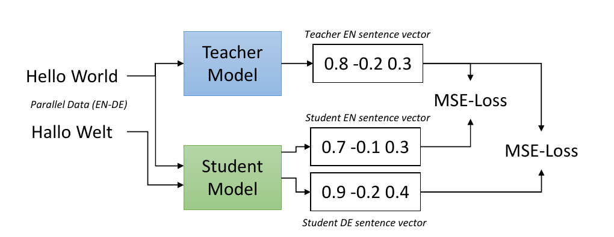
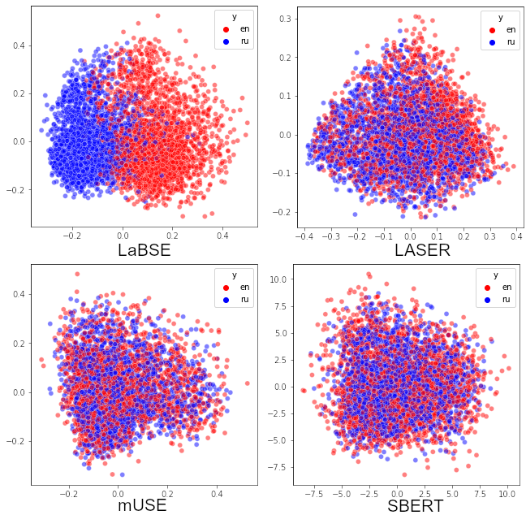

> 原文: [arXiv:2004.09813](https://arxiv.org/abs/2004.09813)（v2，2020-10-05）/ [EMNLP 2020](https://aclanthology.org/2020.emnlp-main.365/)
> 说明: 中英对照供阅读。英文为论文原文（PDF 转写，公式按论文整理）；中文为对应翻译。图表编号与原文一致。caption 保留英文并附中译。数值原样，未改动。

**预印本：** arXiv:2004.09813v2 [cs.CL]，2020 年 10 月 5 日。正式发表于 EMNLP 2020。

**代码、模型与数据集：** https://github.com/UKPLab/sentence-transformers

---

# Making Monolingual Sentence Embeddings Multilingual using Knowledge Distillation

# 用知识蒸馏把单语句向量变成多语

**Authors / 作者：** Nils Reimers, Iryna Gurevych

**Affiliation / 单位：** Ubiquitous Knowledge Processing Lab (UKP-TUDA), Department of Computer Science, Technische Universität Darmstadt / 达姆施塔特工业大学计算机系，泛在知识处理实验室。www.ukp.tu-darmstadt.de

---

## Abstract / 摘要

**EN.** We present an easy and efficient method to extend existing sentence embedding models to new languages. This allows to create multilingual versions from previously monolingual models. The training is based on the idea that a translated sentence should be mapped to the same location in the vector space as the original sentence. We use the original (monolingual) model to generate sentence embeddings for the source language and then train a new system on translated sentences to mimic the original model. Compared to other methods for training multilingual sentence embeddings, this approach has several advantages: It is easy to extend existing models with relatively few samples to new languages, it is easier to ensure desired properties for the vector space, and the hardware requirements for training are lower. We demonstrate the effectiveness of our approach for 50+ languages from various language families. Code to extend sentence embeddings models to more than 400 languages is publicly available.1

**中.** 本文给出一个简单高效的方法，把已有的句向量模型扩展到新语言，从而由原先的单语模型造出多语版本。训练基于这样一个想法：一句话的译文应当被映射到向量空间里与原句相同的位置。我们用原始的（单语）模型为源语言生成句向量，然后在译句上训练一个新系统去模仿原模型。相比其他训练多语句向量的方法，这个做法有几个好处：用相对少的样本就容易把已有模型扩到新语言；更容易保证向量空间具备所需性质；训练的硬件需求更低。我们在来自多个语系的 50+ 语言上验证了方法的有效性。把句向量模型扩展到 400 多种语言的代码已公开。1

1 Code, models, and datasets: https://github.com/UKPLab/sentence-transformers / 代码、模型与数据集见上述地址。

---

## 1 Introduction / 引言

**EN.** Mapping sentences or short text paragraphs to a dense vector space, such that similar sentences are close, has wide applications in NLP. However, most existing sentence embeddings models are monolingual, usually only for English, as applicable training data for other languages is scarce. For multi- and cross-lingual scenarios, only few sentence embeddings models exist.

**中.** 把句子或短文本段落映射到稠密向量空间、让相似句子彼此靠近，在 NLP 里用途很广。然而现有的句向量模型多数是单语的，通常只有英文，因为其他语言可用的训练数据稀缺。面向多语和跨语场景的句向量模型很少。

**EN.** In this publication, we present a new method that allows us to extend existing sentence embeddings models to new languages. We require a teacher model $M$ for source language $s$ and a set of parallel (translated) sentences $((s_1, t_1), ..., (s_n, t_n))$ with $t_i$ the translation of $s_i$. Note, the $t_i$ can be in different languages. We train a new student model $\hat{M}$ such that $\hat{M}(s_i) \approx M(s_i)$ and $\hat{M}(t_i) \approx M(s_i)$ using mean squared loss. We call this approach multilingual knowledge distillation, as the student $\hat{M}$ distills the knowledge of the teacher $M$ in a multilingual setup. We demonstrate that this type of training works for various language combinations as well as for multilingual setups. We observe an especially high improvement of up to 40 accuracy points for low resource languages compared to LASER (Artetxe and Schwenk, 2019b).

**中.** 本文提出一个新方法，可以把已有句向量模型扩展到新语言。我们需要一个面向源语言 $s$ 的教师模型 $M$，以及一组平行（翻译）句对 $((s_1, t_1), ..., (s_n, t_n))$，其中 $t_i$ 是 $s_i$ 的译文。注意，$t_i$ 可以属于不同语言。我们用均方损失训练一个新的学生模型 $\hat{M}$，使 $\hat{M}(s_i) \approx M(s_i)$ 且 $\hat{M}(t_i) \approx M(s_i)$。我们把这个做法叫做**多语知识蒸馏**，因为学生 $\hat{M}$ 在多语设定下蒸馏教师 $M$ 的知识。我们证明这种训练对各种语言组合以及多语设定都有效。相比 LASER（Artetxe and Schwenk, 2019b），在低资源语言上我们观察到最多约 40 个准确率点的显著提升。

**EN.** The student model $\hat{M}$ learns a multilingual sentence embedding space with two important properties: 1) Vector spaces are aligned across languages, i.e., identical sentences in different languages are close, 2) vector space properties in the original source language from the teacher model $M$ are adopted and transferred to other languages.

**中.** 学生模型 $\hat{M}$ 学到的多语句向量空间有两个重要性质：1）跨语言的向量空间是对齐的，也就是不同语言里相同的句子彼此靠近；2）教师模型 $M$ 在原始源语言上的向量空间性质被继承下来，并转移到其他语言。

**EN.** The presented approach has various advantages compared to other training approaches for multilingual sentence embeddings. LASER (Artetxe and Schwenk, 2019b) trains an encoder-decoder LSTM model using a translation task. The output of the encoder is used as sentence embedding. While LASER works well for identifying exact translations in different languages, it works less well for assessing the similarity of sentences that are not exact translations.

**中.** 相比其他训练多语句向量的方法，本文方法有多项优势。LASER（Artetxe and Schwenk, 2019b）用翻译任务训练一个编码器-解码器 LSTM 模型，拿编码器的输出当句向量。LASER 擅长识别不同语言之间的精确译文，但在评估「并非精确译文」的句子之间的相似度时表现较差。

**EN.** Multilingual Universal Sentence Encoder (mUSE) (Chidambaram et al., 2019; Yang et al., 2019) was trained in a multi-task setup on SNLI (Bowman et al., 2015) and on over a billion question-answer pairs from popular online forums and QA websites. In order to align the cross-lingual vector spaces, mUSE used a translation ranking task. Given a translation pair $(s_i, t_i)$ and various alternative (incorrect) translations, identify the correct translation. First, multi-task learning is difficult since it can suffer from catastrophic forgetting and balancing multiple tasks is not straight-forward. Further, running the translation ranking task is complex and results in a huge computational overhead. Selecting random alternative translations usually leads to mediocre results. Instead, hard negatives (Guo et al., 2018) are required, i.e., alternative incorrect translations that have a high similarity to the correct translation. To get these hard negatives, mUSE was first trained with random negatives samples, then, this preliminary sentence encoder was used to identify hard negative examples. They then re-trained the network.

**中.** 多语通用句编码器（mUSE）（Chidambaram et al., 2019; Yang et al., 2019）在 SNLI（Bowman et al., 2015）和来自热门网络论坛与问答网站的十亿多个问答对上做多任务训练。为了对齐跨语向量空间，mUSE 用了一个翻译排序任务：给定一个翻译对 $(s_i, t_i)$ 和若干候选的（错误）译文，识别出正确的译文。首先，多任务学习本身就难，因为可能发生灾难性遗忘，而且平衡多个任务并不直观。其次，运行翻译排序任务很复杂，带来巨大的计算开销。随机挑选候选译文通常只能得到平庸的结果；必须用难负例（Guo et al., 2018），也就是与正确译文高度相似、但其实不对的候选译文。为了得到这些难负例，mUSE 先用随机负例训练一遍，再用这个初步的句编码器去找出难负例，然后重新训练网络。

**EN.** In this work, we use Sentence-BERT (SBERT) (Reimers and Gurevych, 2019), which achieves state-of-the-art performance for various sentence embeddings task. SBERT is based on transformer models like BERT (Devlin et al., 2018) and applies mean pooling on the output. In our experiments we use XLM-R (Conneau et al., 2019), a pre-trained network on 100 languages, as student model. Note, the described approach is not limited to be used with transformer models and should also work with other network architectures.

**中.** 本文使用 Sentence-BERT（SBERT）（Reimers and Gurevych, 2019），它在多项句向量任务上达到当时最优。SBERT 基于 BERT（Devlin et al., 2018）这类 Transformer 模型，在输出上做均值池化。实验里我们用 XLM-R（Conneau et al., 2019）作学生模型，它是在 100 种语言上预训练的网络。注意，所述方法并不限于 Transformer 模型，对其他网络架构也应当适用。

**图 1 / Figure 1.** Given parallel data (e.g. English and German), train the student model such that the produced vectors for the English and German sentences are close to the teacher English sentence vector. / 给定平行数据（例如英语和德语），训练学生模型，使它为英语句和德语句产生的向量都靠近教师的英语句向量。

---

## 2 Training / 训练

**EN.** We require a teacher model $M$, that maps sentences in one or more source languages $s$ to a dense vector space. Further, we need parallel (translated) sentences $((s_1, t_1), ..., (s_n, t_n))$ with $s_i$ a sentence in one of the source languages and $t_i$ a sentence in one of the target languages.

**中.** 我们需要一个教师模型 $M$，它把一种或多种源语言 $s$ 的句子映射到稠密向量空间。此外还需要平行（翻译）句对 $((s_1, t_1), ..., (s_n, t_n))$，其中 $s_i$ 是某种源语言的句子，$t_i$ 是某种目标语言的句子。

**EN.** We train a student model $\hat{M}$ such that $\hat{M}(s_i) \approx M(s_i)$ and $\hat{M}(t_i) \approx M(s_i)$. For a given mini-batch $\mathcal{B}$, we minimize the mean-squared loss:

**中.** 我们训练学生模型 $\hat{M}$，使 $\hat{M}(s_i) \approx M(s_i)$ 且 $\hat{M}(t_i) \approx M(s_i)$。对给定的小批量 $\mathcal{B}$，最小化均方损失：

$$
\frac{1}{\lvert\mathcal{B}\rvert}\sum_{j\in\mathcal{B}}\Big[\big(M(s_j) - \hat{M}(s_j)\big)^2 + \big(M(s_j) - \hat{M}(t_j)\big)^2\Big]
$$

**EN.** $\hat{M}$ could have the structure and the weights of $M$, or it can be a different network architecture. This training procedure is illustrated in Figure 1. We denote trained models with $\hat{M} \leftarrow M$, as the student model $\hat{M}$ learns the representation of the teacher model $M$.

**中.** $\hat{M}$ 可以采用 $M$ 的结构和权重，也可以是另一种网络架构。训练过程见图 1。我们把训好的模型记作 $\hat{M} \leftarrow M$，表示学生模型 $\hat{M}$ 学习教师模型 $M$ 的表示。

**EN.** In our experiments, we mainly use an English SBERT model as teacher model $M$ and use XLM-RoBERTa (XLM-R) as student model $\hat{M}$. The English BERT models have a wordpiece vocabulary size of 30k mainly consisting of English tokens. Using the English SBERT model as initialization for $\hat{M}$ would be suboptimal, as most words in other latin-based languages would be broken down to short character sequences, and words in non-latin alphabets would be mapped to the UNK token. In contrast, XLM-R uses SentencePiece2, which avoids language specific pre-processing. Further, it uses a vocabulary with 250k entries from 100 different languages. This makes XLM-R much more suitable for the initialization of the multilingual student model.

**中.** 实验中我们主要用英文 SBERT 模型作教师 $M$，用 XLM-RoBERTa（XLM-R）作学生 $\hat{M}$。英文 BERT 模型的 wordpiece 词表只有 3 万，主要由英文 token 构成。拿英文 SBERT 模型来初始化 $\hat{M}$ 并不理想：其他拉丁语系语言里的多数词会被切成很短的字符序列，而非拉丁字母的词会被映射到 UNK token。相比之下，XLM-R 使用 SentencePiece2，避免了与语言相关的预处理；而且它的词表有 25 万条，来自 100 种不同语言。这使 XLM-R 更适合用来初始化多语学生模型。

2 https://github.com/google/sentencepiece

---

## 3 Training Data / 训练数据

**EN.** In this section, we evaluate the importance of training data for making the sentence embedding model multilingual. The OPUS website3 (Tiedemann, 2012) provides parallel data for hundreds of language pairs. In our experiments, we use the following datasets:

**中.** 本节评估训练数据对「把句向量模型做成多语」这件事有多重要。OPUS 网站3（Tiedemann, 2012）提供数百个语言对的平行数据。实验中我们使用以下数据集：

3 http://opus.nlpl.eu/

**EN.**
- **GlobalVoices:** A parallel corpus of news stories from the web site Global Voices.
- **TED2020:** We crawled the translated subtitles for about 4,000 TED talks, available in over 100 languages. This dataset is available in our repository.
- **NewsCommentary:** Political and economic commentary crawled from the web site Project Syndicate, provided by WMT.
- **WikiMatrix:** Mined parallel sentences from Wikipedia in different languages (Schwenk et al., 2019). We only used pairs with scores above 1.05, as pairs below this threshold were often of bad quality.
- **Tatoeba:** Tatoeba4 is a large database of example sentences and translations to support language learning.
- **Europarl:** Parallel sentences extracted from the European Parliament website (Koehn, 2005).
- **JW300:** Mined, parallel sentences from the magazines Awake! and Watchtower (Agić and Vulić, 2019).
- **OpenSubtitles2018:** Translated movie subtitles from opensubtitles.org (Lison and Tiedemann, 2016).
- **UNPC:** Manually translated United Nations documents from 1994 - 2014 (Ziemski et al., 2016).

**中.**
- **GlobalVoices：** 来自 Global Voices 网站的新闻报道平行语料。
- **TED2020：** 我们爬取了约 4,000 场 TED 演讲的翻译字幕，覆盖 100 多种语言。该数据集在我们的仓库中提供。
- **NewsCommentary：** 从 Project Syndicate 网站爬取的政治与经济评论，由 WMT 提供。
- **WikiMatrix：** 从不同语言的 Wikipedia 中挖掘的平行句（Schwenk et al., 2019）。我们只用打分高于 1.05 的句对，因为低于这个阈值的句对质量常常很差。
- **Tatoeba：** Tatoeba4 是一个大型例句与翻译数据库，用于支持语言学习。
- **Europarl：** 从欧洲议会网站抽取的平行句（Koehn, 2005）。
- **JW300：** 从《Awake!》和《Watchtower》杂志挖掘的平行句（Agić and Vulić, 2019）。
- **OpenSubtitles2018：** 来自 opensubtitles.org 的电影字幕翻译（Lison and Tiedemann, 2016）。
- **UNPC：** 1994–2014 年人工翻译的联合国文件（Ziemski et al., 2016）。

4 https://tatoeba.org/

**EN.** Getting parallel sentence data can be challenging for some low-resource language pairs. Hence, we also experiment with bilingual dictionaries:

**中.** 对一些低资源语言对来说，获取平行句数据会很困难。因此我们也试验了双语词典：

**EN.**
- **MUSE:** MUSE5 provides 110 large-scale ground-truth bilingual dictionaries created by an internal translation tool (Conneau et al., 2017b).
- **Wikititles:** We use the Wikipedia database dumps to extract the article titles from cross-language links between Wikipedia articles. For example, the page "United States" links to the German page "Vereinigte Staaten". This gives a dictionary covering a wide range of topics.

**中.**
- **MUSE：** MUSE5 提供 110 部大规模真值双语词典，由一个内部翻译工具生成（Conneau et al., 2017b）。
- **Wikititles：** 我们用 Wikipedia 数据库转储，从 Wikipedia 条目之间的跨语言链接中抽取条目标题。例如页面 "United States" 链接到德语页面 "Vereinigte Staaten"。这给出一部覆盖广泛主题的词典。

5 https://github.com/facebookresearch/MUSE

**EN.** The data set sizes for English-German (EN-DE) and English-Arabic (EN-AR) are depicted in Table 5. For training, we balance the data set sizes by drawing for a mini batch roughly the same number of samples from each data set. Data from smaller data sets is repeated.

**中.** 英语-德语（EN-DE）和英语-阿拉伯语（EN-AR）各数据集的规模见表 5。训练时我们平衡各数据集的规模：为一个小批量从每个数据集抽取大致相同数量的样本。较小数据集中的数据会被重复使用。

**EN.** We trained XLM-R as our student model and used SBERT fine-tuned on English NLI and STS data6 as our teacher model. We trained for a maximum of 20 epochs with batch size 64, 10,000 warm-up steps, and a learning rate of 2e-5. As development set, we measured the MSE loss on hold-out parallel sentences.

**中.** 我们以 XLM-R 为学生模型，以在英文 NLI 和 STS 数据上微调过的 SBERT6 为教师模型。训练最多 20 个 epoch，批大小 64，10,000 步 warm-up，学习率 2e-5。开发集上我们测量留出平行句的 MSE 损失。

6 bert-base-nli-stsb-mean-tokens model from our repository / 来自我们仓库的 bert-base-nli-stsb-mean-tokens 模型。

**EN.** In (Reimers and Gurevych, 2017, 2018), we showed that the random seed can have a large impact on the performances of trained models, especially for small datasets. In the following experiments, we have quite large datasets of up to several million parallel sentences and we observed rather minor differences ($\sim 0.3$ score points) between random seeds.

**中.** 在（Reimers and Gurevych, 2017, 2018）中我们表明，随机种子会对训练所得模型的表现产生很大影响，对小数据集尤其如此。在后续实验里，我们的数据集相当大，最多达几百万平行句，我们观察到不同随机种子之间的差异相当小（约 0.3 分）。

---

## 4 Experiments / 实验

**EN.** In this section, we conduct experiments on three tasks: Multi- and cross-lingual semantic textual similarity (STS), bitext retrieval, and cross-lingual similarity search. STS assigns a score for a pair of sentences, while bitext retrieval identifies parallel (translated) sentences from two large monolingual corpora.

**中.** 本节在三个任务上做实验：多语与跨语语义文本相似度（STS）、bitext 检索、跨语相似性检索。STS 为一对句子给出一个分数，而 bitext 检索则从两个不同语言的大型单语语料中识别出平行（互译）句对。

**EN.** Note, evaluating the capability of different strategies to align vector spaces across languages is non-trivial. The performance for cross-lingual tasks depends on the ability to map sentences across languages to one vector space (usually the vector space for English) as well as on the properties this source vector space has. Differences in performance can then be due to a better or worse alignment between the languages or due to different properties of the (source) vector space.

**中.** 注意，评估不同策略跨语言对齐向量空间的能力并不容易。跨语任务上的表现既取决于把不同语言的句子映射到同一个向量空间（通常是英语的向量空间）的能力，也取决于这个源向量空间本身具备什么性质。因此表现上的差异，可能来自语言之间对齐得更好或更差，也可能来自（源）向量空间性质的不同。

**EN.** We evaluate the following systems:

**中.** 我们评估以下系统：

**EN.** **SBERT-nli-stsb:** The output of the BERT-base model is combined with mean pooling to create a fixed-sized sentence representation (Reimers and Gurevych, 2019). It was fine-tuned on the English AllNLI (SNLI (Bowman et al., 2015) and MultiNLI (Williams et al., 2018)) dataset and on the English training set of the STS benchmark (Cer et al., 2017) using a siamese network structure.

**中.** **SBERT-nli-stsb：** 把 BERT-base 模型的输出与均值池化结合，得到固定长度的句子表示（Reimers and Gurevych, 2019）。它用孪生网络结构，在英文 AllNLI（SNLI（Bowman et al., 2015）与 MultiNLI（Williams et al., 2018））数据集以及 STS benchmark（Cer et al., 2017）的英文训练集上微调。

**EN.** **mBERT / XLM-R mean:** Mean pooling of the outputs for the pre-trained multilingual BERT (mBERT) and XLM-R model. These models are pre-trained on multilingual data and have a multilingual vocabulary. However, no parallel data was used.

**中.** **mBERT / XLM-R mean：** 对预训练的多语 BERT（mBERT）和 XLM-R 模型的输出做均值池化。这些模型在多语数据上预训练，有多语词表，但没有用到任何平行数据。

**EN.** **mBERT- / XLM-R-nli-stsb:** We fine-tuned XLM-R and mBERT on the (English) AllNLI and the (English) training set of the STS benchmark.

**中.** **mBERT- / XLM-R-nli-stsb：** 我们在（英文）AllNLI 和 STS benchmark 的（英文）训练集上微调 XLM-R 和 mBERT。

**EN.** **LASER:** LASER (Artetxe and Schwenk, 2019b) uses max-pooling over the output of a stacked LSTM-encoder. The encoder was trained in an encoder-decoder setup (machine translation setup) on parallel corpora over 93 languages.

**中.** **LASER：** LASER（Artetxe and Schwenk, 2019b）对堆叠 LSTM 编码器的输出做最大池化。该编码器在编码器-解码器设定（机器翻译设定）下，在覆盖 93 种语言的平行语料上训练。

**EN.** **mUSE:** Multilingual Universal Sentence Encoder (Chidambaram et al., 2019) uses a dual-encoder transformer architecture and was trained on mined question-answer pairs, SNLI data, translated SNLI data, and parallel corpora over 16 languages.

**中.** **mUSE：** 多语通用句编码器（Chidambaram et al., 2019）采用双编码器 Transformer 架构，在挖掘得到的问答对、SNLI 数据、翻译后的 SNLI 数据以及覆盖 16 种语言的平行语料上训练。

**EN.** **LaBSE:** Language-agnostic BERT Sentence Embedding (LaBSE) (Feng et al., 2020) was trained similar to mUSE with a dual-encoder transformer architecture based on BERT with 6 Billion translation pairs for 109 languages.

**中.** **LaBSE：** 语言无关的 BERT 句向量（LaBSE）（Feng et al., 2020）训练方式与 mUSE 类似，采用基于 BERT 的双编码器 Transformer 架构，用 60 亿翻译对覆盖 109 种语言。

**EN.** **mBERT- / DistilmBERT- / XLM-R ← SBERT-nli-stsb:** We learn mBERT, DistilmBERT, and XLM-R to imitate the output of the English SBERT-nli-stsb model.

**中.** **mBERT- / DistilmBERT- / XLM-R ← SBERT-nli-stsb：** 我们让 mBERT、DistilmBERT 和 XLM-R 学习模仿英文 SBERT-nli-stsb 模型的输出。

**EN.** **XLM-R ← SBERT-paraphrases:** We train XLM-R to imitate SBERT-paraphrases, a RoBERTa model trained on more than 50 Million English paraphrase pairs.

**中.** **XLM-R ← SBERT-paraphrases：** 我们训练 XLM-R 去模仿 SBERT-paraphrases——一个在 5000 万以上英文改写对上训练的 RoBERTa 模型。

**EN.** For our multi-lingual knowledge distillation experiments, we trained a single model with parallel data for 50 languages7.

**中.** 在多语知识蒸馏实验中，我们用覆盖 50 种语言的平行数据训练了一个单一模型7。

7 ar, bg, ca, cs, da, de, el, es, et, fa, fi, fr, fr-ca, gl, gu, he, hi, hr, hu, hy, id, it, ja, ka, ko, ku, lt, lv, mk, mn, mr, ms, my, nb, nl, pl, pt, pt, pt-br, ro, ru, sk, sl, sq, sr, sv, th, tr, uk, ur, vi, zh-cn, zh-tw / 语言代码原样照录（论文脚注内 pt 出现两次）。

### 4.1 Multilingual Semantic Textual Similarity / 多语语义文本相似度

**EN.** The goal of semantic textual similarity (STS) is to assign for a pair of sentences a score indicating their semantic similarity. For example, a score of 0 indicates not related and 5 indicates semantically equivalent.

**中.** 语义文本相似度（STS）的目标是给一对句子打一个分数，表示它们的语义相似程度。例如 0 分表示无关，5 分表示语义等价。

**EN.** The multilingual STS 2017 dataset (Cer et al., 2017) contains annotated pairs for EN-EN, AR-AR, ES-ES, EN-AR, EN-ES, EN-TR. We extend this dataset by translating one sentence of each pair in the EN-EN dataset to German. Further, we use Google Translate to create the datasets EN-FR, EN-IT, and EN-NL. Samples of these machine translated versions have been checked by humans fluent in that language.

**中.** 多语 STS 2017 数据集（Cer et al., 2017）包含 EN-EN、AR-AR、ES-ES、EN-AR、EN-ES、EN-TR 的标注句对。我们扩展了这个数据集：把 EN-EN 数据集中每一对的其中一句翻译成德语。此外，我们用 Google Translate 构造了 EN-FR、EN-IT 和 EN-NL 数据集。这些机器翻译版本的样本已由该语言的流利使用者检查过。

**EN.** For the generate sentence embeddings we compute cosine similarity and, as recommended in (Reimers et al., 2016), compute the Spearman's rank correlation $\rho$ between the computed score and the gold score.

**中.** 对生成的句向量我们计算余弦相似度，并按（Reimers et al., 2016）的建议，计算所算分数与金标分数之间的斯皮尔曼秩相关 $\rho$。

**EN.** Table 1 shows the results for the monolingual setup and Table 2 the cross-lingual setup.

**中.** 表 1 给出单语设定的结果，表 2 给出跨语设定的结果。

**表 1 / Table 1.** Spearman rank correlation $\rho$ between the cosine similarity of sentence representations and the gold labels for STS 2017 dataset. Performance is reported by convention as $\rho \times 100$. / 在 STS 2017 数据集上，句子表示的余弦相似度与金标标签之间的斯皮尔曼秩相关 $\rho$。按惯例以 $\rho \times 100$ 报告。

| Model | EN-EN | ES-ES | AR-AR | Avg. |
| --- | ---: | ---: | ---: | ---: |
| mBERT mean | 54.4 | 56.7 | 50.9 | 54.0 |
| XLM-R mean | 50.7 | 51.8 | 25.7 | 42.7 |
| mBERT-nli-stsb | 80.2 | 83.9 | 65.3 | 76.5 |
| XLM-R-nli-stsb | 78.2 | 83.1 | 64.4 | 75.3 |
| *Knowledge Distillation / 知识蒸馏* | | | | |
| mBERT ← SBERT-nli-stsb | 82.5 | 83.0 | 78.8 | 81.4 |
| DistilmBERT ← SBERT-nli-stsb | 82.1 | 84.0 | 77.7 | 81.2 |
| XLM-R ← SBERT-nli-stsb | 82.5 | 83.5 | 79.9 | 82.0 |
| XLM-R ← SBERT-paraphrases | 88.8 | 86.3 | 79.6 | 84.6 |
| *Other Systems / 其他系统* | | | | |
| LASER | 77.6 | 79.7 | 68.9 | 75.4 |
| mUSE | 86.4 | 86.9 | 76.4 | 83.2 |
| LaBSE | 79.4 | 80.8 | 69.1 | 76.4 |

**表 2 / Table 2.** Spearman rank correlation $\rho$ between the cosine similarity of sentence representations and the gold labels for STS 2017 dataset. Performance is reported by convention as $\rho \times 100$. / 同表 1 口径，跨语子集。

| Model | EN-AR | EN-DE | EN-TR | EN-ES | EN-FR | EN-IT | EN-NL | Avg. |
| --- | ---: | ---: | ---: | ---: | ---: | ---: | ---: | ---: |
| mBERT mean | 16.7 | 33.9 | 16.0 | 21.5 | 33.0 | 34.0 | 35.6 | 27.2 |
| XLM-R mean | 17.4 | 21.3 | 9.2 | 10.9 | 16.6 | 22.9 | 26.0 | 17.8 |
| mBERT-nli-stsb | 30.9 | 62.2 | 23.9 | 45.4 | 57.8 | 54.3 | 54.1 | 46.9 |
| XLM-R-nli-stsb | 44.0 | 59.5 | 42.4 | 54.7 | 63.4 | 59.4 | 66.0 | 55.6 |
| *Knowledge Distillation / 知识蒸馏* | | | | | | | | |
| mBERT ← SBERT-nli-stsb | 77.2 | 78.9 | 73.2 | 79.2 | 78.8 | 78.9 | 77.3 | 77.6 |
| DistilmBERT ← SBERT-nli-stsb | 76.1 | 77.7 | 71.8 | 77.6 | 77.4 | 76.5 | 74.7 | 76.0 |
| XLM-R ← SBERT-nli-stsb | 77.8 | 78.9 | 74.0 | 79.7 | 78.5 | 78.9 | 77.7 | 77.9 |
| XLM-R ← SBERT-paraphrases | 82.3 | 84.0 | 80.9 | 83.1 | 84.9 | 86.3 | 84.5 | 83.7 |
| *Other Systems / 其他系统* | | | | | | | | |
| LASER | 66.5 | 64.2 | 72.0 | 57.9 | 69.1 | 70.8 | 68.5 | 67.0 |
| mUSE | 79.3 | 82.1 | 75.5 | 79.6 | 82.6 | 84.5 | 84.1 | 81.1 |
| LaBSE | 74.5 | 73.8 | 72.0 | 65.5 | 77.0 | 76.9 | 75.1 | 73.5 |

**EN.** As shown before (Reimers and Gurevych, 2019), using mBERT / XLM-R without fine-tuning yields rather poor performance. Training on English NLI & STS data (mBERT/XLM-nli-stsb) significantly improves the performance also for the other languages. While in the monolingual setup (Table 1) the performance is quite competitive, we observe a significant drop for the cross-lingual setup (Table 2). This indicates that the vectors spaces are not well aligned across languages.

**中.** 如先前所示（Reimers and Gurevych, 2019），不经微调直接使用 mBERT / XLM-R 的表现相当差。在英文 NLI 与 STS 数据上训练（mBERT/XLM-nli-stsb）也显著提升了其他语言上的表现。在单语设定（表 1）下表现相当有竞争力，但在跨语设定（表 2）下我们观察到明显下降。这说明各语言之间的向量空间没有很好地对齐。

**EN.** Using our multilingual knowledge distillation approach, we observe state-of-the-art performances for mono- as well as for the cross-lingual setup, significantly outperforming other state-of-the-art models (LASER, mUSE, LaBSE). Even though SBERT-nli-stsb was trained on the STSbenchmark train set, we observe the best performance by SBERT-paraphrase, which was not trained with any STS dataset. Instead, it was trained on a large and broad paraphrase corpus, mainly derived from Wikipedia, which generalizes well to various topics.

**中.** 使用我们的多语知识蒸馏方法，在单语与跨语设定下都观察到当时最优的表现，显著超过其他最优模型（LASER、mUSE、LaBSE）。尽管 SBERT-nli-stsb 是在 STS benchmark 训练集上训练的，我们观察到表现最好的却是 SBERT-paraphrase——它没有用任何 STS 数据集训练，而是在一个大而宽泛的改写语料（主要来自 Wikipedia）上训练，对各种主题泛化良好。

**EN.** In our experiments, XLM-R is slightly ahead of mBERT and DistilmBERT. mBERT and DistilmBERT use different language-specific tokenization tools, making those models more difficult to be used on raw text. In contrast, XLM-R uses a SentencePiece model that can be applied directly on raw text data for all languages. Hence, in the following experiments we only report results for XLM-R.

**中.** 在我们的实验中，XLM-R 略领先于 mBERT 和 DistilmBERT。mBERT 和 DistilmBERT 使用不同的、与语言相关的分词工具，使这些模型更难直接用于原始文本。相比之下，XLM-R 使用 SentencePiece 模型，可以对所有语言直接用在原始文本数据上。因此在后续实验中我们只报告 XLM-R 的结果。

### 4.2 BUCC: Bitext Retrieval / BUCC：bitext 检索

**EN.** Bitext retrieval aims to identify sentence pairs that are translations in two corpora in different languages. Guo et al. (2018) showed that computing the cosine similarity of all sentence embeddings and to use nearest neighbor retrieval with a threshold has certain issues.

**中.** bitext 检索的目标是在两个不同语言的语料中识别出互为译文的句对。Guo et al. (2018) 表明，计算所有句向量的余弦相似度、再用带阈值的最近邻检索，存在一些问题。

**EN.** For our experiments, we use the BUCC bitext retrieval code from LASER8 with the scoring function from Artetxe and Schwenk (2019a):

**中.** 实验中我们使用来自 LASER8 的 BUCC bitext 检索代码，配合 Artetxe and Schwenk (2019a) 的打分函数：

$$
\mathrm{score}(x,y) = \mathrm{margin}\left(\cos(x,y),\ \sum_{z \in \mathrm{NN}_k(x)}\frac{\cos(x,z)}{2k} + \sum_{z \in \mathrm{NN}_k(y)}\frac{\cos(y,z)}{2k}\right)
$$

**EN.** with $x, y$ the two sentence embeddings and $\mathrm{NN}_k(x)$ denoting the $k$ nearest neighbors of $x$ in the other language9. As margin function, we use $\mathrm{margin}(a,b) = a/b$.

**中.** 其中 $x$、$y$ 是两个句向量，$\mathrm{NN}_k(x)$ 表示 $x$ 在另一语言中的 $k$ 个最近邻9。margin 函数取 $\mathrm{margin}(a,b) = a/b$。

8 https://github.com/facebookresearch/LASER/
9 retrieved using faiss: https://github.com/facebookresearch/faiss / 用 faiss 检索。

**EN.** We use the dataset from the BUCC mining task (Zweigenbaum et al., 2017, 2018), with the goal of extracting parallel sentences between an English corpus and four other languages: German, French, Russian, and Chinese. The corpora consist of 150K - 1.2M sentences for each language with about 2-3% of the sentences being parallel. The data is split into training and test sets. The training set is used to find a threshold for the score function. Pairs above the threshold are returned as parallel sentences. Performance is measured using F1 score.

**中.** 我们使用 BUCC 挖掘任务（Zweigenbaum et al., 2017, 2018）的数据集，目标是在一个英文语料与另外四种语言（德语、法语、俄语、中文）之间抽取平行句。各语言语料包含 15 万到 120 万句，其中约 2–3% 的句子是平行的。数据切分为训练集和测试集。训练集用来为打分函数确定阈值，超过阈值的句对被返回为平行句。表现用 F1 分数衡量。

**EN.** Results are shown in Table 3. Using mean pooling directly on mBERT / XLM-R produces low scores. While training on English NLI and STS data improves the performance for XLM-R (XLM-R-nli-stsb), it reduces the performance for mBERT. It is unclear why mBERT mean and XLM-R mean produce vastly different scores and why training on NLI data improves the cross-lingual performance for XLM-R, while reducing the performance for mBERT. As before, we observe that mBERT / XLM-R do not have well aligned vector spaces and training only on English data is not sufficient.

**中.** 结果见表 3。直接对 mBERT / XLM-R 做均值池化得到的分数很低。在英文 NLI 和 STS 数据上训练提升了 XLM-R 的表现（XLM-R-nli-stsb），但降低了 mBERT 的表现。我们不清楚为什么 mBERT mean 和 XLM-R mean 的分数差别如此之大，也不清楚为什么在 NLI 数据上训练会提升 XLM-R 的跨语表现、却降低 mBERT 的表现。和前面一样，我们观察到 mBERT / XLM-R 的向量空间没有良好对齐，只在英文数据上训练并不够。

**EN.** Using our multilingual knowledge distillation method, we were able to significantly improve the performance compared to the mBERT / XLM-R model trained only on English data.

**中.** 使用我们的多语知识蒸馏方法，相比只在英文数据上训练的 mBERT / XLM-R 模型，表现得到了显著提升。

**表 3 / Table 3.** F1 score on the BUCC bitext mining task. / BUCC bitext 挖掘任务上的 F1 分数。

| Model | DE-EN | FR-EN | RU-EN | ZH-EN | Avg. |
| --- | ---: | ---: | ---: | ---: | ---: |
| mBERT mean | 44.1 | 47.2 | 38.0 | 37.4 | 41.7 |
| XLM-R mean | 5.2 | 6.6 | 22.1 | 12.4 | 11.6 |
| mBERT-nli-stsb | 38.9 | 39.5 | 26.4 | 30.2 | 33.7 |
| XLM-R-nli-stsb | 44.0 | 51.0 | 51.5 | 44.0 | 47.6 |
| *Knowledge Distillation / 知识蒸馏* | | | | | |
| XLM-R ← SBERT-nli-stsb | 86.8 | 84.4 | 86.3 | 85.1 | 85.7 |
| XLM-R ← SBERT-paraphrase | 90.8 | 87.1 | 88.6 | 87.8 | 88.6 |
| *Other systems / 其他系统* | | | | | |
| mUSE | 88.5 | 86.3 | 89.1 | 86.9 | 87.7 |
| LASER | 95.4 | 92.4 | 92.3 | 91.7 | 93.0 |
| LaBSE | 95.9 | 92.5 | 92.4 | 93.0 | 93.5 |

**EN.** While LASER and LaBSE only achieve mediocre results on the STS 2017 dataset, they achieve state-of-the-art performances on BUCC outperforming mUSE and our approach. LASER and LaBSE were specifically designed to identify perfect translations across languages. However, as the STS 2017 results show, these models have issues assigning meaningful similarity scores for sentence pairs that don't have identical meaning.

**中.** 虽然 LASER 和 LaBSE 在 STS 2017 数据集上只取得中等结果，它们在 BUCC 上达到当时最优，超过 mUSE 和我们的方法。LASER 和 LaBSE 是专门为识别跨语言的完美译文而设计的。然而正如 STS 2017 的结果所示，这些模型在为「含义并不相同」的句对给出有意义的相似度分数时存在问题。

**EN.** In contrast, mUSE and our approach creates vector spaces such that semantically similar sentences are close. However, sentences with similar meanings must not be translations of each other. For example, in the BUCC setup, the following pair is not labeled as parallel text:

**中.** 相反，mUSE 和我们的方法构造出的向量空间让语义相似的句子彼此靠近。但是，含义相近的句子不一定互为译文。例如在 BUCC 设定下，下面这一对没有被标为平行文本：

**EN.**
- Olympischen Jugend-Sommerspiele fanden vom 16. bis 28. August 2014 in Nanjing (China) statt. (en: Summer Youth Olympic Games took place from August 16 to 28, 2014 in Nanjing (China))
- China hosted the 2014 Youth Olympic Games.

**中.**
- Olympischen Jugend-Sommerspiele fanden vom 16. bis 28. August 2014 in Nanjing (China) statt.（德语原文；中译：2014 年夏季青年奥林匹克运动会于 8 月 16 日至 28 日在中国南京举行。）
- China hosted the 2014 Youth Olympic Games.（中译：中国主办了 2014 年青年奥林匹克运动会。）

**EN.** Both sentences are semantically similar, hence our model and mUSE assign a high similarity score. But the pair is not a translation, as some details are missing (exact dates and location).

**中.** 两句语义相似，因此我们的模型和 mUSE 都给了很高的相似度分数。但这一对并不是翻译，因为缺了一些细节（确切日期和地点）。

**EN.** These results stress the point that there is no single sentence vector space universally suitable for every application. For finding translation pairs in two corpora, LASER and LaBSE would be the best choice. However, for the task of finding semantically similar sentence pairs, our approach and mUSE would be the better choices.

**中.** 这些结果强调了一点：不存在一个普遍适用于所有应用的句向量空间。要在两个语料中寻找翻译对，LASER 和 LaBSE 是最佳选择；而对于寻找语义相似句对的任务，我们的方法和 mUSE 才是更好的选择。

**EN.** We noticed that several positive pairs are missing in the BUCC dataset. We analyzed for SBERT, mUSE, and LASER 20 false positive DE-EN pairs each, i.e., we analyzed pairs with high similarities according to the embeddings method but which are not translations according to the dataset. For 57 out of 60 pairs, we would judge them as valid, high-quality translations. This issue comes from the way BUCC was constructed: It consists of a parallel part, drawn from the News Commentary dataset, and sentences drawn from Wikipedia, which are judged as non-parallel. However, it is not ensured that the sentences from Wikipedia are in fact non-parallel. The systems successfully returned parallel pairs from the Wikipedia part of the dataset. Results based on the BUCC dataset should be judged with care. It is unclear how many parallel sentences are in the Wikipedia part of the dataset and how this affects the scores.

**中.** 我们注意到 BUCC 数据集里缺了若干正样本对。我们分别为 SBERT、mUSE 和 LASER 各分析了 20 个 DE-EN 假正例，也就是按嵌入方法相似度很高、但按数据集标注不算翻译的句对。60 对中有 57 对，我们会判定为有效的、高质量的译文。这个问题来自 BUCC 的构造方式：它由一个平行部分（取自 News Commentary 数据集）和一些取自 Wikipedia 的句子组成，后者被判为非平行。然而并不能保证来自 Wikipedia 的句子事实上非平行。这些系统成功地从数据集的 Wikipedia 部分返回了平行句对。基于 BUCC 数据集的结果应当谨慎判断。数据集 Wikipedia 部分里到底有多少平行句、这又如何影响分数，都不清楚。

### 4.3 Tatoeba: Similarity Search / Tatoeba：相似性检索

**EN.** In this section, we evaluate the strategy for lower resource languages, where it can be especially challenging to get well-aligned sentence embeddings. For evaluation, we use the Tatoeba test setup from LASER (Artetxe and Schwenk, 2019b): The dataset consists of up to 1,000 English-aligned sentence pairs for various languages. Evaluation is done by finding for all sentences the most similar sentence in the other language using cosine similarity. Accuracy is computed for both directions (English to the other language and back).

**中.** 本节评估该策略在较低资源语言上的效果——在这些语言上得到良好对齐的句向量尤其困难。评测使用来自 LASER（Artetxe and Schwenk, 2019b）的 Tatoeba 测试设定：数据集为各种语言各最多 1,000 对与英文对齐的句对。评测方式是用余弦相似度为所有句子在另一语言中找出最相似的句子，并对两个方向（英语到目标语言以及反向）都计算准确率。

**EN.** As before, we fine-tune XLM-R with SBERT-nli-stsb as teacher model. As training data, we use JW300, which covers over 300 languages. To make our results comparable to LASER, we reduce the training data to the same amount as used by LASER. We selected four languages with rather small parallel datasets: Georgian (KA, 296k parallel sentence pairs), Swahili (SW, 173k), Tagalog (TL, 36k), and Tatar (TT, 119k). Tagalog and Tatar were not part of the 100 languages XLM-R was pre-trained for, i.e., XLM-R has no specific vocabulary and the language model was not tuned for these languages.

**中.** 与前面一样，我们以 SBERT-nli-stsb 为教师模型微调 XLM-R。训练数据使用 JW300，它覆盖 300 多种语言。为使结果与 LASER 可比，我们把训练数据削减到与 LASER 所用相同的数量。我们选了四种平行数据集相当小的语言：格鲁吉亚语（KA，296k 平行句对）、斯瓦希里语（SW，173k）、塔加洛语（TL，36k）和塔塔尔语（TT，119k）。塔加洛语和塔塔尔语不在 XLM-R 预训练的 100 种语言之内，也就是说 XLM-R 没有针对这些语言的专门词表，语言模型也没有为它们调过。

**表 4 / Table 4.** Accuracy on the Tatoeba test set in both directions (en to target language and vice versa). / Tatoeba 测试集上双向的准确率（英语到目标语言，以及反向）。

| Model | KA | SW | TL | TT |
| --- | ---: | ---: | ---: | ---: |
| *LASER* | | | | |
| en → xx | 39.7 | 54.4 | 52.6 | 28.0 |
| xx → en | 32.2 | 60.8 | 48.5 | 34.3 |
| *XLM-R ← SBERT-nli-stsb* | | | | |
| en → xx | 73.1 | 85.4 | 86.2 | 54.5 |
| xx → en | 71.7 | 86.7 | 84.0 | 52.3 |

**EN.** As Table 4 shows, we observe a significant accuracy improvement compared to LASER, indicating much better aligned vector spaces between English and these languages. Even though Tagalog had the smallest dataset with 36k pairs and that XLM-R was not pre-trained for this language, we achieve high accuracy scores of 86.2 and 84.0. We conclude that our strategy also works for low resource languages and can yield a significant improvement. The results for all languages in the Tatoeba test set can be found in the appendix.

**中.** 如表 4 所示，相比 LASER 我们观察到显著的准确率提升，说明英语与这些语言之间的向量空间对齐得好得多。尽管塔加洛语的数据集最小（仅 36k 对），而且 XLM-R 并未针对该语言预训练，我们仍取得 86.2 和 84.0 的高准确率。我们得出结论：该策略对低资源语言同样有效，并能带来显著提升。Tatoeba 测试集中全部语言的结果见附录。

---

## 5 Evaluation of Training Datasets / 训练数据集评估

**EN.** To evaluate the suitability of the different training sets, we trained bilingual XLM-R models for EN-DE and EN-AR on the described training datasets. English and German are fairly similar languages and have a large overlap in their alphabets, while English and Arabic are dissimilar languages with distinct alphabets. We evaluate the performance on the STS 2017 dataset.

**中.** 为评估不同训练集的适用性，我们在上述训练数据集上为 EN-DE 和 EN-AR 分别训练了双语 XLM-R 模型。英语和德语是相当相似的语言，字母表有大量重叠；而英语和阿拉伯语是不相似的语言，字母体系不同。我们在 STS 2017 数据集上评估表现。

**EN.** The results for training on the full datasets are shown in Table 5. Table 6 shows the results for training only on the first $k$ sentences of the TED2020 dataset.

**中.** 在完整数据集上训练的结果见表 5。表 6 给出只用 TED2020 数据集前 $k$ 句训练的结果。

**EN.** First, we observe that the bilingual models are slightly better than the model trained for 10 languages (section 4.1): 2.2 points improvement for EN-DE and 1.2 points improvement for EN-AR. Conneau et al. (2019) calls this curse of multilinguality, where adding more languages to a model can degrade the performance as the capacity of the model remains the same.

**中.** 首先，我们观察到双语模型略好于为 10 种语言训练的模型（第 4.1 节）：EN-DE 提升 2.2 分，EN-AR 提升 1.2 分。Conneau et al. (2019) 称之为**多语之咒**：在模型容量不变的情况下，往模型里加入更多语言会降低表现。（口径提示：第 4.1 节写的是 50 种语言；另外按表 5 与表 2 的原值计算，EN-DE 的差值是 2.5 分。）

**EN.** For EN-DE we observe only minor differences between the datasets. It appears that the domain of the training data (news, subtitles, parliamentary debates, magazines) is of minor importance. Further, only little training data is necessary.

**中.** 对 EN-DE，我们只观察到各数据集之间很小的差异。看起来训练数据的领域（新闻、字幕、议会辩论、杂志）影响不大。而且只需要很少的训练数据。

**EN.** For the dissimilar languages English and Arabic, the results are less conclusive. Table 5 shows that more data does not necessarily lead to better results. With the Tatoeba dataset (only 27,000 parallel sentences), we achieve a score of 76.7, while with the UNPC dataset (over 8 Million sentences), we achieve only a score of 66.1. The domain of the parallel sentences is of higher importance. The results on the reduced TED2020 dataset (Table 6) show that the score improves slower for EN-AR than for EN-DE with more data.

**中.** 对英语与阿拉伯语这对不相似的语言，结论没那么明确。表 5 显示更多数据并不必然带来更好的结果。用 Tatoeba 数据集（只有 27,000 平行句）我们得到 76.7 分，而用 UNPC 数据集（超过 800 万句）只得到 66.1 分。平行句的领域更为重要。削减后的 TED2020 数据集结果（表 6）显示，随着数据增加，EN-AR 的分数提升比 EN-DE 慢。

**表 5 / Table 5.** Data set sizes for the EN-DE / EN-AR sections. Performance (Spearman rank correlation) of XLM-R ← SBERT-nli-stsb on the STS 2017 dataset. / EN-DE / EN-AR 部分的数据集规模，以及 XLM-R ← SBERT-nli-stsb 在 STS 2017 数据集上的表现（斯皮尔曼秩相关）。

| Dataset | #DE | EN-DE | #AR | EN-AR |
| --- | ---: | ---: | ---: | ---: |
| XLM-R mean | | 21.3 | | 17.4 |
| XLM-R-nli-stsb | | 59.5 | | 44.0 |
| MUSE Dict | 101k | 75.8 | 27k | 68.8 |
| Wikititles Dict | 545k | 71.4 | 748k | 67.9 |
| MUSE + Wikititles | 646k | 76.0 | 775k | 69.1 |
| GlobalVoices | 37k | 78.1 | 29k | 68.6 |
| TED2020 | 483k | 80.4 | 774k | 78.0 |
| NewsCommentary | 118k | 77.7 | 7k | 57.4 |
| WikiMatrix | 276k | 79.4 | 385k | 75.4 |
| Tatoeba | 303k | 79.5 | 27k | 76.7 |
| Europarl | 736k | 78.7 | | |
| JW300 | 1,399k | 80.0 | 382k | 74.0 |
| UNPC | | | 8M | 66.1 |
| OpenSubtitles | 21M | 79.8 | 28M | 78.8 |
| All datasets | 25M | 81.4 | 38M | 79.0 |

**表 6 / Table 6.** Performance on STS 2017 dataset when trained with reduced TED2020 dataset sizes. / 用削减规模的 TED2020 数据集训练时在 STS 2017 数据集上的表现。

| Dataset size | EN-DE | EN-AR |
| --- | ---: | ---: |
| XLM-R mean | 21.3 | 17.4 |
| XLM-R-nli-stsb | 59.5 | 44.0 |
| 1k | 71.5 | 48.4 |
| 5k | 74.5 | 59.6 |
| 10k | 77.0 | 69.5 |
| 25k | 80.0 | 70.2 |
| Full TED2020 | 80.4 | 78.0 |

---

## 6 Target Language Training / 目标语言训练

**EN.** In this section we evaluate whether it is better to transfer an English model to a certain target language or if training from-scratch on suitable datasets in the target language yields better results.

**中.** 本节评估：把一个英文模型迁移到某个目标语言更好，还是在该目标语言的合适数据集上从头训练效果更好。

**EN.** For this, we use the KorNLI and KorSTS datasets from Ham et al. (2020). They translated the English SNLI (Bowman et al., 2015), MultiNLI (Williams et al., 2018), and STSbenchmark (STSb) (Cer et al., 2017) datasets to Korean with an internal machine translation system. The dev and tests were post-edited by professional translators.

**中.** 为此我们使用 Ham et al. (2020) 的 KorNLI 和 KorSTS 数据集。他们用一个内部机器翻译系统把英文 SNLI（Bowman et al., 2015）、MultiNLI（Williams et al., 2018）和 STS benchmark（STSb）（Cer et al., 2017）数据集翻译成韩语。开发集和测试集由专业译者做了后编辑。

**EN.** Ham et al. fine-tuned Korean RoBERTa and XLM-R on these datasets using the SBERT framework. We use the translated sentences they provide and tuned XLM-R using multilingual knowledge distillation. We use SBERT-nli-stsb as teacher model. Results are shown in Table 7.

**中.** Ham 等人用 SBERT 框架在这些数据集上微调了 Korean RoBERTa 和 XLM-R。我们使用他们提供的翻译句子，并用多语知识蒸馏调优 XLM-R，教师模型为 SBERT-nli-stsb。结果见表 7。

**表 7 / Table 7.** Spearman rank correlation on Korean STS-benchmark test-set (Ham et al., 2020). / 韩语 STS benchmark 测试集上的斯皮尔曼秩相关（Ham et al., 2020）。

| Model | KO-KO |
| --- | ---: |
| LASER | 68.44 |
| mUSE | 76.32 |
| *Trained on KorNLI & KorSTS / 在 KorNLI 与 KorSTS 上训练* | |
| Korean RoBERTa-base | 80.29 |
| Korean RoBERTa-large | 80.49 |
| XLM-R | 79.19 |
| XLM-R-large | 81.84 |
| *Multiling. Knowledge Distillation / 多语知识蒸馏* | |
| XLM-R ← SBERT-nli-stsb | 81.47 |
| XLM-R-large ← SBERT-large-nli-stsb | 83.00 |

**EN.** We observe a slight improvement of using multilingual knowledge distillation over training the models directly on the translated NLI and STS data. This is great news: Training on the Korean datasets yields a model only for Korean, while with multilingual knowledge distillation, we get a model for English and Korean with aligned vector spaces. Further, we do not necessarily have a performance drop if there is only training data for the sentence embedding method in English available.

**中.** 我们观察到，使用多语知识蒸馏相比直接在翻译后的 NLI 和 STS 数据上训练略有提升。这是个好消息：在韩语数据集上训练只能得到一个仅支持韩语的模型，而用多语知识蒸馏，我们得到的是一个英韩向量空间对齐的模型。此外，即使句向量方法只有英文训练数据可用，我们也不必然遭受性能下降。

---

## 7 Language Bias / 语言偏置

**EN.** Roy et al. (2020) introduces the concept of language bias: A model prefers one language or language pair over others. For example, a model would have a language bias if it maps sentences in the same language closer in vector space just because they are of the same language. Language bias can be an issue if the task involves a multilingual sentence pool: certain language pairs might get discriminated, potentially harming the overall performance for multilingual sentence pools.

**中.** Roy et al. (2020) 提出了语言偏置的概念：模型偏好某一种语言或某一个语言对。例如，若模型仅仅因为两句话属于同一语言就把它们在向量空间里映射得更近，那它就有语言偏置。当任务涉及多语句子池时，语言偏置会成为问题：某些语言对可能受到歧视，从而可能损害多语句子池上的整体表现。

**EN.** Figure 2 shows the plot of the first two principle components for different multi-lingual sentence embeddings methods. In the plot, we encoded the English premise sentences from XNLI (Conneau et al., 2018) with their Russian translation. The plot shows for the LaBSE model a drastic separation between the two languages, indicating that the language significantly impacts the resulting embedding vector.

**中.** 图 2 画出了不同多语句向量方法的前两个主成分。图中我们把 XNLI（Conneau et al., 2018）的英文前提句与它们的俄语译文一起编码。图显示 LaBSE 模型上两种语言出现剧烈的分离，说明语言显著影响了最终的嵌入向量。

**图 2 / Figure 2.** First two principle components for parallel sentences in English and Russian. For LaBSE, we observe a strong separation between the vector spaces, i.e., it is more biased for same language pairs. mUSE and the proposed multilingual knowledge distillation approach show nearly no language bias. / 英语与俄语平行句的前两个主成分。对 LaBSE，我们观察到向量空间之间强烈的分离，也就是它对同语言对更有偏置。mUSE 与本文提出的多语知识蒸馏方法几乎看不出语言偏置。

**EN.** The experiments in Section 4 used so far monolingual sentence pools, i.e., all sentences in the source / target pool were of the same language. Hence, these benchmarks are not suited to measure a potential harmful effect from language bias. In order to measure a potential negative effect from language bias, we combine all sentence pairs from the multilingual STS dataset and compute similarity scores as described in Section 4.1. Note, in Section 4.1, the models had only to score e.g. EN-AR sentence pairs. Now, there are 10 language combinations in one joined set. A model without language bias would achieve on this joined set a performance similar to the average of the performances over the individual subsets. However, if a model has a language bias, sentence pairs from specific language combinations will be ranked higher than others, lowering the Spearman rank correlation for the joint set.

**中.** 到目前为止，第 4 节的实验使用的都是单语句子池，也就是源池 / 目标池里所有句子都属于同一语言。因此这些基准不适合衡量语言偏置可能带来的危害。为衡量语言偏置可能的负面影响，我们把多语 STS 数据集中所有句对合并起来，按第 4.1 节所述计算相似度分数。注意，在第 4.1 节里模型只需给例如 EN-AR 的句对打分；现在一个合并集里有 10 种语言组合。没有语言偏置的模型，在这个合并集上的表现应当接近它在各个子集上表现的平均。然而若模型有语言偏置，特定语言组合的句对会被排得更高，从而降低合并集上的斯皮尔曼秩相关。

**表 8 / Table 8.** Spearman rank correlation for the multilingual STS dataset. Expected score is the average over the performance on the individual sets (Table 1 & 2). Actual score is the correlation for one joined set of sentence pairs. Models without language bias would score on the joined set similar to the average over the individual sets. The difference shows the negative impact from the language bias. / 多语 STS 数据集上的斯皮尔曼秩相关。Expected score 是在各个单独集合上表现的平均（表 1 与表 2）。Actual score 是把句对合并成一个集合后的相关。没有语言偏置的模型，在合并集上的得分应与各单独集合的平均接近。差值显示语言偏置带来的负面影响。

| Model | Expected Score | Actual Score | Difference |
| --- | ---: | ---: | ---: |
| LASER | 69.5 | 68.6 | -0.92 |
| mUSE | 81.7 | 81.6 | -0.19 |
| LaBSE | 74.4 | 73.1 | -1.29 |
| XLM-R ← SBERT-paraphrases | 84.0 | 83.9 | -0.11 |

**EN.** The results are depicted in Table 8. We observe that LaBSE has a difference of -1.29 and LASER has a difference of -0.92. Both scores are statistically significant with confidence $p < 0.001$. LASER and LaBSE both have a language bias which decrease the performance on multilingual pools compared to mono-lingual pools. In contrast, mUSE and the proposed multilingual knowledge distillation have a minor, statistically insignificant language bias. There, the performance for the joined set only decreases by -0.19 and -0.11 compared to the evaluation on the individual sets.

**中.** 结果见表 8。我们观察到 LaBSE 的差值为 -1.29，LASER 为 -0.92，两者在置信度 $p < 0.001$ 下统计显著。LASER 和 LaBSE 都存在语言偏置，使它们在多语句子池上的表现低于单语句子池。相反，mUSE 与本文提出的多语知识蒸馏只有很小、统计上不显著的语言偏置：相比在各单独集合上的评测，合并集上的表现只下降 -0.19 和 -0.11。

**EN.** In summary, mUSE and the proposed multilingual knowledge distillation approach can be used on multilingual sentence pools without a negative performance impact from language bias, while LASER and LaBSE prefer certain language combinations over other, impacting the overall result.

**中.** 总之，mUSE 与本文提出的多语知识蒸馏方法可以用在多语句子池上而不会因语言偏置而受到负面影响；而 LASER 和 LaBSE 偏好某些语言组合，从而影响整体结果。

---

## 8 Related Work / 相关工作

**EN.** Sentence embeddings are a well studied area with dozens of proposed methods (Kiros et al., 2015; Conneau et al., 2017a; Cer et al., 2018; Yang et al., 2018). Most of the methods have in common that they were only trained on English. Multilingual representations have attracted significant attention in recent times. Most of it focuses on cross-lingual word embeddings (Ruder, 2017). A common approach is to train word embeddings for each language separately and to learn a linear transformation that maps them to a shared space based on a bilingual dictionary (Artetxe et al., 2018). This mapping can also be learned without parallel data (Conneau et al., 2017b; Lample et al., 2018).

**中.** 句向量是一个被充分研究的领域，已有数十种方法（Kiros et al., 2015; Conneau et al., 2017a; Cer et al., 2018; Yang et al., 2018）。这些方法的共同点是多数只在英文上训练。多语表示近来受到大量关注，其中多数集中在跨语词向量（Ruder, 2017）。一个常见做法是为每种语言分别训练词向量，再基于双语词典学习一个线性变换，把它们映射到共享空间（Artetxe et al., 2018）。这个映射也可以在没有平行数据的情况下学到（Conneau et al., 2017b; Lample et al., 2018）。

**EN.** A straightforward approach for creating cross-lingual sentence embeddings is to use a bag-of-words representation of cross-lingual word embeddings. However, Conneau et al. (2018) showed that this approach works poorly in practical cross-lingual transfer settings. LASER (Artetxe and Schwenk, 2019b) uses a sequence-to-sequence encoder-decoder architecture (Sutskever et al., 2014) based on LSTM networks. It trains on parallel corpora from neural machine translation. To create a fixed sized sentence representation, they apply max-pooling over the output of the encoder. LASER was trained for 93 languages on 16 NVIDIA V100 GPUs for about 5 days.

**中.** 构造跨语句向量的一个直接做法，是用跨语词向量的词袋表示。然而 Conneau et al. (2018) 表明这个做法在实际的跨语迁移设定下效果很差。LASER（Artetxe and Schwenk, 2019b）使用基于 LSTM 网络的序列到序列编码器-解码器架构（Sutskever et al., 2014），在神经机器翻译的平行语料上训练。为得到固定长度的句子表示，他们对编码器输出做最大池化。LASER 为 93 种语言、在 16 张 NVIDIA V100 GPU 上训练了约 5 天。

**EN.** Multilingual Universal Sentence Encoder (mUSE)10 (Chidambaram et al., 2019; Yang et al., 2019) uses a dual-encoder architecture. It was trained in a multi-task setup on SNLI (Bowman et al., 2015) and over 1 Billion crawled question-answer pairs from various communities. A translation ranking task was applied: Given a sentence in the source language and a set of sentences in the target languages, identify the correct translation pair. To work well, hard negative examples (similar, but incorrect translations) must be included in the ranking task. mUSE was trained for 16 languages with 30 million steps. LaBSE (Feng et al., 2020) is based on a BERT architecture and used masked language model and 6 Billion translation pairs for training. It was trained similar to mUSE with a translation ranking loss, however, without any other training data.

**中.** 多语通用句编码器（mUSE）10（Chidambaram et al., 2019; Yang et al., 2019）使用双编码器架构，在 SNLI（Bowman et al., 2015）与来自各类社区的超过 10 亿爬取问答对上做多任务训练。其中用到翻译排序任务：给定源语言的一句话和目标语言的一组句子，识别出正确的翻译对。要让它有效，排序任务里必须包含难负例（相似但不正确的译文）。mUSE 为 16 种语言训练了 3000 万步。LaBSE（Feng et al., 2020）基于 BERT 架构，训练时使用掩码语言模型和 60 亿翻译对。它的训练方式与 mUSE 类似，用翻译排序损失，但没有使用任何其他训练数据。

10 https://tfhub.dev/google/universal-sentence-encoder

**EN.** In this publication, we extended Sentence-BERT (SBERT) (Reimers and Gurevych, 2019). SBERT is based on transformer models like BERT (Devlin et al., 2018) and fine-tunes those using a siamese network structure. By using the pre-trained weights from BERT, suitable sentence embeddings methods can be trained efficiently. Multilingual BERT (mBERT) was trained on 104 languages using Wikipedia, while XLM-R (Conneau et al., 2019) was trained on 100 languages using CommonCrawl. mBERT and XLM-R were not trained on any parallel data, hence, their vector spaces are not aligned.

**中.** 本文扩展了 Sentence-BERT（SBERT）（Reimers and Gurevych, 2019）。SBERT 基于 BERT（Devlin et al., 2018）这类 Transformer 模型，用孪生网络结构对其微调。借助 BERT 的预训练权重，可以高效地训练出合用的句向量方法。多语 BERT（mBERT）在 104 种语言的 Wikipedia 上训练，而 XLM-R（Conneau et al., 2019）在 100 种语言的 CommonCrawl 上训练。mBERT 和 XLM-R 都没有在任何平行数据上训练，因此它们的向量空间并未对齐。

---

## 9 Conclusion / 结论

**EN.** We presented a method to make monolingual sentence embeddings multilingual with aligned vector spaces between the languages. This was achieved by using multilingual knowledge distillation. We demonstrated that this approach successfully transfers properties from the source language vector space (in our case English) to various target languages. Models can be extended to multiple languages in the same training process.

**中.** 我们提出了一个方法，把单语句向量变成多语的、并让各语言之间的向量空间对齐。这是通过多语知识蒸馏实现的。我们证明该方法成功地把源语言向量空间（这里是英语）的性质转移到了各个目标语言。模型可以在同一次训练过程中扩展到多种语言。

**EN.** This stepwise training approach has the advantage that an embedding model with desired properties, for example for clustering, can first be created for a high-resource language. Then, in an independent step, it can be extended to support further languages. This decoupling significantly simplifies the training procedure compared to previous approaches. Further, it minimizes the potential language bias of the resulting model.

**中.** 这种分步训练方式的好处是：可以先为一种高资源语言造出具备所需性质（例如适合聚类）的嵌入模型，然后在一个独立的步骤里把它扩展到支持更多语言。相比先前方法，这种解耦显著简化了训练流程；此外它还把所得模型潜在的语言偏置降到最小。

**EN.** We extensively tested the approach for various languages from different language families. We observe that LASER and LaBSE work well for retrieving exact translations, however, they work less well assessing the similarity of sentence pairs that are not exact translations. Further, we noticed that LASER and LaBSE show a language bias, preferring some language combinations over other.

**中.** 我们在来自不同语系的多种语言上广泛测试了该方法。我们观察到 LASER 和 LaBSE 在检索精确译文上效果很好，但在评估「并非精确译文」的句对之间的相似度时效果较差。此外我们注意到 LASER 和 LaBSE 表现出语言偏置，偏好某些语言组合。

---

## Acknowledgments / 致谢

**EN.** This work has been supported by the German Research Foundation through the German-Israeli Project Cooperation (DIP, grant DA 1600/1-1 and grant GU 798/17-1) and has been funded by the German Federal Ministry of Education and Research and the Hessen State Ministry for Higher Education, Research and the Arts within their joint support of the National Research Center for Applied Cybersecurity ATHENE.

**中.** 本工作得到德国研究基金会通过德以项目合作（DIP，资助号 DA 1600/1-1 与 GU 798/17-1）的支持，并由德国联邦教育与研究部以及黑森州高等教育、研究与艺术部在其对国家应用网络安全研究中心 ATHENE 的联合资助下提供经费。

---

## References / 参考文献

Željko Agić and Ivan Vulić. 2019. JW300: A Wide-Coverage Parallel Corpus for Low-Resource Languages. In Proceedings of the 57th Annual Meeting of the Association for Computational Linguistics, pages 3204–3210, Florence, Italy. ACL.
**中.** JW300：面向低资源语言的广覆盖平行语料。

Mikel Artetxe, Gorka Labaka, and Eneko Agirre. 2018. Generalizing and improving bilingual word embedding mappings with a multi-step framework of linear transformations. AAAI Conference on Artificial Intelligence.
**中.** 用多步线性变换框架泛化并改进双语词向量映射。

Mikel Artetxe and Holger Schwenk. 2019a. Margin-based Parallel Corpus Mining with Multilingual Sentence Embeddings. In Proceedings of the 57th Annual Meeting of the Association for Computational Linguistics, pages 3197–3203, Florence, Italy. ACL.
**中.** 用多语句向量做基于 margin 的平行语料挖掘（本文 BUCC 打分函数的来源）。

Mikel Artetxe and Holger Schwenk. 2019b. Massively Multilingual Sentence Embeddings for Zero-Shot Cross-Lingual Transfer and Beyond. Transactions of the Association for Computational Linguistics, 7(0):597–610.
**中.** 面向零样本跨语迁移及其他任务的大规模多语句向量（即 LASER）。

Samuel R. Bowman, Gabor Angeli, Christopher Potts, and Christopher D. Manning. 2015. A large annotated corpus for learning natural language inference. In Proceedings of EMNLP 2015, pages 632–642, Lisbon, Portugal. ACL.
**中.** 用于学习自然语言推理的大规模标注语料（即 SNLI）。

Daniel Cer, Mona Diab, Eneko Agirre, Iñigo Lopez-Gazpio, and Lucia Specia. 2017. SemEval-2017 Task 1: Semantic Textual Similarity Multilingual and Crosslingual Focused Evaluation. In Proceedings of SemEval-2017, pages 1–14, Vancouver, Canada. ACL.
**中.** SemEval-2017 任务 1：多语与跨语语义文本相似度评测（即 STS 2017 与 STS benchmark）。

Daniel Cer, Yinfei Yang, Sheng-yi Kong, Nan Hua, Nicole Limtiaco, Rhomni St. John, Noah Constant, Mario Guajardo-Cespedes, Steve Yuan, Chris Tar, Yun-Hsuan Sung, Brian Strope, and Ray Kurzweil. 2018. Universal Sentence Encoder. arXiv preprint arXiv:1803.11175.
**中.** 通用句编码器。

Muthu Chidambaram, Yinfei Yang, Daniel Cer, Steve Yuan, Yunhsuan Sung, Brian Strope, and Ray Kurzweil. 2019. Learning Cross-Lingual Sentence Representations via a Multi-task Dual-Encoder Model. In Proceedings of RepL4NLP-2019, pages 250–259, Florence, Italy. ACL.
**中.** 用多任务双编码器模型学习跨语句子表示（即 mUSE）。

Alexis Conneau, Kartikay Khandelwal, Naman Goyal, Vishrav Chaudhary, Guillaume Wenzek, Francisco Guzmán, Edouard Grave, Myle Ott, Luke Zettlemoyer, and Veselin Stoyanov. 2019. Unsupervised Cross-lingual Representation Learning at Scale. arXiv preprint arXiv:1911.02116.
**中.** 大规模无监督跨语表示学习（即 XLM-R，亦为「多语之咒」出处）。

Alexis Conneau, Douwe Kiela, Holger Schwenk, Loïc Barrault, and Antoine Bordes. 2017a. Supervised Learning of Universal Sentence Representations from Natural Language Inference Data. In Proceedings of EMNLP 2017, pages 670–680, Copenhagen, Denmark. ACL.
**中.** 从自然语言推理数据监督学习通用句子表示（即 InferSent）。

Alexis Conneau, Guillaume Lample, Marc'Aurelio Ranzato, Ludovic Denoyer, and Hervé Jégou. 2017b. Word Translation Without Parallel Data. arXiv preprint arXiv:1710.04087.
**中.** 无平行数据的词翻译（即 MUSE 双语词典）。

Alexis Conneau, Ruty Rinott, Guillaume Lample, Adina Williams, Samuel Bowman, Holger Schwenk, and Veselin Stoyanov. 2018. XNLI: Evaluating Cross-lingual Sentence Representations. In Proceedings of EMNLP 2018, pages 2475–2485, Brussels, Belgium. ACL.
**中.** XNLI：评测跨语句子表示。

Jacob Devlin, Ming-Wei Chang, Kenton Lee, and Kristina Toutanova. 2018. BERT: Pre-training of Deep Bidirectional Transformers for Language Understanding. arXiv preprint arXiv:1810.04805.
**中.** BERT：面向语言理解的深度双向 Transformer 预训练。

Fangxiaoyu Feng, Yinfei Yang, Daniel Cer, Naveen Arivazhagan, and Wei Wang. 2020. Language-agnostic BERT Sentence Embedding. arXiv preprint arXiv:2007.01852.
**中.** 语言无关的 BERT 句向量（即 LaBSE）。

Mandy Guo, Qinlan Shen, Yinfei Yang, Heming Ge, Daniel Cer, Gustavo Hernandez Abrego, Keith Stevens, Noah Constant, Yun-Hsuan Sung, Brian Strope, and Ray Kurzweil. 2018. Effective Parallel Corpus Mining using Bilingual Sentence Embeddings. In Proceedings of the Third Conference on Machine Translation: Research Papers, pages 165–176, Brussels, Belgium. ACL.
**中.** 用双语句向量做高效平行语料挖掘（难负例必要性的出处）。

Jiyeon Ham, Yo Joong Choe, Kyubyong Park, Ilji Choi, and Hyungjoon Soh. 2020. KorNLI and KorSTS: New Benchmark Datasets for Korean Natural Language Understanding. arXiv preprint arXiv:2004.03289.
**中.** KorNLI 与 KorSTS：韩语自然语言理解的新基准数据集。

Ryan Kiros, Yukun Zhu, Ruslan R Salakhutdinov, Richard Zemel, Raquel Urtasun, Antonio Torralba, and Sanja Fidler. 2015. Skip-Thought Vectors. In Advances in Neural Information Processing Systems 28, pages 3294–3302. Curran Associates, Inc.
**中.** Skip-Thought 向量。

Philipp Koehn. 2005. Europarl: A Parallel Corpus for Statistical Machine Translation. In Conference Proceedings: the tenth Machine Translation Summit, pages 79–86, Phuket, Thailand. AAMT.
**中.** Europarl：用于统计机器翻译的平行语料。

Guillaume Lample, Alexis Conneau, Ludovic Denoyer, and Marc'Aurelio Ranzato. 2018. Unsupervised Machine Translation Using Monolingual Corpora Only. In International Conference on Learning Representations.
**中.** 仅用单语语料的无监督机器翻译。

Pierre Lison and Jörg Tiedemann. 2016. OpenSubtitles2016: Extracting Large Parallel Corpora from Movie and TV Subtitles. In Proceedings of LREC 2016, Paris, France. ELRA.
**中.** OpenSubtitles2016：从电影和电视字幕抽取大规模平行语料。

Nils Reimers, Philip Beyer, and Iryna Gurevych. 2016. Task-Oriented Intrinsic Evaluation of Semantic Textual Similarity. In Proceedings of COLING 2016, pages 87–96.
**中.** 语义文本相似度的任务导向内在评测（本文采用斯皮尔曼相关的依据）。

Nils Reimers and Iryna Gurevych. 2017. Reporting score distributions makes a difference: Performance study of LSTM-networks for sequence tagging. In Proceedings of EMNLP 2017, pages 338–348, Copenhagen, Denmark. ACL.
**中.** 报告分数分布确有差别：序列标注 LSTM 网络的性能研究（随机种子影响的出处之一）。

Nils Reimers and Iryna Gurevych. 2018. Why Comparing Single Performance Scores Does Not Allow to Draw Conclusions About Machine Learning Approaches. arXiv preprint arXiv:1803.09578.
**中.** 为什么比较单一性能分数不足以对机器学习方法下结论。

Nils Reimers and Iryna Gurevych. 2019. Sentence-BERT: Sentence Embeddings using Siamese BERT-Networks. In Proceedings of EMNLP-IJCNLP 2019, pages 3982–3992, Hong Kong, China. ACL.
**中.** Sentence-BERT：用孪生 BERT 网络做句向量（本文教师模型的来源）。

Uma Roy, Noah Constant, Rami Al-Rfou, Aditya Barua, Aaron Phillips, and Yinfei Yang. 2020. LAReQA: Language-agnostic answer retrieval from a multilingual pool. arXiv preprint arXiv:2004.05484.
**中.** LAReQA：从多语池中做语言无关的答案检索（语言偏置概念的出处）。

Sebastian Ruder. 2017. A survey of cross-lingual embedding models. arXiv preprint arXiv:1706.04902.
**中.** 跨语嵌入模型综述。

Holger Schwenk, Vishrav Chaudhary, Shuo Sun, Hongyu Gong, and Francisco Guzmán. 2019. WikiMatrix: Mining 135M Parallel Sentences in 1620 Language Pairs from Wikipedia. arXiv preprint arXiv:1907.05791.
**中.** WikiMatrix：从 Wikipedia 中挖掘 1620 个语言对、1.35 亿平行句。（论文原文此条 arXiv 号印作 arXiv:11907.05791。）

Ilya Sutskever, Oriol Vinyals, and Quoc V Le. 2014. Sequence to Sequence Learning with Neural Networks. In Advances in Neural Information Processing Systems 27, pages 3104–3112. Curran Associates, Inc.
**中.** 用神经网络做序列到序列学习。

Jörg Tiedemann. 2012. Parallel Data, Tools and Interfaces in OPUS. In Proceedings of LREC'12, Istanbul, Turkey. ELRA.
**中.** OPUS 中的平行数据、工具与接口。

Adina Williams, Nikita Nangia, and Samuel Bowman. 2018. A Broad-Coverage Challenge Corpus for Sentence Understanding through Inference. In Proceedings of NAACL-HLT 2018, Volume 1 (Long Papers), pages 1112–1122. ACL.
**中.** 通过推理理解句子的广覆盖挑战语料（即 MultiNLI）。

Yinfei Yang, Daniel Cer, Amin Ahmad, Mandy Guo, Jax Law, Noah Constant, Gustavo Hernández Ábrego, Steve Yuan, Chris Tar, Yun-Hsuan Sung, Brian Strope, and Ray Kurzweil. 2019. Multilingual Universal Sentence Encoder for Semantic Retrieval. arXiv preprint arXiv:1907.04307.
**中.** 面向语义检索的多语通用句编码器。

Yinfei Yang, Steve Yuan, Daniel Cer, Sheng-Yi Kong, Noah Constant, Petr Pilar, Heming Ge, Yun-hsuan Sung, Brian Strope, and Ray Kurzweil. 2018. Learning Semantic Textual Similarity from Conversations. In Proceedings of The Third Workshop on Representation Learning for NLP, pages 164–174, Melbourne, Australia. ACL.
**中.** 从对话中学习语义文本相似度。

Michał Ziemski, Marcin Junczys-Dowmunt, and Bruno Pouliquen. 2016. The United Nations Parallel Corpus v1.0. In Proceedings of LREC 2016, Paris, France. ELRA.
**中.** 联合国平行语料 v1.0（即 UNPC）。

Pierre Zweigenbaum, Serge Sharoff, and Reinhar Rapp. 2018. Overview of the Third BUCC Shared Task: Spotting Parallel Sentences in Comparable Corpora. In Proceedings of LREC 2018, Paris, France. ELRA.
**中.** 第三届 BUCC 共享任务综述：在可比语料中找出平行句。

Pierre Zweigenbaum, Serge Sharoff, and Reinhard Rapp. 2017. Overview of the Second BUCC Shared Task: Spotting Parallel Sentences in Comparable Corpora. In Proceedings of the 10th Workshop on Building and Using Comparable Corpora, pages 60–67, Vancouver, Canada. ACL.
**中.** 第二届 BUCC 共享任务综述。

---

# Appendix / 附录

## A Tatoeba Similarity Search / Tatoeba 相似性检索

**EN.** LASER (Artetxe and Schwenk, 2019b) introduces the Tatoeba test set: It consists of up to 1,000 English-aligned sentence pairs for various languages. Evaluation is done by finding for all sentences the most similar sentence in the other language using cosine similarity. Accuracy is computed for both directions (English to the other language and back). As the two scores are usually quite close, we report the average of the scores here.

**中.** LASER（Artetxe and Schwenk, 2019b）引入了 Tatoeba 测试集：它由各种语言各最多 1,000 对与英文对齐的句对组成。评测方式是用余弦相似度为所有句子在另一语言中找出最相似的句子，并对两个方向（英语到目标语言以及反向）都计算准确率。由于两个分数通常相当接近，这里我们报告两者的平均。

**EN.** For our multi-lingual knowledge distillation, we exclude all training data from Tatoeba. This is in contrast to LASER, which used Tatoeba also for training. As the overlap between the Tatoeba test and train set is enormous, this bears the risk that the scores for LASER are artificially high. For mUSE and LaBSE, it is unknown whether they used any parallel data crawled from the Tatoeba website.

**中.** 对我们的多语知识蒸馏，我们**排除了全部来自 Tatoeba 的训练数据**。这与 LASER 不同——LASER 也用 Tatoeba 来训练。由于 Tatoeba 测试集与训练集的重叠极大，这带来一个风险：LASER 的分数可能被人为抬高。至于 mUSE 和 LaBSE，不清楚它们是否使用了从 Tatoeba 网站爬取的任何平行数据。

**EN.** Table 9 shows the results for the languages we had parallel training data. We achieve accuracy scores usually in the 90th. Note mUSE is only available for 16 languages, hence, we also tested multilingual knowledge distillation using DistilmBERT as student and mUSE as teacher. We report this as DistilmBERT ← mUSE in the table.

**中.** 表 9 给出我们拥有平行训练数据的那些语言的结果。我们的准确率通常在 90 分段。注意 mUSE 只支持 16 种语言，因此我们也测试了以 DistilmBERT 为学生、mUSE 为教师的多语知识蒸馏，在表中记作 DistilmBERT ← mUSE。

**EN.** For the languages which we did not use any parallel data (Table 10), the scores show a much larger variance. But overall, the scores for languages without parallel data are in most cases low. This is expected, as the model did not learn how to align for these languages. Note, LaBSE and LASER had seen training data for most of the languages in Table 10.

**中.** 对于我们没有使用任何平行数据的语言（表 10），分数的方差大得多。但总体而言，没有平行数据的语言的分数在多数情况下都很低。这是预期之中的，因为模型没有学到如何为这些语言做对齐。注意，LaBSE 和 LASER 对表 10 中的多数语言都见过训练数据。

**表 9 / Table 9.** Tatoeba test set results for languages with parallel data for multilingual knowledge distillation. / 多语知识蒸馏**有**平行数据的语言在 Tatoeba 测试集上的结果。（XLM-R ← SBERT-p 即 XLM-R ← SBERT-paraphrases。）

| Model | ara | bul | cat | ces | cmn | dan | deu | ell | est | fin | fra | glg | heb |
| --- | ---: | ---: | ---: | ---: | ---: | ---: | ---: | ---: | ---: | ---: | ---: | ---: | ---: |
| LASER | 92.0 | 95.0 | 95.9 | 96.5 | 95.4 | 96.0 | 99.0 | 95.0 | 96.7 | 96.3 | 95.6 | 95.5 | 92.2 |
| mUSE | 81.0 | 54.0 | 66.3 | 17.8 | 94.3 | 25.9 | 98.2 | 1.6 | 8.4 | 8.2 | 93.5 | 82.2 | 1.8 |
| LaBSE | 91.0 | 95.7 | 96.5 | 97.5 | 96.2 | 96.4 | 99.4 | 96.6 | 97.7 | 97.0 | 96.0 | 97.2 | 93.0 |
| XLM-R ← SBERT-p | 87.7 | 94.0 | 96.4 | 96.3 | 95.0 | 96.2 | 98.7 | 95.5 | 95.8 | 96.4 | 94.7 | 96.0 | 88.4 |
| DistilmBERT ← mUSE | 86.8 | 93.3 | 95.8 | 94.6 | 95.3 | 94.6 | 98.6 | 93.1 | 93.7 | 91.9 | 94.0 | 95.2 | 85.0 |

| Model | hin | hrv | hun | hye | ind | ita | jpn | kat | kor | lit | lvs | mar | mkd |
| --- | ---: | ---: | ---: | ---: | ---: | ---: | ---: | ---: | ---: | ---: | ---: | ---: | ---: |
| LASER | 94.7 | 97.2 | 96.0 | 36.1 | 94.5 | 95.3 | 90.7 | 35.9 | 88.9 | 96.2 | 95.4 | 91.5 | 94.7 |
| mUSE | 1.2 | 23.9 | 10.2 | 1.7 | 93.3 | 94.3 | 93.8 | 2.6 | 86.0 | 10.2 | 11.1 | 1.8 | 33.1 |
| LaBSE | 97.7 | 97.8 | 97.2 | 95.0 | 95.3 | 94.6 | 96.4 | 95.9 | 93.5 | 97.3 | 96.8 | 94.8 | 94.8 |
| XLM-R ← SBERT-p | 96.4 | 97.0 | 94.7 | 91.3 | 94.1 | 94.9 | 94.2 | 91.4 | 90.1 | 95.8 | 96.4 | 91.0 | 92.2 |
| DistilmBERT ← mUSE | 94.2 | 95.1 | 91.3 | 88.0 | 93.5 | 93.1 | 92.7 | 82.7 | 89.5 | 94.2 | 92.3 | 86.4 | 91.1 |

| Model | mon | nld | nob | pes | pol | por | ron | rus | slk | slv | spa | sqi | srp |
| --- | ---: | ---: | ---: | ---: | ---: | ---: | ---: | ---: | ---: | ---: | ---: | ---: | ---: |
| LASER | 8.2 | 96.3 | 98.8 | 93.4 | 97.8 | 95.2 | 97.4 | 94.6 | 96.6 | 95.9 | 98.0 | 98.0 | 95.3 |
| mUSE | 16.9 | 94.0 | 23.9 | 12.7 | 93.7 | 94.9 | 30.0 | 93.7 | 21.1 | 20.9 | 95.4 | 19.9 | 27.7 |
| LaBSE | 96.6 | 97.2 | 98.9 | 96.0 | 97.8 | 95.6 | 97.8 | 95.3 | 97.3 | 96.7 | 98.4 | 97.6 | 96.2 |
| XLM-R ← SBERT-p | 91.7 | 96.0 | 98.0 | 94.8 | 97.0 | 94.8 | 96.4 | 93.5 | 96.2 | 95.5 | 98.0 | 97.5 | 93.8 |
| DistilmBERT ← mUSE | 90.6 | 95.8 | 95.8 | 90.0 | 95.3 | 94.5 | 94.7 | 94.4 | 95.4 | 94.8 | 95.5 | 95.6 | 93.2 |

| Model | swe | tha | tur | ukr | urd | vie | yue | zsm |
| --- | ---: | ---: | ---: | ---: | ---: | ---: | ---: | ---: |
| LASER | 96.6 | 95.4 | 97.5 | 94.5 | 81.9 | 96.8 | 90.0 | 96.4 |
| mUSE | 18.8 | 96.0 | 94.0 | 51.0 | 6.4 | 10.4 | 84.2 | 89.1 |
| LaBSE | 96.5 | 97.1 | 98.4 | 95.2 | 95.3 | 97.8 | 92.1 | 96.9 |
| XLM-R ← SBERT-p | 95.7 | 96.3 | 97.2 | 94.3 | 92.2 | 97.2 | 84.4 | 95.6 |
| DistilmBERT ← mUSE | 94.3 | 93.2 | 96.5 | 92.5 | 87.9 | 95.3 | 81.0 | 95.2 |

**表 10 / Table 10.** Tatoeba test set results for languages without parallel data for multilingual knowledge distillation. LaBSE and LASER had training data for most of these languages. / 多语知识蒸馏**没有**平行数据的语言在 Tatoeba 测试集上的结果。LaBSE 和 LASER 对其中多数语言有训练数据。

| Model | afr | amh | ang | arq | arz | ast | awa | aze | bel | ben | ber | bos | bre |
| --- | ---: | ---: | ---: | ---: | ---: | ---: | ---: | ---: | ---: | ---: | ---: | ---: | ---: |
| LASER | 89.5 | 42.0 | 37.7 | 39.5 | 68.9 | 86.2 | 36.1 | 66.0 | 66.1 | 89.6 | 68.2 | 96.5 | 15.8 |
| mUSE | 63.5 | 2.1 | 38.1 | 28.2 | 59.6 | 81.5 | 2.4 | 42.2 | 40.3 | 0.7 | 8.3 | 30.1 | 10.2 |
| LaBSE | 97.4 | 94.0 | 64.2 | 46.2 | 78.4 | 90.6 | 73.2 | 96.1 | 96.2 | 91.3 | 10.4 | 96.2 | 17.3 |
| XLM-R ← SBERT-p | 84.5 | 67.9 | 25.0 | 30.6 | 63.7 | 78.3 | 46.5 | 85.0 | 86.9 | 77.6 | 6.8 | 95.8 | 10.1 |
| DistilmBERT ← mUSE | 68.3 | 2.7 | 37.7 | 32.7 | 61.5 | 85.0 | 43.9 | 43.4 | 49.1 | 1.2 | 8.1 | 94.2 | 11.5 |

| Model | cbk | ceb | cha | cor | csb | cym | dsb | dtp | epo | eus | fao | fry | gla |
| --- | ---: | ---: | ---: | ---: | ---: | ---: | ---: | ---: | ---: | ---: | ---: | ---: | ---: |
| LASER | 77.0 | 15.7 | 29.2 | 7.5 | 43.3 | 8.6 | 48.0 | 7.2 | 97.2 | 94.6 | 71.6 | 51.7 | 3.7 |
| mUSE | 76.1 | 13.7 | 33.6 | 6.4 | 37.4 | 13.1 | 35.1 | 8.4 | 36.8 | 19.4 | 18.7 | 52.3 | 6.9 |
| LaBSE | 82.5 | 70.9 | 39.8 | 12.8 | 56.1 | 93.6 | 69.3 | 13.3 | 98.4 | 95.8 | 90.6 | 89.9 | 88.8 |
| XLM-R ← SBERT-p | 69.4 | 11.7 | 25.9 | 5.1 | 40.5 | 34.9 | 51.4 | 7.3 | 68.8 | 48.6 | 50.8 | 58.4 | 7.5 |
| DistilmBERT ← mUSE | 77.2 | 13.8 | 34.7 | 7.3 | 48.0 | 13.1 | 52.0 | 9.4 | 41.2 | 19.0 | 36.1 | 54.0 | 6.0 |

| Model | gle | gsw | hsb | ido | ile | ina | isl | jav | kab | kaz | khm | kur | kzj |
| --- | ---: | ---: | ---: | ---: | ---: | ---: | ---: | ---: | ---: | ---: | ---: | ---: | ---: |
| LASER | 5.2 | 44.4 | 54.5 | 83.7 | 86.2 | 95.2 | 95.6 | 22.9 | 58.1 | 18.6 | 20.6 | 17.2 | 7.2 |
| mUSE | 7.7 | 39.3 | 33.3 | 55.5 | 73.3 | 86.7 | 10.3 | 38.3 | 3.7 | 15.3 | 1.5 | 21.7 | 10.2 |
| LaBSE | 95.0 | 52.1 | 71.2 | 90.9 | 87.1 | 95.8 | 96.2 | 84.4 | 6.2 | 90.5 | 83.2 | 87.1 | 14.2 |
| XLM-R ← SBERT-p | 18.6 | 36.8 | 57.6 | 56.0 | 70.5 | 87.9 | 75.8 | 37.3 | 2.7 | 73.7 | 64.8 | 43.7 | 8.0 |
| DistilmBERT ← mUSE | 8.0 | 38.9 | 56.4 | 61.1 | 77.8 | 90.4 | 16.0 | 31.7 | 3.7 | 16.8 | 1.2 | 27.7 | 10.8 |

| Model | lat | lfn | mal | max | mhr | nds | nno | nov | oci | orv | pam | pms | swg |
| --- | ---: | ---: | ---: | ---: | ---: | ---: | ---: | ---: | ---: | ---: | ---: | ---: | ---: |
| LASER | 58.5 | 64.5 | 96.9 | 50.9 | 10.4 | 82.9 | 88.3 | 66.0 | 61.2 | 28.1 | 6.0 | 49.6 | 46.0 |
| mUSE | 36.7 | 60.5 | 1.2 | 65.0 | 14.3 | 57.5 | 21.2 | 66.1 | 42.9 | 28.3 | 8.4 | 48.8 | 48.7 |
| LaBSE | 82.0 | 71.2 | 98.9 | 71.1 | 19.2 | 81.2 | 95.9 | 78.2 | 69.9 | 46.8 | 13.6 | 67.0 | 65.2 |
| XLM-R ← SBERT-p | 28.0 | 57.7 | 94.0 | 58.5 | 11.9 | 50.7 | 89.3 | 58.8 | 52.4 | 33.4 | 7.0 | 44.3 | 33.9 |
| DistilmBERT ← mUSE | 42.9 | 65.3 | 1.0 | 60.9 | 14.2 | 59.5 | 78.8 | 69.8 | 54.7 | 27.8 | 9.6 | 52.6 | 51.8 |

| Model | swh | tam | tat | tel | tgl | tuk | tzl | uig | uzb | war | wuu | xho | yid |
| --- | ---: | ---: | ---: | ---: | ---: | ---: | ---: | ---: | ---: | ---: | ---: | ---: | ---: |
| LASER | 57.6 | 69.4 | 31.1 | 79.7 | 50.6 | 20.7 | 44.7 | 45.2 | 18.7 | 13.6 | 87.7 | 8.5 | 5.7 |
| mUSE | 13.7 | 2.8 | 15.7 | 2.4 | 16.2 | 20.9 | 46.6 | 4.0 | 15.9 | 15.6 | 82.2 | 14.8 | 1.9 |
| LaBSE | 88.6 | 90.7 | 87.9 | 98.3 | 97.4 | 80.0 | 63.0 | 93.7 | 86.8 | 65.3 | 90.3 | 91.9 | 91.0 |
| XLM-R ← SBERT-p | 27.6 | 85.7 | 17.8 | 89.1 | 32.4 | 24.1 | 41.3 | 65.5 | 32.6 | 11.4 | 82.7 | 11.6 | 52.7 |
| DistilmBERT ← mUSE | 13.8 | 2.3 | 13.5 | 1.9 | 15.7 | 27.6 | 45.2 | 4.5 | 18.7 | 15.4 | 82.2 | 13.4 | 6.2 |

---

*译注：模型名 SBERT / XLM-R / mBERT / DistilmBERT / LASER / mUSE / LaBSE，数据集名 SNLI / MultiNLI / AllNLI / STS / STSb / BUCC / Tatoeba / XNLI / KorNLI / KorSTS / OPUS / JW300 / TED2020 / WikiMatrix / UNPC / Europarl / MUSE / Wikititles，以及 SentencePiece / wordpiece / faiss 等按惯例不译。语言代码（ara / deu / kat 等）为 ISO 639-3，原样保留。*
