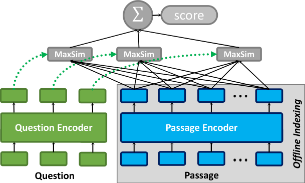
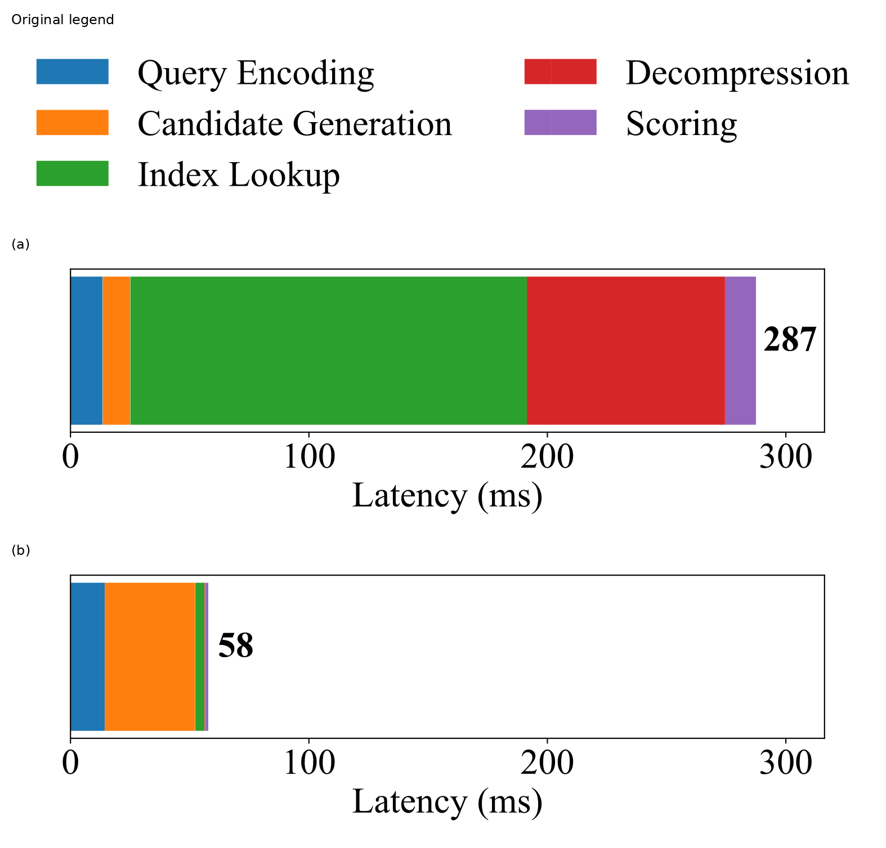
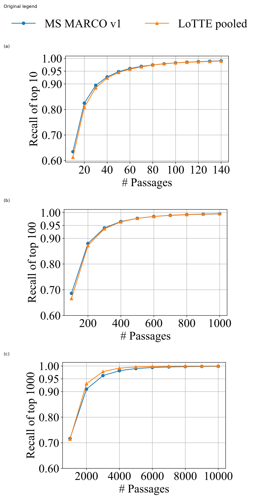
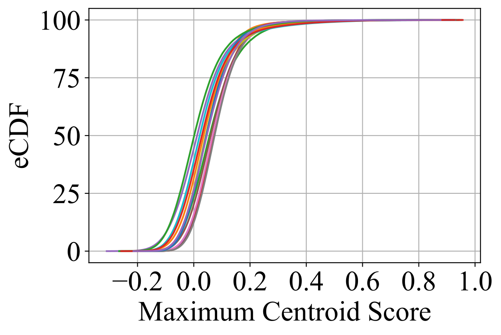
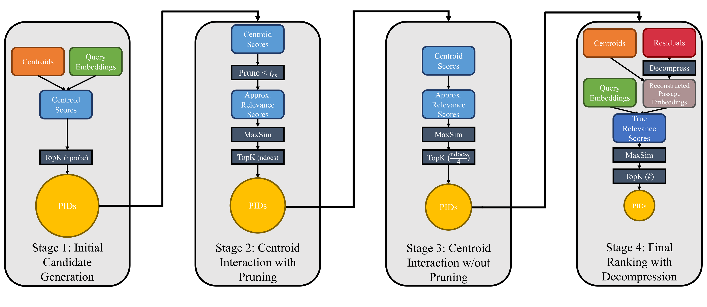
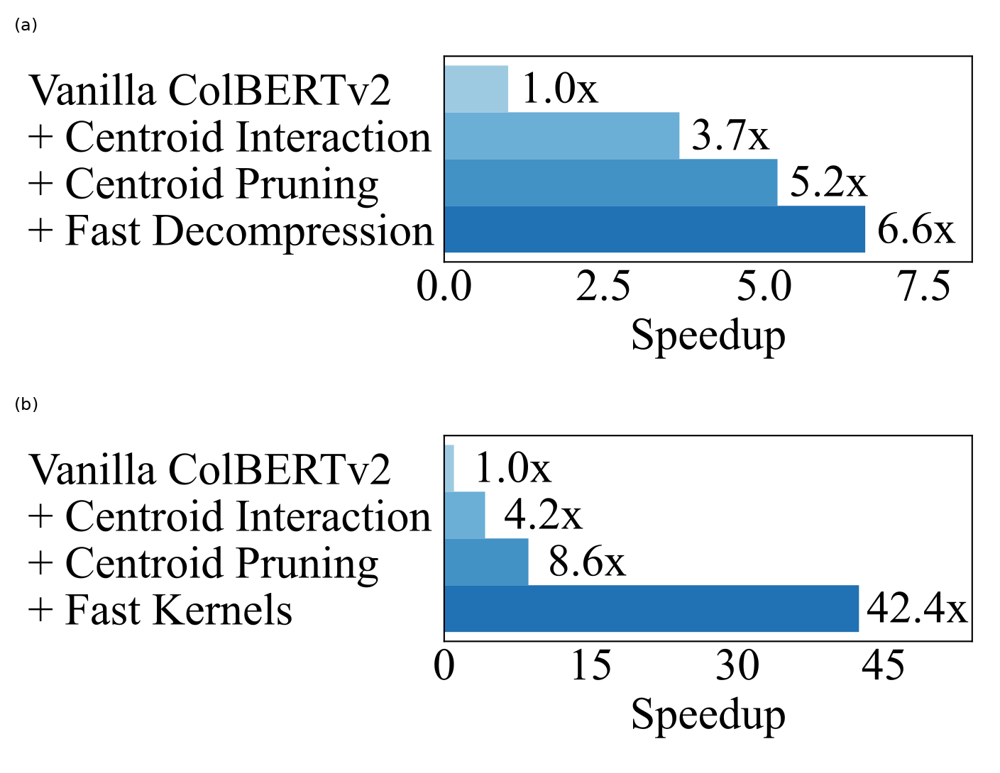
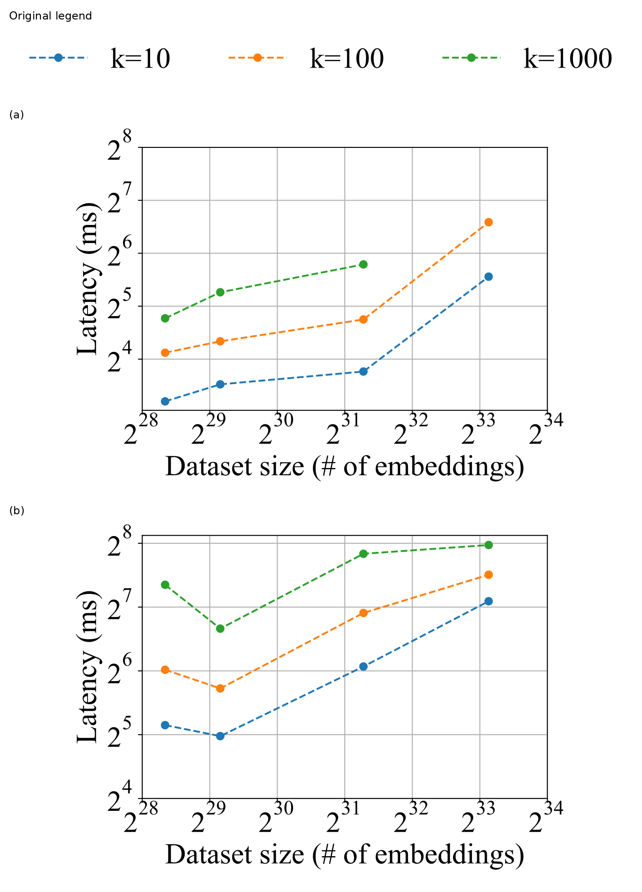
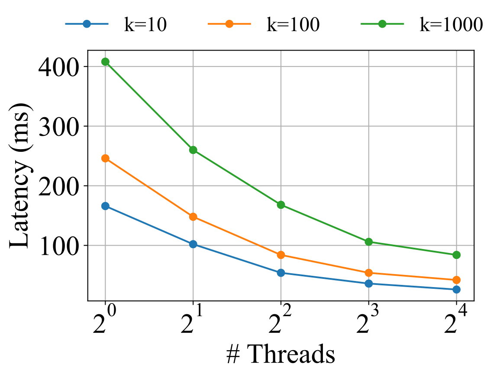

# PLAID：论文精炼研读

> 利用压缩索引里的质心提前筛选候选，减少残差读取、解压与完整 MaxSim 的计算。
>
> [原论文](https://arxiv.org/abs/2205.09707v1)

## 论文简介

ColBERTv2 已经压缩了多向量索引，但候选读取和残差解压仍占据查询延迟。PLAID 将质心从存储码本变成在线筛选工具：共享查询—质心分数表，先做剪枝与完整质心交互，最后只对少量段落恢复残差，并用定制内核减少 padding 和访存。

在 MS MARCO v1 的 k=1000 配置中，相对高召回 vanilla ColBERTv2，GPU 检索从 259.6 ms 到 38.4 ms，8 线程 CPU 从 4568.5 ms 到 101.3 ms，MRR@10 接近不变，但深召回略降。论文还检验域外和亿级语料；计时不含查询编码，不能直接当作服务端总延迟。

## 背景：为什么压缩了索引，检索仍然很慢

### 从单向量到后期交互

单向量检索把整个查询和段落各压成一个向量，打分便宜，也方便使用 ANN 索引。ColBERT 选择保留每个 token 的向量：查询与段落独立编码，段落表示可以离线存储，在线查询时再让两边做细粒度交互。

**图 1：** 每个查询 token 都在段落 token 中寻找最相似的向量，再把这些最大相似度相加。段落侧可预计算，在线阶段无需像 cross-encoder 那样联合运行整个 Transformer，但需要读取和比较多个 token 向量。

设查询矩阵为 $Q\in\mathbb{R}^{m\times h}$，段落矩阵为 $D\in\mathbb{R}^{n\times h}$。向量归一化后，点积即余弦相似度，论文的打分函数为：

$$
S(q,d)=\sum_{i=1}^{m}\max_{j=1}^{n} Q_i\cdot D_j^T. \tag{1}
$$

**MaxSim 的方向：** 对每个查询 token，沿段落 token 轴取最大值，最后沿查询轴求和。例如查询有两个 token，分别找到 0.8 和 0.7 的最佳匹配，则段落分数为 1.5。这个过程保留了不同查询词各自的匹配证据，代价是候选段落越多、每段 token 越长，访存和打分越重。

### ColBERTv2 已经做了什么

ColBERTv2 通过去噪监督提高检索质量，并用残差压缩降低索引占用。对一个段落 token 向量，索引保存：

- **质心 ID**：通过 k-means 找到的最近质心编号。
- **量化残差**：原向量与质心之差，每个维度用 1 或 2 bit 表示。

以默认 128 维为例，FP16 向量本身需要 256 bytes；压缩后的主体为 4-byte 质心 ID，加 16/32-byte 残差，即约 20/36 bytes。整个索引还包括质心表、倒排表、段落长度与偏移，实际占用不能只按这组单向量字节数推算。

用解释性记号，解压可写为：

$$
\hat D_j=\operatorname{normalize}(C_{z_j}+\hat r_j).
$$

这里 $z_j$ 是质心 ID，$\hat r_j$ 是量化后的残差。解压恢复的是压缩表示近似出的向量，仍包含量化误差。

### 真正的瓶颈：读取与解压大量候选

**图 2：** 查询编码、候选生成、索引读取、残差解压和打分分列显示。vanilla ColBERTv2 的主要开销集中在索引读取与解压；PLAID 增加了早期筛选工作，却显著缩小了后续需要完整处理的候选集合。

vanilla 检索可能生成上万段落候选，每个段落又有数十个 token 向量。系统需要从索引收集压缩表示、按不同段落长度构造 padding 张量、展开残差，再执行 MaxSim。因此，**索引能放进内存，并不意味着查询能快速读完和解压它。** 图 2 的总量约为 287→58 ms；后文结果表采用排除查询编码的口径，二者分别阅读。

## 相关工作：PLAID 在检索链路中的位置

| 路线 | 文档表示与检索方式 | 与 PLAID 的关系 |
| --- | --- | --- |
| Cross-encoder | 查询和文档联合编码，直接估计相关性 | 细粒度交互昂贵，通常用于候选精排 |
| BM25 / SPLADE | 稀疏词项权重，依靠倒排索引检索 | 可用词项分数及上界剪枝，提供高效检索的背景 |
| DPR / ANCE 等 | 每段一个稠密向量，使用 ANN | 成熟的单向量检索机制不能直接表达完整 token MaxSim |
| ColBERT | token 级多向量，独立编码后交互 | 定义 PLAID 使用的匹配方式 |
| ColBERTv2 | 多向量＋残差压缩＋改进监督 | 提供 PLAID 的模型与索引表示 |
| PLAID | 在质心近似与完整残差打分之间分阶段筛选 | 优化在线执行流程和内核 |

PLAID 没有引入新的 embedding 训练损失。它利用已有压缩索引，把“昂贵地对全部候选精确计算”改成“先便宜地缩小候选，再做完整打分”。其质心分数依赖当前查询，不能直接照搬传统稀疏检索中预先存好的词项—文档上界。

## 方法：先用质心判断谁值得解压

### 两个观察

**观察一：只用质心，也能找到大部分强候选。** 把 token 向量暂时替换为其质心，再计算近似 MaxSim，得到一份成本更低的排序。

**图 3：** 分别以 vanilla ColBERTv2 的 top-10、top-100、top-1000 为参照，衡量质心排序取更多候选时能覆盖多少。MS MARCO v1 和 LoTTE pooled dev 上，论文报告取约 $10\times k$ 个质心候选可覆盖原 top-$k$ 的 99% 以上，例如目标为 1000 时取约 10000。这个覆盖指标衡量与原系统结果的重合程度，相关性质量仍需用 qrels 或问答指标评测。

**观察二：对某个查询，只有少部分质心重要。** 一个语料库虽然可能有数万至数十万质心，但大部分与本次查询中的所有 token 都不够相似。

**图 4：** 在随机 15 个 MS MARCO v1 查询上，作者画出“每个质心对查询 token 的最大相似度”的经验累积分布。分数较高的质心只占小尾部，启发系统在早期忽略低分质心，减少近似打分的工作量。

### 质心交互：把段落看成质心袋

设全部质心组成矩阵 $C\in\mathbb{R}^{K\times h}$。先计算查询与全部质心的相似度：

$$
A=CQ^T\in\mathbb{R}^{K\times m}. \tag{2}
$$

$A$ 的每一行对应一个质心，每一列对应一个查询 token。**这张分数表每个查询只算一次，随后所有候选段落共享。** 段落只需提供自身的质心 ID 列表 $z=(z_1,\ldots,z_n)$，通过查表构造：

$$
B=A[z,:]\in\mathbb{R}^{n\times m}. \tag{3}
$$

再执行与原 MaxSim 相同方向的聚合：

$$
\tilde S(q,d)=\sum_{i=1}^{m}\max_{j=1}^{n}B_{j,i}
=\sum_{i=1}^{m}\max_{j=1}^{n}A_{z_j,i}. \tag{4}
$$

**例子：** 查询有两个 token，段落的两个质心分别对应分数行 $(0.8,0.1)$ 与 $(0.2,0.7)$。按列取最大值得到 $(0.8,0.7)$，段落近似分数为 1.5。若段落只有第一种质心，分数为 $0.8+0.1=0.9$。重复出现同一质心不会改变质心 MaxSim，因此可以把段落理解为一个“质心袋”；这里不依靠 BM25 式词频累积。

这一步省去的是每个候选 token 的残差读取、重建和向量点积。候选仍需提供质心 ID，但主要操作变成共享分数表的查找与最大值聚合。最终残差打分时，同质心 token 的不同残差又可以提供更细的区分。

公式说明：这里统一采用“token/质心为行”的矩阵约定。原文式 (3) 的行堆叠与式 (4) 的下标方向存在歧义，上式用 $B_{j,i}$ 明确表示段落轴取最大值、查询轴求和。

### 质心剪枝：连近似打分也减少一些

在构造段落质心交互前，对每个质心检查：

$$
\operatorname{keep}(c)=\left[\max_{i=1}^{m}A_{c,i}\geq t_{cs}\right]. \tag{5}
$$

$t_{cs}$ 是质心分数阈值。只要该质心与任意一个查询 token 足够相似，就保留它的整行分数；若对所有查询 token 都很弱，则在这一轮跳过。

例如阈值为 0.4，分数行 $(0.8,0.1)$ 会被完整保留，$(0.1,0.2)$ 则被跳过。这是**按质心行筛选**，并非逐个把小于 0.4 的单元置零。剪枝后的表示更稀疏，早期候选筛选更快；下一轮再对已留下的段落恢复全部质心进行打分。

### 四阶段检索流程

**图 5：** 候选生成之后，先做带剪枝的质心交互，再做不剪枝的质心交互，最后才解压残差。候选预算依次收缩为 `ndocs`、`ndocs/4`，完整打分后返回 top-$k$。

| 阶段 | 输入与操作 | 输出 |
| --- | --- | --- |
| 候选生成 | 对每个 query token 选择 top-`nprobe` 质心，读取相应倒排表并合并、去重 passage ID | 初始候选集合 |
| 带剪枝的质心交互 | 跳过低分质心，以稀疏质心表示做近似 MaxSim | top-`ndocs` 段落 |
| 完整质心交互 | 对留下的段落使用全部质心，再做一次近似 MaxSim | top-`ndocs/4` 段落 |
| 残差解压与完整打分 | 读取剩余段落的量化残差，重建并归一化向量，计算式 (1) | top-$k$ |

以 `k=1000` 为例，论文配置先保留 4096 个段落，再收缩到 1024 个，最后对这 1024 个段落做完整打分并输出 1000 个。第一阶段没有 vanilla 的 `ncandidates` 式硬上限，通过探测质心和后续预算控制工作量。

第三阶段恢复的是**已保留段落的全部质心**。早期已淘汰的段落不会回来，所以这是带质量—速度权衡的近似检索。质心分数也不是原向量分数的严格上界：例如 $c=(1,0)$、$d=(0.8,0.6)$，对 $q=(0,1)$ 分数由 0.6 近似为 0，对 $q=(1,0)$ 则由 0.8 近似为 1，既可能低估也可能高估。

### 倒排表：直接返回段落 ID

vanilla 的质心倒排表存的是 embedding ID，还需映射到段落。PLAID 直接存每个质心对应的唯一 passage ID，减少条目数量，也可使用 32-bit ID。在 MS MARCO v2 上，倒排表从约 **71 GB 降至 27 GB，约节省 2.7×**；包含其他结构的整个索引则从 246.0 GiB 降到 202.2 GiB。

### 执行内核：无 padding MaxSim 与查表解压

**无 padding MaxSim。** 段落长度各不相同，通用批处理会把打包的二维表示变成按最大段落长度补齐的三维张量。PLAID 的 CPU C++ 内核直接遍历打包表示，每个线程只维护一个长度为查询 token 数 $m$ 的最大值缓冲，边读边更新，最后求和。这样减少了 padding、临时张量和数据移动；$O(m)$ 指每线程打分缓冲。

**查表解压。** 一个 packed byte 有 256 种取值。若每维残差使用 $b$ bit，则一个字节装下 $8/b$ 个量化桶索引；PLAID 预先列出这 256 种展开结果，解压时查表，再按桶值恢复残差，减少重复移位和展开。

论文为 CPU 和 GPU 都优化了解压：CPU 按段落并行，GPU 使用 CUDA 内核处理残差字节。无 padding MaxSim 的定制内核在该论文中只实现于 CPU；GPU 质心交互仍使用 PyTorch。整体是在原有实现上增加约 300 行 Python 和 700 行 C++。

## 实验

### 模型来源与数据集

PLAID 直接改检索引擎，使用已有模型：**ColBERTv2 在 MS MARCO v1 上训练**，用于 v1 域内与 LoTTE、MS MARCO v2 域外评测；Wikipedia 使用 **NQ 上训练的 ColBERT-QA checkpoint** 并加入残差压缩。

- **MS MARCO v1：** 网页段落排序，约 880 万段落，本文在 dev 查询上评测；指标包括首个相关结果的 MRR@10 和不同深度的 Recall。
- **Wikipedia OpenQA：** 2018 年 12 月 Wikipedia 语料，使用 Natural Questions 查询；Success@k 衡量前 k 个段落中是否包含答案。
- **LoTTE pooled：** 来自 StackExchange 的长尾、多主题查询；本文使用 pooled dev 的 search 风格查询，评测训练域外检索。平均段落长度约为 MS MARCO v1 的两倍。
- **MS MARCO v2：** 大规模域外评测，使用 augmented passage 版本，加入 passage title、忽略 headings，约 1.384 亿段落。

**表 1（原文 Table 1）：语料与索引规模。** Token 列对应索引中的 token/embedding 数量。

| 数据集 | 段落 | Token/embedding | 评测查询 | vanilla 索引 GiB | PLAID 索引 GiB |
| --- | --- | --- | --- | --- | --- |
| MS MARCO v1 | 8.8M | 597.9M | 6980 | 24.6 | 21.6 |
| Wikipedia | 21.0M | 2.6B | 8757 | 105.2 | 92.0 |
| LoTTE pooled | 2.4M | 339.4M | 2931 | 14.0 | 12.3 |
| MS MARCO v2 | 138.4M | 9.4B | 3903 | 246.0 | 202.2 |

前三个数据集使用每维 2-bit 残差，v2 使用 1-bit 残差。PLAID 在相同压缩表示上进一步优化了倒排结构，因此相对 vanilla 还有索引空间收益。

### 参数与计时设置

**表 2（原文 Table 2）：不同输出深度的配置。** 输出越深，质心探测越多、阈值越低、候选预算越大。

| 输出 k | nprobe | t_cs | ndocs |
| --- | --- | --- | --- |
| 10 | 1 | 0.5 | 256 |
| 100 | 2 | 0.45 | 1024 |
| 1000 | 4 | 0.4 | 4096 |

CPU 使用单线程或 8 线程；GPU 为 **TITAN V、12 GB 显存**，GPU 实验可使用全部 56 个 CPU 线程。论文排除查询编码，每次试验先计算全部查询的平均延迟，再取三次试验平均值中的最小值，机器空闲，部分实验绑定 NUMA 节点。因此下表体现检索阶段的平均效率，生产系统的编码、网络和尾部延迟需另外测量。

### MS MARCO v1：质量与速度的主要对照

**表 3（原文 Table 3）：MS MARCO v1 dev 结果。** 所有质量指标按百分数尺度列出；“—”表示未报告或该输出深度不适用。

| 系统 | MRR@10 | R@100 | R@1000 | CPU 1线程 ms | CPU 8线程 ms | GPU ms |
| --- | --- | --- | --- | --- | --- | --- |
| BM25（PISA，k=1000） | 18.7* | — | — | 8.3* | — | — |
| SPLADEv2（PISA，k=1000） | 36.8* | — | 97.9* | 220.3* | — | — |
| ColBERTv1 | 36.1 | 87.3 | 95.2 | — | — | 54.3 |
| vanilla ColBERTv2（p=2，c=$2^{13}$） | 39.7 | 90.4 | 96.6 | 3485.1 | 921.8 | 53.4 |
| vanilla ColBERTv2（p=4，c=$2^{16}$） | 39.7 | 91.4 | 98.3 | — | 4568.5 | 259.6 |
| PLAID ColBERTv2（k=10） | 39.4 | — | — | 185.5 | 31.5 | 11.5 |
| PLAID ColBERTv2（k=100） | 39.8 | 90.6 | — | 222.3 | 52.9 | 20.2 |
| PLAID ColBERTv2（k=1000） | 39.8 | 91.3 | 97.5 | 352.3 | 101.3 | 38.4 |

星号为论文引用的既有结果；相应硬件或实现条件有差异。BM25、SPLADE 提供背景对照，同模型的 vanilla→PLAID 更直接体现执行引擎的作用。vanilla 的 p、c 分别为探测数和候选预算。

**关键结果：**

- **保守配置 k=1000：** GPU 约 6.8×、8 线程 CPU 约 45× 加速，MRR@10 接近不变；R@1000 从 98.3 降到 97.5，下降 0.8 个百分点。
- **较浅配置 k=10：** GPU 11.5 ms、8 线程 CPU 31.5 ms，MRR@10 为 39.4；相对高召回 vanilla，分别约 22.6× 和 145× 加速，适合只关心少量结果的场景。
- **vanilla 本身也有速度档位：** p=2、c=$2^{13}$ 的基线比高召回配置更快，因此“6.8×/45×”始终对应表中 p=4、c=$2^{16}$ 的对照。

### Wikipedia OpenQA：换成问答模型仍然有效

**表 4（原文 Table 4）：Wikipedia 结果。**

| 系统 | Success@5 | Success@100 | CPU 8线程 ms | GPU ms |
| --- | --- | --- | --- | --- |
| DPR | 66.8 | 85.0 | — | — |
| ColBERT-QA（未压缩） | 75.3 | 89.2 | — | — |
| vanilla ColBERT-QA（p=4，c=$2^{15}$；残差压缩） | 74.3 | 89.0 | 5077.9 | 204.1 |
| PLAID ColBERT-QA（k=10；残差压缩） | 73.3 | — | 67.1 | 13.6 |
| PLAID ColBERT-QA（k=100；残差压缩） | 74.1 | 88.0 | 120.1 | 26.9 |
| PLAID ColBERT-QA（k=1000；残差压缩） | 74.4 | 88.9 | 228.4 | 55.3 |

**解读：** k=1000 相对压缩 vanilla，GPU 约 3.7×、CPU 约 22× 加速，答案命中指标接近。未压缩 ColBERT-QA 的 Success@5 更高，说明模型表示压缩与检索引擎剪枝各有自己的影响，应分别比较。

### LoTTE：域外长尾检索

**表 5（原文 Table 5）：LoTTE pooled dev 结果。**

| 系统 | Success@5 | Success@100 | CPU 8线程 ms | GPU ms |
| --- | --- | --- | --- | --- |
| BM25 | 47.8* | 77.6* | — | — |
| SPLADEv2 | 67.0* | 89.0* | — | — |
| vanilla ColBERTv2（p=2，c=$2^{13}$） | 69.3 | 90.3 | 1508.4 | 66.9 |
| PLAID ColBERTv2（k=10） | 69.1 | — | 35.5 | 9.2 |
| PLAID ColBERTv2（k=100） | 69.4 | 89.9 | 64.8 | 17.4 |
| PLAID ColBERTv2（k=1000） | 69.6 | 90.5 | 163.1 | 27.3 |

星号为论文引用的既有结果。

**解读：** k=1000 时 GPU 约 2.5×、CPU 约 9.2× 加速，两个质量指标略有提高。k=10 时 GPU 约 7.3×、CPU 约 42.5× 加速。虽然 LoTTE 的段落数量更少，但段落更长，读取和处理 token 的成本仍然显著；仅按文档数估计延迟会忽略这一点。

### MS MARCO v2：扩大到亿级段落

**表 6（原文 Table 6）：MS MARCO v2 结果。**

| 系统 | MRR@100 | R@100 | R@1000 | CPU 8线程 ms | GPU ms |
| --- | --- | --- | --- | --- | --- |
| BM25（Anserini，augmented） | 8.7 | 40.3 | 69.3 | — | — |
| vanilla ColBERTv2（p=4，c=$2^{16}$） | 18.0 | 68.2 | 88.1 | 5228.5 | OOM |
| PLAID ColBERTv2（k=10） | — | — | — | 136.4 | 47.1 |
| PLAID ColBERTv2（k=100） | 17.9 | 67.0 | — | 181.9 | 96.1 |
| PLAID ColBERTv2（k=1000） | 18.0 | 68.4 | 85.7 | 251.3 | OOM |

**解读：** 语料比 MS MARCO v1 大约 16 倍，PLAID k=1000 仍把 CPU 延迟压到约 251 ms，较 vanilla 快约 20.8×；MRR@100 相同，R@100 接近，但 R@1000 下降 2.4 个百分点。k=100 的 GPU 延迟为 96.1 ms；k=1000 时两者都 OOM，反映出该实现与硬件下的显存限制。

## 消融：算法筛选和内核优化分别贡献多少

**图 6：** 在随机 500 个 MS MARCO v1 查询上，使用 k=1000 配置，从 vanilla 出发依次加入完整质心交互、质心剪枝、优化内核。图中的数值是相对 vanilla 的累计倍数。

| 累计配置 | GPU 加速 | CPU 8线程加速 |
| --- | --- | --- |
| vanilla | 1.0× | 1.0× |
| ＋一轮完整质心交互 | 3.7× | 4.2× |
| ＋带剪枝的质心交互 | 5.2× | 8.6× |
| ＋优化内核（完整 PLAID） | 6.6× | 42.4× |

**结论：** 质心筛选本身已经显著减少昂贵计算，内核优化进一步放大收益，尤其是 CPU。最后一项相对上一项约为 GPU 1.3×、CPU 4.9×。作者另测了只替换 CPU 内核、不加入质心交互的配置，只有约 3× 加速，说明完整收益来自方法与实现共同作用。这里使用查询子样本，因此 CPU 42.4× 与完整 dev 结果的 45× 略有差异。

## 扩展性：语料规模与 CPU 线程

### 随 embedding 数量增长

**图 7：** 横轴为 embedding 数量，纵轴为延迟，采用双对数尺度；GPU、CPU 分别展示不同 k 的趋势。MS MARCO v2 的 GPU k=1000 因 OOM 无对应点。

作者观察到延迟总体接近随 embedding 数量的平方根增长，并将其与 ColBERTv2 按规模平方根配置质心数等因素联系起来。这是跨几个语料的经验趋势：段落长度、查询分布和候选规模同时变化，部署预算仍需在目标数据上测量。

### 增加线程后的收益

**图 8：** 增加 CPU 线程能降低延迟，k=1000 时 16 线程相对单线程约快 4.9×。加速没有线性达到 16×，作者推测仍有候选生成开销，以及段落长度不均引起的负载不均；进一步 profiling 留待后续工作。

## 结论与局限

PLAID 的关键是把 ColBERTv2 中用于节省空间的质心，进一步用于**节省在线计算和访存**。共享查询—质心分数表、两轮质心筛选和最终残差打分构成完整链路，倒排结构与内核优化让这条链路高效执行。

论文在域内、域外及亿级语料上展示了显著加速。代价主要体现在近似筛选的候选丢失、部分深召回下降，以及当时 GPU 实现的大候选显存限制。对应用而言，输出深度、质量要求和硬件共同决定合适的参数档位。

论文：[arXiv v1](https://arxiv.org/abs/2205.09707v1)；代码：[ColBERT](https://github.com/stanford-futuredata/ColBERT)。图表来自原论文，原作署名见文首，许可为 [CC BY 4.0](https://creativecommons.org/licenses/by/4.0/)。
