# PLAID: An Efficient Engine for Late Interaction Retrieval / 全文中英对照

> 来源：[arXiv:2205.09707v1](https://arxiv.org/abs/2205.09707v1)。英文段落后紧接中文，覆盖所取 HTML 版本的主文、附录、图表、脚注与参考文献；公式、数字表和书目信息共用。中文以机器初译为底稿，进行了术语整理与结构核对，尚未逐句人工审定；遇到歧义请以紧邻英文和原论文为准。 原作版权归所列作者，许可见 [原作许可](http://creativecommons.org/licenses/by/4.0/)；中文译文与版式改写在该许可条件下提供（涉及 SA 时沿用相同许可，涉及 NC 时仅限非商业使用）。

## Authors and affiliations / 作者与机构

Keshav Santhanam Note: Equal contribution. email: keshav2@stanford.edu Affiliation: Stanford University , United States , Omar Khattab email: okhattab@stanford.edu Affiliation: Stanford University , United States , Christopher Potts Affiliation: Stanford University , United States and Matei Zaharia Affiliation: Stanford University , United States

## Abstract. / 摘要。

**EN.** Pre-trained language models are increasingly important components across multiple information retrieval (IR) paradigms. Late interaction, introduced with the ColBERT model and recently refined in ColBERTv2, is a popular paradigm that holds state-of-the-art status across many benchmarks. To dramatically speed up the search latency of late interaction, we introduce the Performance-optimized Late Interaction Driver (PLAID). Without impacting quality, PLAID swiftly eliminates low-scoring passages using a novel centroid interaction mechanism that treats every passage as a lightweight bag of centroids. PLAID uses centroid interaction as well as centroid pruning, a mechanism for sparsifying the bag of centroids, within a highly-optimized engine to reduce late interaction search latency by up to 7 $\times$ on a GPU and 45 $\times$ on a CPU against vanilla ColBERTv2, while continuing to deliver state-of-the-art retrieval quality. This allows the PLAID engine with ColBERTv2 to achieve latency of tens of milliseconds on a GPU and tens or just few hundreds of milliseconds on a CPU at large scale, even at the largest scales we evaluate with 140M passages.

**中.** 预训练语言模型在多种信息检索 (IR) 范式中日益成为重要的组成部分。后期交互是随 ColBERT 模型引入并最近在 ColBERTv2 中改进的，是一种流行的范式，在许多基准测试中都保持着最先进的地位。为了显着加快后期交互的搜索延迟，我们引入了性能优化的后期交互驱动程序 (PLAID)。在不影响质量的情况下，PLID 使用新颖的质心交互机制快速消除低分段落，该机制将每个段落视为一个轻量级的质心包。 PLAID 在高度优化的引擎中使用质心交互和质心剪枝（一种稀疏质心包的机制），可将后期交互搜索延迟在 GPU 上减少最多 7 $\times$，在 CPU 上减少 45 $\times$，与普通 ColBERTv2 相比，同时继续提供最先进的检索质量。这使得带有 ColBERTv2 的 PLAID 引擎能够在 GPU 上实现数十毫秒的延迟，在 CPU 上实现数十甚至数百毫秒的延迟，即使在我们使用 140M 通道评估的最大规模下也是如此。

## Introduction / 一、简介

**EN.** Recent advances in neural information retrieval (IR) have led to notable gains on retrieval benchmarks and retrieval-based NLP tasks. Late interaction, introduced in ColBERT ( Khattab and Zaharia, 2020 ) , is a paradigm that delivers state-of-the-art quality in many of these settings, including passage ranking ( Santhanam et al., 2021 ; Hofstätter et al., 2022 ; Wang et al., 2021 ) , open-domain question answering ( Khattab et al., 2021b ; Li et al., 2021 ) , conversational tasks ( Paranjape et al., 2022 ; Minas Krasakis et al., 2022 ) , and beyond ( Khattab et al., 2021a ; Zhong et al., 2022 ) . ColBERT and its variants encode queries and documents into token-level vectors and conduct scoring via scalable yet fine-grained interactions at the level of tokens (Figure 1 ), alleviating the dot-product bottleneck of single-vector representations. The recent ColBERTv2 ( Santhanam et al., 2021 ) model demonstrates that late interaction models often considerably outperform recent single-vector and sparse representations within and outside the training domain, a finding echoed in several recent studies ( Lupart and Clinchant, 2022 ; Zhan et al., 2022 ; Thakur et al., 2021 ; Macdonald et al., 2021 ; Zeng et al., 2022 ; Thai et al., 2022 ) .

**中.** 神经信息检索 (IR) 的最新进展使检索基准和基于检索的 NLP 任务取得了显着进展。 ColBERT 中引入的后期交互（Khattab 和 Zaharia，2020）是一种在许多环境中提供最先进质量的范例，包括段落排名（Santhanam 等人，2021；Hofstätter 等人，2022；Wang 等人，2021）、开放域问答（Khattab 等人，2021b；Li 等人） al., 2021)、会话任务(Paranjape et al., 2022; Minas Krasakis et al., 2022) 以及其他任务(Khattab et al., 2021a;zhong et al., 2022)。 ColBERT 及其变体将查询和文档编码为标记级向量，并通过标记级可扩展且细粒度的交互进行评分（图 1），从而缓解了单向量表示的点积瓶颈。最近的 ColBERTv2（Santhanam 等人，2021）模型表明，后期交互模型通常远远优于训练域内外的单向量和稀疏表示，这一发现在最近的几项研究中得到了呼应（Lupart 和 Clinchant，2022；Zhan 等人，2022；Thakur 等人，2021；Macdonald 等人，2021；Zeng 等人）等人，2022；Thai 等人，2022）。

**EN.** Despite its strong retrieval quality, late interaction requires special infrastructure ( Khattab and Zaharia, 2020 ; Lin, 2022 ) for low-latency retrieval as it encodes each query and each document as a full matrix . Most IR models represent documents as a single vector, either sparse (e.g., BM25 ( Robertson et al., 1995 ) ; SPLADE ( Formal et al., 2021b ) ) or dense (e.g., DPR ( Karpukhin et al., 2020 ) ; ANCE ( Xiong et al., 2020 ) ), and thus mature sparse retrieval strategies like WAND ( Broder et al., 2003 ) or dense kNN methods like HNSW ( Malkov and Yashunin, 2018 ) cannot be applied directly or optimally to late interaction. While recent work ( Macdonald and Tonellotto, 2021 ; Tonellotto and Macdonald, 2021 ; Santhanam et al., 2021 ) has explored optimizing individual components of ColBERT’s pipeline, an end-to-end optimized engine has never been studied to our knowledge.

**中.** 尽管其检索质量很强，但后期交互需要特殊的基础设施（Khattab 和 Zaharia，2020；Lin，2022）来实现低延迟检索，因为它将每个查询和每个文档编码为完整矩阵。大多数IR模型将文档表示为单个向量，要么是稀疏的（例如，BM25（Robertson等人，1995）；SPLADE（Formal等人，2021b）），要么是密集的（例如，DPR（Karpukhin等人，2020）；ANCE（Xiong等人，2020）），因此成熟的稀疏检索策略如WAND（ Broder 等人，2003）或 HNSW（Malkov 和 Yashunin，2018）等密集 kNN 方法不能直接或最佳地应用于后期交互。虽然最近的工作（Macdonald 和 Tonellotto，2021；Tonellotto 和 Macdonald，2021；Santhanam 等人，2021）探索了优化 ColBERT 管道的各个组件，但据我们所知，从未研究过端到端优化引擎。

**EN.** We study how to optimize late-interaction search latency at a large scale, taking all steps of retrieval into account. We build on the state-of-the-art ColBERTv2 model. Besides improving quality with denoised supervision, ColBERTv2 aggressively compresses the storage footprint of late interaction. It reduces the index size by up to an order of magnitude using residual representations (§ 3.1 ). In those, each vector in a passage is encoded using the ID of its nearest centroid that approximates its token semantics—among tens or hundreds of thousands of centroids obtained through $k$ -means clustering—and a quantized residual vector.

**中.** 我们研究如何大规模优化后期交互搜索延迟，同时考虑检索的所有步骤。我们以最先进的 ColBERTv2 模型为基础。除了通过降噪监督提高质量之外，ColBERTv2 还积极压缩后期交互的存储占用空间。它使用残差表示将索引大小减少了一个数量级（第 3.1 节）。在这些中，段落中的每个向量都使用其最近的质心的 ID（通过 $k$ 表示聚类获得的数万或数十万个质心）和量化的残差向量进行编码，该质心近似其标记语义。

**EN.** We introduce the P erformance-optimized La te I nteraction D river (PLAID), [^footnote1] an efficient retrieval engine that reduces late interaction search latency by 2.5–7 $\times$ on GPU and 9–45 $\times$ on CPU against vanilla ColBERTv2 while retaining high quality. This allows the PLAID implementation of ColBERTv2, PLAID ColBERTv2, to achieve CPU-only latency of tens or just few hundreds of milliseconds and GPU latency of few tens of milliseconds at very large scale, even on 140M passages. Crucially, PLAID ColBERTv2 does so while continuing to deliver state-of-the-art retrieval quality.

**中.** 我们引入了性能优化的后期交互 D 河 (PLAID)，[^footnote1] 是一种高效的检索引擎，与普通 ColBERTv2 相比，它在 GPU 上将后期交互搜索延迟减少了 2.5-7 $\times$，在 CPU 上减少了 9-45 $\times$，同时保持了高质量。这使得 ColBERTv2 的 PLAID 实现，PLAID ColBERTv2，即使在 140M 通道上，也能实现数十或数百毫秒的仅 CPU 延迟和数十毫秒的 GPU 延迟。至关重要的是，PLID ColBERTv2 在做到这一点的同时，继续提供最先进的检索质量。

**EN.** To dramatically speed up search, PLAID leverages the centroid component of the ColBERTv2 representations, which is a compact integer ID per token. Instead of exhaustively scoring all passages found with nearest-neighbor search, PLAID uses the centroids to identify high-scoring passages and eliminate weaker candidates without loading their larger residuals. We conduct this in a multi-stage pipeline and introduce centroid interaction , a scoring mechanism that treats every passage as a lightweight bag of centroid IDs . We show that this centroid-only multi-vector search exhibits high recall without using the vector residuals (§ 3.3 ), allowing us to reserve full scoring to a very small number of candidate passages. Because the centroids come from a fixed set (i.e., constitute a discrete vocabulary), the distance between the query vectors and all centroids can be computed once during search and re-used across all bag-of-centroids passage representations. This allows us to further leverage the centroid scores for centroid pruning , which sparsifies the bag of centroid representations in the earlier stages of retrieval by skipping centroid IDs that are distant from all query vectors.

**中.** 为了显着加快搜索速度，PLAID 利用了 ColBERTv2 表示的质心组件，它是每个标记的紧凑整数 ID。 PLAID 不是对最近邻搜索找到的所有段落进行详尽的评分，而是使用质心来识别高分段落并消除较弱的候选段落，而不加载其较大的残差。我们在多阶段管道中进行此操作，并引入质心交互，这是一种评分机制，将每个段落视为质心 ID 的轻量级包。我们证明，这种仅质心的多向量搜索在不使用向量残差的情况下表现出高召回率（第 3.3 节），使我们能够为极少数候选段落保留完整评分。因为质心来自固定的集合（即，构成离散词汇表），所以可以在搜索期间计算一次查询向量和所有质心之间的距离，并在所有质心袋段落表示中重复使用。这使我们能够进一步利用质心分数进行质心修剪，通过跳过远离所有查询向量的质心 ID，在检索的早期阶段稀疏质心表示包。

**EN.** In the PLAID engine, we implement centroid interaction and centroid pruning and implement optimized yet modular kernels for the data movement, decompression, and scoring components of late interaction with the residual representations of ColBERTv2 (§ 4.5 ). We extensively evaluate the quality and efficiency of PLAID within and outside the training domain (on MS MARCO v1 ( Nguyen et al., 2016 ) and v2 ( Craswell et al., 2022 ) , Wikipedia, and LoTTE ( Santhanam et al., 2021 ) ) and across a wide range of corpus sizes (2M–140M passages), search depths ( $k$ =10, 100, 1000), and hardware settings with single- and multi-threaded CPU and with a GPU (§ 5.2 ). We also conduct a detailed ablation study to understand the empirical sources of gains among centroid interaction, centroid pruning, and our faster kernels (§ 5.3 ).

**中.** 在 PLAID 引擎中，我们实现了质心交互和质心修剪，并实现了优化的模块化内核，用于数据移动、解压缩以及与 ColBERTv2 的剩余表示进行后期交互的评分组件（第 4.5 节）。我们在训练领域内外（在 MS MARCO v1（Nguyen 等人，2016）和 v2（Craswell 等人，2022）、维基百科和 LoTTE（Santhanam 等人，2021））以及各种语料库大小（2M-140M 段落）、搜索深度（ $k$ =10, 100, 1000)，以及具有单线程和多线程 CPU 以及 GPU 的硬件设置（§ 5.2）。我们还进行了详细的消融研究，以了解质心相互作用、质心修剪和更快的内核之间增益的经验来源（第 5.3 节）。

**EN.** In summary, we make the following contributions:

**中.** 总之，我们做出以下贡献：

**EN.** (1)

**中.** (1)

**EN.** We analyze centroid-only retrieval with ColBERTv2, showing that a pruned bag-of-centroids representation can support high-recall candidate generation (§ 3 ).

**中.** 我们使用 ColBERTv2 分析仅质心检索，表明修剪后的质心袋表示可以支持高召回率候选生成（§ 3）。

**EN.** (2)

**中.** (2)

**EN.** We propose PLAID, a retrieval engine that introduces centroid interaction and centroid pruning as well as optimized implementations of these techniques for dramatically improving the latency of late-interaction search (§ 4 ).

**中.** 我们提出了 PLAID，一种检索引擎，它引入了质心交互和质心修剪以及这些技术的优化实现，以显着改善后期交互搜索的延迟（§ 4）。

**EN.** (3)

**中.** (3)

**EN.** We extensively evaluate PLAID and conduct a large-scale evaluation up to 140M passages, the largest to our knowledge with late-interaction retrievers (§ 5 ).

**中.** 我们广泛评估 PLAID 并进行了高达 140M 通道的大规模评估，这是我们所知的后期交互检索器中最大的评估（§ 5）。

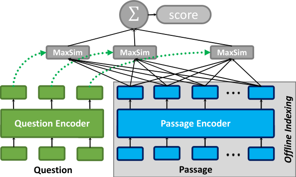

**EN.** Figure 1 . The late interaction architecture, given a query and a passage. Diagram from Khattab et al. (2021b) with permission.

**中.** 图 1.后期交互架构，给定一个查询和一个段落。 Khattab 等人的图表。 (2021b) 经许可。

## Related Work / 2.相关工作

### Neural IR / 2.1.神经红外

**EN.** The IR community has introduced many neural IR models based on pre-trained Transformers. Whereas early models were primarily cross-encoders ( Nogueira and Cho, 2019 ; MacAvaney et al., 2019 ) that attend jointly to queries and passages, many subsequent models target higher efficiency by producing independent representations for queries and passages. Some of those produce sparse term weights ( Dai and Callan, 2020 ; Mallia et al., 2021 ) , whereas others encode each passage or query into a single vector ( Xiong et al., 2020 ; Karpukhin et al., 2020 ; Qu et al., 2021 ) or multi-vector representation (the class we study; ( Khattab and Zaharia, 2020 ; Santhanam et al., 2021 ; Khattab et al., 2021b ; Humeau et al., 2020 ; Gao et al., 2021 ) ). These choices make different tradeoffs about efficiency and quality: whereas sparse term weights and single-vector models can be particularly lightweight in some settings, multi-vector late interaction ( Khattab and Zaharia, 2020 ) can often result in considerably stronger quality and robustness. Orthogonal to the choice of modeling query–document interactions, researchers have improved the supervision for neural models with harder negatives ( Khattab et al., 2021b ; Xiong et al., 2020 ; Zhan et al., 2020 ) as well as distillation and denoising ( Qu et al., 2021 ; Ren et al., 2021 ; Hofstätter et al., 2020 ) , among other approaches. Our work extends ColBERTv2 ( Santhanam et al., 2021 ) , which combines late interaction modeling with hard negative and denoising supervision to achieve state-of-the-art quality among standalone retrievers.

**中.** IR 社区引入了许多基于预训练 Transformer 的神经 IR 模型。虽然早期模型主要是联合处理查询和段落的交叉编码器（Nogueira 和 Cho，2019；MacAvaney 等人，2019），但许多后续模型通过为查询和段落生成独立表示来提高效率。其中一些产生稀疏术语权重（Dai 和 Callan，2020；Mallia 等人，2021），而另一些则将每个段落或查询编码为单个向量（Xiong 等人，2020；Karpukhin 等人，2020；Qu 等人，2021）或多向量表示（我们研究的类别；（Khattab 和 Zaharia，2020； Santhanam 等人，2021；Khattab 等人，2021b；Humeau 等人，2020；Gao 等人，2021))。这些选择在效率和质量方面做出了不同的权衡：虽然稀疏项权重和单向量模型在某些设置中可能特别轻量级，但多向量后期交互（Khattab 和 Zaharia，2020）通常可以带来相当强的质量和鲁棒性。与建模查询-文档交互的选择正交，研究人员改进了对具有更难负例的神经模型的监督（Khattab et al., 2021b；Xiong et al., 2020；Zhan et al., 2020）以及蒸馏和去噪（Qu et al., 2021；Ren et al., 2021；Hofstätter et al., 2020）等方法。我们的工作扩展了 ColBERTv2（Santhanam 等人，2021），它将后期交互建模与硬负和去噪监督相结合，以在独立检索器中实现最先进的质量。

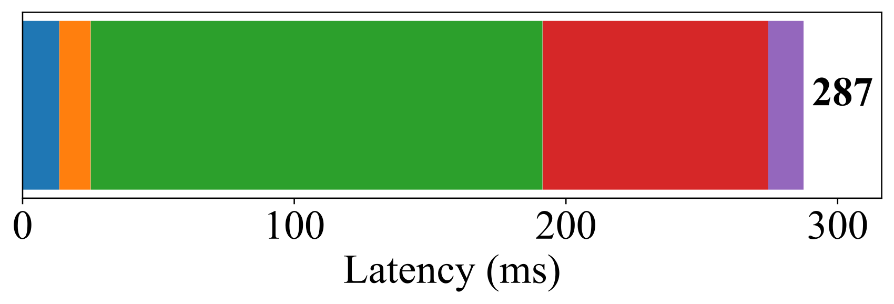

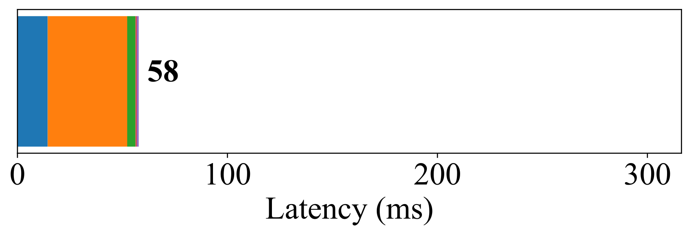

**EN.** Figure 2 . Latency breakdown of MS MARCO v1 dev queries run with vanilla ColBERTv2 and PLAID ColBERTv2 on a TITAN V GPU. Vanilla ColBERTv2 is overwhelmingly bottlenecked with the cost of index lookup and decompression, a challenge that PLAID addresses.

**中.** 图2.在 TITAN V GPU 上使用普通 ColBERTv2 和 PLAID ColBERTv2 运行 MS MARCO v1 开发查询的延迟细分。 Vanilla ColBERTv2 的瓶颈主要在于索引查找和解压缩的成本，而 PLAID 解决了这一挑战。

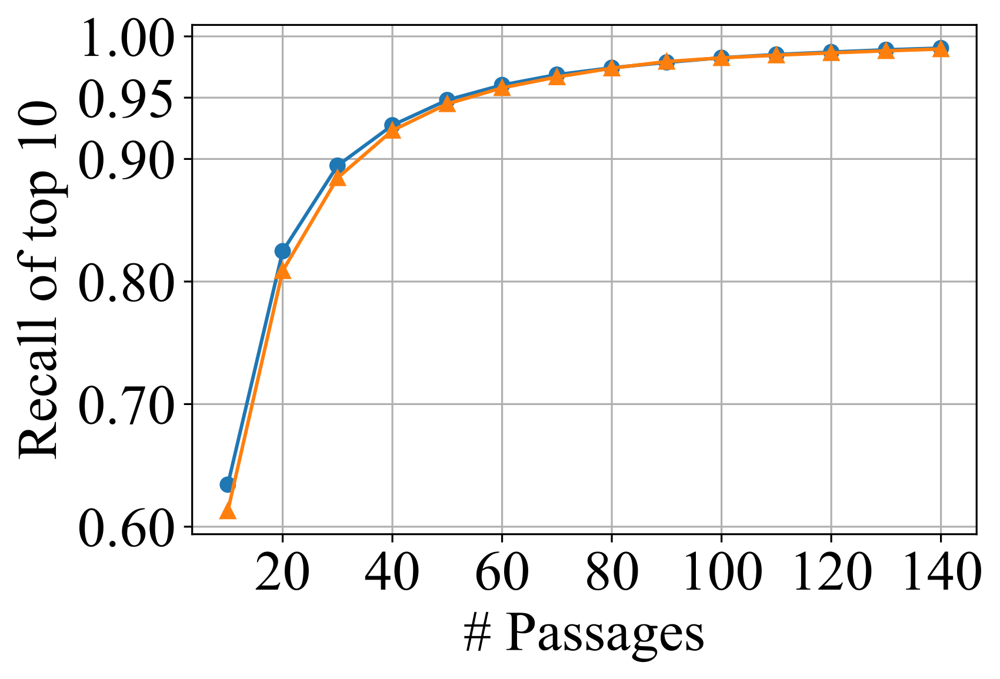

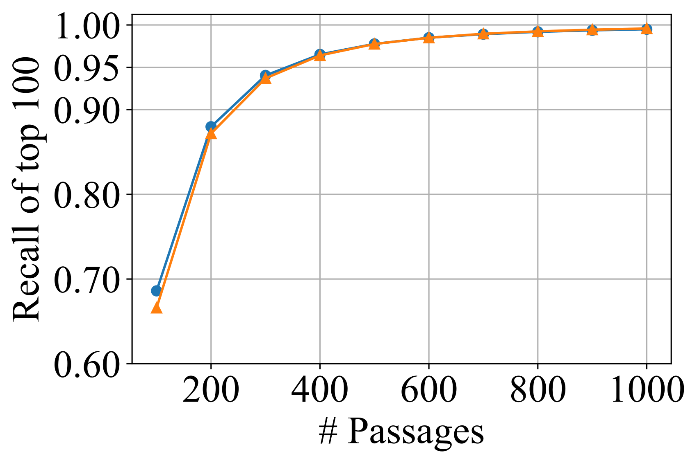

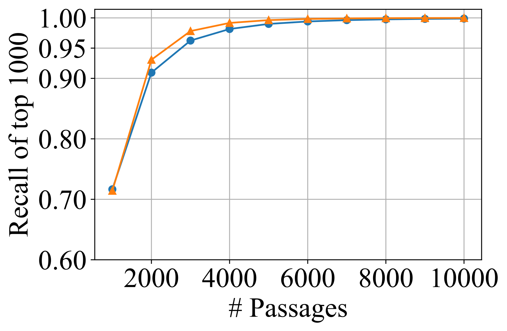

**EN.** Figure 3 . Recall of passages retrieved by a centroid-only version of ColBERTv2 with respect to the top $k$ passages retrieved by vanilla ColBERTv2. Centroids alone can identify virtually all of the top- $k$ passages retrieved with the full ColBERTv2 pipeline, within $10\cdot k$ or fewer candidates, motivating our centroid interaction strategy.

**中.** 图3.回想一下仅质心版本的 ColBERTv2 检索到的段落，相对于普通 ColBERTv2 检索到的顶部 $k$ 段落。仅质心就可以识别通过完整 ColBERTv2 管道检索到的 $10\cdot k$ 或更少候选者中几乎所有顶级 $k$ 段落，从而激发了我们的质心交互策略。

### Pruning for Sparse and Dense Retrieval / 2.2.稀疏和稠密检索的修剪

**EN.** For sparse retrieval models, traditional IR has a wealth of work on fast strategies for skipping documents for top- $k$ search. Strategies often keep metadata like term score upper bounds to skip lower-scoring candidates and most follow a Document-At-A-Time (DAAT) scoring approach ( Turtle and Flood, 1995 ; Broder et al., 2003 ; Ding and Suel, 2011 ; Dimopoulos et al., 2013 ; Mallia et al., 2017 ; Khattab et al., 2020 ) . Refer to Tonellotto et al. (2018) for a detailed treatment of recent methods. A key difference to our settings is that these all strategies expect a set of precomputed scores (particularly, useful upper bounds on every term–document pair), whereas with late interaction the term–document interaction (i.e., the MaxSim score) is only known at query time after a matrix-vector multiplication. Our observations about the utility of centroids for accelerating late interaction successfully moves the problem closer to classical IR, but poses the challenge that the query-to-centroid scores are only known at query time.

**中.** 对于稀疏检索模型，传统 IR 在快速策略方面做了大量工作，用于跳过顶级 $k$ 搜索的文档。策略通常保留术语分数上限等元数据，以跳过得分较低的候选者，并且大多数策略遵循一次文档 (DAAT) 评分方法（Turtle 和 Flood，1995；Broder 等人，2003；Ding 和 Suel，2011；Dimopoulos 等人，2013；Mallia 等人，2017；Khattab 等人， 2020）。请参阅 Tonellotto 等人。 （2018）对最新方法的详细处理。与我们的设置的一个关键区别是，所有这些策略都期望一组预先计算的分数（特别是每个术语-文档对的有用上限），而在后期交互中，术语-文档交互（即 MaxSim 分数）仅在矩阵向量乘法之后的查询时才知道。我们对质心在加速后期交互方面的效用的观察成功地使问题更接近经典 IR，但提出了查询到质心分数仅在查询时已知的挑战。

**EN.** For dense retrieval models that use single-vector representations, approximate $k$ -nearest neighbor (ANN) search is a well-studied problem ( Jegou et al., 2010 ; Johnson et al., 2019 ; Abuzaid et al., 2019 ; Malkov and Yashunin, 2018 ) . Our focus extends such work from a single vector to the late interaction of two matrices.

**中.** 对于使用单向量表示的稠密检索模型，近似 $k$ 最近邻（ANN）搜索是一个经过充分研究的问题（Jegou 等人，2010；Johnson 等人，2019；Abuzaid 等人，2019；Malkov 和 Yashunin，2018）。我们的重点将此类工作从单个向量扩展到两个矩阵的后期相互作用。

## Analysis of ColBERTv2 Retrieval / ColBERTv2检索分析

**EN.** We begin by a preliminary investigation of the latency (§ 3.2 ) and scoring patterns (§ 3.3 ) of ColBERTv2 retrieval that motivates our work on PLAID. To make this section self-contained, § 3.1 reviews the modeling, storage, and supervision of ColBERTv2.

**中.** 我们首先对 ColBERTv2 检索的延迟（第 3.2 节）和评分模式（第 3.3 节）进行初步调查，这激发了我们在 PLAID 上的工作。为了使本节变得独立，第 3.1 节回顾了 ColBERTv2 的建模、存储和监督。

### Modeling, Storage, and Retrieval / 3.1.建模、存储和检索

**EN.** PLAID optimizes retrieval for models using the late interaction architecture of ColBERT, which includes systems like ColBERTv2, Baleen ( Khattab et al., 2021a ) , Hindsight ( Paranjape et al., 2022 ) , and DrDecr ( Li et al., 2021 ) , among others. As depicted in Figure 1 , a Transformer encodes queries and passages independently into vectors at the token level. For scalability, passage representations are pre-computed offline. At search time, the similarity between a query $q$ and a passage $d$ is computed as the summation of “MaxSim” operations, namely, the largest cosine similarity between each vector in the query matrix and all of the passage vectors:

**中.** PLAID 使用 ColBERT 的后期交互架构优化模型检索，其中包括 ColBERTv2、Baleen（Khattab 等人，2021a）、Hindsight（Paranjape 等人，2022）和 DrDecr（Li 等人，2021）等系统。如图 1 所示，Transformer 将查询和段落独立编码为令牌级别的向量。为了可扩展性，段落表示是离线预先计算的。在搜索时，查询 $q$ 和段落 $d$ 之间的相似度计算为“MaxSim”操作的总和，即查询矩阵中每个向量与所有段落向量之间的最大余弦相似度：

$$
S_{q,d}=\sum_{i=1}^{|Q|}\max_{j=1}^{|D|}Q_{i}\cdot D_{j}^{T}\tag{1}
$$

**EN.** where $Q$ and $D$ are the matrix representations of the query and passage, respectively. In doing so, this scoring function aligns each query token with the “most similar” passage token and estimates relevance as the sum of these term-level scores. Refer to Khattab and Zaharia (2020) for a more complete discussion of late interaction.

**中.** 其中 $Q$ 和 $D$ 分别是查询和段落的矩阵表示。在此过程中，此评分函数将每个查询标记与“最相似”的段落标记对齐，并将相关性估计为这些术语级别分数的总和。有关后期交互的更完整讨论，请参阅 Khattab 和 Zaharia (2020)。

**EN.** For storing the passage representations, we adopt the ColBERTv2 residual compression strategy, which reduces the index size by up to an order of magnitude over naive storage of late-interaction embeddings as vectors of 16-bit floating-point numbers. Instead, ColBERTv2’s compression strategy efficiently clusters all token-level vectors and encodes each vector using the ID of its nearest cluster centroid as well as a quantized residual vector, wherein each dimension is 1- or 2-bit encoding of the delta between the centroid and the original uncompressed vector. Decompressing a vector requires locating its centroid ID, encoded using 4 bytes, and its residual, which consume 16 or 32 bytes for 1- or 2-bit residuals, assuming the default 128-dimensional vectors.

**中.** 为了存储段落表示，我们采用了 ColBERTv2 残差压缩策略，与将后期交互嵌入简单存储为 16 位浮点数向量相比，该策略将索引大小减少了一个数量级。相反，ColBERTv2 的压缩策略有效地对所有 token 级向量进行聚类，并使用其最近的聚类质心的 ID 以及量化残差向量对每个向量进行编码，其中每个维度是质心和原始未压缩向量之间增量的 1 位或 2 位编码。解压缩向量需要定位其质心 ID（使用 4 个字节编码）及其残差，假设默认的 128 维向量，则消耗 16 或 32 个字节来表示 1 位或 2 位残差。

**EN.** While we adopt ColBERTv2’s compression, we improve its retrieval strategy. We refer to the original retrieval strategy as “vanilla” ColBERTv2 retrieval. We refer to Santhanam et al. (2021) for details of compression and retrieval in ColBERTv2.

**中.** 我们在采用ColBERTv2的压缩的同时，改进了它的检索策略。我们将原始检索策略称为“普通”ColBERTv2 检索。我们参考 Santhanam 等人。 (2021) 了解 ColBERTv2 中压缩和检索的详细信息。

### ColBERTv2 Latency Breakdown / ColBERTv2 延迟细分

**EN.** Figure 2 presents a breakdown of query latency on MS MARCO Passage Ranking (v1) on a GPU, showing results for vanilla ColBERTv2 (Figure 2(a) ) against the new PLAID ColBERTv2 (Figure 2(b) ). Latency is divided between query encoding, candidate generation, index lookups (i.e., to gather the compressed vector representations for candidate passages), residual decompression, and finally scoring (i.e., the final MaxSim computations).

**中.** 图 2 显示了 GPU 上 MS MARCO Passage Ranking (v1) 的查询延迟细分，显示了普通 ColBERTv2（图 2(a)）与新 PLAID ColBERTv2（图 2(b)）的结果。延迟分为查询编码、候选生成、索引查找（即收集候选段落的压缩向量表示）、残差解压缩和最终评分（即最终的 MaxSim 计算）。

**EN.** For vanilla ColBERTv2, index lookup and residual decompression are overwhelming bottlenecks. Gathering vectors from the index is expensive because it consumes significant memory bandwidth: each vector in this setting is encoded with a 4-bit centroid ID and 32-byte residuals, each passage contains tens of vectors, and there can be up to $2^{16}$ candidate passages. Moreover, index lookup in vanilla ColBERTv2 also constructs padded tensors on the fly to deal with the variable length of passages. Decompression of residuals is comprised of several non-trivial operations such as unpacking bits and computing large sums, which can be expensive when ColBERTv2 produces a large initial candidate set (~10-40k passages) as is the case for MS MARCO v1. While it is possible to use a smaller candidate set, doing so reduces recall (§ 5 ).

**中.** 对于普通的 ColBERTv2，索引查找和残差解压缩是压倒性的瓶颈。从索引中收集向量的成本很高，因为它会消耗大量内存带宽：此设置中的每个向量都使用 4 位质心 ID 和 32 字节残差进行编码，每个段落包含数十个向量，并且最多可以有 $2^{16}$ 候选段落。此外，普通 ColBERTv2 中的索引查找还动态构建填充张量来处理可变长度的段落。残差解压缩由几个重要的操作组成，例如解包位和计算大和，当 ColBERTv2 生成大型初始候选集（~10-40k 通道）时，这些操作可能会很昂贵，就像 MS MARCO v1 的情况一样。虽然可以使用较小的候选集，但这样做会降低召回率（§ 5）。

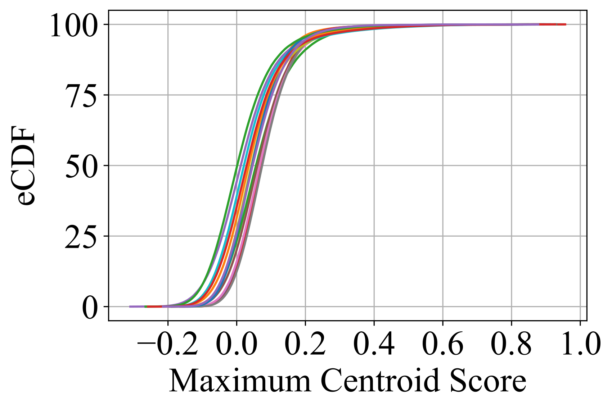

**EN.** Figure 4 . Centroid score distribution for each query among a random sample of 15 MS MARCO v1 dev queries evaluated with ColBERTv2.

**中.** 图4.使用 ColBERTv2 评估的 15 个 MS MARCO v1 开发查询的随机样本中每个查询的质心分数分布。

### Centroids Alone Identify Strong Candidates / 3.3.质心本身就可以识别出强大的候选者

**EN.** This breakdown in Figure 2(b) demonstrates that exhaustively scoring a large number of candidates passages, particularly gathering and decompressing their residuals, can amount to a considerable cost. Whereas ColBERTv2 ( Santhanam et al., 2021 ) exploits centroids to reduce the space footprint, our work demonstrates that the centroids can also accelerate search , while maintaining quality, by serving as proxies for the passage embeddings. Because of this, we can skip low-scoring passages without having to look up or decompress their residuals, adding some additional candidate generation overhead to achieve substantial savings in the subsequent stages (Figure 2(b) ).

**中.** 图 2(b) 中的细分表明，对大量候选段落进行彻底评分，特别是收集和解压缩其残差，可能会产生相当大的成本。尽管 ColBERTv2（Santhanam 等人，2021）利用质心来减少空间占用，但我们的工作表明，质心还可以通过充当段落嵌入的代理来加速搜索，同时保持质量。因此，我们可以跳过低分段落，而不必查找或解压缩其残差，增加一些额外的候选生成开销，以在后续阶段实现大量节省（图 2(b)）。

**EN.** Effectively, we hypothesize that centroid-only retrieval can find the high-scoring passages otherwise retrieved by vanilla ColBERTv2. We test this hypothesis by comparing the top- $k$ passages retrieved by vanilla ColBERTv2 to a modified implementation that conducts retrieval using only the centroids and no residuals. We present the results in Figure 3 . At $k\in\{10,100,1000\}$ , the figure plots the average recall of the top- $k$ passages of vanilla ColBERTv2 within the passages retrieved by centroid-only ColBERTv2 at various depths. In other words, we report the fraction of the top- $k$ passages of vanilla ColBERTv2 that appear within the top- $k^{\prime}$ passages of centroid-only ColBERTv2, for $k^{\prime}\geq k$ .

**中.** 实际上，我们假设仅质心检索可以找到高分段落，否则由普通 ColBERTv2 检索。我们通过将普通 ColBERTv2 检索到的顶部 $k$ 段落与仅使用质心而不使用残差进行检索的修改实现进行比较来测试这一假设。我们在图 3 中展示了结果。在 $k\in\{10,100,1000\}$ 处，该图绘制了仅质心 ColBERTv2 在不同深度检索到的段落中普通 ColBERTv2 的顶部 $k$ 段落的平均召回率。换句话说，我们报告了普通 ColBERTv2 的顶部 $k$ 段落出现在仅质心 ColBERTv2 的顶部 $k^{\prime}$ 段落中的分数，对于 $k^{\prime}\geq k$ 。

**EN.** The results support our hypothesis, both in domain for MS MARCO v1 and out of domain using the LoTTE Pooled (dev) search queries ( Santhanam et al., 2021 ) . For instance, if we retrieve $10\cdot k$ passages using only centroids, those $10\cdot k$ passages still contain 99+% of the top $k$ passages retrieved by the vanilla ColBERTv2 full pipeline.

**中.** 结果支持我们的假设，无论是在域内 MS MARCO v1 还是在域外使用 LoTTE 池化 (dev) 搜索查询（Santhanam 等人，2021）。例如，如果我们仅使用质心检索 $10\cdot k$ 段落，这些 $10\cdot k$ 段落仍然包含由普通 ColBERTv2 完整管道检索到的顶部 $k$ 段落的 99% 以上。

### Not All Centroids Are Important Per Query / 3.4.并非所有质心对于每个查询都很重要

**EN.** We further hypothesize that for a given query a small subset of the passage embedding clusters tend to be far more important than others in determining relevance. If this were in fact the case, then we could prioritize computation over these highly weighted centroids and discard the rest since we know they will not contribute significantly to the final ranking. We test this theory by randomly sampling 15 MS MARCO v1 queries and plotting an empirical CDF of each centroid’s maximum relevance score observed across all query tokens, as shown in Figure 4 . We do find that there is a small tail of highly weighted centroids whose relevance scores have far higher magnitude than all other centroids. While not shown in Figure 4 , we also repeated this experiment with LoTTE pooled queries and found a very similar score distribution.

**中.** 我们进一步假设，对于给定的查询，段落嵌入簇的一小部分在确定相关性方面往往比其他子集重要得多。如果事实确实如此，那么我们可以优先考虑这些高权重质心的计算，并丢弃其余的，因为我们知道它们不会对最终排名做出重大贡献。我们通过随机采样 15 个 MS MARCO v1 查询并绘制在所有查询标记中观察到的每个质心最大相关性得分的经验 CDF 来测试该理论，如图 4 所示。我们确实发现存在一小部分高权重质心，其相关性分数的幅度远高于所有其他质心。虽然图 4 中未显示，但我们还使用 LoTTE 池化查询重复了此实验，并发现了非常相似的分数分布。

## PLAID / 4.格子

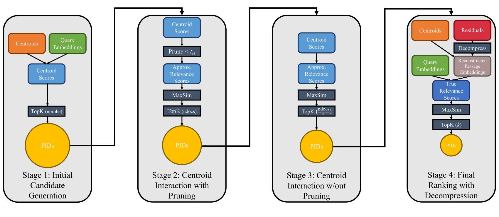

**EN.** Figure 5 . The PLAID scoring pipeline. The first stage generates an initial set of candidate passages using the centroids. Next the second and third stages leverage centroid pruning and centroid interaction respectively to refine the candidate set. Then the last stage performs full residual decompression to obtain the final passage ranking. We use the hyperparameter ndocs to specify the number of candidates returned by Stage 2, and in our experiments we have Stage 3 output $\frac{\texttt{ndocs}}{4}$ passages.

**中.** 图5. PLAID 评分管道。第一阶段使用质心生成一组初始候选段落。接下来，第二和第三阶段分别利用质心剪枝和质心交互来细化候选集。然后最后阶段进行完全残差减压以获得最终的通道排名。我们使用超参数 ndocs 来指定第 2 阶段返回的候选者数量，在我们的实验中，我们有第 3 阶段输出 $\frac{\texttt{ndocs}}{4}$ 段落。

**EN.** Figure 5 illustrates the PLAID scoring pipeline, which consists of multiple consecutive stages for retrieval, filtering, and ranking. The first stage produces an initial candidate set by computing relevance scores for each centroid with respect to the query embeddings. In the intermediate stages, PLAID uses the novel techniques of centroid interaction and centroid pruning to aggressively yet effectively filter the candidate passages. Finally, PLAID ranks the final candidate set using fully reconstructed passage embeddings. We discuss each of these modules in more depth as follows.

**中.** 图 5 说明了 PLAID 评分流程，该流程由用于检索、过滤和排名的多个连续阶段组成。第一阶段通过计算每个质心相对于查询嵌入的相关性分数来生成初始候选集。在中间阶段，PLAID 使用质心交互和质心剪枝的新技术来积极而有效地过滤候选段落。最后，PLAID 使用完全重建的段落嵌入对最终候选集进行排名。我们如下更深入地讨论每个模块。

### Candidate Generation / 4.1.候选人一代

**EN.** Given the query embedding matrix $Q$ and the list of centroid vectors $C$ in the index, PLAID computes the token-level query–centroid relevance scores $S_{c,q}$ as a matrix multiplication:

**中.** 给定查询嵌入矩阵 $Q$ 和索引中的质心向量 $C$ 列表，PLID 将标记级查询质心相关性分数 $S_{c,q}$ 计算为矩阵乘法：

$$
S_{c,q}=C\cdot Q^{T}\\
\tag{2}
$$

**EN.** and then identifies the passages “close” to the top- $t$ centroids per query token as the initial candidate set. A passage is close to a centroid iff one or more of its tokens are assigned to that centroid by $k$ -means clustering during indexing. This value $t$ is referred to as nprobe in vanilla ColBERTv2 and we retain that terminology in PLAID ColBERTv2.

**中.** 然后将每个查询标记“靠近”顶部 $t$ 质心的段落识别为初始候选集。一篇文章接近质心当且仅当其一个或多个标记被 $k$ 分配给该质心 - 意味着在索引期间进行聚类。该值 $t$ 在普通 ColBERTv2 中称为 nprobe，我们在 PLAID ColBERTv2 中保留该术语。

**EN.** The initial candidate generation in PLAID ColBERTv2 differs from the corresponding vanilla ColBERTv2 stage in two key aspects. First, while vanilla ColBERTv2 saves an inverted list mapping centroids to their corresponding embedding IDs, PLAID ColBERTv2 instead structures the inverted list as a map from centroids to the corresponding unique passage IDs . Storing passage IDs is advantageous over storing embedding IDs since there are far fewer passages than embeddings, meaning the inverted list has to store less information overall. This also enables PLAID ColBERTv2 to use 32-bit integers in the inverted list rather than potentially 64-bit longs. [^footnote2] In practice, this translates to a space savings of 2.7 $\times$ in the MS MARCO v2 ( Craswell et al., 2022 ) inverted list (71 GB to 27 GB, with 140M passages).

**中.** PLAID ColBERTv2 中的初始候选生成在两个关键方面与相应的普通 ColBERTv2 阶段不同。首先，虽然普通 ColBERTv2 保存了将质心映射到其相应嵌入 ID 的倒排列表，但 PLAID ColBERTv2 而是将倒排列表构建为从质心到相应唯一段落 ID 的映射。存储段落 ID 比存储嵌入 ID 更有优势，因为段落数量比嵌入少得多，这意味着倒排列表必须存储的总体信息更少。这还使得 PLAID ColBERTv2 能够在倒排列表中使用 32 位整数，而不是潜在的 64 位长整型。 [^footnote2] 实际上，这意味着 MS MARCO v2（Craswell 等人，2022）倒排列表（71 GB 至 27 GB，140M 段落）中节省了 2.7 $\times$ 的空间。

**EN.** Second, and relatedly, if the initial candidate set was too large (as specified by the ncandidates hyperparameter) vanilla ColBERTv2 would prune it by scoring and ranking a subset of the candidate embedding vectors—in particular, the embeddings listed within the vanilla mapping from centroid IDs to embedding IDs—with full residual decompression, which is quite costly as we discuss in § 3.2 . In contrast, PLAID ColBERTv2 does not impose any limit on the initial candidate size because the subsequent stages can cheaply filter the candidate passages with centroid interaction and pruning.

**中.** 其次，与此相关的是，如果初始候选集太大（由 ncandidates 超参数指定），普通 ColBERTv2 会通过对候选嵌入向量的子集进行评分和排名来修剪它（特别是在从质心 ID 到嵌入 ID 的普通映射中列出的嵌入），并进行完全残差解压缩，这非常昂贵，正如我们在第 3.2 节中讨论的那样。相比之下，PLID ColBERTv2 不会对初始候选大小施加任何限制，因为后续阶段可以通过质心交互和修剪来廉价地过滤候选段落。

### Centroid Interaction / 4.2.质心交互

**EN.** Centroid interaction cheaply approximates per-passage relevance by substituting each token’s embedding vector with its nearest centroid in the standard MaxSim formulation. By applying centroid interaction as an additional filtering stage, the scoring pipeline can skip the expensive embedding reconstruction process for a large fraction of the candidate passages. This results in significantly faster end-to-end retrieval. Intuitively, centroid interaction enables PLAID to emulate traditional bag-of-words retrieval wherein the centroid relevance scores take the role of the term relevance scores used in systems like BM25. However, because of its vector representations (of the query in particular), PLAID computes the centroid relevance scores at query time in contrast to the more traditional pre-computed term relevance scores.

**中.** 通过用标准 MaxSim 公式中最近的质心替换每个标记的嵌入向量，质心交互可以廉价地近似每个段落的相关性。通过应用质心交互作为附加过滤阶段，评分管道可以跳过大部分候选段落的昂贵的嵌入重建过程。这会显着加快端到端检索速度。直观上，质心交互使 PLAID 能够模拟传统的词袋检索，其中质心相关性分数充当 BM25 等系统中使用的术语相关性分数的角色。然而，由于其向量表示（特别是查询的向量表示），PLID 在查询时计算质心相关性分数，这与更传统的预先计算的术语相关性分数形成鲜明对比。

**EN.** The procedure works as follows. Recall that $S_{c,q}$ from Equation 2 stores the relevance scores for each centroid with respect to the query tokens. Suppose $I$ is the list of the centroid indices mapped to each of the tokens in the candidate set. Furthermore, let $S_{c,q}[i]$ denote the $i$ -th row of $S_{c,q}$ . Then PLAID constructs the centroid-based approximate scores $\tilde{D}$ as

**中.** 该过程的工作原理如下。回想一下，方程 2 中的 $S_{c,q}$ 存储每个质心相对于查询标记的相关性分数。假设 $I$ 是映射到候选集中每个标记的质心索引列表。此外，令 $S_{c,q}[i]$ 表示 $S_{c,q}$ 的第 $i$ 行。然后 PLAID 构造基于质心的近似分数 $\tilde{D}$ 为

$$
\tilde{D}=\begin{bmatrix}S_{c,q}[I_{1}]\\
S_{c,q}[I_{2}]\\
\cdots\\
S_{c,q}[I_{|\tilde{D}|}]\end{bmatrix}\tag{3}
$$

**EN.** Then to rank the candidate passages using $\tilde{D}$ , PLAID computes the MaxSim scores $S_{\tilde{D}}$ as

**中.** 然后，为了使用 $\tilde{D}$ 对候选段落进行排名，PLID 将 MaxSim 分数 $S_{\tilde{D}}$ 计算为

$$
S_{\tilde{D}}=\sum_{i}^{|Q|}\max_{j=1}^{|\tilde{D}|}\tilde{D}_{i,j}\tag{4}
$$

**EN.** The top $k$ most relevant passages drawn from $S_{\tilde{D}}$ serve as the filtered candidate passage set.

**中.** 从 $S_{\tilde{D}}$ 中提取的最相关的 $k$ 段落用作过滤后的候选段落集。

**EN.** PLAID includes optimized kernels to efficiently deploy centroid interaction (and more generally MaxSim operations); we discuss these in § 4.5 .

**中.** PLAID 包括优化的内核，可有效部署质心交互（以及更普遍的 MaxSim 操作）；我们在第 4.5 节中讨论这些内容。

### Centroid Pruning / 4.3.质心剪枝

**EN.** As an additional optimization, PLAID leverages the observation from § 3.3 to first prune low-magnitude centroid scores before constructing $\tilde{D}$ . In this filtering phase PLAID will only score tokens whose maximum corresponding centroid score meets the given threshold $t_{cs}$ . Concretely, $\tilde{D}$ will only be comprised of tokens whose corresponding centroid (suppose centroid $i$ ) meets the following condition:

**中.** 作为一项额外的优化，PLID 利用第 3.3 节中的观察结果，在构建 $\tilde{D}$ 之前首先修剪低量级质心分数。在此过滤阶段，PLAID 将仅对最大相应质心得分满足给定阈值 $t_{cs}$ 的标记进行评分。具体来说， $\tilde{D}$ 将仅由相应质心（假设质心 $i$ ）满足以下条件的代币组成：

$$
\max_{j=1}^{|Q|}S_{c,q_{i,j}}\geq t_{cs}\tag{5}
$$

**EN.** We introduce the hyperparameter ndocs to refer to the number of candidate documents selected by Stage 2. We then found empirically that choosing $\frac{\texttt{ndocs}}{4}$ candidates from Stage 3 produced good results; we use this heuristic for all the results presented in § 5 .

**中.** 我们引入超参数 ndocs 来指代第 2 阶段选择的候选文档的数量。然后我们根据经验发现，从第 3 阶段选择 $\frac{\texttt{ndocs}}{4}$ 候选文档产生了良好的结果；我们对第 5 节中提供的所有结果都使用此启发式。

### Scoring / 4.4.评分

**EN.** As in vanilla ColBERTv2, PLAID will reconstruct the original embeddings of the final candidate passage set via residual decompression and rank these using MaxSim. Let $D$ be the reconstructed embedding vectors for the final candidate set after decompression. Then the final scores $S_{q,d}$ are computed using Equation 1 .

**中.** 与普通 ColBERTv2 一样，PLID 将通过残差解压缩重建最终候选段落集的原始嵌入，并使用 MaxSim 对它们进行排序。令 $D$ 为解压后最终候选集的重构嵌入向量。然后使用公式 1 计算最终分数 $S_{q,d}$。

**EN.** Section § 4.5 discusses fast kernels for accelerating the MaxSim and decompression operations.

**中.** 第 4.5 节讨论了用于加速 MaxSim 和解压缩操作的快速内核。

### Fast Kernels: Padding-Free MaxSim & Optimized Decompression / 4.5.快速内核：无填充 MaxSim 和优化解压缩

**EN.** Figure 2(a) shows that index lookup operations are a large source of overhead for vanilla ColBERTv2. One reason these lookups are expensive is that they require reshaping and padding the 2D index tensors with an extra dimension representing the maximum passage length. The resulting 3D tensors facilitate batched MaxSim operations over ragged lists of token vectors. To avoid this padding, we instead implement custom C++ code that directly computes the MaxSim scores over the packed 2D index tensors (i.e., one where many 2D sub-tensors of various lengths are concatenated along the same dimension). Our kernel loops over each passage’s corresponding token vectors to compute the per-passage maximum scores with respect to each query token and then sums the per-passage maximum scores across all query tokens. This design is trivial to parallelize across passages, and also enables $O(|Q|)$ per-thread memory usage by allocating a single output vector to store the maximum scores per query token and repeatedly updating this vector in-place. In contrast, the padding-based approach requires $O(|D|\cdot|Q|)$ space. We have incorporated this design into optimized implementations of centroid interaction as well as the final MaxSim operation (stage 4 in Figure 5 ). PLAID only implements these kernels for CPU execution. Adding corresponding GPU kernels remains future work.

**中.** 图 2(a) 显示索引查找操作是普通 ColBERTv2 的一大开销来源。这些查找成本高昂的原因之一是它们需要使用表示最大通道长度的额外维度来重塑和填充 2D 索引张量。生成的 3D 张量有助于在不规则的标记向量列表上进行批量 MaxSim 操作。为了避免这种填充，我们改为实现自定义 C++ 代码，直接计算压缩的 2D 索引张量（即，沿同一维度连接许多不同长度的 2D 子张量）的 MaxSim 分数。我们的内核循环遍历每个段落的相应标记向量，以计算每个查询标记的每个段落最大分数，然后将所有查询标记的每个段落最大分数相加。这种设计对于跨段落并行化来说很简单，并且还通过分配单个输出向量来存储每个查询标记的最大分数并就地重复更新该向量来启用 $O(|Q|)$ 每线程内存使用。相反，基于填充的方法需要 $O(|D|\cdot|Q|)$ 空间。我们已将此设计纳入质心交互的优化实现以及最终的 MaxSim 操作（图 5 中的第 4 阶段）。 PLAID 仅为 CPU 执行实现这些内核。添加相应的 GPU 内核仍是未来的工作。

**EN.** ColBERTv2’s residual decompression scheme computes a list of centroid vectors, determines a fixed set of $2^{b}$ possible deltas from these centroids, and then stores the index into the set of deltas corresponding to each embedding vector. In particular, each compressed 8-bit value stores $\frac{8}{b}$ indices in the range $[0,2^{b})$ . ColBERTv2 incurs significant overhead due to residual decompression, as shown in Figure 2(a) . This is partially due to the naïve decompression implementation, which required explicitly unpacking bits from the compressed representation and performing expensive bit shift and sum operations to recover the original values. Instead, PLAID pre-computes all $2^{8}$ possible lists of indices encoded by an 8-bit packed value. These outputs are stored in a lookup table so that the decompression function can simply retrieve the indices from the table rather than manually unpacking the bits. We include optimized implementations of this lookup-based decompression for both CPU and GPU execution. The GPU implementation uses a custom CUDA kernel that allocates a separate thread to decompress each individual byte in the compressed residual tensor (the thread block size is computed as $\frac{b\cdot d}{8}$ for $d$ -dimensional embedding vectors). The CPU implementation instead parallelizes decompression at the granularity of individual passages.

**中.** ColBERTv2 的残差解压缩方案计算质心向量列表，从这些质心确定一组固定的 $2^{b}$ 可能的增量，然后将索引存储到与每个嵌入向量对应的增量集合中。特别是，每个压缩的 8 位值存储 $[0,2^{b})$ 范围内的 $\frac{8}{b}$ 索引。 ColBERTv2 由于残余解压而产生大量开销，如图 2(a) 所示。这部分是由于简单的解压缩实现，它需要显式地从压缩表示中解压缩位并执行昂贵的位移和求和操作以恢复原始值。相反，PLAID 预先计算由 8 位打包值编码的所有 $2^{8}$ 可能的索引列表。这些输出存储在查找表中，以便解压缩函数可以简单地从表中检索索引，而不是手动解压缩位。我们为 CPU 和 GPU 执行提供了这种基于查找的解压缩的优化实现。 GPU 实现使用自定义 CUDA 内核，该内核分配一个单独的线程来解压缩压缩残差张量中的每个单独字节（对于 $d$ 维嵌入向量，线程块大小计算为 $\frac{b\cdot d}{8}$）。相反，CPU 实现以各个段落的粒度并行解压缩。

## Evaluation / 评价

**EN.** Our evaluation seeks to answer the following research questions:

**中.** 我们的评估旨在回答以下研究问题：

**EN.** (1)

**中.** (1)

**EN.** How does PLAID affect end-to-end latency and retrieval quality across IR benchmarks? (§ 5.2 )

**中.** PLAID 如何影响跨 IR 基准的端到端延迟和检索质量？ （第 5.2 条）

**EN.** (2)

**中.** (2)

**EN.** How much do each of PLAID’s optimizations contribute to the performance speedups? (§ 5.3 )

**中.** PLAID 的每项优化对性能加速的贡献有多大？ （第 5.3 条）

**EN.** (3)

**中.** (3)

**EN.** How well does PLAID scale with respect to the corpus size and the parallelism degree? (§ 5.4 )

**中.** PLAID 在语料库大小和并行度方面的扩展效果如何？ （第 5.4 条）

### Setup / 5.1.设置

| Dataset 数据集 | # Passages # 段落 | # Tokens # 代币 | # Queries # 查询 | ColBERTv2 Index Size (GiB) ColBERTv2 索引大小 (GiB) | ColBERTv2 Index Size (GiB) ColBERTv2 索引大小 (GiB) |
| --- | --- | --- | --- | --- | --- |
| Dataset 数据集 | # Passages # 段落 | # Tokens # 代币 | # Queries # 查询 | Vanilla 香草 | PLAID 格子 |
| MS MARCO v1 ( Nguyen et al., 2016 ) MS MARCO v1（Nguyen 等人，2016） | 8.8M | 597.9M | 6980 | 24.6 | 21.6 |
| Wikipedia ( Karpukhin et al., 2020 ) 维基百科（Karpukhin 等人，2020） | 21.0M | 2.6B | 8757 | 105.2 | 92.0 |
| LoTTE pooled ( Santhanam et al., 2021 ) LoTTE 合并（Santhanam 等人，2021） | 2.4M | 339.4M | 2931 | 14.0 | 12.3 |
| MS MARCO v2 ( Craswell et al., 2022 ) MS MARCO v2（Craswell 等人，2022） | 138.4M | 9.4B | 3903 | 246.0 | 202.2 |

**EN.** Table 1 . List of benchmarks used for evaluation with relevant statistics.

**中.** 表 1.用于评估的基准列表以及相关统计数据。

| $k$ | nprobe 探针 | $t_{cs}$ | ndocs 国家文档 |
| --- | --- | --- | --- |
| 10 | 1 | 0.5 | 256 |
| 100 | 2 | 0.45 | 1024 |
| 1000 | 4 | 0.4 | 4096 |

**EN.** Table 2 . PLAID hyperparameter configuration.

**中.** 表 2. PLAID 超参数配置。

#### PLAID Implementation / 格子实施

**EN.** The PLAID engine subsumes centroid interaction as well as optimizations for residual decompression. We implement PLAID modularly as an extension to ColBERTv2’s PyTorch-based implementation, particularly its search components. For CPU execution, we implement the centroid interaction and decompression operations entirely in multithreaded C++ code. For GPUs, we implement centroid interaction in PyTorch and provide a CUDA kernel for fast decompression. Overall, PLAID constitutes roughly 300 lines of additional Python code and 700 lines of C++.

**中.** PLAID 引擎包含质心交互以及残余减压的优化。我们以模块化方式实现 PLAID，作为 ColBERTv2 基于 PyTorch 的实现（特别是其搜索组件）的扩展。对于CPU执行，我们完全用多线程C++代码实现质心交互和解压缩操作。对于GPU，我们在PyTorch中实现质心交互，并提供CUDA内核用于快速解压。总体而言，PLID 包含大约 300 行额外的 Python 代码和 700 行 C++。

#### Datasets / 数据集

**EN.** Our evaluation includes results from four different IR benchmarks, as listed in Table 1 . We perform in-domain evaluation on the MS MARCO v1 and Wikipedia Open QA benchmarks, with retrievers trained specifically for these tasks, and out-of-domain evaluation on the StackExchange-based LoTTE Santhanam et al. (2021) and the TREC 2021 Deep Learning Track ( Craswell et al., 2022 ) MS MARCO v2 benchmarks, with the ColBERTv2 retriever ( Santhanam et al., 2021 ) trained on MS MARCO v1. For evaluation on Wikipedia we use the December 2018 dump ( Karpukhin et al., 2020 ) with queries from the NaturalQuestions (NQ) dataset ( Kwiatkowski et al., 2019 ) . Our LoTTE ( Santhanam et al., 2021 ) evaluation uses the “pooled” dev dataset with “search”-style queries. For MS MARCO v2, we use the augmented passage version of the data ( Authors, 2021 ) and include passage titles while ignoring headings. As we evaluate several configurations of the models, all of our evaluation is performed using development set queries.

**中.** 我们的评估包括四个不同 IR 基准的结果，如表 1 所列。我们对 MS MARCO v1 和 Wikipedia Open QA 基准进行域内评估，并使用专门针对这些任务训练的检索器，并对基于 StackExchange 的 LoTTE Santhanam 等人进行域外评估。 (2021) 和 TREC 2021 深度学习轨道 (Craswell et al., 2022) MS MARCO v2 基准，其中 ColBERTv2 检索器 (Santhanam et al., 2021) 在 MS MARCO v1 上进行训练。为了对维基百科进行评估，我们使用 2018 年 12 月的转储（Karpukhin 等人，2020）以及来自 NaturalQuestions (NQ) 数据集的查询（Kwiatkowski 等人，2019）。我们的 LoTTE（Santhanam 等人，2021）评估使用带有“搜索”式查询的“池化”开发数据集。对于 MS MARCO v2，我们使用数据的增强段落版本（作者，2021）并包含段落标题，同时忽略标题。当我们评估模型的多种配置时，我们所有的评估都是使用开发集查询来执行的。

#### Systems and hyperparameters / 系统和超参数

**EN.** We report results for several systems for end-to-end results: vanilla ColBERTv2 and PLAID ColBERTv2 as well as ColBERT (v1) ( Khattab and Zaharia, 2020 ) , BM25 ( Robertson et al., 1995 ) , SPLADEv2 ( Formal et al., 2021a ) , and DPR ( Karpukhin et al., 2020 ) . For vanilla ColBERTv2, we use the specific hyperparameters reported in the ColBERTv2 paper for each benchmark dataset. We indicate these in the result tables with p ( nprobe ) and c ( ncandidates ). For PLAID ColBERTv2, we evaluate three different settings: $k=10$ , $k=100$ , and $k=1000$ . The $k$ parameter controls the final number of scored documents as well as the retrieval hyperparameters described in § 4 . Table 2 lists these hyperparameter configurations for each $k$ setting. We find empirically that ranking $\frac{\texttt{ndocs}}{4}$ documents for the final scoring stage produces strong results. For both vanilla ColBERTv2 and PLAID ColBERTv2, we compress all datasets to 2 bits per dimension, with the exception of MS MARCO v2 where we compress to 1 bit.

**中.** 我们报告了多个系统的端到端结果：vanilla ColBERTv2 和 PLAID ColBERTv2 以及 ColBERT (v1) (Khattab 和 Zaharia, 2020)、BM25 (Robertson 等人, 1995)、SPLADEv2 (Formal 等人, 2021a) 和 DPR (Karpukhin 等人, 2020) ）。对于普通 ColBERTv2，我们对每个基准数据集使用 ColBERTv2 论文中报告的特定超参数。我们在结果表中用 p ( nprobe ) 和 c ( ncandidates ) 表示这些。对于 PLAID ColBERTv2，我们评估三种不同的设置： $k=10$ 、 $k=100$ 和 $k=1000$ 。 $k$ 参数控制评分文档的最终数量以及第 4 节中描述的检索超参数。表 2 列出了每个 $k$ 设置的超参数配置。我们根据经验发现，在最终评分阶段对 $\frac{\texttt{ndocs}}{4}$ 文档进行排名会产生很好的结果。对于普通 ColBERTv2 和 PLAID ColBERTv2，我们将所有数据集压缩到每个维度 2 位，但 MS MARCO v2 除外，我们压缩到 1 位。

#### Hardware / 硬件

**EN.** We conduct all experiments on servers with 28 Intel Xeon Gold 6132 2.6 GHz CPU cores (2 threads per core for a total of 56 threads) and 4 NVIDIA TITAN V GPUs each. Every server has two NUMA sockets with roughly 92 ns intra-socket memory latency, 142 ns inter-socket memory latency, 72 GBps intra-socket memory bandwidth, and 33 GBps inter-socket memory bandwidth. Each TITAN V GPU has 12 GB of high-bandwidth memory.

**中.** 我们在具有 28 个 Intel Xeon Gold 6132 2.6 GHz CPU 内核（每个内核 2 个线程，总共 56 个线程）和 4 个 NVIDIA TITAN V GPU 的服务器上进行所有实验。每台服务器都有两个 NUMA 插槽，插槽内内存延迟约为 92 ns，插槽间内存延迟为 142 ns，插槽内内存带宽为 72 GBps，插槽间内存带宽为 33 GBps。每个 TITAN V GPU 均具有 12 GB 高带宽内存。

#### Latency measurements / 延迟测量

**EN.** When measuring latency for end-to-end results, we compute the average latency of all queries (see Table 1 for query totals), and then report the minimum average latency across 3 trials. For other results we describe the specific measurement procedure in the relevant section. We discard the query encoding latency for neural models (ColBERTv1 ( Khattab and Zaharia, 2020 ) , vanilla ColBERTv2 ( Santhanam et al., 2021 ) , PLAID ColBERTv2, and SPLADEv2 ( Formal et al., 2021a ) ) following Mackenzie et al. (2021) ; prior work has shown that the cost of running the BERT model can be made negligible with standard techniques such as quantization, distillation, etc. ( Bergum, 2021 ) . We measure latency on an otherwise idle machine. We prepend commands with numactl --membind 0 to ensure intra-socket I/O operations. We do not do this for MS MARCO v2, since its large index may require both NUMA nodes. For GPU results we allow full usage of all 56 threads, but for CPU-only results we restrict usage to either 1 or 8 threads using torch.set_num_threads . For non-ColBERT systems we use the single-threaded latency numbers reported by Mackenzie et al. (2021) . Note that these numbers were measured on a different hardware setup and using a different implementation and are therefore simply meant to establish PLAID ColBERTv2’s competitive performance rather than serving as absolute comparisons.

**中.** 在测量端到端结果的延迟时，我们计算所有查询的平均延迟（有关查询总数，请参阅表 1），然后报告 3 次试验的最小平均延迟。对于其他结果，我们在相关部分描述了具体的测量程序。我们遵循 Mackenzie 等人的建议，放弃了神经模型的查询编码延迟（ColBERTv1（Khattab 和 Zaharia，2020）、vanilla ColBERTv2（Santhanam 等人，2021）、PLID ColBERTv2 和 SPLADEv2（Formal 等人，2021a））。 (2021);先前的工作表明，使用量化、蒸馏等标准技术可以使运行 BERT 模型的成本可以忽略不计（Bergum，2021）。我们测量闲置机器上的延迟。我们在命令前面加上 numactl --membind 0 以确保套接字内 I/O 操作。我们不会对 MS MARCO v2 执行此操作，因为它的大索引可能需要两个 NUMA 节点。对于 GPU 结果，我们允许完全使用所有 56 个线程，但对于仅限 CPU 的结果，我们使用 torch.set_num_threads 将使用限制为 1 或 8 个线程。对于非 ColBERT 系统，我们使用 Mackenzie 等人报告的单线程延迟数。 （2021）。请注意，这些数字是在不同的硬件设置和使用不同的实现上测量的，因此只是为了确定 PLAID ColBERTv2 的竞争性能，而不是作为绝对比较。

### End-to-end Results / 5.2.端到端结果

| System 系统 | MRR@10 | R@100 | R@1k | Latency (ms) 延迟（毫秒） | Latency (ms) 延迟（毫秒） | Latency (ms) 延迟（毫秒） |
| --- | --- | --- | --- | --- | --- | --- |
| System 系统 | MRR@10 | R@100 | R@1k | 1-CPU | 8-CPU | GPU 图形处理器 |
| BM25 (PISA ( Mallia et al., 2019 ) ; $k=1000$ ) BM25（PISA（Mallia 等人，2019）；$k=1000$） | 18.7* | - | - | 8.3* | - | - |
| SPLADEv2 (PISA; $k=1000$ ) SPLADEv2（PISA；$k=1000$） | 36.8* | - | 97.9* | 220.3* | - | - |
| ColBERTv1 | 36.1 | 87.3 | 95.2 | - | - | 54.3 |
| Vanilla ColBERTv2 ( p =2, c = $2^{13}$ ) 原版 ColBERTv2 ( p =2, c = $2^{13}$ ) | 39.7 | 90.4 | 96.6 | 3485.1 | 921.8 | 53.4 |
| Vanilla ColBERTv2 ( p =4, c = $2^{16}$ ) 原版 ColBERTv2（p = 4，c = $2^{16}$） | 39.7 | 91.4 | 98.3 | - | 4568.5 | 259.6 |
| PLAID ColBERTv2 ( $k=10$ ) 格子 ColBERTv2 ( $k=10$ ) | 39.4 | - | - | 185.5 | 31.5 | 11.5 |
| PLAID ColBERTv2 ( $k=100$ ) 格子 ColBERTv2 ( $k=100$ ) | 39.8 | 90.6 | - | 222.3 | 52.9 | 20.2 |
| PLAID ColBERTv2 ( $k=1000$ ) 格子 ColBERTv2 ( $k=1000$ ) | 39.8 | 91.3 | 97.5 | 352.3 | 101.3 | 38.4 |

**EN.** Table 3 . End-to-end in-domain evaluation on the MS MARCO v1 benchmark. Numbers marked with an asterisk are copied from Formal et al. (2021b) for SPLADEv2 quality and Mackenzie et al. (2021) for latencies.

**中.** 表 3.基于 MS MARCO v1 基准的端到端域内评估。标有星号的数字复制自 Formal 等人。 (2021b) SPLADEv2 质量和 Mackenzie 等人。 (2021) 延迟。

| System 系统 | Success@5 成功@5 | Success@100 成功@100 | Latency (ms) 延迟（毫秒） | Latency (ms) 延迟（毫秒） |
| --- | --- | --- | --- | --- |
| System 系统 | Success@5 成功@5 | Success@100 成功@100 | CPU (8) 中央处理器 (8) | GPU 图形处理器 |
| DPR | 66.8 | 85.0 | - | - |
| ColBERT-QA Retrieval (uncompressed) ColBERT-QA 检索（未压缩） | 75.3 | 89.2 | - | - |
| ColBERT-QA ( Khattab et al., 2021b ) Retriever with ColBERTv2 ( Santhanam et al., 2021 ) residual compression ColBERT-QA (Khattab et al., 2021b) 具有 ColBERTv2 (Santhanam et al., 2021) 残余压缩的检索器 | ColBERT-QA ( Khattab et al., 2021b ) Retriever with ColBERTv2 ( Santhanam et al., 2021 ) residual compression ColBERT-QA (Khattab et al., 2021b) 具有 ColBERTv2 (Santhanam et al., 2021) 残余压缩的检索器 | ColBERT-QA ( Khattab et al., 2021b ) Retriever with ColBERTv2 ( Santhanam et al., 2021 ) residual compression ColBERT-QA (Khattab et al., 2021b) 具有 ColBERTv2 (Santhanam et al., 2021) 残余压缩的检索器 | ColBERT-QA ( Khattab et al., 2021b ) Retriever with ColBERTv2 ( Santhanam et al., 2021 ) residual compression ColBERT-QA (Khattab et al., 2021b) 具有 ColBERTv2 (Santhanam et al., 2021) 残余压缩的检索器 | ColBERT-QA ( Khattab et al., 2021b ) Retriever with ColBERTv2 ( Santhanam et al., 2021 ) residual compression ColBERT-QA (Khattab et al., 2021b) 具有 ColBERTv2 (Santhanam et al., 2021) 残余压缩的检索器 |
| Vanilla ColBERT-QA Retrieval ( p =4, c = $2^{15}$ ) Vanilla ColBERT-QA 检索（p = 4，c = $2^{15}$） | 74.3 | 89.0 | 5077.9 | 204.1 |
| PLAID ColBERT-QA Retrieval ( $k=10$ ) PLAID ColBERT-QA 检索 ( $k=10$ ) | 73.3 | - | 67.1 | 13.6 |
| PLAID ColBERT-QA Retrieval ( $k=100$ ) PLAID ColBERT-QA 检索 ( $k=100$ ) | 74.1 | 88.0 | 120.1 | 26.9 |
| PLAID ColBERT-QA Retrieval ( $k=1000$ ) PLAID ColBERT-QA 检索 ( $k=1000$ ) | 74.4 | 88.9 | 228.4 | 55.3 |

**EN.** Table 4 . End-to-end in-domain retrieval evaluation on the Wikipedia open-domain question answering benchmark. We use the NQ checkpoint of ColBERT-QA ( Khattab et al., 2021b ) , and apply ColBERTv2 compression. We compare vanilla ColBERTv2 retrieval against PLAID ColBERTv2 retrieval. DPR results from Karpukhin et al. (2020) . We refer to Khattab et al. (2021b) for details on OpenQA retrieval evaluation.

**中.** 表 4.维基百科开放域问答基准的端到端域内检索评估。我们使用 ColBERT-QA 的 NQ 检查点（Khattab 等人，2021b），并应用 ColBERTv2 压缩。我们将普通 ColBERTv2 检索与 PLAID ColBERTv2 检索进行比较。来自 Karpukhin 等人的 DPR 结果。 （2020）。我们参考 Khattab 等人。 (2021b) 有关 OpenQA 检索评估的详细信息。

| System 系统 | Success@5 成功@5 | Success@100 成功@100 | Latency (ms) 延迟（毫秒） | Latency (ms) 延迟（毫秒） |
| --- | --- | --- | --- | --- |
| System 系统 | Success@5 成功@5 | Success@100 成功@100 | CPU (8) 中央处理器 (8) | GPU 图形处理器 |
| BM25 | 47.8* | 77.6* | - | - |
| SPLADEv2 斯普拉德v2 | 67.0* | 89.0* | - | - |
| Vanilla ColBERTv2 ( p =2, c = $2^{13}$ ) 原版 ColBERTv2 ( p =2, c = $2^{13}$ ) | 69.3 | 90.3 | 1508.4 | 66.9 |
| PLAID ColBERTv2 ( $k=10$ ) 格子 ColBERTv2 ( $k=10$ ) | 69.1 | - | 35.5 | 9.2 |
| PLAID ColBERTv2 ( $k=100$ ) 格子 ColBERTv2 ( $k=100$ ) | 69.4 | 89.9 | 64.8 | 17.4 |
| PLAID ColBERTv2 ( $k=1000$ ) 格子 ColBERTv2 ( $k=1000$ ) | 69.6 | 90.5 | 163.1 | 27.3 |

**EN.** Table 5 . End-to-end out-of-domain evaluation on the (dev) pooled dataset of the LoTTE benchmark. Numbers marked with an asterisk were taken from Santhanam et al. (2021) .

**中.** 表 5.对 LoTTE 基准的（开发）池数据集进行端到端域外评估。标有星号的数字取自 Santhanam 等人。 （2021）。

| System 系统 | MRR@100 | R@100 | R@1k | Latency (ms) 延迟（毫秒） | Latency (ms) 延迟（毫秒） |
| --- | --- | --- | --- | --- | --- |
| System 系统 | MRR@100 | R@100 | R@1k | 8-CPU | GPU 图形处理器 |
| BM25 (Anserini ( Yang et al., 2018 ) ; Augmented) BM25（Anserini（Yang 等人，2018）；增强版） | 8.7 | 40.3 | 69.3 | - | - |
| Vanilla ColBERTv2 ( p =4, c = $2^{16}$ ) 原版 ColBERTv2（p = 4，c = $2^{16}$） | 18.0 | 68.2 | 88.1 | 5228.5 | OOM |
| PLAID ColBERTv2 ( $k=10$ ) 格子 ColBERTv2 ( $k=10$ ) | - | - | - | 136.4 | 47.1 |
| PLAID ColBERTv2 ( $k=100$ ) 格子 ColBERTv2 ( $k=100$ ) | 17.9 | 67.0 | - | 181.9 | 96.1 |
| PLAID ColBERTv2 ( $k=1000$ ) 格子 ColBERTv2 ( $k=1000$ ) | 18.0 | 68.4 | 85.7 | 251.3 | OOM |

**EN.** Table 6 . End-to-end out-of-domain evaluation on the MS MARCO v2 benchmark. BM25 results from ( Authors, 2022 ) .

**中.** 表 6.基于 MS MARCO v2 基准的端到端域外评估。 BM25 结果来自（作者，2022）。

**EN.** Table 3 presents in-domain results for the MS MARCO v1 benchmark. We observe that in the most conservative setting ( $k=1000$ ), PLAID ColBERTv2 is able to match the MRR@10 and Recall@100 achieved by vanilla ColBERTv2 while delivering speedups of 6.8 $\times$ on GPU and 45 $\times$ on CPU. For some minimal reduction in quality, PLAID ColBERTv2 can further increase the speedups over vanilla ColBERTv2 to 12.9–22.6 $\times$ on GPU and 86.4–145 $\times$ on CPU. PLAID ColBERTv2 also achieves competitive latency compared to other systems (within 1.6 $\times$ of SPLADEv2) while outperforming them on retrieval quality.

**中.** 表 3 显示了 MS MARCO v1 基准测试的域内结果。我们观察到，在最保守的设置 ($k=1000$) 中，PLID ColBERTv2 能够与普通 ColBERTv2 实现的 MRR@10 和 Recall@100 相匹配，同时在 GPU 上提供 6.8 $\times$，在 CPU 上提供 45 $\times$。对于质量的一些最小程度的降低，PLID ColBERTv2 可以进一步将 GPU 上的加速比普通 ColBERTv2 提高到 12.9–22.6 $\times$，在 CPU 上提高到 86.4–145 $\times$。与其他系统相比，PLID ColBERTv2 还实现了有竞争力的延迟（SPLADEv2 的 1.6 $\times$ 以内），同时在检索质量方面优于其他系统。

**EN.** We observe a similar trend with in-domain evaluation on the Wikipedia OpenQA benchmark as shown in Table 4 . PLAID ColBERTv2 achieves speedups of 3.7 $\times$ on GPU and 22 $\times$ on CPU with no quality loss compared to vanilla ColBERTv2, and speedups of 7.6–15 $\times$ on GPU and 42.3–75.7 $\times$ on CPU with minimal quality loss.

**中.** 我们在 Wikipedia OpenQA 基准上观察到域内评估的类似趋势，如表 4 所示。与普通 ColBERTv2 相比，PLID ColBERTv2 在 GPU 上实现了 3.7 $\times$，在 CPU 上实现了 22 $\times$，且没有质量损失；在 GPU 上实现了 7.6–15 $\times$，在 CPU 上实现了 42.3–75.7 $\times$，同时质量损失最小。

**EN.** We confirm PLAID works well in out-of-domain settings, as well, as demonstrated by our results on the LoTTE “pooled” dataset. We see in Table 5 that PLAID ColBERTv2 outperforms vanilla ColBERTv2 by 2.5 $\times$ on GPU and 9.2 $\times$ on CPU with $k=1000$ ; furthermore, this setting actually improves quality compared to vanilla ColBERTv2. With some quality loss PLAID ColBERTv2 can achieve speedups of 3.8–7.3 $\times$ on GPU and 23.2–42.5 $\times$ on CPU. Note that the CPU latencies achieved on LoTTE with PLAID ColBERTv2 are larger than those achieved on MS MARCO v1 because the average LoTTE passage length is roughly 2 $\times$ that of MS MARCO v1.

**中.** 我们确认 PLAID 在域外设置中也能很好地工作，正如我们在 LoTTE“池化”数据集上的结果所证明的那样。我们在表 5 中看到，PLID ColBERTv2 在 GPU 上的性能优于普通 ColBERTv2 2.5 $\times$，在具有 $k=1000$ 的 CPU 上优于普通 ColBERTv2 9.2 $\times$；此外，与普通 ColBERTv2 相比，此设置实际上提高了质量。在存在一定质量损失的情况下，PLID ColBERTv2 在 GPU 上可实现 3.8–7.3 $\times$ 的加速，在 CPU 上可实现 23.2–42.5 $\times$ 的加速。请注意，使用 PLAID ColBERTv2 在 LoTTE 上实现的 CPU 延迟大于在 MS MARCO v1 上实现的 CPU 延迟，因为平均 LoTTE 通道长度大约是 MS MARCO v1 的 2 $\times$。

**EN.** Finally, Table 6 shows that PLAID ColBERTv2 scales effectively to MS MARCO v2, which is a large-scale dataset with 138M passages and 9.4B tokens (approximately 16 $\times$ bigger than MS MARCO v1). Continuing the trend we observe with other datasets, we find that PLAID ColBERTv2 is 20.8 $\times$ faster than vanilla ColBERTv2 on CPU with no quality loss up to 100 passages. We do find that when $k=1000$ both vanilla ColBERTv2 and PLAID ColBERTv2 run out of memory on GPU; we believe we can address this in PLAID by implementing custom padding-free MaxSim kernels for GPU execution as discussed in § 4.5 .

**中.** 最后，表 6 显示 PLAID ColBERTv2 可以有效地扩展到 MS MARCO v2，这是一个具有 138M 段落和 9.4B 个标记的大型数据集（比 MS MARCO v1 大大约 16 $\times$）。延续我们在其他数据集上观察到的趋势，我们发现 PLAID ColBERTv2 在 CPU 上比普通 ColBERTv2 快 20.8 $\times$，并且最多 100 个通道没有质量损失。我们确实发现，当 $k=1000$ 时，vanilla ColBERTv2 和 PLAID ColBERTv2 都会在 GPU 上耗尽内存；我们相信我们可以通过实现用于 GPU 执行的自定义无填充 MaxSim 内核来解决 PLAID 中的问题，如第 4.5 节中所述。

### Ablation / 5.3.消融

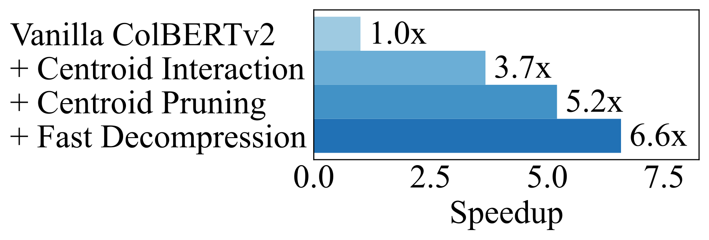

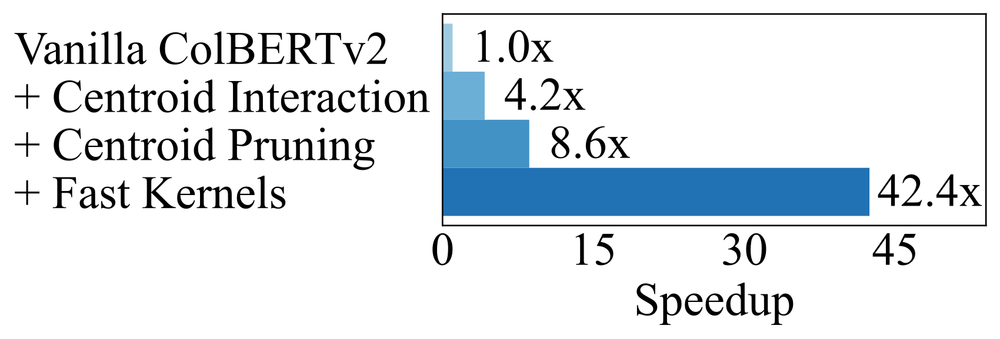

**EN.** Figure 6 . Ablation of performance optimizations included in PLAID.

**中.** 图6. PLAID 中包含的性​​能优化的消融。

**EN.** Figure 6 presents an ablation analysis to break down PLAID’s performance improvements for both GPU and CPU execution. Our measurements are taken from evaluation on a random sample of 500 MS MARCO v1 queries (note that this results in minor differences in the absolute numbers reported in Table 3 ). We consider vanilla ColBERTv2 as a baseline, and then add one stage of centroid interaction without pruning (stage 3 in Figure 5 ), followed by another stage of centroid interaction with centroid pruning (stage 2 in Figure 5 ), and then finally the optimized kernels described in § 4.5 . When applicable we use hyperparameters corresponding to the $k=1000$ setting described in Table 2 (i.e., the most conservative setting).

**中.** 图 6 展示了一项消融分析，以分解 PLAID 对 GPU 和 CPU 执行的性能改进。我们的测量结果来自对 500 个 MS MARCO v1 查询的随机样本的评估（请注意，这会导致表 3 中报告的绝对数字存在微小差异）。我们将普通 ColBERTv2 视为基线，然后添加一个不进行剪枝的质心交互阶段（图 5 中的阶段 3），然后添加具有质心剪枝的质心交互的另一阶段（图 5 中的阶段 2），最后是第 4.5 节中描述的优化内核。如果适用，我们使用与表 2 中描述的 $k=1000$ 设置相对应的超参数（即最保守的设置）。

**EN.** We find that both the algorithmic improvements to the scoring pipeline as well as the implementation optimizations are key to PLAID’s performance. In particular, the centroid interaction stages alone deliver speedups of 5.2 $\times$ on GPU and 8.6 $\times$ on CPU, but adding the implementation optimizations result in additional speedups of 1.3 $\times$ on GPU and 4.9 $\times$ on CPU. Only enabling optimized C++ kernels on CPU without centroid interaction (not shown in Figure 6 ) results in an end-to-end speedup of just 3 $\times$ compared to 42.4 $\times$ with the complete PLAID.

**中.** 我们发现评分管道的算法改进以及实施优化都是 PLAID 性能的关键。特别是，仅质心交互阶段就可以在 GPU 上实现 5.2 $\times$ 的加速，在 CPU 上实现 8.6 $\times$ 的加速，但添加实现优化后，可以在 GPU 上实现 1.3 $\times$ 的额外加速，在 CPU 上实现 4.9 $\times$ 的额外加速。仅在没有质心交互的情况下在 CPU 上启用优化的 C++ 内核（图 6 中未显示）会导致端到端加速仅为 3 $\times$，而使用完整 PLAID 时则为 42.4 $\times$。

### Scalability / 5.4.可扩展性

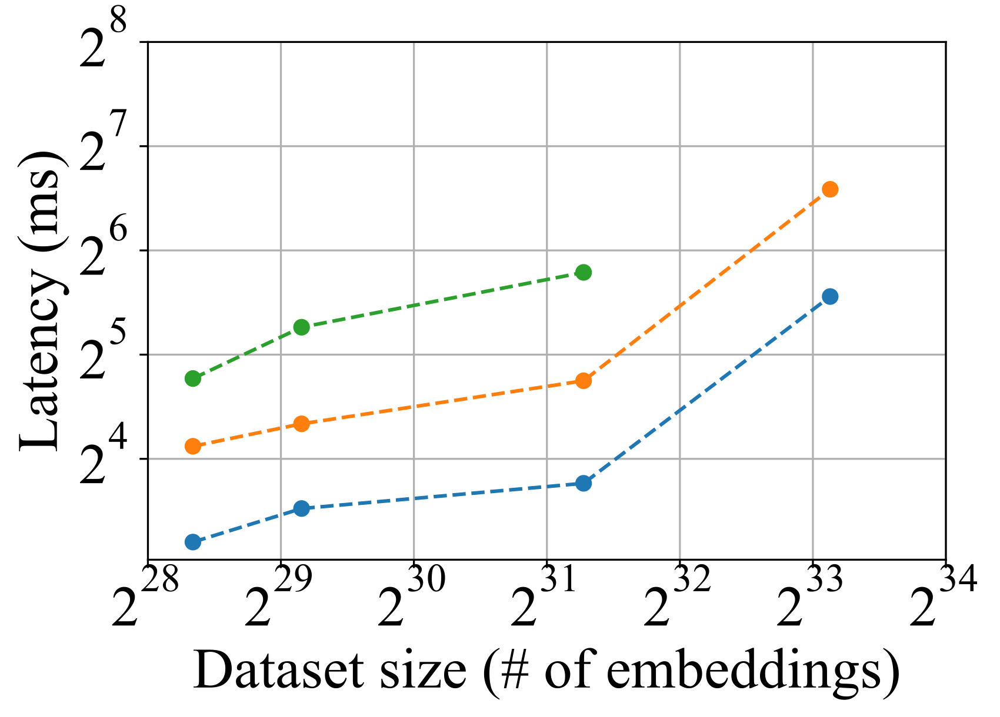

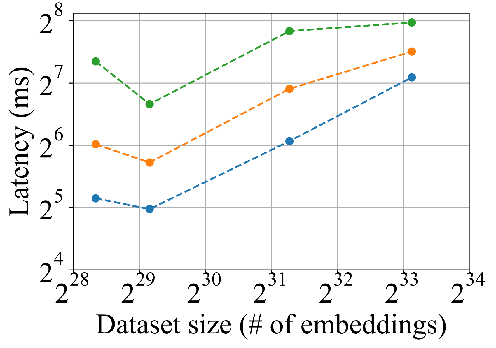

**EN.** Figure 7 . End-to-end latency versus dataset size (as measured in number of embeddings) for each setting of $k$ (note the log-log scale). Dataset sizes are taken from Table 1 , and latency numbers are taken from Tables 3 , 4 , 5 , and 6 .

**中.** 图 7. $k$ 每种设置的端到端延迟与数据集大小（以嵌入数量衡量）（注意对数比例）。数据集大小取自表 1，延迟数取自表 3、表 4、表 5 和表 6。

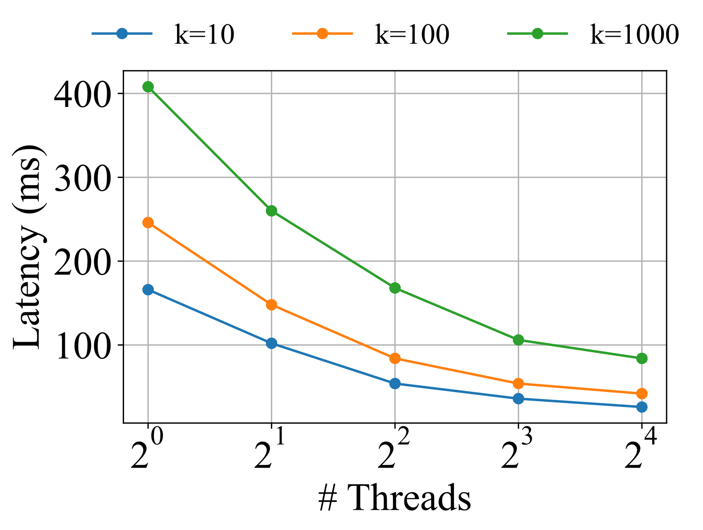

**EN.** Figure 8 . PLAID scaling behavior with respect to the number of available CPU threads.

**中.** 图 8. PLAID 缩放行为与可用 CPU 线程数相关。

**EN.** We evaluate PLAID’s scalability with respect to both the dataset size as well as the parallelism degree (on CPU).

**中.** 我们根据数据集大小和并行度（在 CPU 上）评估 PLAID 的可扩展性。

**EN.** First, Figure 7 plots the end-to-end PLAID ColBERTv2 latencies we measured for each benchmark dataset versus the size of each dataset (measured in number of embeddings). While latencies across different datasets are not necessarily directly comparable (e.g due to different passage lengths), we nevertheless aim to analyze high-level trends from this figure. We find that in general, PLAID ColBERTv2 latencies appear to scale with respect to the square root of dataset size. This intuitively follows from the fact that ColBERTv2 sets the number of centroids proportionally to the square root of the number of embeddings, and the overhead of candidate generation is inversely correlated with the number of partitions.

**中.** 首先，图 7 绘制了我们为每个基准数据集测量的端到端 PLAID ColBERTv2 延迟与每个数据集的大小（以嵌入数量测量）的关系。虽然不同数据集的延迟不一定可以直接比较（例如，由于不同的通道长度），但我们的目标是从该图中分析高级趋势。我们发现，一般来说，PLID ColBERTv2 延迟似乎与数据集大小的平方根成比例。这直观地源于以下事实：ColBERTv2 将质心数量设置为与嵌入数量的平方根成比例，并且候选生成的开销与分区数量成反比。

**EN.** Next, Figure 8 plots the latency achieved by PLAID ColBERTv2 versus the number of available CPU threads, repeated for $k\in\{10,100,1000\}$ . We evaluate a random sample of 500 MS MARCO v1 queries to obtain the latency measurements. We observe that PLAID is able to take advantage of additional threads; in particular, executing with 16 threads results in a speedup of 4.9 $\times$ compared to single-threaded execution when $k=1000$ . While PLAID does not achieve perfect linear scaling, we speculate that possible explanations could include remaining inefficiencies in the existing vanilla ColBERTv2 candidate generation step (which we do not optimize at a low level for this work) or suboptimal load balancing between threads due to the non-uniform passage lengths. We defer more extensive profiling and potential solutions to future work.

**中.** 接下来，图 8 绘制了 PLAID ColBERTv2 实现的延迟与可用 CPU 线程数量的关系，对 $k\in\{10,100,1000\}$ 进行了重复。我们评估 500 MS MARCO v1 查询的随机样本以获得延迟测量值。我们观察到 PLAID 能够利用额外的线程；特别是，与 $k=1000$ 时的单线程执行相比，使用 16 个线程执行会导致 4.9 $\times$ 的加速。虽然 PLAID 没有实现完美的线性缩放，但我们推测可能的解释可能包括现有普通 ColBERTv2 候选生成步骤中仍然效率低下（我们在这项工作中没有在低水平上进行优化）或由于通道长度不均匀而导致线程之间的负载平衡不理想。我们将更广泛的分析和潜在的解决方案推迟到未来的工作中。

## Conclusion / 六、结论

**EN.** In this work, we presented PLAID, an efficient engine for late interaction that accelerates retrieval by aggressively and cheaply filtering candidate passages. We showed that retrieval with only ColBERTv2 centroids retains high recall compared to vanilla ColBERTv2, and the distribution of centroid relevance scores skews toward lower magnitude scores. Using these insights, we introduced the technique of centroid interaction and incorporated centroid interaction into multiple stages of the PLAID ColBERTv2 scoring pipeline. We also described our highly optimized implementation of PLAID that includes custom kernels for padding-free MaxSim and residual decompression operations. We found in our evaluation across several IR benchmarks that PLAID ColBERTv2 provides speedups of 2.5–6.8 $\times$ on GPU and 9.2–45 $\times$ on CPU with virtually no quality loss compared to vanilla ColBERTv2 while scaling effectively to a dataset of 140 million passages.

**中.** 在这项工作中，我们提出了 PLAID，这是一种用于后期交互的高效引擎，它通过积极且廉价地过滤候选段落来加速检索。我们表明，与普通 ColBERTv2 相比，仅使用 ColBERTv2 质心进行检索保留了较高的召回率，并且质心相关性分数的分布偏向于较低的幅度分数。利用这些见解，我们引入了质心交互技术，并将质心交互合并到 PLAID ColBERTv2 评分流程的多个阶段中。我们还描述了高度优化的 PLAID 实现，其中包括用于无填充 MaxSim 和残差解压缩操作的自定义内核。我们在对多个 IR 基准的评估中发现，PLID ColBERTv2 在 GPU 上提供了 2.5–6.8 $\times$，在 CPU 上提供了 9.2–45 $\times$，与普通 ColBERTv2 相比，几乎没有质量损失，同时有效扩展到包含 1.4 亿通道的数据集。

## References / 参考文献

- Abuzaid et al . (2019) Firas Abuzaid, Geet Sethi, Peter Bailis, and Matei Zaharia. 2019. To index or not to index: Optimizing exact maximum inner product search. In 2019 IEEE 35th International Conference on Data Engineering (ICDE) . IEEE, 1250–1261.

- Authors (2021) Anserini GitHub Repo Authors. 2021. Passage Collection (Augmented). [https://github.com/castorini/anserini/blob/master/docs/experiments-msmarco-v2.md#passage-collection-augmented](https://github.com/castorini/anserini/blob/master/docs/experiments-msmarco-v2.md#passage-collection-augmented)

- Authors (2022) Anserini GitHub Repo Authors. 2022. Anserini Regressions: MS MARCO (V2) Passage Ranking. [https://github.com/castorini/anserini/blob/master/docs/regressions-msmarco-v2-passage-augmented.md](https://github.com/castorini/anserini/blob/master/docs/regressions-msmarco-v2-passage-augmented.md)

- Bergum (2021) Jo Kristian Bergum. 2021. Pretrained Transformer Language Models for Search - part 3. [https://blog.vespa.ai/pretrained-transformer-language-models-for-search-part-3/](https://blog.vespa.ai/pretrained-transformer-language-models-for-search-part-3/)

- Broder et al . (2003) Andrei Z Broder, David Carmel, Michael Herscovici, Aya Soffer, and Jason Zien. 2003. Efficient query evaluation using a two-level retrieval process. In CIKM .

- Craswell et al . (2022) Nick Craswell, Bhaskar Mitra, Emine Yilmaz, Daniel Campos, and Jimmy Lin. 2022. Overview of the TREC 2021 deep learning track. In Text REtrieval Conference (TREC) . TREC. [https://www.microsoft.com/en-us/research/publication/overview-of-the-trec-2021-deep-learning-track/](https://www.microsoft.com/en-us/research/publication/overview-of-the-trec-2021-deep-learning-track/)

- Dai and Callan (2020) Zhuyun Dai and Jamie Callan. 2020. Context-Aware Term Weighting For First Stage Passage Retrieval. In Proceedings of the 43rd International ACM SIGIR conference on research and development in Information Retrieval, SIGIR 2020, Virtual Event, China, July 25-30, 2020 , Jimmy Huang, Yi Chang, Xueqi Cheng, Jaap Kamps, Vanessa Murdock, Ji-Rong Wen, and Yiqun Liu (Eds.). ACM, 1533–1536. [https://doi.org/10.1145/3397271.3401204](https://doi.org/10.1145/3397271.3401204)

- Dimopoulos et al . (2013) Constantinos Dimopoulos, Sergey Nepomnyachiy, and Torsten Suel. 2013. Optimizing top-k document retrieval strategies for block-max indexes. In WSDM .

- Ding and Suel (2011) Shuai Ding and Torsten Suel. 2011. Faster top-k document retrieval using block-max indexes. In SIGIR .

- Formal et al . (2021a) Thibault Formal, Carlos Lassance, Benjamin Piwowarski, and Stéphane Clinchant. 2021a. SPLADE v2: Sparse Lexical and Expansion Model for Information Retrieval. arXiv preprint arXiv:2109.10086 (2021). [https://arxiv.org/abs/2109.10086](https://arxiv.org/abs/2109.10086)

- Formal et al . (2021b) Thibault Formal, Benjamin Piwowarski, and Stéphane Clinchant. 2021b. SPLADE: Sparse Lexical and Expansion Model for First Stage Ranking. In Proceedings of the 44th International ACM SIGIR Conference on Research and Development in Information Retrieval . 2288–2292.

- Gao et al . (2021) Luyu Gao, Zhuyun Dai, and Jamie Callan. 2021. COIL: Revisit Exact Lexical Match in Information Retrieval with Contextualized Inverted List. In Proceedings of the 2021 Conference of the North American Chapter of the Association for Computational Linguistics: Human Language Technologies . Association for Computational Linguistics, Online, 3030–3042. [https://doi.org/10.18653/v1/2021.naacl-main.241](https://doi.org/10.18653/v1/2021.naacl-main.241)

- Hofstätter et al . (2020) Sebastian Hofstätter, Sophia Althammer, Michael Schröder, Mete Sertkan, and Allan Hanbury. 2020. Improving Efficient Neural Ranking Models with Cross-Architecture Knowledge Distillation. arXiv preprint arXiv:2010.02666 (2020). [https://arxiv.org/abs/2010.02666](https://arxiv.org/abs/2010.02666)

- Hofstätter et al . (2022) Sebastian Hofstätter, Omar Khattab, Sophia Althammer, Mete Sertkan, and Allan Hanbury. 2022. Introducing Neural Bag of Whole-Words with ColBERTer: Contextualized Late Interactions using Enhanced Reduction. arXiv preprint arXiv:2203.13088 (2022).

- Humeau et al . (2020) Samuel Humeau, Kurt Shuster, Marie-Anne Lachaux, and Jason Weston. 2020. Poly-encoders: Architectures and Pre-training Strategies for Fast and Accurate Multi-sentence Scoring. In 8th International Conference on Learning Representations, ICLR 2020, Addis Ababa, Ethiopia, April 26-30, 2020 . OpenReview.net. [https://openreview.net/forum?id=SkxgnnNFvH](https://openreview.net/forum?id=SkxgnnNFvH)

- Jegou et al . (2010) Herve Jegou, Matthijs Douze, and Cordelia Schmid. 2010. Product quantization for nearest neighbor search. IEEE transactions on pattern analysis and machine intelligence 33, 1 (2010), 117–128.

- Johnson et al . (2019) Jeff Johnson, Matthijs Douze, and Hervé Jégou. 2019. Billion-scale similarity search with gpus. IEEE Transactions on Big Data (2019).

- Karpukhin et al . (2020) Vladimir Karpukhin, Barlas Oguz, Sewon Min, Patrick Lewis, Ledell Wu, Sergey Edunov, Danqi Chen, and Wen-tau Yih. 2020. Dense Passage Retrieval for Open-Domain Question Answering. In Proceedings of the 2020 Conference on Empirical Methods in Natural Language Processing (EMNLP) . Association for Computational Linguistics, Online, 6769–6781. [https://doi.org/10.18653/v1/2020.emnlp-main.550](https://doi.org/10.18653/v1/2020.emnlp-main.550)

- Khattab et al . (2020) Omar Khattab, Mohammad Hammoud, and Tamer Elsayed. 2020. Finding the best of both worlds: Faster and more robust top-k document retrieval. In Proceedings of the 43rd International ACM SIGIR Conference on Research and Development in Information Retrieval . 1031–1040.

- Khattab et al . (2021a) Omar Khattab, Christopher Potts, and Matei Zaharia. 2021a. Baleen: Robust Multi-Hop Reasoning at Scale via Condensed Retrieval. In Thirty-Fifth Conference on Neural Information Processing Systems .

- Khattab et al . (2021b) Omar Khattab, Christopher Potts, and Matei Zaharia. 2021b. Relevance-guided Supervision for OpenQA with ColBERT. Transactions of the Association for Computational Linguistics 9 (2021), 929–944.

- Khattab and Zaharia (2020) Omar Khattab and Matei Zaharia. 2020. ColBERT: Efficient and Effective Passage Search via Contextualized Late Interaction over BERT. In Proceedings of the 43rd International ACM SIGIR conference on research and development in Information Retrieval, SIGIR 2020, Virtual Event, China, July 25-30, 2020 , Jimmy Huang, Yi Chang, Xueqi Cheng, Jaap Kamps, Vanessa Murdock, Ji-Rong Wen, and Yiqun Liu (Eds.). ACM, 39–48. [https://doi.org/10.1145/3397271.3401075](https://doi.org/10.1145/3397271.3401075)

- Kwiatkowski et al . (2019) Tom Kwiatkowski, Jennimaria Palomaki, Olivia Redfield, Michael Collins, Ankur Parikh, Chris Alberti, Danielle Epstein, Illia Polosukhin, Jacob Devlin, Kenton Lee, Kristina Toutanova, Llion Jones, Matthew Kelcey, Ming-Wei Chang, Andrew M. Dai, Jakob Uszkoreit, Quoc Le, and Slav Petrov. 2019. Natural Questions: A Benchmark for Question Answering Research. Transactions of the Association for Computational Linguistics 7 (2019), 452–466. [https://doi.org/10.1162/tacl_a_00276](https://doi.org/10.1162/tacl_a_00276)

- Li et al . (2021) Yulong Li, Martin Franz, Md Arafat Sultan, Bhavani Iyer, Young-Suk Lee, and Avirup Sil. 2021. Learning Cross-Lingual IR from an English Retriever. arXiv preprint arXiv:2112.08185 (2021).

- Lin (2022) Jimmy Lin. 2022. A proposed conceptual framework for a representational approach to information retrieval. In ACM SIGIR Forum , Vol. 55. ACM New York, NY, USA, 1–29.

- Lupart and Clinchant (2022) Simon Lupart and Stéphane Clinchant. 2022. Toward A Fine-Grained Analysis of Distribution Shifts in MSMARCO. arXiv preprint arXiv:2205.02870 (2022).

- MacAvaney et al . (2019) Sean MacAvaney, Andrew Yates, Arman Cohan, and Nazli Goharian. 2019. CEDR: Contextualized Embeddings for Document Ranking. In Proceedings of the 42nd International ACM SIGIR Conference on Research and Development in Information Retrieval . 1101–1104. [https://doi.org/10.1145/3331184.3331317](https://doi.org/10.1145/3331184.3331317)

- Macdonald and Tonellotto (2021) Craig Macdonald and Nicola Tonellotto. 2021. On approximate nearest neighbour selection for multi-stage dense retrieval. In Proceedings of the 30th ACM International Conference on Information & Knowledge Management . 3318–3322.

- Macdonald et al . (2021) Craig Macdonald, Nicola Tonellotto, and Iadh Ounis. 2021. On Single and Multiple Representations in Dense Passage Retrieval. arXiv preprint arXiv:2108.06279 (2021).

- Mackenzie et al . (2021) Joel Mackenzie, Andrew Trotman, and Jimmy Lin. 2021. Wacky Weights in Learned Sparse Representations and the Revenge of Score-at-a-Time Query Evaluation. arXiv preprint arXiv:2110.11540 (2021).

- Malkov and Yashunin (2018) Yu A Malkov and Dmitry A Yashunin. 2018. Efficient and robust approximate nearest neighbor search using hierarchical navigable small world graphs. IEEE transactions on pattern analysis and machine intelligence 42, 4 (2018), 824–836.

- Mallia et al . (2021) Antonio Mallia, Omar Khattab, Torsten Suel, and Nicola Tonellotto. 2021. Learning passage impacts for inverted indexes. In Proceedings of the 44th International ACM SIGIR Conference on Research and Development in Information Retrieval . 1723–1727.

- Mallia et al . (2017) Antonio Mallia, Giuseppe Ottaviano, Elia Porciani, Nicola Tonellotto, and Rossano Venturini. 2017. Faster blockmax wand with variable-sized blocks. In SIGIR .

- Mallia et al . (2019) Antonio Mallia, Michal Siedlaczek, Joel Mackenzie, and Torsten Suel. 2019. PISA: Performant indexes and search for academia. Proceedings of the Open-Source IR Replicability Challenge (2019).

- Minas Krasakis et al . (2022) Antonios Minas Krasakis, Andrew Yates, and Evangelos Kanoulas. 2022. Zero-shot Query Contextualization for Conversational Search. arXiv e-prints (2022), arXiv–2204.

- Nguyen et al . (2016) Tri Nguyen, Mir Rosenberg, Xia Song, Jianfeng Gao, Saurabh Tiwary, Rangan Majumder, and Li Deng. 2016. MS MARCO: A Human-Generated MAchine Reading COmprehension Dataset. arXiv preprint arXiv:1611.09268 (2016). [https://arxiv.org/abs/1611.09268](https://arxiv.org/abs/1611.09268)

- Nogueira and Cho (2019) Rodrigo Nogueira and Kyunghyun Cho. 2019. Passage Re-ranking with BERT. arXiv preprint arXiv:1901.04085 (2019). [https://arxiv.org/abs/1901.04085](https://arxiv.org/abs/1901.04085)

- Paranjape et al . (2022) Ashwin Paranjape, Omar Khattab, Christopher Potts, Matei Zaharia, and Christopher D Manning. 2022. Hindsight: Posterior-guided Training of Retrievers for Improved Open-ended Generation. In International Conference on Learning Representations . [https://openreview.net/forum?id=Vr_BTpw3wz](https://openreview.net/forum?id=Vr_BTpw3wz)

- Qu et al . (2021) Yingqi Qu, Yuchen Ding, Jing Liu, Kai Liu, Ruiyang Ren, Wayne Xin Zhao, Daxiang Dong, Hua Wu, and Haifeng Wang. 2021. RocketQA: An Optimized Training Approach to Dense Passage Retrieval for Open-Domain Question Answering. In Proceedings of the 2021 Conference of the North American Chapter of the Association for Computational Linguistics: Human Language Technologies . Association for Computational Linguistics, Online, 5835–5847. [https://doi.org/10.18653/v1/2021.naacl-main.466](https://doi.org/10.18653/v1/2021.naacl-main.466)

- Ren et al . (2021) Ruiyang Ren, Yingqi Qu, Jing Liu, Wayne Xin Zhao, Qiaoqiao She, Hua Wu, Haifeng Wang, and Ji-Rong Wen. 2021. RocketQAv2: A Joint Training Method for Dense Passage Retrieval and Passage Re-ranking. arXiv preprint arXiv:2110.07367 (2021). [https://arxiv.org/abs/2110.07367](https://arxiv.org/abs/2110.07367)

- Robertson et al . (1995) Stephen E Robertson, Steve Walker, Susan Jones, Micheline M Hancock-Beaulieu, Mike Gatford, et al . 1995. Okapi at TREC-3. NIST Special Publication (1995).

- Santhanam et al . (2021) Keshav Santhanam, Omar Khattab, Jon Saad-Falcon, Christopher Potts, and Matei Zaharia. 2021. ColBERTv2: Effective and Efficient Retrieval via Lightweight Late Interaction. arXiv preprint arXiv:2112.01488 (2021).

- Thai et al . (2022) Katherine Thai, Yapei Chang, Kalpesh Krishna, and Mohit Iyyer. 2022. RELIC: Retrieving Evidence for Literary Claims. arXiv preprint arXiv:2203.10053 (2022).

- Thakur et al . (2021) Nandan Thakur, Nils Reimers, Andreas Rücklé, Abhishek Srivastava, and Iryna Gurevych. 2021. BEIR: A Heterogeneous Benchmark for Zero-shot Evaluation of Information Retrieval Models. In Thirty-fifth Conference on Neural Information Processing Systems Datasets and Benchmarks Track (Round 2) . [https://openreview.net/forum?id=wCu6T5xFjeJ](https://openreview.net/forum?id=wCu6T5xFjeJ)

- Tonellotto and Macdonald (2021) Nicola Tonellotto and Craig Macdonald. 2021. Query embedding pruning for dense retrieval. In Proceedings of the 30th ACM International Conference on Information & Knowledge Management . 3453–3457.

- Tonellotto et al . (2018) Nicola Tonellotto, Craig Macdonald, Iadh Ounis, et al . 2018. Efficient Query Processing for Scalable Web Search. Foundations and Trends® in Information Retrieval (2018).

- Turtle and Flood (1995) Howard Turtle and James Flood. 1995. Query evaluation: strategies and optimizations. IP & M (1995).

- Wang et al . (2021) Xiao Wang, Craig Macdonald, Nicola Tonellotto, and Iadh Ounis. 2021. Pseudo-relevance feedback for multiple representation dense retrieval. In Proceedings of the 2021 ACM SIGIR International Conference on Theory of Information Retrieval . 297–306.

- Xiong et al . (2020) Lee Xiong, Chenyan Xiong, Ye Li, Kwok-Fung Tang, Jialin Liu, Paul N Bennett, Junaid Ahmed, and Arnold Overwijk. 2020. Approximate Nearest Neighbor Negative Contrastive Learning for Dense Text Retrieval. In International Conference on Learning Representations .

- Yang et al . (2018) Peilin Yang, Hui Fang, and Jimmy Lin. 2018. Anserini: Reproducible ranking baselines using Lucene. Journal of Data and Information Quality (JDIQ) 10, 4 (2018), 1–20.

- Zeng et al . (2022) Hansi Zeng, Hamed Zamani, and Vishwa Vinay. 2022. Curriculum Learning for Dense Retrieval Distillation. arXiv preprint arXiv:2204.13679 (2022).

- Zhan et al . (2020) Jingtao Zhan, Jiaxin Mao, Yiqun Liu, Min Zhang, and Shaoping Ma. 2020. Learning To Retrieve: How to Train a Dense Retrieval Model Effectively and Efficiently. arXiv preprint arXiv:2010.10469 (2020). [https://arxiv.org/abs/2010.10469](https://arxiv.org/abs/2010.10469)

- Zhan et al . (2022) Jingtao Zhan, Xiaohui Xie, Jiaxin Mao, Yiqun Liu, Min Zhang, and Shaoping Ma. 2022. Evaluating Extrapolation Performance of Dense Retrieval. arXiv preprint arXiv:2204.11447 (2022).

- Zhong et al . (2022) Wei Zhong, Jheng-Hong Yang, and Jimmy Lin. 2022. Evaluating Token-Level and Passage-Level Dense Retrieval Models for Math Information Retrieval. arXiv preprint arXiv:2203.11163 (2022).

## Footnotes / 脚注

[^footnote1]: **EN.** Code maintained at [https://github.com/stanford-futuredata/ColBERT](https://github.com/stanford-futuredata/ColBERT) . As of May’22, PLAID lies under the branch [fast_search](https://github.com/stanford-futuredata/ColBERT/tree/fast_search) but will soon be merged upstream. **中.** 代码维护在 [https://github.com/stanford-futuredata/ColBERT](https://github.com/stanford-futuredata/ColBERT) 。截至 22 年 5 月，PLID 位于分支 [fast_search](https://github.com/stanford-futuredata/ColBERT/tree/fast_search) 下，但很快就会被合并到上游。

[^footnote2]: **EN.** This assumes no more than $\leq 2^{32}$ (4 billion) passages in the corpus, but this limit is 30 $\times$ larger than even MS MARCO v2 ( Craswell et al., 2022 ) . **中.** 这假设语料库中的段落不超过 $\leq 2^{32}$（40 亿），但此限制甚至比 MS MARCO v2 大 30 $\times$（Craswell 等人，2022）。
