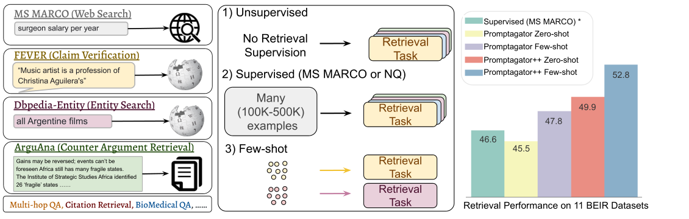
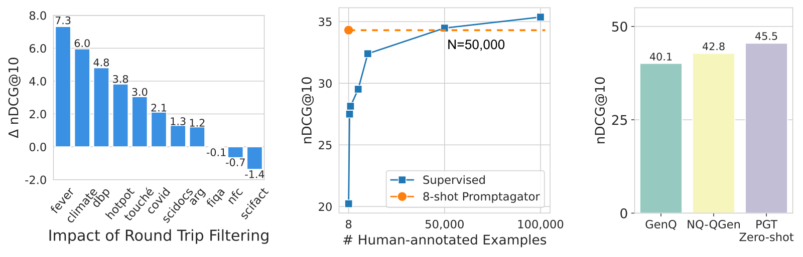
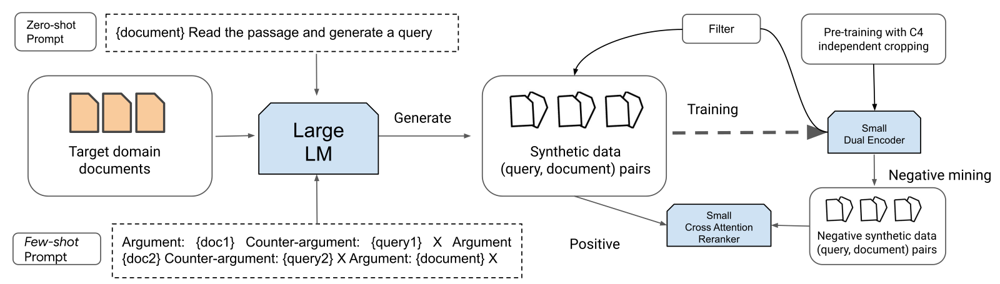
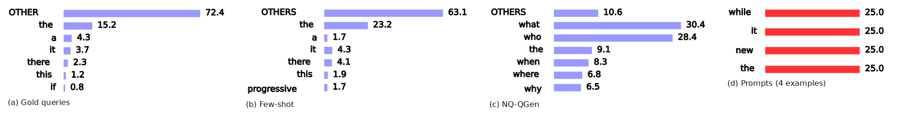
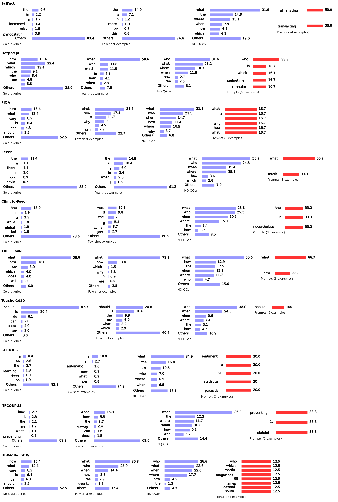

# Promptagator 详解：至多 8 条示范造查询，再训 110M 双塔

> **paper**：[Promptagator: Few-shot Dense Retrieval From 8 Examples](https://arxiv.org/abs/2209.11755)（Dai, Zhao, Ma, Luan, Ni, Lu, Bakalov, Guu, Hall, Chang；Google Research；arXiv:2209.11755）
> **backbone**：查询生成 FLAN 137B（不微调）；检索双塔 T5-base 1.1（110M）；可选重排器同为 110M（Promptagator++）
> **date**：2022-09
> **modality**：文本稠密检索，可加轻量重排
> **languages**：英文 BEIR

全文逐段中英对照见同目录 [zh.md](zh.md)。本文把少样本设定、三步流水线、训练配方和表 2 的口径写清。数字只取论文表内和正文写出的原值。这不是 InPars 的后继版本：InPars 用少样本造查询去训接在 BM25 后面的重排器；本文用任务提示造查询，直接训端到端双塔。

**少样本检索（few-shot retrieval）**：每个任务只有一段意图说明和最多 8 条标注的相关对，不能靠 MS MARCO 或 NQ 的大规模人工查询来训检索器。**双编码器（dual encoder）**：查询和文档分开编码，用向量近邻做一阶段召回。**交叉注意力重排器（cross-attention reranker）**：把查询和文档放进同一个 Transformer，只对双塔取出的短名单打分。**一致性过滤（consistency filtering）**：合成查询必须能把生成它的那篇源文档检索回来，否则丢掉。本文把这个往返检查的门槛设成 Top-1。**nDCG@10**：前 10 名按位置折扣后的归一化累积增益，BEIR 的主指标。

---

## 这篇实际在做什么

BEIR 上的任务意图差很远：问答、找重复问题、事实核查、找反论点，不是同一种「相关」。从单一大规模 QA 数据零样本迁过去，对论辩和争议话题不够用。

Promptagator 不拿那几条标注直接训双塔。它把任务描述和最多 8 条真实相关对写成提示，让冻结的 FLAN 137B 给目标语料里的文档写查询，再用这些合成对训一个 110M 的双塔。可选的 Promptagator++ 用同一批数据再训一个 110M 重排器，重排双塔的 top-200。主评测故意不用 MS MARCO、NQ、Quora 的标注去训检索器。FLAN 的训练数据和 NQ、Quora 有重叠，所以这三份也从主平均里拿掉，剩下 11 个公开集合。

| 项 | 论文设定 |
| --- | --- |
| 示范 | 每任务 0–8 条；超长就减少条数或截断单条 |
| 生成 | FLAN 137B；温度 0.7；每篇最多 8 条查询；每库最多随机 100 万篇 |
| 零样本提示 | `{d} Read the passage and generate a query.` |
| 过滤 | 只用合成数据训出的初始双塔；源文档必须排在 Top-1 |
| 双塔 | T5-base 1.1，110M；均值池化后投到 768 维 |
| 预训练 | C4 上 Contriever 式独立裁剪，批内随机负例，交叉熵 |
| 重排 | 110M 交叉编码器；推理重排 top-200；训练从双塔 top-200 里采负例 |

---

## 三步

**图在讲什么。** (a) BEIR 任务在查询分布、语料和意图上彼此不同。(b) 常见做法是从大规模 QA 监督迁到新任务。(c) 只靠目标任务上最多 8 条示范造数之后，110M 双塔和再加重排的平均位置。对应论文 Figure 1。

**提示生成。** 任务 $T$ 有语料 $D_T$、查询分布 $Q_T$ 和相关意图 $I_T$。取 $k\le 8$ 条满足 $I_T(q_i,d_i)=1$ 的对，按 FLAN 的指令格式交替写入文档描述和查询描述，最后接一篇新文档。模型必须先写出正确的查询描述前缀，否则整条丢掉。前缀随任务变。ArguAna 用 `Argument:` 对 `Counter Argument:`，让模型写反论点，而不是再写一条相似论点。示范若只能从测试查询里抽，评测时这些查询即使被找回也记失败。

**往返过滤。** 问答里的一致性过滤通常要一个外部问答模型。不同检索意图不能共用一个 QA 过滤器。本文先用未过滤的合成对训一个初始双塔，再只保留源文档排在该查询 Top-$K$ 里的对。$K$ 在 MS MARCO 上调，取 1，并用于全部 BEIR 集合。过滤模型和被滤的数据是同一批噪声合成对，论文仍报告它能删掉大量查询并提高检索。被删掉的多数是问得太泛，或查询里有文档没有的幻觉；也有好对被初始双塔误杀。作者把按查询调整 $K$ 留作以后的事。

**继续训练。** 双塔先在 C4 上做独立裁剪预训练，再在合成对上用批内负例和交叉熵微调，过滤之后在剩下的对上继续微调。Promptagator++ 的重排器用同样的生成数据训练。

---

## 表 2：11 个集合的 nDCG@10

列顺序与论文一致：ArguAna、Touche-2020、TREC-COVID、NFCorpus、HotpotQA、DBPedia、Climate-FEVER、FEVER、SciFact、SCIDOCS、FiQA。括号里的 Climate-FEVER 来自改用 FEVER 的少样本提示，不计入平均。BEIR 把 Climate-FEVER 的 supports、refutes、not enough info 都当成相关，而后一档文档未必和查询有关，放进提示会带坏生成。换成 FEVER 提示后，少样本双塔在该列从 16.8 升到 24.0，并超过零样本的 21.4。

检索器：

| 模型 | arg | touché | covid | nfc | hotpot | dbp | climate | fever | scifact | scidocs | fiqa | AVG |
| --- | ---: | ---: | ---: | ---: | ---: | ---: | ---: | ---: | ---: | ---: | ---: | ---: |
| BM25 | 31.5 | 36.7 | 65.6 | 32.5 | 60.3 | 31.3 | 21.3 | 75.3 | 66.5 | 15.8 | 23.6 | 41.8 |
| Contriever | 37.9 | 19.3 | 27.4 | 31.7 | 48.1 | 29.2 | 15.5 | 68.2 | 64.9 | 14.9 | 24.5 | 34.7 |
| GTR-XXL | 54.0 | 25.6 | 50.1 | 34.2 | 59.9 | 40.8 | 26.7 | 74.0 | 66.2 | 16.1 | 46.7 | 44.9 |
| SPLADE v2 | 47.9 | 27.2 | 71.0 | 33.4 | 68.4 | 43.5 | 23.5 | 78.6 | 69.3 | 15.8 | 33.6 | 46.6 |
| ColBERT v2 | 46.3 | 26.3 | 73.8 | 33.8 | 66.7 | 44.6 | 17.6 | 78.5 | 69.3 | 15.4 | 35.6 | 46.2 |
| GenQ | 49.3 | 18.2 | 61.9 | 31.9 | 53.4 | 32.8 | 17.5 | 66.9 | 64.4 | 14.3 | 30.8 | 40.1 |
| GPL | 55.7 | 25.5 | 70.0 | 34.5 | 58.2 | 38.4 | 23.5 | 75.9 | 67.4 | 16.9 | 34.4 | 45.5 |
| 零样本 | 53.8 | 26.6 | 72.7 | 33.4 | 60.4 | 36.4 | 21.4 | 76.2 | 62.3 | 16.3 | 40.4 | 45.5 |
| 少样本 | 59.4 | 34.5 | 75.6 | 33.4 | 61.4 | 38.0 | 16.8 (24.0) | 77.0 | 65.0 | 18.4 | 46.2 | 47.8 |

零样本双塔平均 45.5，已经接近在 MS MARCO 上训过的 GPL（45.5）和 ColBERT v2（46.2）。少样本再抬到 47.8，比零样本高两个点以上。提升最大的是 Touche-2020（争议话题）和 ArguAna（长论点找反论点），这两类和事实型问答差得远，任务提示才能把意图写进生成查询。双塔本身没有 ColBERT、SPLADE 那种词元级交互，也不做难负例挖掘或蒸馏。论文用这套简单配方来说明增益主要来自生成数据，而不是检索器结构。

检索加重点排：

| 模型 | arg | touché | covid | nfc | hotpot | dbp | climate | fever | scifact | scidocs | fiqa | AVG |
| --- | ---: | ---: | ---: | ---: | ---: | ---: | ---: | ---: | ---: | ---: | ---: | ---: |
| UPR (3B) | 50.3 | 21.3 | 60.4 | 33.3 | 72.2 | 33.8 | 9.5 | 57.3 | 69.6 | 17.3 | 45.0 | 42.7 |
| monoT5 (3B) | 28.8 | 20.0 | 79.5 | 38.4 | 75.9 | 47.8 | 28.0 | 85.0 | 77.7 | 19.7 | 51.4 | 51.1 |
| ++ 零样本 | 52.1 | 27.8 | 76.0 | 36.0 | 71.2 | 41.3 | 22.6 | 83.8 | 73.2 | 19.1 | 45.9 | 49.9 |
| ++ 少样本 | 63.0 | 38.1 | 76.2 | 37.0 | 73.6 | 43.4 | 20.3 (24.1) | 86.6 | 73.1 | 20.1 | 49.4 | 52.8 |

少样本重排平均 52.8，比少样本双塔 47.8 高约 5 点，也高于表内的 monoT5-3B（51.1）和 UPR（42.7）。InPars 在这张表里只报了 TREC-COVID 一格（78.4），没有 11 集平均。

---

## 消融里写明的三件事

一致性过滤在 11 个集合的 8 个上提高少样本双塔，平均 +2.5 nDCG@10。NFCorpus 和 SciFact 变差。这两份生成查询最少，作者推测在滤完的小数据上继续微调会过拟合。

另外两个比较是：8 条示范加上 LLM，在简单双塔上可以追上约 5 万条 MS MARCO 人工标注；零样本 Promptagator 大幅超过 GenQ 和在 NQ 上微调的 T5 查询生成器，而后两者与本文共用同一套过滤和双塔训练超参。因此论文把主要因素归于提示过的 LLM 生成，而不是训练配方。

图 3、图 4 是首词直方图，用来看生成查询像不像该任务的真实查询。ArguAna 的真实查询和少样本生成都以 OTHER、the、a 为主；NQ-QGen 则集中在 what、who、when、where。其余数据集同一规律：少样本更靠近该任务自己的首词，NQ-QGen 仍像问句。柱上的百分比以图为准，正文没有另列表。

---

## 和相邻做法的分界

表 1 把 Promptagator 标成 Few (0–8) 条监督、110M、生成器是 FLAN，重排时再加一个 110M、候选 200。GenQ 和 GPL 的检索器也是 110M，但查询生成器用的是在 MS MARCO 上训过的 T5，监督规模是约 50 万。UPR 用提示过的 LLM 直接重排，不把生成查询拿去训检索器。

方法上可以单独记住的四点：8 条示范是用来写提示，不是用来充当双塔的全部训练集；过滤器不能借用别的任务的问答模型，否则意图会被绑死；Top-1 往返会误杀一些好对，但平均仍然赚 2.5 点；服务的是 110M 双塔，137B 只在离线造数时出现。
