# 面向高效纯整数推理的神经网络量化与训练

> 原文：[arXiv:1712.05877v1](https://arxiv.org/html/1712.05877v1)，作者及机构见下。
> 中文全译稿：以机器初译为底稿，统一技术术语，并校订摘要和关键方法段落；覆盖主文、附录、算法、表格、图注和脚注。参考文献保留原始书目，原图内部文字与代码保留英文。英文转写见 [en.md](en.md)，方法分析另见 [Jacob2018详解.md](Jacob2018详解.md)。

## 作者与机构

Benoit Jacob Skirmantas Kligys Bo Chen Menglong Zhu Affiliation: Matthew Tang Andrew Howard Hartwig Adam Dmitry Kalenichenko Affiliation: {benoitjacob,skligys,bochen,menglong, Email: mttang,howarda,hadam,dkalenichenko}@google.com Affiliation: Google Inc.

## 摘要

智能移动设备日益普及，而基于深度学习的模型计算开销巨大，这要求端侧推理方案兼具效率与精度。我们提出一种量化方案，使推理能够完全使用整数算术；在常见的纯整数硬件上，它比浮点推理更易高效实现。我们还联合设计了训练流程，以保持量化后的端到端模型精度。因此，该方案改善了精度与端侧延迟之间的权衡。即便在以运行效率著称的 MobileNet 模型族上，改善也十分显著；我们在常见 CPU 上，通过 ImageNet 分类与 COCO 检测实验展示了这些收益。

## 引言

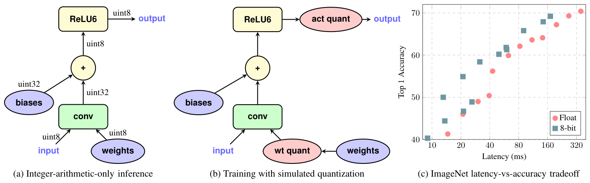

图 1.1：仅整数算术量化。 a) 卷积层的仅整数算术推理。根据等式1，输入和输出被表示为$8$位整数。卷积涉及 8 位整数操作数和 32 位整数累加器。偏置加法仅涉及 32 位整数（第 2.4 节）。 ReLU6非线性仅涉及$8$位整数运算。 b) 使用卷积层的模拟量化进行训练。所有变量和计算均使用 32 位浮点运算进行。权重量化（“wt quant”）和激活量化（“act quant”）节点被注入到计算图中以模拟变量量化的效果（第 3 节）。所得图近似于面板 a) 中的仅整数算术计算图，同时可使用浮点模型的传统优化算法进行训练。 c) 我们的量化方案受益于常见 CPU 中的快速整数算术电路，以提供改进的延迟与精度权衡（第 4 节）。该图将整数量化的 MobileNets [10] 与使用 Qualcomm Snapdragon 835 LITTLE 内核的 ImageNet [3] 上的浮点基线进行了比较。

当前最先进的卷积神经网络 (CNN) 不太适合在移动设备上使用。自从 AlexNet [20] 出现以来，现代 CNN 主要根据分类/检测精度进行评估。因此，网络架构的发展并未考虑模型复杂性和计算效率。另一方面，在智能手机、AR/VR 设备（HoloLens、Daydream）和无人机等移动平台上成功部署 CNN 需要小模型尺寸以适应有限的设备内存，并需要低延迟以保持用户参与度。这催生了一个新兴的研究领域，其重点是减少 CNN 的模型大小和推理时间，同时将精度损失降至最低。

该领域的方法大致分为两类。第一类以 MobileNet [10]、SqueezeNet [16]、ShuffleNet [32] 和 DenseNet [11] 为代表，设计了利用计算/内存高效操作的新颖网络架构。第二类将 CNN 的权重和/或激活从 32 位浮点量化为较低位宽的表示。这种方法被三元权重网络（TWN [22]）、二元神经网络（BNN [14]）、XNOR-net [27] 等方法所采用，[8,21,26,33,34,35]，是我们研究的重点。尽管有丰富的量化方法，但在权衡延迟和准确性时，当前的量化方法在两个方面都存在缺陷。

首先，先前的方法尚未在合理的基线架构上进行评估。最常见的基线架构 AlexNet [20]、VGG [28] 和 GoogleNet [29] 都经过设计过度参数化，以便获得边际精度改进。因此，很容易获得这些架构的相当大的压缩，从而将这些架构的量化实验最多减少到概念验证。相反，一个更有意义的挑战是量化模型架构，这些模型架构已经可以有效地在延迟与准确性之间进行权衡，例如移动网络。

其次，许多量化方法无法在实际硬件上提供可验证的效率改进。仅量化权重 ([2,4,8,33]) 的方法主要与设备上的存储有关，而与计算效率无关。值得注意的例外是二进制、三元和位移网络 [14,22,27]。后面这些方法采用 0 或 2 的幂的权重，允许通过位移位来实现乘法。然而，虽然位移位在定制硬件中可能很有效，但它们对具有乘法加法指令的现有硬件几乎没有什么好处，如果正确使用（即流水线化），这些指令并不比单独的加法更昂贵。此外，只有当操作数很宽时，乘法才会很昂贵，并且一旦权重和激活都被量化，避免乘法的需要就会随着位宽的增加而减少。值得注意的是，这些方法很少提供设备上的测量来验证所承诺的时序改进。更适合运行时的方法将权重和激活量化为 1 位表示形式 [14,27,34]。通过这些方法，乘法和加法都可以通过高效的位移和位计数操作来实现，这在定制 GPU 内核 (BNN [14]) 中得到了展示。然而，1 位量化通常会导致性能大幅下降，并且可能对模型表示过于严格。

在本文中，我们通过改进常见移动硬件上 MobileNet 的延迟与准确性权衡来解决上述问题。我们的具体贡献是：

- 我们提供了一种量化方案（第 2.1 节），将权重和激活量化为 8 位整数，并将一些参数（偏置向量）量化为 32 位整数。

- 我们提供了一个量化推理框架，可以在 Qualcomm Hexagon 等纯整数算术硬件上高效实现（第 2.2 节、第 2.3 节），并且我们描述了在 ARM NEON 上高效、准确的实现（附录 B）。

- 我们提供了与我们的量化推理共同设计的量化训练框架（第3 节），以最大程度地减少实际模型量化带来的准确性损失。

- 我们将我们的框架应用于基于 MobileNet 的高效分类和检测系统，并在流行的 ARM CPU 上提供基准测试结果（第 4 节），这些结果显示了最先进的 MobileNet 架构在延迟与准确性权衡方面的显着改进，这在 ImageNet 分类 [3]、COCO 对象检测 [23] 和其他任务中得到了证明。

我们的工作从[7]和[31]中汲取灵感，[7]利用低精度定点算法来加速CNN的训练速度，[31]使用$8$位定点算法来加速x86 CPU上的推理。相反，我们的量化方案侧重于提高移动 CPU 上的推理速度与准确性权衡。

## 量化推理

### 量化方案

在本节中，我们描述我们的通用量化方案 [^footnote1] [^footnote2] ，即值的位表示（下面表示为 $q$ ，表示“量化值”）与其作为数学实数的解释（下面表示为 $r$ ，表示“实值”）之间的对应关系。我们的量化方案是在推理期间使用纯整数算术和在训练期间使用浮点算术来实现的，两种实现彼此保持高度的对应性。我们通过首先为我们的量化方案提供数学上严格的定义，并分别采用该方案进行整数算术推理和浮点训练来实现这一目标。

我们的量化方案的一个基本要求是它允许仅使用量化值上的整数算术运算来有效地实现所有算术（我们避免需要查找表的实现，因为与 SIMD 硬件上的纯算术相比，这些实现往往表现不佳）。这相当于要求量化方案是整数 $q$ 到实数 $r$ 的仿射映射，即形式

$$
r=S(q-Z)\tag{1}
$$

对于一些常量 $S$ 和 $Z$ 。方程(1)是我们的量化方案，常数$S$和$Z$是我们的量化参数。我们的量化方案对每个激活数组和每个权重数组内的所有值使用一组量化参数；单独的数组使用单独的量化参数。

对于 8 位量化，$q$ 被量化为 8 位整数（对于 $B$ 位量化，$q$ 被量化为 $B$ 位整数）。一些数组（通常是偏置向量）被量化为 32 位整数，请参见第 2.4 节。

常数 $S$（“比例”）是任意正实数。它通常在软件中表示为浮点量，如实际值 $r$ 。 2.2 节描述了避免在推理工作负载中表示此类浮点量的方法。

常数 $Z$（零点）的类型与量化值 $q$ 相同，实际上就是实数零对应的量化值。这样，实数 $r=0$ 就能由某个量化值精确表示。之所以要求这一点，是因为高效实现神经网络算子时，往往需要在数组边界周围填充零。

到目前为止，我们的讨论总结在以下量化缓冲区数据结构 [^footnote3] 中，其中神经网络中的每个激活数组和权重数组都存在这样一个缓冲区的一个实例。我们使用 C++ 语法是因为它允许明确地传递类型。

```cpp
template<typename QType> // e.g. QType=uint8
struct QuantizedBuffer {
vector<QType> q; // the quantized values
float S; // the scale
QType Z; // the zero-point
};
```

### 仅整数算术矩阵乘法

我们现在转向如何仅使用整数运算进行推理的问题，即如何使用方程（1）将实数计算转换为量化值计算，以及如何将后者设计为仅涉及整数运算，即使比例值$S$不是整数。

考虑两个实数方阵 $N\times N$ $r_{1}$ 和 $r_{2}$ 的乘法，它们的乘积由 $r_{3}=r_{1}r_{2}$ 表示。我们将每个矩阵 $r_{\alpha}$（$\alpha=1$、$2$ 或 $3$）的条目表示为 $1\leqslant i,j\leqslant N$ 的 $r_{\alpha}^{(i,j)}$，并将用于量化它们的量化参数表示为 $(S_{\alpha},Z_{\alpha})$。我们用 $q_{\alpha}^{(i,j)}$ 表示量化条目。等式(1)则变为：

$$
r_{\alpha}^{(i,j)}=S_{\alpha}(q_{\alpha}^{(i,j)}-Z_{\alpha}).\tag{2}
$$

根据矩阵乘法的定义，我们有

$$
S_{3}(q_{3}^{(i,k)}-Z_{3})=\sum_{j=1}^{N}S_{1}(q_{1}^{(i,j)}-Z_{1})S_{2}(q_{2}^{(j,k)}-Z_{2}),\tag{3}
$$

可以重写为

$$
q_{3}^{(i,k)}=Z_{3}+M\sum_{j=1}^{N}(q_{1}^{(i,j)}-Z_{1})(q_{2}^{(j,k)}-Z_{2}),\tag{4}
$$

其中乘数 $M$ 定义为

$$
M\coloneqq\frac{S_{1}S_{2}}{S_{3}}.\tag{5}
$$

在等式(4)中，唯一的非整数是乘数$M$。作为仅取决于量化尺度 $S_{1},S_{2},S_{3}$ 的常数，它可以离线计算。我们凭经验发现它总是在区间 $(0,1)$ 中，因此可以用归一化形式表达它

$$
M=2^{-n}M_{0}\tag{6}
$$

其中 $M_{0}$ 位于区间 $[0.5,1)$，$n$ 为非负整数。归一化乘数 $M_{0}$ 很适合表示为定点乘数（根据硬件能力采用 int16 或 int32 等）。例如，使用 int32 时，以最接近 $2^{31}M_{0}$ 的 int32 值表示 $M_{0}$。由于 $M_{0}\geqslant 0.5$，该整数始终至少为 $2^{30}$，因而始终具有至少 30 位的相对精度。乘以 $M_{0}$ 就可以实现为定点乘法 [^footnote4]。另一方面，乘以 $2^{-n}$ 可以通过高效位移实现，但位移必须正确执行舍入到最近整数；附录 B 会再次讨论这一问题。

### 高效处理零点

为了有效地实现等式（4）的求值，而不必执行 $2N^{3}$ 减法，也不必将乘法的操作数扩展为 16 位整数，我们首先注意到，通过分布等式（4）中的乘法，我们可以将其重写为

$$
\begin{split}q_{3}^{(i,k)}=Z_{3}+M\left(\vphantom{\sum_{j=1}^{N}}NZ_{1}Z_{2}-Z_{1}a_{2}^{(k)}\right.\\
\left.-Z_{2}\bar{a}_{1}^{(i)}+\sum_{j=1}^{N}q_{1}^{(i,j)}q_{2}^{(j,k)}\right)\end{split}\tag{7}
$$

哪里

$$
a_{2}^{(k)}\coloneqq\sum_{j=1}^{N}q_{2}^{(j,k)},\;\;\bar{a}_{1}^{(i)}\coloneqq\sum_{j=1}^{N}q_{1}^{(i,j)}.\tag{8}
$$

每个 $a_{2}^{(k)}$ 或 $\bar{a}_{1}^{(i)}$ 仅需要 $N$ 加法进行计算，因此它们总共只需要 $2N^{2}$ 加法。 (7)的评估的其余成本几乎完全集中在核心整数矩阵乘法累加上

$$
\sum_{j=1}^{N}q_{1}^{(i,j)}q_{2}^{(j,k)}\tag{9}
$$

它需要 $2N^{3}$ 算术运算；事实上，(7) 中涉及的所有其他内容都是 $O(N^{2})$ ，而 $O$ 中有一个小常数。因此，扩展为形式 (7) 以及 $a_{2}^{(k)}$ 和 $\bar{a}_{1}^{(i)}$ 的分解计算可以对除 $N$ 最小值之外的任意零点进行低开销处理，从而将问题简化为与我们在任何其他无零点量化方案中必须计算的相同核心整数矩阵乘法累加 (9)。

### 典型融合层的实现

我们继续第 2.3 节的讨论，但现在明确定义所有涉及量的数据类型，并修改量化矩阵乘法（7）以将偏置加法和激活函数评估直接合并到其中。将整个层融合到单个操作中不仅仅是一种优化。由于我们必须在推理代码中重现训练中使用的相同算术，因此推理代码中融合运算符的粒度（采用 8 位量化输入并生成 8 位量化输出）必须与训练图中“伪量化”运算符的放置相匹配（第 3 节）。

对于我们在 ARM 和 x86 CPU 架构上的实现，我们使用 gemmlowp 库 [18]，其 GemmWithOutputPipeline 入口点提供支持我们现在描述的 [^footnote5] 的融合操作。

我们将 $q_{1}$ 矩阵作为权重，将 $q_{2}$ 矩阵作为激活。权重和激活都是 uint8 类型（我们可以等效地选择 int8，并适当修改零点）。累加 uint8 值的乘积需要 32 位累加器，我们为累加器选择有符号类型，原因很快就会清楚。 (9) 中的总和的形式为：

$$
\texttt{int32 += uint8 * uint8}.\tag{10}
$$

为了让量化偏置加法能够直接把 int32 偏置加入 int32 累加器，偏置向量采用如下量化方式：量化数据类型为 int32；量化零点 $Z_{\mathrm{bias}}$ 为 0；量化缩放因子 $S_{\mathrm{bias}}$ 与累加器的缩放因子相同，即权重与输入激活缩放因子的乘积。采用第 2.3 节的记号，

$$
S_{\mathrm{bias}}=S_{1}S_{2},\;\;Z_{\mathrm{bias}}=0.\tag{11}
$$

尽管偏置向量被量化为 32 位值，但它们仅占神经网络参数的一小部分。此外，使用更高精度的偏置向量满足了实际需求：由于每个偏置向量条目都被添加到许多输出激活中，偏置向量中的任何量化误差往往会充当总体偏置（即具有非零均值的误差项），必须避免这种情况，以保持良好的端到端神经网络精度 [^footnote6] 。

对于 int32 累加器的最终值，还剩下三件事要做：缩小到 8 位输出激活使用的最终范围，向下转换为 uint8 并应用激活函数以产生最终的 8 位输出激活。

缩小尺度相当于乘以式 (7) 中的乘数 $M$。如第 2.2 节所述，它通过乘以归一化定点乘数 $M_{0}$，再执行带舍入的位移实现。随后执行向 uint8 的饱和转换，将结果限制在 $[0,255]$ 内。

我们关注的是纯粹的钳位激活函数，例如ReLU，ReLU6。数学函数在附录 A.1 中讨论，我们目前不将它们融合到此类层中。因此，我们的融合激活函数唯一需要做的就是在存储最终的 uint8 输出激活之前，进一步将 uint8 值钳位到 $[0,255]$ 的某个子区间。在实践中，量化训练过程（第 3 节）倾向于学习使用整个输出 uint8 $[0,255]$ 间隔，以便激活函数不再执行任何操作，其效果被包含在对 uint8 的饱和强制转换中隐含的对 $[0,255]$ 的钳位中。

## 使用模拟量化进行训练

训练量化网络的常见方法是进行浮点训练，然后量化所得权重（有时需要额外的量化后训练进行微调）。我们发现这种方法对于具有相当大表征能力的大型模型来说效果足够好，但会导致小型模型的准确性显着下降。简单训练后量化的常见故障模式包括：1）不同输出通道的权重范围存在较大差异（大于 $100\times$ ）（第 2 节要求同一层的所有通道量化到相同的分辨率，这导致范围较小的通道中的权重具有更高的相对误差）和 2）异常权重值，使量化后所有剩余权重不太精确。

我们提出在训练前向传播中模拟量化影响的方法。反向传播仍按通常方式进行，所有权重和偏置都以浮点数保存，使它们能够接受很小的更新。不过，前向传播会用浮点算术实现第 2 节量化方案的舍入行为，模拟推理引擎实际执行的量化推理：

- 权重在与输入进行卷积之前进行量化。如果该层使用批归一化（参见[17]），则批归一化参数会在量化之前“折叠到”权重中，请参见第 3.2 节。

- 激活在推理期间的点处被量化，例如，在将激活函数应用于卷积层或全连接层的输出之后，或者在旁路连接将多个层的输出添加或连接在一起之后（例如在 ResNet 中）。

对于每一层，量化由量化级别数和钳位范围参数化，并通过逐点应用量化函数 $q$ 来执行，定义如下：

$$
\begin{aligned}\displaystyle\clamp(r;a,b) \displaystyle\coloneqq\min\left(\max(x,a),b\right) \\ \displaystyle s(a,b,n) \displaystyle\coloneqq\frac{b-a}{n-1} \\ \displaystyle q(r;a,b,n) \displaystyle\coloneqq\left\lfloor\frac{\clamp(r;a,b)-a}{s(a,b,n)}\right\rceil s(a,b,n)+a,\end{aligned}\tag{12}
$$

其中$r$是要量化的实数值，$[a;b]$是量化范围，$n$是量化级别数，$\lfloor\cdot\rceil$表示四舍五入到最接近的整数。 $n$ 对于我们实验中的所有层都是固定的，例如$n=2^{8}=256$ 用于 8 位量化。

### 学习量化范围

权重量化与激活量化的量化范围的处理方式不同：

- 对于权重，基本思想是简单地设置 $a\coloneqq\min w$ 、 $b\coloneqq\max w$ 。我们对此进行了细微的调整，以便权重一旦量化为 int8 值，就仅在 $[-127,127]$ 范围内，并且永远不会采用值 $-128$ ，因为这可以实现大量优化机会（有关更多详细信息，请参阅附录 B ）。

- 对于激活，范围取决于网络的输入。为了估计范围，我们收集训练期间激活时看到的 $[a;b]$ 范围，然后通过指数移动平均值 (EMA) 聚合它们，平滑参数接近 1，以便在数千个训练步骤中平滑观察到的范围。鉴于当范围快速变化时 EMA 更新激活范围会出现显着延迟，我们发现在训练开始时完全禁用激活量化（例如，5 万到 200 万步）很有用。这允许网络进入更稳定的状态，其中激活量化范围不排除大部分值。

在这两种情况下，边界 $[a;b]$ 都会被微调，以便值 $0.0$ 在量化后可以精确地表示为整数 $z(a,b,n)$。结果，学习到的量化参数映射到等式1中的尺度$S$和零点$Z$：

$$
S=s(a,b,n),\,\,\,Z=z(a,b,n)\tag{13}
$$

下面我们描述了模拟量化，假设神经网络的计算被捕获为 TensorFlow 图 [1]。算法 1 描述了典型的工作流程。

- 1：创建浮点模型的训练图。

- 2：在推理过程中根据等式 12 将张量向下转换为更少位数的位置插入伪量化 TensorFlow 操作。

- 3：以模拟量化模式训练直至收敛。

- 4：创建并优化在低位推理引擎中运行的推理图。

- 5：使用量化推理图运行推理。

算法1 量化图训练和推理

通过融合和删除操作优化推理图超出了本文的范围。图修改（插入伪量化操作、创建和优化推理图）和低位推理引擎的源代码已在 [19] 中与 TensorFlow 的贡献一起开源。

图 1.1 a 和 b 展示了简单卷积层量化前后的 TensorFlow 图。图 C.3 中具有旁路连接的更复杂卷积的图示可以在图 C.4 中找到。

注意，训练中没有对偏置施加模拟量化，因为推理时偏置表示为 32 位整数，其范围和精度都远高于 8 位权重与激活。此外，偏置的量化参数由权重和激活的量化参数推导得到，参见第 2.4 节。

说明 [19] 使用的典型 TensorFlow 代码如下：

```python
from tf.contrib.quantize \
import quantize_graph as qg

g = tf.Graph()
with g.as_default():
  output = ...
  total_loss = ...
  optimizer = ...
  train_tensor = ...
if is_training:
  quantized_graph = \
      qg.create_training_graph(g)
else:
  quantized_graph = \
      qg.create_eval_graph(g)
# Train or evaluate quantized_graph.
```

### 批量归一化折叠

对于使用批归一化（参见 [17]）的模型，还存在额外的复杂性：训练图中，批归一化是一组独立操作；推理图中，为了提高效率，其参数则会折叠进卷积或全连接层的权重与偏置。为了准确模拟量化影响，需要模拟这种折叠，并在权重经过批归一化参数缩放之后再对其量化。具体如下：

$$
w_{\mathrm{fold}}\coloneqq\frac{\gamma w}{\sqrt{EMA(\sigma^{2}_{B})+\varepsilon}}.\tag{14}
$$

这里$\gamma$是批归一化的尺度参数，$EMA(\sigma^{2}_{B})$是整个批量的卷积结果方差的移动平均估计，而$\varepsilon$只是一个用于数值稳定性的小常数。

折叠后，批归一化卷积层简化为图 1.1a 所示的简单卷积层，其折叠权重为 $w_{\mathrm{fold}}$ 以及相应的折叠偏置。因此，图 1.1 b 中的相同配方适用。请参阅附录，了解批归一化卷积层的训练图（图 C.5）、相应的推理图（图 C.6）、批归一化折叠后的训练图（图 C.7）以及折叠和量化后的训练图（图 C.8）。

## 实验

我们进行了两组实验，一组展示了量化训练的有效性（第 4.1 节），另一组则说明了通用硬件上量化模型改进的延迟与准确性权衡（第 4.2 节）。进行基准测试的神经网络的推理工作负载中对性能最关键的部分是矩阵乘法 (GEMM)。 8 位和 32 位浮点 GEMM 推理代码使用 gemmlowp 库 [18] 进行 8 位量化推理，使用 Eigen 库 [6] 进行 32 位浮点推理。

### 大型网络的量化训练

我们将量化训练应用于 ImageNet 数据集上的 ResNets [9] 和 InceptionV3 [30]。这些流行的网络计算量太大，无法部署在移动设备上，但出于比较目的而包含在内。培训方案在附录 D.1 和 D.2 中讨论。

#### ResNet

我们在表 4.1 中比较了不同深度的浮点与整数量化 ResNet。仅整数量化网络的精度在其浮点对应网络的 $2\%$ 范围内。

| ResNet 深度 | 50 | 100 | 150 |
| --- | --- | --- | --- |
| 浮点准确率 | 76.4% | 78.0% | 78.8% |
| 整数量化准确率 | 74.9% | 76.6% | 76.7% |

表 4.1：ImageNet 上的 ResNet：各种网络深度的浮点与量化网络精度。

我们还在表 4.2 中列出了不同量化方案下的 ResNet50 精度。正如预期的那样，纯整数量化优于 FGQ [26]，后者使用 2 位进行权重量化。 INQ [33]（5 位权重浮点激活）实现了与我们相似的精度，但我们提供了额外的运行时改进（参见第 4.2 节）。

| 方案 | BWN | TWN | INQ | FGQ | 本文 |
| --- | --- | --- | --- | --- | --- |
| 权重位数 | 1 | 2 | 5 | 2 | 8 |
| 激活位数 | float32 | float32 | float32 | 8 | 8 |
| 准确率 | 68.7% | 72.5% | 74.8% | 70.8% | 74.9% |

表 4.2：ImageNet 上的 ResNet：各种量化方案下的精度，包括二元权重网络（BWN [ 21 , 15 ] ）、三元权重网络（TWN [ 21 , 22 ] ）、增量网络量化（ INQ [ 33 ] ）和细粒度量化（ FGQ [ 26 ] ）

#### ImageNet 上的 Inception v3

我们比较了分别量化为 8 位和 7 位的 Inception v3 模型。通过将等式12中的量化级别数设置为$n=2^{7}$来获得7位量化。我们还通过比较具有两种激活非线性 ReLU6 和 ReLU 的网络来探讨激活量化的灵敏度。培训方案见附录 D.2。

表 4.3 显示，7 位量化训练产生的模型精度接近 8 位量化训练，并且使用 ReLU6 的量化模型的精度下降较小。后者可以通过注意到 ReLU6 引入间隔 $[0,6]$ 作为激活的自然范围来解释，而 ReLU 允许激活从可能更大的间隔中获取值，不同通道中具有不同的范围。固定范围内的值更容易高精度量化。

| 激活函数 | 类型 | 准确率 | 准确率 | top-5 召回率 | top-5 召回率 |
| --- | --- | --- | --- | --- | --- |
|  |  | 均值 | 标准差 | 均值 | 标准差 |
| ReLU6 | 浮点 | 78.4% | 0.1% | 94.1% | 0.1% |
|  | 8 位 | 75.4% | 0.1% | 92.5% | 0.1% |
|  | 7 位 | 75.0% | 0.3% | 92.4% | 0.2% |
| ReLU | 浮点 | 78.3% | 0.1% | 94.2% | 0.1% |
|  | 8 位 | 74.2% | 0.2% | 92.2% | 0.1% |
|  | 7 位 | 73.7% | 0.3% | 92.0% | 0.1% |

表 4.3：ImageNet 上的 Inception v3：浮点模型和量化模型的准确性和召回率 5 比较。

### MobileNet 的量化

MobileNet 是一系列架构，可在设备上延迟和 ImageNet 分类准确性之间实现最先进的权衡。在本节中，我们将演示纯整数量化如何进一步改善通用硬件上的权衡。

#### ImageNet

我们在三种类型的 Qualcomm 核心上对具有不同深度倍增器 (DM) 和 ImageNet 分辨率的 MobileNet 架构进行了基准测试，这三种核心代表了三种不同的微架构：1) Snapdragon 835 LITTLE 核心（图 1.1 c），这是 Google Pixel 2 中使用的一种高能效处理器； 2）Snapdragon 835大核（图4.1），Google Pixel 2采用的高性能核心； 3）Snapdragon 821大核（图4.2），Google Pixel 1中使用的高性能核心。

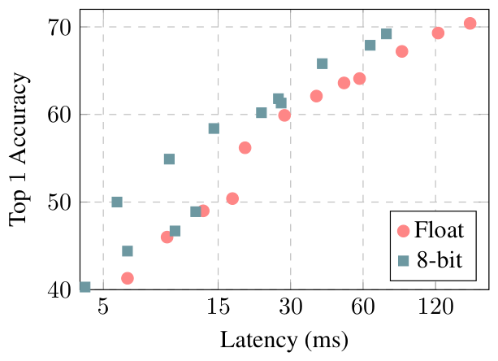

图 4.1：Qualcomm Snapdragon 835 大核上的 ImageNet 分类器：浮点和纯整数 MobileNet 的延迟与准确度权衡。

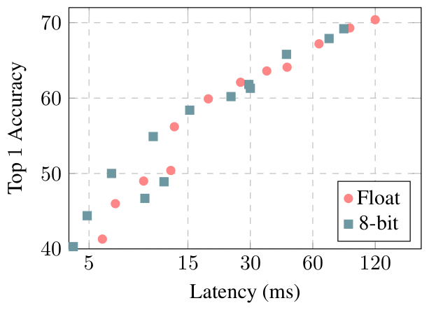

图 4.2：Qualcomm Snapdragon 821 上的 ImageNet 分类器：浮点和纯整数 MobileNet 的延迟与准确度权衡。

在运行时间预算相同的情况下，仅整数量化的 MobileNet 比浮点 MobileNet 具有更高的精度。对于 Snapdragon 835 LITTLE 核心而言，在实时 (30 fps) 操作所需的 33ms 延迟下，精度差距相当大 ($\sim 10\%$)。虽然大多数量化文献都侧重于最小化给定架构的准确性损失，但我们主张更全面的延迟与准确性权衡作为更好的衡量标准。请注意，这种权衡主要取决于硬件中浮点与纯整数算术的相对速度。例如，浮点计算在 Snapdragon 821 中得到了更好的优化，从而导致量化模型的延迟减少得不太明显。

#### COCO

我们在移动实时对象检测的背景下评估了量化，比较了 MobileNet SSD [10, 25] 的量化 8 位模型和浮点模型在 COCO 数据集 [24] 上的性能。我们将 SSD 预测层中的所有常规卷积替换为可分离卷积（深度方向后跟 $1\times 1$ 投影）。这一修改与 MobileNet 的整体设计一致，并使它们的计算效率更高。我们利用开源 TensorFlow 对象检测 API [12] 来训练和评估我们的模型。训练方案在附录 D.3 中描述。我们还延迟了 $500$ 千步的量化（参见第 3.1 节），发现它显着缩短了收敛时间。

表 4.4 显示了浮点模型和整数量化模型之间的延迟与精度的权衡。延迟是在使用 Snapdragon 835 核心（大核心和小核心）的单线程上测量的。量化训练和推理可最多减少 $50\%$ 的运行时间，同时将准确性损失降至最低（相对于 $-1.8\%$）。

| DM | 类型 | mAP | LITTLE 核（ms） | 大核（ms） |
| --- | --- | --- | --- | --- |
| 100% | 浮点 | 22.1 | 778 | 370 |
|  | 8 位 | 21.7 | 687 | 272 |
| 50% | 浮点 | 16.7 | 270 | 121 |
|  | 8 位 | 16.6 | 146 | 61 |

表 4.4：浮点和纯整数量化模型的 COCO 数据集上的目标检测速度和准确性。延迟（毫秒）是在 Qualcomm Snapdragon 835 big 和 LITTLE 核心上测量的。

#### 人脸检测

为了更好地在较小规模上检查量化的 MobileNet SSD，我们在人脸属性分类数据集（[10] 中使用的基于 Flickr 的数据集）上对人脸检测进行了基准测试。我们联系了 [10] 的作者，按照相同的协议（详见附录 D.4）评估我们的量化 MobileNet 在检测和人脸属性方面的表现。

如表 4.5 和 4.6 所示，使用 Qualcomm Snapdragon 835 big 或 LITTLE 核心时，量化可实现接近 $2\times$ 的延迟降低，但代价是平均精度下降 $\sim 2\%$。值得注意的是，量化允许 $25\%$ 人脸检测器在单个大核上实时运行 ($1K/28\approx 36$ fps)，而浮点模型仍然慢于实时 ($1K/44\approx 23$ fps)。

我们还检查了多线程对量化模型延迟的影响。表 4.6 显示了使用 $4$ 内核时从 $1.5$ 到 $2.2\times$ 的加速。两个内核之间的加速比相当，并且对于多线程开销占总计算的较小部分的较大模型而言，加速比更高。

| DM | 类型 | 精确率 | 召回率 |
| --- | --- | --- | --- |
| 100% | 浮点 | 68% | 76% |
|  | 8 位 | 66% | 75% |
| 50% | 浮点 | 65% | 70% |
|  | 8 位 | 62% | 70% |
| 25% | 浮点 | 56% | 64% |
|  | 8 位 | 54% | 63% |

表 4.5：浮点和纯整数量化模型的人脸检测精度。报告的精度/召回率是不同精度/召回值的平均值，其中真实值和预测窗口之间的 IOU $x$ 被认为是正确的检测，对于 $\{0.5,0.55,\ldots,0.95\}$ 中的 $x$ 。

| DM | 类型 | LITTLE 核 | LITTLE 核 | LITTLE 核 | 大核 | 大核 | 大核 |
| --- | --- | --- | --- | --- | --- | --- | --- |
|  |  | 1 | 2 | 4 | 1 | 2 | 4 |
| 100% | 浮点 | 711 | – | – | 337 | – | – |
|  | 8 位 | 372 | 238 | 167 | 154 | 100 | 69 |
| 50% | 浮点 | 233 | – | – | 106 | – | – |
|  | 8 位 | 134 | 96 | 74 | 56 | 40 | 30 |
| 25% | 浮点 | 100 | – | – | 44 | – | – |
|  | 8 位 | 67 | 52 | 43 | 28 | 22 | 18 |

表 4.6：人脸检测：Qualcomm Snapdragon 835 内核上浮点和量化模型的延迟。

#### 人脸属性

图 4.3 显示了 Qualcomm Snapdragon 821 上人脸属性分类的延迟与准确度的权衡。由于量化训练几乎不会导致准确度下降，因此即使 Qualcomm Snapdragon 821 针对浮点运算进行了高度优化，我们也看到了改进的权衡（参见图 4.2 进行比较）。

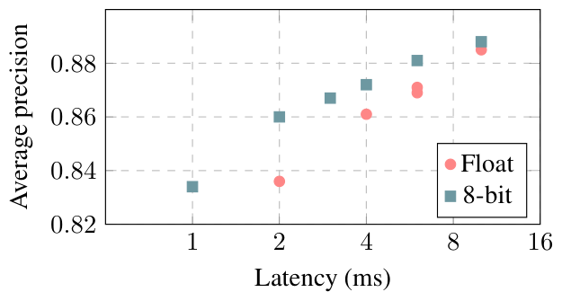

图 4.3：Qualcomm Snapdragon 821 上的人脸属性分类器：浮点和纯整数 MobileNet 的延迟与准确性权衡。

消融研究为了了解量化方案的性能敏感性，我们进一步评估具有不同权重和激活量化位宽的量化训练。二进制属性的平均精度和年龄精度相对于浮点基线的下降分别如表 4.7 和 4.8 所示。这些表表明：1) 权重比激活对减少的量化位宽更敏感，2) 8 位和 7 位量化模型的性能与浮点模型类似，3) 当总位宽相等时，最好保持权重和激活位宽相同。

| 权重位数 ↓ / 激活位数 → | 8 | 7 | 6 | 5 | 4 |
| --- | --- | --- | --- | --- | --- |
| 8 | -0.9% | -0.3% | -0.4% | -1.3% | -3.5% |
| 7 | -1.3% | -0.5% | -1.2% | -1.0% | -2.6% |
| 6 | -1.1% | -1.2% | -1.6% | -1.6% | -3.1% |
| 5 | -3.1% | -3.7% | -3.4% | -3.4% | -4.8% |
| 4 | -11.4% | -13.6% | -10.8% | -13.1% | -14.0% |

表 4.7：人脸属性：整数量化 MobileNet（不同权重和激活位宽）与浮点相比的相对平均类别精度。

| 权重位数 ↓ / 激活位数 → | 8 | 7 | 6 | 5 | 4 |
| --- | --- | --- | --- | --- | --- |
| 8 | -1.3% | -1.6% | -3.2% | -6.0% | -9.8% |
| 7 | -1.8% | -1.2% | -4.6% | -7.0% | -9.9% |
| 6 | -2.1% | -4.9% | -2.6% | -7.3% | -9.6% |
| 5 | -3.1% | -6.1% | -7.8% | -4.4% | -10.0% |
| 4 | -10.6% | -20.8% | -17.9% | -19.0% | -19.5% |

表 4.8：人脸属性：与浮点相比，量化模型（不同权重和激活位宽）相差 5 岁的年龄精度。

## 讨论

我们提出了一种仅依赖整数运算来近似神经网络中的浮点计算的量化方案。模拟量化效果的训练有助于将模型精度恢复到与原始水平几乎相同的水平。 $4\times$ 除了减小模型大小之外，还通过基于 ARM NEON 的实现提高了推理效率。这一改进促进了常见 ARM CPU 的延迟与流行计算机视觉模型的准确性之间的最先进的权衡。我们的量化方案和高效架构设计之间的协同作用表明，仅整数算术推理可能是推动视觉识别技术进入实时和低端手机市场的关键推动因素。

## 参考文献

- [1] M. Abadi, A. Agarwal, P. Barham, E. Brevdo, Z. Chen, C. Citro, G. S. Corrado, A. Davis, J. Dean, M. Devin, et al. Tensorflow: Large-scale machine learning on heterogeneous systems, 2015. Software available from tensorflow. org , 1, 2015.

- [2] W. Chen, J. T. Wilson, S. Tyree, K. Q. Weinberger, and Y. Chen. Compressing neural networks with the hashing trick. CoRR, abs/1504.04788 , 2015.

- [3] J. Deng, W. Dong, R. Socher, L.-J. Li, K. Li, and L. Fei-Fei. Imagenet: A large-scale hierarchical image database. In Computer Vision and Pattern Recognition, 2009. CVPR 2009. IEEE Conference on , pages 248–255. IEEE, 2009.

- [4] Y. Gong, L. Liu, M. Yang, and L. Bourdev. Compressing deep convolutional networks using vector quantization. arXiv preprint arXiv:1412.6115 , 2014.

- [5] Google. TensorFlow Lite. [https://www.tensorflow.org/mobile/tflite](https://www.tensorflow.org/mobile/tflite) .

- [6] G. Guennebaud, B. Jacob, et al. Eigen v3. [http://eigen.tuxfamily.org](http://eigen.tuxfamily.org) .

- [7] S. Gupta, A. Agrawal, K. Gopalakrishnan, and P. Narayanan. Deep learning with limited numerical precision. In Proceedings of the 32nd International Conference on Machine Learning (ICML-15) , pages 1737–1746, 2015.

- [8] S. Han, H. Mao, and W. J. Dally. Deep compression: Compressing deep neural network with pruning, trained quantization and huffman coding. CoRR, abs/1510.00149 , 2, 2015.

- [9] K. He, X. Zhang, S. Ren, and J. Sun. Deep residual learning for image recognition. In Proceedings of the IEEE conference on computer vision and pattern recognition , pages 770–778, 2016.

- [10] A. G. Howard, M. Zhu, B. Chen, D. Kalenichenko, W. Wang, T. Weyand, M. Andreetto, and H. Adam. Mobilenets: Efficient convolutional neural networks for mobile vision applications. CoRR , abs/1704.04861, 2017.

- [11] G. Huang, Z. Liu, L. van der Maaten, and K. Q. Weinberger. Densely connected convolutional networks. In The IEEE Conference on Computer Vision and Pattern Recognition (CVPR) , July 2017.

- [12] J. Huang, V. Rathod, D. Chow, C. Sun, and M. Zhu. Tensorflow object detection api, 2017.

- [13] J. Huang, V. Rathod, C. Sun, M. Zhu, A. Korattikara, A. Fathi, I. Fischer, Z. Wojna, Y. Song, S. Guadarrama, et al. Speed/accuracy trade-offs for modern convolutional object detectors. arXiv preprint arXiv:1611.10012 , 2016.

- [14] I. Hubara, M. Courbariaux, D. Soudry, R. El-Yaniv, and Y. Bengio. Binarized neural networks. In Advances in neural information processing systems , pages 4107–4115, 2016.

- [15] I. Hubara, M. Courbariaux, D. Soudry, R. El-Yaniv, and Y. Bengio. Quantized neural networks: Training neural networks with low precision weights and activations. arXiv preprint arXiv:1609.07061 , 2016.

- [16] F. N. Iandola, M. W. Moskewicz, K. Ashraf, S. Han, W. J. Dally, and K. Keutzer. Squeezenet: Alexnet-level accuracy with 50x fewer parameters and¡ 1mb model size. arXiv preprint arXiv:1602.07360 , 2016.

- [17] S. Ioffe and C. Szegedy. Batch normalization: Accelerating deep network training by reducing internal covariate shift. In Proceedings of the 32Nd International Conference on International Conference on Machine Learning - Volume 37 , ICML’15, pages 448–456. JMLR.org, 2015.

- [18] B. Jacob, P. Warden, et al. gemmlowp: a small self-contained low-precision gemm library. [https://github.com/google/gemmlowp](https://github.com/google/gemmlowp) .

- [19] S. Kligys, S. Sivakumar, et al. Tensorflow quantized training support. [https://github.com/tensorflow/tensorflow/tree/master/tensorflow/contrib/quantize](https://github.com/tensorflow/tensorflow/tree/master/tensorflow/contrib/quantize) .

- [20] A. Krizhevsky, I. Sutskever, and G. E. Hinton. Imagenet classification with deep convolutional neural networks. In Advances in neural information processing systems , pages 1097–1105, 2012.

- [21] C. Leng, H. Li, S. Zhu, and R. Jin. Extremely low bit neural network: Squeeze the last bit out with admm. arXiv preprint arXiv:1707.09870 , 2017.

- [22] F. Li, B. Zhang, and B. Liu. Ternary weight networks. arXiv preprint arXiv:1605.04711 , 2016.

- [23] T.-Y. Lin, M. Maire, S. Belongie, J. Hays, P. Perona, D. Ramanan, P. Dollár, and C. L. Zitnick. Microsoft coco: Common objects in context. In European conference on computer vision , pages 740–755. Springer, 2014.

- [24] T.-Y. Lin, M. Maire, S. Belongie, J. Hays, P. Perona, D. Ramanan, P. Dollár, and C. L. Zitnick. Microsoft COCO: Common objects in context. In ECCV , 2014.

- [25] W. Liu, D. Anguelov, D. Erhan, C. Szegedy, and S. Reed. Ssd: Single shot multibox detector. arXiv preprint arXiv:1512.02325 , 2015.

- [26] N. Mellempudi, A. Kundu, D. Mudigere, D. Das, B. Kaul, and P. Dubey. Ternary neural networks with fine-grained quantization. arXiv preprint arXiv:1705.01462 , 2017.

- [27] M. Rastegari, V. Ordonez, J. Redmon, and A. Farhadi. Xnor-net: Imagenet classification using binary convolutional neural networks. arXiv preprint arXiv:1603.05279 , 2016.

- [28] K. Simonyan and A. Zisserman. Very deep convolutional networks for large-scale image recognition. arXiv preprint arXiv:1409.1556 , 2014.

- [29] C. Szegedy, W. Liu, Y. Jia, P. Sermanet, S. Reed, D. Anguelov, D. Erhan, V. Vanhoucke, and A. Rabinovich. Going deeper with convolutions. In Proceedings of the IEEE Conference on Computer Vision and Pattern Recognition , pages 1–9, 2015.

- [30] C. Szegedy, V. Vanhoucke, S. Ioffe, J. Shlens, and Z. Wojna. Rethinking the inception architecture for computer vision. In Proceedings of the IEEE Conference on Computer Vision and Pattern Recognition , pages 2818–2826, 2016.

- [31] V. Vanhoucke, A. Senior, and M. Z. Mao. Improving the speed of neural networks on cpus. In Proc. Deep Learning and Unsupervised Feature Learning NIPS Workshop , volume 1, page 4, 2011.

- [32] X. Zhang, X. Zhou, M. Lin, and J. Sun. Shufflenet: An extremely efficient convolutional neural network for mobile devices. CoRR , abs/1707.01083, 2017.

- [33] A. Zhou, A. Yao, Y. Guo, L. Xu, and Y. Chen. Incremental network quantization: Towards lossless cnns with low-precision weights. arXiv preprint arXiv:1702.03044 , 2017.

- [34] S. Zhou, Y. Wu, Z. Ni, X. Zhou, H. Wen, and Y. Zou. Dorefa-net: Training low bitwidth convolutional neural networks with low bitwidth gradients. arXiv preprint arXiv:1606.06160 , 2016.

- [35] C. Zhu, S. Han, H. Mao, and W. J. Dally. Trained ternary quantization. arXiv preprint arXiv:1612.01064 , 2016.

## 附录：特定于层的详细信息

### 数学函数

双曲正切、逻辑函数和 softmax 等数学函数经常出现在神经网络中。不需要查找表，因为这些函数以纯定点算术实现，类似于它们在浮点算术 [^footnote7] 中的实现方式。

### 加法

一些神经网络使用简单的加法层类型，只需将两个激活数组加在一起。与浮点相比，此类加法层在量化推理中的成本更高，因为需要重新缩放：需要使用乘法器 $M=S_{1}/S_{2}$ 的定点乘法将一个输入重新缩放到另一个输入的比例，类似于我们之前看到的（第 2.2 节末尾），然后才能将实际加法作为简单的整数加法执行；最后，必须再次重新调整结果以适应输出数组的比例 [^footnote8] 。

### 拼接

对串联层的完全通用支持会带来与加法层相同的重新缩放问题。因为这种 uint8 值的重新缩放将是一种有损操作，并且串联似乎应该是一种无损操作，所以我们更愿意以不同的方式处理这个问题：我们引入了一个要求，即串联层中的所有输入激活和输出激活都具有相同的量化参数，而不是实现有损重新缩放。这消除了重新缩放的需要，因此串联是无损的并且没有任何算术 [^footnote9] 。

## 附录：ARM NEON 详细信息

本节假设您熟悉 ARM NEON 指令集上的汇编编程。下面的指令助记符指的是 64 位 ARM 指令集，但讨论同样适用于 32 位 ARM 指令。

本文中引用的定点乘法完全映射到 SQRDMULH 指令。使用正确舍入指令 SQRDMULH 而不是 SQDMULH [^footnote10] 非常重要。

第 2.2 节所述的舍入到最近整数的右移，并不能精确对应任何单条 ARM NEON 指令。问题在于，RSHL 指令以可变负偏移量执行舍入右移时，会把恰好位于中点的值向上舍入，而不是向远离零的方向舍入。例如，用 RSHL 实现 $-12/2^{3}$ 时，结果是 $-1$，而所需的舍入结果应为 $-2$。这会引入整体向上的偏差，实际观察表明该偏差可能显著损伤端到端推理精度。仍可使用 RSHL 实现正确的舍入右移，但需要在其前后加入适当的修正运算 [^footnote11]。

为了高效 NEON 实现矩阵乘法的核心累加，我们使用以下技巧。在(10)中的乘加运算中，我们首先将操作数的类型从uint8更改为int8（可以通过从量化值和零点中减去128来完成）。因此核心乘加变为

$$
\texttt{int32 += int8 * int8}.\tag{B.1}
$$

正如第 3 节中提到的，通过对量化训练过程进行细微调整，我们可以确保权重一旦量化为 int8 值，就永远不会采用值 $-128$ 。因此，（B.1）中的乘积永远不是 $-128*-128$ ，因此绝对值始终小于 $2^{14}$ 。因此，( B.1 ) 可以在本地 int16 累加器上累加两个乘积，然后再将其累加到真正的 int32 累加器中。这允许使用 8 路 SIMD 乘法（int8 操作数上的 SMULL），然后是 8 路 SIMD 乘加（int8 操作数上的 SMLAL），然后是成对加法累加到 int32 累加器 (SADALP) [^footnote12] 中。

## 附录：图表

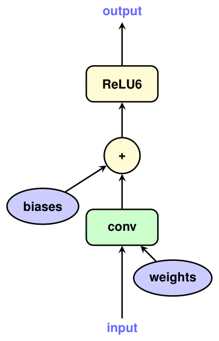

图 C.1：简单图：原始图

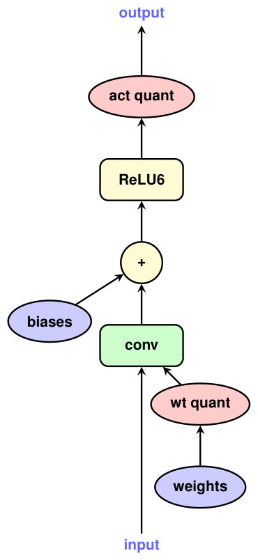

图 C.2：简单图：量化

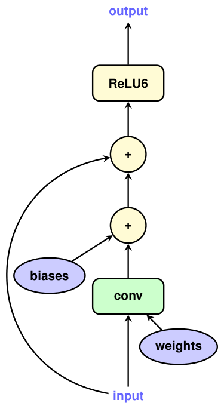

图 C.3：具有旁路连接的层：原始

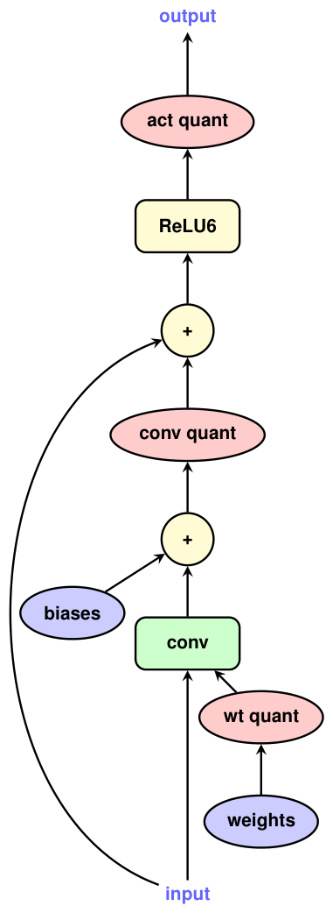

图 C.4：具有旁路连接的层：量化

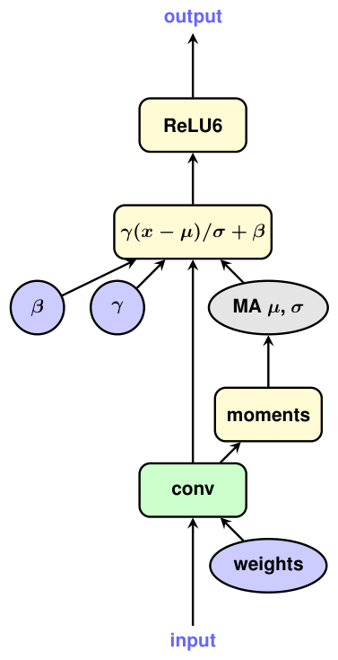

图 C.5：具有批归一化的卷积层：训练图

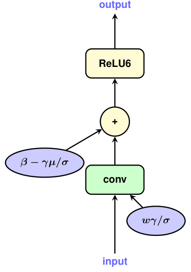

图 C.6：具有批归一化的卷积层：推理图

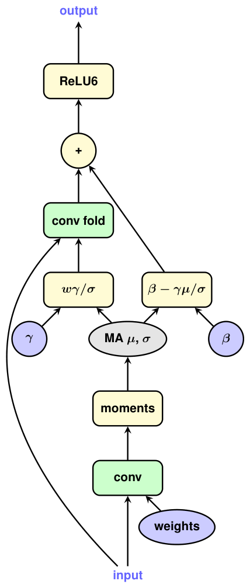

图 C.7：具有批归一化的卷积层：训练图，折叠

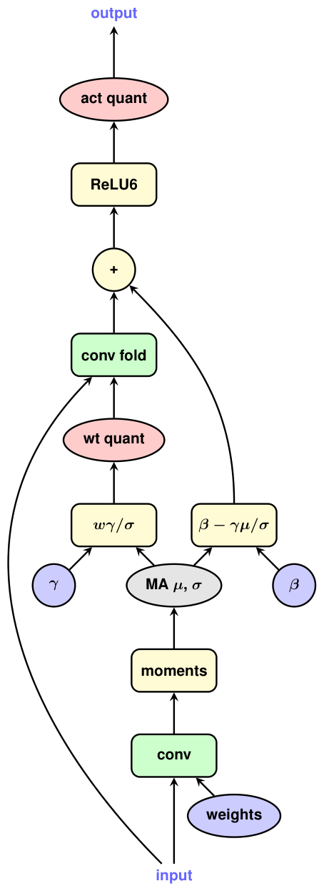

图 C.8：具有批归一化的卷积层：训练图、折叠和量化

## 实验方案

### ResNet 实验方案

预处理。来自 ImageNet [3] 的所有图像均在保留纵横比的情况下调整大小，以便图像的最小边为 $256$。然后裁剪中心 $224\times 224$ 补丁，并减去每个 RGB 通道的平均值。

优化。我们使用 TensorFlow [1] 中的动量优化器，其动量为 $0.9$ ，批量大小为 $32$ 。学习率从 $10^{-5}$ 开始，并在每个 $30$ epoch 中按 $0.1$ 阶梯式衰减。由于第 3 节中讨论的原因，激活量化延迟了 $500,000$ 步骤。训练异步使用 $50$ 工作器，并在验证精度达到稳定水平后停止，通常在 $100$ 纪元之后。

### Inception 实验方案

表 4.3 的全部结果均来自约 $10$ 百万步的异步训练，每批 $32$ 个样本，使用 $50$ 个分布式 worker。训练数据为带标签的 ImageNet 2012 $299\times 299$ 图像；增强包括随机裁剪、随机水平翻转和随机颜色扰动。优化器为 RMSProp，初始学习率为 $0.045$，每 $2$ 个 epoch 以 $0.94$ 的因子阶梯式指数衰减。其余 RMSProp 参数为：动量 $0.9$、衰减 $0.9$、epsilon 项 $1.0$。训练参数采用衰减系数为 $0.9999$ 的 EMA 平均。

### COCO检测协议

预处理。在训练期间，所有图像都会被随机裁剪并调整大小为 $320\times 320$ 。在评估过程中，所有图像都直接调整为 $320\times 320$ 。所有输入值均标准化为 $[-1,1]$ 。

优化。我们使用 TensorFlow [1] 中的 RMSprop 优化器，批量大小为 $32$ 。学习率从 $4\times 10^{-3}$ 开始，并以阶梯方式衰减，每个 $100$ 时期的系数为 $0.1$。由于第 3 节中讨论的原因，激活量化延迟了 $500,000$ 步骤。训练异步使用 $20$ 工作器，并在验证精度达到稳定水平后停止，通常在大约 $6$ 百万步后。

指标。评估结果以 COCO 主要挑战指标报告：AP at IoU=.50:.05:.95。我们遵循[13]中相同的训练/评估分割。

### 人脸检测和人脸属性分类协议

预处理。从文献 [10] 使用的 Flickr 数据集图像中随机取宽高比为 1:1 的裁剪区域；人脸检测调整为 $320\times 320$ 像素，人脸属性分类调整为 $128\times 128$ 像素。裁剪结果以 $50\%$ 的概率水平翻转。各 RGB 通道数值重新归一化到 $[-1,1]$。

人脸检测优化。我们使用 TensorFlow [1] 中的 RMSprop 优化器，批量大小为 $32$ 。学习率从 $4\times 10^{-3}$ 开始，并以阶梯方式衰减，每个 $100$ 时期的系数为 $0.1$。由于第 3 节中讨论的原因，激活量化延迟了 $500,000$ 步骤。训练异步使用 $20$ 工作器，并在验证精度达到稳定水平后停止，通常在大约 $3$ 百万步后。

人脸属性分类优化。我们遵循[10]中的优化协议。我们使用 Tensorflow [1] 中的 Adagrad 优化器，批量大小为 $32$，恒定学习率为 $0.1$。训练异步使用 $12$ 工作器，并在 $20$ 百万步处停止。

延迟测量。我们创建了一个二进制文件，可在 $100$ 秒内对随机输入重复运行人脸检测和人脸属性分类模型。我们使用 adb push 命令将此二进制文件推送到 Pixel 和 Pixel 2 手机，并使用 adb shell 命令指定适当的任务集在 1、2 和 4 个 LITTLE 核心以及 1、2 和 4 个大核心上执行它。我们报告了 $320\times 320$ 输入上的人脸检测器模型以及 $128\times 128$ 输入上的人脸属性分类器模型的平均运行时间。

## 脚注

[^footnote1]: 这里描述的量化方案是 TensorFlow Lite [5] 中采用的方案，我们将参考其代码的特定部分来说明下面讨论的各个方面。

[^footnote2]: 我们之前在 gemmlowp [18] 的[文档](https://github.com/google/gemmlowp/blob/fcf32e7a0a4d2af46e63eccf0c8fa4d83d0311c5/doc/quantization.md) 中描述了这种量化方案。该页面作为本节中开发的一些主题的替代处理及其独立的示例代码可能仍然有用。

[^footnote3]: TensorFlow Lite [5] 转换器中的实际数据结构是 [此头文件](https://github.com/tensorflow/tensorflow/blob/4952f981be07b8bf508f8226f83c10cdafa3f0c4/tensorflow/contrib/lite/toco/model.h) 中的 QuantizationParams 和 Array。正如我们在下一小节中讨论的，这种仍然包含浮点量的数据结构不会出现在实际的量化设备端推理代码中。

[^footnote4]: 本节讨论的计算是在 TensorFlow Lite [5] [参考代码](https://github.com/tensorflow/tensorflow/blob/4952f981be07b8bf508f8226f83c10cdafa3f0c4/tensorflow/contrib/lite/kernels/internal/reference/reference_ops.h#L493-L534) 中针对全连接层实现的。

[^footnote5]: 本节中的讨论是在 TensorFlow Lite [5] 中实现的，例如卷积运算符（ [参考代码](https://github.com/tensorflow/tensorflow/blob/4952f981be07b8bf508f8226f83c10cdafa3f0c4/tensorflow/contrib/lite/kernels/internal/reference/reference_ops.h#L248-L314) 是独立的，[优化代码](https://github.com/tensorflow/tensorflow/blob/4952f981be07b8bf508f8226f83c10cdafa3f0c4/tensorflow/contrib/lite/kernels/internal/optimized/optimized_ops.h#L837-L906) 调用 gemmlowp [ 18 ] ）。

[^footnote6]: 这里讨论的偏置向量的量化是在 TensorFlow Lite [5] 转换器中实现的[此处](https://github.com/tensorflow/tensorflow/blob/4952f981be07b8bf508f8226f83c10cdafa3f0c4/tensorflow/contrib/lite/toco/graph_transformations/quantize.cc#L171-L197)。

[^footnote7]: gemmlowp [ 18 ] 的 [定点目录](https://github.com/google/gemmlowp/tree/fcf32e7a0a4d2af46e63eccf0c8fa4d83d0311c5/fixedpoint) 中给出了至少 tanh 和逻辑函数的纯算术、SIMD 就绪、无分支、定点实现，并且专门针对 NEON 和 SSE 指令集。人们可以在 TensorFlow Lite [5] 中看到[这些是如何调用的](https://github.com/tensorflow/tensorflow/blob/4952f981be07b8bf508f8226f83c10cdafa3f0c4/tensorflow/contrib/lite/kernels/internal/optimized/optimized_ops.h#L2705-L2844)。

[^footnote8]: 请参阅 TensorFlow Lite [5] [实现](https://github.com/tensorflow/tensorflow/blob/4952f981be07b8bf508f8226f83c10cdafa3f0c4/tensorflow/contrib/lite/kernels/internal/optimized/optimized_ops.h#L1402-L1507)。

[^footnote9]: 这是在 TensorFlow Lite [5] 转换器的[本部分](https://github.com/tensorflow/tensorflow/blob/faf7f05f5ed3d92405656a318fb2d571a7d31532/tensorflow/contrib/lite/toco/graph_transformations/hardcode_min_max.cc#L66-L126) 中实现的

[^footnote10]: gemmlowp [18] 中的定点数学函数[实现](https://github.com/google/gemmlowp/tree/fcf32e7a0a4d2af46e63eccf0c8fa4d83d0311c5/fixedpoint) 使用此类定点乘法和普通（非饱和）整数加法。我们没有使用一般的饱和算术。

[^footnote11]: 它在 gemmlowp [18] 中实现[此处](https://github.com/google/gemmlowp/blob/fcf32e7a0a4d2af46e63eccf0c8fa4d83d0311c5/fixedpoint/fixedpoint_neon.h#L146-L152)。

[^footnote12]: 该技术在 gemmlowp [18] 的[优化的 NEON 内核](https://github.com/google/gemmlowp/blob/fcf32e7a0a4d2af46e63eccf0c8fa4d83d0311c5/internal/kernel_neon.h#L929-L1262) 中实现，这正是 TensorFlow Lite 使用的技术（请参阅[这一行](https://github.com/tensorflow/tensorflow/blob/4952f981be07b8bf508f8226f83c10cdafa3f0c4/tensorflow/contrib/lite/kernels/internal/optimized/optimized_ops.h#L903) 中 L8R8WithLhsNonzeroBitDepthParams 的选择）。

> 译注：正文关于训练时偏置不施加模拟量化的描述，不表示部署偏置为浮点；第 2.4 节明确采用 int32 偏置，缩放因子为权重与输入激活缩放因子的乘积。
