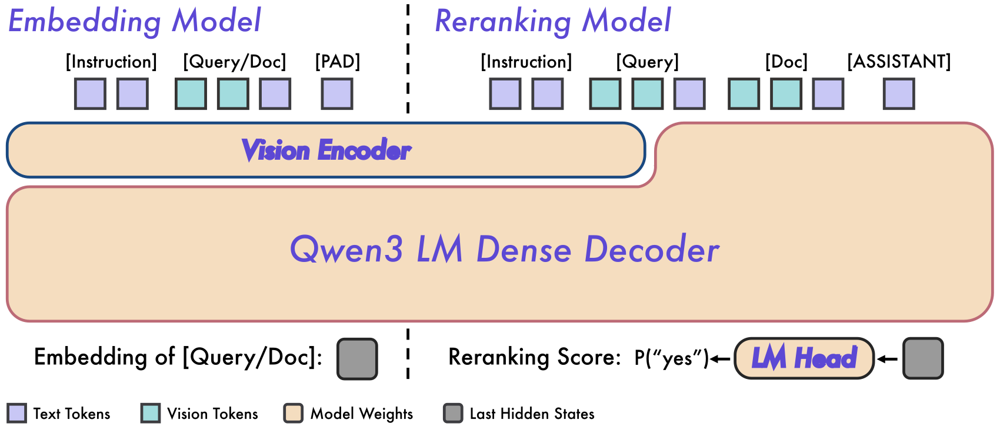
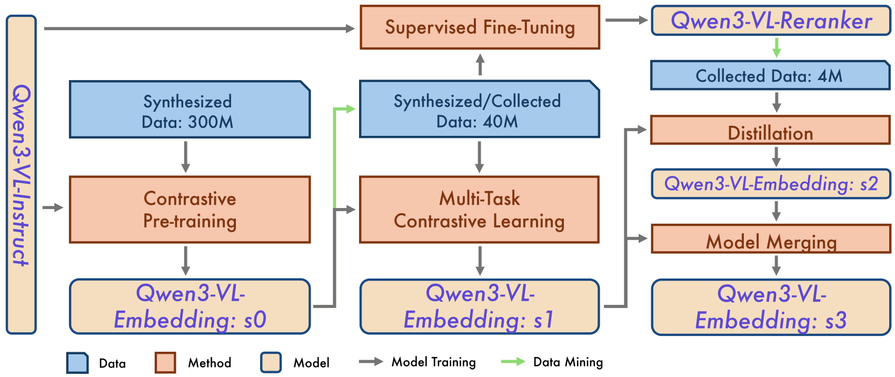
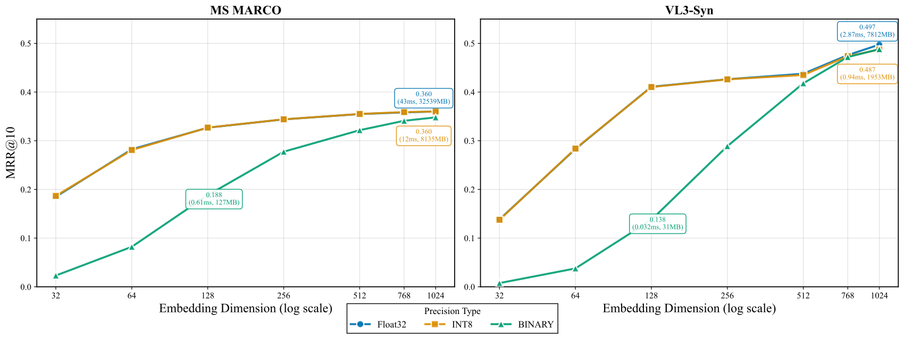

# Qwen3-VL-Embedding 与 Reranker：统一多模态检索和排序

> Qwen3-VL 将文本、图像、视频及组合输入统一为检索对象，通过多阶段训练、重排蒸馏和模型合并获得兼顾多任务的向量模型。
>
> [论文](https://arxiv.org/abs/2601.04720) · 本文依据 v2 · [代码](https://github.com/QwenLM/Qwen3-VL-Embedding)

多模态检索既需要便于索引的独立编码，也需要精细判断查询与候选是否相关。本文在 Qwen3-VL 上同时训练双编码器 Embedding 和交叉编码器 Reranker，用合成数据预训练、精选多任务训练、重排教师蒸馏逐步改善表示，再合并模型平衡检索与分类等能力。2B/8B 模型支持文本、图像、视频及组合输入，并通过 MRL 和向量量化感知训练控制索引成本。8B 在论文 MMEB-v2 上达到 77.8，但纯文本成绩仍略低于同规模 Qwen3-Embedding，视频与高分辨率编码也有明显成本。

## 模型结构与输入

两类模型均以 Qwen3-VL-Instruct 初始化，保留因果注意力。Embedding 在 system 中写任务指令，在 user 中放输入对象，追加 `<|endoftext|>`，取该位置最后层隐藏状态作为向量。2B 输出 2,048 维，8B 输出 4,096 维，模型规格为 32K 序列长度。

Embedding 让查询和候选分别编码、以余弦相似度检索。Reranker 联合读取指令、查询和候选，学习输出 yes/no；相关性分数为：

$$
s(q,d)=\sigma\bigl(\operatorname{logit}(\mathrm{yes})-\operatorname{logit}(\mathrm{no})\bigr).
$$

它是逐对判断，而非一次同时比较整个候选列表。重排可以利用更充分交互，但不能预先把所有查询—候选关系存成一个固定向量。

## 数据格式与合成

每个子数据集包含任务指令、查询集合、候选库和正负相关性标注，输入允许单一或混合模态。种子池先过滤低分辨率与异常宽高比，视频再做场景切分并去除静态/损坏片段；Qwen3-VL-32B 生成细粒度类别，结合置信度和 GME 图文一致性过滤，再按类别平衡。

图片任务覆盖分类、问答与检索；视频覆盖分类、问答、检索和片段定位。生成时先描述内容，再按任务生成问题、正例和混淆负例，降低一次生成复杂标注的难度。

难负例挖掘分为召回与过滤：检索 top-K，只保留至少有一个正例超过阈值的查询，再从非正例中选择满足分数边界的候选，减少误把潜在正例当负例。该策略降低风险，但相似度阈值并不能保证标签绝对正确。公开数据与内部数据共同参与训练，论文没有给出可完全重建的全部数据清单和数量。

## 多阶段训练与合并

图 5 标出预训练约 400M 样本、多任务阶段约 40M 样本、蒸馏约 2M 样本；这些是阶段规模，不能据此还原全部来源配比。第一阶段以大规模弱监督合成数据训练得到 s0，负例由已有模型挖掘。第二阶段使用公开精选数据、内部数据和部分合成数据，以 s0 改善挖掘，得到多任务模型 s1；同时在检索子集训练 Reranker。第三阶段由 Reranker 给小规模高质量候选集打分，蒸馏得到偏重检索的 s2，再与 s1 合并为 s3，恢复分类和 QA 等能力的平衡。

训练采用 LoRA。图像最多约 1,280 个视觉 token；视频初始按 1 FPS 抽样、最多 64 帧，所有帧总预算约 4,500 token。这是训练配置，评测还使用不同预算，不能与模型 32K 规格混为一谈。

## 针对不同任务的损失

检索采用 InfoNCE，第一阶段分母包含正例、难负例及 query–query、document–document、query–document 等批内项；用掩码排除重复正例及分数过高的疑似假负例。第二阶段移除 query–query 和 document–document 项，适配高质量多模态检索数据。

分类把样本当 query、类别文字当 document，只使用该查询明确错误的类别作为负例，避免把同类样本的标签误排斥。STS 使用 CoSENT，令预测相似度顺序匹配人工分数顺序：

$$
\mathcal L_{\mathrm{STS}}=\log\left(1+\sum_{y_a>y_b}\exp((s_b-s_a)/\tau)\right).
$$

重排蒸馏匹配同一候选集上的分布：

$$
\mathcal L_{\mathrm{distill}}=-\sum_iP_{\mathrm{reranker}}(d_i\mid q)\log P_{\mathrm{embedding}}(d_i\mid q).
$$

Reranker 自身用 yes/no 标签的交叉熵训练。以上目标不能简单互换：分类标签、连续相似度和检索候选分别提供不同监督。

## MRL 与向量量化

MRL 不只在完整向量上计算损失，也在多个前缀维度上训练，使截断后仍具有可用排序。QAT 则同时对全精度与模拟低精度向量优化目标，用 LSQ 学习步长，并以 STE 通过舍入操作传播梯度。这里主要解决输出向量的低精度表示，不等于把整个模型权重都量化。

作者用 MSMARCO 全 passage 语料和 2M 图像的 VL3-Syn 分别测试文本与跨模态检索，每项 10K 查询，指标 MRR@10。1,024→512 维在该文本实验中约损失 1.4% 检索表现，向量存储减半；int8 影响较小，二值量化损失更明显，低维时尤其突出。报告中的速度收益依赖其实现，不能推断所有向量数据库都会同幅提速。

## 主要结果

MMEB-v2 包含 36 个图像、18 个视频和 24 个视觉文档数据集。论文评测最大上下文为 16,384，图片预算 1,800 token，视频预算 15,000 token且最多 64 帧。

| 模型 | 图像 | 视频 | 视觉文档 | 全部 78 集 |
| --- | --- | --- | --- | --- |
| Qwen3-VL-Embedding-2B | 75.0 | 61.9 | 79.2 | 73.2 |
| Qwen3-VL-Embedding-8B | 80.1 | 67.1 | 82.4 | 77.8 |
| RzenEmbed-8B | 75.9 | 55.7 | 81.3 | 72.9 |
| Seed-1.6-embedding-1215 | 78.0 | 67.7 | 82.2 | 76.9 |

77.8 相对 72.9 是约 6.7% 相对提高，绝对差为 4.9 分；不能写成提高 6.7 个百分点。纯文本 MMTEB 上，8B 为 67.9，同规模 Qwen3-Embedding 为 70.6。

重排统一在 2B Embedding 召回的 top-100 上进行。8B Reranker 在 JinaVDR 达到 83.6，ViDoRe v3 达到 66.7，对应初始召回排序为 71.0、52.9。这里比较的是固定召回候选后的排序，效果仍受第一阶段召回上限约束。

## 消融、附录与结论

2B 的 s0/s1/s2/s3 综合分数为 66.6/72.1/71.5/73.2。蒸馏提高检索，却可能降低分类和 QA，因此总分并非随阶段单调增加；模型合并恢复平衡。增加图像 token、帧数和视频总预算通常有益，但收益递减，极高预算还可能退步。

附录给出任务格式、数据合成提示及应用示例。本文将统一表示、重排、蒸馏、MRL 和量化组合为完整检索训练流程；局限包括内部数据难复现、视觉输入预算敏感、低维二值表示退化，以及多模态能力与纯文本最优表现之间的取舍。
