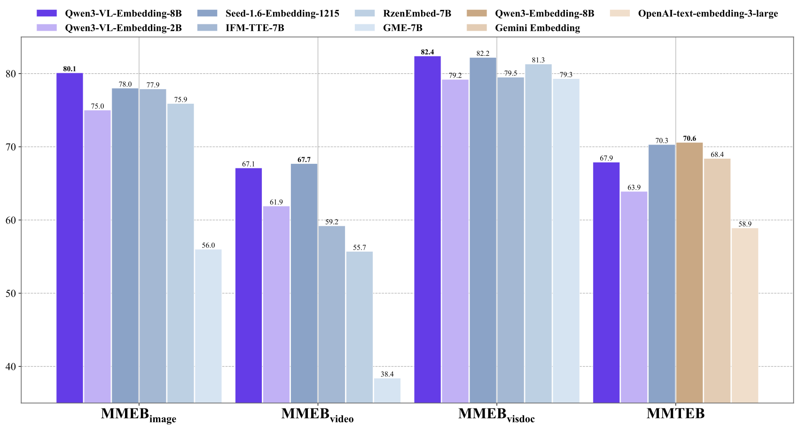
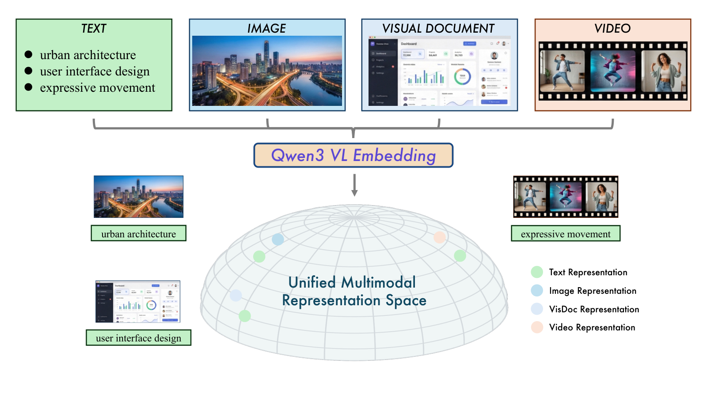
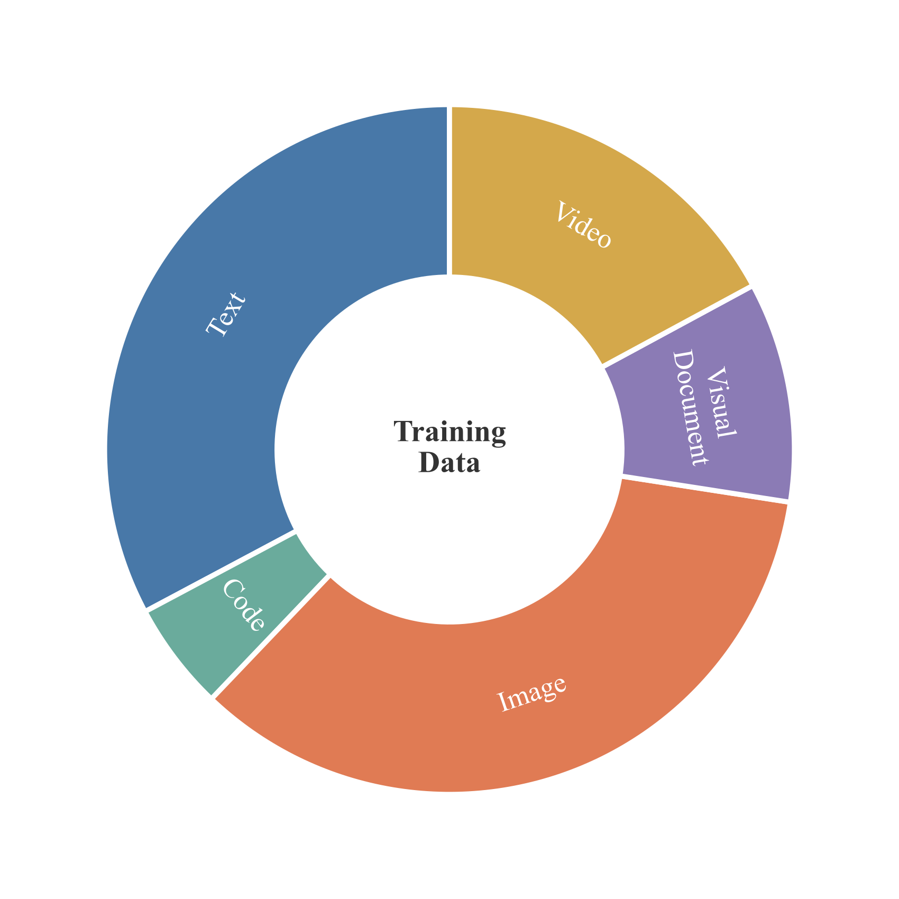
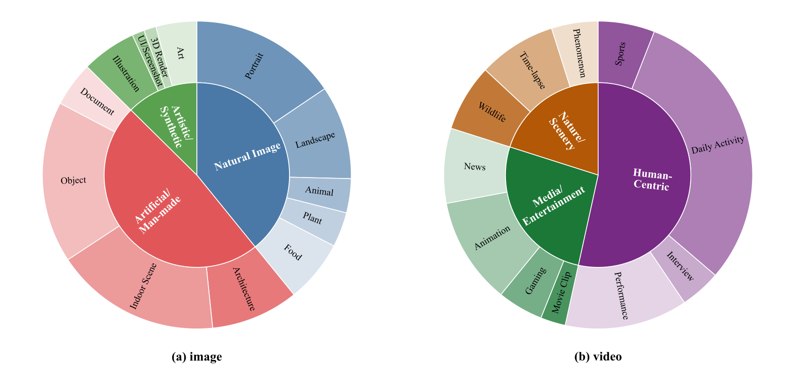
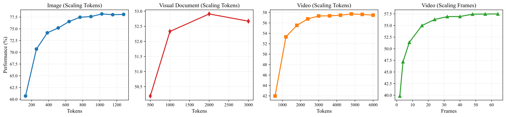

# Qwen3-VL-Embedding and Qwen3-VL-Reranker: A Unified Framework for State-of-the-Art Multimodal Retrieval and Ranking / 全文中英对照

> 来源：[arXiv:2601.04720v2](https://arxiv.org/abs/2601.04720v2)。英文段落后紧接中文，覆盖所取 HTML 版本的主文、附录、图表、脚注与参考文献；公式、数字表和书目信息共用。中文以机器初译为底稿，进行了术语整理与结构核对，尚未逐句人工审定；遇到歧义请以紧邻英文和原论文为准。 本文对照整理基于仓库原有论文副本，原作版权归所列作者。

## Authors and affiliations / 作者与机构

Mingxin Li [^id1] Yanzhao Zhang [^footnotex1] Dingkun Long [^footnotex2] Keqin Chen Affiliation: Sibo Song Shuai Bai Zhibo Yang Pengjun Xie Affiliation: An Yang Dayiheng Liu Jingren Zhou Junyang Lin Affiliation: Tongyi Lab, Alibaba Group

## Abstract / 摘要

**EN.** In this report, we introduce the Qwen3-VL-Embedding and Qwen3-VL-Reranker model series, the latest extensions of the Qwen family built on the Qwen3-VL foundation model. Together, they provide an end-to-end pipeline for high-precision multimodal search by mapping diverse modalities, including text, images, document images, and video, into a unified representation space. The Qwen3-VL-Embedding model employs a multi-stage training paradigm, progressing from large-scale contrastive pre-training to reranking model distillation, to generate semantically rich high-dimensional vectors. It supports Matryoshka Representation Learning, enabling flexible embedding dimensions, and handles inputs up to 32k tokens. Complementing this, Qwen3-VL-Reranker performs fine-grained relevance estimation for query-document pairs using a cross-encoder architecture with cross-attention mechanisms. Both model series inherit the multilingual capabilities of Qwen3-VL, supporting more than 30 languages, and are released in 2B and 8B parameter sizes to accommodate diverse deployment requirements. Empirical evaluations demonstrate that the Qwen3-VL-Embedding series achieves state-of-the-art results across diverse multimodal embedding evaluation benchmarks. Specifically, Qwen3-VL-Embedding-8B attains an overall score of 77.8 on MMEB-V2, ranking first among all models (as of January 8, 2025). This report presents the architecture, training methodology, and practical capabilities of the series, demonstrating their effectiveness on various multimodal retrieval tasks, including image-text retrieval, visual question answering, and video-text matching.

**中.** 在本报告中，我们介绍了 Qwen3-VL-Embedding 和 Qwen3-VL-Reranker 模型系列，它们是基于 Qwen3-VL 基础模型构建的 Qwen 系列的最新扩展。它们共同通过将文本、图像、文档图像和视频等不同模态映射到统一的表示空间中，为高精度多模态搜索提供端到端管道。 Qwen3-VL-Embedding模型采用多阶段训练范例，从大规模对比预训练到重新排序模型蒸馏，以生成语义丰富的高维向量。它支持 Matryoshka 表示学习，支持灵活的嵌入维度，并可处理多达 32k 个令牌的输入。作为补充，Qwen3-VL-Reranker 使用具有交叉注意力机制的交叉编码器架构对查询文档对执行细粒度的相关性估计。两个模型系列都继承了Qwen3-VL的多语言能力，支持30多种语言，并以2B和8B参数大小发布，以适应多样化的部署需求。实证评估表明，Qwen3-VL-Embedding 系列在不同的多模态嵌入评估基准上取得了最先进的结果。具体来说，Qwen3-VL-Embedding-8B在MMEB-V2上的总体得分为77.8，在所有模型中排名第一（截至2025年1月8日）。本报告介绍了该系列的架构、训练方法和实践能力，展示了其在图像文本检索、视觉问答和视频文本匹配等各种多模态检索任务上的有效性。

|  | [https://huggingface.co/collections/Qwen](https://huggingface.co/collections/Qwen) |
| --- | --- |
|  | [https://modelscope.cn/organization/qwen](https://modelscope.cn/organization/qwen) |
|  | [https://github.com/QwenLM/Qwen3-VL-Embedding](https://github.com/QwenLM/Qwen3-VL-Embedding) |

**EN.** Figure 1: Illustration of the Unified Multimodal Representation Space. Qwen3-VL-Embedding model series represent multi-source data (Text, Image, Visual Document, and Video) into a common manifold. By aligning semantic concepts across modalities (e.g., the text ”urban architecture” and its corresponding image), the model achieves a holistic understanding of complex visual and textual information.

**中.** 图 1：统一多模态表示空间的图示。 Qwen3-VL-Embedding 模型系列将多源数据（文本、图像、视觉文档和视频）表示为公共流形。通过跨模态（例如文本“城市建筑”及其相应图像）调整语义概念，该模型实现了对复杂视觉和文本信息的整体理解。

## Introduction / 简介

**EN.** The exponential growth of multimodal content on the internet has fundamentally transformed how information is created, shared, and consumed. Modern digital ecosystems are increasingly populated with diverse data modalities, including natural images, text documents, infographics, screenshots, and videos. This proliferation necessitates advanced retrieval systems capable of understanding and matching semantic concepts across different modalities, moving beyond traditional text-only search paradigms. Multimodal search, which aims to retrieve relevant content regardless of the query or document modality, has emerged as a critical capability for applications ranging from e-commerce product discovery to scientific literature exploration and social media navigation ( Faysse et al., 2025 ; Fu et al., 2025 ) .

**中.** 互联网上多模式内容的指数级增长从根本上改变了信息的创建、共享和消费方式。现代数字生态系统越来越多地充满了各种数据模式，包括自然图像、文本文档、信息图表、屏幕截图和视频。这种激增需要先进的检索系统能够理解和匹配不同模式的语义概念，超越传统的纯文本搜索范式。多模态搜索旨在检索相关内容，无论查询或文档模态如何，已成为从电子商务产品发现到科学文献探索和社交媒体导航等应用的关键功能（Faysse 等人，2025 年；Fu 等人，2025 年）。

**EN.** Within contemporary multimodal retrieval architectures, embedding and reranking models constitute the two most critical modules. The field of multimodal representation learning has witnessed significant progress over the past decade ( Manzoor et al., 2023 ; Mei et al., 2025 ) . Among these pioneering works, CLIP (Contrastive Language-Image Pre-training) ( Radford et al., 2021 ) has been particularly influential by demonstrating that large-scale contrastive learning on image-text pairs can produce powerful aligned representations. Its success has cemented the importance of learning shared embedding spaces where semantically similar content is positioned proximate in the representation space regardless of its modality.

**中.** 在当代多模态检索架构中，嵌入和重排序模型构成了两个最关键的模块。多模态表示学习领域在过去十年中取得了重大进展（Manzoor et al., 2023; Mei et al., 2025）。在这些开创性的工作中，CLIP（对比语言-图像预训练）（Radford et al., 2021）尤其具有影响力，它证明了图像-文本对的大规模对比学习可以产生强大的对齐表示。它的成功巩固了学习共享嵌入空间的重要性，其中语义相似的内容位于表示空间中最接近的位置，无论其模态如何。

**EN.** As the development of foundation models accelerates, multimodal pre-trained vision-language models (VLMs) such as Qwen-VL ( Wang et al., 2024b ; Bai et al., 2025 ) and GPT-4o ( Hurst et al., 2024 ) have achieved unprecedented success in multimodal comprehension. Building on these breakthroughs, the multimodal retrieval community has increasingly explored training unified multimodal embedding models based on VLMs. Notable efforts in this space include E5-V ( Jiang et al., 2024 ) , GME ( Zhang et al., 2025b ) , BGE-VL ( Zhou et al., 2025 ) , and VLM2Vec ( Meng et al., 2025 ; Jiang et al., 2025 ) . Training unified multimodal representations based on VLMs offers several compelling advantages. First, VLMs possess inherent cross-modal alignment through their pre-training on large-scale image-text datasets. Second, they leverage sophisticated attention mechanisms to capture fine-grained interactions between visual and textual elements. Third, they provide a natural pathway to handling complex multimodal documents such as infographics and presentation slides where visual and textual information are deeply intertwined. Furthermore, VLM-based approaches can inherit the extensive multilingual and multi-domain knowledge encoded in foundation models, enabling more robust generalization across diverse retrieval scenarios.

**中.** 随着基础模型发展的加速，多模态预训练视觉语言模型（VLM）如Qwen-VL（Wang et al., 2024b；Bai et al., 2025）和GPT-4o（Hurst et al., 2024）在多模态理解方面取得了前所未有的成功。基于这些突破，多模态检索社区越来越多地探索基于 VLM 训练统一的多模态嵌入模型。该领域的著名工作包括 E5-V (Jiang et al., 2024)、GME (Zhang et al., 2025b)、BGE-VL (Zhou et al., 2025) 和 VLM2Vec (Meng et al., 2025; Jiang et al., 2025)。基于 VLM 训练统一的多模态表示具有几个引人注目的优势。首先，VLM 通过对大规模图像文本数据集进行预训练而拥有固有的跨模式对齐能力。其次，它们利用复杂的注意力机制来捕获视觉和文本元素之间的细粒度交互。第三，它们提供了处理复杂多模式文档（例如视觉和文本信息深度交织的信息图表和演示幻灯片）的自然途径。此外，基于 VLM 的方法可以继承基础模型中编码的广泛多语言和多领域知识，从而在不同的检索场景中实现更强大的泛化。

**EN.** In this work, we introduce the Qwen3-VL-Embedding and Qwen3-VL-Reranker model series, which are specifically designed for multimodal retrieval applications. Built upon the powerful Qwen3-VL ( Bai et al., 2025 ) foundation model, these models bring together advanced vision-language understanding capabilities with specialized training methodologies tailored for retrieval tasks. The Qwen3-VL-Embedding series employs a sophisticated multi-stage training paradigm that progresses from contrastive pre-training on large-scale multimodal data to knowledge distillation from ranking models, ultimately producing semantically rich embeddings that capture nuanced relationships across modalities. These models support Matryoshka Representation Learning ( Kusupati et al., 2022 ) , allowing users to flexibly select embedding dimensions according to their storage and computational constraints without retraining. Additionally, we incorporate quantization-aware training strategies during the training process to ensure that the generated embeddings maintain robust performance after quantization. This capability significantly improves the storage efficiency and computational friendliness of downstream tasks. The models can process inputs containing up to 32,768 tokens, enabling comprehensive understanding of long documents and videos. Complementing the embedding models, the Qwen3-VL-Reranker series adopts a cross-encoder architecture that performs deep cross-attention between query and document representations, providing precise relevance scores for candidate retrieval results. Both model series inherit the impressive multilingual capabilities of the Qwen3-VL foundation model, supporting more than 30 languages with high proficiency, and are released in two sizes (2B, and 8B parameters) to accommodate diverse application scenarios.

**中.** 在这项工作中，我们介绍了 Qwen3-VL-Embedding 和 Qwen3-VL-Reranker 模型系列，它们是专为多模态检索应用而设计的。这些模型建立在强大的 Qwen3-VL（Bai 等人，2025）基础模型的基础上，将先进的视觉语言理解能力与针对检索任务量身定制的专门训练方法结合在一起。 Qwen3-VL-Embedding 系列采用复杂的多阶段训练范例，从大规模多模态数据的对比预训练到排序模型的知识蒸馏，最终产生语义丰富的嵌入，捕获跨模态的细微关系。这些模型支持 Matryoshka 表示学习（Kusupati et al., 2022），允许用户根据其存储和计算限制灵活选择嵌入维度，而无需重新训练。此外，我们在训练过程中结合了量化感知训练策略，以确保生成的嵌入在量化后保持稳健的性能。该功能显着提高了下游任务的存储效率和计算友好性。该模型可以处理包含多达 32,768 个标记的输入，从而能够全面理解长文档和视频。作为对嵌入模型的补充，Qwen3-VL-Reranker 系列采用交叉编码器架构，在查询和文档表示之间执行深度交叉关注，为候选检索结果提供精确的相关性分数。两个模型系列都继承了Qwen3-VL基础模型令人印象深刻的多语言能力，高度熟练地支持30多种语言，并以2B和8B参数两种尺寸发布，以适应不同的应用场景。

**EN.** We evaluate the Qwen3-VL-Embedding and Qwen3-VL-ReRanker model series across a comprehensive set of benchmarks spanning multiple tasks and domains. Experimental results demonstrate that our embedding and reranking models achieve state-of-the-art performance across multiple types of downstream tasks. For example, the flagship model Qwen3-VL-Embedding-8B attains a score of 77.8 on the MMEB-V2 benchmark ( Meng et al., 2025 ) , as evaluated in January 2026, surpassing all models currently on the leaderboard [^footnote1] , including both open-source models and closed-source API services. Beyond multimodal evaluation, in pure text evaluation, the Qwen3-VL-Embedding-8B model achieves a mean task score of 67.9 on the MTEB Multilingual benchmark ( Enevoldsen et al., 2025a ) , demonstrating highly competitive performance. Moreover, our reranking model delivers competitive results across a range of retrieval tasks. The Qwen3-VL-Reranker-2B model exceeds previously top-performing models in numerous retrieval tasks, while the larger Qwen3-VL-Reranker-8B model demonstrates even superior performance, improving ranking results by 4.1 points over the 2B model across multiple tasks. Furthermore, we include a constructive ablation study to elucidate the key factors contributing to the superior performance of the Qwen3-VL-Embedding series, providing insights into its effectiveness.

**中.** 我们通过涵盖多个任务和领域的一套全面的基准来评估 Qwen3-VL-Embedding 和 Qwen3-VL-ReRanker 模型系列。实验结果表明，我们的嵌入和重新排序模型在多种类型的下游任务中实现了最先进的性能。例如，旗舰模型Qwen3-VL-Embedding-8B在2026年1月评估的MMEB-V2基准（Meng et al., 2025）上获得了77.8分，超过了目前排行榜上的所有模型[^footnote1]，包括开源模型和闭源API服务。除了多模态评估之外，在纯文本评估中，Qwen3-VL-Embedding-8B 模型在 MTEB 多语言基准上取得了 67.9 的平均任务得分（Enevoldsen 等人，2025a），表现出极具竞争力的性能。此外，我们的重新排名模型在一系列检索任务中提供了有竞争力的结果。 Qwen3-VL-Reranker-2B 模型在众多检索任务中超越了之前表现最好的模型，而更大的 Qwen3-VL-Reranker-8B 模型表现出更优越的性能，在多个任务中比 2B 模型提高了 4.1 个百分点。此外，我们还开展了一项建设性消融研究，以阐明 Qwen3-VL-Embedding 系列卓越性能的关键因素，从而深入了解其有效性。

**EN.** In the following sections, we present the architectural design of our model, elaborate on the training procedures, report comprehensive experimental results for both the embedding and reranking components, and conclude this technical report by synthesizing key findings and discussing promising avenues for future investigation.

**中.** 在以下部分中，我们介绍模型的架构设计，详细说明训练程序，报告嵌入和重新排序组件的综合实验结果，并通过综合关键发现并讨论未来研究的有希望的途径来总结本技术报告。

**EN.** Figure 2: Overview of the Qwen3-VL-Embedding and Qwen3-VL-Reranker architecture.

**中.** 图 2：Qwen3-VL-Embedding 和 Qwen3-VL-Reranker 架构概述。

## Model / 型号

| Model Type 型号类型 | Size 尺寸 | Layers 层数 | Sequence Length 序列长度 | Embedding Dimension 嵌入维度 | Quantization Support 量化支持 | MRL Support 最大残留限量支持 | Instruction Aware 指令感知 |
| --- | --- | --- | --- | --- | --- | --- | --- |
| Qwen3-VL-Embedding Qwen3-VL-嵌入 | 2B | 28 | 32K | 2048 | Yes 是的 | Yes 是的 | Yes 是的 |
| Qwen3-VL-Embedding Qwen3-VL-嵌入 | 8B | 36 | 32K | 4096 | Yes 是的 | Yes 是的 | Yes 是的 |
| Qwen3-VL-Reranker Qwen3-VL-重新排序器 | 2B | 28 | 32K | - | - | - | Yes 是的 |
| Qwen3-VL-Reranker Qwen3-VL-重新排序器 | 8B | 36 | 32K | - | - | - | Yes 是的 |

**EN.** Table 1: Model specifications for the Qwen3-VL-Embedding and Qwen3-VL-Reranker. “Quantization Support” indicates the supported quantization formats for the embeddings. “MRL support” denotes whether the embedding model allows user-specified embedding dimensionalities. “Instruction-aware” indicates whether the models support task-specific customization of the input instruction.

**中.** 表 1：Qwen3-VL-Embedding 和 Qwen3-VL-Reranker 的型号规格。 “量化支持”表示嵌入支持的量化格式。 “MRL 支持”表示嵌入模型是否允许用户指定的嵌入维度。 “指令感知”表示模型是否支持输入指令的特定于任务的定制。

**EN.** Qwen3-VL-Embedding and Qwen3-VL-Reranker models are designed to make task-aware relevance judgments for multimodal instances. As shown in Figure 2 , the embedding model follows a bi-encoder architecture to produce dense vector representations of instances and uses cosine similarity as the relevance measure. In contrast, the reranking model adopts a cross-encoder architecture to provide more fine-grained relevance estimates for each query–document pair.

**中.** Qwen3-VL-Embedding 和 Qwen3-VL-Reranker 模型旨在对多模态实例进行任务感知的相关性判断。如图 2 所示，嵌入模型遵循双编码器架构来生成实例的密集向量表示，并使用余弦相似度作为相关性度量。相比之下，重新排序模型采用交叉编码器架构，为每个查询-文档对提供更细粒度的相关性估计。

#### Model Architecture / 模型架构

**EN.** Both the embedding and reranking models are built on the Qwen3-VL backbone, using causal attention. After being trained on a large-scale collection of multimodal, multi-task relevance data, they retain the backbone’s world knowledge, multimodal perception, and instruction-following capabilities, while additionally gaining the ability to estimate relevance. We train two model sizes—2B and 8B—and summarize their specifications in Table 1 .

**中.** 嵌入和重新排序模型都建立在 Qwen3-VL 主干上，使用因果注意力。在接受大规模多模态、多任务相关性数据收集的训练后，它们保留了主干的世界知识、多模态感知和指令跟踪能力，同时还获得了估计相关性的能力。我们训练了两种模型尺寸——2B 和 8B——并在表 1 中总结了它们的规格。

#### Embedding Method / 嵌入方法

**EN.** The embedding model extracts task-aware dense vectors for multimodal inputs. The input format follows the Qwen3-VL context structure, where the instruction is passed as a system message, with the default instruction being “Represent the user’s input.” The multimodal instance to be represented is passed as a user message, and it can be in the form of text, images, videos, or any combination of these modalities. Finally, a “PAD” ( `<|endoftext|>` ) token is appended to the input, and the last hidden state corresponding to this token is used as the dense vector representation of the instance.

**中.** 嵌入模型为多模态输入提取任务感知的密集向量。输入格式遵循 Qwen3-VL 上下文结构，其中指令作为系统消息传递，默认指令是“代表用户的输入”。要表示的多模态实例作为用户消息传递，并且可以是文本、图像、视频或这些模态的任意组合的形式。最后，将“PAD”（`<|endoftext|>`）标记附加到输入，并将与该标记对应的最后一个隐藏状态用作实例的密集向量表示。

**EN.** Input Template for Embedding

**中.** 用于嵌入的输入模板

**EN.** `<|im_start|>system`

**中.** `<|im_start|>system`

**EN.** `{Instruction}`

**中.** `{Instruction}`

**EN.** `<|im_end|>`

**中.** `<|im_end|>`

**EN.** `<|im_start|>user`

**中.** `<|im_start|>user`

**EN.** `{Instance}`

**中.** `{Instance}`

**EN.** `<|im_end|>`

**中.** `<|im_end|>`

**EN.** `<|im_start|>assistant`

**中.** `<|im_start|>assistant`

**EN.** `<|endoftext|>`

**中.** `<|endoftext|>`

#### Reranking Method / 重排法

**EN.** The reranking model adopts a pointwise ranking approach, which evaluates the relevance between a pair of multimodal instances according to the relevance definition provided in the instruction. The input format follows the Qwen3-VL context structure, where both the relevance-defining instruction and the pair of multimodal instances to be evaluated are passed as user messages. These multimodal inputs can be text, images, videos, or any combination of these modalities. Finally, the relevance estimation for the pair is obtained by calculating the model’s probability of predicting “yes” or “no” as the next output token.

**中.** 重排序模型采用逐点排序方法，根据指令中提供的相关性定义来评估一对多模态实例之间的相关性。输入格式遵循 Qwen3-VL 上下文结构，其中相关性定义指令和要评估的一对多模式实例都作为用户消息传递。这些多模式输入可以是文本、图像、视频或这些模式的任意组合。最后，通过计算模型预测“是”或“否”作为下一个输出标记的概率来获得该对的相关性估计。

**EN.** Input Template for Reranking

**中.** 用于重新排名的输入模板

**EN.** `<|im_start|>system`

**中.** `<|im_start|>system`

**EN.** `Judge whether the Document meets the requirements based on the Query and the Instruct provided. Note that the answer can only be "yes" or "no".`

**中.** `Judge whether the Document meets the requirements based on the Query and the Instruct provided. Note that the answer can only be "yes" or "no".`

**EN.** `<|im_end|>`

**中.** `<|im_end|>`

**EN.** `<|im_start|>user`

**中.** `<|im_start|>user`

**EN.** `<Instruct>: {Instruction}`

**中.** `<Instruct>: {Instruction}`

**EN.** `<Query>: {Query}`

**中.** `<Query>: {Query}`

**EN.** `<Document>: {Document}`

**中.** `<Document>: {Document}`

**EN.** `<|im_end|>`

**中.** `<|im_end|>`

**EN.** `<|im_start|>assistant`

**中.** `<|im_start|>assistant`

## Data / 数据

**EN.** To endow the model with universal representation capabilities across diverse modalities, tasks, and domains, we curated a massive-scale dataset. The distribution of different categories within the dataset is illustrated in Figure 4 . However, both publicly available and proprietary in-house data exhibit significant imbalances and, in specific scenarios, notable scarcity across these dimensions. To address these challenges, we leverage data synthesis to construct a balanced training corpus that ensures robust coverage across all modalities, tasks, and domains.

**中.** 为了赋予模型跨不同模式、任务和领域的通用表示能力，我们策划了一个大规模数据集。数据集中不同类别的分布如图 4 所示。然而，公开的数据和专有的内部数据都表现出严重的不平衡，并且在特定情况下，这些维度上的数据显着稀缺。为了应对这些挑战，我们利用数据合成来构建一个平衡的训练语料库，确保对所有模式、任务和领域的稳健覆盖。

### Dataset Format / 数据集格式

**EN.** The complete dataset comprises multiple sub-datasets, denoted as $\mathcal{D}=\{D_{i}\}_{i=1}^{M}$ . Each sub-dataset $D_{i}$ is defined by a quadruple $D_{i}=(I_{i},Q_{i},C_{i},R_{i})$ , structured as follows:

**中.** 完整的数据集包含多个子数据集，表示为 $\mathcal{D}=\{D_{i}\}_{i=1}^{M}$ 。每个子数据集 $D_{i}$ 由四元组 $D_{i}=(I_{i},Q_{i},C_{i},R_{i})$ 定义，结构如下：

**EN.** —

**中.** —

**EN.** Instruction ( $I_{i}$ ): A textual description defining the specific relevance criteria and task objectives for the sub-dataset.

**中.** 指令 ( $I_{i}$ )：定义子数据集的具体相关标准和任务目标的文本描述。

**EN.** —

**中.** —

**EN.** Queries ( $Q_{i}$ ): A collection of $N_{q}$ query objects, $Q_{i}=\{q_{j}\}_{j=1}^{N_{q}}$ . Each $q_{j}$ can consist of text, images, videos, or any multimodal combination thereof.

**中.** 查询 ( $Q_{i}$ )：$N_{q}$ 查询对象 $Q_{i}=\{q_{j}\}_{j=1}^{N_{q}}$ 的集合。每个 $q_{j}$ 可以由文本、图像、视频或其任何多模式组合组成。

**EN.** —

**中.** —

**EN.** Corpus ( $C_{i}$ ): A repository of $N_{d}$ document objects, $C_{i}=\{d_{j}\}_{j=1}^{N_{d}}$ . Similar to queries, each $d_{j}$ may be a single modality or a multimodal composite of text, images, and videos.

**中.** 语料库 ( $C_{i}$ )：$N_{d}$ 文档对象 $C_{i}=\{d_{j}\}_{j=1}^{N_{d}}$ 的存储库。与查询类似，每个 $d_{j}$ 可以是单一模态或多模态的文本、图像和视频组合。

**EN.** —

**中.** —

**EN.** Relevance Labels ( $R_{i}$ ): This component identifies the relationships between queries and documents, denoted as $R_{i}=\{(q_{j},\{d_{j,k}^{+}\}_{k=1}^{n^{+}},\{d_{j,k}^{-}\}_{k=1}^{n^{-}})\}_{j=1}^{N_{q}}$ . For each query $q_{j}$ , $\{d_{j,k}^{+}\}_{k=1}^{n^{+}}\subset C_{i}$ represents the set of relevant documents (positive documents), while $\{d_{j,k}^{-}\}_{k=1}^{n^{-}}\subset C_{i}$ represents the set of irrelevant documents (negative documents).

**中.** 相关性标签 ( $R_{i}$ )：此组件标识查询和文档之间的关系，表示为 $R_{i}=\{(q_{j},\{d_{j,k}^{+}\}_{k=1}^{n^{+}},\{d_{j,k}^{-}\}_{k=1}^{n^{-}})\}_{j=1}^{N_{q}}$ 。对于每个查询 $q_{j}$ ， $\{d_{j,k}^{+}\}_{k=1}^{n^{+}}\subset C_{i}$ 表示相关文档（正文档）的集合，而 $\{d_{j,k}^{-}\}_{k=1}^{n^{-}}\subset C_{i}$ 表示不相关文档（负文档）的集合。

**EN.** Representative dataset examples are presented in Appendix A .

**中.** 附录 A 中给出了代表性数据集示例。

### Data Synthesis / 数据综合

**EN.** We employ data synthesis to construct various sub-datasets $D_{i}$ . Specifically, we extend the methodology introduced in Qwen3 Embedding ( Zhang et al., 2025c ) to multimodal scenarios.

**中.** 我们采用数据合成来构建各种子数据集 $D_{i}$ 。具体来说，我们将 Qwen3 Embedding（Zhang et al., 2025c）中引入的方法扩展到多模态场景。

#### Seed Pool Construction / 种子库建设

**EN.** Since the diversity of synthesized data depends on the underlying seed pool, we first aggregate an extensive collection of high-quality and diverse raw image and video datasets. To establish a high-quality foundation, we first apply coarse-grained quality filtering to prune assets with low resolutions or irregular aspect ratios. This is followed by structural refinement, specifically employing scene cut detection and removing static or corrupted segments, to preserve the integrity of temporal dynamics in video data. Subsequently, we leverage Qwen3-VL-32B ( Bai et al., 2025 ) to generate fine-grained categorical labels for the remaining assets. To ensure cross-modal alignment, we implement a rigorous filtering mechanism that excludes samples with low-confidence annotations or poor visual-text correspondence, as measured by similarity scores from the GME ( Zhang et al., 2025b ) embedding model. Finally, we perform category-wise rebalancing on the refined dataset to construct the final seed pool. The resulting category distribution is illustrated in Figure 4 .

**中.** 由于合成数据的多样性取决于底层种子池，因此我们首先聚合大量高质量且多样化的原始图像和视频数据集。为了建立高质量的基础，我们首先应用粗粒度的质量过滤来修剪低分辨率或不规则纵横比的资产。接下来是结构细化，特别是采用场景剪切检测并删除静态或损坏的片段，以保持视频数据中时间动态的完整性。随后，我们利用 Qwen3-VL-32B (Bai et al., 2025) 为剩余资产生成细粒度的分类标签。为了确保跨模态对齐，我们实施了严格的过滤机制，排除具有低置信度注释或视觉文本对应性差的样本，这是通过 GME (Zhang et al., 2025b) 嵌入模型的相似性分数来衡量的。最后，我们对精炼数据集进行类别再平衡以构建最终的种子池。由此产生的类别分布如图 4 所示。

**EN.** Based on the seed pool, we leverage Qwen3-VL-32B ( Bai et al., 2025 ) to perform multimodal and multi-task annotation.

**中.** 基于种子池，我们利用 Qwen3-VL-32B (Bai et al., 2025) 来执行多模式和多任务注释。

#### Image Tasks Annotation / 图像任务注释

**EN.** We synthesize image datasets across three primary task paradigms:

**中.** 我们跨三个主要任务范例合成图像数据集：

**EN.** 1.

**中.** 1.

**EN.** Image Classification : The query $q$ comprises an image and a classification instruction, while the document $d$ is the specific category label. We synthesize datasets for a wide range of classification tasks, including object recognition, scene parsing, landmark identification, and action recognition. For each sample, the model designates a specific task type and annotates the image with its ground-truth category along with a semantically confusing negative label.

**中.** 图像分类：查询$q$包含图像和分类指令，而文档$d$是具体类别标签。我们为各种分类任务合成数据集，包括对象识别、场景解析、地标识别和动作识别。对于每个样本，模型指定一个特定的任务类型，并使用其真实类别以及语义上令人困惑的负标签来注释图像。

**EN.** 2.

**中.** 2.

**EN.** Image Question Answering : The query $q$ consists of an image and a grounded question, and the document $d$ is the corresponding answer. We generate diverse QA pairs covering factoid identification, visual reasoning, OCR-based data extraction, and domain-specific knowledge inquiry. Following a prescribed task orientation, the model formulates a question based on the visual content, providing a ground-truth response and a plausible but deceptive distractor.

**中.** 图像问答：查询$q$由图像和接地问题组成，文档$d$是相应的答案。我们生成多样化的 QA 对，涵盖事实识别、视觉推理、基于 OCR 的数据提取和特定领域的知识查询。按照规定的任务导向，该模型根据视觉内容提出一个问题，提供真实的响应和看似合理但具有欺骗性的干扰项。

**EN.** 3.

**中.** 3.

**EN.** Image Retrieval : The query $q$ is a search text, and the document $d$ is the candidate image. We synthesize retrieval queries across a hierarchy of semantic depths, spanning direct visual descriptions, abstract narrative scenarios, compositional logical constraints, and knowledge-centric textual localization. The model assigns a specific retrieval intent and generates a corresponding search query that captures either the salient visual features or the embedded textual logic within the image.

**中.** 图像检索：查询$q$是搜索文本，文档$d$是候选图像。我们跨语义深度层次结构综合检索查询，涵盖直接视觉描述、抽象叙事场景、组成逻辑约束和以知识为中心的文本本地化。该模型分配特定的检索意图并生成相应的搜索查询，该搜索查询捕获图像中的显着视觉特征或嵌入的文本逻辑。

#### Video Tasks Annotation / 视频任务注释

**EN.** We synthesize video datasets across four primary task paradigms:

**中.** 我们综合了四个主要任务范例的视频数据集：

**EN.** 1.

**中.** 1.

**EN.** Video Classification : The query $q$ combines a video with a classification task, and the document $d$ is the resulting category. We synthesize datasets for diverse classification tasks, including activity recognition, scene parsing, event categorization, and sentiment/intent analysis. For each sample, the model identifies its category and generates a semantically related negative label.

**中.** 视频分类：查询 $q$ 将视频与分类任务组合在一起，文档 $d$ 是结果类别。我们为各种分类任务合成数据集，包括活动识别、场景解析、事件分类和情感/意图分析。对于每个样本，模型都会识别其类别并生成语义相关的负标签。

**EN.** 2.

**中.** 2.

**EN.** Video Question Answering : The query $q$ includes a video and a question, while the document $d$ is the answer. We generate diverse QA pairs spanning factual identification, temporal grounding, thematic reasoning, and cinematic analysis. Guided by a specified task type, the model formulates a question and provides a correct response and a deceptive distractor.

**中.** 视频问答：查询$q$包含视频和问题，而文档$d$是答案。我们生成多样化的问答对，涵盖事实识别、时间基础、主题推理和电影分析。在指定任务类型的指导下，该模型提出一个问题并提供正确的答案和欺骗性的干扰项。

**EN.** 3.

**中.** 3.

**EN.** Video Retrieval : The query $q$ is a textual description, and the document $d$ is the video. We synthesize retrieval queries across a spectrum of semantic granularities, ranging from entity and action-centric searches to temporal-event descriptions, thematic/emotional discovery, and instructional tutorial localization. The model produces a search query that captures the primary events and thematic content of the video.

**中.** 视频检索：查询$q$是文本描述，文档$d$是视频。我们跨一系列语义粒度综合检索查询，范围从以实体和动作为中心的搜索到时间事件描述、主题/情感发现和教学教程本地化。该模型生成一个搜索查询，捕获视频的主要事件和主题内容。

**EN.** 4.

**中.** 4.

**EN.** Moment Retrieval : The query $q$ is a textual query (optionally including a keyframe), and the document $d$ is a specific video segment. The moment retrieval task aims at fine-grained temporal grounding. The model identifies a specific target—such as an action, object, or character—and localizes a relevant temporal segment. Simultaneously, it identifies an irrelevant segment with a clear temporal gap to serve as a negative contrast.

**中.** 时刻检索：查询$q$是文本查询（可选地包括关键帧），文档$d$是特定视频片段。时刻检索任务旨在细粒度的时间基础。该模型识别特定目标（例如动作、物体或角色）并定位相关时间段。同时，它识别出具有明显时间间隙的不相关片段作为负面对比。

**EN.** Prior to synthesizing task-specific annotations, we require the model to generate a descriptive caption for each image or video to provide necessary context. This two-step approach ensures higher quality and consistency in the subsequent annotation generation. Selected prompt examples for the synthesis of specific tasks are provided in Appendix B .

**中.** 在合成特定于任务的注释之前，我们要求模型为每个图像或视频生成描述性标题，以提供必要的上下文。这种两步方法确保了后续注释生成的更高质量和一致性。附录 B 中提供了用于综合特定任务的精选提示示例。

### Positive Refinement and Hard Negative Mining / 正向细化和硬负向挖掘

**EN.** Hard negative samples play a crucial role in contrastive representation learning ( Robinson et al., 2021 ) . To enhance the quality of positive pairs and identify effective hard negatives, we implement an automated two-stage mining pipeline: Recall and Relevance Filtering.

**中.** 硬负样本在对比表示学习中发挥着至关重要的作用（Robinson et al., 2021）。为了提高正对的质量并识别有效的难负例，我们实施了自动化的两阶段挖掘管道：召回和相关性过滤。

#### Recall / 召回

**EN.** For each sub-dataset $D_{i}$ , we use an embedding model to extract representations for all queries $q_{j}\in Q_{i}$ and documents $d_{k}\in C_{i}$ . For each query $q_{j}$ , we retrieve the top- $K$ most relevant candidates $\{d_{k}\}_{k=1}^{K}$ based on cosine similarity, denoted as relevance scores $S=\{s_{j,k}\}_{k=1}^{K}$ .

**中.** 对于每个子数据集$D_{i}$，我们使用嵌入模型来提取所有查询的表示$q_{j}\in Q_{i}$和文件$d_{k}\in C_{i}$。对于每个查询$q_{j}$，我们检索顶部 -$K$最相关的候选人$\{d_{k}\}_{k=1}^{K}$基于余弦相似度，表示为相关性分数$S=\{s_{j,k}\}_{k=1}^{K}$。

#### Relevance Filtering / 相关性过滤

**EN.** Finally, we refine the relevance labels $R_{i}$ based on the relevance scores $S$ to eliminate noise:

**中.** 最后，我们根据相关性分数 $S$ 细化相关性标签 $R_{i}$ 以消除噪音：

**EN.** —

**中.** —

**EN.** Positive Refinement : We retain $q_{j}$ only if at least one positive document $d^{+}\in\{d_{k}\}_{k=1}^{K}$ achieves a score $s>t^{+}$ , where $t^{+}$ is a hyperparameter acting as the score threshold. If no such candidate exists, the query $q_{j}$ is discarded.

**中.** 正向细化：仅当至少一个正向文档 $d^{+}\in\{d_{k}\}_{k=1}^{K}$ 达到分数 $s>t^{+}$ 时，我们才保留 $q_{j}$ ，其中 $t^{+}$ 是充当分数阈值的超参数。如果不存在这样的候选，则丢弃查询 $q_{j}$。

**EN.** —

**中.** —

**EN.** Hard Negative Selection : For a valid query $q_{j}$ , we compute the average score of its refined positive samples, $\bar{s}^{+}$ . Any non-positive document $d\in\{d_{k}\}_{k=1}^{K}$ is selected as a hard negative only if its score satisfies $s<\bar{s}^{+}+\delta^{-}$ , where $\delta^{-}$ is a small safety margin to prevent the inclusion of “false negatives”.

**中.** 硬负选择：对于有效查询 $q_{j}$ ，我们计算其精炼正样本 $\bar{s}^{+}$ 的平均分数。任何非阳性文档 $d\in\{d_{k}\}_{k=1}^{K}$ 仅当其分数满足 $s<\bar{s}^{+}+\delta^{-}$ 时才被选为硬阴性，其中 $\delta^{-}$ 是一个小的安全裕度，以防止包含“假阴性”。

## Training Strategy / 培训策略

**EN.** Figure 5: The multi-stage training pipeline of Qwen3-VL-Embedding and Qwen3-VL-Reranker.

**中.** 图 5：Qwen3-VL-Embedding 和 Qwen3-VL-Reranker 的多阶段训练流程。

**EN.** To train our Qwen3-VL-Embedding and Qwen3-VL-Reranker, we employ a multi-stage training pipeline, as shown in Figure 5 . This approach is designed to mitigate the data imbalance between abundant weakly-supervised data and scarce high-quality samples ( Wang et al., 2022 ; Li et al., 2023 ; Chen et al., 2024 ; Zhang et al., 2025c ) . The model is first pre-trained on vast amounts of weakly supervised, noisy data to establish a baseline for relevance understanding and to boost generalization. We then perform fine-tuning on high-quality, task-specific datasets to steer the model toward more precise relevance scoring and fine-grained interaction. In addition to the aforementioned reasons, another objective of the multi-stage training strategy is to bootstrap both data quality and model performance. As the training progresses through successive stages, the model’s capabilities are continuously enhanced. This improvement, in turn, facilitates more effective data mining, thereby refining the quality of the training data. This iterative cycle ultimately leads to a substantial boost in the model’s overall performance.

**中.** 为了训练 Qwen3-VL-Embedding 和 Qwen3-VL-Reranker，我们采用多阶段训练流程，如图 5 所示。这种方法旨在缓解丰富的弱监督数据与稀缺的高质量样本之间的数据不平衡（Wang et al., 2022；Li et al., 2023；Chen et al., 2024；Zhang et al., 2025c）。该模型首先对大量弱监督、噪声数据进行预训练，以建立相关性理解的基线并促进泛化。然后，我们对高质量、特定于任务的数据集进行微调，以引导模型实现更精确的相关性评分和细粒度交互。除了上述原因之外，多阶段训练策略的另一个目标是引导数据质量和模型性能。随着训练的不断进行，模型的能力不断增强。这种改进反过来又促进了更有效的数据挖掘，从而提高了训练数据的质量。这个迭代周期最终导致模型整体性能的大幅提升。

### Multi-stage Training / 多阶段训练

**EN.** We implement a three-stage training strategy as follows:

**中.** 我们实施以下三阶段培训策略：

#### Stage 1: Contrastive Pre-training

**EN.** In the pre-training stage, we first perform contrastive learning on the embedding model using large-scale, multimodal, and multi-task synthetic data. The synthetic data utilized in this stage is mined using the methodology described in Section 3.3 , utilizing an existing open-source model ( Zhang et al., 2025b ) as the embedding model.

**中.** 在预训练阶段，我们首先使用大规模、多模态、多任务合成数据对嵌入模型进行对比学习。此阶段使用的合成数据是使用第 3.3 节中描述的方法进行挖掘的，利用现有的开源模型（Zhang et al., 2025b）作为嵌入模型。

**EN.** The optimization objective employed during training is defined in Equation 1 . Upon completion of this stage, we obtain the initial model version, Qwen3-VL-Embedding: s0.

**中.** 训练期间采用的优化目标如公式 1 所示。完成此阶段后，我们获得初始模型版本 Qwen3-VL-Embedding：s0。

#### Stage 2: Multi-Task Contrastive Learning and Supervised Fine-Tuning / 第二阶段：多任务对比学习和监督微调

**EN.** In this stage, we primarily utilize a combination of curated public datasets and proprietary in-house data, augmented with sampled synthetic data to address the task imbalance inherent in existing datasets. Benefiting from the improved multi-task performance of Qwen3-VL-Embedding: s0, we employ this model to perform data mining, thereby ensuring high data quality across various tasks. We then train our embedding model using multi-task contrastive learning, implementing tailored contrastive objectives for different task types (see Section 5.1 for details). This results in Qwen3-VL-Embedding: s1.

**中.** 在此阶段，我们主要利用精选的公共数据集和专有的内部数据的组合，并通过采样的合成数据进行增强，以解决现有数据集中固有的任务不平衡问题。受益于 Qwen3-VL-Embedding: s0 改进的多任务性能，我们采用该模型进行数据挖掘，从而确保各个任务的高数据质量。然后，我们使用多任务对比学习来训练我们的嵌入模型，为不同的任务类型实现定制的对比目标（详细信息请参见第 5.1 节）。 This results in Qwen3-VL-Embedding: s1.

**EN.** Simultaneously, we train a new reranking model, Qwen3-VL-Reranker, by training on the retrieval-specific subset of the newly mined data, using Equation 4 as the optimization objective. This subset encompasses diverse tasks, including image retrieval, video retrieval, moment retrieval, and visual document retrieval. The resulting model demonstrates superior performance across these retrieval-centric tasks.

**中.** 同时，我们使用公式 4 作为优化目标，通过对新挖掘数据的检索特定子集进行训练来训练新的重新排序模型 Qwen3-VL-Reranker。该子集涵盖多种任务，包括图像检索、视频检索、时刻检索和视觉文档检索。生成的模型展示了这些以检索为中心的任务的卓越性能。

#### Stage 3: Distillation and Model Merging

**EN.** In this final stage, we further enhance the embedding model by distilling the relevance discrimination expertise from the previously trained Qwen3-VL-Reranker. To achieve this, we curate a compact sub-dataset from both public and proprietary sources, ensuring a balanced distribution across multiple retrieval categories. We then employ Qwen3-VL-Reranker to generate fine-grained relevance scores for this subset, which serves as the supervision signal for training the embedding model under the objective defined in Equation 3 . This distillation process yields Qwen3-VL-Embedding: s2.

**中.** 在最后阶段，我们通过从之前训练的 Qwen3-VL-Reranker 中提取相关性判别专业知识，进一步增强嵌入模型。为了实现这一目标，我们从公共和专有来源整理了一个紧凑的子数据集，确保在多个检索类别之间平衡分布。然后，我们使用 Qwen3-VL-Reranker 为该子集生成细粒度的相关性分数，作为在等式 3 中定义的目标下训练嵌入模型的监督信号。该蒸馏过程产生 Qwen3-VL-Embedding：s2。

**EN.** While Qwen3-VL-Embedding: s2 exhibits significant gains in retrieval-centric tasks, it suffers a slight performance degradation in classification and QA tasks. To address this, we merge Qwen3-VL-Embedding: s2 with Qwen3-VL-Embedding: s1 using the methodology proposed by Li et al. (2024) . This process results in our final model, Qwen3-VL-Embedding: s3, which achieves optimal and balanced performance across all evaluated tasks.

**中.** 虽然 Qwen3-VL-Embedding: s2 在以检索为中心的任务中表现出显着的进步，但它在分类和 QA 任务中的性能略有下降。为了解决这个问题，我们使用 Li 等人提出的方法将 Qwen3-VL-Embedding: s2 与 Qwen3-VL-Embedding: s1 合并。 （2024）。这个过程产生了我们的最终模型 Qwen3-VL-Embedding: s3，它在所有评估的任务中实现了最佳和平衡的性能。

### Implementation / 实施

**EN.** We employ Low-Rank Adaptation (LoRA) ( Hu et al., 2022 ) for model training, with the model parameters initialized from Qwen3-VL-Instruct. This approach offers several key advantages: 1) reduced memory footprint, allowing for larger effective batch sizes; 2) enhanced generalization performance; and 3) significantly more efficient hyperparameter search for model merging ( Li et al., 2024 ) . Additionally, we adopt dynamic resolution and frame rates. For the image modality, we preserve the original aspect ratio while capping the maximum token consumption at 1,280 (approximately $1.3\times 10^{6}$ pixels). For video, we first sample at 1 FPS with a maximum of 64 frames. For each frame, the aspect ratio is maintained, and the total token budget for all frames is constrained to 4,500 (approximately $9.2\times 10^{6}$ pixels).

**中.** 我们采用低秩适配（LoRA）（Hu et al., 2022）进行模型训练，模型参数从 Qwen3-VL-Instruct 初始化。这种方法具有几个关键优势：1）减少内存占用，允许更大的有效批量大小； 2) enhanced generalization performance; 3) 模型合并的超参数搜索效率显着提高（Li et al., 2024）。此外，我们采用动态分辨率和帧速率。对于图像模态，我们保留原始长宽比，同时将最大令牌消耗限制在 1,280（大约 $1.3\times 10^{6}$ 像素）。对于视频，我们首先以 1 FPS 采样，最多 64 帧。对于每个帧，纵横比保持不变，所有帧的总令牌预算限制为 4,500（大约 $9.2\times 10^{6}$ 像素）。

## Training Objective / 培训目标

**EN.** This section outlines the training objectives for the Qwen3-VL-Embedding and Qwen3-VL-Reranker. For Qwen3-VL Embedding model, We extend the loss function from the Qwen3 Embedding model ( Zhang et al., 2025c ) to handle a wider variety of data types. We also integrate two key techniques: Matryoshka Representation Learning (MRL) ( Kusupati et al., 2022 ) to produce variable-dimension embeddings, and Quantization-Aware Training (QAT) ( Esser et al., 2020 ) to support multiple numerical precisions. Together, these methods reduce storage and compute costs, improving inference efficiency. The Qwen3-VL-Reranker adopts the same objective function as Qwen3 Reranker ( Zhang et al., 2025c ) . The specific loss functions for each model are detailed below.

**中.** 本节概述了 Qwen3-VL-Embedding 和 Qwen3-VL-Reranker 的训练目标。对于 Qwen3-VL Embedding 模型，我们扩展了 Qwen3 Embedding 模型（Zhang et al., 2025c）的损失函数，以处理更广泛的数据类型。我们还集成了两项关键技术：Matryoshka 表示学习（MRL）（Kusupati 等人，2022）来生成可变维度嵌入，以及量化感知训练（QAT）（Esser 等人，2020）来支持多种数值精度。这些方法共同降低了存储和计算成本，提高了推理效率。 Qwen3-VL-Reranker 采用与 Qwen3 Reranker 相同的目标函数（Zhang et al., 2025c）。下面详细介绍每个模型的具体损失函数。

### Loss Functions for the Embedding Model

**EN.** The training of Qwen3-VL-Embedding involves diverse data types across multiple stages. To accommodate this, we employ distinct loss function tailored to the specific characteristics of each data category.

**中.** Qwen3-VL-Embedding的训练涉及多个阶段的多种数据类型。为了适应这一点，我们采用针对每个数据类别的具体特征量身定制的不同损失函数。

#### Loss for Retrieval Data / 检索数据丢失

**EN.** This category includes data from various multimodal and cross-modal retrieval tasks, such as Text-to-Text (T2T), Text-to-Image (T2I), and Image+Text-to-Image+Text (IT2IT) retrieval. In Stage 1, we use the same InfoNCE loss ( Oord et al., 2018 ) formulation as in the Qwen3-Embedding:

**中.** 此类别包括来自各种多模式和跨模式检索任务的数据，例如文本到文本（T2T）、文本到图像（T2I）和图像+文本到图像+文本（IT2IT）检索。在第 1 阶段，我们使用与 Qwen3-Embedding 中相同的 InfoNCE 损失（Oord 等人，2018）公式：

$$
\mathcal{L}_{\textrm{retrieval}}=-\frac{1}{N}\sum_{i}^{N}\log\frac{e^{(s(q_{i},d_{i}^{+})/\tau)}}{Z_{i}},\tag{1}
$$

**EN.** where $s(\cdot,\cdot)$ is a similarity function (we use cosine similarity), $\tau$ is a temperature parameter, and $Z_{i}$ aggregates scores from the positive pair and various types of negative pairs:

**中.** 其中 $s(\cdot,\cdot)$ 是相似度函数（我们使用余弦相似度），$\tau$ 是温度参数，$Z_{i}$ 聚合正对和各种类型负对的分数：

$$
Z_{i}=e^{(s(q_{i},d_{i}^{+})/\tau)}+\sum_{k}^{K}m_{ik}e^{(s(q_{i},d_{i,k}^{-})/\tau)}+\sum_{j\neq i}m_{ij}e^{(s(q_{i},q_{j})/\tau)}+\sum_{j\neq i}m_{ij}e^{(s(d_{i}^{+},d_{j})/\tau)}+\sum_{j\neq i}m_{ij}e^{(s(q_{i},d_{j})/\tau)}
$$

**EN.** corresponding to similarities with (1) the positive document $d_{i}^{+}$ , (2) $K$ hard negatives $\{d_{i,k}^{-}\}_{k=1}^{K}$ , (3) other in-batch queries $\{q_{j}\}_{j\neq i}$ , (4) other in-batch documents $\{d_{j}\}_{j\neq i}$ contrasted with $d_{i}^{+}$ , and (5) other in-batch documents $\{d_{j}\}_{j\neq i}$ contrasted with $q_{i}$ . $m_{ij}$ is a masking factor to mitigate the impact of false negatives:

**中.** 对应于与（1）正文档 $d_{i}^{+}$ ，（2） $K$ 难负例 $\{d_{i,k}^{-}\}_{k=1}^{K}$ ，（3）其他批内查询 $\{q_{j}\}_{j\neq i}$ ，（4）其他批内文档 $\{d_{j}\}_{j\neq i}$ 与 $d_{i}^{+}$ 对比，以及（5）其他批内文档的相似性 $\{d_{j}\}_{j\neq i}$ contrasted with $q_{i}$ . $m_{ij}$ 是一个掩蔽因子，用于减轻漏报的影响：

$$
m_{ij}=\begin{cases}0,&\text{if }s_{ij}>s(q_{i},d_{i}^{+})+0.1\text{ or }d_{j}=d_{i}^{+},\\
1,&\text{otherwise},\end{cases}
$$

**EN.** where $s_{ij}$ denotes the corresponding similarity score (e.g., $s(q_{i},d_{j})$ or $s(q_{i},q_{j})$ ).

**中.** 其中 $s_{ij}$ 表示相应的相似度得分（例如， $s(q_{i},d_{j})$ 或 $s(q_{i},q_{j})$ ）。

**EN.** In Stage 2, we further modify the objective by removing the query–query and document–document terms from $Z_{i}$ . Empirically, this adjustment yields better performance on high-quality multimodal retrieval data.

**中.** 在第 2 阶段，我们通过从 $Z_{i}$ 中删除查询-查询和文档-文档术语来进一步修改目标。根据经验，这种调整可以在高质量多模态检索数据上产生更好的性能。

#### Loss for Classification Data / 分类数据损失

**EN.** For text or image classification tasks, we likewise formulate training as contrastive learning. Specifically, the instance to be classified is treated as a query $q$ , and its class label is treated as the corresponding document $d^{+}$ . In contrast to retrieval, negative samples are restricted to explicitly incorrect labels for the same query, while other labels in the batch are ignored to avoid introducing false negatives.

**中.** 对于文本或图像分类任务，我们同样将训练制定为对比学习。具体来说，待分类的实例被视为查询 $q$ ，其类标签被视为对应的文档 $d^{+}$ 。与检索相反，负样本仅限于同一查询的明显不正确的标签，而批次中的其他标签将被忽略以避免引入假负例。

#### Semantic Textual Similarity (STS) Data / 语义文本相似度 (STS) 数据

**EN.** STS datasets are symmetric and thus do not admit a natural query–document asymmetry. Moreover, supervision is typically provided as real-valued similarity scores. To exploit this fine-grained signal, we optimize the model with the CoSent loss ( Huang et al., 2024 ) , which encourages cosine similarities between paired embeddings to preserve the ordering induced by ground-truth similarity scores:

**中.** STS 数据集是对称的，因此不允许自然的查询-文档不对称。此外，监督通常以实值相似度分数的形式提供。为了利用这种细粒度信号，我们使用 CoSent 损失来优化模型（Huang et al., 2024），这鼓励成对嵌入之间的余弦相似性，以保留由真实相似度分数引起的排序：

$$
\mathcal{L}_{\mathrm{sts}}=\log\!\left(1+\sum_{\hat{s}(q_{i},d_{j})>\hat{s}(q_{m},d_{n})}\exp\!\left(\frac{\cos(q_{m},d_{n})-\cos(q_{i},d_{j})}{\tau}\right)\right),\tag{2}
$$

**EN.** where $\hat{s}(q_{i},d_{j})$ denotes the ground-truth score for the pair $(q_{i},d_{j})$ .

**中.** 其中 $\hat{s}(q_{i},d_{j})$ 表示 $(q_{i},d_{j})$ 对的真实分数。

#### Distillation Data / 蒸馏数据

**EN.** In the final training stage, we further improve the embedding model via knowledge distillation. We sample a high-quality subset from the union of all training data and use a strong reranker to provide supervision. Concretely, for each query $q$ , we pre-compute (offline) reranker relevance logits for its positive document and $k$ negatives. During training, we compute embedding-based scores online using cosine similarity and minimize a distribution-matching objective (cross-entropy) to align the embedding model’s score distribution with that of the reranker:

**中.** 在最后的训练阶段，我们通过知识蒸馏进一步改进嵌入模型。我们从所有训练数据的联合中采样高质量的子集，并使用强大的重新排序器来提供监督。具体来说，对于每个查询 $q$ ，我们预先计算其正文档和 $k$ 负文档的（离线）重排序相关性逻辑。在训练过程中，我们使用余弦相似度在线计算基于嵌入的分数，并最小化分布匹配目标（交叉熵），以使嵌入模型的分数分布与重排序器的分数分布保持一致：

$$
\mathcal{L}_{\text{distill}}=-\sum_{i=1}^{k+1}P_{\text{reranker}}(d_{i}\mid q)\,\log P_{\text{embedding}}(d_{i}\mid q),\tag{3}
$$

**EN.** where $P(d_{i}\mid q)$ is the softmax distribution over the $(k{+}1)$ candidate documents (one positive and $k$ negatives) for query $q$ .

**中.** 其中 $P(d_{i}\mid q)$ 是查询 $q$ 的 $(k{+}1)$ 候选文档（一个正数和 $k$ 负数）的 softmax 分布。

#### Additional Techniques for Efficient Inference / 高效推理的附加技术

**EN.** In practical retrieval systems, index construction requires storing a large number of embeddings offline. To reduce storage overhead and improve retrieval efficiency, we incorporate the following auxiliary training objectives.

**中.** 在实际的检索系统中，索引构建需要离线存储大量嵌入。为了减少存储开销并提高检索效率，我们纳入了以下辅助训练目标。

#### Matryoshka Representation Learning (MRL) / 俄罗斯套娃表征学习 (MRL)

**EN.** When optimizing the objectives described above, we compute each loss not only on the full-dimensional embedding, but also on truncated lower-dimensional prefixes of the same representation ( Kusupati et al., 2022 ) . Empirically, training over a sufficiently dense set of MRL dimensions yields strong generalization, enabling competitive performance at intermediate dimensions that are not explicitly included during training.

**中.** 在优化上述目标时，我们不仅在全维嵌入上计算每个损失，而且还在同一表示的截断的低维前缀上计算每个损失（Kusupati 等人，2022）。根据经验，在足够密集的 MRL 维度上进行训练会产生很强的泛化能力，从而在训练期间未明确包含的中间维度上实现有竞争力的表现。

#### Quantization-Aware Training (QAT) / 量化感知训练 (QAT)

**EN.** Storing embeddings with lower numerical precision (int8 or binary) can further reduce both storage and compute overhead. To preserve embedding quality under low-precision representations, we adopt a quantization-aware training (QAT) strategy. Concretely, during training we compute the optimization objective using both full-precision embeddings and their low-precision (quantized) counterparts, so that the model learns to produce embeddings that are robust to quantization. This allows the learned representations to better adapt to low-bit embedding formats, mitigating the performance degradation that may otherwise occur at deployment time. We instantiate QAT with Learned Step Size Quantization (LSQ) ( Esser et al., 2020 ) . LSQ treats the quantization scale (step size) as a learnable parameter and optimizes it jointly with the model weights via backpropagation. In addition, it uses a Straight-Through Estimator (STE) ( Bengio et al., 2013 ) to propagate gradients through the non-differentiable rounding operation, enabling end-to-end training under simulated quantization.

**中.** 以较低数值精度（int8 或二进制）存储嵌入可以进一步减少存储和计算开销。为了在低精度表示下保持嵌入质量，我们采用量化感知训练（QAT）策略。具体来说，在训练期间，我们使用全精度嵌入及其低精度（量化）对应项来计算优化目标，以便模型学习生成对量化具有鲁棒性的嵌入。这使得学习到的表示能够更好地适应低位嵌入格式，从而减轻部署时可能发生的性能下降。我们使用学习步长量化（LSQ）实例化 QAT（Esser 等人，2020）。 LSQ 将量化尺度（步长）视为可学习参数，并通过反向传播与模型权重联合对其进行优化。此外，它使用直通估计器（STE）（Bengio et al., 2013）通过不可微的舍入操作传播梯度，从而实现模拟量化下的端到端训练。

### Loss Function for the Reranking Model / 重排序模型的损失函数

**EN.** We frame reranking as a binary classification problem: given a query–document pair, the model predicts either a special yes token (relevant) or no token (irrelevant).

**中.** 我们将重新排名视为二元分类问题：给定查询-文档对，模型预测特殊的“是”标记（相关）或“否”标记（不相关）。

$$
\mathcal{L}_{\textrm{reranking}}=-\log p(l|I,q,d),\tag{4}
$$

**EN.** where $p(\cdot|*)$ denotes the probability assigned by the VLM. The label $l$ is “yes” for positive pairs and “no” for negatives. This loss function encourages the model to assign higher probabilities to correct labels, thereby improving the ranking performance ( Dai et al., 2025 ) .

**中.** 其中 $p(\cdot|*)$ 表示 VLM 分配的概率。标签 $l$ 对于正对来说是“是”，对于负对来说是“否”。这种损失函数鼓励模型为正确标签分配更高的概率，从而提高排名性能（Dai et al., 2025）。

**EN.** During inference, the final relevance score is computed by applying the sigmoid function to the difference between the logits of the ’yes’ and ’no’ tokens:

**中.** 在推理过程中，最终的相关性得分是通过将 sigmoid 函数应用于“是”和“否”标记的 logits 之间的差异来计算的：

$$
s=\text{sigmoid}(\text{logit}(\text{yes})-\text{logit}(\text{no})).\tag{5}
$$

## Evaluation / 评价

### Multimodal Benchmarks / 多式联运基准

| Model 型号 | Size 尺寸 | Image 图片 | Image 图片 | Image 图片 | Image 图片 | Image 图片 | Video 视频 | Video 视频 | Video 视频 | Video 视频 | Video 视频 | VisDoc 可视文档 | VisDoc 可视文档 | VisDoc 可视文档 | VisDoc 可视文档 | VisDoc 可视文档 | All 全部 |
| --- | --- | --- | --- | --- | --- | --- | --- | --- | --- | --- | --- | --- | --- | --- | --- | --- | --- |
| Model 型号 | Size 尺寸 | CLS | QA 质量保证 | RET 视网膜色素变性 | GD | Overall 整体 | CLS | QA 质量保证 | RET 视网膜色素变性 | MRET 安瑞 | Overall 整体 | VDRv1 | VDRv2 | VR 虚拟现实 | OOD 面向对象设计 | Overall 整体 | All 全部 |
| # of Datasets $\rightarrow$ 数据集数量 $\rightarrow$ |  | 10 | 10 | 12 | 4 | 36 | 5 | 5 | 5 | 3 | 18 | 10 | 4 | 6 | 4 | 24 | 78 |
| Open-Source Models 开源模型 | Open-Source Models 开源模型 | Open-Source Models 开源模型 | Open-Source Models 开源模型 | Open-Source Models 开源模型 | Open-Source Models 开源模型 | Open-Source Models 开源模型 | Open-Source Models 开源模型 | Open-Source Models 开源模型 | Open-Source Models 开源模型 | Open-Source Models 开源模型 | Open-Source Models 开源模型 | Open-Source Models 开源模型 | Open-Source Models 开源模型 | Open-Source Models 开源模型 | Open-Source Models 开源模型 | Open-Source Models 开源模型 |  |
| VLM2Vec ( Jiang et al., 2025 ) VLM2Vec（Jiang et al., 2025） | 2B | 58.7 | 49.3 | 65.0 | 72.9 | 59.7 | 33.4 | 30.5 | 20.6 | 30.7 | 28.6 | 49.8 | 13.5 | 51.8 | 48.2 | 44.0 | 47.7 |
| VLM2Vec-V2 ( Meng et al., 2025 ) VLM2Vec-V2（Meng 等人，2025） | 2B | 62.9 | 56.3 | 69.5 | 77.3 | 64.9 | 39.3 | 34.3 | 28.8 | 36.8 | 34.6 | 75.5 | 44.9 | 79.4 | 62.2 | 69.2 | 59.2 |
| GME ( Zhang et al., 2025b ) GME（Zhang et al., 2025b） | 2B | 54.4 | 29.9 | 66.9 | 55.5 | 51.9 | 34.9 | 42.0 | 25.6 | 31.1 | 33.6 | 86.1 | 54.0 | 82.5 | 67.5 | 76.8 | 55.3 |
| Ops-MM-embedding-v1 [†](https://huggingface.co/OpenSearch-AI/Ops-MM-embedding-v1-2B) Ops-MM-嵌入-v1 [†](https://huggingface.co/OpenSearch-AI/Ops-MM-embedding-v1-2B) | 2B | 68.1 | 65.1 | 69.2 | 80.9 | 69.0 | 53.6 | 55.6 | 41.8 | 33.7 | 47.6 | 76.4 | 53.2 | 77.6 | 64.2 | 70.8 | 64.6 |
| RzenEmbed ( Jian et al., 2025 ) RzenEmbed（Jian 等人，2025） | 2B | 68.5 | 66.3 | 74.5 | 90.3 | 72.3 | 50.4 | 49.7 | 46.6 | 38.9 | 47.3 | 87.1 | 55.1 | 87.2 | 43.4 | 74.5 | 67.2 |
| VLM2Vec ( Jiang et al., 2025 ) VLM2Vec（Jiang et al., 2025） | 8B | 62.7 | 56.9 | 69.4 | 82.2 | 65.5 | 39.1 | 30.0 | 29.0 | 38.9 | 33.7 | 56.9 | 9.4 | 59.1 | 54.0 | 49.1 | 53.1 |
| GME ( Zhang et al., 2025b ) GME（Zhang et al., 2025b） | 8B | 57.7 | 34.7 | 71.2 | 59.3 | 56.0 | 37.4 | 50.4 | 28.4 | 37.0 | 38.4 | 89.4 | 55.6 | 85.0 | 68.3 | 79.3 | 59.1 |
| Ops-MM-embedding-v1 [†](https://huggingface.co/OpenSearch-AI/Ops-MM-embedding-v1-7B) Ops-MM-嵌入-v1 [†](https://huggingface.co/OpenSearch-AI/Ops-MM-embedding-v1-7B) | 8B | 69.7 | 69.6 | 73.1 | 87.2 | 72.7 | 59.7 | 62.2 | 45.7 | 43.2 | 53.8 | 80.1 | 59.6 | 79.3 | 67.8 | 74.4 | 68.9 |
| RzenEmbed ( Jian et al., 2025 ) RzenEmbed（Jian 等人，2025） | 8B | 70.6 | 71.7 | 78.5 | 92.1 | 75.9 | 58.8 | 63.5 | 51.0 | 45.5 | 55.7 | 89.7 | 60.7 | 88.7 | 69.9 | 81.3 | 72.9 |
| Closed-Source Models 闭源模型 | Closed-Source Models 闭源模型 | Closed-Source Models 闭源模型 | Closed-Source Models 闭源模型 | Closed-Source Models 闭源模型 | Closed-Source Models 闭源模型 | Closed-Source Models 闭源模型 | Closed-Source Models 闭源模型 | Closed-Source Models 闭源模型 | Closed-Source Models 闭源模型 | Closed-Source Models 闭源模型 | Closed-Source Models 闭源模型 | Closed-Source Models 闭源模型 | Closed-Source Models 闭源模型 | Closed-Source Models 闭源模型 | Closed-Source Models 闭源模型 | Closed-Source Models 闭源模型 |  |
| IFM-TTE [†](https://interestfm-tte.github.io/) | 8B | 76.7 | 78.5 | 74.6 | 89.3 | 77.9 | 60.5 | 67.9 | 51.7 | 54.9 | 59.2 | 85.2 | 71.5 | 92.7 | 53.3 | 79.5 | 74.1 |
| Seed-1.6-embedding-0615 [†](https://seed1-6-embedding.github.io/) | - | 76.1 | 74.0 | 77.9 | 91.3 | 77.8 | 55.0 | 60.8 | 51.3 | 53.5 | 55.3 | 85.3 | 56.6 | 84.7 | 68.6 | 77.7 | 72.6 |
| Seed-1.6-embedding-1215 [†](https://seed1-6-embedding.github.io/) 种子-1.6-嵌入-1215 [†](https://seed1-6-embedding.github.io/) | - | 75.0 | 74.9 | 79.3 | 89.0 | 78.0 | 85.2 | 66.7 | 59.1 | 54.8 | 67.7 | 90.0 | 60.3 | 90.0 | 70.7 | 82.2 | 76.9 |
| Qwen3 VL Embedding Models Qwen3 VL 嵌入模型 | Qwen3 VL Embedding Models Qwen3 VL 嵌入模型 | Qwen3 VL Embedding Models Qwen3 VL 嵌入模型 | Qwen3 VL Embedding Models Qwen3 VL 嵌入模型 | Qwen3 VL Embedding Models Qwen3 VL 嵌入模型 | Qwen3 VL Embedding Models Qwen3 VL 嵌入模型 | Qwen3 VL Embedding Models Qwen3 VL 嵌入模型 | Qwen3 VL Embedding Models Qwen3 VL 嵌入模型 | Qwen3 VL Embedding Models Qwen3 VL 嵌入模型 | Qwen3 VL Embedding Models Qwen3 VL 嵌入模型 | Qwen3 VL Embedding Models Qwen3 VL 嵌入模型 | Qwen3 VL Embedding Models Qwen3 VL 嵌入模型 | Qwen3 VL Embedding Models Qwen3 VL 嵌入模型 | Qwen3 VL Embedding Models Qwen3 VL 嵌入模型 | Qwen3 VL Embedding Models Qwen3 VL 嵌入模型 | Qwen3 VL Embedding Models Qwen3 VL 嵌入模型 | Qwen3 VL Embedding Models Qwen3 VL 嵌入模型 |  |
| Qwen3-VL-Embedding-2B Qwen3-VL-嵌入-2B | 2B | 70.3 | 74.3 | 74.8 | 88.5 | 75.0 | 71.9 | 64.9 | 53.9 | 53.3 | 61.9 | 84.4 | 65.3 | 86.4 | 69.4 | 79.2 | 73.2 |
| Qwen3-VL-Embedding-8B Qwen3-VL-嵌入-8B | 8B | 74.2 | 81.1 | 80.2 | 92.3 | 80.1 | 78.4 | 71.0 | 58.7 | 56.1 | 67.1 | 87.2 | 69.9 | 88.7 | 73.3 | 82.4 | 77.8 |

**EN.** Table 2: Results on the MMEB-V2 benchmark ( Meng et al., 2025 ) . CLS: classification, QA: question answering, RET: retrieval, GD: grounding, MRET: moment retrieval, VDR: ViDoRe, VR: VisRAG, OOD: out-of-distribution. † : link to the model’s homepage. All models except IFM-TTE have been re-evaluated on the updated VisDoc OOD [^footnote3] split.

**中.** 表 2：MMEB-V2 基准测试结果（Meng 等人，2025）。 CLS：分类，QA：问答，RET：检索，GD：接地，MRET：时刻检索，VDR：ViDoRe，VR：VisRAG，OOD：分布外。 †：链接到模型主页。除 IFM-TTE 之外的所有模型均已在更新的 VisDoc OOD [^footnote3] 拆分上重新评估。

**EN.** To evaluate the overall performance of Qwen3-VL-Embedding in multimodal and multi-task representation learning, we report its results on the MMEB-v2 benchmark ( Meng et al., 2025 ) . MMEB-v2 provides a comprehensive assessment spanning three primary domains—Image, Video, and Visual Document—comprising nine task categories and 78 datasets in total. We compared our model against several prominent open-source and proprietary baselines. During evaluation, the context length is constrained to 16,384 tokens. For image-based tasks, the maximum token consumption is set at 1,800, while for video-based tasks, we cap the total tokens at 15,000 and the frame count at 64. As summarized in Table 3 , the results demonstrate that our model achieves state-of-the-art (SOTA) average performance and exhibits exceptional proficiency across all three domains. Specifically, Qwen3-VL-Embedding-8B achieves an average score of 77.8 on MMEB-v2, representing a 6.7% improvement over the previous best open-source model.

**中.** 为了评估 Qwen3-VL-Embedding 在多模态和多任务表示学习中的整体性能，我们在 MMEB-v2 基准上报告了其结果（Meng et al., 2025）。 MMEB-v2 提供了涵盖三个主要领域（图像、视频和视觉文档）的全面评估，总共包含 9 个任务类别和 78 个数据集。我们将我们的模型与几个著名的开源和专有基线进行了比较。在评估期间，上下文长度被限制为 16,384 个标记。对于基于图像的任务，最大令牌消耗设置为 1,800，而对于基于视频的任务，我们将总令牌限制为 15,000，帧数限制为 64。如表 3 所示，结果表明我们的模型实现了最先进 (SOTA) 的平均性能，并在所有三个领域都表现出了卓越的熟练程度。具体来说，Qwen3-VL-Embedding-8B 在 MMEB-v2 上的平均得分为 77.8，比之前最好的开源模型提高了 6.7%。

### Visual Document Benchmarks / 视觉文档基准

**EN.** In addition to the evaluation datasets in MMEB-V2, we conducted further tests on the latest JinaVDR ( Günther et al., 2025 ) and Vidore-v3 [^footnote4] benchmarks for visual document retrieval tasks. We compared our models with current state-of-the-art ColPali-style models, with the results illustrated in Table 3 . As shown, our embedding model achieves performance comparable to ColPali-style models that require significantly higher computational costs. Furthermore, our reranker model substantially outperforms ColPali models of a similar parameter size.

**中.** 除了 MMEB-V2 中的评估数据集之外，我们还对最新的 JinaVDR (Günther et al., 2025) 和 Vidore-v3 [^footnote4] 视觉文档检索任务基准进行了进一步测试。我们将我们的模型与当前最先进的 ColPali 风格模型进行了比较，结果如表 3 所示。如图所示，我们的嵌入模型实现了与 ColPali 风格模型相当的性能，后者需要更高的计算成本。此外，我们的 reranker 模型明显优于参数大小相似的 ColPali 模型。

| Model 型号 | Size 尺寸 | VisRAG 维斯拉格 | VisDocOOD | Vidore-v1 维多雷-v1 | Vidore-v2 维多雷-v2 | Vidore-v3 维多雷-v3 | JinaVDR 吉纳VDR | Avg 平均 |
| --- | --- | --- | --- | --- | --- | --- | --- | --- |
| llama-nemoretriever-colembed-1b-v1 ( Xu et al., 2025 ) llama-nemoretriever-colembed-1b-v1（Xu 等人，2025） | 1B | 82.4 | 65.6 | 90.5 | 62.1 | 55.5 | 66.4 | 70.4 |
| llama-nemoretriever-colembed-3b-v1 ( Xu et al., 2025 ) llama-nemoretriever-colembed-3b-v1（Xu 等人，2025） | 3B | 85.5 | 69.7 | 91.0 | 55.5 | 57.1 | 67.8 | 71.1 |
| colnomic-embed-multimodal-3b ( Team, 2025 ) colnomic-embed-multimodal-3b（团队，2025） | 3B | 86.8 | 71.0 | 89.7 | 63.5 | 56.4 | 77.6 | 74.2 |
| colqwen2.5-v0.2 ( Faysse et al., 2025 ) colqwen2.5-v0.2（Faysse 等人，2025） | 3B | 86.6 | 70.9 | 89.5 | 59.3 | 52.4 | 75.6 | 72.4 |
| tomoro-colqwen3-embed-4b ( Huang and Tan, 2025 ) tomoro-colqwen3-embed-4b（黄和谭，2025） | 4B | 89.0 | 75.9 | 90.6 | 66.0 | 60.2 | 76.2 | 76.5 |
| colnomic-embed-multimodal-7b ( Team, 2025 ) colnomic-embed-multimodal-7b（团队，2025） | 7B | 88.7 | 75.6 | 90.0 | 62.0 | 57.6 | 78.9 | 75.5 |
| tomoro-colqwen3-embed-8b ( Huang and Tan, 2025 ) tomoro-colqwen3-embed-8b（黄和谭，2025） | 8B | 90.2 | 76.8 | 90.8 | 67.7 | 61.6 | 79.2 | 77.7 |
| Qwen3 VL Embedding Models Qwen3 VL 嵌入模型 | Qwen3 VL Embedding Models Qwen3 VL 嵌入模型 | Qwen3 VL Embedding Models Qwen3 VL 嵌入模型 | Qwen3 VL Embedding Models Qwen3 VL 嵌入模型 | Qwen3 VL Embedding Models Qwen3 VL 嵌入模型 | Qwen3 VL Embedding Models Qwen3 VL 嵌入模型 | Qwen3 VL Embedding Models Qwen3 VL 嵌入模型 | Qwen3 VL Embedding Models Qwen3 VL 嵌入模型 | Qwen3 VL Embedding Models Qwen3 VL 嵌入模型 |
| Qwen3-VL-Embedding-2B Qwen3-VL-嵌入-2B | 2B | 86.4 | 69.4 | 84.4 | 65.3 | 52.9 | 71.0 | 71.6 |
| Qwen3-VL-Embedding-8B Qwen3-VL-嵌入-8B | 8B | 88.7 | 73.3 | 87.2 | 69.9 | 59.0 | 76.9 | 75.8 |
| Qwen3 VL Reranking Models Qwen3 VL 模型重新排序 | Qwen3 VL Reranking Models Qwen3 VL 模型重新排序 | Qwen3 VL Reranking Models Qwen3 VL 模型重新排序 | Qwen3 VL Reranking Models Qwen3 VL 模型重新排序 | Qwen3 VL Reranking Models Qwen3 VL 模型重新排序 | Qwen3 VL Reranking Models Qwen3 VL 模型重新排序 | Qwen3 VL Reranking Models Qwen3 VL 模型重新排序 | Qwen3 VL Reranking Models Qwen3 VL 模型重新排序 | Qwen3 VL Reranking Models Qwen3 VL 模型重新排序 |
| Qwen3-VL-Ranker-2B | 2B | 90.2 | 72.5 | 90.5 | 65.2 | 60.8 | 80.9 | 76.7 |
| Qwen3-VL-Ranker-8B | 8B | 91.2 | 75.7 | 91.9 | 72.8 | 66.7 | 83.6 | 80.3 |

**EN.** Table 3: Results on visual document retrieval benchmarks. All results are obtained from our experimental runs.

**中.** 表 3：视觉文档检索基准的结果。所有结果均来自我们的实验运行。

### Text Benchmarks / 文本基准

**EN.** Table 4 compares our Qwen3-VL-Embedding models with standard text-only embedding models on the MMTEB ( Enevoldsen et al., 2025b ) benchmark. Compared to text-only Qwen3 embedding models of similar sizes, the Qwen3-VL-Embedding model series show slightly lower performance. Nevertheless, Qwen3-VL-Embedding maintains competitive performance on pure text tasks. Specifically, Qwen3-VL-Embedding-8B achieves a mean task score of 67.9 on MMTEB, performing on par with other similarly sized text-only embedding models.

**中.** 表 4 将我们的 Qwen3-VL-Embedding 模型与 MMTEB（Enevoldsen 等人，2025b）基准上的标准纯文本嵌入模型进行了比较。与类似大小的纯文本 Qwen3 嵌入模型相比，Qwen3-VL-Embedding 模型系列的性能稍低。尽管如此，Qwen3-VL-Embedding 在纯文本任务上保持了有竞争力的性能。具体来说，Qwen3-VL-Embedding-8B 在 MMTEB 上的平均任务得分为 67.9，与其他类似大小的纯文本嵌入模型的表现相当。

| Model 型号 | Size 尺寸 | Mean (Task) 平均值（任务） | Mean (Type) 平均值（类型） | Bitext Mining 比特文挖掘 | Class- ification 分类 | Clus- tering 聚类 | Inst. Retrieval 研究所。检索 | Multilabel Class. 多标签类。 | Pair Class. 双人班。 | Rerank 重新排序 | Retrieval 检索 | STS 超导系统 |
| --- | --- | --- | --- | --- | --- | --- | --- | --- | --- | --- | --- | --- |
| Open-Source Models 开源模型 | Open-Source Models 开源模型 | Open-Source Models 开源模型 | Open-Source Models 开源模型 | Open-Source Models 开源模型 | Open-Source Models 开源模型 | Open-Source Models 开源模型 | Open-Source Models 开源模型 | Open-Source Models 开源模型 | Open-Source Models 开源模型 | Open-Source Models 开源模型 | Open-Source Models 开源模型 | Open-Source Models 开源模型 |
| KaLM-Embedding-Gemma3-12B-2511 ( Zhao et al., 2025 ) KaLM-Embedding-Gemma3-12B-2511（赵等人，2025） | 12B | 72.3 | 62.5 | 83.8 | 77.9 | 55.8 | 5.5 | 33.0 | 84.7 | 67.3 | 75.7 | 79.0 |
| llama-embed-nemotron-8b ( Babakhin et al., 2025 ) llama-embed-nemotron-8b（Babakhin 等人，2025） | 8B | 69.5 | 61.1 | 81.7 | 73.2 | 54.4 | 10.8 | 29.9 | 84.0 | 67.8 | 68.7 | 79.4 |
| NV-Embed-v2 Lee et al. (2024) NV-Embed-v2 Lee 等人。 (2024) | 7B | 56.3 | 49.6 | 57.8 | 57.3 | 40.8 | 1.0 | 18.6 | 78.9 | 63.8 | 56.7 | 71.1 |
| GritLM-7B ( Muennighoff et al., 2024 ) GritLM-7B（Muennighoff 等人，2024） | 7B | 60.9 | 53.7 | 70.5 | 61.8 | 49.8 | 3.5 | 22.8 | 80.9 | 63.8 | 58.3 | 73.3 |
| BGE-M3 ( Chen et al., 2024 ) BGE-M3（Chen 等人，2024） | 0.6B | 59.6 | 52.2 | 79.1 | 60.4 | 40.9 | -3.1 | 20.1 | 80.8 | 62.8 | 54.6 | 74.1 |
| multilingual-e5-large-instruct ( Wang et al., 2024a ) multilingual-e5-large-instruct（Wang 等人，2024a） | 0.6B | 63.2 | 55.1 | 80.1 | 64.9 | 50.8 | -0.4 | 22.9 | 80.9 | 62.6 | 57.1 | 76.8 |
| gte-Qwen2-1.5B-instruct ( Li et al., 2023 ) gte-Qwen2-1.5B-instruct（李等人，2023） | 1.5B | 59.5 | 52.7 | 62.5 | 58.3 | 52.1 | 0.74 | 24.0 | 81.6 | 62.6 | 60.8 | 71.6 |
| gte-Qwen2-7b-instruct ( Li et al., 2023 ) gte-Qwen2-7b-instruct（Li 等人，2023） | 7B | 62.5 | 55.9 | 73.9 | 61.6 | 52.8 | 4.9 | 25.5 | 85.1 | 65.6 | 60.1 | 74.0 |
| Qwen3-Embedding-0.6B ( Zhang et al., 2025c ) Qwen3-Embedding-0.6B（Zhang et al., 2025c） | 0.6B | 64.3 | 56.0 | 72.2 | 66.8 | 52.3 | 5.1 | 24.6 | 80.8 | 61.4 | 64.6 | 76.2 |
| Qwen3-Embedding-4B ( Zhang et al., 2025c ) Qwen3-Embedding-4B（Zhang 等人，2025c） | 4B | 69.5 | 60.9 | 79.4 | 72.3 | 57.2 | 11.6 | 26.8 | 85.1 | 65.1 | 69.6 | 80.9 |
| Qwen3-Embedding-8B ( Zhang et al., 2025c ) Qwen3-Embedding-8B（Zhang 等人，2025c） | 8B | 70.6 | 61.7 | 80.9 | 74.0 | 57.7 | 10.1 | 28.7 | 86.4 | 65.6 | 70.9 | 81.1 |
| Closed-Source Models 闭源模型 | Closed-Source Models 闭源模型 | Closed-Source Models 闭源模型 | Closed-Source Models 闭源模型 | Closed-Source Models 闭源模型 | Closed-Source Models 闭源模型 | Closed-Source Models 闭源模型 | Closed-Source Models 闭源模型 | Closed-Source Models 闭源模型 | Closed-Source Models 闭源模型 | Closed-Source Models 闭源模型 | Closed-Source Models 闭源模型 | Closed-Source Models 闭源模型 |
| text-embedding-3-large [†](https://platform.openai.com/docs/models/text-embedding-3-large) 文本嵌入-3-大 [†](https://platform.openai.com/docs/models/text-embedding-3-large) | - | 58.9 | 51.4 | 62.2 | 60.3 | 46.9 | -2.7 | 22.0 | 79.2 | 63.9 | 59.3 | 71.7 |
| Cohere-embed-multilingual-v3.0 [†](https://cohere.com/blog/introducing-embed-v3) | - | 61.1 | 53.2 | 70.5 | 63.0 | 46.9 | -1.9 | 22.7 | 79.9 | 64.1 | 59.2 | 74.8 |
| Gemini Embedding ( Lee et al., 2025 ) Gemini 嵌入（Lee 等人，2025） | - | 68.4 | 59.6 | 79.3 | 71.8 | 54.6 | 5.2 | 29.2 | 83.6 | 65.6 | 67.7 | 79.4 |
| Seed-1.6-embedding-1215 [†](https://seed1-6-embedding.github.io/) 种子-1.6-嵌入-1215 [†](https://seed1-6-embedding.github.io/) | - | 70.3 | 61.3 | 78.7 | 76.8 | 56.8 | -0.0 | 46.2 | 85.5 | 66.2 | 66.1 | 75.9 |
| Qwen3 VL Embedding Models Qwen3 VL 嵌入模型 | Qwen3 VL Embedding Models Qwen3 VL 嵌入模型 | Qwen3 VL Embedding Models Qwen3 VL 嵌入模型 | Qwen3 VL Embedding Models Qwen3 VL 嵌入模型 | Qwen3 VL Embedding Models Qwen3 VL 嵌入模型 | Qwen3 VL Embedding Models Qwen3 VL 嵌入模型 | Qwen3 VL Embedding Models Qwen3 VL 嵌入模型 | Qwen3 VL Embedding Models Qwen3 VL 嵌入模型 | Qwen3 VL Embedding Models Qwen3 VL 嵌入模型 | Qwen3 VL Embedding Models Qwen3 VL 嵌入模型 | Qwen3 VL Embedding Models Qwen3 VL 嵌入模型 | Qwen3 VL Embedding Models Qwen3 VL 嵌入模型 | Qwen3 VL Embedding Models Qwen3 VL 嵌入模型 |
| Qwen3-VL-Embeddnig-2B | 2B | 63.9 | 55.8 | 69.5 | 65.9 | 52.5 | 3.9 | 26.1 | 78.5 | 64.8 | 67.1 | 74.3 |
| Qwen3-VL-Embeddnig-8B | 8B | 67.9 | 58.9 | 77.5 | 72.0 | 55.8 | 4.5 | 28.6 | 81.1 | 65.7 | 69.4 | 75.4 |

**EN.** Table 4: Performance on MTEB Multilingual ( Enevoldsen et al., 2025a ) . For compared models, the scores are retrieved from MTEB online leaderboard on December 25th, 2025.

**中.** 表 4：MTEB 多语言性能（Enevoldsen 等人，2025a）。对于比较模型，分数取自 2025 年 12 月 25 日的 MTEB 在线排行榜。

### Evaluation for Reranking Model / 重排序模型的评估

**EN.** Table 5 presents the evaluation results across various reranking tasks. For multimodal retrieval, we utilize the MMEB-v2 suite, covering image, video (including moment retrieval), and visual document tasks. Text retrieval is evaluated using MMTEB, while visual document retrieval is further assessed on MMEB-v2, JinaVDR, and ViDoRe v3. To ensure a fair comparison, we use Qwen3-VL-Embedding-2B to retrieve the top 100 candidates before applying the reranking models for refinement. Our results demonstrate that all three Qwen3-VL-Reranker models consistently outperform the base embedding model and baseline rerankers, with the 8B variant achieving the best performance across most tasks.

**中.** 表 5 列出了各种重新排序任务的评估结果。对于多模态检索，我们利用 MMEB-v2 套件，涵盖图像、视频（包括时刻检索）和视觉文档任务。使用 MMTEB 评估文本检索，而在 MMEB-v2、JinaVDR 和 ViDoRe v3 上进一步评估视觉文档检索。为了确保公平比较，我们使用 Qwen3-VL-Embedding-2B 检索前 100 个候选者，然后再应用重新排名模型进行细化。我们的结果表明，所有三个 Qwen3-VL-Reranker 模型始终优于基本嵌入模型和基线重新排序器，其中 8B 变体在大多数任务中实现了最佳性能。

| Model 型号 | Size 尺寸 | MMEB-v2(Retrieval) MMEB-v2（检索） | MMEB-v2(Retrieval) MMEB-v2（检索） | MMEB-v2(Retrieval) MMEB-v2（检索） | MMEB-v2(Retrieval) MMEB-v2（检索） | MMTEB(Retrieval) MMTEB(检索) | JinaVDR 吉纳VDR | ViDoRe(v3) 维多雷(v3) |  |
| --- | --- | --- | --- | --- | --- | --- | --- | --- | --- |
| Model 型号 | Size 尺寸 | Avg 平均 | Image 图片 | Video 视频 | VisDoc 可视文档 | MMTEB(Retrieval) MMTEB(检索) | JinaVDR 吉纳VDR | ViDoRe(v3) 维多雷(v3) |  |
| Qwen3-VL-Embedding-2B Qwen3-VL-嵌入-2B | 2B | 73.4 | 74.8 | 53.6 | 79.2 | 68.1 | 71.0 | 52.9 |  |
| jina-reranker-m0 [†](https://huggingface.co/jinaai/jina-reranker-m0) | 2B | - | 68.2 | - | 85.2 | - | 82.2 | 57.8 |  |
| Qwen3-VL-Reranker-2B | 2B | 75.2 | 74.0 | 53.2 | 83.2 | 70.0 | 80.9 | 60.8 |  |
| Qwen3-VL-Reranker-8B | 8B | 79.2 | 78.2 | 61.0 | 85.8 | 74.9 | 83.6 | 66.7 |  |

**EN.** Table 5: Evaluation results for reranking models and baselines. All scores are obtained from our experimental runs.

**中.** 表 5：重新排序模型和基线的评估结果。所有分数均来自我们的实验运行。

## Analysis / 分析

### Efficacy of Matryoshka Representation Learning and Embedding Quantization / 俄罗斯套娃表示学习和嵌入量化的功效

**EN.** Figure 6: Performance analysis of different embedding dimensions and embedding quantization on MSMARCO Passage Dataset (text to text retrieval) and VL3-Syn Dataset (text to image retrieval).

**中.** 图 6：MSMARCO Passage 数据集（文本到文本检索）和 VL3-Syn 数据集（文本到图像检索）上不同嵌入维度和嵌入量化的性能分析。

**EN.** Embedding models are foundational to modern retrieval systems, spanning both unimodal tasks (e.g., text retrieval) and cross-modal scenarios (e.g., text to image retrieval). In large-scale production environments, the corpus size often reaches millions or even billions of entries. Consequently, optimizing storage requirements for the corpus while enhancing computational efficiency by reducing retrieval latency is a critical challenge. The Qwen3-VL-Embedding series addresses these needs by integrating Matryoshka Representation Learning (MRL) and Quantization-Aware Training (QAT) into its training pipeline.

**中.** 嵌入模型是现代检索系统的基础，涵盖单模态任务（例如文本检索）和跨模态场景（例如文本到图像检索）。在大规模生产环境中，语料库规模往往达到数百万甚至数十亿条。因此，优化语料库的存储要求，同时通过减少检索延迟来提高计算效率是一项关键挑战。 Qwen3-VL-Embedding 系列通过将俄罗斯套娃表示学习 (MRL) 和量化感知训练 (QAT) 集成到其训练流程中来满足这些需求。

**EN.** To evaluate the practical impact of these strategies on retrieval performance, we conduct benchmarks across two representative tasks. The first is a text retrieval task utilizing the MSMARCO Passage Ranking dataset ( Bajaj et al., 2016 ) , where we sample 10,000 queries and use all passages from the training dataset as our test corpus. The second is a cross-modal text to image retrieval task based on the VL3-Syn ( Zhang et al., 2025a ) dataset, featuring 10,000 captions as queries and a corpus of 2,000,000 images. We adopt the Qwen3-VL-Embedding-2B model for experimentation and utilize MRR@10 as our primary evaluation metric. Furthermore, we provide a comprehensive analysis of index storage overhead and retrieval latency across varying embedding dimensions and quantization schemes to demonstrate the tradeoffs between accuracy and efficiency.

**中.** 为了评估这些策略对检索性能的实际影响，我们对两个代表性任务进行了基准测试。第一个是利用 MSMARCO Passage Ranking 数据集（Bajaj et al., 2016）的文本检索任务，我们对 10,000 个查询进行采样，并使用训练数据集中的所有段落作为我们的测试语料库。第二个是基于 VL3-Syn（Zhang et al., 2025a）数据集的跨模式文本到图像检索任务，以 10,000 个标题作为查询和 2,000,000 个图像的语料库。我们采用 Qwen3-VL-Embedding-2B 模型进行实验，并使用 MRR@10 作为我们的主要评估指标。此外，我们还对不同嵌入维度和量化方案的索引存储开销和检索延迟进行了全面分析，以证明准确性和效率之间的权衡。

**EN.** As illustrated in Figure 6 , we observe consistent patterns in both text retrieval and text to image cross-modal retrieval. Regarding embedding dimensionality, retrieval performance degrades as dimensions decrease; however, within a reasonable range, this degradation is acceptable given the substantial savings in storage and retrieval latency. For instance, in text retrieval tasks, reducing the embedding dimension from 1024 to 512 results in only a 1.4% decrease in retrieval performance while achieving 50% storage reduction and doubling retrieval speed. Regarding embedding quantization, we find that int8 quantization preserves retrieval performance with negligible degradation, whereas binary quantization significantly impairs retrieval effectiveness. Moreover, this performance loss becomes increasingly pronounced as embedding dimensionality decreases.

**中.** 如图 6 所示，我们在文本检索和文本到图像跨模式检索中观察到一致的模式。对于嵌入维数，检索性能随着维数的减小而降低；然而，在合理的范围内，考虑到存储和检索延迟的显着节省，这种降级是可以接受的。例如，在文本检索任务中，将嵌入维度从 1024 减少到 512，检索性能仅下降 1.4%，同时实现存储减少 50% 和检索速度提高一倍。关于嵌入量化，我们发现 int8 量化保留了检索性能，而降级可以忽略不计，而二进制量化则显着损害了检索效果。此外，随着嵌入维数的减小，这种性能损失变得越来越明显。

### Impact of Spatial and Temporal Granularity / 空间和时间粒度的影响

**EN.** Figure 7: Impact of visual granularity on model performance across different domains.

**中.** 图 7：视觉粒度对不同领域模型性能的影响。

**EN.** In this section, we investigate how model performance scales with visual granularity across different dimensions. Specifically, for the image modality, we examine the impact of spatial resolution as measured by the number of visual tokens. For video, we decouple our analysis into two axes: (i) temporal granularity, measured by the number of frames, and (ii) spatial resolution, quantified by the aggregate token budget across all frames.

**中.** 在本节中，我们将研究模型性能如何随不同维度的视觉粒度进行扩展。具体来说，对于图像模态，我们检查了通过视觉标记数量来衡量的空间分辨率的影响。对于视频，我们将分析分解为两个轴：(i) 时间粒度，通过帧数来衡量；(ii) 空间分辨率，通过所有帧的总代币预算来量化。

**EN.** We first analyzed the distribution of image/video resolutions and frame counts across the MMEB-v2 benchmarks, selecting several high-resolution tasks from the Image, Video, and Visual Document domains for our experiments. The results are illustrated in Figure 7 . Our findings indicate a consistent trend where performance improves with increased resource consumption across all task categories. However, we observe a pronounced diminishing return as resource allocation grows, with a slight performance regression occurring at the highest levels of consumption. A potential explanation for this decline is the inherent performance degradation that the model encounters when processing excessively long contexts.

**中.** 我们首先分析了 MMEB-v2 基准中图像/视频分辨率和帧数的分布，从图像、视频和视觉文档领域选择了几个高分辨率任务进行实验。结果如图 7 所示。我们的研究结果表明了一个一致的趋势：所有任务类别的性能随着资源消耗的增加而提高。然而，我们观察到，随着资源分配的增长，回报明显递减，在最高消耗水平上出现轻微的性能回归。这种下降的一个潜在解释是模型在处理过长的上下文时遇到的固有性能下降。

### Performance Across Training Stages / 各个训练阶段的表现

| Model Stage 模特舞台 | Image 图片 | Image 图片 | Image 图片 | Image 图片 | Image 图片 | Video 视频 | Video 视频 | Video 视频 | Video 视频 | Video 视频 | VisDoc 可视文档 | VisDoc 可视文档 | VisDoc 可视文档 | VisDoc 可视文档 | VisDoc 可视文档 | All 全部 |
| --- | --- | --- | --- | --- | --- | --- | --- | --- | --- | --- | --- | --- | --- | --- | --- | --- |
| Model Stage 模特舞台 | CLS | QA 质量保证 | RET 视网膜色素变性 | GD | Overall 整体 | CLS | QA 质量保证 | RET 视网膜色素变性 | MRET 安瑞 | Overall 整体 | VDRv1 | VDRv2 | VR 虚拟现实 | OOD 面向对象设计 | Overall 整体 | All 全部 |
| s0 | 62.2 | 63.7 | 65.9 | 80.0 | 65.8 | 60.8 | 65.9 | 51.1 | 48.4 | 57.5 | 76.7 | 59.8 | 79.5 | 64.3 | 74.8 | 66.6 |
| s1 | 71.2 | 75.8 | 72.4 | 88.3 | 74.8 | 73.0 | 67.7 | 51.3 | 41.6 | 60.3 | 83.5 | 58.8 | 84.9 | 66.4 | 77.1 | 72.1 |
| s2 | 61.8 | 69.8 | 78.8 | 76.3 | 71.3 | 63.9 | 60.0 | 55.6 | 57.8 | 59.5 | 84.2 | 72.4 | 87.9 | 70.6 | 80.9 | 71.5 |
| s3 | 70.3 | 74.3 | 74.8 | 88.5 | 75.0 | 71.9 | 64.9 | 53.9 | 53.3 | 61.9 | 84.4 | 65.3 | 86.4 | 69.4 | 79.2 | 73.2 |

**EN.** Table 6: Performance of Qwen3-VL-Embedding-2B across different training stages on the MMEB-V2.

**中.** 表 6：Qwen3-VL-Embedding-2B 在 MMEB-V2 上不同训练阶段的性能。

**EN.** In our multi-stage training pipeline, a total of four embedding models were produced. Table 6 details the performance of these four models at the 2B size. The results indicate that by distilling from a reranking model, the embedding model achieves a substantial performance boost in retrieval-oriented tasks. Although a slight decline is observed in other task categories during this process, the final model merging stage successfully reconciles these trade-offs, leading to a robust and superior overall performance across all benchmarks.

**中.** 在我们的多阶段训练流程中，总共生成了四个嵌入模型。表 6 详细介绍了这四种模型在 2B 尺寸下的性能。结果表明，通过从重新排序模型中提炼出来，嵌入模型在面向检索的任务中实现了显着的性能提升。尽管在此过程中观察到其他任务类别略有下降，但最终的模型合并阶段成功地协调了这些权衡，从而在所有基准测试中实现了稳健且卓越的整体性能。

## Conclusion / 结论

**EN.** In this work, we present Qwen3-VL-Embedding and Qwen3-VL-Reranker, a state-of-the-art model series for multimodal retrieval. By integrating a multi-stage training pipeline with high-quality multimodal data while maximally leveraging the multimodal knowledge and general understanding capabilities of Qwen3-VL Foundation models, Qwen3-VL-Embedding and Qwen3-VL-Reranker model series achieve unprecedented performance across a broad spectrum of multimodal retrieval benchmarks while maintaining strong pure-text capabilities. Furthermore, through matryoshka representation learning and quantization-aware training, the Qwen3-VL-Embedding series offers excellent practical deployment characteristics, significantly reducing computational costs for downstream tasks while preserving superior performance. Looking forward, promising directions include extending support to additional modalities, developing more efficient training paradigms, enhancing compositional reasoning capabilities, and establishing more comprehensive evaluation protocols. We believe these models represent a significant advancement in multimodal retrieval technology and hope they will facilitate further innovation in this rapidly evolving field.

**中.** 在这项工作中，我们提出了 Qwen3-VL-Embedding 和 Qwen3-VL-Reranker，这是用于多模态检索的最先进的模型系列。通过将多阶段训练流程与高质量多模态数据相集成，同时最大限度地利用 Qwen3-VL Foundation 模型的多模态知识和一般理解能力，Qwen3-VL-Embedding 和 Qwen3-VL-Reranker 模型系列在广泛的多模态检索基准上实现了前所未有的性能，同时保持了强大的纯文本功能。此外，通过俄罗斯套娃表示学习和量化感知训练，Qwen3-VL-Embedding系列提供了出色的实际部署特性，显着降低了下游任务的计算成本，同时保持了卓越的性能。展望未来，有希望的方向包括扩大对其他模式的支持、开发更有效的训练范式、增强组合推理能力以及建立更全面的评估协议。我们相信这些模型代表了多模态检索技术的重大进步，并希望它们将促进这个快速发展的领域的进一步创新。

## References / 参考文献

- Babakhin et al. (2025) Y. Babakhin, R. Osmulski, R. Ak, G. Moreira, M. Xu, B. Schifferer, B. Liu, and E. Oldridge Llama-embed-nemotron-8b: a universal text embedding model for multilingual and cross-lingual tasks . External Links: 2511.07025 , [Link](https://arxiv.org/abs/2511.07025) Cited by: Table 4 .

- Bai et al. (2025) S. Bai, Y. Cai, R. Chen, K. Chen, X. Chen, Z. Cheng, L. Deng, W. Ding, C. Gao, C. Ge, W. Ge, Z. Guo, Q. Huang, J. Huang, F. Huang, B. Hui, S. Jiang, Z. Li, M. Li, M. Li, K. Li, Z. Lin, J. Lin, X. Liu, J. Liu, C. Liu, Y. Liu, D. Liu, S. Liu, D. Lu, R. Luo, C. Lv, R. Men, L. Meng, X. Ren, X. Ren, S. Song, Y. Sun, J. Tang, J. Tu, J. Wan, P. Wang, P. Wang, Q. Wang, Y. Wang, T. Xie, Y. Xu, H. Xu, J. Xu, Z. Yang, M. Yang, J. Yang, A. Yang, B. Yu, F. Zhang, H. Zhang, X. Zhang, B. Zheng, H. Zhong, J. Zhou, F. Zhou, J. Zhou, Y. Zhu, and K. Zhu Qwen3-vl technical report . arXiv preprint arXiv:2511.21631 . Cited by: §1 , §1 , §3.2 , §3.2 .

- Bajaj et al. (2016) P. Bajaj, D. Campos, N. Craswell, L. Deng, J. Gao, X. Liu, R. Majumder, A. McNamara, B. Mitra, T. Nguyen, et al. Ms marco: a human generated machine reading comprehension dataset . arXiv preprint arXiv:1611.09268 . Cited by: §7.1 .

- Bengio et al. (2013) Y. Bengio, N. Léonard, and A. Courville Estimating or propagating gradients through stochastic neurons for conditional computation . arXiv preprint arXiv:1308.3432 . Cited by: §5.1.1 .

- Chen et al. (2024) J. Chen, S. Xiao, P. Zhang, K. Luo, D. Lian, and Z. Liu M3-embedding: multi-linguality, multi-functionality, multi-granularity text embeddings through self-knowledge distillation . In Findings of the Association for Computational Linguistics: ACL 2024 , L. Ku, A. Martins, and V. Srikumar (Eds.) , Bangkok, Thailand , pp. 2318–2335 . External Links: [Link](https://aclanthology.org/2024.findings-acl.137/) , [Document](https://dx.doi.org/10.18653/v1/2024.findings-acl.137) Cited by: §4 , Table 4 .

- Dai et al. (2025) Z. Dai, X. Zhang, M. Li, Y. Zhang, D. Long, P. Xie, M. Zhang, W. Li, and M. Zhang Supervised fine-tuning or contrastive learning? towards better multimodal llm reranking . arXiv preprint arXiv:2510.14824 . Cited by: §5.2 .

- Enevoldsen et al. (2025a) K. Enevoldsen, I. Chung, I. Kerboua, M. Kardos, A. Mathur, D. Stap, J. Gala, W. Siblini, D. Krzeminski, G. I. Winata, et al. MMTEB: massive multilingual text embedding benchmark . In International Conference on Learning Representations , Cited by: §1 , Table 4 .

- Enevoldsen et al. (2025b) K. Enevoldsen, I. Chung, I. Kerboua, M. Kardos, A. Mathur, D. Stap, J. Gala, W. Siblini, D. Krzemiński, G. I. Winata, S. Sturua, S. Utpala, M. Ciancone, M. Schaeffer, G. Sequeira, D. Misra, S. Dhakal, J. Rystrøm, R. Solomatin, Ö. Çağatan, A. Kundu, M. Bernstorff, S. Xiao, A. Sukhlecha, B. Pahwa, R. Poświata, K. K. GV, S. Ashraf, D. Auras, B. Plüster, J. P. Harries, L. Magne, I. Mohr, M. Hendriksen, D. Zhu, H. Gisserot-Boukhlef, T. Aarsen, J. Kostkan, K. Wojtasik, T. Lee, M. Šuppa, C. Zhang, R. Rocca, M. Hamdy, A. Michail, J. Yang, M. Faysse, A. Vatolin, N. Thakur, M. Dey, D. Vasani, P. Chitale, S. Tedeschi, N. Tai, A. Snegirev, M. Günther, M. Xia, W. Shi, X. H. Lù, J. Clive, G. Krishnakumar, A. Maksimova, S. Wehrli, M. Tikhonova, H. Panchal, A. Abramov, M. Ostendorff, Z. Liu, S. Clematide, L. J. Miranda, A. Fenogenova, G. Song, R. B. Safi, W. Li, A. Borghini, F. Cassano, H. Su, J. Lin, H. Yen, L. Hansen, S. Hooker, C. Xiao, V. Adlakha, O. Weller, S. Reddy, and N. Muennighoff MMTEB: massive multilingual text embedding benchmark . External Links: 2502.13595 , [Link](https://arxiv.org/abs/2502.13595) Cited by: §6.3 .

- Esser et al. (2020) S. K. Esser, J. L. McKinstry, D. Bablani, R. Appuswamy, and D. S. Modha LEARNED step size quantization . In International Conference on Learning Representations , Cited by: §5.1.1 , §5 .

- Faysse et al. (2025) M. Faysse, H. Sibille, T. Wu, B. Omrani, G. Viaud, C. Hudelot, and P. Colombo ColPali: efficient document retrieval with vision language models . In ICLR , Cited by: Table 11 , §1 , Table 3 .

- Fu et al. (2025) C. Fu, D. Zhang, Y. Lin, Z. Nie, X. Zhang, J. Liu, Y. Liu, W. Guan, P. Wang, J. Xu, et al. MOON embedding: multimodal representation learning for e-commerce search advertising . arXiv preprint arXiv:2511.11305 . Cited by: §1 .

- Goyal et al. (2017) Y. Goyal, T. Khot, D. Summers-Stay, D. Batra, and D. Parikh Making the v in vqa matter: elevating the role of image understanding in visual question answering . In Proceedings of the IEEE conference on computer vision and pattern recognition , pp. 6904–6913 . Cited by: Table 9 .

- Günther et al. (2025) M. Günther, S. Sturua, M. K. Akram, I. Mohr, A. Ungureanu, S. Eslami, S. Martens, B. Wang, N. Wang, and H. Xiao Jina-embeddings-v4: universal embeddings for multimodal multilingual retrieval . External Links: 2506.18902 , [Link](https://arxiv.org/abs/2506.18902) Cited by: §6.2 .

- Hu et al. (2022) E. J. Hu, Y. Shen, P. Wallis, Z. Allen-Zhu, Y. Li, S. Wang, L. Wang, and W. Chen LoRA: low-rank adaptation of large language models . In The Tenth International Conference on Learning Representations, ICLR 2022, Virtual Event, April 25-29, 2022 , External Links: [Link](https://openreview.net/forum?id=nZeVKeeFYf9) Cited by: §4.2 .

- Huang et al. (2024) X. Huang, H. Peng, D. Zou, Z. Liu, J. Li, K. Liu, J. Wu, J. Su, and P. S. Yu CoSENT: consistent sentence embedding via similarity ranking . IEEE/ACM Trans. Audio, Speech and Lang. Proc. 32 , pp. 2800–2813 . External Links: ISSN 2329-9290 , [Link](https://doi.org/10.1109/TASLP.2024.3402087) , [Document](https://dx.doi.org/10.1109/TASLP.2024.3402087) Cited by: §5.1 .

- Huang and Tan (2025) X. Huang and K. M. Tan Beyond text: unlocking true multimodal, end-to-end rag with tomoro colqwen3 . Tomoro.ai . External Links: [Link](https://tomoro.ai/insights/beyond-text-unlocking-true-multimodal-end-to-end-rag-with-tomoro-colqwen3) Cited by: Table 3 , Table 3 .

- Hurst et al. (2024) A. Hurst, A. Lerer, A. P. Goucher, A. Perelman, A. Ramesh, A. Clark, A. Ostrow, A. Welihinda, A. Hayes, A. Radford, et al. Gpt-4o system card . arXiv preprint arXiv:2410.21276 . Cited by: §1 .

- Jian et al. (2025) W. Jian, Y. Zhang, D. Liang, C. Xie, Y. He, D. Leng, and Y. Yin RzenEmbed: towards comprehensive multimodal retrieval . arXiv preprint arXiv:2510.27350 . Cited by: Table 2 , Table 2 .

- Jiang et al. (2024) T. Jiang, M. Song, Z. Zhang, H. Huang, W. Deng, F. Sun, Q. Zhang, D. Wang, and F. Zhuang E5-v: universal embeddings with multimodal large language models . arXiv preprint arXiv:2407.12580 . Cited by: §1 .

- Jiang et al. (2025) Z. Jiang, R. Meng, X. Yang, S. Yavuz, Y. Zhou, and W. Chen VLM2Vec: training vision-language models for massive multimodal embedding tasks . In ICLR , Cited by: §1 , Table 2 , Table 2 .

- Krizhevsky et al. (2009) A. Krizhevsky G. Hinton et al. Learning multiple layers of features from tiny images . Cited by: Table 9 .

- Kusupati et al. (2022) A. Kusupati, G. Bhatt, A. Rege, M. Wallingford, A. Sinha, V. Ramanujan, W. Howard-Snyder, K. Chen, S. Kakade, P. Jain, et al. Matryoshka representation learning . Advances in Neural Information Processing Systems 35 , pp. 30233–30249 . Cited by: §1 , §5.1.1 , §5 .

- Lee et al. (2024) C. Lee, R. Roy, M. Xu, J. Raiman, M. Shoeybi, B. Catanzaro, and W. Ping NV-embed: improved techniques for training llms as generalist embedding models . arXiv preprint arXiv:2405.17428 . Cited by: Table 4 .

- Lee et al. (2025) J. Lee, F. Chen, S. Dua, D. Cer, M. Shanbhogue, I. Naim, G. H. Ábrego, Z. Li, K. Chen, H. S. Vera, et al. Gemini embedding: generalizable embeddings from gemini . arXiv preprint arXiv:2503.07891 . Cited by: Table 4 .

- Li et al. (2024) M. Li, Z. Nie, Y. Zhang, D. Long, R. Zhang, and P. Xie Improving general text embedding model: tackling task conflict and data imbalance through model merging . arXiv preprint arXiv:2410.15035 . Cited by: §4.1 , §4.2 .

- Li et al. (2023) Z. Li, X. Zhang, Y. Zhang, D. Long, P. Xie, and M. Zhang Towards general text embeddings with multi-stage contrastive learning . arXiv preprint arXiv:2308.03281 . Cited by: §4 , Table 4 , Table 4 .

- Lin et al. (2014) T. Lin, M. Maire, S. Belongie, J. Hays, P. Perona, D. Ramanan, P. Dollár, and C. L. Zitnick Microsoft coco: common objects in context . In European conference on computer vision , pp. 740–755 . Cited by: Table 7 , Table 8 , Table 9 .

- Manzoor et al. (2023) M. A. Manzoor, S. Albarri, Z. Xian, Z. Meng, P. Nakov, and S. Liang Multimodality representation learning: a survey on evolution, pretraining and its applications . ACM Transactions on Multimedia Computing, Communications and Applications 20 ( 3 ), pp. 1–34 . Cited by: §1 .

- Mei et al. (2025) L. Mei, S. Mo, Z. Yang, and C. Chen A survey of multimodal retrieval-augmented generation . arXiv preprint arXiv:2504.08748 . Cited by: §1 .

- Meng et al. (2025) R. Meng, Z. Jiang, Y. Liu, M. Su, X. Yang, Y. Fu, C. Qin, Z. Chen, R. Xu, C. Xiong, et al. Vlm2vec-v2: advancing multimodal embedding for videos, images, and visual documents . arXiv preprint arXiv:2507.04590 . Cited by: §1 , §1 , §6.1 , Table 2 , Table 2 .

- Muennighoff et al. (2024) N. Muennighoff, H. Su, L. Wang, N. Yang, F. Wei, T. Yu, A. Singh, and D. Kiela Generative representational instruction tuning . External Links: 2402.09906 Cited by: Table 4 .

- Oord et al. (2018) A. v. d. Oord, Y. Li, and O. Vinyals Representation learning with contrastive predictive coding . arXiv preprint arXiv:1807.03748 . Cited by: §5.1 .

- Radford et al. (2021) A. Radford, J. W. Kim, C. Hallacy, A. Ramesh, G. Goh, S. Agarwal, G. Sastry, A. Askell, P. Mishkin, J. Clark, et al. Learning transferable visual models from natural language supervision . In International conference on machine learning , pp. 8748–8763 . Cited by: §1 .

- Rajpurkar et al. (2016) P. Rajpurkar, J. Zhang, K. Lopyrev, and P. Liang Squad: 100,000+ questions for machine comprehension of text . arXiv preprint arXiv:1606.05250 . Cited by: Table 8 .

- Robinson et al. (2021) J. Robinson, C. Chuang, S. Sra, and S. Jegelka CONTRASTIVE learning with hard negative samples . In International Conference on Learning Representations (ICLR) , Cited by: §3.3 .

- Soomro et al. (2012) K. Soomro, A. R. Zamir, and M. Shah Ucf101: a dataset of 101 human actions classes from videos in the wild . arXiv preprint arXiv:1212.0402 . Cited by: Table 10 .

- Team (2025) N. Team Nomic embed multimodal: interleaved text, image, and screenshots for visual document retrieval . Nomic AI . External Links: [Link](https://nomic.ai/blog/posts/nomic-embed-multimodal) Cited by: Table 3 , Table 3 .

- Wang et al. (2022) L. Wang, N. Yang, X. Huang, B. Jiao, L. Yang, D. Jiang, R. Majumder, and F. Wei Text embeddings by weakly-supervised contrastive pre-training . arXiv preprint arXiv:2212.03533 . Cited by: §4 .

- Wang et al. (2024a) L. Wang, N. Yang, X. Huang, L. Yang, R. Majumder, and F. Wei Multilingual e5 text embeddings: a technical report . arXiv preprint arXiv:2402.05672 . Cited by: Table 4 .

- Wang et al. (2024b) P. Wang, S. Bai, S. Tan, S. Wang, Z. Fan, J. Bai, K. Chen, X. Liu, J. Wang, W. Ge, et al. Qwen2-vl: enhancing vision-language model’s perception of the world at any resolution . arXiv preprint arXiv:2409.12191 . Cited by: §1 .

- Xiao et al. (2021) J. Xiao, X. Shang, A. Yao, and T. Chua Next-qa: next phase of question-answering to explaining temporal actions . In Proceedings of the IEEE/CVF conference on computer vision and pattern recognition , pp. 9777–9786 . Cited by: Table 10 .

- Xu et al. (2016) J. Xu, T. Mei, T. Yao, and Y. Rui Msr-vtt: a large video description dataset for bridging video and language . In Proceedings of the IEEE conference on computer vision and pattern recognition , pp. 5288–5296 . Cited by: Table 10 .

- Xu et al. (2025) M. Xu, G. Moreira, R. Ak, R. Osmulski, Y. Babakhin, Z. Yu, B. Schifferer, and E. Oldridge Llama nemoretriever colembed: top-performing text-image retrieval model . External Links: 2507.05513 , [Link](https://arxiv.org/abs/2507.05513) Cited by: Table 3 , Table 3 .

- Zhang et al. (2025a) B. Zhang, K. Li, Z. Cheng, Z. Hu, Y. Yuan, G. Chen, S. Leng, Y. Jiang, H. Zhang, X. Li, et al. Videollama 3: frontier multimodal foundation models for image and video understanding . arXiv preprint arXiv:2501.13106 . Cited by: §7.1 .

- Zhang et al. (2015) X. Zhang, J. Zhao, and Y. LeCun Character-level convolutional networks for text classification . Advances in neural information processing systems 28 . Cited by: Table 8 .

- Zhang et al. (2025b) X. Zhang, Y. Zhang, W. Xie, M. Li, Z. Dai, D. Long, P. Xie, M. Zhang, W. Li, and M. Zhang Bridging modalities: improving universal multimodal retrieval by multimodal large language models . In Proceedings of the Computer Vision and Pattern Recognition Conference , pp. 9274–9285 . Cited by: §1 , §3.2 , §4.1 , Table 2 , Table 2 .

- Zhang et al. (2025c) Y. Zhang, M. Li, D. Long, X. Zhang, H. Lin, B. Yang, P. Xie, A. Yang, D. Liu, J. Lin, F. Huang, and J. Zhou Qwen3 embedding: advancing text embedding and reranking through foundation models . arXiv preprint arXiv:2506.05176 . Cited by: §3.2 , §4 , §5 , Table 4 , Table 4 , Table 4 .

- Zhao et al. (2025) X. Zhao, X. Hu, Z. Shan, S. Huang, Y. Zhou, X. Zhang, Z. Sun, Z. Liu, D. Li, X. Wei, Y. Pan, Y. Xiang, M. Zhang, H. Wang, J. Yu, B. Hu, and M. Zhang KaLM-embedding-v2: superior training techniques and data inspire a versatile embedding model . External Links: 2506.20923 , [Link](https://arxiv.org/abs/2506.20923) Cited by: Table 4 .

- Zhou et al. (2025) J. Zhou, Y. Xiong, Z. Liu, Z. Liu, S. Xiao, Y. Wang, B. Zhao, C. J. Zhang, and D. Lian Megapairs: massive data synthesis for universal multimodal retrieval . In Proceedings of the 63rd Annual Meeting of the Association for Computational Linguistics (Volume 1: Long Papers) , pp. 19076–19095 . Cited by: §1 .

## Dataset Examples / 数据集示例

| Dataset 数据集 | Docmatix 文档管理系统 |
| --- | --- |
| Instruction 说明 | Find a screenshot that relevant to the user’s question. 查找与用户问题相关的屏幕截图。 |

| Queries ( $Q_{i}$ ) 查询 ($Q_{i}$) | Queries ( $Q_{i}$ ) 查询 ($Q_{i}$) | Queries ( $Q_{i}$ ) 查询 ($Q_{i}$) |
| --- | --- | --- |
| q_01 | What type of research project was announced by the Danish Cancer Society on 01/02/21? 丹麦癌症协会于 2021 年 1 月 2 日宣布了什么类型的研究项目？ |  |

| Corpus ( $C_{i}$ ) 语料库（$C_{i}$） | Corpus ( $C_{i}$ ) 语料库（$C_{i}$） | Corpus ( $C_{i}$ ) 语料库（$C_{i}$） |
| --- | --- | --- |
| d_01 |  |  |
| d_02 |  |  |
| d_03 |  |  |

| Relevance ( $R_{i}$ ) 相关性 ($R_{i}$) | {q_01: pos: [d_01], neg: [d_02, d_03]}; {q_01：正：[d_01]，负：[d_02，d_03]}； |
| --- | --- |

| Dataset 数据集 | MS-COCO |
| --- | --- |
| Instruction 说明 | Find an image caption describing the following everyday image. 找到描述以下日常图像的图像标题。 |

| Queries ( $Q_{i}$ ) 查询 ($Q_{i}$) | Queries ( $Q_{i}$ ) 查询 ($Q_{i}$) | Queries ( $Q_{i}$ ) 查询 ($Q_{i}$) |
| --- | --- | --- |
| q_01 |  |  |

| Corpus ( $C_{i}$ ) 语料库（$C_{i}$） | Corpus ( $C_{i}$ ) 语料库（$C_{i}$） | Corpus ( $C_{i}$ ) 语料库（$C_{i}$） |
| --- | --- | --- |
| d_01 | A man swinging a baseball bat on a baseball field. 一名男子在棒球场上挥舞棒球棒。 |  |
| d_02 | The man is walking on the field to play a game of baseball. 该男子正在球场上散步去打棒球。 |  |
| d_03 | A boy playing baseball waiting for a pitch. 一个男孩在打棒球，等待投球。 |  |

| Relevance ( $R_{i}$ ) 相关性 ($R_{i}$) | {q_01: pos: [d_01], neg: [d_02, d_03]}; {q_01：正：[d_01]，负：[d_02，d_03]}； |
| --- | --- |

**EN.** Table 7: Dataset format examples: Docmatix [†](https://huggingface.co/blog/docmatix) and MS-COCO ( Lin et al., 2014 ) .

**中.** 表 7：数据集格式示例：Docmatix [†](https://huggingface.co/blog/docmatix) 和 MS-COCO（Lin 等人，2014）。

## Examples of Data Synthesis Prompts / 数据合成提示示例

**EN.** Image Question Answering Prompt

**中.** 图片问答提示

**EN.** `You are given an image. Your job is to create ONE high-quality multimodal training example for an Image Question Answering (IQA) dataset.`

**中.** `You are given an image. Your job is to create ONE high-quality multimodal training example for an Image Question Answering (IQA) dataset.`

**EN.** `The final answer MUST be a single JSON object and nothing else.`

**中.** `The final answer MUST be a single JSON object and nothing else.`

**EN.** ``

**中.** ``

**EN.** `STEP 1 - Visual Description (less or equal than 500 {language} words)`

**中.** `STEP 1 - Visual Description (less or equal than 500 {language} words)`

**EN.** `- General scene summary and object-level details (attributes, positions, relations).`

**中.** `- General scene summary and object-level details (attributes, positions, relations).`

**EN.** `- Contextual features (environment, lighting, actions).`

**中.** `- Contextual features (environment, lighting, actions).`

**EN.** `- Brainstorm the types of reasoning enabled (e.g., spatial, comparative, predictive).`

**中.** `- Brainstorm the types of reasoning enabled (e.g., spatial, comparative, predictive).`

**EN.** ``

**中.** ``

**EN.** `STEP 2 - Task Selection`

**中.** `STEP 2 - Task Selection`

**EN.** `Choose ONE task type from the list below that best fits the image content:`

**中.** `Choose ONE task type from the list below that best fits the image content:`

**EN.** `- Factoid Identification: Questions about specific entities, brands, or basic facts (e.g., "What brand is the watch?").`

**中.** `- Factoid Identification: Questions about specific entities, brands, or basic facts (e.g., "What brand is the watch?").`

**EN.** `- Visual Reasoning: Questions requiring logical inference or analysis (e.g., "How many rats were fed the control diet?").`

**中.** `- Visual Reasoning: Questions requiring logical inference or analysis (e.g., "How many rats were fed the control diet?").`

**EN.** `- OCR-based Data Extraction: Questions targeting text, tables, or document info (e.g., "Who is the author of the book?").`

**中.** `- OCR-based Data Extraction: Questions targeting text, tables, or document info (e.g., "Who is the author of the book?").`

**EN.** `- Domain-specific Knowledge Inquiry: Questions requiring specialized background knowledge (e.g., "What style of architecture is this?").`

**中.** `- Domain-specific Knowledge Inquiry: Questions requiring specialized background knowledge (e.g., "What style of architecture is this?").`

**EN.** ``

**中.** ``

**EN.** `STEP 3 - Populate the Example`

**中.** `STEP 3 - Populate the Example`

**EN.** `Fill every key below using double quotes. Do not add extra keys.`

**中.** `Fill every key below using double quotes. Do not add extra keys.`

**EN.** `{`

**中.** `{`

**EN.** `"description": "<STEP 1 output>",`

**中.** `"description": "<STEP 1 output>",`

**EN.** `"task_type": "<Task selected in STEP 2>",`

**中.** `"task_type": "<Task selected in STEP 2>",`

**EN.** `"question": "<A visually grounded question in {language}>",`

**中.** `"question": "<A visually grounded question in {language}>",`

**EN.** `"positive_answer": "<Concise, correct answer in {language}>",`

**中.** `"positive_answer": "<Concise, correct answer in {language}>",`

**EN.** `"hard_negative_answer": "<A plausible but deceptive incorrect answer in {language}>"`

**中.** `"hard_negative_answer": "<A plausible but deceptive incorrect answer in {language}>"`

**EN.** `}`

**中.** `}`

**EN.** ``

**中.** ``

**EN.** `Hard Constraints:`

**中.** `Hard Constraints:`

**EN.** `- "task_type" must be exactly chosen from the list in STEP 2.`

**中.** `- "task_type" must be exactly chosen from the list in STEP 2.`

**EN.** `- Ensure the question is directly answerable from the visual or embedded textual content.`

**中.** `- Ensure the question is directly answerable from the visual or embedded textual content.`

**EN.** `- Output ONLY the JSON object.`

**中.** `- Output ONLY the JSON object.`

**EN.** Video Classification Prompt

**中.** 视频分类提示

**EN.** `You are given a video. Your job is to create ONE high-quality multimodal training example for a video classification dataset.`

**中.** `You are given a video. Your job is to create ONE high-quality multimodal training example for a video classification dataset.`

**EN.** `The final answer MUST be a single JSON object and nothing else.`

**中.** `The final answer MUST be a single JSON object and nothing else.`

**EN.** ``

**中.** ``

**EN.** `STEP 1 - Visual Analysis (less or equal than 300 {language} words)`

**中.** `STEP 1 - Visual Analysis (less or equal than 300 {language} words)`

**EN.** `- General overview of the video content.`

**中.** `- General overview of the video content.`

**EN.** `- Identify primary actions, environmental settings, and the overall event type.`

**中.** `- Identify primary actions, environmental settings, and the overall event type.`

**EN.** `- Brainstorm potential ways this video could support the classification tasks listed in STEP 2.`

**中.** `- Brainstorm potential ways this video could support the classification tasks listed in STEP 2.`

**EN.** ``

**中.** ``

**EN.** `STEP 2 - Task Selection`

**中.** `STEP 2 - Task Selection`

**EN.** `Choose ONE task type from the list below that best fits the video:`

**中.** `Choose ONE task type from the list below that best fits the video:`

**EN.** `- Activity Recognition: Identifying the main activity or action being performed.`

**中.** `- Activity Recognition: Identifying the main activity or action being performed.`

**EN.** `- Scene Parsing: Determining the primary environment or setting of the video.`

**中.** `- Scene Parsing: Determining the primary environment or setting of the video.`

**EN.** `- Event Categorization: Classifying the video into a specific event type or intended purpose.`

**中.** `- Event Categorization: Classifying the video into a specific event type or intended purpose.`

**EN.** `- Sentiment/Intent Analysis: Recognizing the dominant emotional tone or the sentiment expressed.`

**中.** `- Sentiment/Intent Analysis: Recognizing the dominant emotional tone or the sentiment expressed.`

**EN.** ``

**中.** ``

**EN.** `STEP 3 - Populate the Example`

**中.** `STEP 3 - Populate the Example`

**EN.** `Fill every key below using double quotes. Do not add extra keys.`

**中.** `Fill every key below using double quotes. Do not add extra keys.`

**EN.** `{`

**中.** `{`

**EN.** `"description": "<STEP 1 output>",`

**中.** `"description": "<STEP 1 output>",`

**EN.** `"task_type": "<Task Selected in STEP 2>",`

**中.** `"task_type": "<Task Selected in STEP 2>",`

**EN.** `"label": "<Correct label in {language}>",`

**中.** `"label": "<Correct label in {language}>",`

**EN.** `"misleading_label": "<Plausible but incorrect label in {language} for hard negative mining>"`

**中.** `"misleading_label": "<Plausible but incorrect label in {language} for hard negative mining>"`

**EN.** `}`

**中.** `}`

**EN.** ``

**中.** ``

**EN.** `Hard Constraints:`

**中.** `Hard Constraints:`

**EN.** `- "task_type" must be exactly chosen from the list in STEP 2.`

**中.** `- "task_type" must be exactly chosen from the list in STEP 2.`

**EN.** `- "description", "label", and "misleading_label" must be in {language}.`

**中.** `- "description", "label", and "misleading_label" must be in {language}.`

**EN.** `- Output ONLY the JSON object—no extra text or explanations.`

**中.** `- Output ONLY the JSON object—no extra text or explanations.`

## Model Applications and Examples / 模型应用和示例

**EN.** In this section, we present several real-world application scenarios to demonstrate the practical utility of Qwen3-VL-Embedding. The showcases in Table Tables 8 , 9 , 10 and 11 illustrate how the model handles diverse queries and complex visual data, providing a clearer understanding of its integration into downstream tasks.

**中.** 在本节中，我们将介绍几个实际应用场景来演示 Qwen3-VL-Embedding 的实用性。表 8、表 9、表 10 和表 11 展示了该模型如何处理不同的查询和复杂的视觉数据，从而更清楚地了解其与下游任务的集成。

| Task 任务 | AG News ( Zhang et al., 2015 ) AG新闻（Zhang et al., 2015） |
| --- | --- |
| Instruction 说明 | Classify the news article. 对新闻文章进行分类。 |

| Ex. 例如。 | Query 查询 | Document 文件 | Sim. 西姆。 |
| --- | --- | --- | --- |
| 1 | Text: Fears for T N pension after talks Unions representing workers at Turner Newall say they are ’disappointed’ after talks with stricken parent firm Federal Mogul. 文本：谈判后对 TN 养老金的担忧 代表特纳纽沃尔工人的工会表示，在与陷入困境的母公司辉门谈判后，他们感到“失望”。 | Text: Business 文本：商业 | 0.55 |
| 2 | Text: US fighter squadron to be deployed in South Korea next month (AFP) AFP - A squadron of US Air Force F-15E fighters based in Alaska will fly to South Korea next month for temporary deployment aimed at enhancing US firepower on the Korean peninsula… 文：美国战斗机中队下个月将部署在韩国（法新社） 法新社 - 驻扎在阿拉斯加的美国空军F-15E战斗机中队将于下个月飞往韩国进行临时部署，旨在增强美国在朝鲜半岛的火力…… | Text: World 文字：世界 | 0.57 |

| Task 任务 | SQuAD ( Rajpurkar et al., 2016 ) SQuAD（Rajpurkar 等人，2016） |
| --- | --- |
| Instruction 说明 | Retrieve passages that answer this question. 检索回答这个问题的段落。 |

| Ex. 例如。 | Query 查询 | Document 文件 | Sim. 西姆。 |
| --- | --- | --- | --- |
| 1 | Text: Which NFL team represented the AFC at Super Bowl 50? 文本：哪支 NFL 球队代表 AFC 参加第 50 届超级碗比赛？ | Text: Super Bowl 50 was an American football game to determine the champion of the National Football League (NFL) for the 2015 season. The American Football Conference (AFC) champion Denver Broncos defeated… 文本：第 50 届超级碗是一场决定 2015 赛季美国国家橄榄球联盟 (NFL) 冠军的美式橄榄球比赛。美国橄榄球联盟 (AFC) 冠军丹佛野马队击败... | 0.81 |
| 2 | Text: Who headlined the halftime show for Super Bowl 50? 文本：第 50 届超级碗中场秀的主角是谁？ | Text: CBS broadcast Super Bowl 50 in the U.S., and charged an average of $5 million for a 30-second commercial during the game. The Super Bowl 50 halftime show was headlined by the British rock group Coldpl… 文字：哥伦比亚广播公司在美国转播第 50 届超级碗比赛，比赛期间 30 秒的广告平均收费 500 万美元。第 50 届超级碗中场秀由英国摇滚乐队 Coldpl 领衔…… | 0.75 |

| Task 任务 | MS MARCO ( Lin et al., 2014 ) MS MARCO（林等人，2014） |
| --- | --- |
| Instruction 说明 | Retrieve relevant passages. 检索相关段落。 |

| Ex. 例如。 | Query 查询 | Document 文件 | Sim. 西姆。 |
| --- | --- | --- | --- |
| 1 | Text: walgreens store sales average 文本：沃尔格林商店平均销售额 | Text: The average Walgreens salary ranges from approximately $15,000 per year for Customer Service Associate / Cashier to $179,900 per year for District Manager. Average Walgreens hourly pay ranges from app… 文本：沃尔格林地区经理的平均年薪约为 $15,000 per year for Customer Service Associate / Cashier to $179,900 美元。沃尔格林平均时薪范围从应用程序...... | 0.77 |
| 2 | Text: how much do bartenders make 文本：调酒师赚多少钱 | Text: According to the Bureau of Labor Statistics, the average hourly wage for a bartender is $10.36,andtheaverageyearlytake-homeis$ 21,550. Bartending can be a lot of things. For some it is exciting,… 文本：根据劳工统计局的数据，调酒师的平均小时工资为 $10.36,andtheaverageyearlytake-homeis$ 21,550。调酒可以做很多事情。对于某些人来说这是令人兴奋的，... | 0.81 |

**EN.** Table 8: Similarity scores evaluated by Qwen3-VL-Embedding (text tasks).

**中.** 表 8：Qwen3-VL-Embedding（文本任务）评估的相似性分数。

| Task 任务 | CIFAR-10 ( Krizhevsky et al., 2009 ) CIFAR-10（Krizhevsky 等人，2009） |
| --- | --- |
| Instruction 说明 | Classify the object in this image. 对该图像中的对象进行分类。 |

| Ex. 例如。 | Query 查询 | Document 文件 | Sim. 西姆。 |
| --- | --- | --- | --- |
| 1 | Image: 图片： | Text: cat 文字：猫 | 0.67 |
| 2 | Image: 图片： | Text: truck 文字：卡车 | 0.69 |

| Task 任务 | VQAv2 ( Goyal et al., 2017 ) VQAv2（Goyal 等人，2017） |
| --- | --- |
| Instruction 说明 | Find the answer to this question about the image. 找到有关图像的这个问题的答案。 |

| Ex. 例如。 | Query 查询 | Document 文件 | Sim. 西姆。 |
| --- | --- | --- | --- |
| 1 | Text: Where is he looking? Image: 文字：他在看哪里？图片： | Text: down 文字：下 | 0.54 |
| 2 | Text: What are the people in the background doing? Image: 文本：背景中的人在做什么？图片： | Text: watching 文字：看着 | 0.67 |

| Task 任务 | MS COCO ( Lin et al., 2014 ) MS COCO（林等人，2014） |
| --- | --- |
| Instruction 说明 | Find images matching this description. 查找与此描述匹配的图像。 |

| Ex. 例如。 | Query 查询 | Document 文件 | Sim. 西姆。 |
| --- | --- | --- | --- |
| 1 | Text: A man with a red helmet on a small moped on a dirt road. 文字：一名戴着红色头盔的男子骑着一辆小型轻便摩托车行驶在土路上。 | Image: 图片： | 0.52 |
| 2 | Text: The bathroom is clean and ready to be used. 文字：浴室干净，可以使用。 | Image: 图片： | 0.46 |

**EN.** Table 9: Similarity scores evaluated by Qwen3-VL-Embedding (image tasks).

**中.** 表 9：Qwen3-VL-Embedding（图像任务）评估的相似性分数。

| Task 任务 | UCF101 ( Soomro et al., 2012 ) UCF101（Soomro 等人，2012） |
| --- | --- |
| Instruction 说明 | Classify the action in this video. 对该视频中的动作进行分类。 |

| Ex. 例如。 | Query 查询 | Document 文件 | Sim. 西姆。 |
| --- | --- | --- | --- |
| 1 | Video: 视频： | Text: FloorGymnastics 文：自由体操 | 0.66 |

| Task 任务 | NExTQA ( Xiao et al., 2021 ) NExTQA（Xiao 等人，2021） |
| --- | --- |
| Instruction 说明 | Find the answer to this question about the video. 查找有关视频的问题的答案。 |

| Ex. 例如。 | Query 查询 | Document 文件 | Sim. 西姆。 |
| --- | --- | --- | --- |
| 1 | Text: Why did the girl have painted nail polish on her nails… Video: 文字：女孩为什么要在指甲上涂指甲油……视频： | Text: (E) look nice 文字：(E) 看起来不错 | 0.64 |

| Task 任务 | MST-VTT ( Xu et al., 2016 ) MST-VTT（Xu et al., 2016） |
| --- | --- |
| Instruction 说明 | Find videos matching this description. 查找与此描述匹配的视频。 |

| Ex. 例如。 | Query 查询 | Document 文件 | Sim. 西姆。 |
| --- | --- | --- | --- |
| 1 | Text: baseball player hits ball 文本：棒球运动员击球 | Video: 视频： | 0.80 |

**EN.** Table 10: Similarity scores evaluated by Qwen3-VL-Embedding (video tasks).

**中.** 表 10：Qwen3-VL-Embedding（视频任务）评估的相似性分数。

| Task 任务 | ViDoRe_ArxivQA ( Faysse et al., 2025 ) ViDoRe_ArxivQA（Faysse 等人，2025） |
| --- | --- |
| Instruction 说明 | Find documents that answer this question. 查找可以回答此问题的文档。 |

| Ex. 例如。 | Query 查询 | Document 文件 | Sim. 西姆。 |
| --- | --- | --- | --- |
| 1 | Text: Based on the graph, what is the impact of correcting for fspec not equal to 1 on the surface density trend? 文本：根据图表，修正 fspec 不等于 1 对表面密度趋势有何影响？ | Image: 图片： | 0.63 |
| 2 | Text: Based on the progression from JUL10 to FEB11Q, what trend can be observed in the thread participation? 文本：从 2010 年 7 月到 2011 年 2 月的进展来看，线程参与度有什么趋势？ | Image: 图片： | 0.55 |

**EN.** Table 11: Similarity scores evaluated by Qwen3-VL-Embedding (visual document tasks).

**中.** 表 11：Qwen3-VL-Embedding（视觉文档任务）评估的相似性分数。

## Footnotes / 脚注

[^id1]: **EN.** Equal contribution. **中.** 同等贡献。

[^footnote1]: **EN.** [https://huggingface.co/spaces/TIGER-Lab/MMEB-Leaderboard](https://huggingface.co/spaces/TIGER-Lab/MMEB-Leaderboard) **中.** [https://huggingface.co/spaces/TIGER-Lab/MMEB-Leaderboard](https://huggingface.co/spaces/TIGER-Lab/MMEB-Leaderboard)

[^footnote3]: **EN.** [https://huggingface.co/datasets/VLM2Vec/MMLongBench-page-fixed](https://huggingface.co/datasets/VLM2Vec/MMLongBench-page-fixed) , [https://huggingface.co/datasets/VLM2Vec/ViDoSeek-page-fixed](https://huggingface.co/datasets/VLM2Vec/ViDoSeek-page-fixed) **中.** [https://huggingface.co/datasets/VLM2Vec/MMLongBench-page-fixed](https://huggingface.co/datasets/VLM2Vec/MMLongBench-page-fixed) , [https://huggingface.co/datasets/VLM2Vec/ViDoSeek-page-fixed](https://huggingface.co/datasets/VLM2Vec/ViDoSeek-page-fixed)

[^footnote4]: **EN.** [https://huggingface.co/collections/vidore/vidore-benchmark-v3](https://huggingface.co/collections/vidore/vidore-benchmark-v3) **中.** [https://huggingface.co/collections/vidore/vidore-benchmark-v3](https://huggingface.co/collections/vidore/vidore-benchmark-v3)
