# R-GPL 详解：GPL 蒸馏途中用正在适应的模型重挖难负例

> **paper**：[Remining Hard Negatives for Generative Pseudo Labeled Domain Adaptation](https://arxiv.org/abs/2501.14434)（Yuksel, Rau, Kamps；阿姆斯特丹大学；arXiv:2501.14434v1，2025-01-24）
> **base weights**：[GPL/msmarco-distilbert-margin-mse](https://huggingface.co/GPL/msmarco-distilbert-margin-mse)
> **backbone**：学生为 MS MARCO 上 MarginMSE 训过的 DistilBERT 稠密检索器；查询生成继承 GPL 的预训练 T5；教师为交叉编码器；初始难负例由 msmarco-distilbert-base-v3 与 msmarco-MiniLM-L-6-v3 挖掘
> **date**：2025-01-24（v1）
> **modality**：文本稠密检索（一阶段双塔；目标域无人工相关性标签）
> **languages**：英文语料与常见文档体裁

全文逐段中英对照见同目录 [zh.md](zh.md)。本文把继承的 GPL 流水线、这篇印出的 MarginMSE、重挖掘步长和三张主表的口径写清，数字只取论文表内原值。正文句子与表单元格对不上时，表内数字以单元格为准，正文句子仍按论文原文引用。

**稠密检索器（dense retriever）**：把查询和文档各自编成低维向量，用相似度做最近邻。文档可以离线建索引，查询来了只编码一次。论文里的学生就是这种模型。**双编码器（bi-encoder）**：查询一路、文档一路，两路不在同一段注意力里见面。这篇相关工作里，GPL 和 AugSBERT 训练的就是双编码器。**交叉编码器（cross-encoder）**：把查询和文档拼成一条序列，用交叉注意力打一个相关分。通常更准，也更能扛域偏移，但对整库逐对打分太贵，所以在 GPL 里当教师，不负责线上检索。**难负例（hard negative）**：和查询语义很像、训练时却当作不相关的段落。比随机负例更能把排序边界拉开。**伪标签（pseudo label）**：没有人工标注时，用教师给合成样本打的分。GPL 打的是教师对正例和难负例的分数差，不是 0/1。**域适应（domain adaptation）**：源域（这里是 MS MARCO，论文常拼作 MSMARCO）有训练信号，目标域没有人工编辑的相关性标签，要把检索器迁过去。**NDCG@10**：看前 10 名，位置越靠后折扣越大，再除以理想排序。**Success@5**：前 5 名里是否出现成功命中，LoTTE 用这个指标。**BEIR**：一组领域很杂的零样本检索基准。本文用其中开放的 14/19 个集。**LoTTE**：长尾主题分层评测（Long-Tail Topic-stratified Evaluation），12 个测试集，补 BEIR 里那些不像自然搜索的任务。

---

## 这篇实际在做什么

MS MARCO 上训好的稠密检索器，换到生物医学、金融、科学或长尾论坛主题之后，向量空间对不上新写法。交叉编码器和延迟交互（late interaction，查询词元与文档词元拖到最后才交互，如 ColBERT）更扛域偏移，但推理更贵。生产里第一阶段要扫大语料，推理时间是主要约束，所以仍希望用双塔。

无监督域适应这边，已有的强基线是 **GPL**（Wang et al., 2022）。目标域只要无标注文档。GPL 用合成查询和训练开始前挖好的难负例，把交叉编码器的间隔蒸馏给学生双塔。难负例挖完就固定，整个适应过程不换。GPL 相对既往方法，在 19 个 BEIR 集里的 18 个上有显著提升。原 GPL 论文没有报 LoTTE；本文补上这一评测。

本文的观察是：适应之后，模型取回的文档按 GPL 教师打分，比未适应的基线更相关（图 1）。研究问题因此是：正在适应的模型，能不能提供信息量更大的难负例，让适应再往前走一步。

做法叫 **R-GPL**：生成式伪标签域适应过程中重挖难负例。流水线前半段原样继承 GPL；新的一步是每隔 \(k\) 步，用**当前正在适应的模型**刷新难负例索引。主实验默认 \(k = 30{,}000\)。摘要与结论的计数是：BEIR 14 个集里 13 个优于 GPL，LoTTE 12 个集里 9 个优于 GPL。

---

## 继承下来的 GPL：先写查询，再挖一次负例，再蒸馏间隔

读 R-GPL 之前，先把被继承的流水线按这篇论文自己的叙述放在这里。对比实验紧跟 Wang et al. (2022) 的设置和处理流水线，这样表 1、表 2 里 GPL 与 R-GPL 的差别只来自重挖掘。

1. **查询生成。** 用在源域预训练好的 T5，从目标域文档写出合成查询。相关工作把这一点说成：GPL 用预训练 T5 生成查询，再用交叉编码器给生成的查询–文档对打连续相关分，从而把 QGen 的二值标签换成连续分数。QGen（Ma et al., 2021）是在源域训自编码器，从目标文档写问题，标签仍是二值。
2. **正例就是源文档。** 对每条生成查询 \(Q\)，用来生成它的那篇文档标成相关文档 \(D^{+}\)。学生要学的正对是「这条合成查询 ↔ 写出它的文档」。
3. **难负例来自 MS MARCO 稠密检索器，而且 GPL 里只挖一次。** 最初选中的难负例落在预训练检索器的前 50 名。本文使用的两个挖掘器是 msmarco-distilbert-base-v3（Hard Negative Miner 1）和 msmarco-MiniLM-L-6-v3（Hard Negative Miner 2）。Wang et al. (2022) 已经表明，用 MSMARCO 上预训练的稠密检索器挖负例，比用 BM25 难负例提升更大。GPL 在训练开始前挖完，之后整段域适应里这批 \(D^{-}\) 不变。
4. **教师是交叉编码器，学生去模仿间隔。** 教师用这些难负例，计算生成查询到相关文档、到难负例文档的相关性间隔。学生是稠密排序器，被要求在训练中模仿交叉编码器分数的间隔，从而在潜空间里把文档和查询嵌出与教师相近的距离。
5. **损失是 MarginMSE。** 三元组是 \((Q, D^{+}, D^{-})\)。学生间隔与教师间隔的均方误差就是损失。公式见下一节，按**这篇**印出的写法，而不是 GPL 原文里带前导负号的那一式。

线上检索只跑学生双塔。T5、两个挖掘器和交叉编码器都留在造数据和蒸馏侧。InPars（Bonifacio et al., 2022）也用 LLM（GPT-3）写合成查询，但微调的是交叉编码器，实验里没有继续微调稠密检索器，和这里的学生不是同一条路。SPAR 则是把 BM25 的稀疏信号蒸馏进稠密检索，教师不是交叉编码器。

难负例为什么重要，相关工作给了对照。早期做法是取 BM25 词面相近的顶部文档（Karpukhin et al., 2020）：便宜，算一次即可，全程固定，但偏向精确词匹配。ANCE（Xiong et al., 2020）改为从正在优化的检索器自己的顶部结果里采样，并异步刷新索引。REALM（Guu et al., 2020）每隔 \(k\) 步用文档编码器刷新文档嵌入索引。R-GPL 借的是「用当前模型刷新」这一层，刷新的对象是 GPL 训练三元组里的难负例，不是另起一套对比学习。

---

## 学生怎么编码

学生按稠密段落检索来编码。文档嵌入 \(E(d)\)，查询嵌入 \(E(q)\)。输入写成

\[
x = [\mathrm{CLS}], w_1, \ldots, w_l, [\mathrm{SEP}]
\]

隐藏状态是 \(h = \{[\mathrm{CLS}], h_1, \ldots, h_l, [\mathrm{SEP}]\}\)。整段表示用隐藏状态的**均值池化**，池化时丢掉 \([\mathrm{CLS}]\) 和 \([\mathrm{SEP}]\)。每个模型最大长度 350。脚注说明：这里的 passage 同时指查询和文档。

这和 GPL 实验设定一致：DistilBERT 一类双塔、长度 350、均值池化。本文的 Base 列不是重新训出来的，而是未适应模型的零样本分，权重是 [GPL/msmarco-distilbert-margin-mse](https://huggingface.co/GPL/msmarco-distilbert-margin-mse)，也就是已经在 MS MARCO 上用 MarginMSE 训过、还没在目标域上适应的学生。

---

## 这篇印出来的 MarginMSE

对每条生成查询，正例 \(D^{+}\) 是源文档，负例 \(D^{-}\) 是挖到的难负例。损失写作

\[
L(Q, D^{+}, D^{-}) = \mathrm{MSE}\big(\mathrm{DR}(Q, D^{+}) - \mathrm{DR}(Q, D^{-}),\ \mathrm{CE}(Q, D^{+}) - \mathrm{CE}(Q, D^{-})\big)
\]

\(\mathrm{DR}\) 是学生稠密检索器的分数间隔，\(\mathrm{CE}\) 是教师交叉编码器的分数间隔。MSE 让两边的间隔靠近：教师认为正例比难负例高出多少，学生就学着高出多少。坏查询时教师给正对的分不高，间隔变小，学生不必把查询和源文档拽得很近；难负例其实也有点相关时，教师给 \(D^{-}\) 的分也高，间隔同样变小，学生不必把它推得很远。

GPL 原文的 MarginMSE 印出来带前导负号，形状和负对数似然一样，和「把间隔差缩小」的散文目标不一致。**这篇不沿用那个负号。** 损失就是两个间隔之差的 MSE。正文紧接着写「从学生（DR）和教师（CE）两边算间隔，之后把下面的公式当作损失函数」；PDF 里公式排在这句话前面。读的时候以上面这一式为准。

图 4 的纵轴就是教师间隔 \(\mathrm{CE}(Q, D^{+}) - \mathrm{CE}(Q, D^{-})\)。难负例变得更相关时，这个差会变小，蒸馏损失会跟着动。论文说学生损失和教师间隔高度耦合。

---

## R-GPL 新加的一步：每 k 步用当前模型重挖

基线模型一边适应，一边更熟悉目标域的任务和语言，取回的文档按教师看也更相关。R-GPL 把这件事用回训练集：每隔 \(k\) 步，用**正在适应的那个模型**重新挖难负例，替换原来的难负例索引。论文称之为增量地挖「更好」的难负例。

和 GPL 的分界就在负例是否冻结：

| | GPL | R-GPL |
| --- | --- | --- |
| 查询与正例 | T5 合成查询；正例 = 源文档 | 相同 |
| 初始难负例 | 两个 MS MARCO 稠密检索器的 top-50 | 相同，Miner 1 与 Miner 2 |
| 训练中的负例 | 挖一次，静态保留 | 每 \(k\) 步用当前适应中的模型刷新 |
| 教师与损失 | 交叉编码器间隔，MarginMSE | 相同 |
| 主实验的 \(k\) | — | 30,000 |

主结果表的 R-GPL 都是 \(k = 30{,}000\)（表 1 注记写 30K steps）。表 3 另在三个数据集上扫了 10k、30k、50k、100k。初始负例仍然来自那两个预训练挖掘器；刷新开始之后，挖掘器换成当前学生。

论文给出的机制是：新负例更贴近当前查询嵌入的邻域（图 5），教师分更高，因而更难与源文档区分，训练信号更好。静态方案把同一批文档 ID 留在训练集里；刷新后 ID 会变，覆盖更广的文档集合，这一点和 ANCE 的发现同向。同步刷新会加训练开销，推理路径不变。局限里把异步刷新留给未来工作。

---

## 实验在比什么

**BEIR。** 开放的 14/19 个集，指标 NDCG@10。表 1 按任务分组：生物医学（TREC-COVID、NF-Corpus）、开放域问答（HotPot-QA、FIQA、NQ）、论据检索（Arguana、WebisTouche）、重复问题（Quora、CQADupstack）、实体（DBPedia-Entity）、引用预测（SCIDocs）、事实核查（Climate-FEVER、FEVER、SCIFACT）。CQADupstack 是各子任务的平均，显著性检验不做，因为这是宏平均。

**LoTTE。** 12 个测试集，每个 500–2,000 条查询、10 万–200 万段落，按主题切开，另有把全部主题的查询和段落汇在一起的 pooled 设定。指标是 Success@5。表 2 分成 Search 与 Forum 两块，主题都是 Writing、Recreation、Science、Technology、Lifestyle，再加上 Pooled。论文用它补 BEIR：BEIR 里不少是引用、反论、重复问题，或维基百科式的高流行实体，不像自然搜索，也不覆盖长尾主题。更早的域适应论文没有报 LoTTE。GPL 列是作者按 Wang et al. (2022) 的流水线在 LoTTE 上重新训的。

四列的含义：

- **BM25**：ElasticSearch，\(b = 0.75\)，\(k_1 = 1.2\)。
- **Base**：未适应的 GPL/msmarco-distilbert-margin-mse 的零样本分。
- **GPL**：静态难负例的域适应。
- **R-GPL**：同一流水线，每 30,000 步重挖。R-GPL 列旁边的点数是 **R-GPL 减 GPL**，不是相对 Base。

显著性：查询级 NDCG@10（LoTTE 表注写的是相对 GPL）上的单侧 Wilcoxon 符号秩检验，\(p < 0.05\) 标 ⋆。表 1 的星标在数据集名上，表示 R-GPL 显著优于 GPL。正文说：相对 BM25 和 Base 的提升都显著，相对 GPL 的提升大多数显著。CQADupStack 不进入这套检验。

---

## 表 1：BEIR 上的 NDCG@10

R-GPL 在 30K 步刷新。加粗沿论文 caption：该行最高分。星号只标论文印出的显著项。Arguana 没有星，而且是唯一 R-GPL 低于 GPL 的行。

| 数据集 | BM25 | Base | GPL | R-GPL | R-GPL − GPL |
| --- | ---: | ---: | ---: | ---: | ---: |
| TREC-COVID⋆ | 68.8 | 65.1 | 71.6 | **76.0** | +4.4 |
| NF-Corpus | **34.3** | 27.6 | 34.1 | 34.2 | +0.1 |
| HotPot-QA⋆ | **60.2** | 55.4 | 56.5 | 56.7 | +0.2 |
| FIQA⋆ | 25.4 | 26.7 | 32.8 | **33.6** | +0.8 |
| NQ⋆ | 32.6 | 45.6 | 46.7 | **50.4** | +3.7 |
| Arguana | 47.2 | 33.9 | **48.3** | 46.4 | −1.9 |
| WebisTouche⋆ | **34.7** | 19.6 | 23.3 | 26.4 | +3.1 |
| Quora⋆ | 80.8 | 81.2 | 83.2 | **84.1** | +0.9 |
| CQADupstack | 32.5 | 29.6 | 34.5 | **34.8** | +0.3 |
| DBPedia-Entity⋆ | 32.0 | 34.2 | 36.1 | **38.1** | +2.0 |
| SCIDocs | **16.5** | 13.6 | 16.1 | 16.2 | +0.1 |
| Climate-FEVER | 18.6 | 20.0 | 22.8 | **23.1** | +0.3 |
| FEVER⋆ | 64.9 | 76.5 | 77.9 | **79.1** | +1.2 |
| SCIFACT | **69.1** | 57.1 | 66.4 | 67.8 | +1.4 |
| 印出的 Average | 41.1 | 41.8 | 46.4 | **47.7** | +1.3 |

印出的平均是 **Base 41.8、GPL 46.4、R-GPL 47.7**。R-GPL 相对 GPL 的印出平均增益是 +1.3。最大单集增益在 TREC-COVID：76.0 − 71.6 = 4.4。其次是 NQ +3.7（50.4 − 46.7）、WebisTouche +3.1（26.4 − 23.3）、DBPedia-Entity +2.0、SCIFACT +1.4、FEVER +1.2。NF-Corpus、HotPot-QA、SCIDocs、Climate-FEVER、CQADupstack 的增益都在 +0.1 到 +0.3。HotPot-QA 只有 +0.2 仍带星：显著性是查询级检验，不是用宏差分的大小来定。

有星的是 TREC-COVID、HotPot-QA、FIQA、NQ、WebisTouche、Quora、DBPedia-Entity、FEVER。没有星的是 NF-Corpus、Arguana、CQADupstack、SCIDocs、Climate-FEVER、SCIFACT。CQADupstack 无星是因为宏平均不做检验，不是因为增益为 0。

BM25 仍是若干行的最高分：NF-Corpus 34.3、HotPot-QA 60.2、WebisTouche 34.7、SCIDocs 16.5、SCIFACT 69.1。这些行上 R-GPL 高于 GPL，也高于 Base，但没有超过词法基线。WebisTouche 上 Base 只有 19.6，GPL 23.3，R-GPL 26.4，词法基线 34.7 仍明显更高。SCIFACT 上 BM25 69.1，Base 掉到 57.1，GPL 回到 66.4，R-GPL 67.8，域适应收回了大部分零样本缺口，词法分仍更高。

**Arguana 是例外。** R-GPL 46.4，GPL 48.3，差 −1.9，所以 14 里只有这一集重挖掘没有加分。两列相对 Base 33.9 的抬升都很大。正文写的是相对 Base：GPL **+14.4**，R-GPL **+12.3**。表内 48.3 − 33.9 = 14.4，与 +14.4 一致；46.4 − 33.9 = **12.5**，比正文的 +12.3 高 0.2。读的时候两句都留着：正文引用 +14.4 和 +12.3，单元格减法是 14.4 和 12.5。Arguana 上最高分是 GPL 的 48.3，BM25 为 47.2，R-GPL 46.4 落在二者之下、远高于 Base。

**BM25 的印出平均不要改。** 表底 BM25 是 **41.1**。把上面 14 个 BM25 单元格做不加权平均，约为 **44.1**，对不上 41.1。Base、GPL、R-GPL 的不加权平均与印出的 41.8 / 46.4 / 47.7 一致，这里只标 BM25 这一处。后面引用平均时仍用印出的 41.1，不把 41.1 改写成 44.1。

从 Base 到 GPL 的跨域收益，比从 GPL 再到 R-GPL 更大：印出平均 41.8 → 46.4（+4.6），再 → 47.7（+1.3）。重挖掘是在已经适应过的 GPL 上再抬一截，不是替代查询生成和教师间隔。

---

## 表 2：LoTTE 上的 Success@5

LoTTE 上 GPL 相对 Base 每一行都更高，论文因此说 GPL 框架迁到这个基准上是成立的。R-GPL 相对 GPL：12 行里 9 行更高，Recreation 的 Search 和 Lifestyle 的 Forum 两行打平，Science 的 Forum 下降 0.5。摘要里的 9/12 指的是提升的行数；两处打平和一处下降都不算提升。

| 划分 | 主题 | BM25 | Base | GPL | R-GPL | R-GPL − GPL |
| --- | --- | ---: | ---: | ---: | ---: | ---: |
| Search | Writing⋆ | 63.2 | 70.6 | 77.1 | **77.4** | +0.3 |
| Search | Recreation | 59.8 | 62.8 | **71.0** | **71.0** | 打平 |
| Search | Science⋆ | 38.6 | 46.4 | 52.0 | **55.3** | +3.3 |
| Search | Technology | 44.5 | 57.6 | 64.1 | **64.9** | +0.8 |
| Search | Lifestyle | 68.1 | 77.0 | 82.8 | **83.4** | +0.6 |
| Search | Pooled⋆ | 52.4 | 62.1 | 65.2 | **67.8** | +2.6 |
| Forum | Writing⋆ | 66.5 | 66.8 | 72.2 | **73.7** | +1.5 |
| Forum | Recreation⋆ | 56.3 | 59.9 | 66.8 | **68.2** | +1.4 |
| Forum | Science | 35.1 | 34.3 | **39.7** | 39.2 | −0.5 |
| Forum | Technology⋆ | 40.4 | 41.5 | 50.0 | **51.0** | +1.0 |
| Forum | Lifestyle | 62.4 | 69.3 | **74.4** | **74.4** | 打平 |
| Forum | Pooled⋆ | 48.3 | 52.4 | 54.3 | **56.7** | +2.4 |
| 印出的 Average | | 53.0 | 58.4 | 64.5 | **65.2** | +0.6 |

印出平均是 BM25 **53.0**、Base **58.4**、GPL **64.5**、R-GPL **65.2**，R-GPL 相对 GPL 的印出平均增益是 +0.6。Search 侧最大增益在 Science：55.3 − 52.0 = +3.3，且带星。Pooled 两侧都带星：Search +2.6（67.8 − 65.2），Forum +2.4（56.7 − 54.3）。Forum Writing +1.5、Forum Recreation +1.4、Forum Technology +1.0 也都带星。Search 的 Technology +0.8、Lifestyle +0.6、Writing +0.3 在表上没有星；Writing 的 Search 行名带星，Technology 与 Lifestyle 的 Search 不带。

**Science 的 Forum 是 LoTTE 上唯一下降的格子：** GPL 39.7，R-GPL 39.2，差 −0.5。这一行 Base 是 34.3，BM25 是 35.1，GPL 和 R-GPL 都明显高于 Base，下降发生在重挖掘这一步。论文的说法是 science forum 的性能只是略降。

**GPL 平均行印的是 64.5。** 上面 12 个 GPL 单元格的不加权平均约为 **64.1**，对不上 64.5。BM25、Base、R-GPL 的单元格平均分别约为 53.0、58.4、65.2，与印出平均一致。引用 LoTTE 总平均时保留印出的 64.5，并记住它与 12 格平均之间有这一处差。不要把 64.5 改成 64.1。

和 BEIR 一样，从 Base 到 GPL 的步子大于从 GPL 到 R-GPL：58.4 → 64.5，再 → 65.2。长尾主题上，静态 GPL 已经把 Success@5 抬起来；重挖掘再在多数行上加一点，Science Search 和两个 Pooled 加得更明显。

---

## 表 3：隔多少步重挖

频率实验只跑图 2 用过的三个集：TREC-COVID、FIQA、SCIFACT。指标仍是 NDCG@10。列是普通 GPL，以及每 10k、30k、50k、100k 步重挖一次。

| 数据集 | GPL | 10k | 30k | 50k | 100k |
| --- | ---: | ---: | ---: | ---: | ---: |
| TREC-COVID | 71.6 | 73.7 | **76.0** | 75.1 | 75.5 |
| FIQA | 32.8 | **34.0** | 33.6 | 33.8 | 33.5 |
| SCIFACT | 66.4 | 66.1 | **67.8** | 67.3 | 67.7 |

论文的读法是：**30,000 步整体最好。** 30k 拿下 TREC-COVID 的 76.0 和 SCIFACT 的 67.8，这两格也是表 1 里 R-GPL 的数。FIQA 单独看，10k 的 34.0 高于 30k 的 33.6，50k 的 33.8 也高于 30k；30k 并不是 FIQA 这一行的最高格。

正文写：无论 \(k\) 取多少，三个数据集上都相对普通 GPL 有提升。单元格里有一处例外：**SCIFACT 的 10k 是 66.1，低于普通 GPL 的 66.4。** 其余格子都高于对应的 GPL 列：TREC-COVID 四个 \(k\) 都高于 71.6；FIQA 四个 \(k\) 都高于 32.8；SCIFACT 在 30k、50k、100k 上高于 66.4。讨论部分又说，表 3 表明不论频率如何，重挖都会提升域适应。读表时把 SCIFACT@10k 这一格单独记住。

30k 也是表 1、表 2 主结果所用的步长。更密（10k）或更疏（50k、100k）在这三个集上大多仍高于静态 GPL，但论文把综合最好的设定放在 30k。

---

## 图在讲什么

图 2 到图 6 的原图已从 HTML 取出。曲线上的具体读数仍以正文和表为准，不从像素里估。

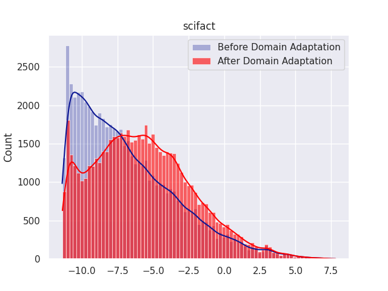

**图 1。** 本地图是 SciFact 一面板。横轴是 GPL 教师估计的相关分，纵轴是计数，对象是检索回来的前 100 篇文档。蓝色是域适应前，红色是域适应后。适应前的质量堆在更低的分数一侧；适应后的质量向更高分数移动，右侧还有一条长尾。这就是引言里的动机：适应后的模型取回的文档，按教师看更相关。脚注 6 用分数分布的旧文献来解释这种移动：相关文档倾向于正态，不相关文档倾向于指数，分布整体右移说明模型更会把相关文档排上来。同一条脚注说，TREC Covid 上看不到指数尾，原因是排序深度有限，而 TREC Covid 的池化又异常深。图 1 本身不报告重挖掘。

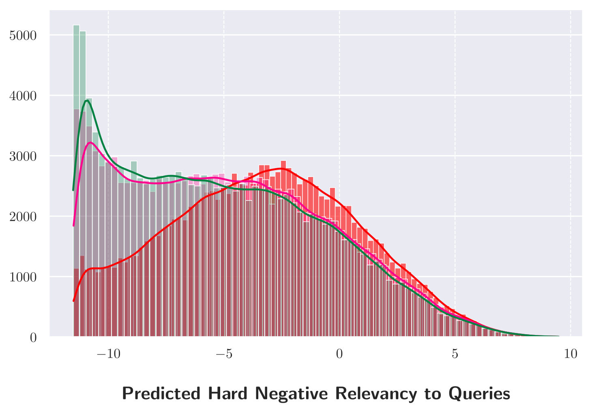

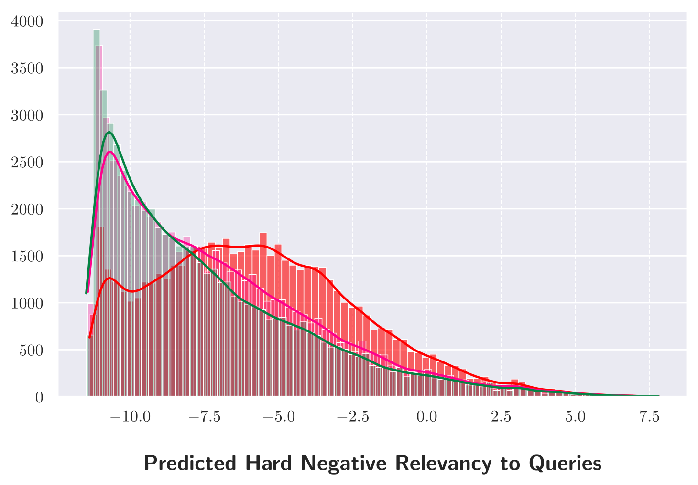

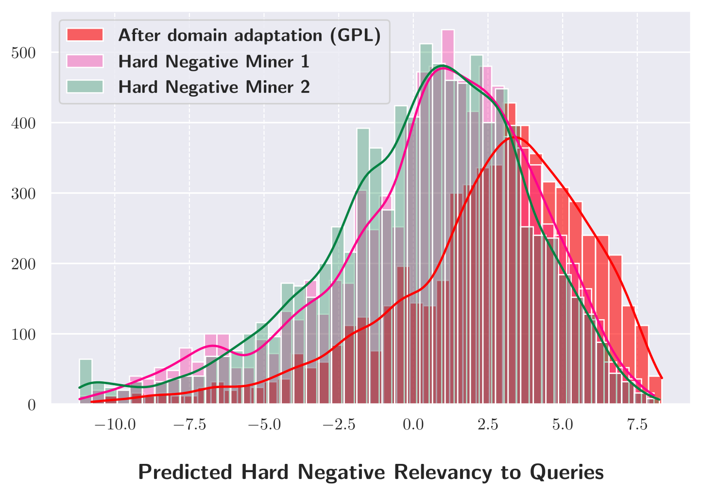

**图 2。** 三张直方图，(a) FIQA、(b) SCIFACT、(c) TREC-COVID。比的是域适应模型与两个难负例挖掘器各自取回的难负例，分数仍由教师打，看的是前 100。正文的结论是：域适应模型的前 100 个难负例，教师分更高。这些文档更难和「写出查询的那篇文档」分开，所以是更硬的负例，训练信号更好。图上不另引具体柱高。

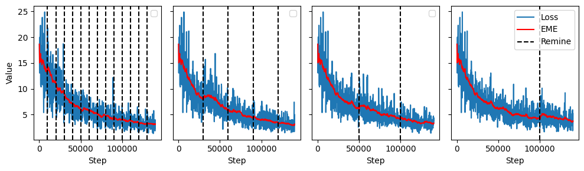

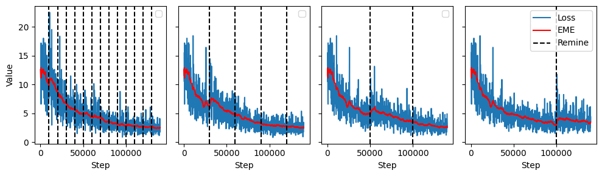

**图 3。** FIQA 与 TREC-COVID 的蒸馏损失，用长度 50 的指数移动平均平滑。虚线标出重挖发生的步。第一次重挖之后损失上升，再落回原先的水平；后来的重挖看不到同样的上升。训练继续时损失下降，学生在学着模仿交叉编码器的间隔。讨论把第一次尖峰解释为：新难负例上，学生一时配不上教师间隔；之后学生学会嵌入这些新文档，后段的尖峰就不再那么突出。

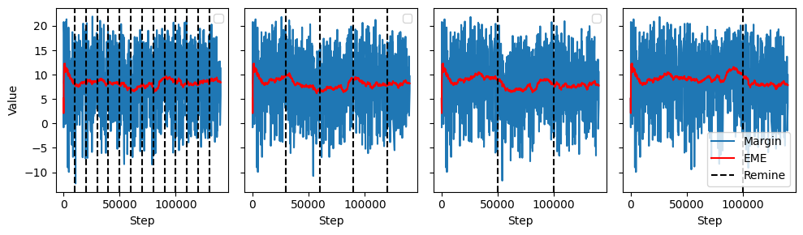

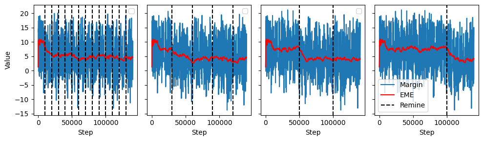

**图 4。** 教师间隔 \(\mathrm{CE}(Q, D^{+}) - \mathrm{CE}(Q, D^{-})\)，面板同样是 FIQA 和 TREC-COVID。挖完难负例之后间隔下降，第一次刷新最明显。间隔变小，是因为新的 \(D^{-}\) 在教师眼里更接近正例。学生的蒸馏损失和这条教师间隔绑在一起：间隔一变，MSE 的目标就变。

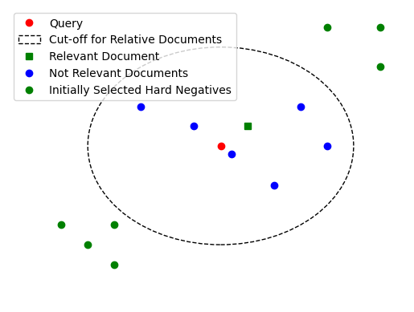

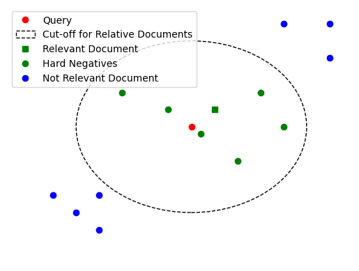

**图 5。** GPL 框架里查询与文档嵌入的二维投影，没有单独的本地图文件。(a) 域适应之后，最初挖到的静态难负例已经移出查询嵌入的邻近区域。(b) 刚刚重挖完时，选中的难负例重新落在查询附近。静态负例会跟着学生空间一起漂走；刷新是在当前空间里重新拣邻域里的文档。讨论用这一点解释：刷新后的训练样本盖住查询嵌入的邻近，并且文档 ID 不再是同一批，上下文更广。

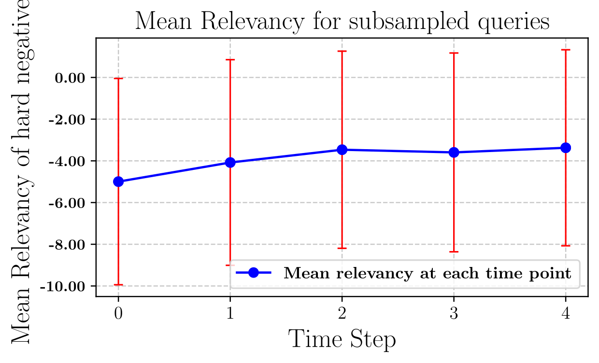

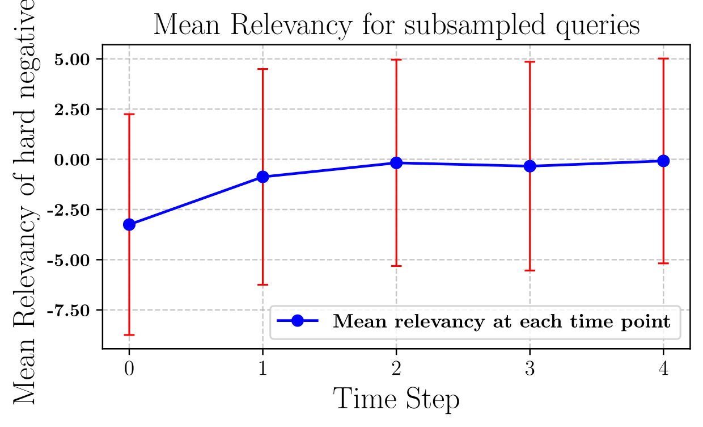

**图 6。** FIQA 与 TREC-COVID 上，返回的难负例的平均相关性随时间步变化。时间步 0 是初始难负例，之后每一步是一次重挖。误差条是该时间点相关性的标准差。随机抽了 1,000 条生成查询，相关性用教师交叉编码器算，每条查询取前 50 个难负例。正文只给出形状：第一次重挖后相关性急剧上升，之后每次重挖再逐步升高。不把坐标刻度当成曲线读数。这个陡升和第一次损失尖峰是同一件事的两侧：负例突然更相关，学生旧的间隔对不上，损失先冲高再学回来。

---

## 局限

26 个任务和语料（BEIR 14 加 LoTTE 12）都是英文、常见文档体裁。跨语言、多语言、多模态，以及更专门的任务，论文认为还需要另做。零样本方法和更大的 LLM 在常见主题上可以很强，换到很窄的任务和领域会弱不少；作者把域适应看成研究这类语言与体裁偏移的一条路。

重挖提高的是训练复杂度，不是推理复杂度。BM25 在训练时间和推理时间上仍然更省：稀疏表示，索引可以扩到数十亿文档。稠密检索器靠嵌入索引，推理复杂度仍然有吸引力。生产里查询时可能有百万级请求，索引只建一次，碳足迹上推理比训练更要紧。R-GPL 与不做重挖的域适应、以及与零样本双塔，推理路径相同；多出来的代价在训练。

刷新是和训练同步做的。大语料（超过 100 万文档）上，带重挖的域适应时间长于不重挖的域适应。换来的是同样推理时间下更高的检索质量。未来工作打算改成异步刷新，做法指向 Xiong et al. (2020) 的 ANCE。论文原句写的是 “to further reduce the training efficiency”；按上下文，指的是把同步刷新的训练开销降下来。

---

## 读完可以留下的判断

R-GPL 没有换查询生成器，也没有换教师。正例仍是写出合成查询的源文档，初始负例仍是两个 MS MARCO 双塔的 top-50，损失仍是学生间隔对齐教师间隔的 MSE。新的只有一件事：适应开始之后，每 \(k\) 步用当前模型把难负例换掉，默认 30,000 步。

表 1 的印出平均停在 Base 41.8、GPL 46.4、R-GPL 47.7。13/14 的提升是相对 GPL 的行计数；Arguana 退 1.9 点。正文的 Arguana 相对 Base 是 +14.4 与 +12.3，其中 R-GPL 与 46.4 − 33.9 差 0.2。BM25 印出平均 41.1 保留，单元格平均约 44.1 只作为对照记一次。

表 2 的印出平均停在 53.0、58.4、64.5、65.2。9/12 是提升；Science forum 的 −0.5 和两处打平要单独看。GPL 的 64.5 与 12 格平均约 64.1 不一致，引用时用印出的 64.5。

表 3 里 30k 是论文认定的整体最好步长，同时是主表的设定。SCIFACT 在 10k 上是 66.1，低于普通 GPL 的 66.4，这是「无论 \(k\) 都有提升」这句话对不上的那一格。
