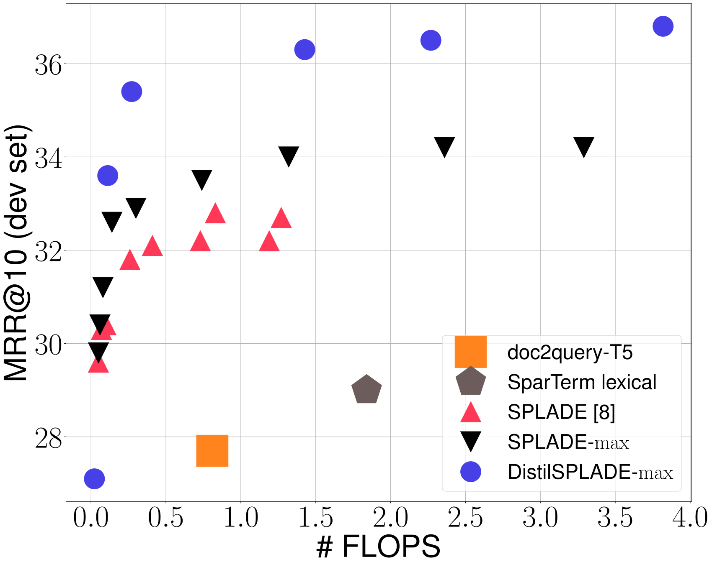
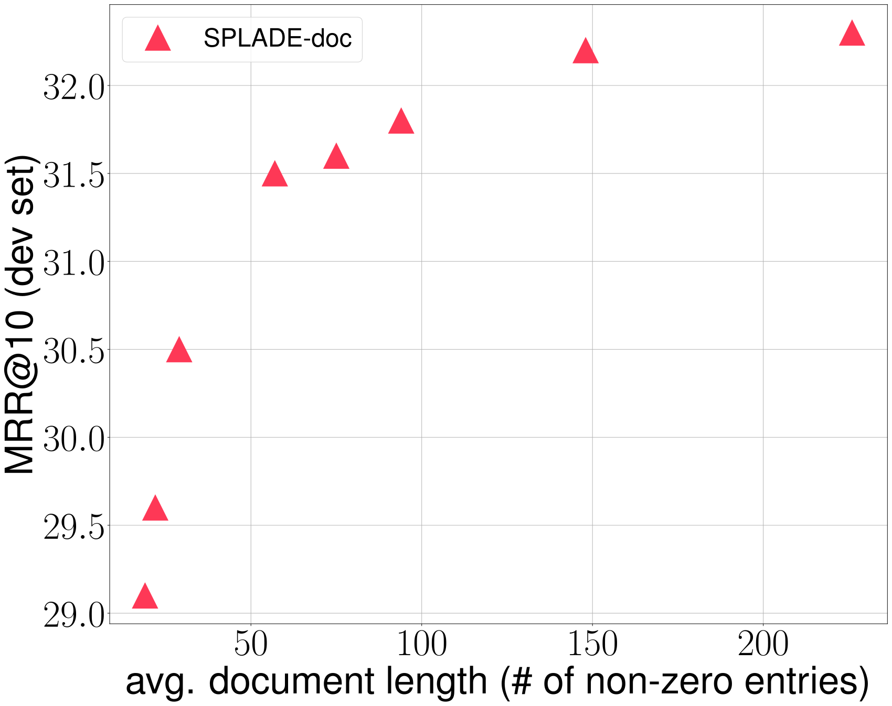

# SPLADE v2: Sparse Lexical and Expansion Model for Information Retrieval / 全文中英对照

> 来源：[arXiv:2109.10086v1](https://arxiv.org/abs/2109.10086v1)。英文段落后紧接中文，覆盖所取 HTML 版本的主文、附录、图表、脚注与参考文献；公式、数字表和书目信息共用。中文以机器初译为底稿，进行了术语整理与结构核对，尚未逐句人工审定；遇到歧义请以紧邻英文和原论文为准。 原作版权归所列作者，许可见 [原作许可](http://creativecommons.org/licenses/by-nc-sa/4.0/)；中文译文与版式改写在该许可条件下提供（涉及 SA 时沿用相同许可，涉及 NC 时仅限非商业使用）。

## Authors and affiliations / 作者与机构

Thibault Formal Affiliation: Naver Labs Europe , Meylan , France Affiliation: Sorbonne Université, LIP6 , Paris , France email: thibault.formal@naverlabs.com , Benjamin Piwowarski Affiliation: Sorbonne Université, CNRS, LIP6 , Paris , France email: benjamin.piwowarski@lip6.fr , Carlos Lassance Affiliation: Naver Labs Europe , Meylan , France email: carlos.lassance@naverlabs.com and Stéphane Clinchant Affiliation: Naver Labs Europe , Meylan , France email: stephane.clinchant@naverlabs.com

## Abstract. / 摘要。

**EN.** In neural Information Retrieval (IR), ongoing research is directed towards improving the first retriever in ranking pipelines. Learning dense embeddings to conduct retrieval using efficient approximate nearest neighbors methods has proven to work well. Meanwhile, there has been a growing interest in learning sparse representations for documents and queries, that could inherit from the desirable properties of bag-of-words models such as the exact matching of terms and the efficiency of inverted indexes. Introduced recently, the SPLADE model provides highly sparse representations and competitive results with respect to state-of-the-art dense and sparse approaches. In this paper, we build on SPLADE and propose several significant improvements in terms of effectiveness and/or efficiency. More specifically, we modify the pooling mechanism, benchmark a model solely based on document expansion, and introduce models trained with distillation. We also report results on the BEIR benchmark. Overall, SPLADE is considerably improved with more than $9$ % gains on NDCG@10 on TREC DL 2019, leading to state-of-the-art results on the BEIR benchmark.

**中.** 在神经信息检索（IR）中，正在进行的研究旨在改进排名管道中的第一个检索器。事实证明，学习密集嵌入以使用有效的近似最近邻方法进行检索效果良好。与此同时，人们对学习文档和查询的稀疏表示越来越感兴趣，这可以继承词袋模型的理想属性，例如术语的精确匹配和倒排索引的效率。最近推出的 SPLADE 模型提供了高度稀疏的表示以及相对于最先进的密集和稀疏方法的竞争结果。在本文中，我们以 SPLADE 为基础，并在有效性和/或效率方面提出了几项重大改进。更具体地说，我们修改池机制，仅基于文档扩展对模型进行基准测试，并引入通过蒸馏训练的模型。我们还报告了 BEIR 基准的结果。总体而言，SPLADE 得到了显着改进，在 TREC DL 2019 上的 NDCG@10 上获得了超过 $9$ % 的增益，从而在 BEIR 基准上取得了最先进的结果。

#### Keywords: / 关键词：

**EN.** neural networks, indexing, sparse representations, regularization

**中.** 神经网络、索引、稀疏表示、正则化

## Introduction / 一、简介

**EN.** The release of large pre-trained language models like BERT ( Devlin et al., 2018 ) has shaken-up Natural Language Processing and Information Retrieval. These models have shown a strong ability to adapt to various tasks by simple fine-tuning. At the beginning of 2019, Nogueira and Cho ( Nogueira and Cho, 2019 ) achieved state-of-the-art results – by a large margin – on the MS MARCO passage re-ranking task, paving the way for LM-based neural ranking models. Because of strict efficiency requirements, these models have initially been used as re-rankers in a two-stage ranking pipeline, where first-stage retrieval – or candidate generation – is conducted with bag-of-words models (e.g. BM25) that rely on inverted indexes. While BOW models remain strong baselines ( Yang et al., 2019 ) , they suffer from the long standing vocabulary mismatch problem, where relevant documents might not contain terms that appear in the query. Thus, there have been attempts to substitute standard BOW approaches by learned (neural) rankers. Designing such models poses several challenges regarding efficiency and scalability: therefore there is a need for methods where most of the computation can be done offline and online inference is fast. Dense retrieval with approximate nearest neighbors search has shown impressive results ( Xiong et al., 2021 ; Qu et al., 2021 ; Lin et al., 2021 ; Hofstätter et al., 2021 ) , but can still benefit from BOW models (e.g. by combining both types of signals), due to the absence of explicit term matching. Hence, there has recently been a growing interest in learning sparse representations for queries and documents ( Zamani et al., 2018 ; Dai and Callan, 2019 ; Nogueira et al., 2019 ; Zhao et al., 2020 ; Bai et al., 2020 ; Gao et al., 2021 ; Mallia et al., 2021 ; Formal et al., 2021 ) . By doing so, models can inherit from the desirable properties of BOW models like exact-match of (possibly latent) terms, efficiency of inverted indexes and interpretability. Additionally, by modeling implicit or explicit (latent, contextualized) expansion mechanisms – similarly to standard expansion models in IR – these models can reduce the vocabulary mismatch.

**中.** BERT（Devlin et al., 2018）等大型预训练语言模型的发布震撼了自然语言处理和信息检索。这些模型通过简单的微调就表现出了很强的适应各种任务的能力。 2019 年初，Nogueira 和 Cho (Nogueira and Cho, 2019) 在 MS MARCO 段落重排序任务上大幅取得了最先进的结果，为基于 LM 的神经排序模型铺平了道路。由于严格的效率要求，这些模型最初被用作两阶段排名管道中的重新排名器，其中第一阶段检索（或候选生成）是使用依赖倒排索引的词袋模型（例如 BM25）进行的。虽然 BOW 模型仍然具有强大的基线（Yang et al., 2019），但它们遭受长期存在的词汇不匹配问题，即相关文档可能不包含查询中出现的术语。因此，有人尝试通过学习（神经）排名器来替代标准 BOW 方法。设计此类模型在效率和可扩展性方面提出了一些挑战：因此需要一种可以离线完成大部分计算并且在线推理速度很快的方法。使用近似最近邻搜索的稠密检索已显示出令人印象深刻的结果（Xiong 等人，2021；Qu 等人，2021；Lin 等人，2021；Hofstätter 等人，2021），但由于缺乏显式术语匹配，仍然可以从 BOW 模型中受益（例如，通过组合两种类型的信号）。因此，最近人们对学习查询和文档的稀疏表示越来越感兴趣（Zamani et al., 2018；Dai and Callan, 2019；Nogueira et al., 2019；Zhao et al., 2020；Bai et al., 2020；Gao et al., 2021；Mallia et al., 2021；Formal et al., 2021）。通过这样做，模型可以继承 BOW 模型的理想属性，例如（可能是潜在的）项的精确匹配、倒排索引的效率和可解释性。此外，通过对隐式或显式（潜在的、上下文化的）扩展机制进行建模（类似于 IR 中的标准扩展模型），这些模型可以减少词汇不匹配。

**EN.** In this paper, we build on the SPLADE model ( Formal et al., 2021 ) and propose several improvements/modifications that bring gains in terms of effectiveness or efficiency: (1) by simply modifying SPLADE pooling mechanism, we are able to increase effectiveness by a large margin; (2) in the meantime, we propose an extension of the model without query expansion. Such model is inherently more efficient, as everything can be pre-computed and indexed offline, while providing results that are still competitive; (3) finally, we use distillation techniques ( Hofstätter et al., 2020 ) to boost SPLADE performance, leading to close to state-of-the-art results on the MS MARCO passage ranking task as well as the BEIR zero-shot evaluation benchmark ( Thakur et al., 2021 ) .

**中.** 在本文中，我们以 SPLADE 模型（Formal et al., 2021）为基础，提出了几项改进/修改，这些改进/修改在有效性或效率方面带来了收益：（1）通过简单地修改 SPLADE 池化机制，我们能够大幅提高有效性； (2)同时，我们提出了模型的扩展，无需查询扩展。这种模型本质上更高效，因为所有内容都可以预先计算并离线索引，同时提供仍然具有竞争力的结果； (3) 最后，我们使用蒸馏技术 (Hofstätter et al., 2020) 来提升 SPLADE 性能，从而在 MS MARCO 通道排名任务以及 BEIR 零样本评估基准上获得接近最先进的结果 (Thakur et al., 2021)。

## Related Works / 相关作品

**EN.** Dense retrieval based on BERT Siamese models ( Reimers and Gurevych, 2019 ) has become the standard approach for candidate generation in Question Answering and IR ( Guu et al., 2020 ; Karpukhin et al., 2020 ; Xiong et al., 2021 ; Qu et al., 2021 ; Lin et al., 2021 ; Hofstätter et al., 2021 ) . While the backbone of these models remains the same, recent works highlight the critical aspects of the training strategy to obtain state-of-the-art results, ranging from improved negative sampling ( Lin et al., 2021 ; Hofstätter et al., 2021 ) to distillation ( Hofstätter et al., 2020 ; Lin et al., 2021 ) . ColBERT ( Khattab and Zaharia, 2020 ) pushes things further: the postponed token-level interactions allow to efficiently apply the model for first-stage retrieval, benefiting of the effectiveness of modeling fine-grained interactions, at the cost of storing embeddings for each (sub)term – raising concerns about the actual scalability of the approach for large collections. To the best of our knowledge, very few studies have discussed the impact of using approximate nearest neighbors (ANN) search on IR metrics ( Boytsov, 2018 ; Tu et al., 2020 ) . Due to the moderate size of the MS MARCO collection, results are usually reported with an exact , brute-force search, therefore giving no indication on the effective computing cost.

**中.** 基于 BERT Siamese 模型的稠密检索（Reimers 和 Gurevych，2019）已成为问答和 IR 中候选生成的标准方法（Guu 等人，2020；Karpukhin 等人，2020；Xiong 等人，2021；Qu 等人，2021；Lin 等人，2021；Hofstätter 等人）等，2021）。虽然这些模型的主干保持不变，但最近的工作强调了获得最先进结果的训练策略的关键方面，从改进的负采样（Lin et al., 2021；Hofstätter et al., 2021）到蒸馏（Hofstätter et al., 2020；Lin et al., 2021）。 ColBERT（Khattab 和 Zaharia，2020）进一步推动了事情的发展：推迟的令牌级交互允许有效地将模型应用于第一阶段检索，受益于建模细粒度交互的有效性，但代价是存储每个（子）项的嵌入 - 引发了人们对该方法针对大型集合的实际可扩展性的担忧。据我们所知，很少有研究讨论使用近似最近邻 (ANN) 搜索对 ​​IR 指标的影响（Boytsov，2018；Tu et al.，2020）。由于 MS MARCO 集合的规模适中，因此通常通过精确的强力搜索来报告结果，因此没有给出有效计算成本的指示。

**EN.** An alternative to dense indexes is term-based ones. Building on standard BOW models, Zamani et al. first introduced SNRM ( Zamani et al., 2018 ) : the model embeds documents and queries in a sparse high-dimensional latent space by means of $\ell_{1}$ regularization on representations. However, SNRM effectiveness remains limited and its efficiency has been questioned ( Paria et al., 2020 ) .

**中.** 密集索引的替代方案是基于术语的索引。 Zamani 等人以标准 BOW 模型为基础。首先引入了 SNRM（Zamani et al., 2018）：该模型通过对表示的 $\ell_{1}$ 正则化将文档和查询嵌入稀疏高维潜在空间中。然而，SNRM 的有效性仍然有限，其效率受到质疑（Paria et al., 2020）。

**EN.** Motivated by the success of BERT, there have been attempts to transfer the knowledge from pre-trained LM to sparse approaches. DeepCT ( Dai and Callan, 2019 ; Dai and Callan, 2020a ; Dai and Callan, 2020b ) focused on learning contextualized term weights in the full vocabulary space – akin to BOW term weights. However, as the vocabulary associated with a document remains the same, this type of approach does not solve the vocabulary mismatch, as acknowledged by the use of query expansion for retrieval ( Dai and Callan, 2019 ) . A first solution to this problem consists in expanding documents using generative approaches such as doc2query ( Nogueira et al., 2019 ) and doc2query-T5 ( Nogueira and Lin, 2019 ) to predict expansion words for documents. The document expansion adds new terms to documents – hence fighting the vocabulary mismatch – as well as repeats existing terms, implicitly performing re-weighting by boosting important terms.

**中.** 受 BERT 成功的推动，人们尝试将知识从预训练的 LM 转移到稀疏方法。 DeepCT（Dai 和 Callan，2019；Dai 和 Callan，2020a；Dai 和 Callan，2020b）专注于学习完整词汇空间中的语境化术语权重——类似于 BOW 术语权重。然而，由于与文档关联的词汇保持不变，这种方法并不能解决词汇不匹配的问题，正如使用查询扩展进行检索所承认的那样（Dai 和 Callan，2019）。此问题的第一个解决方案包括使用生成方法（例如 doc2query（Nogueira 等人，2019）和 doc2query-T5（Nogueira 和 Lin，2019））来扩展文档来预测文档的扩展词。文档扩展向文档添加了新术语，从而解决了词汇不匹配的问题，并重复现有术语，通过提升重要术语隐式地执行重新加权。

**EN.** Recently, DeepImpact ( Mallia et al., 2021 ) combined the expansion from doc2query-T5 with the re-weighting from DeepCT to learn term impacts . These expansion techniques are however limited by the way they are trained (predicting queries), which is indirect in nature and limit their progress. A second solution to this problem, that has been chosen by recent works ( Bai et al., 2020 ; MacAvaney et al., 2020 ; Zhao et al., 2020 ; Formal et al., 2021 ) , is to estimate the importance of each term of the vocabulary implied by each term of the document (or query), i.e. to compute an interaction matrix between the document or query tokens and all the tokens from the vocabulary. This is followed by an aggregation mechanism (roughly sum for SparTerm ( Bai et al., 2020 ) and SPLADE ( Formal et al., 2021 ) , max for EPIC ( MacAvaney et al., 2020 ) and SPARTA ( Zhao et al., 2020 ) ), that allows to compute an importance weight for each term of the vocabulary, for the full document or query.

**中.** 最近，DeepImpact（Mallia 等人，2021）将 doc2query-T5 的扩展与 DeepCT 的重新加权相结合，以学习术语影响。然而，这些扩展技术受到训练方式（预测查询）的限制，训练方式本质上是间接的，限制了它们的进展。最近的工作（Bai et al., 2020；MacAvaney et al., 2020；Zhao et al., 2020；Formal et al., 2021）选择的第二个解决方案是估计文档（或查询）的每个术语所隐含的词汇表中每个术语的重要性，即计算文档或查询标记与词汇表中所有标记之间的交互矩阵。接下来是聚合机制（SparTerm（Bai 等人，2020）和 SPLADE（Formal 等人，2021）的粗略求和，EPIC（MacAvaney 等人，2020）和 SPARTA（Zhao 等人，2020）的最大值），允许为完整文档或查询计算词汇表中每个术语的重要性权重。

**EN.** However, EPIC and SPARTA (document) representations are not sparse enough by construction – unless resorting on top- $k$ pooling – contrary to SparTerm, for which fast retrieval is thus possible. Furthermore, the latter does not include (like SNRM) an explicit sparsity regularization, which hinders its performance. SPLADE however relies on such regularization, as well as other key changes, that boost both the efficiency and the effectiveness of this type of approaches, providing a model that both learns expansion and compression in an end-to-end manner. Furthermore, COIL ( Gao et al., 2021 ) proposed to revisit exact-match mechanisms by learning dense representations per term to perform contextualized term matching, at the cost of increased index size.

**中.** 然而，EPIC 和 SPARTA（文档）表示在构造上不够稀疏——除非采用顶部 $k$ 池化——这与 SparTerm 相反，因此可以进行快速检索。此外，后者不包括（如 SNRM）显式稀疏正则化，这会影响其性能。然而，SPLADE 依赖于这种正则化以及其他关键变化，从而提高了此类方法的效率和有效性，提供了一种能够以端到端方式学习扩展和压缩的模型。此外，COIL（Gao et al., 2021）提出通过学习每个术语的稠密表示来重新审视精确匹配机制，以执行上下文化的术语匹配，但代价是增加索引大小。

## Sparse Lexical representations for first-stage ranking / 第一阶段排名的稀疏词汇表示

**EN.** In this section, we first describe in details the SPLADE model recently introduced in ( Formal et al., 2021 ) .

**中.** 在本节中，我们首先详细描述最近在 (Formal et al., 2021) 中引入的 SPLADE 模型。

### SPLADE / 3.1.斯普拉德

**EN.** SPLADE predicts term importance – in BERT WordPiece vocabulary ( $|V|=30522$ ) – based on the logits of the Masked Language Model (MLM) layer. More precisely, let us consider an input query or document sequence (after WordPiece tokenization) $t=(t_{1},t_{2},...,t_{N})$ , and its corresponding BERT embeddings $(h_{1},h_{2},...,h_{N})$ . We consider the importance $w_{ij}$ of the token $j$ (vocabulary) for a token $i$ (of the input sequence):

**中.** SPLADE 预测 BERT WordPiece 词汇中的术语重要性（$|V|=30522$) – 基于屏蔽语言模型 (MLM) 层的 logits。更准确地说，让我们考虑输入查询或文档序列（在 WordPiece 标记化之后）$t=(t_{1},t_{2},...,t_{N})$，及其相应的 BERT 嵌入$(h_{1},h_{2},...,h_{N})$。我们考虑重要性$w_{ij}$代币的$j$（词汇​​）令牌$i$（输入序列）：

$$
w_{ij}=\text{transform}(h_{i})^{T}E_{j}+b_{j}\quad j\in\{1,...,|V|\}\tag{1}
$$

**EN.** where $E_{j}$ denotes the BERT input embedding for token $j$ , $b_{j}$ is a token-level bias, and transform $(.)$ is a linear layer with GeLU activation and LayerNorm. Note that Eq. ( 1 ) is equivalent to the MLM prediction, thus it can also be initialized from a pre-trained MLM model. The final representation is then obtained by summing importance predictors over the input sequence tokens, after applying a log-saturation effect ( Formal et al., 2021 ) :

**中.** 其中 $E_{j}$ 表示 token $j$ 的 BERT 输入嵌入，$b_{j}$ 是 token 级偏差，变换 $(.)$ 是具有 GeLU 激活和 LayerNorm 的线性层。请注意等式。 (1)相当于MLM预测，因此也可以从预先训练的MLM模型进行初始化。应用对数饱和效应后，通过对输入序列标记的重要性预测因子求和来获得最终表示（Formal et al., 2021）：

$$
w_{j}=\sum_{i\in t}\log\left(1+\text{ReLU}(w_{ij})\right)\tag{2}
$$

#### Ranking loss / 排名损失

**EN.** Let $s(q,d)$ denote the ranking score obtained via dot product between $q$ and $d$ representations from Eq. ( 2 ). Given a query $q_{i}$ in a batch, a positive document $d_{i}^{+}$ , a (hard) negative document $d_{i}^{-}$ (e.g. coming from BM25 sampling), and a set of negative documents in the batch (positive documents from other queries) $\{d_{i,j}^{-}\}_{j}$ , we consider a constrastive loss, which can be interpreted as the maximization of the probability of the document $d_{i}^{+}$ being relevant among the documents $d_{i}^{+},d_{i}^{-}$ and $\{d_{i,j}^{-}\}$ :

**中.** 让 $s(q,d)$ 表示通过等式 1 的 $q$ 和 $d$ 表示之间的点积获得的排名分数。 （2）。给定一个批次中的查询 $q_{i}$ 、一个正文档 $d_{i}^{+}$ 、一个（硬）负文档 $d_{i}^{-}$ （例如来自 BM25 采样）以及该批次中的一组负文档（来自其他查询的正文档） $\{d_{i,j}^{-}\}_{j}$ ，我们考虑对比损失，它可以解释为文档概率的最大化$d_{i}^{+}$ 与文件 $d_{i}^{+},d_{i}^{-}$ 和 $\{d_{i,j}^{-}\}$ 相关：

$$
\mathcal{L}_{rank-IBN}=-\log\frac{e^{s(q_{i},d_{i}^{+})}}{e^{s(q_{i},d_{i}^{+})}+e^{s(q_{i},d_{i}^{-})}+\sum_{j}e^{s(q_{i},d_{i,j}^{-})}}\tag{3}
$$

**EN.** The in-batch negatives (IBN) sampling strategy is widely used for training image retrieval models, and has shown to be effective in learning first-stage rankers ( Karpukhin et al., 2020 ; Qu et al., 2021 ; Lin et al., 2021 ) .

**中.** 批量负样本（IBN）采样策略广泛用于训练图像检索模型，并且已被证明在学习第一阶段排序器方面是有效的（Karpukhin et al., 2020; Qu et al., 2021; Lin et al., 2021）。

#### Learning sparse representations / 学习稀疏表示

**EN.** The idea of learning sparse representations for first-stage retrieval dates back to SNRM ( Zamani et al., 2018 ) , via $\ell_{1}$ regularization. Later, ( Paria et al., 2020 ) pointed-out that minimizing the $\ell_{1}$ norm of representations does not result in the most efficient index, as nothing ensures that posting lists are evenly distributed. Note that this is even more true for standard indexes due to the Zipfian nature of the term frequency distribution. To obtain a well-balanced index, Paria et al. ( Paria et al., 2020 ) introduce the FLOPS regularizer, a smooth relaxation of the average number of floating-point operations necessary to compute the score between a query and a document, and hence directly related to the retrieval time. It is defined using $a_{j}$ as a continuous relaxation of the activation (i.e. the term has a non-zero weight) probability $p_{j}$ for token $j$ , and estimated for documents $d$ in a batch of size $N$ by $\bar{a}_{j}=\frac{1}{N}\sum_{i=1}^{N}w^{(d_{i})}_{j}$ . This gives the following regularization loss

**中.** 学习第一阶段检索的稀疏表示的想法可以追溯到 SNRM（Zamani 等人，2018），通过 $\ell_{1}$ 正则化。后来，（Paria et al., 2020）指出，最小化表示的 $\ell_{1}$ 范数并不会产生最有效的索引，因为没有什么可以确保发布列表均匀分布。请注意，由于术语频率分布的 Zipfian 性质，对于标准索引来说更是如此。为了获得一个均衡的指数，Paria 等人。 （Paria 等人，2020）引入了 FLOPS 正则化器，它是计算查询和文档之间得分所需的平均浮点运算次数的平滑松弛，因此与检索时间直接相关。它使用 $a_{j}$ 定义为令牌 $j$ 的激活的连续松弛（即该术语具有非零权重）概率 $p_{j}$ ，并通过 $\bar{a}_{j}=\frac{1}{N}\sum_{i=1}^{N}w^{(d_{i})}_{j}$ 对一批大小为 $N$ 的文档 $d$ 进行估计。这给出了以下正则化损失

$$
\ell_{\texttt{FLOPS}}=\sum_{j\in V}{\bar{a}}_{j}^{2}=\sum_{j\in V}\left(\frac{1}{N}\sum_{i=1}^{N}w_{j}^{(d_{i})}\right)^{2}\tag{4}
$$

#### Overall loss / 整体亏损

**EN.** By jointly optimizing the model in Eq. ( 2 ) with ranking and regularization losses, SPLADE combines the best of both worlds for end-to-end training of sparse, expansion-aware representations of documents and queries:

**中.** 通过联合优化方程中的模型。 ( 2 ) 通过排名和正则化损失，SPLADE 结合了两全其美的方法，用于文档和查询的稀疏、扩展感知表示的端到端训练：

$$
\mathcal{L}=\mathcal{L}_{rank-IBN}+\lambda_{q}\mathcal{L}^{q}_{\texttt{reg}}+\lambda_{d}\mathcal{L}^{d}_{\texttt{reg}}\tag{5}
$$

**EN.** where $\mathcal{L}_{\texttt{reg}}$ is the sparse FLOPS regularization from Eq. 4 . We use two distinct regularization weights ( $\lambda_{d}$ and $\lambda_{q}$ ) for queries and documents – allowing to put more pressure on the sparsity for queries, which is critical for fast retrieval.

**中.** 其中 $\mathcal{L}_{\texttt{reg}}$ 是等式 1 中的稀疏 FLOPS 正则化。 4.我们对查询和文档使用两种不同的正则化权重（ $\lambda_{d}$ 和 $\lambda_{q}$ ）——允许对查询的稀疏性施加更大的压力，这对于快速检索至关重要。

### Pooling strategy / 3.2.池化策略

**EN.** We propose to change the sum in Eq. ( 2 ) by a $\max$ pooling operation:

**中.** 我们建议更改等式中的总和。 (2)通过$\max$进行池化操作：

$$
w_{j}=\max_{i\in t}\log\left(1+\text{ReLU}(w_{ij})\right)\tag{6}
$$

**EN.** The model now bears more similarities with SPARTA and EPIC, and to some extent ColBERT. As shown in the experiments section, it considerably improves SPLADE performance. In the following, max pooling is the default configuration for SPLADE, and the corresponding model is referred to as SPLADE- ${\max}$ .

**中.** 该模型现在与 SPARTA 和 EPIC 以及某种程度上与 ColBERT 有更多相似之处。如实验部分所示，它显着提高了 SPLADE 性能。下面，最大池化是SPLADE的默认配置，对应的模型称为SPLADE-${\max}$。

### SPLADE document encoder / SPLADE文档编码器

**EN.** In addition to the max pooling operation, we consider a document-only version of SPLADE. In this case, there are no query expansion nor query term weighting, and the ranking score is simply given by:

**中.** 除了最大池化操作之外，我们还考虑了 SPLADE 的纯文档版本。在这种情况下，没有查询扩展，也没有查询项加权，排名分数简单地由下式给出：

$$
s(q,d)=\sum_{j\in q}w_{j}^{d}\tag{7}
$$

**EN.** Such extension offers an interesting efficiency boost: because the ranking score solely depends on the document term weights, everything can be pre-computed offline, and inference cost is consequently reduced, while still offering competitive results as shown in the experiments. We refer to this model as SPLADE-doc.

**中.** 这种扩展提供了有趣的效率提升：因为排名分数仅取决于文档术语权重，所以所有内容都可以离线预先计算，从而降低推理成本，同时仍然提供实验中所示的有竞争力的结果。我们将此模型称为 SPLADE-doc。

### Distillation and hard negatives / 3.4.蒸馏和难负例

**EN.** We also incorporate distillation to our training procedure, following the improvements shown in ( Hofstätter et al., 2020 ) . The distillation training is done in two steps: (1) we first train both a SPLADE first-stage retriever as well as a cross-encoder reranker [^footnote1] using the triplets generated by ( Hofstätter et al., 2020 ) ; (2) in the second step, we generate triplets using SPLADE trained with distillation (thus providing harder negatives than BM25), and use the aforementioned reranker to generate the scores needed for the Margin-MSE loss. We then train a SPLADE model from scratch using these triplets and scores. The result of the second step is what we call DistilSPLADE- ${\max}$ .

**中.** 我们还将蒸馏纳入我们的训练程序中，遵循 (Hofstätter et al., 2020) 中所示的改进。蒸馏训练分两步完成：（1）我们首先使用（Hofstätter et al., 2020）生成的三元组训练 SPLADE 第一阶段检索器以及交叉编码器重排序器 [^footnote1]； (2) 在第二步中，我们使用经过蒸馏训练的 SPLADE 生成三元组（从而提供比 BM25 更难的负例），并使用前面提到的重新排序器生成 Margin-MSE 损失所需的分数。然后，我们使用这些三元组和分数从头开始训练 SPLADE 模型。第二步的结果就是我们所说的 DistilSPLADE-${\max}$。

## Experimental setting and results / 实验设置和结果

**EN.** We trained and evaluated our models on the MS MARCO passage ranking dataset [^footnote2] in the full ranking setting. The dataset contains approximately $8.8$ M passages, and hundreds of thousands training queries with shallow annotation ( $\approx 1.1$ relevant passages per query in average). The development set contains $6980$ queries with similar labels, while the TREC DL 2019 evaluation set provides fine-grained annotations from human assessors for a set of $43$ queries ( Craswell et al., 2020 ) .

**中.** 我们在 MS MARCO 通道排名数据集 [^footnote2] 上在完整排名设置中训练和评估我们的模型。该数据集包含大约 $8.8$ M 个段落，以及数十万个带有浅层注释的训练查询（平均每个查询有 $\approx 1.1$ 相关段落）。开发集包含具有相似标签的 $6980$ 查询，而 TREC DL 2019 评估集为一组 $43$ 查询提供来自人类评估者的细粒度注释（Craswell 等人，2020）。

#### Training, indexing and retrieval / 训练、索引和检索

**EN.** We initialized the models with the DistilBERT-base checkpoint. Models are trained with the ADAM optimizer, using a learning rate of $2e^{-5}$ with linear scheduling and a warmup of $6000$ steps, and a batch size of $124$ . We keep the best checkpoint using MRR@10 on a validation set of $500$ queries, after training for $150$ k iterations, using an approximate retrieval validation set similar to ( Hofstätter et al., 2021 ) . For the SPLADE-doc approach, we simply train for $50$ k steps and select the last checkpoint. We consider a maximum length of $256$ for input sequences. In order to mitigate the contribution of the regularizer at the early stages of training, we follow ( Paria et al., 2020 ) and use a scheduler for $\lambda$ , quadratically increasing $\lambda$ at each training iteration, until a given step ( $50$ k in our case), from which it remains constant. Typical values for $\lambda$ fall between $1e^{-1}$ and $1e^{-4}$ . For storing the index, we use a custom implementation based on Python arrays, and we rely on Numba ( Lam et al., 2015 ) to parallelize retrieval. Models [^footnote3] are trained using PyTorch ( Paszke et al., 2019 ) and HuggingFace transformers ( Wolf et al., 2020 ) , on $4$ Tesla $V100$ GPUs with $32$ GB memory.

**中.** 我们使用基于 DistilBERT 的检查点初始化模型。模型使用 ADAM 优化器进行训练，使用 $2e^{-5}$ 的学习率和线性调度、$6000$ 步骤的预热以及 $124$ 的批量大小。在对 $150$ k 次迭代进行训练之后，我们使用类似于 (Hofstätter et al., 2021) 的近似检索验证集，在 $500$ 查询的验证集上使用 MRR@10 保留最佳检查点。对于 SPLADE-doc 方法，我们只需训练 $50$ k 步骤并选择最后一个检查点。我们考虑输入序列的最大长度为 $256$。为了减轻训练早期阶段正则化器的贡献，我们遵循（Paria et al., 2020）并使用 $\lambda$ 的调度程序，在每次训练迭代中二次增加 $\lambda$ ，直到给定步骤（在我们的例子中为 $50$ k ），从该步骤开始它保持恒定。 $\lambda$ 的典型值介于 $1e^{-1}$ 和 $1e^{-4}$ 之间。为了存储索引，我们使用基于 Python 数组的自定义实现，并依靠 Numba (Lam et al., 2015) 来并行化检索。模型 [^footnote3] 使用 PyTorch（Paszke 等人，2019）和 HuggingFace 转换器（Wolf 等人，2020）在具有 $32$ GB 内存的 $4$ Tesla $V100$ GPU 上进行训练。

#### Evaluation / 评价

**EN.** We report Recall@1000 for both datasets, as well as the official metrics MRR@10 and NDCG@10 for MS MARCO dev set and TREC DL 2019 respectively. Since we are essentially interested in the first retrieval step, we do not consider re-rankers based on BERT, and we compare our approach to first stage rankers only – results reported on the MS MARCO leaderboard are thus not comparable to the results presented here. We compare to the following sparse approaches (1) BM25, (2) DeepCT ( Dai and Callan, 2019 ) , (3) doc2query-T5 ( Nogueira and Lin, 2019 ) , (4) SparTerm ( Bai et al., 2020 ) , (5) COIL-tok ( Gao et al., 2021 ) and (6) DeepImpact ( Mallia et al., 2021 ) , as well as state-of-the-art dense approaches ANCE ( Xiong et al., 2020 ) , TCT-ColBERT ( Lin et al., 2021 ) and TAS-B ( Hofstätter et al., 2021 ) , reporting results from corresponding papers.

**中.** 我们报告了两个数据集的 Recall@1000，以及分别针对 MS MARCO 开发集和 TREC DL 2019 的官方指标 MRR@10 和 NDCG@10。由于我们本质上对第一个检索步骤感兴趣，因此我们不考虑基于 BERT 的重新排序器，并且我们仅将我们的方法与第一阶段排序器进行比较 - 因此 MS MARCO 排行榜上报告的结果与此处提供的结果不可比较。我们与以下稀疏方法进行比较：（1）BM25、（2）DeepCT（Dai 和 Callan，2019）、（3）doc2query-T5（Nogueira 和 Lin，2019）、（4）SparTerm（Bai 等人，2020）、（5）COIL-tok（Gao 等人，2021）和（6）DeepImpact（Mallia 等人） al., 2021)，以及最先进的密集方法 ANCE (Xiong et al., 2020)、TCT-ColBERT (Lin et al., 2021) 和 TAS-B (Hofstätter et al., 2021)，报告相应论文的结果。

**EN.** MS MARCO dev and TREC DL 2019 results are given in Table 1 : as the performance for SPLADE depends on the regularization strength $\lambda$ , and as more efficient models are generally less effective, we select in the table the best performing model in our grid of experiments, with reasonable efficiency (in terms of FLOPS). Figure 1 highlights the actual trade-off between effectiveness and efficiency for SPLADE, by showing the performance (MRR@10 on MS MARCO dev set) vs FLOPS, for SPLADE models trained with different regularization strength. The FLOPS metric is an estimation of the average number of floating-point operations between a query and a document which is defined as the expectation $\mathbb{E}_{q,d}\left[\sum_{j\in V}p_{j}^{(q)}p_{j}^{(d)}\right]$ where $p_{j}$ is the activation probability for token $j$ in a document $d$ or a query $q$ . It is empirically estimated from a set of approximately $100$ k development queries, on the MS MARCO collection. Overall, we observe that: (1) our improved models outperform the other sparse retrieval methods by a large margin on the MS MARCO dev set as well as TREC DL 2019 queries ; (2) the results are competitive with state-of-the-art dense retrieval methods.

**中.** MS MARCO dev 和 TREC DL 2019 结果在表 1 中给出：由于 SPLADE 的性能取决于正则化强度 $\lambda$ ，并且由于更高效的模型通常效果较差，因此我们在表中选择实验网格中性能最佳的模型，具有合理的效率（就 FLOPS 而言）。图 1 通过显示使用不同正则化强度训练的 SPLADE 模型的性能（MS MARCO 开发集上的 MRR@10）与 FLOPS，突出显示了 SPLADE 有效性和效率之间的实际权衡。 FLOPS 指标是对查询和文档之间浮点运算平均次数的估计，定义为期望 $\mathbb{E}_{q,d}\left[\sum_{j\in V}p_{j}^{(q)}p_{j}^{(d)}\right]$ ，其中 $p_{j}$ 是文档 $d$ 或查询 $q$ 中标记 $j$ 的激活概率。它是根据 MS MARCO 集合上一组大约 $100$ k 的开发查询进行经验估计的。总体而言，我们观察到：（1）我们改进的模型在 MS MARCO 开发集以及 TREC DL 2019 查询上大幅优于其他稀疏检索方法； （2）结果与最先进的稠密检索方法具有竞争力。

#### BEIR / 贝尔

**EN.** Finally, we verify the zero-shot performance of SPLADE using a subset of datasets from the BEIR ( Thakur et al., 2021 ) benchmark that encompasses various IR datasets for zero-shot evaluation. We solely use a subset due to the fact that some of the datasets (namely CQADupstack , BioASQ , Signal-1M , TREC-NEWS , Robust04 ) are not readily available. Results are displayed in Table 2 (NDCG@10). We compare against the best performing models from the original benchmark paper ( Thakur et al., 2021 ) (ColBERT ( Khattab and Zaharia, 2020 ) ) and the two best performing from the rolling benchmark [^footnote4] (tuned BM25 and TAS-B ( Hofstätter et al., 2021 ) ). We also report the SPLADE evaluation against these baselines.

**中.** 最后，我们使用 BEIR（Thakur 等人，2021）基准数据集的子集验证了 SPLADE 的零样本性能，该基准包含用于零样本评估的各种 IR 数据集。我们仅使用一个子集，因为某些数据集（即 CQADupstack 、 BioASQ 、 Signal-1M 、 TREC-NEWS 、 Robust04 ）不易获得。结果显示在表 2 (NDCG@10) 中。我们与原始基准论文（Thakur 等人，2021）（ColBERT（Khattab 和 Zaharia，2020））中的最佳性能模型以及滚动基准 [^footnote4]（调整后的 BM25 和 TAS-B（Hofstätter 等人，2021））中的两个最佳性能模型进行比较。我们还根据这些基线报告 SPLADE 评估。

| model 型号 | MS MARCO dev MS MARCO 开发者 | MS MARCO dev MS MARCO 开发者 | TREC DL 2019 | TREC DL 2019 |
| --- | --- | --- | --- | --- |
|  | MRR@10 | R@1000 | NDCG@10 | R@1000 |
| Dense retrieval 稠密检索 |  |  |  |  |
| Siamese (ours) 暹罗（我们的） | 0.312 | 0.941 | 0.637 | 0.711 |
| ANCE ( Xiong et al., 2020 ) ANCE（熊等人，2020） | 0.330 | 0.959 | 0.648 | - |
| TCT-ColBERT ( Lin et al., 2021 ) TCT-ColBERT（Lin 等人，2021） | 0.359 | 0.970 | 0.719 | 0.760 |
| TAS-B ( Hofstätter et al., 2021 ) TAS-B（Hofstätter 等人，2021） | 0.347 | 0.978 | 0.717 | 0.843 |
| RocketQA ( Qu et al., 2021 ) RocketQA（Qu 等人，2021） | 0.370 | 0.979 | - | - |
| Sparse retrieval 稀疏检索 |  |  |  |  |
| BM25 | 0.184 | 0.853 | 0.506 | 0.745 |
| DeepCT ( Dai and Callan, 2019 ) DeepCT（Dai 和 Callan，2019） | 0.243 | 0.913 | 0.551 | 0.756 |
| doc2query-T5 ( Nogueira and Lin, 2019 ) doc2query-T5（Nogueira 和 Lin，2019） | 0.277 | 0.947 | 0.642 | 0.827 |
| SparTerm ( Bai et al., 2020 ) SparTerm（Bai 等人，2020） | 0.279 | 0.925 | - | - |
| COIL-tok ( Gao et al., 2021 ) COIL-tok（高等人，2021） | 0.341 | 0.949 | 0.660 | - |
| DeepImpact ( Mallia et al., 2021 ) DeepImpact（Mallia 等人，2021） | 0.326 | 0.948 | 0.695 | - |
| SPLADE ( Formal et al., 2021 ) SPLADE（Formal 等人，2021） | 0.322 | 0.955 | 0.665 | 0.813 |
| Our methods 我们的方法 |  |  |  |  |
| SPLADE- ${\max}$ 斯普拉德-${\max}$ | 0.340 | 0.965 | 0.684 | 0.851 |
| SPLADE-doc SPLADE文档 | 0.322 | 0.946 | 0.667 | 0.747 |
| DistilSPLADE- $\max$ DistilSPLADE-$\max$ | 0.368 | 0.979 | 0.729 | 0.865 |

**EN.** Table 1. Evaluation on MS MARCO passage retrieval (dev set) and TREC DL 2019.

**中.** 表 1. MS MARCO 段落检索（开发集）和 TREC DL 2019 的评估。

**EN.** Figure 1. Performance vs FLOPS for SPLADE models trained with different regularization strength $\lambda$ on MS MARCO.

**中.** 图 1. 在 MS MARCO 上使用不同正则化强度 $\lambda$ 训练的 SPLADE 模型的性能与 FLOPS。

**EN.** Figure 2. Performance vs average document length (number of non-zero dimensions in document representations) for SPLADE-doc models trained with different regularization strength $\lambda_{d}$ on MS MARCO.

**中.** 图 2. 在 MS MARCO 上使用不同正则化强度 $\lambda_{d}$ 训练的 SPLADE-doc 模型的性能与平均文档长度（文档表示中非零维度的数量）。

### Impact of max pooling / 4.1.最大池化的影响

**EN.** First, on MS MARCO and TREC, max pooling brings almost $2$ points in MRR@10 and NDCG@10 compared to the SPLADE baseline. It becomes competitive with COIL and DeepImpact. In addition, Figure 1 shows that SPLADE- $\max$ is consistently better than SPLADE, in terms of effectiveness-efficiency trade-off. SPLADE- $\max$ has also improved performance on the BEIR benchmark (cf Table 2 ).

**中.** 首先，在 MS MARCO 和 TREC 上，与 SPLADE 基线相比，最大池化在 MRR@10 和 NDCG@10 中几乎带来了 $2$ 点。它与 COIL 和 DeepImpact 具有竞争力。此外，图 1 显示，在有效性与效率权衡方面，SPLADE-$\max$ 始终优于 SPLADE。 SPLADE- $\max$ 还提高了 BEIR 基准测试的性能（参见表 2）。

### Document expansion / 4.2.文档扩展

**EN.** Our document encoder model with max pooling is able to reach the same performance as the previous SPLADE model, outperforming doc2query-T5 on MS MARCO. As this model has no query encoder, it is more efficient in terms of e.g. latency. Figure 2 illustrates how we can balance efficiency (in terms of the average size of document representations) with effectiveness. For relatively sparse representations, we are able to obtain performance on par with approaches like doc2query-T5 (e.g. MRR@10= $29.6$ for a model with an average of $19$ non-zero weights per document). In addition, it is straightforward to train and apply to a new document collection: a single forward is required as opposed to multiple inferences with beam search for doc2query-T5.

**中.** 我们具有最大池化的文档编码器模型能够达到与之前的 SPLADE 模型相同的性能，优于 MS MARCO 上的 doc2query-T5。由于该模型没有查询编码器，因此在以下方面更加高效：延迟。图 2 说明了我们如何平衡效率（就文档表示的平均大小而言）和有效性。对于相对稀疏的表示，我们能够获得与 doc2query-T5 等方法相当的性能（例如，对于每个文档平均为 $19$ 非零权重的模型，MRR@10= $29.6$）。此外，训练和应用到新文档集合非常简单：需要单个前向，而不是使用 doc2query-T5 的波束搜索进行多个推理。

### Distillation / 4.3.蒸馏

**EN.** By training with distillation, we are able to considerably improve the performance of SPLADE, as seen in Table 1 . From Figure 1 , we observe that distilled models bring huge improvements for higher values of FLOPS ( $0.368$ MRR@10 for $\approx$ $4$ FLOPS), but are still very efficient in low regime ( $0.35$ MRR for $\approx$ 0.3 FLOPS). Furthermore, DistilSPLADE- $\max$ is able to outperform all other methods in most datasets of the BEIR benchmark (cf Table 2 ).

**中.** 通过蒸馏训练，我们能够显着提高 SPLADE 的性能，如表 1 所示。从图 1 中，我们观察到蒸馏模型为更高的 FLOPS 值带来了巨大的改进（$0.368$ MRR@10 对于 $\approx$ $4$ FLOPS），但在低状态下仍然非常高效（$0.35$ MRR 对于 $\approx$ 0.3 FLOPS）。此外，DistilSPLADE-$\max$ 在 BEIR 基准的大多数数据集中都能够优于所有其他方法（参见表 2）。

| Corpus 语料库 | Baselines 基线 | Baselines 基线 | Baselines 基线 | SPLADE 斯普拉德 | SPLADE 斯普拉德 | SPLADE 斯普拉德 |
| --- | --- | --- | --- | --- | --- | --- |
| Corpus 语料库 | ColBERT 科尔伯特 | BM25 | TAS-B | sum ( Formal et al., 2021 ) 总和（Formal 等人，2021） | max 最大 | distil 蒸馏 |
| MS MARCO 马可女士 | 0.425 | 0.228 | 0.408 | 0.387 | 0.402 | 0.433 |
| ArguAna 阿尔古阿纳 | 0.233 | 0.315 | 0.427 | 0.447 | 0.439 | 0.479 |
| Climate-FEVER 气候狂热 | 0.184 | 0.213 | 0.228 | 0.162 | 0.199 | 0.235 |
| DBPedia 数据库百科 | 0.392 | 0.273 | 0.384 | 0.343 | 0.366 | 0.435 |
| FEVER 发烧 | 0.771 | 0.753 | 0.700 | 0.728 | 0.730 | 0.786 |
| FiQA-2018 | 0.317 | 0.236 | 0.300 | 0.258 | 0.287 | 0.336 |
| HotpotQA 火锅QA | 0.593 | 0.603 | 0.584 | 0.635 | 0.636 | 0.684 |
| NFCorpus NFC语料库 | 0.305 | 0.325 | 0.319 | 0.311 | 0.313 | 0.334 |
| NQ 网Q | 0.524 | 0.329 | 0.463 | 0.438 | 0.469 | 0.521 |
| Quora 知乎 | 0.854 | 0.789 | 0.835 | 0.829 | 0.835 | 0.838 |
| SCIDOCS | 0.145 | 0.158 | 0.149 | 0.141 | 0.145 | 0.158 |
| SciFact 科学事实 | 0.671 | 0.665 | 0.643 | 0.626 | 0.628 | 0.693 |
| TREC-COVID TREC-新冠病毒 | 0.677 | 0.656 | 0.481 | 0.655 | 0.673 | 0.710 |
| Touché-2020 (v1) | 0.275 | 0.614 | 0.173 | 0.289 | 0.316 | 0.364 |
| Avg. all 平均。全部 | 0.455 | 0.440 | 0.435 | 0.446 | 0.460 | 0.500 |
| Avg. zero-shot 平均。零射击 | 0.457 | 0.456 | 0.437 | 0.451 | 0.464 | 0.506 |
| Best on dataset 数据集最佳 | 2 | 2 | 0 | 0 | 0 | 11 |

**EN.** Table 2. NDCG@10 results on BEIR (subset containing all the readily available datasets).

**中.** 表 2. BEIR 上的 NDCG@10 结果（包含所有现成数据集的子集）。

## Conclusion / 结论

**EN.** In this paper, we have built on the SPLADE model by reconsidering its pooling mechanism, and by using standard training techniques such as distillation for neural IR models. Our experiments have shown that the max pooling technique indeed provides a substantial improvement. Secondly, the document encoder is an interesting model for faster retrieval conditions. Finally, the distilled SPLADE model leads to close to state-of-the-art models on MS MARCO and TREC DL 2019, while clearly outperforming recent dense models on zero-shot evaluation.

**中.** 在本文中，我们通过重新考虑其池机制并使用标准训练技术（例如神经 IR 模型的蒸馏）来构建 SPLADE 模型。我们的实验表明，最大池化技术确实提供了实质性的改进。其次，文档编码器是一个有趣的模型，可以实现更快的检索条件。最后，经过蒸馏的 SPLADE 模型在 MS MARCO 和 TREC DL 2019 上接近最先进的模型，同时在零样本评估方面明显优于最近的密集模型。

## References / 参考文献

- Bai et al . (2020) Yang Bai, Xiaoguang Li, Gang Wang, Chaoliang Zhang, Lifeng Shang, Jun Xu, Zhaowei Wang, Fangshan Wang, and Qun Liu. 2020. SparTerm: Learning Term-based Sparse Representation for Fast Text Retrieval. arXiv:2010.00768 [cs.IR]

- Boytsov (2018) Leonid Boytsov. 2018. Efficient and Accurate Non-Metric k-NN Search with Applications to Text Matching . Ph.D. Dissertation. Carnegie Mellon University.

- Craswell et al . (2020) Nick Craswell, Bhaskar Mitra, Emine Yilmaz, Daniel Campos, and Ellen M Voorhees. 2020. Overview of the trec 2019 deep learning track. arXiv preprint arXiv:2003.07820 (2020).

- Dai and Callan (2019) Zhuyun Dai and Jamie Callan. 2019. Context-Aware Sentence/Passage Term Importance Estimation For First Stage Retrieval. arXiv:1910.10687 [cs.IR]

- Dai and Callan (2020a) Zhuyun Dai and Jamie Callan. 2020a. Context-Aware Document Term Weighting for Ad-Hoc Search . Association for Computing Machinery, New York, NY, USA, 1897–1907. [https://doi.org/10.1145/3366423.3380258](https://doi.org/10.1145/3366423.3380258)

- Dai and Callan (2020b) Zhuyun Dai and Jamie Callan. 2020b. Context-Aware Term Weighting For First Stage Passage Retrieval . Association for Computing Machinery, New York, NY, USA, 1533–1536. [https://doi.org/10.1145/3397271.3401204](https://doi.org/10.1145/3397271.3401204)

- Devlin et al . (2018) Jacob Devlin, Ming-Wei Chang, Kenton Lee, and Kristina Toutanova. 2018. BERT: Pre-training of Deep Bidirectional Transformers for Language Understanding. CoRR abs/1810.04805 (2018). arXiv:1810.04805 [http://arxiv.org/abs/1810.04805](http://arxiv.org/abs/1810.04805)

- Formal et al . (2021) Thibault Formal, Benjamin Piwowarski, and Stéphane Clinchant. 2021. SPLADE: Sparse Lexical and Expansion Model for First Stage Ranking. In Proceedings of the 44th International ACM SIGIR Conference on Research and Development in Information Retrieval (Virtual Event, Canada) (SIGIR ’21) . Association for Computing Machinery, New York, NY, USA, 2288–2292. [https://doi.org/10.1145/3404835.3463098](https://doi.org/10.1145/3404835.3463098)

- Gao et al . (2021) Luyu Gao, Zhuyun Dai, and Jamie Callan. 2021. COIL: Revisit Exact Lexical Match in Information Retrieval with Contextualized Inverted List. In Proceedings of the 2021 Conference of the North American Chapter of the Association for Computational Linguistics: Human Language Technologies . Association for Computational Linguistics, Online, 3030–3042. [https://doi.org/10.18653/v1/2021.naacl-main.241](https://doi.org/10.18653/v1/2021.naacl-main.241)

- Guu et al . (2020) Kelvin Guu, Kenton Lee, Zora Tung, Panupong Pasupat, and Ming-Wei Chang. 2020. REALM: Retrieval-Augmented Language Model Pre-Training. arXiv:2002.08909 [cs.CL]

- Hofstätter et al . (2021) Sebastian Hofstätter, Sheng-Chieh Lin, Jheng-Hong Yang, Jimmy Lin, and Allan Hanbury. 2021. Efficiently Teaching an Effective Dense Retriever with Balanced Topic Aware Sampling. In Proc. of SIGIR .

- Hofstätter et al . (2020) Sebastian Hofstätter, Sophia Althammer, Michael Schröder, Mete Sertkan, and Allan Hanbury. 2020. Improving Efficient Neural Ranking Models with Cross-Architecture Knowledge Distillation. arXiv:2010.02666 [cs.IR]

- Karpukhin et al . (2020) Vladimir Karpukhin, Barlas Oğuz, Sewon Min, Patrick Lewis, Ledell Wu, Sergey Edunov, Danqi Chen, and Wen tau Yih. 2020. Dense Passage Retrieval for Open-Domain Question Answering. arXiv:2004.04906 [cs.CL]

- Khattab and Zaharia (2020) Omar Khattab and Matei Zaharia. 2020. ColBERT: Efficient and Effective Passage Search via Contextualized Late Interaction over BERT. In Proceedings of the 43rd International ACM SIGIR Conference on Research and Development in Information Retrieval (Virtual Event, China) (SIGIR ’20) . Association for Computing Machinery, New York, NY, USA, 39–48. [https://doi.org/10.1145/3397271.3401075](https://doi.org/10.1145/3397271.3401075)

- Lam et al . (2015) Siu Kwan Lam, Antoine Pitrou, and Stanley Seibert. 2015. Numba: A llvm-based python jit compiler. In Proceedings of the Second Workshop on the LLVM Compiler Infrastructure in HPC . 1–6.

- Lin et al . (2021) Sheng-Chieh Lin, Jheng-Hong Yang, and Jimmy Lin. 2021. In-Batch Negatives for Knowledge Distillation with Tightly-Coupled Teachers for Dense Retrieval. In Proceedings of the 6th Workshop on Representation Learning for NLP (RepL4NLP-2021) . Association for Computational Linguistics, Online, 163–173. [https://doi.org/10.18653/v1/2021.repl4nlp-1.17](https://doi.org/10.18653/v1/2021.repl4nlp-1.17)

- MacAvaney et al . (2020) Sean MacAvaney, Franco Maria Nardini, Raffaele Perego, Nicola Tonellotto, Nazli Goharian, and Ophir Frieder. 2020. Expansion via Prediction of Importance with Contextualization. Proceedings of the 43rd International ACM SIGIR Conference on Research and Development in Information Retrieval (Jul 2020). [https://doi.org/10.1145/3397271.3401262](https://doi.org/10.1145/3397271.3401262)

- Mallia et al . (2021) Antonio Mallia, Omar Khattab, Torsten Suel, and Nicola Tonellotto. 2021. Learning Passage Impacts for Inverted Indexes. In Proceedings of the 44th International ACM SIGIR Conference on Research and Development in Information Retrieval (Virtual Event, Canada) (SIGIR ’21) . Association for Computing Machinery, New York, NY, USA, 1723–1727. [https://doi.org/10.1145/3404835.3463030](https://doi.org/10.1145/3404835.3463030)

- Nogueira and Cho (2019) Rodrigo Nogueira and Kyunghyun Cho. 2019. Passage Re-ranking with BERT. arXiv:1901.04085 [cs.IR]

- Nogueira and Lin (2019) Rodrigo Nogueira and Jimmy Lin. 2019. From doc2query to docTTTTTquery.

- Nogueira et al . (2019) Rodrigo Nogueira, Wei Yang, Jimmy Lin, and Kyunghyun Cho. 2019. Document Expansion by Query Prediction. arXiv:1904.08375 [cs.IR]

- Paria et al . (2020) Biswajit Paria, Chih-Kuan Yeh, Ian E. H. Yen, Ning Xu, Pradeep Ravikumar, and Barnabás Póczos. 2020. Minimizing FLOPs to Learn Efficient Sparse Representations. arXiv:2004.05665 [cs.LG]

- Paszke et al . (2019) Adam Paszke, Sam Gross, Francisco Massa, Adam Lerer, James Bradbury, Gregory Chanan, Trevor Killeen, Zeming Lin, Natalia Gimelshein, Luca Antiga, et al . 2019. PyTorch: An Imperative Style, High-Performance Deep Learning Library.. In NeurIPS .

- Qu et al . (2021) Yingqi Qu, Yuchen Ding, Jing Liu, Kai Liu, Ruiyang Ren, Wayne Xin Zhao, Daxiang Dong, Hua Wu, and Haifeng Wang. 2021. RocketQA: An Optimized Training Approach to Dense Passage Retrieval for Open-Domain Question Answering. In Proceedings of the 2021 Conference of the North American Chapter of the Association for Computational Linguistics: Human Language Technologies . Association for Computational Linguistics, Online, 5835–5847. [https://doi.org/10.18653/v1/2021.naacl-main.466](https://doi.org/10.18653/v1/2021.naacl-main.466)

- Reimers and Gurevych (2019) Nils Reimers and Iryna Gurevych. 2019. Sentence-BERT: Sentence Embeddings using Siamese BERT-Networks. In Proceedings of the 2019 Conference on Empirical Methods in Natural Language Processing . Association for Computational Linguistics. [http://arxiv.org/abs/1908.10084](http://arxiv.org/abs/1908.10084)

- Thakur et al . (2021) Nandan Thakur, Nils Reimers, Andreas Rücklé, Abhishek Srivastava, and Iryna Gurevych. 2021. BEIR: A Heterogenous Benchmark for Zero-shot Evaluation of Information Retrieval Models. CoRR abs/2104.08663 (2021). arXiv:2104.08663 [https://arxiv.org/abs/2104.08663](https://arxiv.org/abs/2104.08663)

- Tu et al . (2020) Zhengkai Tu, Wei Yang, Zihang Fu, Yuqing Xie, Luchen Tan, Kun Xiong, Ming Li, and Jimmy Lin. 2020. Approximate Nearest Neighbor Search and Lightweight Dense Vector Reranking in Multi-Stage Retrieval Architectures. In Proceedings of the 2020 ACM SIGIR on International Conference on Theory of Information Retrieval . 97–100.

- Wolf et al . (2020) Thomas Wolf, Lysandre Debut, Victor Sanh, Julien Chaumond, Clement Delangue, Anthony Moi, Pierric Cistac, Tim Rault, Rémi Louf, Morgan Funtowicz, Joe Davison, Sam Shleifer, Patrick von Platen, Clara Ma, Yacine Jernite, Julien Plu, Canwen Xu, Teven Le Scao, Sylvain Gugger, Mariama Drame, Quentin Lhoest, and Alexander M. Rush. 2020. HuggingFace’s Transformers: State-of-the-art Natural Language Processing. arXiv:1910.03771 [cs.CL]

- Xiong et al . (2020) Lee Xiong, Chenyan Xiong, Ye Li, Kwok-Fung Tang, Jialin Liu, Paul Bennett, Junaid Ahmed, and Arnold Overwijk. 2020. Approximate Nearest Neighbor Negative Contrastive Learning for Dense Text Retrieval. arXiv:2007.00808 [cs.IR]

- Xiong et al . (2021) Lee Xiong, Chenyan Xiong, Ye Li, Kwok-Fung Tang, Jialin Liu, Paul N. Bennett, Junaid Ahmed, and Arnold Overwikj. 2021. Approximate Nearest Neighbor Negative Contrastive Learning for Dense Text Retrieval. In International Conference on Learning Representations . [https://openreview.net/forum?id=zeFrfgyZln](https://openreview.net/forum?id=zeFrfgyZln)

- Yang et al . (2019) Wei Yang, Kuang Lu, Peilin Yang, and Jimmy Lin. 2019. Critically Examining the “Neural Hype”. Proceedings of the 42nd International ACM SIGIR Conference on Research and Development in Information Retrieval (Jul 2019). [https://doi.org/10.1145/3331184.3331340](https://doi.org/10.1145/3331184.3331340)

- Zamani et al . (2018) Hamed Zamani, Mostafa Dehghani, W. Bruce Croft, Erik Learned-Miller, and Jaap Kamps. 2018. From Neural Re-Ranking to Neural Ranking: Learning a Sparse Representation for Inverted Indexing. In Proceedings of the 27th ACM International Conference on Information and Knowledge Management (Torino, Italy) (CIKM ’18) . Association for Computing Machinery, New York, NY, USA, 497–506. [https://doi.org/10.1145/3269206.3271800](https://doi.org/10.1145/3269206.3271800)

- Zhao et al . (2020) Tiancheng Zhao, Xiaopeng Lu, and Kyusong Lee. 2020. SPARTA: Efficient Open-Domain Question Answering via Sparse Transformer Matching Retrieval. arXiv:2009.13013 [cs.CL]

## Footnotes / 脚注

[^footnote1]: **EN.** Using [https://huggingface.co/cross-encoder/ms-marco-MiniLM-L-12-v2](https://huggingface.co/cross-encoder/ms-marco-MiniLM-L-12-v2) as pre-trained checkpoint. **中.** 使用 [https://huggingface.co/cross-encoder/ms-marco-MiniLM-L-12-v2](https://huggingface.co/cross-encoder/ms-marco-MiniLM-L-12-v2) 作为预训练检查点。

[^footnote2]: **EN.** [https://github.com/microsoft/MSMARCO-Passage-Ranking](https://github.com/microsoft/MSMARCO-Passage-Ranking) **中.** [https://github.com/microsoft/MSMARCO-Passage-Ranking](https://github.com/microsoft/MSMARCO-Passage-Ranking)

[^footnote3]: **EN.** We made the code public at [https://github.com/naver/splade](https://github.com/naver/splade) **中.** 我们将代码公开在 [https://github.com/naver/splade](https://github.com/naver/splade)

[^footnote4]: **EN.** [https://docs.google.com/spreadsheets/d/1L8aACyPaXrL8iEelJLGqlMqXKPX2oSP_R10pZoy77Ns](https://docs.google.com/spreadsheets/d/1L8aACyPaXrL8iEelJLGqlMqXKPX2oSP_R10pZoy77Ns) **中.** [https://docs.google.com/spreadsheets/d/1L8aACyPaXrL8iEelJLGqlMqXKPX2oSP_R10pZoy77Ns](https://docs.google.com/spreadsheets/d/1L8aACyPaXrL8iEelJLGqlMqXKPX2oSP_R10pZoy77Ns)
