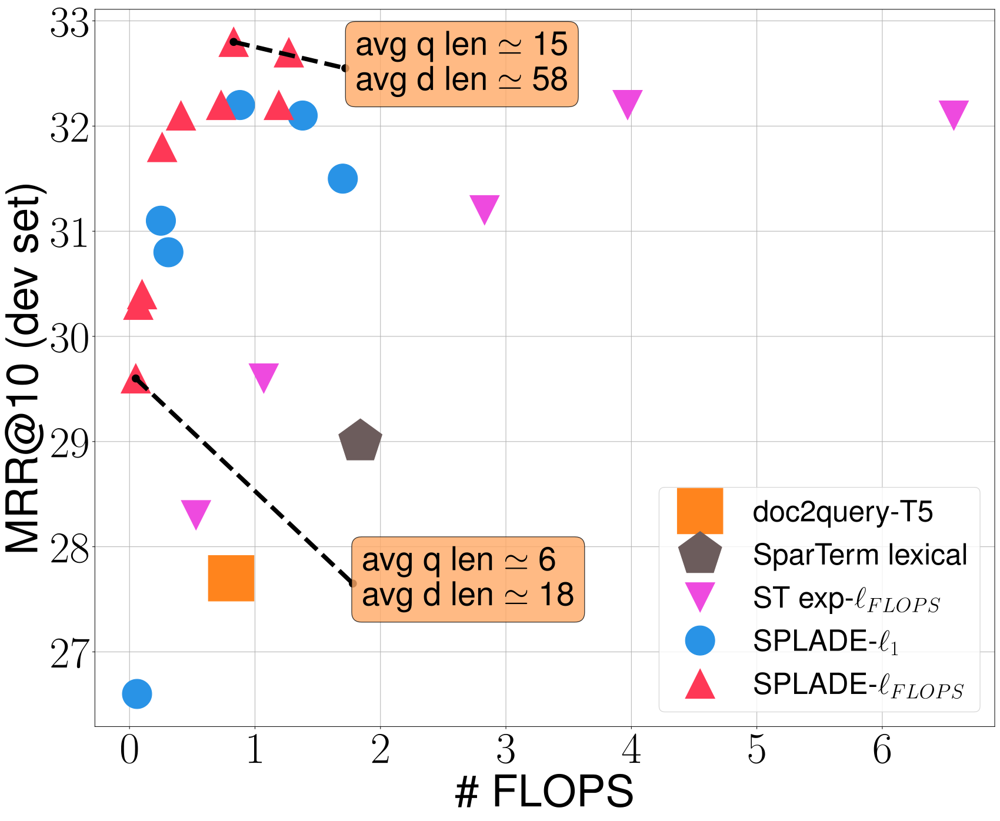

# SPLADE：学习词项扩展与稀疏检索

> 让 BERT 的 MLM 词表预测直接形成可索引的稀疏词项权重，用对数饱和和稀疏正则把语义扩展、匹配质量与索引成本一起训练。
>
> Thibault Formal、Benjamin Piwowarski、Stéphane Clinchant · SIGIR 2021 · [论文 v1](https://arxiv.org/abs/2107.05720v1) · [官方代码](https://github.com/naver/splade)

## 论文简介

BM25 使用倒排索引，便于精确词项匹配，但相关文档与查询可能使用不同表达；稠密向量能缓解词汇不匹配，却改变了索引结构，也容易弱化显式词项信号。SPLADE 在 BERT WordPiece 词表空间学习查询和文档表示：每个输入位置预测所有词项的重要性，经过非负化、对数饱和和求和聚合，再以排序损失和稀疏正则联合优化。

这使文本既能为出现过的词重新赋权，也能激活未出现但语义相关的词，最终仍用稀疏内积和倒排索引检索。MS MARCO 与 TREC DL 实验显示它显著优于多种稀疏基线，接近当时的稠密方法；但准确率和稀疏程度存在明确取舍，论文的 FLOPS 代理不能直接等同真实服务延迟。

## 背景与相关工作

DeepCT 主要重估原文出现词的权重；doc2query/docT5query 用生成的查询扩展文档；SparTerm、EPIC、SPARTA 则借助语言模型预测词表权重。SPLADE 直接承接 SparTerm：后者使用额外二值门控决定保留哪些词，门控先学好后固定，难以与排序目标共同优化。

作者的目标是保留“每一维对应一个词”的可解释性，又让扩展与稀疏化由排序任务端到端决定。它是**第一阶段全库检索器**，不是只对 BM25 候选重排的交叉编码器；两类任务的排行榜数字不能直接比较。

## 从 token 到词表权重

设输入文本为 $t=(t_1,\ldots,t_N)$，BERT 隐状态为 $h_i$，词表大小 $|V|=30,522$。使用原 MLM 预测头计算：

$$
z_{ij}=\operatorname{transform}(h_i)^\top E_j+b_j.
$$

$E_j$ 是第 $j$ 个 WordPiece 的词向量，transform 包含线性映射、GeLU 与 LayerNorm。这里读取的是 MLM logits，**不是先对整个词表做 softmax 概率归一化**。

SPLADE 的文档／查询第 $j$ 维表示为：

$$
w_j(t)=\sum_{i=1}^{N}\log(1+\operatorname{ReLU}(z_{ij})),\qquad
s(q,d)=\sum_{j\in V}w_j(q)w_j(d).
$$

ReLU 使负 logit 对应零权重；对数饱和压制特别大的激活，使少数强词不至于完全支配表示。求和沿输入位置进行，输出依然是词表维度。词表中未在原文出现的词也可被激活，因此发生语义扩展。原版这里是 **sum pooling**，max pooling 属于下一篇的修改。

## 排序学习与稀疏正则

训练 batch 中，每个查询有正文档、BM25 难负例，以及其他查询的正文档作为批内负例。排序目标为：

$$
\mathcal L_{\rm rank}=-\log\frac{e^{s(q_i,d_i^+)}}
{e^{s(q_i,d_i^+)}+e^{s(q_i,d_i^-)}+\sum_j e^{s(q_i,d_{i,j}^-)}}.
$$

若只优化相关性，模型可以让大量词项保持非零，导致长倒排表和昂贵匹配。论文比较 $\ell_1$ 与 FLOPS 正则。对于 batch 中第 $j$ 维的平均激活 $\bar a_j$：

$$
\bar a_j=\frac1B\sum_{i=1}^{B}w_j(t_i),\qquad
\mathcal L_{\rm FLOPS}=\sum_{j\in V}\bar a_j^2.
$$

平方使全 batch 中普遍激活的维度受到更强惩罚，倾向于避免少数词的倒排表特别长；它与逐样本简单限制非零维数不是一回事。总目标为

$$
\mathcal L=\mathcal L_{\rm rank}+\lambda_q\mathcal L_{\rm reg}^{q}
+\lambda_d\mathcal L_{\rm reg}^{d}.
$$

查询和文档使用不同正则强度，便于更强地约束在线查询扩展。较大的 $\lambda$ 通常带来更稀疏的表示，但可能牺牲匹配能力。

## 数据与训练设置

训练与主评测采用 **MS MARCO passage**：约 880 万段落、数十万训练查询，相关性标注较稀疏，平均每查询约 1.1 个已标正文档。开发集有 6,980 条查询，使用 MRR@10 与 Recall@1000。**TREC DL 2019**的 43 个查询有更细粒度人工相关性判断，使用 nDCG@10 和 Recall@1000。

模型从 BERT-base 初始化，最大长度 256，batch 124，Adam 学习率 $2\times10^{-5}$，学习率 warmup 6,000 步，总训练 150k 步。稀疏正则系数在前 50k 步二次增长，避免一开始压掉所有有效激活；实验系数大致在 $10^{-4}$ 到 $10^{-1}$。原实现用 Python 数组保存索引、Numba 并行检索，四张 32GB V100 训练。

## 主结果：精度与计算量一起看

原论文表 1 的代表性结果如下，均为第一阶段检索；FLOPS 是作者定义的平均匹配计算量代理。

| 方法 | MS MARCO MRR@10 | R@1000 | TREC DL nDCG@10 | FLOPS |
|---|---:|---:|---:|---:|
| BM25 | .184 | .853 | .506 | .13 |
| doc2query-T5 | .277 | .947 | .642 | .81 |
| ANCE | .330 | .959 | .648 | — |
| TCT-ColBERT（当时版本） | .335 | .964 | .670 | — |
| SparTerm expansion + FLOPS（作者重训） | .312 | .954 | .671 | 2.83 |
| SPLADE + $\ell_1$ | .322 | .954 | .667 | .88 |
| SPLADE + FLOPS | .322 | .955 | .665 | .73 |

对数饱和之后，SPLADE 在同一训练框架下同时改善 MRR 与 FLOPS；$\ell_1$ 和 FLOPS 两种版本精度相近，但后者匹配计算量更低。TREC DL 的个别指标没有全面优于所有对照，不能只看一列就声称统治所有检索场景。

横轴是计算量代理，纵轴是 MS MARCO MRR@10。图中每个点对应不同正则配置，展示的是一条精度—效率曲线；强稀疏模型虽然更省，精度会下降。相同 FLOPS 附近，SPLADE 通常比未采用对数饱和的扩展模型更好。

## 词项扩展示例与局限

论文以“弓形腿、骨骼排列与矫正锻炼”的段落展示权重。除了原有 bow、legs、alignment 等词，还激活 leg、exercise、bones、treatment；也出现 arrow、teeth 等可能受多义性影响的词。这表明扩展不是复制关键词，也不是保证正确的知识生成。

结论是：稀疏模型可以把语义泛化与倒排索引结合，关键不只是“用 BERT 输出词权重”，还包括对数饱和、批内负例和联合正则。本文主要检验英语 MS MARCO/TREC DL，尚未在这一篇中完成大规模跨域 BEIR 评测；真实索引大小、CPU 查询延迟、编码成本也需要单独测量。下一篇 SPLADE v2 将进一步考察 max pooling、文档单侧编码和蒸馏。
