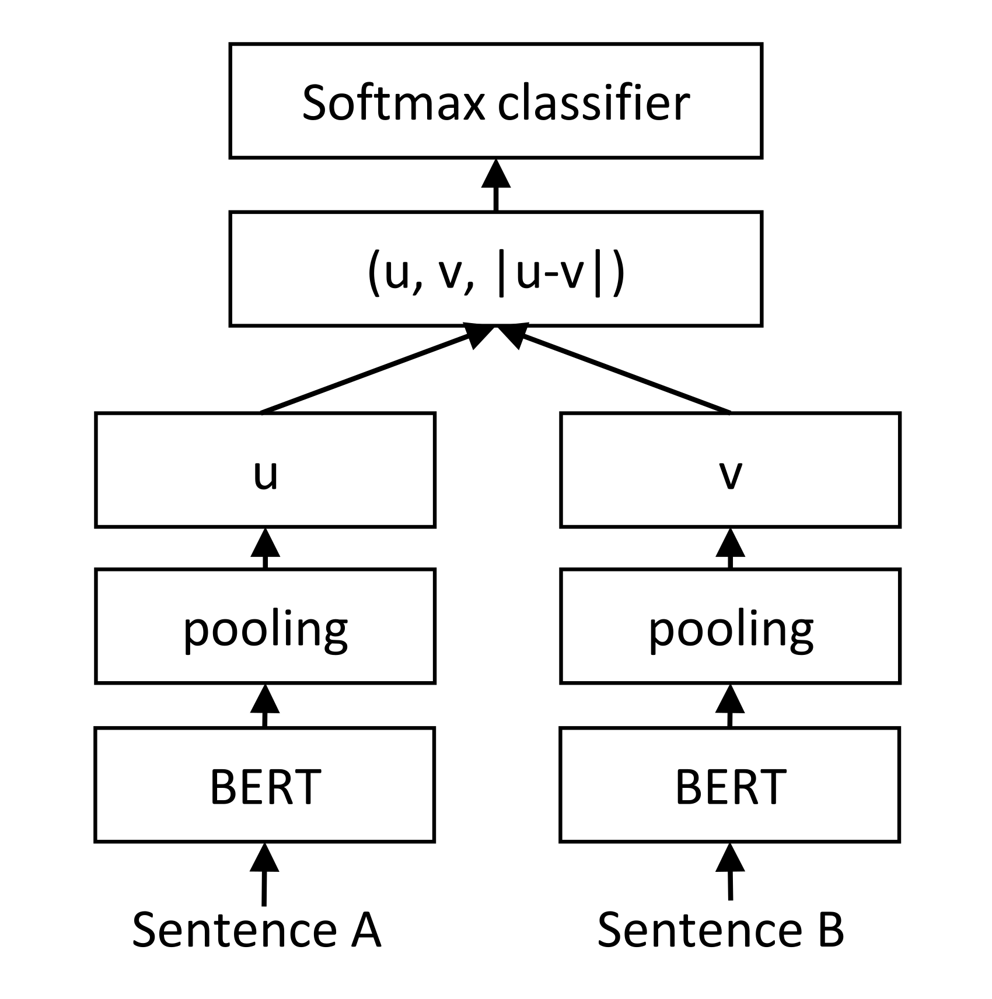
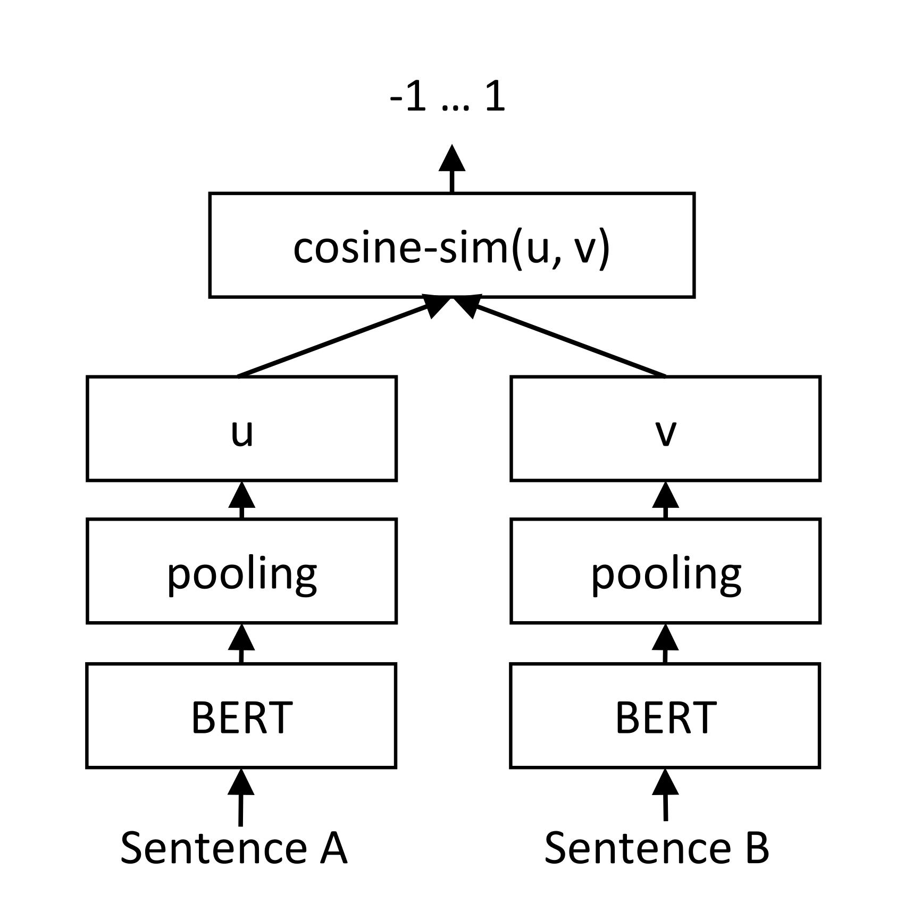

# Sentence-BERT：利用孪生 BERT 网络学习句向量

> Sentence-BERT 让共享参数的 BERT 分别编码句子，通过 NLI、相似度或三元组目标微调，使句向量能直接用余弦比较并支持预计算。
>
> Nils Reimers、Iryna Gurevych · EMNLP-IJCNLP 2019 · [原论文](https://arxiv.org/abs/1908.10084v1) · [代码](https://github.com/UKPLab/sentence-transformers) · [补充解读](Sentence-BERT解读.md)

## 摘要

BERT 联合读取两个句子，在语义相似度任务上很强，但每一对都要重新运行网络。在一万个句子中找最相似的一对，需要约五千万次交叉编码器推理，论文估计耗时约 65 小时。Sentence-BERT（SBERT）改用共享参数的孪生／三元组网络，独立生成可比较的句向量，将该示例中的编码时间降到约五秒。

论文在 STS、论证相似度、Wikipedia 章节与 SentEval 上检验表示质量。主要发现是：直接对预训练 BERT 做平均池化或取 CLS，并不能得到适合余弦比较的句向量；用 NLI 微调后效果显著提升。独立编码保留了效率优势，但在需要精细句间交互的任务上仍可能落后于交叉编码器。

## 引言

交叉编码器把两个句子放进同一 Transformer，输出两者关系。它无法把每个候选的计算单独缓存：一万个句子的两两比较数为 $n(n-1)/2=49,995,000$；在四千万条 Quora 问题中逐一与新问题联合编码，也无法满足在线检索需求。

SBERT 的目标是把每个句子映射为固定向量，再以余弦或距离函数比较。句子集合只需编码一次，后续搜索、聚类及相似度计算都可以复用表示。论文特别研究如何微调 BERT，使其向量空间真正反映句级语义，而非直接采用未经相似度训练的隐藏状态。

## 相关工作

BERT、RoBERTa 擅长有监督句子与句对任务；平均池化、CLS 是直接抽取独立表示的常用方法，但其几何性质未必适合相似度。Skip-Thought 用邻句预测训练表示，InferSent 则以 NLI 监督训练孪生 BiLSTM，Universal Sentence Encoder 结合 Transformer 与多种训练信号。这些工作表明，训练任务会显著影响句向量质量。

Poly-encoder 用多个上下文向量与预计算候选交互，能降低检索成本，但其评分不对称且仍有额外交互，不如简单向量距离适合大规模两两比较。SBERT 从已预训练的 BERT／RoBERTa 出发，保留独立编码结构，使用轻量微调获得可比较表示。

## 模型

### 池化与共享参数

每个句子独立经过同一个 BERT／RoBERTa。模型比较三种池化：取 CLS、对 token 表示逐维平均（MEAN）、逐维取最大值（MAX），默认使用 MEAN。各分支**共享权重**，因此训练得到统一的句向量空间；孪生网络是训练组织方式，并不需要部署两套不同参数。

图中两个句子各自编码、各自池化，随后才组合向量进入分类器。分类误差通过两个分支共同更新编码器；与交叉编码器相比，句子内部的编码不依赖另一个句子。

### 分类目标

对句向量 $u,v\in\mathbb R^d$，拼接自身表示和逐维绝对差：

$$
x=[u;v;\lvert u-v\rvert],\qquad p=\operatorname{softmax}(Wx+b).
$$

这里把原文公式按列向量约定展开，$W\in\mathbb R^{k\times3d}$，$k$ 是标签数。NLI 使用蕴含、矛盾、中立三分类交叉熵。分类头学习如何从两个独立表示判断关系，从而将句级语义监督传入编码器；实际相似度推理时移除分类头。

### 回归目标

对有连续相似度标签的句对，计算 $s=\cos(u,v)$，最小化与目标分数之间的均方误差。图中的流程也就是相似度推理：编码候选后直接复用向量，不需要再次联合运行 BERT。

### 三元组目标

给定锚句 $a$、正例 $p$、负例 $n$，令对应向量为 $s_a,s_p,s_n$，使用：

$$
\mathcal L_{\mathrm{triplet}}=
\max\bigl(\|s_a-s_p\|_2-\|s_a-s_n\|_2+\epsilon,0\bigr).
$$

目标要求正例距离比负例至少小一个 margin；论文取 $\epsilon=1$。三种目标分别适配关系分类、连续相似度和相对距离监督，使用哪种由数据标签决定。

### 训练细节

默认 NLI 训练合并 SNLI（约 570k 句对）和 MultiNLI（约 430k，包含不同口语及书面体裁）。每个样本包含两个句子与蕴含／矛盾／中立标签，以三分类目标训练一轮，batch 16，Adam 学习率 $2\times10^{-5}$，前 10% 数据线性 warmup。

NLI 提供句级关系监督，而非检索相关性标注；论文后面分别检验这种监督能否迁移到直接余弦比较，以及在 STS 标签上继续微调后的效果。

## 评测：语义文本相似度

### 不用 STS 数据训练的评测

论文称该设置为 Unsupervised STS，指**不使用 STS 专属训练集**；SBERT 本身已经用 NLI 标签训练。评测包括 STS12–16、STSb、SICK-R，比较向量余弦与人工相关性标签的 Spearman $\rho$，按 $100\rho$ 报告。

| Model | STS12 | STS13 | STS14 | STS15 | STS16 | STSb | SICK-R | Avg. |
| --- | --- | --- | --- | --- | --- | --- | --- | --- |
| Avg. GloVe embeddings | 55.14 | 70.66 | 59.73 | 68.25 | 63.66 | 58.02 | 53.76 | 61.32 |
| Avg. BERT embeddings | 38.78 | 57.98 | 57.98 | 63.15 | 61.06 | 46.35 | 58.40 | 54.81 |
| BERT CLS-vector | 20.16 | 30.01 | 20.09 | 36.88 | 38.08 | 16.50 | 42.63 | 29.19 |
| InferSent - Glove | 52.86 | 66.75 | 62.15 | 72.77 | 66.87 | 68.03 | 65.65 | 65.01 |
| Universal Sentence Encoder | 64.49 | 67.80 | 64.61 | 76.83 | 73.18 | 74.92 | 76.69 | 71.22 |
| SBERT-NLI-base | 70.97 | 76.53 | 73.19 | 79.09 | 74.30 | 77.03 | 72.91 | 74.89 |
| SBERT-NLI-large | 72.27 | 78.46 | 74.90 | 80.99 | 76.25 | 79.23 | 73.75 | 76.55 |
| SRoBERTa-NLI-base | 71.54 | 72.49 | 70.80 | 78.74 | 73.69 | 77.77 | 74.46 | 74.21 |
| SRoBERTa-NLI-large | 74.53 | 77.00 | 73.18 | 81.85 | 76.82 | 79.10 | 74.29 | 76.68 |

**原文表 1。** 平均 BERT 只有 54.81，CLS 为 29.19，均低于平均 GloVe 的 61.32。SBERT-NLI-large 达到 76.55，相对 InferSent 提升 11.54 点、相对 USE 提升 5.33 点；SICK-R 上仍低于 USE。RoBERTa 在这套句向量评测中的改善较小，优势主要来自训练方式的改变。

### 使用 STS benchmark 微调

STSb 包含 8,628 个来自图像描述、新闻和论坛的句对，划分为 5,749／1,500／1,379 个训练／开发／测试样本。SBERT 用回归目标微调，再以余弦评分。作者比较直接 STSb 训练与先 NLI、再 STSb 两条路径，运行十个随机种子。

| 模型 | 只用 STSb | NLI 后再用 STSb |
|---|---:|---:|
| BERT cross-encoder base | $84.30\pm.76$ | $88.33\pm.19$ |
| SBERT base | $84.67\pm.19$ | $85.35\pm.17$ |
| SRoBERTa base | $84.92\pm.34$ | $84.79\pm.38$ |
| BERT cross-encoder large | $85.64\pm.81$ | $88.77\pm.46$ |
| SBERT large | $84.45\pm.43$ | $86.10\pm.13$ |
| SRoBERTa large | $85.02\pm.76$ | $86.15\pm.35$ |

**原文表 2 的训练对照。** NLI 初始化通常有帮助，尤其交叉编码器提升明显。最高结果仍由交叉编码器取得，SBERT 的主要收益是候选独立编码与复用。

### 论证侧面相似度

AFS 有 6,000 个论证句对，涉及枪支管制、同性婚姻与死刑，按 0–5 分标注。相似论证不仅需提出相近主张，还需采用类似理由，因此比描述性 STS 更依赖细粒度语义。

作者分别做十折交叉验证和跨主题评测：后者只用两个主题训练，在未见的第三个主题测试，再对三种留出结果平均。SBERT 使用回归目标。

| 模型 | 十折 Pearson $r$ | 十折 Spearman $\rho$ | 跨主题 $r$ | 跨主题 $\rho$ |
|---|---:|---:|---:|---:|
| BERT-AFS-base | 77.20 | 74.84 | 58.49 | 57.23 |
| SBERT-AFS-base | 76.57 | 74.13 | 52.34 | 50.65 |
| BERT-AFS-large | 78.68 | 76.38 | 62.02 | 60.34 |
| SBERT-AFS-large | 77.85 | 75.93 | 53.82 | 53.10 |

**原文表 3。** 同分布十折评测中 SBERT 接近 BERT；跨主题时差距扩大到约 7 个 Spearman 点。作者解释为：交叉编码器能够直接逐词对照两个论证，独立向量则需要仅凭少量主题学出可迁移的主张与理由表示。

### Wikipedia 章节区分

从同一篇文章中抽取锚句、同章节正例和不同章节负例，以章节结构构建弱监督三元组。模型在约 180 万训练三元组上训练一轮，测试使用来自不同文章的 222,957 个三元组，指标是正例是否比负例更接近锚句。

| 方法 | 准确率 |
|---|---:|
| mean-vectors | .65 |
| skip-thoughts-CS | .62 |
| Dor 等人的 BiLSTM | .74 |
| SBERT-WikiSec-base | .8042 |
| SBERT-WikiSec-large | .8078 |
| SRoBERTa-WikiSec-large | .7973 |

**原文表 4。** 三元组训练使 SBERT 学到同一文章内部更细的主题关系；RoBERTa 同样没有稳定超过 BERT。

## 评测：SentEval

SentEval 冻结句向量，再训练逻辑回归分类器，使用十折交叉验证检查可迁移信息。七项任务为影评情感 MR、商品评价 CR、主观性 SUBJ、意见极性 MPQA、情感 SST、问题类型 TREC 和复述识别 MRPC。

| Model | MR | CR | SUBJ | MPQA | SST | TREC | MRPC | Avg. |
| --- | --- | --- | --- | --- | --- | --- | --- | --- |
| Avg. GloVe embeddings | 77.25 | 78.30 | 91.17 | 87.85 | 80.18 | 83.0 | 72.87 | 81.52 |
| Avg. fast-text embeddings | 77.96 | 79.23 | 91.68 | 87.81 | 82.15 | 83.6 | 74.49 | 82.42 |
| Avg. BERT embeddings | 78.66 | 86.25 | 94.37 | 88.66 | 84.40 | 92.8 | 69.45 | 84.94 |
| BERT CLS-vector | 78.68 | 84.85 | 94.21 | 88.23 | 84.13 | 91.4 | 71.13 | 84.66 |
| InferSent - GloVe | 81.57 | 86.54 | 92.50 | 90.38 | 84.18 | 88.2 | 75.77 | 85.59 |
| Universal Sentence Encoder | 80.09 | 85.19 | 93.98 | 86.70 | 86.38 | 93.2 | 70.14 | 85.10 |
| SBERT-NLI-base | 83.64 | 89.43 | 94.39 | 89.86 | 88.96 | 89.6 | 76.00 | 87.41 |
| SBERT-NLI-large | 84.88 | 90.07 | 94.52 | 90.33 | 90.66 | 87.4 | 75.94 | 87.69 |

**原文表 5。** SBERT-NLI-large 平均 87.69，高于 InferSent 的 85.59 和 USE 的 85.10；情感任务提升较明显，TREC 问题分类仍落后于使用问答语料训练的 USE。

这里还有一个重要对照：平均 BERT 在 STS 上表现弱，却在 SentEval 中有 84.94。STS 直接用余弦、各维以相同方式参与比较；SentEval 会学习分类权重，能够重新选择不同维度的信息。因此，表示包含可用语义信息与向量几何适合直接相似度，并不是同一项评测。

## 消融研究

作者分别在 NLI 分类、STSb 回归上改变池化；另外只在 NLI 分类中改变分类头的拼接方式。每种配置运行十个随机种子，在 STSb 开发集上测余弦 Spearman。

| 池化 | NLI 分类训练 | STSb 回归训练 |
|---|---:|---:|
| MEAN | 80.78 | 87.44 |
| MAX | 79.07 | 69.92 |
| CLS | 79.80 | 86.62 |

| NLI 分类头输入（均使用 MEAN） | Spearman |
|---|---:|
| $[u;v]$ | 66.04 |
| $[\lvert u-v\rvert]$ | 69.78 |
| $[u\odot v]$ | 70.54 |
| $[\lvert u-v\rvert;u\odot v]$ | 78.37 |
| $[u;v;u\odot v]$ | 77.44 |
| $[u;v;\lvert u-v\rvert]$ | 80.78 |
| $[u;v;\lvert u-v\rvert;u\odot v]$ | 80.44 |

**原文表 6。** NLI 训练中池化差异较小，分类头加入逐维绝对差很重要；额外加入逐维乘积并未进一步改善。STSb 回归中 MAX 明显差于 MEAN／CLS，说明池化结论与训练目标有关。分类头拼接仅影响训练，最终推理仍直接比较两个独立向量。

## 计算效率

论文在 i7-5820K CPU 与 V100 GPU 上测量每秒编码句数。Smart batching 将长度相近的句子分到同一批，仅填充到该批最长句，从而减少 padding 计算。

| 模型 | CPU 句/秒 | GPU 句/秒 |
|---|---:|---:|
| 平均 GloVe | 6469 | — |
| InferSent | 137 | 1876 |
| USE | 67 | 1318 |
| SBERT-base | 44 | 1378 |
| SBERT-base + smart batching | 83 | 2042 |

**原文表 7。** SBERT 在 CPU 上仍慢于浅层 BiLSTM；GPU 上 smart batching 使其从 1378 提高到 2042 句/秒，超过 InferSent 和 USE。文首约五秒的示例还利用了句子只编码一次的结构性节省，不能仅由每秒编码速度解释。

## 结论

SBERT 将预训练 Transformer 改造成可独立编码、适合余弦比较的句向量模型。NLI 微调显著改善未经相似度训练的 BERT 表示；回归和三元组目标支持进一步适配。它让大规模语义比较、搜索和聚类更可行，同时保留了在精细交互及跨主题任务上的质量取舍。
