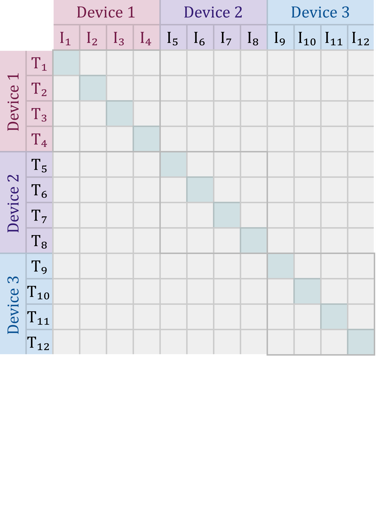
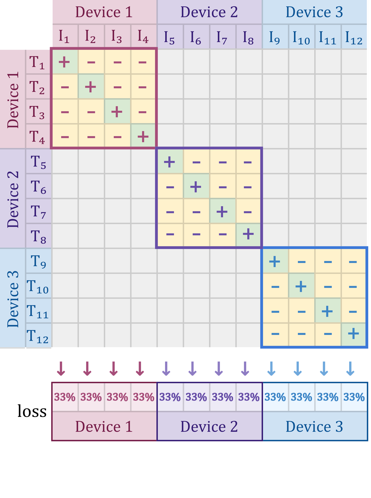
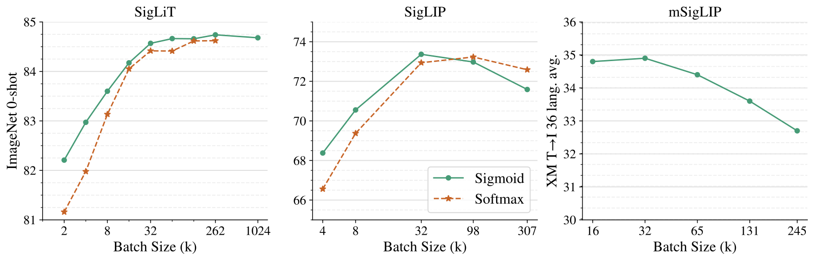

# SigLIP：用于图文预训练的逐对 Sigmoid 损失

> SigLIP 将图文配对改为独立的二分类目标，省去跨候选 softmax 归一化，便于分块计算，并系统检验 batch、负例比例与训练稳定性。
>
> Xiaohua Zhai 等 · ICCV 2023 · [原论文](https://arxiv.org/abs/2303.15343v4) · [代码](https://github.com/google-research/big_vision) · [补充解读](SigLIP解读.md)

## 摘要

CLIP 的双向 softmax 要在 batch 全部图文组合上归一化，增加分布式计算和得分矩阵显存。本文提出逐图文对的 sigmoid 二分类：匹配对为正，其余组合为负，每对损失独立求和，不需要全局 softmax 分母。

作者在同时训练图像／文本塔的 SigLIP，以及固定视觉塔的 SigLiT 上比较效果，发现较小 batch 时 sigmoid 明显有利，扩大到约 32k 后收益趋于饱和，甚至百万 batch 也并非必要。另通过偏置、正负例比例和噪声实验说明训练行为；四张 TPUv4 上两天达到 84.5% ImageNet 零样本的配置属于复用强视觉塔的 SigLiT。

## 引言

图文对比预训练已成为通用视觉表示的重要路线。标准目标对每张图在所有文本中选正确配对，再对每段文本反向选择图像；数值稳定的 softmax 及大规模分布式计算需要访问整组得分。

本文改为独立判断“这对图文是否匹配”。这一视角把样本 batch 与参与的图文对数量分开，既提供高效实现，也允许独立研究更多样本、更多负配对是否持续改善表示。

## 相关工作

CLIP、ALIGN 使用大规模图文 softmax 对比训练；LiT 冻结预训练视觉塔，FLIP 通过减少视觉 token 降低成本。CoCa、BLIP 等加入生成或数据过滤。Sigmoid 在其他表示任务已有使用，本文重点验证其图文预训练收益，以及分块实现、batch 缩放和小资源训练条件。

## 方法

### 图文预训练的 Softmax 目标

令 $x_i,y_j$ 为单位归一化图像／文本向量，$t=\exp(t')$ 为可学习的 logit 尺度。CLIP 用两个方向的交叉熵：

$$
\mathcal L_{\mathrm{softmax}}=-\frac1{2B}\sum_i\left[
\log\frac{e^{t x_i^\top y_i}}{\sum_j e^{t x_i^\top y_j}}
+\log\frac{e^{t x_i^\top y_i}}{\sum_j e^{t x_j^\top y_i}}
\right].
$$

每项正例得分需要与对应整行或整列一起归一化，两个方向不能直接合并成单一独立配对和。

### 逐对 Sigmoid 目标

设 $z_{ij}=1$ 表示真实配对，其他组合取 $-1$。按原文算法的二分类 logit 约定，写为：

$$
a_{ij}=t x_i^\top y_j+b,\qquad
\mathcal L_{\mathrm{sigmoid}}=-\frac1B\sum_{i,j}\log\sigma(z_{ij}a_{ij}).
$$

正例推动 logit 变大，负例推动其变小；每一对只依赖自己的分数。总损失按 $B$ 归一化，而非 $B^2$。这里的 $b$ 用于控制正负先验：一个 batch 有 $B$ 个正对、$B^2-B$ 个负对，初始若全部预测 .5，负例会主导最初更新。

默认初始化 **$b=-10,t'=\log10$，即 $t=10$**，使初始匹配概率较低。以原文后面的偏置消融为准；不要将尺度 $t$ 与其对数参数混用。

### 高效分块实现

每卡保留本地图像表示，先与本地文本计算，再轮转接收其他卡的文本块。每次仅物化一个本地大小的得分矩阵，累计独立 sigmoid 损失及梯度。图中亮色方块表示当前正在计算的局部配对块。

相较一次 all-gather 全局表示并保存 $B\times B$ 得分矩阵，这种方式降低峰值显存；交换和配对计算仍存在，但无需同时保留所有得分。该实现支持作者探索百万级 batch。

## 结果

评测主要使用 ImageNet 零样本分类与 XM3600 三十六语言跨模态检索。默认采用 ScalingViT-Adafactor；实验分别控制训练已见样本数，以比较损失和 batch。

### SigLiT：扩大 batch 的极限

SigLiT 固定 ViT-g 视觉编码器，预计算图像表示，只训练文本塔。batch 从 512 扫到约 1M，小于 16k 时 sigmoid 明显优于 softmax，大 batch 后差距缩小。

各设备交换局部文本块，计算当前图文配对后累加损失，不必同时物化全局相似度矩阵。

三个面板分别使用不同训练设置和已见样本预算。整体在约 32k 后收益趋于饱和；SigLiT 的峰值可出现在更大 batch，但改善有限。极大 batch 在短训练预算下更新次数太少，需要更长调度才能充分起效。

### SigLIP：同时训练两塔

英文 WebLI 实验使用 B/16 图像塔、B 级文本塔、224px 图像、32k SentencePiece 词表，文本最多 16 token。sigmoid 在小于约 32k batch 时更有利，最佳约 32k；softmax 需约 98k 才达最佳，约 307k 时两者都退化。

同样四张 TPUv4，Base SigLIP 可容纳 batch 4096，而相应 CLIP 约为 2048。收益同时来自单次配对目标和更大的可用 batch。

### 多语言预训练

多语实验保留 WebLI 的约 100 种语言。250k 大词表比 32k 多语词表略好，但词嵌入占用更高，因此用 $N\times K$ 查表再投影到 $W$ 维，以代替 $N\times W$，取 $K=96,W=768$。

原文表 2，在 30B 已见样本下比较：

| batch | ImageNet 零样本 | XM3600 平均文→图 |
|---|---:|---:|
| 16k | 71.6 | 34.8 |
| 32k | 73.2 | 34.9 |
| 64k | 73.2 | 34.4 |
| 128k | 73.2 | 33.6 |
| 240k | 73.1 | 32.7 |

ImageNet 在 32k 后基本持平，多语检索反而下降，说明扩大 batch 的最佳点与任务有关。

### 四张 TPUv4 的 SigLiT

固定预训练视觉塔后，四卡可以主要承担文本训练。一个约一天的配置取得 79.7% ImageNet 零样本；固定更强 g/14 视觉塔、batch 20k、约两天的配置达到 84.5%。这些时间只对应本阶段训练，不包含视觉塔预训练。

### 少量 TPUv4 的 SigLIP

复用但**不冻结**预训练视觉塔时，作者发现默认 weight decay 会损伤其特征。视觉塔学习率乘 .1，并关闭其 weight decay 后效果明显改善；随机初始化的文本参数仍保留 weight decay。

| 设置 | TPUv4 数 | 时间 | ImageNet 零样本 |
|---|---:|---:|---:|
| SigLiT，固定强视觉塔 | 4 | 2 天 | 84.5 |
| SigLIP，预训练 B/16 继续更新 | 16 | 3 天 | 71.0 |
| SigLIP，随机初始化 B/16 | 32 | 2 天 | 72.1 |
| SigLIP，随机初始化 B/16 | 32 | 5 天 | 73.4 |

原文表 1 的配置节选。各行初始化和训练预算不同，主要展示可行资源配置。

### 大 batch 的稳定性

作者发现较大 batch 容易产生梯度尖峰和过大的参数变化。将 Adam／Adafactor 的 $\beta_2$ 从 .999 降至 **.95**，可更快跟踪梯度尺度并减轻失稳；本文后续实验默认使用 .95。

### 正负例比例

在 16k batch 中，负配对约 268M，远多于 16k 正配对。作者分别随机删负例、仅保留最难负例、仅保留最易负例，并用延长训练匹配总配对数量。

随机重平衡损伤效果，只保留容易负例更差；保留难负例能较好保持质量，进一步匹配总配对预算后可小幅改善。实验说明不均衡本身未必是核心问题，负例提供的信息与总训练预算更重要。

### 偏置初始化

| $b$ 初值 | $t'$ 初值 | ImageNet | Pets | CIFAR100 |
|---|---|---:|---:|---:|
| 无偏置 | $\log10$ | 62.0 | 81.8 | 59.9 |
| −10 | $\log10$ | 63.0 | 82.4 | 61.0 |
| −10 | $\log1$ | 61.0 | 80.0 | 60.4 |
| 0 | $\log10$ | 61.7 | 79.9 | 59.0 |
| 0 | $\log1$ | 53.7 | 73.2 | 53.8 |

原文表 3，Base、8k batch、900M 已见样本。负偏置与合理尺度共同避免早期大幅纠正负例先验；仅加入一个初值为零的偏置并不等价。

### 标签噪声稳健性

作者对图像加入随机噪声、替换文本 token、打乱图文配对，并组合这些扰动。在 M 级模型、3.6B 已见样本的控制实验中，sigmoid 随噪声增强仍优于相应 softmax 对照。这是对明确扰动方式的经验结果。

## 结论

逐对 sigmoid 是图文预训练的一种简单有效替代目标，尤其有利于较小 batch 与分块实现。百万 batch 实验并未显示必须无限增大负例池；约 32k 已在多种设置中接近最佳。偏置、优化器稳定性和预训练参数的更新策略，也属于完整训练配方。
