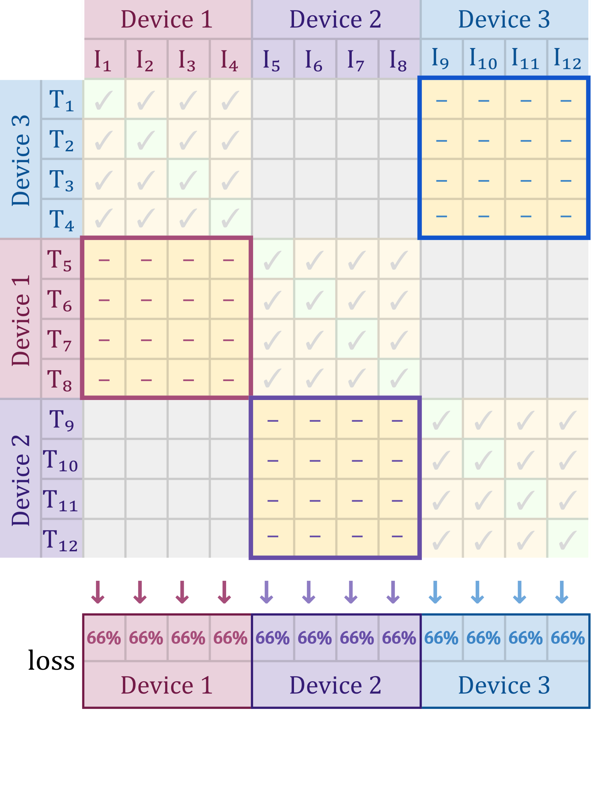
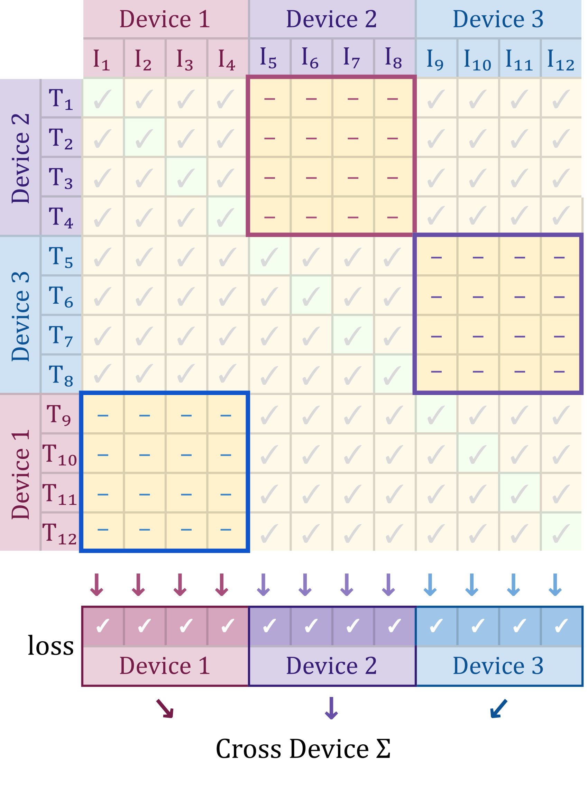
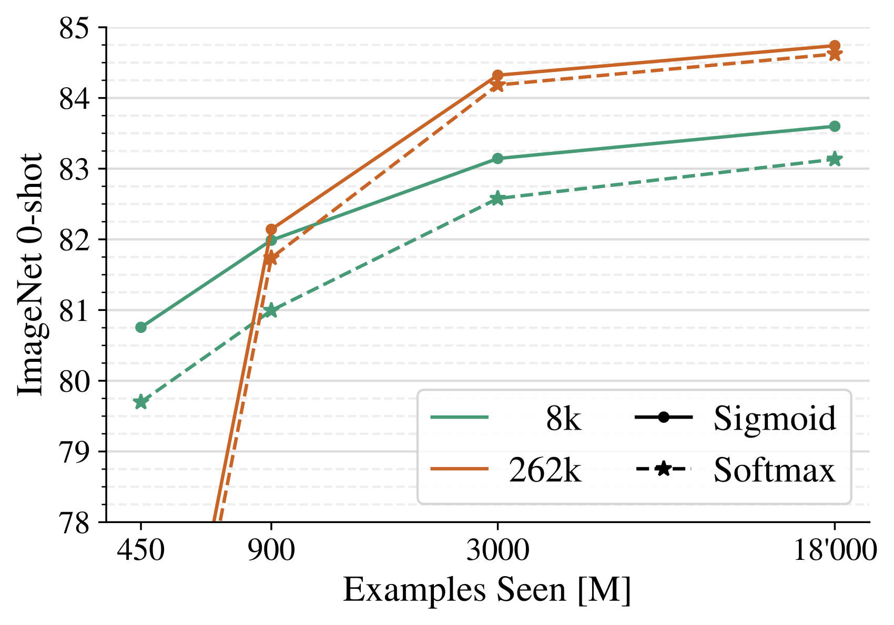
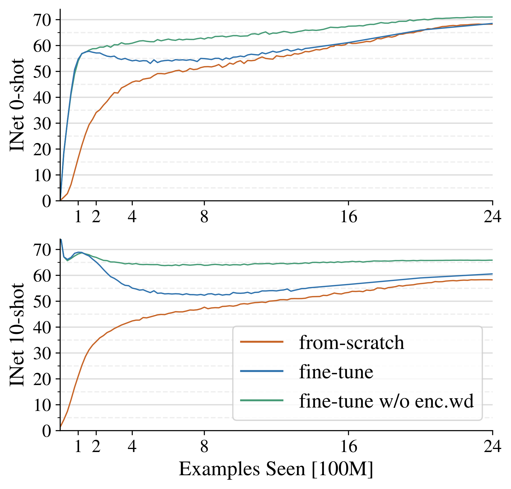
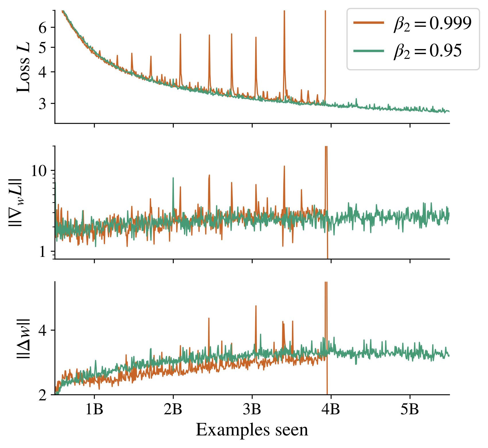
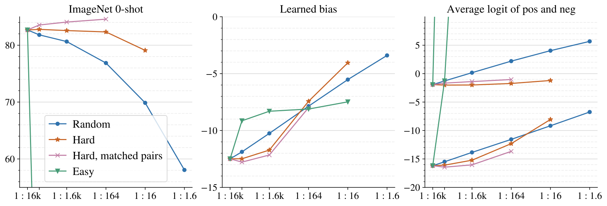
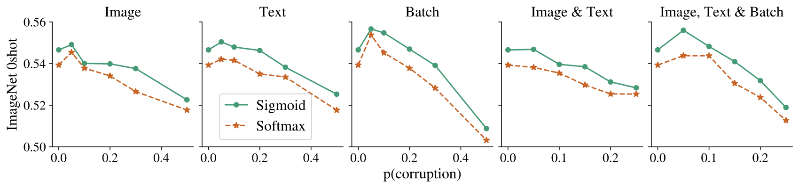
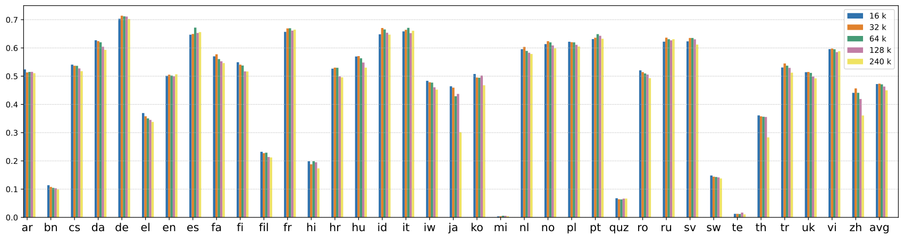
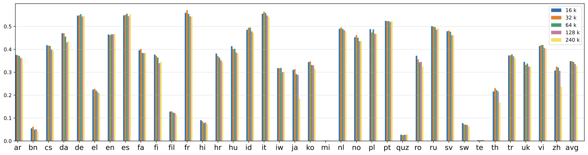

# Sigmoid Loss for Language Image Pre-Training / 全文中英对照

> 来源：[arXiv:2303.15343v3](https://arxiv.org/abs/2303.15343v3)。英文段落后紧接中文，覆盖所取 HTML 版本的主文、附录、图表、脚注与参考文献；公式、数字表和书目信息共用。中文以机器初译为底稿，进行了术语整理与结构核对，尚未逐句人工审定；遇到歧义请以紧邻英文和原论文为准。 本文采用可完整获取的 v3 HTML；仓库原有 PDF 为另一版本，不能据其页码定位本对照稿。 原作版权归所列作者，许可见 [原作许可](http://creativecommons.org/licenses/by/4.0/)；中文译文与版式改写在该许可条件下提供（涉及 SA 时沿用相同许可，涉及 NC 时仅限非商业使用）。

## Authors and affiliations / 作者与机构

Xiaohua Zhai ⋆ Basil Mustafa Alexander Kolesnikov Lucas Beyer ⋆ Affiliation: Google Research, Brain Team, Zürich Affiliation: {xzhai, basilm, akolesnikov, lbeyer}@google.com

## Abstract / 摘要

**EN.** We propose a simple pairwise sigmoid loss for image-text pre-training. Unlike standard contrastive learning with softmax normalization, the sigmoid loss operates solely on image-text pairs and does not require a global view of the pairwise similarities for normalization. The sigmoid loss simultaneously allows further scaling up the batch size, while also performing better at smaller batch sizes. With only four TPUv4 chips, we can train a Base CLIP model at 4 k batch size and a Large LiT model at 20 k batch size, the latter achieves 84.5% ImageNet zero-shot accuracy in two days. This disentanglement of the batch size from the loss further allows us to study the impact of examples vs pairs and negative to positive ratio. Finally, we push the batch size to the extreme, up to one million, and find that the benefits of growing batch size quickly diminish, with a more reasonable batch size of 32 k being sufficient. We hope our research motivates further explorations in improving the quality and efficiency of language-image pre-training.

**中.** 我们提出了一种简单的成对 sigmoid 损失用于图像文本预训练。与使用 softmax 归一化的标准对比学习不同，sigmoid 损失仅对图像-文本对进行操作，并且不需要对归一化的成对相似性进行全局视图。 sigmoid 损失同时允许进一步扩大批量大小，同时在较小的批量大小下也能表现更好。仅用四个 TPUv4 芯片，我们就可以训练 4 k 批量大小的 Base CLIP 模型和 20 k 批量大小的 Large LiT 模型，后者在两天内达到 84.5% ImageNet 零样本精度。批量大小与损失的分离进一步使我们能够研究示例与对以及负与正比率的影响。最后，我们将批量大小推至极限，达到 100 万，并发现增加批量大小的好处很快就会消失，更合理的批量大小 32 k 就足够了。我们希望我们的研究能够激发进一步探索提高语言图像预训练的质量和效率。

## Introduction / 简介

**EN.** Contrastive pre-training using weak supervision from image-text pairs found on the web is becoming the go-to method for obtaining generic computer vision backbones, slowly replacing pre-training on large labelled multi-class datasets. The high-level idea is to simultaneously learn an aligned representation space for images and texts using paired data. Seminal works CLIP [ 31 ] and ALIGN [ 20 ] established the viability of this approach at a large scale, and following their success, many large image-text datasets became available privately [ 47 , 11 , 19 , 39 ] and publicly [ 33 , 5 , 13 , 6 , 34 ] .

**中.** 使用网络上的图像-文本对的弱监督进行对比预训练正在成为获取通用计算机视觉主干的首选方法，慢慢取代大型标记多类数据集上的预训练。高级思想是使用配对数据同时学习图像和文本的对齐表示空间。开创性的工作 CLIP [31] 和 ALIGN [20] 确立了这种方法大规模的可行性，随着它们的成功，许多大型图像文本数据集开始私下使用 [47, 11, 19, 39] 和公开使用 [33, 5, 13, 6, 34]。

**EN.** The standard recipe to pre-train such models leverages the image-text contrastive objective. It aligns the image and text embeddings for matching (positive) image-text pairs while making sure that unrelated (negative) image-text pairs are dissimilar in the embedding space. This is achieved via a batch-level softmax-based contrastive loss, applied twice to normalize the pairwise similarity scores across all images, then all texts. A naive implementation of the softmax is numerically unstable; it is usually stabilized by subtracting the maximum input value before applying the softmax [ 16 ] , which requires another pass over the full batch.

**中.** 预训练此类模型的标准方法利用图像文本对比目标。它对齐图像和文本嵌入以匹配（正）图像-文本对，同时确保不相关（负）图像-文本对在嵌入空间中不相似。这是通过批量级基于 softmax 的对比损失来实现的，应用两次以标准化所有图像和所有文本的成对相似性分数。 softmax 的简单实现在数值上是不稳定的；通常通过在应用 softmax [16] 之前减去最大输入值来稳定它，这需要再次遍历整个批次。

|  | Image 图片 | Text 文字 | BS 学士 | #TPUv4 | Days 天数 | INet-0 |
| --- | --- | --- | --- | --- | --- | --- |
| SigLiT 西格利特 | B/8 | L ∗ | 32 k | 4 | 1 | 79.7 |
| SigLiT 西格利特 | g/14 | L | 20 k | 4 | 2 | 84.5 |
| SigLIP 西格利普 | B/16 | B | 16 k | 16 | 3 | 71.0 |
| SigLIP 西格利普 | B/16 | B | 32 k | 32 | 2 | 72.1 |
| SigLIP 西格利普 | B/16 | B | 32 k | 32 | 5 | 73.4 |

**EN.** Table 1 : SigLiT and SigLIP results . Sigmoid loss is memory efficient, allows larger batch sizes (BS) that unlocks language image pre-training with a small number of chips. SigLiT model with a frozen public L/16 checkpoint [ 35 ] , trained on the LiT image-text dataset [ 47 ] using four TPU-v4 chips for one day, achieves 79.7% 0-shot accuracy on ImageNet. The same setup with a g/14 checkpoint [ 46 ] leads to 84.5% accuracy, trained for two days. With a public unlocked B/16 image checkpoint [ 35 ] , trained on the WebLI dataset [ 11 ] , SigLIP achieves 71.0% 0-shot accuracy using 16 TPU-v4 chips for three days. The last two rows show results with randomly initialized models.

**中.** 表 1：SigLiT 和 SigLIP 结果。 Sigmoid 损失内存效率高，允许更大的批量大小 (BS)，从而用少量芯片解锁语言图像预训练。具有冻结公共 L/16 检查点 [35] 的 SigLiT 模型，使用四个 TPU-v4 芯片在 LiT 图像文本数据集 [47] 上训练一天，在 ImageNet 上实现了 79.7% 的 0-shot 准确率。具有 g/14 检查点 [46] 的相同设置经过两天训练后，准确率达到 84.5%。通过公开解锁的 B/16 图像检查点 [35]，并在 WebLI 数据集 [11] 上进行训练，SigLIP 使用 16 个 TPU-v4 芯片三天实现了 71.0% 的 0-shot 准确率。最后两行显示随机初始化模型的结果。

**EN.** In this paper, we propose a simpler alternative: the sigmoid loss. It does not require any operation across the full batch and hence greatly simplifies the distributed loss implementation and boosts efficiency. Additionally, it conceptually decouples the batch size from the definition of the task. We compare the proposed sigmoid loss with the standard softmax loss across multiple setups. In particular, we investigate sigmoid-based loss with two prominent approaches for image-text learning: CLIP [ 31 ] and LiT [ 47 ] , which we call sigmoid language image pre-training ( SigLIP ) and sigmoid LiT ( SigLiT ), respectively. We find that the sigmoid loss performs significantly better than the softmax loss when the batch size is smaller than 16 k. As the train batch size grows, the gap closes. Importantly, the sigmoid loss is symmetric, requires just a single pass, and a typical implementation requires less memory than the softmax loss. This enables successful training of a SigLiT model at a batch size of one million . However, we find that the performance saturates with growing batch size, both for softmax and sigmoid. The good news is that a reasonable batch size, i.e. 32 k, is sufficient for image-text pre-training. This conclusion also holds for multilingual SigLIP training on over 100 languages.

**中.** 在本文中，我们提出了一个更简单的替代方案：Sigmoid 损失。它不需要跨整个批次进行任何操作，因此大大简化了分布式损失的实现并提高了效率。此外，它从概念上将批量大小与任务的定义解耦。我们将所提出的 sigmoid 损失与多个设置中的标准 softmax 损失进行了比较。特别是，我们使用两种著名的图像文本学习方法来研究基于 sigmoid 的损失：CLIP [31] 和 LiT [47]，我们分别将其称为 sigmoid 语言图像预训练 (SigLIP) 和 sigmoid LiT (SigLiT)。我们发现，当批量大小小于 16 k 时，sigmoid 损失的表现明显优于 softmax 损失。随着列车批量大小的增加，差距就会缩小。重要的是，sigmoid 损失是对称的，只需要一次传递，并且典型的实现比 softmax 损失需要更少的内存。这使得能够成功训练批量大小为一百万的 SigLiT 模型。然而，我们发现随着批量大小的增加，softmax 和 sigmoid 的性能都会饱和。好消息是，合理的批量大小（即 32 k）足以进行图像文本预训练。这一结论也适用于 100 多种语言的多语言 SigLIP 培训。

**EN.** In Table 1 , we present setups for image-text pre-training that require a moderate amount of TPUv4 chips for training. SigLiT is surprisingly efficient, reaching 79.7% zero-shot accuracy on ImageNet in just a single day on four chips. SigLIP’s more demanding from-scratch training reaches 73.4% zero-shot accuracy in 5 days with 32 TPUv4 chips. This compares favorably to prior works such as FLIP [ 26 ] and CLIP [ 31 ] , which require approximately 5 and 10 days respectively on 256 TPUv3 cores. When fine-tuning a pre-trained vision backbone in SigLIP, denoted as in Table 1 , we found that disabling the weight decay on the pre-trained backbone leads to better results (see Figure 4 for details). We hope our work paves the way for making the nascent language-image pre-training field more accessible.

**中.** 在表 1 中，我们提出了图像文本预训练的设置，需要适量的 TPUv4 芯片进行训练。 SigLiT 的效率令人惊讶，仅一天之内，在四个芯片上就达到了 ImageNet 上 79.7% 的零样本准确率。 SigLIP 要求更高的从头开始训练，使用 32 个 TPUv4 芯片在 5 天内达到 73.4% 的零样本准确率。这与 FLIP [26] 和 CLIP [31] 等之前的工作相比，在 256 个 TPUv3 核心上分别需要大约 5 天和 10 天。当在 SigLIP 中微调预训练的视觉主干时（如表 1 所示），我们发现禁用预训练主干上的权重衰减会带来更好的结果（详细信息请参见图 4）。我们希望我们的工作能够为新兴的语言图像预训练领域的普及铺平道路。

## Related Work / 相关工作

**EN.** Contrastive learning with the sigmoid loss. One prior work proposes a similar sigmoid loss for the task of unsupervised dimensionality reduction [ 17 ] ; in the scope of contrastive image-text learning, the vast majority of works rely on the softmax-based InfoNCE loss as popularized by [ 37 ] .

**中.** 与 sigmoid 损失进行对比学习。之前的一项工作针对无监督降维任务提出了类似的 sigmoid 损失 [17]；在对比图像文本学习领域，绝大多数工作依赖于[37]所推广的基于softmax的InfoNCE损失。

**EN.** Contrastive language-image pre-training has become popular since CLIP [ 31 ] and ALIGN [ 20 ] applied softmax contrastive learning [ 48 , 37 , 9 , 21 ] to large-scale image-text datasets. Both models perform very well on zero-shot transfer tasks, including classification and retrieval. Follow-up works show that contrastively pre-trained models produce good representations for fine-tuning [ 41 , 14 ] , linear regression [ 20 ] , object detection [ 27 ] , semantic segmentation [ 28 ] and video tasks [ 45 ] .

**中.** 自从 CLIP [31] 和 ALIGN [20] 将 softmax 对比学习 [48,37,9,21] 应用到大规模图像文本数据集以来，对比语言图像预训练变得流行。两种模型在零样本迁移任务（包括分类和检索）上都表现良好。后续工作表明，对比预训练模型可以为微调 [41, 14]、线性回归 [20]、对象检测 [27]、语义分割 [28] 和视频任务 [45] 提供良好的表示。

**EN.** Generative language-image pre-training Besides softmax contrastive pre-training, various alternatives have been proposed. GIT [ 39 ] , SimVLM [ 40 ] , and LEMON [ 19 ] successfully pre-train models using a generative text decoder instead, while CoCa [ 44 ] adds such a decoder to the discriminative CLIP/ALIGN setup, thus combining the pros and cons of both approaches into a single very capable model. BLIP [ 25 ] further proposes CapFilt which uses the generative decoder to create better captions and the discriminative part of the model to filter pairs. Language-Image pre-training is a very active field and surveys [ 7 ] rapidly become outdated.

**中.** 生成语言图像预训练除了softmax对比预训练之外，还提出了各种替代方案。 GIT [39]、SimVLM [40] 和 LEMON [19] 成功地使用生成文本解码器预训练模型，而 CoCa [44] 将这样的解码器添加到判别性 CLIP/ALIGN 设置中，从而将两种方法的优缺点结合到一个非常强大的模型中。 BLIP [25] 进一步提出了 CapFilt，它使用生成解码器来创建更好的字幕，并使用模型的判别部分来过滤对。语言-图像预训练是一个非常活跃的领域，调查[7]很快就过时了。

**EN.** Efficient language-image pre-training On the other hand, few works have tried making language image pre-training more efficient. LiT [ 47 ] and FLIP [ 26 ] are notable attempts, the former requires a pre-trained and locked backbone, and the latter sacrifices quality by randomly dropping visual tokens. BASIC [ 30 ] and LAION [ 1 ] look at scaling batch-size but only go up to 16 k and 160 k respectively, by using many hundreds of chips, and for the former also mixing in a large private classification dataset [ 30 , 43 ] . The recent Lion optimizer [ 10 ] claims to be able to reduce the training cost to reach similar quality.

**中.** 高效的语言图像预训练另一方面，很少有工作尝试使语言图像预训练更加高效。 LiT [47] 和 FLIP [26] 是值得注意的尝试，前者需要预先训练和锁定的主干，后者通过随机丢弃视觉标记来牺牲质量。 BASIC [30] 和 LAION [1] 着眼于扩展批量大小，但通过使用数百个芯片分别只能达到 16 k 和 160 k，并且前者还混合在大型私有分类数据集中 [30, 43]。最近的 Lion 优化器 [10] 声称能够降低训练成本以达到类似的质量。

**EN.** 1 # img_emb : image model embedding [n, dim]

**中.** 1 # img_emb : 图像模型嵌入 [n, dim]

**EN.** 2 # txt_emb : text model embedding [n, dim]

**中.** 2 # txt_emb : 文本模型嵌入 [n, dim]

**EN.** 3 # t_prime, b : learnable temperature and bias

**中.** 3 # t_prime, b ：可学习的温度和偏差

**EN.** 4 # n : mini-batch size

**中.** 4 # n : 小批量大小

**EN.** 5

**中.** 5

**EN.** 6 t = exp ( t_prime )

**中.** 6 t = exp ( t_prime )

**EN.** 7 zimg = l2_normalize ( img_emb )

**中.** 7 zimg = l2_normalize ( img_emb )

**EN.** 8 ztxt = l2_normalize ( txt_emb )

**中.** 8 ztxt = l2_normalize ( txt_emb )

**EN.** 9 logits = dot ( zimg , ztxt . T ) * t + b

**中.** 9 logits = 点 ( zimg , ztxt . T ) * t + b

**EN.** 10 labels = 2 * eye ( n ) - ones ( n ) # -1 with diagonal 1

**中.** 10 个标签 = 2 * 眼睛 ( n ) - 个体 ( n ) # -1 对角线 1

**EN.** 11 l = - sum ( log_sigmoid ( labels * logits )) / n

**中.** 11 l = - sum ( log_sigmoid ( labels * logits )) / n

**EN.** Algorithm 1 Sigmoid loss pseudo-implementation.

**中.** 算法1 Sigmoid损失伪实现。

## Method / 方法

**EN.** In this section, we first review the widely-used softmax-based contrastive loss. We then introduce the pairwise sigmoid loss and discuss its efficient implementation.

**中.** 在本节中，我们首先回顾广泛使用的基于 softmax 的对比损失。然后我们介绍成对 sigmoid 损失并讨论其有效实现。

**EN.** Given a mini-batch $\mathcal{B}=\{(I_{1},T_{1}),(I_{2},T_{2}),\dots\}$ of image-text pairs, the contrastive learning objective encourages embeddings of matching pairs $(I_{i},T_{i})$ to align with each other, while pushing embeddings of unmatched pairs $(I_{i},T_{j{\neq}i})$ apart. For practical purposes, it is assumed that for all images $i$ , the text associated with a different image $j$ is not related to $i$ , and vice-versa. This assumption is usually noisy and imperfect.

**中.** 给定小批量 $\mathcal{B}=\{(I_{1},T_{1}),(I_{2},T_{2}),\dots\}$ 图像-文本对，对比学习目标鼓励匹配对 $(I_{i},T_{i})$ 的嵌入相互对齐，同时将不匹配对 $(I_{i},T_{j{\neq}i})$ 的嵌入推开。出于实际目的，假设对于所有图像 $i$ ，与不同图像 $j$ 关联的文本与 $i$ 不相关，反之亦然。这种假设通常是有噪音且不完美的。

**EN.** Figure 1 : Efficient loss implementation demonstrated via a mock setup with 3 devices and a global batch size of 12. There are no all-gathers, and at any point in time only the bright yellow square (size $4\times 4$ ) is materialized in memory.

**中.** 图 1：通过具有 3 个设备和全局批量大小为 12 的模拟设置演示了高效的损失实现。没有所有聚集，并且在任何时间点只有亮黄色方块（大小 $4\times 4$ ）在内存中具体化。

### Softmax loss for language image pre-training / 语言图像预训练的 Softmax 损失

**EN.** When using the softmax loss to formalize this objective, an image model $f(\cdot)$ and a text model $g(\cdot)$ are trained to minimize the following objective:

**中.** 当使用softmax损失来形式化该目标时，训练图像模型$f(\cdot)$和文本模型$g(\cdot)$以最小化以下目标：

$$
-\frac{1}{2|\mathcal{B}|}\sum_{i=1}^{|\mathcal{B}|}\left(\overbrace{\log\frac{e^{t\mathbf{x}_{i}\cdot\mathbf{y}_{i}}}{\sum_{j=1}^{|\mathcal{B}|}e^{t\mathbf{x}_{i}\cdot\mathbf{y}_{j}}}}^{\text{image$\rightarrow$text softmax}}+\overbrace{\log\frac{e^{t\mathbf{x}_{i}\cdot\mathbf{y}_{i}}}{\sum_{j=1}^{|\mathcal{B}|}e^{t\mathbf{x}_{j}\cdot\mathbf{y}_{i}}}}^{\text{text$\rightarrow$image softmax}}\right)
$$

**EN.** where $\mathbf{x}_{i}=\frac{f(I_{i})}{\|f(I_{i})\|_{2}}$ and $\mathbf{y}_{i}=\frac{g(T_{i})}{\|g(T_{i})\|_{2}}$ . In this paper, we adopt the vision transformer architecture [ 15 ] for images and the transformer architecture [ 38 ] for texts. Note that due to the asymmetry of the softmax loss, the normalization is independently performed two times: across images and across texts [ 31 ] . The scalar $t$ is parametrized as $\exp(t^{\prime})$ , where $t^{\prime}$ is a global freely learnable parameter.

**中.** 其中 $\mathbf{x}_{i}=\frac{f(I_{i})}{\|f(I_{i})\|_{2}}$ 和 $\mathbf{y}_{i}=\frac{g(T_{i})}{\|g(T_{i})\|_{2}}$ 。在本文中，我们针对图像采用视觉Transformer 架构[15]，针对文本采用Transformer 架构[38]。请注意，由于 softmax 损失的不对称性，标准化独立执行两次：跨图像和跨文本 [31]。标量 $t$ 被参数化为 $\exp(t^{\prime})$ ，其中 $t^{\prime}$ 是全局可自由学习的参数。

### Sigmoid loss for language image pre-training / 语言图像预训练的 Sigmoid 损失

**EN.** Instead of the softmax-based contrastive loss, we propose a simpler alternative that does not require computing global normalization factors. The sigmoid-based loss processes every image-text pair independently, effectively turning the learning problem into the standard binary classification on the dataset of all pair combinations, with a positive labels for the matching pairs $(I_{i},T_{i})$ and negative labels for all other pairs $(I_{i},T_{j{\neq}i})$ . It is defined as follows:

**中.** 我们提出了一种不需要计算全局标准化因子的更简单的替代方案，而不是基于 softmax 的对比损失。基于 sigmoid 的损失独立处理每个图像文本对，有效地将学习问题转化为所有对组合的数据集上的标准二元分类，其中匹配对 $(I_{i},T_{i})$ 为正标签，所有其他对 $(I_{i},T_{j{\neq}i})$ 为负标签。它的定义如下：

$$
-\frac{1}{|\mathcal{B}|}\sum_{i=1}^{|\mathcal{B}|}\sum_{j=1}^{|\mathcal{B}|}\underbrace{\log\frac{1}{1+e^{z_{ij}(-t\mathbf{x}_{i}\cdot\mathbf{y}_{j}+b)}}}_{\mathcal{L}_{ij}}
$$

**EN.** where $z_{ij}$ is the label for a given image and text input, which equals 1 if they are paired and $-1$ otherwise. Note that at initialization, the heavy imbalance coming from the many negatives dominates the loss, leading to large initial optimization steps attempting to correct this bias. To alleviate this, we introduce an additional learnable bias term $b$ similar to the temperature $t$ . We initialize $t^{\prime}$ and $b$ to 10 and -10 respectively. This makes sure the training starts roughly close to the prior and does not require massive over-correction. Algorithm 1 presents a pseudocode implementation of the proposed sigmoid loss for language image pre-training.

**中.** 其中 $z_{ij}$ 是给定图像和文本输入的标签，如果它们配对则等于 1，否则等于 $-1$。请注意，在初始化时，来自许多负例的严重不平衡在损失中占主导地位，导致大量的初始优化步骤试图纠正这种偏差。为了缓解这个问题，我们引入了一个额外的可学习偏差项 $b$ ，类似于温度 $t$ 。我们将 $t^{\prime}$ 和 $b$ 分别初始化为 10 和 -10。这确保训练开始时大致接近先前的训练，并且不需要大量的过度校正。算法 1 提出了用于语言图像预训练的 sigmoid 损失的伪代码实现。

**EN.** Figure 2 : The effect of pre-training batch size. Left: SigLiT results , trained for 18B seen examples. Sigmoid loss outperforms the softmax loss significantly with small batch sizes, and performs similarly at larger batch sizes. We successfully trained an SigLiT model with up to one million batch size. However, performance for both sigmoid and softmax saturate at around 32 k batch size. Middle: SigLIP results , trained for 9B seen examples. Both sigmoid loss and softmax loss saturate at a reasonable batch size, while the peak of the sigmoid loss comes earlier and slightly outperforms the peak of the softmax loss. A very large batch size hurts both losses. Right: mSigLIP results , trained for 30B seen examples. With a multilingual setup using over 100 languages, 32 k batch size is surprisingly sufficient and scaling beyond that hurts performance on a 36-language cross-modal retrieval task.

**中.** 图 2：预训练批量大小的影响。左：SigLiT 结果，针对 18B 个可见示例进行训练。在小批量大小的情况下，Sigmoid 损失显着优于 softmax 损失，在较大批量大小的情况下表现类似。我们成功训练了批量大小高达一百万的 SigLiT 模型。然而，sigmoid 和 softmax 的性能在大约 32 k 批量大小时饱和。中：SigLIP 结果，针对 9B 个可见示例进行训练。 sigmoid 损失和 softmax 损失在合理的批量大小下都会饱和，而 sigmoid 损失的峰值来得更早，并且略优于 softmax 损失的峰值。非常大的批量会损害这两种损失。右：mSigLIP 结果，针对 30B 个可见示例进行训练。对于使用 100 多种语言的多语言设置，32 k 批处理大小已经足够了，超出此范围会损害 36 种语言跨模式检索任务的性能。

### Efficient “chunked” implementation / 高效的“分块”实施

**EN.** Contrastive training typically utilizes data parallelism. Computing the loss when data is split across $D$ devices necessitates gathering all embeddings [ 47 ] with expensive all-gathers and, more importantly, the materialization of a memory-intensive $|{\mathcal{B}}|\times|{\mathcal{B}}|$ matrix of pairwise similarities.

**中.** 对比训练通常利用数据并行性。当数据在 $D$ 设备上分割时计算损失需要使用昂贵的全收集来收集所有嵌入[47]，更重要的是，需要实现成对相似性的内存密集型 $|{\mathcal{B}}|\times|{\mathcal{B}}|$ 矩阵。

**EN.** The sigmoid loss, however, is particularly amenable to a memory efficient, fast, and numerically stable implementation that ameliorates both these issues. Denoting the per-device batch size as $b=\frac{|\mathcal{B}|}{D}$ , the loss is reformulated as:

**中.** 然而，sigmoid 损失特别适合内存高效、快速且数值稳定的实现，从而改善这两个问题。将每个设备的批量大小表示为 $b=\frac{|\mathcal{B}|}{D}$ ，损失重新表述为：

$$
-\frac{1}{|\mathcal{B}|}\underbrace{\sum_{d_{i}=1}^{D}}_{\textbf{A: }\forall\text{ device }d_{i}}\overbrace{\sum_{d_{j}=1}^{D}}^{\begin{subarray}{c}\text{{B:} swap negs}\\
\text{across devices}\end{subarray}}\overbrace{\underbrace{\sum_{i=bd_{i}}^{b(d_{i}+1)}}_{\begin{subarray}{c}\text{all local}\\
\text{positives}\end{subarray}}\underbrace{\sum_{j=bd_{j}}^{b(d_{j}+1)}}_{\begin{subarray}{c}\text{negs from}\\
\text{next device}\end{subarray}}\mathcal{L}_{ij}}^{\begin{subarray}{c}\text{{C:} per device}\\
\text{loss}\end{subarray}}
$$

**EN.** This is particularly simple for the sigmoid loss as each pair is an independent term in the loss. Figure 1 illustrates this method. In words, we first compute the component of the loss corresponding to the positive pairs, and $b-1$ negative pairs. We then permute representations across devices, so each device takes negatives from its neighbouring device (next iteration of sum B ). The loss is then calculated with respect to this chunk (sum C ). This is done independently in each device, such that each device computes the loss with respect to its local batch $b$ . Losses can then simply be summed across all devices (sum A ). Individual collective permutes (for sum B ) are fast (and indeed $D$ collective permutes is typically faster than two all-gathers between $D$ devices), and the memory cost at any given moment is reduced from $|\mathcal{B}|^{2}$ to $b^{2}$ (for sum C ). Usually $b$ is constant as scaling $|\mathcal{B}|$ is achieved by increasing the number of accelerators. Due to being quadratic with respect to the batch size, the vanilla loss computation rapidly bottlenecks scaling up. This chunked approach enabled training with batch sizes over 1 million on relatively few devices.

**中.** 这对于 sigmoid 损失来说特别简单，因为每一对都是损失中的独立项。图 1 说明了这种方法。换句话说，我们首先计算对应于正对和 $b-1$ 负对的损失分量。然后，我们跨设备排列表示，因此每个设备从其相邻设备中获取负值（和 B 的下一次迭代）。然后计算该块的损失（总和 C ）。这是在每个设备中独立完成的，以便每个设备计算相对于其本地批次 $b$ 的损失。然后可以简单地将所有设备的损耗相加（sum A ）。单独的集体排列（对于 sum B ）很快（实际上 $D$ 集体排列通常比 $D$ 设备之间的两个全收集更快），并且任何给定时刻的内存成本从 $|\mathcal{B}|^{2}$ 减少到 $b^{2}$ （对于 sum C ）。通常，$b$ 是恒定的，因为缩放 $|\mathcal{B}|$ 是通过增加加速器的数量来实现的。由于与批量大小成二次方，普通损失计算很快成为扩展的瓶颈。这种分块方法可以在相对较少的设备上进行批量大小超过 100 万的训练。

## Results / 结果

**EN.** In this section, we evaluate the proposed SigLiT and SigLIP models across a wide range of batch sizes. We discuss what can be achieved with a small number of accelerator chips, using both SigLiT and SigLIP recipes. We also briefly discuss the impact of batch size on multilingual language image pre-training. We ablate the importance of our large-batch stabilization modification and the introduced learned bias term and present a study on the effect of positive and negative pairs ratio in the sigmoid loss. Lastly, we explore SigLIP’s data noise robustness.

**中.** 在本节中，我们将在各种批量大小下评估所提出的 SigLiT 和 SigLIP 模型。我们讨论使用 SigLiT 和 SigLIP 配方，使用少量加速器芯片可以实现什么。我们还简要讨论了批量大小对多语言图像预训练的影响。我们消除了大批量稳定修改和引入的学习偏差项的重要性，并提出了关于 sigmoid 损失中正负对比率影响的研究。最后，我们探讨了 SigLIP 的数据噪声鲁棒性。

**EN.** To validate our models, we report zero-shot transfer results on the ImageNet dataset [ 12 ] and zero-shot retrieval results across 36 languages on the XM3600 dataset [ 36 ] . We use the ScalingViT-Adafactor optimizer [ 46 ] by default for all our experiments.

**中.** 为了验证我们的模型，我们报告了 ImageNet 数据集 [12] 上的零样本传输结果和 XM3600 数据集上 36 种语言的零样本检索结果 [36]。我们所有的实验默认使用 ScalingViT-Adafactor 优化器 [46]。

### SigLiT: Scaling batch size to the limit / SigLiT：将批量大小扩展到极限

**EN.** Following [ 47 ] , we use the same precomputed embeddings for the images using a ViT-g vision model, and train a base size text tower from scratch with the same hyperparameters using the LiT image-text dataset [ 47 ] .

**中.** 按照[47]，我们使用 ViT-g 视觉模型对图像使用相同的预计算嵌入，并使用 LiT 图像文本数据集 [47] 使用相同的超参数从头开始训练基本大小的文本塔。

**EN.** We perform a study over a wide range of batch sizes, from 512 to $1\,M$ , demonstrating the impact of batch size for contrastive learning. Results are presented in Figure 2 (left). When the batch size is smaller than $16\,k$ , sigmoid loss outperforms softmax loss by a large margin. With growing batch sizes, we observe that softmax loss quickly catches up and potentially slightly underperforms sigmoid loss with a large enough batch size. Overall, we recommend using the SigLIP recipe for large batch sizes as well, due to the simplicity, compute savings, and straightforward memory efficient implementation.

**中.** 我们对从 512 到 $1\,M$ 的各种批量大小进行了研究，展示了批量大小对对比学习的影响。结果如图 2（左）所示。当批量大小小于 $16\,k$ 时，sigmoid 损失大幅优于 softmax 损失。随着批量大小的增加，我们观察到 softmax 损失很快就会迎头赶上，并且在批量大小足够大的情况下，其性能可能略低于 sigmoid 损失。总的来说，我们建议对大批量大小也使用 SigLIP 配方，因为它简单、节省计算且实现简单、内存高效。

**EN.** There is a consensus that contrastive learning benefits from large batch sizes, while most of the existing studies stop at 64 k batch size [ 47 , 30 , 9 ] . We successfully trained an SigLiT model at one million batch size, to explore the limit of contrastive learning. To our surprise, the performance saturates at 32 k batch size, further scaling up the batch size only gives a minor boost, and the model peaks at 256 k batch size. Our best SigLiT with a B -sized text mode achieves 84.7% zero-shot transfer accuracy on ImageNet, while the original LiT paper reports a slightly better 85.2% score with a 10 times larger g -sized text model. Figure 3 presents the impact of training duration for different batch sizes. It demonstrates that large, $262\,k$ batch size significantly outperforms smaller $8\,k$ batch size when trained for a sufficiently long time. Note, that for short training durations, large batch size leads to the fewer absolute number of update steps and thus needs more time to ramp up.

**中.** 人们一致认为，对比学习受益于大批量大小，而大多数现有研究都停留在 64 k 批量大小 [47,30,9]。我们成功训练了 100 万批大小的 SigLiT 模型，以探索对比学习的极限。令我们惊讶的是，性能在 32 k 批量大小时达到饱和，进一步扩大批量大小只会带来很小的提升，并且模型在 256 k 批量大小时达到峰值。我们最好的 SigLiT 具有 B 大小的文本模式，在 ImageNet 上实现了 84.7% 的零样本传输准确率，而原始 LiT 论文报告了使用 10 倍大的 g 大小的文本模型的略高的 85.2% 分数。图 3 显示了不同批量大小的训练持续时间的影响。它表明，当训练足够长的时间时，大的 $262\,k$ 批量大小明显优于较小的 $8\,k$ 批量大小。请注意，对于较短的训练持续时间，大批量会导致更新步骤的绝对数量较少，因此需要更多时间来加速。

**EN.** Figure 3 : SigLiT ImageNet 0-shot transfer results with different training durations. Large batch size results in a big performance boost, but needs a sufficiently long schedule to ramp up, as for short schedules, very large batch size results in a small number of gradient update steps.

**中.** 图 3：不同训练持续时间的 SigLiT ImageNet 0-shot 传输结果。大批量会带来很大的性能提升，但需要足够长的调度来提升，对于短调度，非常大的批量会导致少量的梯度更新步骤。

### SigLIP: Sigmoid loss is beneficial for language-image pre-training / SigLIP：Sigmoid损失有利于语言-图像预训练

**EN.** We pre-train SigLIP models on the WebLI dataset [ 11 ] , using only English image and text pairs. We use moderately-sized models: B/16 ViT for image embeddings and B-sized transformer for text embeddings. The input images are resized to 224 $\times$ 224 resolution. The text is tokenized by a 32 k vocabulary sentencepiece tokenizer [ 24 ] trained on the English C4 dataset [ 32 ] , and a maximum of 16 text tokens are kept. Figure 2 middle plot shows SigLIP results, With less than 32 k batch size, SigLIP outperforms CLIP baselines with the standard softmax loss. On the other end of the scale, the memory efficiency of the sigmoid loss enabled much larger batch sizes. For example, with four TPU-v4 chips, we could fit a batch size of 4096 with a Base SigLIP but only 2048 with a corresponding CLIP model. The two advantages together demonstrate significant benefits of the sigmoid loss for language image pre-training with fixed resources, which will be discussed in Section 4.5 .

**中.** 我们仅使用英文图像和文本对在 WebLI 数据集 [11] 上预训练 SigLIP 模型。我们使用中等大小的模型：B/16 ViT 用于图像嵌入，B 大小的转换器用于文本嵌入。输入图像大小调整为 224 $\times$ 224 分辨率。文本由在英语 C4 数据集 [32] 上训练的 32k 词汇句子分词器 [24] 进行标记，最多保留 16 个文本标记。图 2 中图显示了 SigLIP 结果，在批量大小小于 32 k 的情况下，SigLIP 优于具有标准 softmax 损失的 CLIP 基线。另一方面，sigmoid 损失的内存效率可以实现更大的批量大小。例如，对于四个 TPU-v4 芯片，我们可以使用 Base SigLIP 来适应 4096 的批量大小，但使用相应的 CLIP 模型时只能适应 2048。这两个优点共同证明了 sigmoid 损失对于固定资源的语言图像预训练的显着优势，这将在 4.5 节中讨论。

**EN.** As batch size increases, the gap between the sigmoid and the softmax losses diminish. SigLIP performs best at batch size 32 k, whereas the softmax loss required 98 k for optimal performance and still didn’t outperform the sigmoid based variant. Scaling further, a larger batch size like 307 k hurts both losses.

**中.** 随着批量大小的增加，Sigmoid 损失和 Softmax 损失之间的差距缩小。 SigLIP 在批量大小为 32 k 时表现最佳，而 softmax 损失需要 98 k 才能获得最佳性能，并且仍然没有优于基于 sigmoid 的变体。进一步扩展，更大的批量大小（例如 307 k）会损害这两种损失。

### mSigLIP: Multi-lingual pre-training / mSigLIP：多语言预训练

|  | 16 k | 32 k | 64 k | 128 k | 240 k |
| --- | --- | --- | --- | --- | --- |
| INet-0 | 71.6 | 73.2 | 73.2 | 73.2 | 73.1 |
| XM avg XM 平均 | 34.8 | 34.9 | 34.4 | 33.6 | 32.7 |
| XM de XM德 | 54.7 | 54.8 | 55.4 | 54.3 | 54.7 |
| XM en | 46.5 | 46.2 | 46.5 | 46.6 | 46.6 |
| XM hi XM嗨 | 9.1 | 8.5 | 7.9 | 8.1 | 7.3 |
| XM ru XM茹 | 50.1 | 49.9 | 49.7 | 48.6 | 49.3 |
| XM zh 晓明 | 30.7 | 32.5 | 32.0 | 30.6 | 23.7 |

**EN.** Table 2 : Multilingual SigLIP results with various batch sizes, pre-trained for 30 billion seen examples. We report zero-shot transfer results on ImageNet (INet-0) and averaged text to image retrieval results across 36 languages on the crossmodal 3600 dataset (XM). The full table on 36 languages can be found in Appendix.

**中.** 表 2：不同批量大小的多语言 SigLIP 结果，针对 300 亿个可见示例进行了预训练。我们报告了 ImageNet (INet-0) 上的零样本传输结果以及跨模态 3600 数据集 (XM) 上跨 36 种语言的平均文本到图像检索结果。 36 种语言的完整表格可以在附录中找到。

**EN.** We further scale up the training data by keeping all the 100 languages from the WebLI dataset [ 11 ] . With multilingual data, one usually needs to use a larger international vocabulary. We first verify the impact of two tokenizers: a small multilingual vocabulary with 32 k tokens [ 32 ] , and a large multilingual vocabulary with 250 k tokens [ 42 ] . We train B-sized ViT and text models for $900\,M$ total examples seen, and observe slightly more than 1% improvement when using a larger vocabulary.

**中.** 我们通过保留 WebLI 数据集中的所有 100 种语言来进一步扩展训练数据 [11]。对于多语言数据，通常需要使用更大的国际词汇量。我们首先验证两个标记器的影响：具有 32 k 个标记的小型多语言词汇表 [32] 和具有 250 k 个标记的大型多语言词汇表 [42]。我们针对 $900\,M$ 看到的总示例训练 B 大小的 ViT 和文本模型，并观察到使用更大词汇量时略高于 1% 的改进。

**EN.** However, the token embeddings become huge for very large vocabulary sizes. Following the standard setup, we would need to store a $N\times W$ token embedding lookup table to train the multilingual model, where $N$ is the vocabulary size mentioned above and $W$ is the embedding dimension of the text model. To save memory, we propose to use a “bottlenecked” token embedding. We use $N\times K$ embedding matrix and additional $K\times W$ projection, where the bottleneck $K$ is much smaller than $W$ .

**中.** 然而，对于非常大的词汇量来说，标记嵌入会变得巨大。按照标准设置，我们需要存储 $N\times W$ 令牌嵌入查找表来训练多语言模型，其中 $N$ 是上面提到的词汇量，$W$ 是文本模型的嵌入维度。为了节省内存，我们建议使用“瓶颈”令牌嵌入。我们使用 $N\times K$ 嵌入矩阵和附加的 $K\times W$ 投影，其中瓶颈 $K$ 比 $W$ 小得多。

**EN.** In our experiments, we observed that using a large multilingual vocabulary with a bottleneck can be scaled up as efficiently as using a small multilingual vocabulary. Specifically, by enabling the bottleneck of size $K=96$ for Base architecture with $W=768$ , we only see about a half percent quality drop on ImageNet zero-shot transfer, compared to using the full $250k$ vocabulary.

**中.** 在我们的实验中，我们观察到使用具有瓶颈的大型多语言词汇可以像使用小型多语言词汇一样有效地扩展。具体来说，通过使用 $W=768$ 为基础架构启用 $K=96$ 大小的瓶颈，与使用完整的 $250k$ 词汇表相比，我们在 ImageNet 零样本传输中仅看到约 0.5% 的质量下降。

**EN.** With the memory improvements, we train mSigLIP models for various batch sizes, for a total of 30 billion examples seen. Table 2 and Figure 2 (right plot) show the results. A batch size of 32 k is sufficient for a multilingual setup as well. On the XM3600 cross-modal retrieval tasks, we found that going beyond 32 k batch size leads to worse results on average while on ImageNet zero-shot transfer it stays flat. mSigLIP sets the new state-of-the-art on XM3600 text to image retrieval task, with only a Base size model. Our best result is 34.9%, which is more than 6% higher than the previously reported result 28.5% [ 11 ] with a standard LiT model [ 47 ] using a much larger four billion ViT-e model.

**中.** 随着内存的改进，我们训练了不同批量大小的 mSigLIP 模型，总共看到了 300 亿个示例。表 2 和图 2（右图）显示了结果。 32 k 的批量大小也足以满足多语言设置。在 XM3600 跨模式检索任务中，我们发现超过 32 k 批量大小会导致平均结果更差，而在 ImageNet 零样本传输上则保持平稳。 mSigLIP 在 XM3600 文本到图像检索任务上设置了新的最先进技术，仅具有基本尺寸模型。我们的最佳结果是 34.9%，比之前报告的使用更大的 40 亿 ViT-e 模型的标准 LiT 模型 [47] 的结果 28.5% [11] 高出 6% 以上。

**EN.** Figure 4 : Top : SigLIP with pre-trained encoders ramps up quickly. However, only disabling weight decay on the pre-trained encoder weights leads to stable behavior and good ImageNet 0-shot transfer results. Bottom : ImageNet 10-shot transfer results, where decaying the pre-trained weights leads to deterioration of the pre-trained model visual representation quality. Disabling weight decay makes the curve flatter.

**中.** 图 4：顶部：带有预训练编码器的 SigLIP 快速提升。然而，只有禁用预训练编码器权重的权重衰减才能获得稳定的行为和良好的 ImageNet 0-shot 传输结果。底部：ImageNet 10-shot 传输结果，其中预训练权重的衰减会导致预训练模型视觉表示质量的恶化。禁用权重衰减会使曲线变得更平坦。

### SigLiT with four TPU-v4 chips / 具有四个 TPU-v4 芯片的 SigLiT

**EN.** For many practitioners, the important question usually is “what can be trained with a limited amount of resources?” We explore the usage of SigLiT models in this section with only four TPU-v4 chips, as the memory efficient sigmoid loss is suitable for this application scenario.

**中.** 对于许多从业者来说，重要的问题通常是“用有限的资源可以训练什么？”我们在本节中探索 SigLiT 模型的使用，仅使用四个 TPU-v4 芯片，因为内存高效的 sigmoid 损失适合此应用场景。

**EN.** We follow the same setup as in section 4.1 . We use the publicly available ViT-Augreg-B/8 [ 35 ] model as the frozen ( ) vision tower, and precompute embeddings to accelerate the training [ 47 ] . The text model is a Large Transformer, but with a depth of only 12 layers (instead of 24). It is trained using the LION [ 10 ] optimizer with decoupled weight decay $1\times{10}^{-7}$ , linearly warm-up of learning rate over 6.5k steps up to a peak of $1\times{10}^{-4}$ , followed by a cosine decay to 0. We train for a total of 65 000 steps with a batch size of 32k – this leads to just under one day of training. Table 1 shows the results when training a model on four chips for one day, achieving 79.7% 0-shot ImageNet classification accuracy; very competitive in this limited resource regime. With a ViT-g/14 [ 46 ] model as the vision tower and a Large text tower, we can train at 20 k batch size on four chips for 107 k steps in under two days. This further pushes the 0-shot ImageNet classification accuracy up to 84.5%.

**中.** 我们遵循与 4.1 节相同的设置。我们使用公开的 ViT-Augreg-B/8 [35] 模型作为 freeze () 视觉塔，并预计算嵌入来加速训练 [47]。文本模型是一个大型 Transformer，但深度仅为 12 层（而不是 24 层）。它使用具有解耦权重衰减 $1\times{10}^{-7}$ 的 LION [10] 优化器进行训练，学习率线性预热超过 6.5k 步直至 $1\times{10}^{-4}$ 的峰值，然后余弦衰减到 0。我们总共训练 65,000 步，批量大小为 32k – 这导致训练时间不到一天。表1显示了在四个芯片上训练模型一天的结果，实现了79.7%的0-shot ImageNet分类准确率；在这种有限的资源体制下非常有竞争力。使用 ViT-g/14 [ 46 ] 模型作为视觉塔和大型文本塔，我们可以在两天内在四个芯片上以 20 k 批量大小进行 107 k 个步骤的训练。这进一步将 0-shot ImageNet 分类准确率提升至 84.5%。

### SigLIP with a small amount of TPU-v4 chips / 带有少量TPU-v4芯片的SigLIP

**EN.** Figure 5 : The effect of Adam and AdaFactor’s $\beta_{2}$ . As we increase batch-size, we observe more frequent training instability. This instability can mainly be seen in the loss curves (top) and is caused by spikes in the gradient norm (middle) which results in large parameter updates (bottom). Decreasing the $\beta_{2}$ momentum value stabilizes the training. Even though occasional gradient spikes still happen (see step at 2B), they do not destabilize the training process.

**中.** 图5：Adam和AdaFactor的$\beta_{2}$的效果。随着批量大小的增加，我们观察到训练不稳定的情况更加频繁。这种不稳定性主要可以在损失曲线（顶部）中看到，并且是由梯度范数（中间）的尖峰引起的，从而导致较大的参数更新（底部）。降低 $\beta_{2}$ 动量值可以稳定训练。尽管偶尔仍然会发生梯度峰值（参见 2B 中的步骤），但它们不会破坏训练过程的稳定性。

**EN.** Figure 6 : The effect of batch composition. We simulate various batch compositions by masking out negatives, either randomly, keeping only the hardest, or the easiest. With no masking, we have 16 k negatives for each positive in the batch (1:16 k) and the strongest masking we apply (1:1.6) results in almost balanced minibatches. In one setting we match total pairs seen by training for significantly longer. We observe ImageNet 0-shot score, the final value of the learned bias, and the average logits of positive and negative pairs. Overall, the imbalance does not seem to be detrimental, but finding an efficient way of mining negatives might be beneficial.

**中.** 图 6：批次组成的影响。我们通过随机屏蔽负片来模拟各种批次组合，仅保留最难的或最简单的。在没有掩蔽的情况下，批次中的每个正数有 16 k 个负数 (1:16 k)，并且我们应用的最强掩蔽 (1:1.6) 会导致几乎平衡的小批量。在一种设置中，我们匹配训练中看到的总对的时间明显更长。我们观察 ImageNet 0-shot 分数、学习偏差的最终值以及正负对的平均 Logits。总体而言，这种不平衡似乎并不是有害的，但找到一种有效的方式来挖掘负例可能是有益的。

**EN.** It’s resource demanding to train a CLIP model from-scratch in general, with SigLIP it’s possible to fit a larger train batch size with fewer amount of chips. In this section, we explore ways to train SigLIP models efficiently with pre-trained weights. We use pre-trained weights to initialize the image model to accelerate the pre-training, which was originally discussed in [ 47 ] . We use the public and unlocked ViT-Augreg-B/16 [ 35 ] model to initialize our vision tower and fine-tune on the same WebLI English data as used for SigLIP. In all the experiments, we apply a 0.1 learning rate multiplier to the pre-trained image tower to make it suitable for fine-tuning.

**中.** 一般来说，从头开始训练 CLIP 模型需要大量资源，而使用 SigLIP 可以用更少的芯片来适应更大的训练批量大小。在本节中，我们将探索使用预训练权重有效训练 SigLIP 模型的方法。我们使用预训练的权重来初始化图像模型以加速预训练，这最初在[47]中讨论。我们使用公开且未锁定的 ViT-Augreg-B/16 [35] 模型来初始化我们的视觉塔，并在与 SigLIP 使用的相同 WebLI 英语数据上进行微调。在所有实验中，我们对预训练的图像塔应用 0.1 的学习率乘数，以使其适合微调。

**EN.** Figure 4 presents unlocked fine-tuning results alongside from-scratch randomly initialized baselines. We used 16 TPU-v4 chips and train at 16 k batch size for 2.4 B examples seen. We found that the fine-tuning setup doesn’t perform well out-of-the-box; this is consistent with prior works [ 47 ] where finetuning image models degraded visual representation quality. This is evidenced by ImageNet 10-shot linear classification, where in Figure 4 the fine-tuned setup is barely better than the from-scratch baseline.

**中.** 图 4 展示了未锁定的微调结果以及从头开始随机初始化的基线。我们使用 16 个 TPU-v4 芯片，并以 16 k 批量大小训练所见的 2.4 B 示例。我们发现微调设置开箱即用时表现不佳；这与先前的工作[47]一致，其中微调图像模型降低了视觉表示质量。 ImageNet 10-shot 线性分类证明了这一点，在图 4 中，微调设置仅比从头开始的基线好一点。

**EN.** We hypothesize that the default weight decay applied to the pre-trained weights reduces their effectiveness. Motivated by the fine-tuning recipe from [ 15 , 46 , 22 ] , that uses no weight decay, we also propose disabling weight decay on the pre-trained weights for SigLIP training. Weight decay is therefore only applied to the randomly initialized weights in the text model. This simple modification significantly improved SigLIP results. Figure 4 shows that with our improved recipe, SigLIP reaches 71% 0-shot accuracy on ImageNet, using $16k$ batch size, trained on 16 chips for three days. We also present from-scratch results in the bottom rows of Table 1 : with 32 TPUv4 chips for only two days, SigLIP achieves 72.1% 0-shot accuracy. This presents a significant training cost reduction e.g. compared to CLIP (approx. 2500 TPUv3-days for 72.6%) reported in [ 26 ] .

**中.** 我们假设应用于预训练权重的默认权重衰减会降低其有效性。受[15,46,22]中不使用权重衰减的微调方法的启发，我们还建议在 SigLIP 训练的预训练权重上禁用权重衰减。因此，权重衰减仅适用于文本模型中随机初始化的权重。这个简单的修改显着改善了 SigLIP 结果。图 4 显示，通过我们改进的方案，SigLIP 在 ImageNet 上达到了 71% 的 0-shot 准确率，使用 $16k$ 批量大小，在 16 个芯片上训练三天。我们还在表 1 的底行中展示了从头开始的结果：使用 32 个 TPUv4 芯片仅两天，SigLIP 就实现了 72.1% 的 0-shot 准确率。这显着降低了培训成本，例如与 [26] 中报告的 CLIP（大约 2500 个 TPUv3 天，占 72.6%）相比。

### Stabilizing large-batch training / 稳定大批量训练

**EN.** As we move to large batch sizes, the language image pre-training using transformers becomes increasingly more unstable, even when using a modestly-sized model (e.g. Base size). The reason for these instabilities is large spikes in the gradient norms, which translate to large-magnitude changes in the weights that may destabilize the training process, see Figure 5 . We observe that reducing $\beta_{2}$ in Adam and AdaFactor from its default 0.999 to 0.95 (which was suggested in [ 18 , 8 ] ) is enough to stabilize the training. [^footnote2] Intuitively, this allows recovering from gradient spikes quicker. We opt for setting $\beta_{2}=0.95$ by default for all our experiments.

**中.** 当我们转向大批量时，使用 Transformer 进行的语言图像预训练变得越来越不稳定，即使使用中等大小的模型（例如基本大小）也是如此。这些不稳定的原因是梯度范数出现较大的峰值，这会转化为权重的大幅变化，从而可能破坏训练过程的稳定性，见图 5。我们观察到，将 Adam 和 AdaFactor 中的 $\beta_{2}$ 从默认值 0.999 减少到 0.95（[18, 8] 中建议的）足以稳定训练。 [^footnote2] 直观地说，这可以更快地从梯度峰值中恢复。我们为所有实验选择默认设置 $\beta_{2}=0.95$。

**EN.** Figure 7 : Sigmoid-training increases robustness to data noise. Titles show the type of corruption applied, and x-axes show the probability with which they are applied. With increasing corruption severity, M-scale models trained with sigmoid loss for 3.6 billion examples retain superiority over corresponding softmax baseline.

**中.** 图 7：Sigmoid 训练提高了对数据噪声的鲁棒性。标题显示所应用的损坏类型，x 轴显示应用它们的概率。随着腐败严重程度的增加，使用 36 亿个样本的 sigmoid 损失训练的 M 尺度模型相对于相应的 softmax 基线保持了优越性。

### Negative ratio in sigmoid loss / sigmoid 损失的负比率

**EN.** One question which arises when shifting the perspective from the softmax’s “pick the right class” view to the sigmoid’s “rate this pair” view, is the imbalance in positive versus negative pairs. For a batch size $|\mathcal{B}|$ , the batch contains $|\mathcal{B}|$ positive pairs, but $|\mathcal{B}|^{2}-|\mathcal{B}|$ negative examples. In the modest batch-size of 16 k, there are actually 268 M negative examples for only 16 k positive ones. At the same time, because the sigmoid loss decomposes into a sum of per-example losses, we can perform controlled experiments to study the effect of the mini-batch composition and distribution of examples visited. We run experiments in the SigLiT setup at batch-size 16 k for 900 M steps and vary the composition of the batch by masking out ( i.e . ignoring) enough negative examples to reach a target “positive : negative” ratio, masking in the following ways:

**中.** 当将视角从 softmax 的“选择正确的类”观点转变为 sigmoid 的“评价这一对”观点时，出现的一个问题是正对与负对的不平衡。对于批量大小 $|\mathcal{B}|$ ，该批量包含 $|\mathcal{B}|$ 正例对，但包含 $|\mathcal{B}|^{2}-|\mathcal{B}|$ 负例。在 16 k 的适度批量大小中，实际上只有 16 k 个正样本有 268 M 个负样本。同时，由于 sigmoid 损失分解为每个示例损失的总和，因此我们可以进行受控实验来研究小批量组成和访问示例分布的影响。我们在 SigLiT 设置中以批量大小 16 k 运行 900 M 步骤的实验，并通过屏蔽（即忽略）足够的负样本来改变批次的组成，以达到目标“正：负”比率，屏蔽方式如下：

**EN.** Random: Randomly choose negative pairs to mask.

**中.** 随机：随机选择负对进行屏蔽。

**EN.** Hard: Keep hardest negative pairs (highest loss).

**中.** Hard：保留最难的负对（损失最高）。

**EN.** Easy: Keep easiest negatives pairs (lowest loss).

**中.** 简单：保留最简单的负对（损失最低）。

**EN.** Hard + matching total pairs seen: Masking examples while training for a fixed number of steps does decrease the total number of pairs seen during training. Hence in the matched pairs setting, we increase the number of training steps by the masking ratio in order to keep the number of pairs seen constant.

**中.** 硬+匹配看到的总对数：在训练固定步数时屏蔽示例确实会减少训练期间看到的对总数。因此，在匹配对设置中，我们通过掩蔽比增加训练步骤数，以保持看到的对数恒定。

**EN.** Figure 6 shows the effect of the various masking strategies. Randomly removing negatives to rebalance does deteriorate performance. Keeping the easiest examples does not work at all, while keeping the hardest negatives does almost maintain the quality, indicating that, as could be expected, a lot of the learning on the negative side comes from the harder examples. This is further confirmed by the slightly increased performance of training longer on the hardest examples in order to match the total pairs seen.

**中.** 图 6 显示了各种屏蔽策略的效果。随机删除负数以重新平衡确实会降低性能。保留最简单的例子根本不起作用，而保留最难的负例几乎可以保持质量，这表明，正如可以预料的那样，负例的很多学习都来自于更难的例子。为了匹配所看到的总对，在最难的示例上进行更长时间的训练，性能略有提高，这进一步证实了这一点。

**EN.** We also look at the value of the learned bias at the end of training as well as the average logit value for positive and negative examples across these settings, and find the result mostly follows what one would expect: as fewer negatives are present, the bias and logits become more positive overall. Interestingly, when training with more hard negative pairs, the average logits of positive pairs stays mostly flat.

**中.** 我们还查看了训练结束时学习到的偏差的值以及这些设置中正例和负例的平均 Logit 值，发现结果大多符合人们的预期：随着存在的负例越少，偏差和 Logit 总体上变得更加正。有趣的是，当使用更多的困难负对进行训练时，正对的平均 logits 大部分保持平坦。

**EN.** This study confirms that (1) the imbalance does not seem to be a major reason for concern, while at the same time (2) coming up with an efficient way of including more negative examples can be promising but is not trivial.

**中.** 这项研究证实，（1）这种不平衡似乎并不是令人担忧的主要原因，同时（2）提出一种包含更多负面例子的有效方法可能很有希望，但并非微不足道。

| b | t ′ | INet-0 | Pet-0 宠物-0 | C100-0 |
| --- | --- | --- | --- | --- |
| n/a | log 10 记录 10 | 62.0 | 81.8 | 59.9 |
| -10 | log 10 记录 10 | 63.0 | 82.4 | 61.0 |
| -10 | log 1 记录1 | 61.0 | 80.0 | 60.4 |
| 0 | log 10 记录 10 | 61.7 | 79.9 | 59.0 |
| 0 | log 1 记录1 | 53.7 | 73.2 | 53.8 |

**EN.** Table 3 : Bias (b) and temperature (t ′ ) initialization. Results are reported using Base architecture, 8 k batch size, trained for 900M examples. Enabling the bias term b with $-10$ initialization improves results consistently.

**中.** 表 3：偏差 (b) 和温度 (t ') 初始化。结果使用 Base 架构、8 k 批量大小、9 亿个示例进行训练来报告。通过 $-10$ 初始化启用偏置项 b 可以一致地改善结果。

### Bias term in sigmoid loss / sigmoid 损失中的偏差项

**EN.** We ablate the bias term in the loss function, using the Base architecture with an 8 k batch size, trained for 900M examples with the SigLIP setup. Zero-shot transfer results are reported on ImageNet [ 12 ] , Oxford-iiit pet [ 29 ] and Cifar100 [ 23 ] . Table 3 presents results with and without a bias term in the sigmoid loss.

**中.** 我们使用批量大小为 8 k 的 Base 架构消除了损失函数中的偏差项，并使用 SigLIP 设置对 900M 个示例进行了训练。 ImageNet [12]、Oxford-iiit pet [29] 和 Cifar100 [23] 上报告了零样本传输结果。表 3 列出了 sigmoid 损失中包含和不包含偏差项的结果。

**EN.** Enabling the bias term with a $-10$ initialization consistently improves performance across all tasks. This is because the bias term ensures that the training starts close to the prior, preventing dramatic over-correction in early optimization. In contrast, a randomly chosen bias term initialization, such as the 0 initialization in Table 3 , fails to address the over-correction issue, leading to significantly worse results. This effect is particularly noticeable when using a small temperature t ′ initialization. We set the bias and temperature initialization to $b=-10$ and $t^{\prime}=\log 10$ (hence $t=10$ ) as the default for all experiments.

**中.** 通过 $-10$ 初始化启用偏置项可以持续提高所有任务的性能。这是因为偏差项确保训练开始时接近先验值，从而防止早期优化中出现严重的过度校正。相反，随机选择的偏差项初始化，例如表3中的0初始化，无法解决过度校正问题，导致结果明显更差。当使用较小的温度 t ' 初始化时，这种效果尤其明显。我们将偏置和温度初始化设置为 $b=-10$ 和 $t^{\prime}=\log 10$ （因此 $t=10$ ）作为所有实验的默认值。

### Label noise robustness / 标签噪声鲁棒性

**EN.** Prior works demonstrated improved robustness against label noise when using the sigmoid loss for classification models [ 2 ] . This property would be particularly useful here in the face of the famously noisy nature of popular large-scale image-text datasets. In order to study this for SigLIP, we train M/16 image models alongside an M text model at batch size 16384 for 3.6 billion seen examples. We corrupt the training data using one of the following methods:

**中.** 先前的工作证明，在分类模型中使用 sigmoid 损失时，可以提高对抗标签噪声的鲁棒性 [2]。面对流行的大规模图像文本数据集的众所周知的噪声性质，这个属性在这里特别有用。为了针对 SigLIP 进行研究，我们针对 36 亿个可见示例，以批量大小 16384 训练 M/16 图像模型以及 M 文本模型。我们使用以下方法之一破坏训练数据：

**EN.** Image : With probability $p$ , replace the image with uniform random noise.

**中.** 图像：以 $p$ 的概率，用均匀随机噪声替换图像。

**EN.** Text : With probability $p$ , replace tokenized text with a new sequence of randomly sampled tokens, up to some (sampled) sequence length.

**中.** Text ：以 $p$ 的概率，用新的随机采样标记序列替换标记化文本，最多可达某个（采样）序列长度。

**EN.** Batch alignment : Randomly shuffle the ordering of $p$ % of the batch.

**中.** 批次对齐：随机打乱批次中 $p$ % 的顺序。

**EN.** Image & text : Independently apply (1) and (2), each with probability $p$ .

**中.** 图像和文本：独立应用（1）和（2），每个概率为 $p$ 。

**EN.** Image, text & batch : Alongside (4), also shuffle fraction $p$ of alignments.

**中.** 图像、文本和批处理：除了 (4) 之外，还打乱对齐的分数 $p$。

**EN.** Results from varying the likelihood of the corruption are shown in Figure 7 . Models trained with sigmoid loss are increasingly robust to all kinds of added noise.

**中.** 图 7 显示了不同损坏可能性的结果。使用 sigmoid 损失训练的模型对于各种添加的噪声越来越稳健。

## Conclusion / 结论

**EN.** We conducted a study on two language-image pre-training instances that used the sigmoid loss: SigLiT and SigLIP. Our results demonstrate that the sigmoid loss performs better than the softmax baseline, particularly for small train batch sizes. This loss function is also more memory efficient, which allows larger train batch sizes without requiring additional resources. We performed a thorough investigation of the batch size in contrastive learning. Surprisingly, we found that a relatively modest batch size of 32 k yielded nearly optimal performance. Further studies have been performed to understand better the introduced bias term in the sigmoid loss, robustness to data noises and the impact of positive and negative pairs ratio in the sigmoid loss. We hope this work will facilitate language-image pre-training research with limited resources.

**中.** 我们对两个使用 sigmoid 损失的语言图像预训练实例进行了研究：SigLiT 和 SigLIP。我们的结果表明 sigmoid 损失比 softmax 基线表现更好，特别是对于小批量训练。这种损失函数的内存效率也更高，它允许更大的训练批量大小，而不需要额外的资源。我们对对比学习中的批量大小进行了彻底的研究。令人惊讶的是，我们发现相对适中的 32 k 批量大小可以产生近乎最佳的性能。为了更好地理解 sigmoid 损失中引入的偏差项、对数据噪声的鲁棒性以及 sigmoid 损失中正负对比率的影响，我们进行了进一步的研究。我们希望这项工作能够以有限的资源促进语言图像预训练研究。

#### Acknowledgements. / 致谢。

**EN.** We thank Daniel Keysers, Ilya Tolstikhin, Olivier Bousquet and Michael Tschannen for their valuable feedback and discussions on this paper. We thank Joan Puigcerver, Josip Djolonga and Black Hechtman for discussions on efficient implementations of the chunked contrastive loss. We also thank Ross Wightman for spotting a mistake in the pseudocode in the first version of this paper. Similarly, we thank Boris Dayma for spotting a typo making $t$ vs $t^{\prime}$ confusing, which we fixed in the third version of this paper. As always, we thank the Google Brain team at large for providing a supportive research environment. We use the big_vision codebase [ 4 , 3 ] for all experiments in this project.

**中.** 我们感谢 Daniel Keysers、Ilya Tolstikhin、Olivier Bousquet 和 Michael Tschannen 对本文提出的宝贵反馈和讨论。我们感谢 Joan Puigcerver、Josip Djolonga 和 Black Hechtman 对分块对比损失的有效实现进行的讨论。我们还感谢 Ross Wightman 在本文第一个版本的伪代码中发现了错误。同样，我们感谢 Boris Dayma 发现了一个导致 $t$ 与 $t^{\prime}$ 混淆的拼写错误，我们在本文的第三个版本中修复了该错误。一如既往，我们感谢整个 Google Brain 团队提供的支持性研究环境。我们使用 big_vision 代码库 [4, 3] 进行该项目中的所有实验。

## References / 参考文献

- [1] Reaching 80% zero-shot accuracy with OpenCLIP: VIT-G/14 trained on LAION-2B. [https://web.archive.org/web/20230127012732/https://laion.ai/blog/giant-openclip/](https://web.archive.org/web/20230127012732/https://laion.ai/blog/giant-openclip/) .

- [2] Lucas Beyer, Olivier J. Hénaff, Alexander Kolesnikov, Xiaohua Zhai, and Aäron van den Oord. Are we done with imagenet? CoRR , abs/2006.07159, 2020.

- [3] Lucas Beyer, Xiaohua Zhai, and Alexander Kolesnikov. Better plain vit baselines for imagenet-1k, 2022.

- [4] Lucas Beyer, Xiaohua Zhai, and Alexander Kolesnikov. Big vision. [https://github.com/google-research/big_vision](https://github.com/google-research/big_vision) , 2022.

- [5] Minwoo Byeon, Beomhee Park, Haecheon Kim, Sungjun Lee, Woonhyuk Baek, and Saehoon Kim. Coyo-700m: Image-text pair dataset. [https://github.com/kakaobrain/coyo-dataset](https://github.com/kakaobrain/coyo-dataset) , 2022.

- [6] Soravit Changpinyo, Piyush Sharma, Nan Ding, and Radu Soricut. Conceptual 12M: Pushing web-scale image-text pre-training to recognize long-tail visual concepts. In CVPR , 2021.

- [7] Feilong Chen, Duzhen Zhang, Minglun Han, Xiu-Yi Chen, Jing Shi, Shuang Xu, and Bo Xu. VLP: A survey on vision-language pre-training. Int. J. Autom. Comput. , 20(1):38–56, 2023.

- [8] Mark Chen, Alec Radford, Rewon Child, Jeffrey Wu, Heewoo Jun, David Luan, and Ilya Sutskever. Generative pretraining from pixels. In Proceedings of the 37th International Conference on Machine Learning, ICML 2020, 13-18 July 2020, Virtual Event , volume 119 of Proceedings of Machine Learning Research , pages 1691–1703. PMLR, 2020.

- [9] Ting Chen, Simon Kornblith, Mohammad Norouzi, and Geoffrey E. Hinton. A simple framework for contrastive learning of visual representations. In ICML , 2020.

- [10] Xiangning Chen, Chen Liang, Da Huang, Esteban Real, Kaiyuan Wang, Yao Liu, Hieu Pham, Xuanyi Dong, Thang Luong, Cho-Jui Hsieh, Yifeng Lu, and Quoc V. Le. Symbolic discovery of optimization algorithms, 2023.

- [11] Xi Chen, Xiao Wang, Soravit Changpinyo, A. J. Piergiovanni, Piotr Padlewski, Daniel Salz, Sebastian Goodman, Adam Grycner, Basil Mustafa, Lucas Beyer, Alexander Kolesnikov, Joan Puigcerver, Nan Ding, Keran Rong, Hassan Akbari, Gaurav Mishra, Linting Xue, Ashish Thapliyal, James Bradbury, Weicheng Kuo, Mojtaba Seyedhosseini, Chao Jia, Burcu Karagol Ayan, Carlos Riquelme, Andreas Steiner, Anelia Angelova, Xiaohua Zhai, Neil Houlsby, and Radu Soricut. Pali: A jointly-scaled multilingual language-image model. CoRR , abs/2209.06794, 2022.

- [12] Jia Deng, Wei Dong, Richard Socher, Li-Jia Li, Kai Li, and Li Fei-Fei. Imagenet: A large-scale hierarchical image database. In CVPR , 2009.

- [13] Karan Desai, Gaurav Kaul, Zubin Aysola, and Justin Johnson. Redcaps: Web-curated image-text data created by the people, for the people. In Joaquin Vanschoren and Sai-Kit Yeung, editors, Proceedings of the Neural Information Processing Systems Track on Datasets and Benchmarks 1, NeurIPS Datasets and Benchmarks 2021, December 2021, virtual , 2021.

- [14] Xiaoyi Dong, Jianmin Bao, Ting Zhang, Dongdong Chen, Shuyang Gu, Weiming Zhang, Lu Yuan, Dong Chen, Fang Wen, and Nenghai Yu. Clip itself is a strong fine-tuner: Achieving 85.7% and 88.0% top-1 accuracy with vit-b and vit-l on imagenet. CoRR , abs/2212.06138, 2022.

- [15] Alexey Dosovitskiy, Lucas Beyer, Alexander Kolesnikov, Dirk Weissenborn, Xiaohua Zhai, Thomas Unterthiner, Mostafa Dehghani, Matthias Minderer, Georg Heigold, Sylvain Gelly, Jakob Uszkoreit, and Neil Houlsby. An image is worth 16 $\times$ 16 words: Transformers for image recognition at scale. In ICLR , 2021.

- [16] Ian Goodfellow, Yoshua Bengio, and Aaron Courville. Deep Learning . MIT Press, 2016. [http://www.deeplearningbook.org](http://www.deeplearningbook.org) .

- [17] Raia Hadsell, Sumit Chopra, and Yann LeCun. Dimensionality reduction by learning an invariant mapping. In CVPR , volume 2, 2006.

- [18] Kaiming He, Xinlei Chen, Saining Xie, Yanghao Li, Piotr Dollár, and Ross B. Girshick. Masked autoencoders are scalable vision learners. In IEEE/CVF Conference on Computer Vision and Pattern Recognition, CVPR 2022, New Orleans, LA, USA, June 18-24, 2022 , pages 15979–15988. IEEE, 2022.

- [19] Xiaowei Hu, Zhe Gan, Jianfeng Wang, Zhengyuan Yang, Zicheng Liu, Yumao Lu, and Lijuan Wang. Scaling up vision-language pre-training for image captioning. CoRR , abs/2111.12233, 2021.

- [20] Chao Jia, Yinfei Yang, Ye Xia, Yi-Ting Chen, Zarana Parekh, Hieu Pham, Quoc V. Le, Yun-Hsuan Sung, Zhen Li, and Tom Duerig. Scaling up visual and vision-language representation learning with noisy text supervision. In ICML , 2021.

- [21] Prannay Khosla, Piotr Teterwak, Chen Wang, Aaron Sarna, Yonglong Tian, Phillip Isola, Aaron Maschinot, Ce Liu, and Dilip Krishnan. Supervised contrastive learning. In Hugo Larochelle, Marc’Aurelio Ranzato, Raia Hadsell, Maria-Florina Balcan, and Hsuan-Tien Lin, editors, Advances in Neural Information Processing Systems 33: Annual Conference on Neural Information Processing Systems 2020, NeurIPS 2020, December 6-12, 2020, virtual , 2020.

- [22] Alexander Kolesnikov, Lucas Beyer, Xiaohua Zhai, Joan Puigcerver, Jessica Yung, Sylvain Gelly, and Neil Houlsby. Big transfer (BiT): General visual representation learning. In ECCV , 2020.

- [23] Alex Krizhevsky. Learning multiple layers of features from tiny images. Technical report, Univ. of Toronto, 2009.

- [24] Taku Kudo and John Richardson. SentencePiece: A simple and language independent subword tokenizer and detokenizer for neural text processing. In EMNLP , 2018.

- [25] Junnan Li, Dongxu Li, Caiming Xiong, and Steven C. H. Hoi. BLIP: bootstrapping language-image pre-training for unified vision-language understanding and generation. In Kamalika Chaudhuri, Stefanie Jegelka, Le Song, Csaba Szepesvári, Gang Niu, and Sivan Sabato, editors, International Conference on Machine Learning, ICML 2022, 17-23 July 2022, Baltimore, Maryland, USA , volume 162 of Proceedings of Machine Learning Research , pages 12888–12900. PMLR, 2022.

- [26] Yanghao Li, Haoqi Fan, Ronghang Hu, Christoph Feichtenhofer, and Kaiming He. Scaling language-image pre-training via masking. CoRR , abs/2212.00794, 2022.

- [27] Matthias Minderer, Alexey A. Gritsenko, Austin Stone, Maxim Neumann, Dirk Weissenborn, Alexey Dosovitskiy, Aravindh Mahendran, Anurag Arnab, Mostafa Dehghani, Zhuoran Shen, Xiao Wang, Xiaohua Zhai, Thomas Kipf, and Neil Houlsby. Simple open-vocabulary object detection. In Shai Avidan, Gabriel J. Brostow, Moustapha Cissé, Giovanni Maria Farinella, and Tal Hassner, editors, Computer Vision - ECCV 2022 - 17th European Conference, Tel Aviv, Israel, October 23-27, 2022, Proceedings, Part X , volume 13670 of Lecture Notes in Computer Science , pages 728–755. Springer, 2022.

- [28] Jishnu Mukhoti, Tsung-Yu Lin, Omid Poursaeed, Rui Wang, Ashish Shah, Philip H. S. Torr, and Ser-Nam Lim. Open vocabulary semantic segmentation with patch aligned contrastive learning, 2022.

- [29] Omkar M. Parkhi, Andrea Vedaldi, Andrew Zisserman, and C. V. Jawahar. Cats and dogs. In IEEE Conference on Computer Vision and Pattern Recognition , 2012.

- [30] Hieu Pham, Zihang Dai, Golnaz Ghiasi, Hanxiao Liu, Adams Wei Yu, Minh-Thang Luong, Mingxing Tan, and Quoc V. Le. Combined scaling for zero-shot transfer learning. CoRR , abs/2111.10050, 2021.

- [31] Alec Radford, Jong Wook Kim, Chris Hallacy, Aditya Ramesh, Gabriel Goh, Sandhini Agarwal, Girish Sastry, Amanda Askell, Pamela Mishkin, Jack Clark, Gretchen Krueger, and Ilya Sutskever. Learning transferable visual models from natural language supervision. In ICML , 2021.

- [32] Colin Raffel, Noam Shazeer, Adam Roberts, Katherine Lee, Sharan Narang, Michael Matena, Yanqi Zhou, Wei Li, and Peter J. Liu. Exploring the limits of transfer learning with a unified text-to-text transformer. arXiv e-prints , 2019.

- [33] Christoph Schuhmann, Romain Beaumont, Richard Vencu, Cade Gordon, Ross Wightman, Mehdi Cherti, Theo Coombes, Aarush Katta, Clayton Mullis, Mitchell Wortsman, Patrick Schramowski, Srivatsa Kundurthy, Katherine Crowson, Ludwig Schmidt, Robert Kaczmarczyk, and Jenia Jitsev. LAION-5B: an open large-scale dataset for training next generation image-text models. CoRR , abs/2210.08402, 2022.

- [34] Krishna Srinivasan, Karthik Raman, Jiecao Chen, Michael Bendersky, and Marc Najork. WIT: wikipedia-based image text dataset for multimodal multilingual machine learning. CoRR , abs/2103.01913, 2021.

- [35] Andreas Steiner, Alexander Kolesnikov, Xiaohua Zhai, Ross Wightman, Jakob Uszkoreit, and Lucas Beyer. How to train your ViT? Data, augmentation, and regularization in vision transformers. CoRR , abs/2106.10270, 2021.

- [36] Ashish V. Thapliyal, Jordi Pont-Tuset, Xi Chen, and Radu Soricut. Crossmodal-3600: A massively multilingual multimodal evaluation dataset. In Yoav Goldberg, Zornitsa Kozareva, and Yue Zhang, editors, Proceedings of the 2022 Conference on Empirical Methods in Natural Language Processing, EMNLP 2022, Abu Dhabi, United Arab Emirates, December 7-11, 2022 , pages 715–729. Association for Computational Linguistics, 2022.

- [37] Aäron van den Oord, Yazhe Li, and Oriol Vinyals. Representation learning with contrastive predictive coding. CoRR , abs/1807.03748, 2018.

- [38] Ashish Vaswani, Noam Shazeer, Niki Parmar, Jakob Uszkoreit, Llion Jones, Aidan N. Gomez, Lukasz Kaiser, and Illia Polosukhin. Attention is all you need. In NeurIPS , 2017.

- [39] Jianfeng Wang, Zhengyuan Yang, Xiaowei Hu, Linjie Li, Kevin Lin, Zhe Gan, Zicheng Liu, Ce Liu, and Lijuan Wang. GIT: A generative image-to-text transformer for vision and language. CoRR , abs/2205.14100, 2022.

- [40] Zirui Wang, Jiahui Yu, Adams Wei Yu, Zihang Dai, Yulia Tsvetkov, and Yuan Cao. Simvlm: Simple visual language model pretraining with weak supervision. In The Tenth International Conference on Learning Representations, ICLR 2022, Virtual Event, April 25-29, 2022 . OpenReview.net, 2022.

- [41] Mitchell Wortsman, Gabriel Ilharco, Jong Wook Kim, Mike Li, Simon Kornblith, Rebecca Roelofs, Raphael Gontijo Lopes, Hannaneh Hajishirzi, Ali Farhadi, Hongseok Namkoong, and Ludwig Schmidt. Robust fine-tuning of zero-shot models. In IEEE/CVF Conference on Computer Vision and Pattern Recognition, CVPR 2022, New Orleans, LA, USA, June 18-24, 2022 , pages 7949–7961. IEEE, 2022.

- [42] Linting Xue, Noah Constant, Adam Roberts, Mihir Kale, Rami Al-Rfou, Aditya Siddhant, Aditya Barua, and Colin Raffel. mT5: A massively multilingual pre-trained text-to-text transformer. In NAACL-HLT , 2021.

- [43] Jianwei Yang, Chunyuan Li, Pengchuan Zhang, Bin Xiao, Ce Liu, Lu Yuan, and Jianfeng Gao. Unified contrastive learning in image-text-label space. In IEEE/CVF Conference on Computer Vision and Pattern Recognition, CVPR 2022, New Orleans, LA, USA, June 18-24, 2022 , pages 19141–19151. IEEE, 2022.

- [44] Jiahui Yu, Zirui Wang, Vijay Vasudevan, Legg Yeung, Mojtaba Seyedhosseini, and Yonghui Wu. Coca: Contrastive captioners are image-text foundation models. CoRR , abs/2205.01917, 2022.

- [45] Lu Yuan, Dongdong Chen, Yi-Ling Chen, Noel Codella, Xiyang Dai, Jianfeng Gao, Houdong Hu, Xuedong Huang, Boxin Li, Chunyuan Li, Ce Liu, Mengchen Liu, Zicheng Liu, Yumao Lu, Yu Shi, Lijuan Wang, Jianfeng Wang, Bin Xiao, Zhen Xiao, Jianwei Yang, Michael Zeng, Luowei Zhou, and Pengchuan Zhang. Florence: A new foundation model for computer vision. CoRR , abs/2111.11432, 2021.

- [46] Xiaohua Zhai, Alexander Kolesnikov, Neil Houlsby, and Lucas Beyer. Scaling vision transformers. CVPR , 2022.

- [47] Xiaohua Zhai, Xiao Wang, Basil Mustafa, Andreas Steiner, Daniel Keysers, Alexander Kolesnikov, and Lucas Beyer. Lit: Zero-shot transfer with locked-image text tuning. In IEEE/CVF Conference on Computer Vision and Pattern Recognition, CVPR 2022, New Orleans, LA, USA, June 18-24, 2022 , pages 18102–18112. IEEE, 2022.

- [48] Yuhao Zhang, Hang Jiang, Yasuhide Miura, Christopher D. Manning, and Curtis P. Langlotz. Contrastive learning of medical visual representations from paired images and text. In Zachary C. Lipton, Rajesh Ranganath, Mark P. Sendak, Michael W. Sjoding, and Serena Yeung, editors, Proceedings of the Machine Learning for Healthcare Conference, MLHC 2022, 5-6 August 2022, Durham, NC, USA , volume 182 of Proceedings of Machine Learning Research , pages 2–25. PMLR, 2022.

## More results for SigLiT / 有关 SigLiT 的更多结果

**EN.** In section 4.1 , we use the same precomputed embeddings for the images using a ViT-g vision model from [ 47 ] . Only resize augmentation is applied, to a fixed $288\times 288$ resolution. We train a standard base size text tower, using the ScalingViT-Adafactor optimizer [ 46 ] with $\beta_{1}=0.9$ and $\beta_{2}=0.95$ . We use 0.001 learning rate with a linear warmup schedule for the first 200 M examples seen, and then the learning rate is decayed to zero with a cosine learning rate schedule. Weight decay is set to 0.0001 for all the experiments. The text is tokenized by a 32 k vocabulary sentencepiece tokenizer [ 24 ] trained on the English C4 dataset [ 32 ] , and a maximum of 16 text tokens are kept. Table 5 shows results with multiple train examples seen and batch sizes, for both the sigmoid loss and the softmax loss baseline.

**中.** 在第 4.1 节中，我们使用[47]中的 ViT-g 视觉模型对图像使用相同的预计算嵌入。仅对固定 $288\times 288$ 分辨率应用调整大小增强。我们使用 ScalingViT-Adafactor 优化器 [46] 以及 $\beta_{1}=0.9$ 和 $\beta_{2}=0.95$ 来训练标准基本尺寸的文本塔。对于前 2 亿个例子，我们使用 0.001 的学习率和线性预热计划，然后使用余弦学习率计划将学习率衰减到零。所有实验的权重衰减均设置为 0.0001。文本由在英语 C4 数据集 [32] 上训练的 32k 词汇句子分词器 [24] 进行标记，最多保留 16 个文本标记。表 5 显示了 sigmoid 损失和 softmax 损失基线的多个训练示例和批量大小的结果。

**EN.** For training SigLiT in under a day with 4 chips (Section 4.4 ), we used the LION optimizer with peak learning rate $1\times{10}^{-4}$ and weight decay $1\times{10}^{-7}$ . The learning rate was warmed linearly to the peak in 6.5 k steps, then cosine decayed to zero for the remaining 58.5 k steps.

**中.** 为了在一天内用 4 个芯片训练 SigLiT（第 4.4 节），我们使用了具有峰值学习率 $1\times{10}^{-4}$ 和权重衰减 $1\times{10}^{-7}$ 的 LION 优化器。学习率在 6.5 k 步中线性升温至峰值，然后余弦在剩余 58.5 k 步中衰减至零。

## More results for SigLIP / 有关 SigLIP 的更多结果

**EN.** In Table 4 , we present more results for SigLIP with multiple train examples seen: 3 billion examples and 9 billion examples respectively.

**中.** 在表 4 中，我们展示了 SigLIP 的更多结果，其中包含多个训练示例：分别为 30 亿个示例和 90 亿个示例。

| Batch Size 批量大小 | 3 B | 3 B | 9 B | 9 B |
| --- | --- | --- | --- | --- |
| Batch Size 批量大小 | sigmoid 乙状结肠 | softmax 软最大 | sigmoid 乙状结肠 | softmax 软最大 |
| 512 | 51.5 | 47.7 | - | - |
| 1 k | 57.3 | 53.2 | - | - |
| 2 k | 62.1 | 59.3 | - | - |
| 4 k | 65.3 | 63.8 | 68.4 | 66.6 |
| 8 k | 68.6 | 66.6 | 70.6 | 69.4 |
| 32 k | 69.9 | 69.9 | 73.4 | 72.9 |
| 98 k | 69.5 | 69.7 | 73.0 | 73.2 |
| 307 k | - | - | 71.6 | 72.6 |

**EN.** Table 4 : SigLIP zeor-shot accuracy (%) on the ImageNet benchmark. Both the sigmoid loss and the softmax loss baseline are presented. Experiments are performed on multiple train examples seen (3 B, 9 B) and train batch sizes (from 512 to 307 k). When trained for 9 B examples, the peak of the sigmoid loss comes earlier at 32 k than the peak of the softmax loss at 98 k. Together with the memory efficient advantage for the sigmoid loss, it allows one to train the best language-image model with much fewer amount of accelerators.

**中.** 表 4：ImageNet 基准上的 SigLIP zeor-shot 准确度 (%)。给出了 sigmoid 损失和 softmax 损失基线。实验在多个训练示例（3 B、9 B）和训练批量大小（从 512 到 307 k）上进行。当训练 9 个 B 样本时，sigmoid 损失的峰值出现在 32 k 处，而 softmax 损失的峰值出现在 98 k 处。再加上 sigmoid 损失的内存效率优势，它允许人们用更少的加速器来训练最好的语言图像模型。

## More results for mSigLIP / 有关 mSigLIP 的更多结果

**EN.** We present the crossmodal retrieval results on the Crossmodal-3600 dataset, across all the 36 langauges in Figure 8 , Figure 9 and Table 6 .

**中.** 我们在图 8、图 9 和表 6 中展示了 Crossmodal-3600 数据集上所有 36 种语言的跨模态检索结果。

| Batch Size 批量大小 | 450 M | 450 M | 900 M | 900 M | 3 B | 3 B | 18 B | 18 B |
| --- | --- | --- | --- | --- | --- | --- | --- | --- |
| Batch Size 批量大小 | sigmoid 乙状结肠 | softmax 软最大 | sigmoid 乙状结肠 | softmax 软最大 | sigmoid 乙状结肠 | softmax 软最大 | sigmoid 乙状结肠 | softmax 软最大 |
| 512 | 72.5 | 69.5 | 75.0 | 72.8 | 77.2 | 74.6 | - | - |
| 1 k | 75.5 | 73.6 | 77.2 | 76.0 | 79.6 | 77.9 | - | - |
| 2 k | 77.1 | 76.3 | 79.3 | 78.1 | 81.3 | 80.1 | 82.2 | 81.2 |
| 4 k | 79.2 | 78.3 | 80.8 | 79.8 | 82.4 | 81.2 | 83.0 | 82.0 |
| 8 k | 80.8 | 79.7 | 82.0 | 81.0 | 83.1 | 82.6 | 83.6 | 83.1 |
| 16 k | 81.2 | 81.2 | 82.7 | 82.1 | 83.8 | 83.5 | 84.2 | 84.1 |
| 32 k | 81.9 | 81.4 | 83.1 | 82.7 | 84.2 | 84.0 | 84.6 | 84.4 |
| 64 k | 81.6 | 81.6 | 83.0 | 82.8 | 84.3 | 84.1 | 84.7 | 84.4 |
| 128 k | 80.5 | 80.0 | 83.1 | 83.2 | 84.2 | 84.4 | 84.7 | 84.6 |
| 256 k | 72.8 | 72.2 | 82.1 | 81.7 | 84.3 | 84.2 | 84.7 | 84.6 |
| 1024 k | - | - | - | - | - | - | 84.7 | - |

**EN.** Table 5 : SigLiT zero-shot accuracy (%) on the ImageNet benchmark. Both the sigmoid loss and the softmax loss baseline are presented. Extensive experiments are performed on multiple train examples seen (450 M, 900 M, 3 B, 18 B) and train batch sizes (from 512 to 1 M).

**中.** 表 5：ImageNet 基准上的 SigLiT 零样本准确率 (%)。给出了 sigmoid 损失和 softmax 损失基线。对所见的多个训练示例（450 M、900 M、3 B、18 B）和训练批量大小（从 512 到 1 M）进行了广泛的实验。

**EN.** Figure 8 : Zero-shot image to text retrieval results on the Crossmodal-3600 benchmark. Multiple batch sizes are reported.

**中.** 图 8：Crossmodal-3600 基准上的零样本图像到文本检索结果。报告多个批量大小。

**EN.** Figure 9 : Zero-shot text to image retrieval results on the Crossmodal-3600 benchmark. Multiple batch sizes are reported.

**中.** 图 9：Crossmodal-3600 基准上的零样本文本到图像检索结果。报告多个批量大小。

| Lang. 郎. | Image-to-text 图片转文字 | Image-to-text 图片转文字 | Image-to-text 图片转文字 | Image-to-text 图片转文字 | Image-to-text 图片转文字 |  | Text-to-image 文本转图像 | Text-to-image 文本转图像 | Text-to-image 文本转图像 | Text-to-image 文本转图像 | Text-to-image 文本转图像 |
| --- | --- | --- | --- | --- | --- | --- | --- | --- | --- | --- | --- |
| Lang. 郎. | 16 k | 32 k | 64 k | 128 k | 240 k |  | 16 k | 32 k | 64 k | 128 k | 240 k |
| ar 阿尔 | 52.39 | 51.33 | 51.50 | 51.53 | 51.06 |  | 37.61 | 37.37 | 37.14 | 36.31 | 35.98 |
| bn BN | 11.39 | 10.78 | 10.44 | 10.31 | 9.89 |  | 5.53 | 6.25 | 4.94 | 5.14 | 4.36 |
| cs CS | 54.08 | 53.69 | 53.67 | 52.75 | 51.78 |  | 41.82 | 41.64 | 41.46 | 39.93 | 39.38 |
| da 达 | 62.72 | 62.42 | 62.00 | 60.42 | 59.33 |  | 47.01 | 47.01 | 45.55 | 43.03 | 43.47 |
| de 德 | 70.33 | 71.42 | 71.19 | 71.11 | 70.25 |  | 54.70 | 54.83 | 55.36 | 54.31 | 54.71 |
| el 埃尔 | 36.94 | 35.81 | 35.06 | 34.53 | 33.81 |  | 22.42 | 22.78 | 22.00 | 21.25 | 20.79 |
| en zh | 50.11 | 50.53 | 50.22 | 49.94 | 50.67 |  | 46.46 | 46.21 | 46.55 | 46.60 | 46.60 |
| es 英语 | 64.69 | 64.94 | 67.19 | 65.31 | 65.61 |  | 54.81 | 55.04 | 55.51 | 54.47 | 55.24 |
| fa 发 | 57.03 | 57.75 | 56.06 | 55.28 | 54.64 |  | 39.61 | 40.15 | 38.43 | 38.36 | 38.30 |
| fi 菲 | 54.94 | 54.08 | 53.78 | 51.69 | 51.67 |  | 37.70 | 37.14 | 36.38 | 33.98 | 34.50 |
| fil 菲尔 | 23.22 | 22.75 | 22.92 | 21.39 | 21.22 |  | 12.83 | 12.93 | 12.41 | 12.19 | 11.34 |
| fr FR | 65.69 | 66.92 | 66.97 | 66.14 | 66.47 |  | 55.92 | 57.08 | 55.50 | 54.39 | 54.29 |
| hi 嗨 | 19.86 | 18.81 | 19.89 | 19.53 | 17.36 |  | 9.09 | 8.55 | 7.86 | 8.06 | 7.28 |
| hr 小时 | 52.67 | 53.03 | 52.97 | 49.92 | 49.58 |  | 38.16 | 37.09 | 36.37 | 35.25 | 34.33 |
| hu 胡 | 56.97 | 57.11 | 56.33 | 54.83 | 53.03 |  | 41.37 | 40.20 | 40.22 | 38.55 | 38.25 |
| id 编号 | 64.83 | 67.06 | 66.56 | 65.39 | 64.72 |  | 48.53 | 49.42 | 49.49 | 47.82 | 47.29 |
| it 它 | 65.86 | 66.42 | 67.11 | 65.25 | 66.08 |  | 55.52 | 56.39 | 55.85 | 54.75 | 54.11 |
| iw 伊沃 | 48.36 | 47.86 | 47.72 | 46.06 | 45.25 |  | 31.78 | 31.76 | 31.89 | 30.08 | 30.12 |
| ja 贾 | 46.42 | 45.94 | 42.89 | 43.72 | 30.17 |  | 31.04 | 31.32 | 29.21 | 28.87 | 18.50 |
| ko 科 | 50.78 | 49.53 | 49.44 | 50.22 | 46.78 |  | 34.44 | 34.72 | 33.15 | 33.06 | 31.54 |
| mi 米 | 0.36 | 0.42 | 0.58 | 0.56 | 0.42 |  | 0.16 | 0.22 | 0.19 | 0.19 | 0.19 |
| nl NL | 59.56 | 60.36 | 58.94 | 58.31 | 57.86 |  | 48.95 | 49.55 | 48.95 | 48.37 | 47.88 |
| no 不 | 61.36 | 62.39 | 61.97 | 60.89 | 59.86 |  | 45.25 | 46.21 | 45.04 | 43.53 | 43.71 |
| pl PL | 62.19 | 62.03 | 61.97 | 61.11 | 60.50 |  | 48.80 | 47.36 | 48.70 | 46.79 | 46.72 |
| pt 点 | 63.14 | 63.61 | 64.89 | 64.31 | 63.25 |  | 52.41 | 52.34 | 52.30 | 51.93 | 52.37 |
| quz 问题 | 6.78 | 6.42 | 6.36 | 6.64 | 6.67 |  | 2.74 | 2.57 | 2.67 | 2.69 | 2.79 |
| ro 罗 | 52.06 | 51.44 | 50.97 | 50.58 | 49.31 |  | 37.20 | 35.60 | 34.34 | 34.52 | 32.50 |
| ru 茹 | 62.22 | 63.64 | 63.08 | 62.69 | 63.08 |  | 50.11 | 49.89 | 49.71 | 48.61 | 49.31 |
| sv SV | 62.33 | 63.53 | 63.53 | 63.06 | 61.19 |  | 47.89 | 48.18 | 47.64 | 46.17 | 46.16 |
| sw SW | 14.83 | 14.42 | 14.31 | 14.17 | 13.78 |  | 7.81 | 7.17 | 7.11 | 6.94 | 6.34 |
| te 特 | 1.25 | 1.25 | 1.19 | 1.69 | 1.06 |  | 0.40 | 0.29 | 0.32 | 0.47 | 0.32 |
| th | 36.11 | 35.78 | 35.64 | 35.56 | 28.33 |  | 21.58 | 23.08 | 22.22 | 21.62 | 16.76 |
| tr t | 53.08 | 54.50 | 53.72 | 52.94 | 51.25 |  | 37.33 | 37.38 | 37.81 | 36.97 | 36.08 |
| uk 英国 | 51.42 | 51.50 | 51.17 | 49.86 | 49.22 |  | 34.54 | 33.21 | 33.79 | 32.49 | 32.39 |
| vi 六 | 59.58 | 59.78 | 59.53 | 58.53 | 58.83 |  | 41.43 | 41.92 | 41.85 | 40.63 | 40.26 |
| zh | 44.11 | 45.67 | 44.11 | 41.92 | 36.08 |  | 30.74 | 32.45 | 32.05 | 30.61 | 23.72 |
| avg 平均 | 47.21 | 47.36 | 47.11 | 46.34 | 45.00 |  | 34.82 | 34.87 | 34.44 | 33.58 | 32.72 |

**EN.** Table 6 : Image-to-text and text-to-image zero-shot retrieval results on all 36 languages of Crossmodal-3600 , with mSigLIP models trained at different batch sizes for 30 B examples seen.

**中.** 表 6：Crossmodal-3600 所有 36 种语言的图像到文本和文本到图像零样本检索结果，其中 mSigLIP 模型针对 30 B 个示例以不同批量大小进行训练。

## Label noise experiments / 标签噪声实验

**EN.** All models had an M/16 image tower and a M text tower. They were trained from random initialisation for 3.6B examples seen, with a batch size of 16384. A cosine learning rate schedule was used, with an initial linear warmup for 10% of steps up to a peak learning rate of 0.001.

**中.** 所有型号都有一个 M/16 图像塔和一个 M 文本塔。它们从随机初始化的 3.6B 个示例中进行训练，批量大小为 16384。使用余弦学习率计划，初始线性预热为 10% 的步骤，直至峰值学习率 0.001。

## Footnotes / 脚注

[^footnote1]: **EN.** equal contribution **中.** 平等贡献

[^footnote2]: **EN.** Lucas thanks Kaiming He and Xinlei Chen for discussion of $\beta_{2}$ . **中.** Lucas 感谢 Kaiming He 和 Xinlei Chen 对 $\beta_{2}$ 的讨论。
