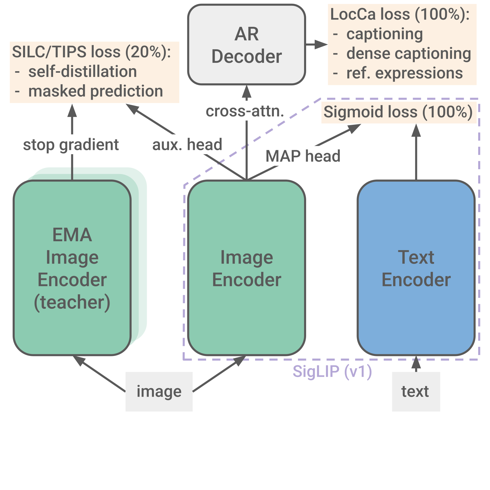
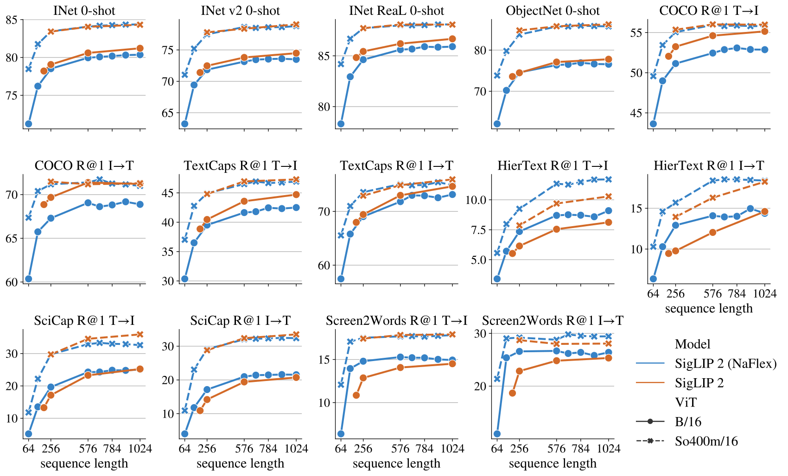

# SigLIP 2：增强多语语义、定位与稠密特征的视觉语言编码器

> SigLIP 2 在图文 sigmoid 目标上组合描述与定位训练、自蒸馏、遮挡预测和数据筛选，并提供保留宽高比的 NaFlex 变体。
>
> Michael Tschannen 等，2025 · [原论文](https://arxiv.org/abs/2502.14786v1) · [代码](https://github.com/google-research/big_vision) · [补充解读](SigLIP2解读.md)

## 摘要

图文对比模型擅长全局语义，但局部定位、稠密视觉特征和多语覆盖仍有不足。SigLIP 2 将已有的描述／区域预测、自蒸馏、遮挡预测和在线数据筛选组合成阶段式训练配方，发布 B、L、So400m、g 四档视觉编码器。

同规模下，模型在零样本分类、图文检索和作为 VLM 视觉塔时普遍优于原 SigLIP，定位和分割／深度等任务改善明显。NaFlex 以一个检查点支持多种序列长度及接近原始宽高比，尤其适合文档输入；不同变体采用不同辅助损失，不能将所有训练组件套到每个检查点上。

## 引言

CLIP／SigLIP 的全局图文匹配不足以直接监督每个 patch 的含义，而 VLM、检测、分割等应用需要更细的局部表示。已有研究分别提出描述解码、区域预测、自监督损失与数据清洗；本文将它们整合，兼顾全局语义和局部特征。

固定分辨率版本沿用 SigLIP 结构，便于替换；另训练 NaFlex 支持多分辨率与原宽高比。小模型还通过主动数据选择吸收强教师的知识。

## 训练配方

图中全程保留图文 sigmoid 与 LocCa 任务，最后 20% 再引入自蒸馏和遮挡预测；小模型的数据筛选、NaFlex 分辨率适配是额外分支。

### 架构、数据与优化器

固定分辨率视觉塔采用带可学习位置嵌入的 ViT，图像和文本都用 MAP 注意力池化。文本长度 64，Gemma 多语 tokenizer 词表 256k；g 视觉塔搭配 So400m 文本塔。

WebLI 包含约 **10B 图像、12B alt-text、109 种语言**。训练混合取 90% 英语网页对、10% 非英语网页对，另用去偏过滤减轻敏感属性的数量及关联偏差。

默认 batch 32k，Adam 学习率 $10^{-3}$、解耦 weight decay $10^{-4}$、梯度裁剪 1、warmup 20k 步后 cosine，共 **40B 已见样本**，最多使用 2048 TPUv5e 和 FSDP。视觉模型参数约 B 86M、L 303M、So400m 400M、g 1B，均为视觉塔口径。

### Sigmoid 损失与解码器

Sigmoid 对每个图文组合做配对二分类。LocCa 解码器通过 cross-attention 读取**未池化 patch 特征**，额外训练三类目标：整图描述、由区域描述预测框、由框预测区域描述。区域标签由 alt-text 的 n-gram 与开放词表检测器自动构造，并补充固定对象类别。

SigLIP 与 LocCa 损失等权。解码器约为文本塔一半层数，描述目标有 50% 概率使用无因果 mask 的并行预测。这个解码器仅用于训练表示，不在发布的编码器中保留。

### 自蒸馏与遮挡预测

训练完成 80% 时加入两项辅助任务：

- **局部到全局一致性**：学生看八个局部视图，EMA 教师看完整全局视图，学生经额外 MLP 头匹配教师语义分布。
- **遮挡 patch 预测**：学生与教师看同一全局视图，但学生遮挡 50% patch，在遮挡位置匹配教师特征。

两项权重为 1 与 .25，再按模型规模调整总权重。图文及 LocCa 使用原始图像，辅助任务使用额外增强视图，减少增强对图文配对信息的破坏。

### 分辨率适配

**固定分辨率。** 从 95% 训练位置恢复，将位置嵌入调整到目标网格；需要时以 PI-resize 将 patch 从 16 改为 14，再继续所有损失。

**NaFlex。** 先把图像按接近原宽高比缩放到 patch 整数网格，在目标 token 预算内切 patch；用坐标和 mask 标记有效区域，把二维位置表双线性插值到非方形网格，padding 不参与注意力。

NaFlex 从 90% 检查点开始，逐 batch 采样 $\{128,256,576,784,1024\}$ 序列长度，延长训练调度；最大长度减半 batch。为控制复杂度，**NaFlex 不采用上面的自蒸馏与遮挡预测阶段**。

### 主动数据筛选蒸馏

B/16、B/32 额外训练 4B 样本，只保留 sigmoid 目标，学习率降至 $10^{-5}$、关闭 weight decay。ACID 用教师与当前学生的“可学习性”分数，从更大 super-batch 筛选实际训练 batch；B/16 从 64k 选 32k。

教师先在高质量数据上适配，兼顾多样知识与质量判断。这里通过**选择训练数据**传递教师信息，未额外加入显式教师 softmax 分布蒸馏损失。

## 实验与结果

### 零样本分类与检索

ImageNet、ImageNetV2、ReaL、ObjectNet 衡量分类与分布变化；COCO、Flickr 与三十六语言 XM3600 测图文 Recall@1。原文表 1 的同配置对照：

| 模型，分辨率 | ImageNet | ImageNetV2 | ObjectNet | COCO 文→图 / 图→文 | XM3600 文→图 / 图→文 |
|---|---:|---:|---:|---:|---:|
| SigLIP B/16，256 | 76.7 | 70.1 | 71.3 | 47.4 / 65.1 | 22.5 / 29.9 |
| SigLIP 2 B/16，256 | 79.1 | 72.5 | 74.5 | 53.2 / 69.7 | 40.7 / 51.0 |
| SigLIP L/16，256 | 80.5 | 74.2 | 77.9 | 51.2 / 69.6 | 30.9 / 40.1 |
| SigLIP 2 L/16，256 | 82.5 | 76.8 | 83.0 | 54.7 / 71.5 | 46.5 / 56.5 |
| SigLIP So/14，384 | 83.2 | 77.1 | 82.9 | 52.0 / 70.2 | 17.8 / 26.6 |
| SigLIP 2 So/14，384 | 84.1 | 78.7 | 86.0 | 55.8 / 71.7 | 48.4 / 57.5 |
| SigLIP 2 g/16，384 | 85.0 | 79.8 | 88.0 | 56.1 / 72.8 | 48.6 / 57.9 |

同模型／分辨率下整体改善，小模型还受益于数据蒸馏。与偏多语训练的 mSigLIP 相比，SigLIP 2 的多语检索略低，但英语分类及检索更强，体现混合比例的平衡。

#### NaFlex 变体

评测额外加入 TextCaps、HierText、SciCap、Screen2Words。保持宽高比在文字、科学图和界面检索中有益，尤其 token 预算较小时；自然图像上，经过蒸馏的 B 级固定版本仍可能更强。NaFlex 在训练分辨率之间插值较好，外推到更高分辨率则较弱。

### 作为 VLM 的视觉编码器

作者冻结视觉塔，搭配 Gemma 2 2B，在 PaliGemma 类训练混合上学习 **50M 样本**，再对下游任务微调。图注、OCR、问答、区域与检测等任务用于检查视觉特征是否能支持语言模型。相同规模及分辨率下，SigLIP 2 总体优于 SigLIP，L 级也超过所比较的 AIMv2。这里的预算是样本数，非 50M 个训练步。

### 稠密预测

**分割、深度与法向。** 冻结视觉塔，训练线性层或 DPT 解码器。由于没有 CLS，实验用 MAP 全局表示与 patch 特征拼接。原文表 2：

| 模型，So/14 | 分辨率 | PASCAL mIoU↑ | ADE20k mIoU↑ | NYUv2 深度 RMSE↓ | NAVI 深度 RMSE↓ |
|---|---:|---:|---:|---:|---:|
| SigLIP | 224 | 72.0 | 37.6 | .576 | .083 |
| SigLIP 2 | 224 | 77.1 | 41.8 | .493 | .067 |
| SigLIP | 384 | 73.8 | 40.8 | .563 | .069 |
| SigLIP 2 | 384 | 78.1 | 45.4 | .466 | .064 |

**开放词表分割。** 用 Cat-Seg 在 COCO-Stuff 的 172 类上训练，再迁移到不同类别表。L/16 在 A-150 的 mIoU 由 37.5 提至 38.8，VOC-21 由 81.1 提至 82.3，显示改善不限于全局图文分数。

### 定位任务

**指代表达理解。** 在冻结 patch 特征上训练六层 cross-attention 解码器，预测 RefCOCO 系区域框。相同 L、256 token 下，RefCOCO val 的 Acc@.5 从 **67.33 提至 86.04**；英语专门训练的 LocCa 为 88.34，仍更高。定位辅助目标带来明显收益，评测解码器则是重新训练的。

**开放词表检测。** 使用 OWL-ViT 训练方式，结果为：

| 视觉塔 | 模型 | COCO AP | LVIS AP | LVIS 稀有类 AP |
|---|---|---:|---:|---:|
| B/16 | SigLIP | 42.2 | 33.0 | 31.0 |
| B/16 | SigLIP 2 | 42.8 | 34.4 | 32.7 |
| So/14 | SigLIP | 44.3 | 39.5 | 40.9 |
| So/14 | SigLIP 2 | 45.2 | 40.5 | 42.3 |

### 文化多样性与公平性

Dollar Street、GeoDE 与 GLDv2 检查地域／文化覆盖。相同 L/16、256px，GeoDE 地域十例准确率从 36.2% 到 44.4%，Dollar Street 零样本从 52.1% 到 55.2%。

表示偏差指标检查随机物体与性别词的关联，所测配置从约 35.5% 降至 7.3%。但按收入和地域拆分后的组间差异，改善很小或没有改善；多语与去偏数据带来的平均收益没有自动消除所有群体差距。

## 相关工作

本文整合 CLIP／SigLIP 的全局图文目标、LocCa 的描述与定位、SILC／TIPS 的局部自监督，以及 NaViT／FlexiViT 和主动数据筛选。贡献主要是这些已有技术的统一配方、阶段安排及开放模型，并以多种下游协议检验其效果。

## 结论

SigLIP 2 同时改善全局语义、局部定位和稠密特征，多语数据扩大了语言和文化覆盖，NaFlex 提供输入形状与计算预算弹性。不同分支的目标和成本各有取舍；主结果是完整训练方案的效果，不应给每个组件分配未经单独消融的提升幅度。
