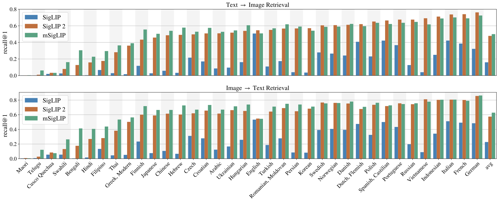
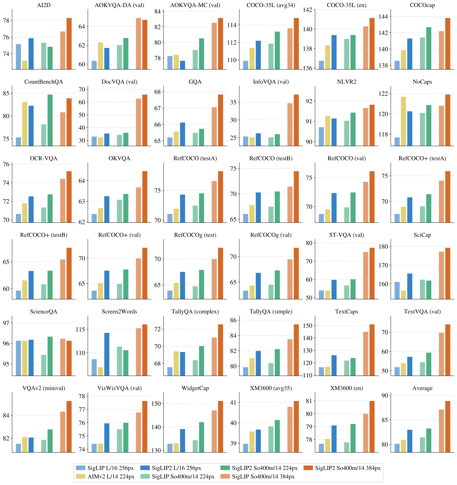
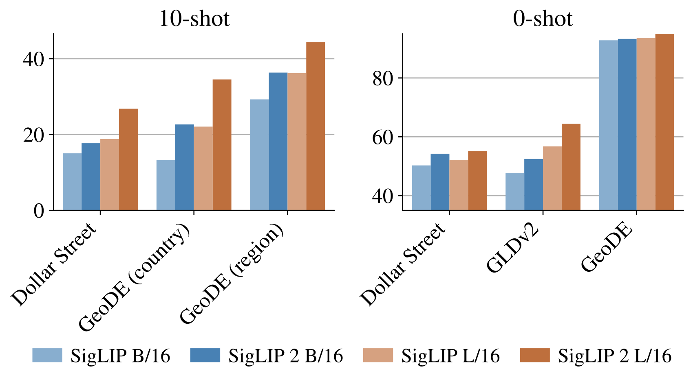
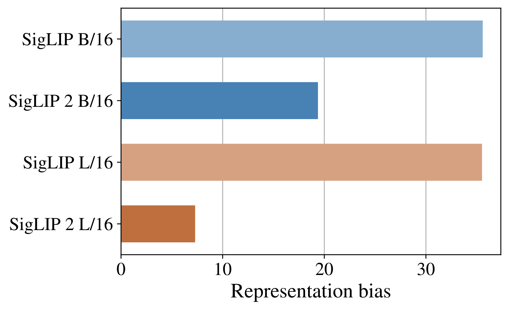

# SigLIP 2: Multilingual Vision-Language Encoders with Improved Semantic Understanding, Localization, and Dense Features / 全文中英对照

> 来源：[arXiv:2502.14786v1](https://arxiv.org/abs/2502.14786v1)。英文段落后紧接中文，覆盖所取 HTML 版本的主文、附录、图表、脚注与参考文献；公式、数字表和书目信息共用。中文以机器初译为底稿，进行了术语整理与结构核对，尚未逐句人工审定；遇到歧义请以紧邻英文和原论文为准。 原作版权归所列作者，许可见 [原作许可](http://creativecommons.org/licenses/by/4.0/)；中文译文与版式改写在该许可条件下提供（涉及 SA 时沿用相同许可，涉及 NC 时仅限非商业使用）。

## Authors and affiliations / 作者与机构

Michael Tschannen Affiliation: Core contributor Alexey Gritsenko Affiliation: Core contributor Xiao Wang Affiliation: Core contributor Muhammad Ferjad Naeem Affiliation: Core contributor Ibrahim Alabdulmohsin Affiliation: Core contributor Nikhil Parthasarathy Affiliation: Core contributor Talfan Evans Affiliation: Core contributor Lucas Beyer Affiliation: Core contributor Ye Xia Basil Mustafa Olivier Hénaff Jeremiah Harmsen Andreas Steiner Xiaohua Zhai Affiliation: Google DeepMind Affiliation: Core contributor Affiliation: Project lead Affiliation: Work done while at Google DeepMind

## Abstract / 摘要

**EN.** We introduce SigLIP 2, a family of new multilingual vision-language encoders that build on the success of the original SigLIP. In this second iteration, we extend the original image-text training objective with several prior, independently developed techniques into a unified recipe—this includes captioning-based pretraining, self-supervised losses (self-distillation, masked prediction) and online data curation. With these changes, SigLIP 2 models outperform their SigLIP counterparts at all model scales in core capabilities, including zero-shot classification, image-text retrieval, and transfer performance when extracting visual representations for Vision-Language Models (VLMs). Furthermore, the new training recipe leads to significant improvements on localization and dense prediction tasks. We also train variants which support multiple resolutions and preserve the input’s native aspect ratio. Finally, we train on a more diverse data-mixture that includes de-biasing techniques, leading to much better multilingual understanding and improved fairness. To allow users to trade off inference cost with performance, we release model checkpoints at four sizes: ViT-B (86M), L (303M), So400m (400M), and g (1B).

**中.** 我们推出 SigLIP 2，这是一个基于原始 SigLIP 成功基础的新型多语言视觉语言编码器系列。在第二次迭代中，我们将原始图像文本训练目标与先前的几种独立开发的技术扩展为统一的配方，其中包括基于字幕的预训练、自监督损失（自蒸馏、屏蔽预测）和在线数据管理。通过这些变化，SigLIP 2 模型在所有模型规模的核心功能上都优于 SigLIP 模型，包括零样本分类、图像文本检索以及为视觉语言模型 (VLM) 提取视觉表示时的传输性能。此外，新的训练方法显着改进了定位和密集预测任务。我们还训练支持多种分辨率并保留输入的原始宽高比的变体。最后，我们对更多样化的数据混合进行训练，其中包括去偏见技术，从而实现更好的多语言理解并提高公平性。为了让用户能够权衡推理成本和性能，我们发布了四种大小的模型检查点：ViT-B (86M)、L (303M)、So400m (400M) 和 g (1B)。

## Introduction / 简介

**EN.** Contrastive image-text embedding models trained on billion-scale datasets, as pioneered by CLIP [ 50 ] and ALIGN [ 28 ] , have become the mainstream approach for high-level, semantic understanding of visual data. These models enable fine-grained, zero-shot classification rivaling the quality of supervised methods and enable efficient text-to-image and image-to-text retrieval. Furthermore, they lead to excellent vision-language understanding capabilities when combined with Large Language Models (LLMs) to build Vision-Language Models (VLMs).

**中.** 由 CLIP [50] 和 ALIGN [28] 开创的在十亿级数据集上训练的对比图像文本嵌入模型已成为视觉数据高级语义理解的主流方法。这些模型可实现细粒度、零样本分类，可与监督方法的质量相媲美，并实现高效的文本到图像和图像到文本检索。此外，当与大型语言模型 (LLM) 结合构建视觉语言模型 (VLM) 时，它们会带来出色的视觉语言理解能力。

**EN.** Developing on the success of CLIP, several improvements have been proposed such as re-captioning images [ 38 ] , adding image-only self-supervised losses [ 45 , 38 ] , and training with a small decoder for auxiliary tasks such as captioning and localization [ 67 , 32 , 62 ] . At the same time, several groups have released model checkpoints for the open-source community [ 50 , 70 , 27 , 57 , 19 ] . However, these releases do not include the full breadth of latest improvements into a single model, as they all relatively closely follow CLIP’s original approach. Here, building on the SigLIP training recipe [ 71 ] , we incorporate several improvements from prior work and release a new family of open models [^footnote1] that both excel on CLIP’s core capabilities—–zero-shot classification, retrieval, and feature extraction for VLMs—and improve areas where vanilla CLIP-style models lag behind, including localization and extracting dense, semantic representations.

**中.** 在 CLIP 成功的基础上，人们提出了一些改进，例如重新字幕图像 [38]、添加仅图像自监督损失 [45, 38]，以及使用小型解码器进行辅助任务（例如字幕和本地化）训练 [67, 32, 62]。与此同时，多个团体发布了开源社区的模型检查点[50,70,27,57,19]。然而，这些版本并不包括单个模型的最新改进的全部内容，因为它们都相对紧密地遵循 CLIP 的原始方法。在这里，在 SigLIP 训练方案 [71] 的基础上，我们结合了之前工作的一些改进，并发布了一系列新的开放模型 [^footnote1]，它们都在 CLIP 的核心功能（VLM 的零样本分类、检索和特征提取）上表现出色，并改进了普通 CLIP 式模型落后的领域，包括本地化和提取密集的语义表示。

**EN.** In summary, SigLIP 2 models provide the following:

**中.** 总之，SigLIP 2 模型提供以下功能：

**EN.** Strong multilingual vision-language encoders: SigLIP 2 shows excellent performance on English-focused vision-language tasks while providing strong results on multilingual benchmarks with a single model. This enables use in a wide range of languages and cultural contexts.

**中.** 强大的多语言视觉语言编码器：SigLIP 2 在以英语为中心的视觉语言任务上表现出出色的性能，同时使用单一模型在多语言基准测试中提供了出色的结果。这使得可以在多种语言和文化背景下使用。

**EN.** Dense features: We incorporate self-supervised losses as well as a decoder-based loss, which result in better dense features (e.g. for segmentation and depth estimation) and improve localization tasks (such as referring expression comprehension).

**中.** 密集特征：我们结合了自监督损失以及基于解码器的损失，这会产生更好的密集特征（例如用于分割和深度估计）并改进定位任务（例如引用表达理解）。

**EN.** Backward compatibility: SigLIP 2 is designed to be backward compatible with SigLIP by relying on the same architecture. This allows existing users to simply swap out the model weights and tokenizer (which is now multilingual) to get improvements on a wide range of tasks.

**中.** 向后兼容性：SigLIP 2 设计为依靠相同的架构与 SigLIP 向后兼容。这使得现有用户只需更换模型权重和分词器（现在是多语言的）即可在各种任务上获得改进。

**EN.** Native aspect ratio and variable resolution: SigLIP 2 also includes a NaFlex variant, which supports multiple resolutions and preserves the native image aspect ratio. These models have the potential to improve aspect sensitive applications such as document understanding.

**中.** 原生长宽比和可变分辨率：SigLIP 2 还包括 NaFlex 变体，它支持多种分辨率并保留原生图像长宽比。这些模型有可能改进方面敏感的应用程序，例如文档理解。

**EN.** Strong small models: SigLIP 2 further optimizes performance of smaller models (B/16 and B/32 models), by using techniques in distillation via active data curation.

**中.** 强大的小型模型：SigLIP 2 通过主动数据管理使用蒸馏技术，进一步优化小型模型（B/16 和 B/32 模型）的性能。

**EN.** In the next section we provide a detailed description of the SigLIP 2 training recipe. Sec. 3 presents evaluations of SigLIP 2 models and baselines across a variety of tasks and benchmarks. Finally, Sec. 4 gives a short overview of related work, and conclusions can be found in Sec. 5 .

**中.** 在下一节中，我们将提供 SigLIP 2 训练方法的详细描述。秒。图 3 展示了对 SigLIP 2 模型和跨各种任务和基准的基线的评估。最后，第二节。第4节给出了相关工作的简短概述，结论可以在第4节中找到。 5.

**EN.** Figure 1: SigLIP 2 adds the captioning-based pretraining from LocCa [ 62 ] as well as self-distillation and masked prediction from SILC [ 45 ] and TIPS [ 38 ] (during the last 20% of training) to the sigmoid loss from SigLIP [ 71 ] . For some variants, the recipe additionally involves fine-tuning with data curation [ 61 ] or adaptation to native aspect ratio and variable sequence length [ 6 , 12 ] .

**中.** 图 1：SigLIP 2 将 LocCa [62] 中基于字幕的预训练以及 SILC [45] 和 TIPS [38]（在训练的最后 20% 期间）的自蒸馏和屏蔽预测添加到 SigLIP [71] 的 sigmoid 损失中。对于某些变体，配方还涉及通过数据管理进行微调[61]或适应原始纵横比和可变序列长度[6, 12]。

## Training recipe / 训练食谱

**EN.** We combine the original SigLIP training recipe [ 71 ] with decoder-based pretraining [ 60 , 62 ] , in addition to self-distillation and masked prediction as in the DINO line of work [ 9 , 47 ] (see Fig. 1 for an overview). Pretraining an image encoder with a language decoder for captioning and referring expression comprehension was shown to improve OCR capabilities and localization [ 62 ] , whereas self-distillation and masked prediction leads to better features for dense prediction tasks, zero-shot classification and retrieval [ 45 , 38 ] . Rather than combining all these techniques in a single run we follow a staged approach as outlined below to manage the computational and memory overhead compared to SigLIP training.

**中.** 我们将原始的 SigLIP 训练方法 [71] 与基于解码器的预训练 [60, 62] 结合起来，此外还有 DINO 工作线 [9, 47] 中的自蒸馏和屏蔽预测（见图 1 的概述）。使用用于字幕和引用表达理解的语言解码器对图像编码器进行预训练可以提高 OCR 能力和定位 [62]，而自蒸馏和屏蔽预测可以为密集预测任务、零样本分类和检索带来更好的特征 [45, 38]。与 SigLIP 训练相比，我们没有将所有这些技术组合在一次运行中，而是采用如下所述的分阶段方法来管理计算和内存开销。

**EN.** In addition to training a set of models and adapting each model separately to different resolutions while distorting the aspect ratio, we also train variants which process images while largely preserving their native aspect ratio like NaViT [ 12 ] and support different sequence lengths as FlexiViT [ 6 ] . We call this variant NaFlex, described in Sec. 2.4.2 .

**中.** 除了训练一组模型并在扭曲长宽比的同时使每个模型分别适应不同的分辨率之外，我们还训练处理图像的变体，同时在很大程度上保留其原始长宽比，如 NaViT [12]，并支持不同的序列长度，如 FlexiViT [6]。我们将此变体称为 NaFlex，如第 2 节所述。 2.4.2.

**EN.** Finally, to improve the quality of the smallest models we fine-tune those with implicit distillation via active sample selection, following the approach from [ 61 ] .

**中.** 最后，为了提高最小模型的质量，我们遵循[61]中的方法，通过主动样本选择对隐式蒸馏进行微调。

### Architecture, training data, optimizer / 架构、训练数据、优化器

**EN.** For the architecture, we follow SigLIP [ 71 ] so that existing users can simply swap out the encoder weights. Specifically, the fixed-resolution variant relies on the standard ViT architecture [ 15 ] with learned positional embedding. We use the same architecture for the image and text tower, except for the g-sized vision encoder which is paired with an So400m-sized [ 1 ] text encoder. Vision and text representations are pooled using a MAP head (attention pooling) [ 69 ] . We set the text length to 64 and use the multilingual Gemma tokenizer [ 22 ] with vocabulary size 256k, transforming the text to lower case before tokenization.

**中.** 对于架构，我们遵循 SigLIP [71]，以便现有用户可以简单地更换编码器权重。具体来说，固定分辨率变体依赖于具有学习位置嵌入的标准 ViT 架构 [15]。我们对图像和文本塔使用相同的架构，除了与 So400m 大小的 [1] 文本编码器配对的 g 大小的视觉编码器。使用 MAP 头（注意力池）对视觉和文本表示进行池化 [69]。我们将文本长度设置为 64，并使用词汇大小为 256k 的多语言 Gemma 分词器 [22]，在分词之前将文本转换为小写。

**EN.** We use the WebLI dataset [ 10 ] containing 10 billion images and 12 billion alt-texts covering 109 languages. To strike a good balance between quality on English and multilingual vision-language benchmarks we compose the mixture such that 90% of the training image-text pairs is sourced from English web pages, and the remaining 10% from non-English web pages, as recommended in [ 49 ] . We further apply the filtering techniques from [ 2 ] to mitigate data biases in representation and association with respect to sensitive attributes.

**中.** 我们使用包含 100 亿张图像和 120 亿条替代文本（涵盖 109 种语言）的 WebLI 数据集 [10]。为了在英语和多语言视觉语言基准质量之间取得良好的平衡，我们将混合物组合在一起，使得 90% 的训练图像-文本对来自英语网页，其余 10% 来自非英语网页，如 [49] 中所建议的。我们进一步应用[2]中的过滤技术来减轻敏感属性的表示和关联中的数据偏差。

**EN.** Unless noted otherwise, we use the Adam optimizer with learning rate $10^{-3}$ , decoupled weight decay $10^{-4}$ [ 37 ] , and gradient clipping to norm 1. We set the batch size to 32k and use a cosine schedule with 20k warmup steps, training for a total of 40B examples. Our models are trained on up to 2048 TPUv5e chips [ 24 ] using a fully-sharded data-parallel strategy (FSDP [ 72 ] ).

**中.** 除非另有说明，我们使用 Adam 优化器，其学习率为 $10^{-3}$ 、解耦权重衰减 $10^{-4}$ [37] 和梯度裁剪为范数 1。我们将批量大小设置为 32k，并使用具有 20k 预热步骤的余弦计划，总共训练 40B 个示例。我们的模型使用完全分片的数据并行策略（FSDP [72]）在多达 2048 个 TPUv5e 芯片 [24] 上进行训练。

### Training with Sigmoid loss and decoder / 使用 Sigmoid 损失和解码器进行训练

**EN.** In the first step of pretraining, we combine SigLIP [ 71 ] with LocCa [ 62 ] by simply combining the two losses with equal weight. Unlike CLIP [ 50 ] , which relies on a contrastive loss, SigLIP creates binary classification problems by combining every image embedding with every text embedding in the mini-batch and trains the embeddings to classify matching and non-matching pairs via logistic regression (sigmoid loss). We use the original implementation and refer to [ 71 ] for details.

**中.** 在预训练的第一步中，我们通过简单地将两个损失以相同的权重组合起来，将 SigLIP [71] 与 LocCa [62] 结合起来。与依赖于对比损失的 CLIP [50] 不同，SigLIP 通过将每个图像嵌入与小批量中的每个文本嵌入相结合来创建二元分类问题，并训练嵌入通过逻辑回归（sigmoid 损失）对匹配和非匹配对进行分类。我们使用原始实现并参考[71]了解详细信息。

**EN.** For LocCa, we attach a standard transformer decoder with cross-attention to the un-pooled vision encoder representation (before applying the MAP head). The decoder follows the shapes of the text encoder except that we add cross-attention layers and reduce the number of layers by a factor of two. Besides image captioning, LocCa also trains for automatic referring expression prediction and grounded captioning. The former amounts to predicting bounding box coordinates for captions describing specific image regions, whereas the latter involves predicting region-specific captions given bounding box coordinates. Region-caption pairs are automatically annotated by first extracting n-grams from the alt-texts and then applying open-vocabulary detection using the recipe from [ 41 ] . Additionally, we use the fixed set of object categories from [ 10 ] instead of n-grams. For each example, the decoder is trained to predict all three targets (amounting to three decoder forward-passes). The captioning target is predicted with parallel prediction [ 60 ] with probability of 50%, i.e. all caption tokens are predicted in parallel from mask tokens, without causal attention mask. Please refer to [ 62 ] for more detail. Finally, to reduce memory consumption due to the large vocabulary, we implement a chunked version of the decoder loss.

**中.** 对于 LocCa，我们附加了一个标准的转换器解码器，该解码器对未池化的视觉编码器表示进行交叉关注（在应用 MAP 头之前）。解码器遵循文本编码器的形状，只是我们添加了交叉注意力层并将层数减少了两倍。除了图像字幕之外，LocCa 还训练自动引用表达预测和接地字幕。前者相当于预测描述特定图像区域的标题的边界框坐标，而后者涉及在给定边界框坐标的情况下预测特定于区域的标题。首先从替代文本中提取 n 元语法，然后使用 [41] 中的配方应用开放词汇检测，从而自动注释区域标题对。此外，我们使用 [10] 中的固定对象类别集而不是 n-gram。对于每个示例，解码器经过训练以预测所有三个目标（相当于三个解码器前向传递）。字幕目标是通过并行预测[60]以 50% 的概率进行预测，即所有字幕标记都是从掩码标记并行预测的，没有因果注意掩码。更详细的信息请参考[62]。最后，为了减少由于词汇量大而导致的内存消耗，我们实现了解码器损失的分块版本。

**EN.** For all model sizes, we set the vision encoder patch size to 16 and the image resolution to 256 (resulting in an image representation sequence length of 256). Finally, we note that the decoder only serves for representation learning here and is not part of the model release.

**中.** 对于所有模型大小，我们将视觉编码器补丁大小设置为 16，将图像分辨率设置为 256（导致图像表示序列长度为 256）。最后，我们注意到解码器在这里仅用于表示学习，而不是模型发布的一部分。

### Training with self-distillation and masked prediction / 使用自蒸馏和屏蔽预测进行训练

**EN.** Following SILC [ 45 ] and TIPS [ 38 ] , we augment the training setup described in Sec. 2.2 with local-to-global correspondence learning with self-distillation and masked prediction losses [ 9 , 75 , 47 ] to improve the local semantics of the (un-pooled) feature representation. This representation is typically used for dense prediction tasks like segmentation, depth estimation etc. Concretely, we add two terms to the losses described in Sec. 2.2 as detailed next.

**中.** 遵循 SILC [45] 和 TIPS [38]，我们增强了第 2 节中描述的训练设置。 2.2 通过自蒸馏和掩蔽预测损失的局部到全局对应学习[9,75,47]来改善（非池化）特征表示的局部语义。这种表示通常用于密集预测任务，如分割、深度估计等。具体来说，我们在第 2 节中描述的损失中添加了两项。 2.2 如下详述。

**EN.** The first term is the local-to-global consistency loss from [ 45 ] , in which the vision encoder becomes the student network, which gets a partial (local) view of the training image, and is trained to match the teacher’s representation, derived from the full image. This auxiliary matching task is performed in a high-dimensional feature space computed with a separate MLP head. As is common in the literature, the teacher parameters are obtained as an exponential moving average (EMA) of the student parameters over the previous iterations. We rely on a single global (teacher) view and 8 local (student) views and otherwise follow the augmentations, loss and hyper parameters from [ 45 ] .

**中.** 第一项是[45]中的局部到全局一致性损失，其中视觉编码器成为学生网络，它获得训练图像的部分（局部）视图，并经过训练以匹配从完整图像导出的教师表示。该辅助匹配任务是在使用单独的 MLP 头计算的高维特征空间中执行的。正如文献中常见的那样，教师参数是通过先前迭代中学生参数的指数移动平均值 (EMA) 获得的。我们依赖于单个全局（教师）视图和 8 个局部（学生）视图，并遵循 [45] 中的增强、损失和超参数。

**EN.** The second loss term is the masked prediction objective from [ 38 ] . We replace 50% of the embedded image patches in the student network with mask tokens and train the student to match the features of the teacher at masked locations. The loss is then defined identically to the first term (consistency loss), but applied to per-patch features rather than the pooled, image-level representation. Further, both the student and the teacher see the same, global view (up to masking in the student).

**中.** 第二个损失项是[38]中的屏蔽预测目标。我们用掩模标记替换学生网络中 50% 的嵌入图像块，并训练学生在掩模位置匹配教师的特征。然后，损失的定义与第一项（一致性损失）相同，但应用于每个补丁特征而不是池化的图像级表示。此外，学生和老师都看到相同的全局视图（直到学生的屏蔽）。

**EN.** We add these losses at 80% of training completion, initializing the teacher with the student parameters and the remaining additional parameters (heads, mask token and corresponding optimizer parameters) randomly. We use the original image for computing the SigLIP and LocCa losses from the previous section and apply the additional losses on additional augmented views. This is done to ensure that data augmentation does not negatively impact the image-text alignment as recommended by [ 45 ] . The weights of the first and the second loss terms are set to 1 and 0.25. Further, to balance model quality on global/semantic and dense tasks, we re-weight the two loss terms by another factor of 0.25, 0.5, 1.0, and 0.5 for the B, L, So400m and g, model sizes, respectively.

**中.** 我们在训练完成 80% 时添加这些损失，用学生参数和剩余的附加参数（头、掩码标记和相应的优化器参数）随机初始化教师。我们使用原始图像来计算上一节中的 SigLIP 和 LocCa 损失，并将附加损失应用于其他增强视图。这样做是为了确保数据增强不会对图像文本对齐产生负面影响，如[45]所建议的。第一个和第二个损失项的权重设置为1和0.25。此外，为了平衡全局/语义和密集任务的模型质量，我们分别对 B、L、So400m 和 g 模型大小的另一个因子 0.25、0.5、1.0 和 0.5 重新加权两个损失项。

### Adaptation to different resolutions / 适配不同分辨率

|  |  |  |  | ImageNet-1k | ImageNet-1k | ImageNet-1k | ImageNet-1k | ImageNet-1k | COCO 可可 | COCO 可可 | Flickr 弗利克 | Flickr 弗利克 | XM3600 | XM3600 |
| --- | --- | --- | --- | --- | --- | --- | --- | --- | --- | --- | --- | --- | --- | --- |
| ViT 维特 | Res. 资源。 | Seq. 序列。 | Model 型号 | val 瓦尔 | v2 | ReaL 真实 | ObjNet 对象网 | 10s. | T $\rightarrow$ I | I $\rightarrow$ T | T $\rightarrow$ I | I $\rightarrow$ T | T $\rightarrow$ I | I $\rightarrow$ T |
| B/32 | 224 | 49 | MetaCLIP [ 66 ] 元CLIP [ 66 ] | 67.7 | 59.6 | – | 52.8 | – | 46.6 | – | 72.9 | – | – | – |
| B/32 | 256 | 64 | OpenCLIP [ 27 ] OpenCLIP [27] | 72.8 | 64.8 | – | 59.6 | – | 39.9 | 57.9 | 64.9 | 84.8 | – | – |
| B/32 | 256 | 64 | SigLIP 2 西格利普2 | 74.0 | 66.9 | 81.4 | 66.1 | 66.6 | 47.2 | 63.7 | 75.5 | 89.3 | 38.3 | 49.0 |
| B/16 | 224 | 196 | CLIP [ 50 ] 剪辑[50] | 68.3 | 61.9 | – | 55.3 | – | 33.1 | 52.4 | 62.1 | 81.9 | – | – |
| B/16 | 224 | 196 | OpenCLIP [ 27 ] OpenCLIP [27] | 70.2 | 62.3 | – | 56.0 | – | 42.3 | 59.4 | 69.8 | 86.3 | – | – |
| B/16 | 224 | 196 | MetaCLIP [ 66 ] 元CLIP [ 66 ] | 72.4 | 65.1 | – | 60.0 | – | 48.9 | – | 77.1 | – | – | – |
| B/16 | 224 | 196 | EVA-CLIP [ 57 ] EVA 夹 [ 57 ] | 74.7 | 67.0 | – | 62.3 | – | 42.2 | 58.7 | 71.2 | 85.7 | – | – |
| B/16 | 224 | 196 | SigLIP [ 71 ] 西格利普 [ 71 ] | 76.2 | 69.5 | 82.8 | 70.7 | 69.9 | 47.2 | 64.5 | 77.9 | 89.6 | 22.4 | 29.3 |
| B/16 | 224 | 196 | DFN [ 19 ] 东风网络 [19] | 76.2 | 68.2 | – | 63.2 | – | 51.9 | – | 77.3 | – | – | – |
| B/16 | 224 | 196 | SigLIP 2 西格利普2 | 78.2 | 71.4 | 84.8 | 73.6 | 72.1 | 52.1 | 68.9 | 80.7 | 93.0 | 40.3 | 50.7 |
| B/16 | 256 | 256 | SigLIP [ 71 ] 西格利普 [ 71 ] | 76.7 | 70.1 | 83.1 | 71.3 | 70.3 | 47.4 | 65.1 | 78.3 | 91.1 | 22.5 | 29.9 |
| B/16 | 256 | 256 | SigLIP 2 西格利普2 | 79.1 | 72.5 | 85.4 | 74.5 | 73.1 | 53.2 | 69.7 | 81.7 | 94.4 | 40.7 | 51.0 |
| B/16 | 384 | 576 | SigLIP [ 71 ] 西格利普 [ 71 ] | 78.6 | 72.0 | 84.6 | 73.8 | 72.7 | 49.7 | 67.5 | 80.7 | 92.2 | 23.3 | 30.3 |
| B/16 | 384 | 576 | SigLIP 2 西格利普2 | 80.6 | 73.8 | 86.2 | 77.1 | 74.7 | 54.6 | 71.4 | 83.8 | 94.9 | 41.2 | 51.6 |
| B/16 | 512 | 1024 | SigLIP [ 71 ] 西格利普 [ 71 ] | 79.2 | 72.9 | 84.9 | 74.8 | 73.3 | 50.4 | 67.6 | 81.6 | 92.5 | 23.5 | 30.5 |
| B/16 | 512 | 1024 | SigLIP 2 西格利普2 | 81.2 | 74.5 | 86.7 | 77.8 | 75.2 | 55.2 | 71.2 | 84.5 | 95.5 | 41.4 | 52.0 |
| L/14 | 224 | 256 | OpenCLIP [ 27 ] OpenCLIP [27] | 74.0 | 61.1 | – | 66.4 | – | 46.1 | 62.1 | 75.0 | 88.7 | – | – |
| L/14 | 224 | 256 | CLIP [ 50 ] 剪辑[50] | 75.5 | 69.0 | – | 69.9 | – | 36.5 | 56.3 | 65.2 | 85.2 | – | – |
| L/14 | 224 | 256 | MetaCLIP [ 66 ] 元CLIP [ 66 ] | 79.2 | 72.6 | – | 74.6 | – | 55.7 | – | 83.3 | – | – | – |
| L/14 | 224 | 256 | CLIPA-v2 [ 33 ] | 79.7 | 72.8 | – | 71.1 | – | 46.3 | 64.1 | 73.0 | 89.1 | – | – |
| L/14 | 224 | 256 | EVA-CLIP [ 57 ] EVA 夹 [ 57 ] | 79.8 | 72.9 | – | 75.3 | – | 47.5 | 63.7 | 77.3 | 89.7 | – | – |
| L/14 | 224 | 256 | DFN [ 19 ] 东风网络 [19] | 82.2 | 75.7 | – | 74.8 | – | 59.6 | – | 84.7 | – | – | – |
| L/16 | 256 | 256 | SigLIP [ 71 ] 西格利普 [ 71 ] | 80.5 | 74.2 | 85.9 | 77.9 | 76.8 | 51.2 | 69.6 | 81.3 | 92.0 | 30.9 | 40.1 |
| L/16 | 256 | 256 | SigLIP 2 西格利普2 | 82.5 | 76.8 | 87.3 | 83.0 | 78.8 | 54.7 | 71.5 | 84.1 | 94.5 | 46.5 | 56.5 |
| L/16 | 384 | 576 | SigLIP [ 71 ] 西格利普 [ 71 ] | 82.1 | 75.9 | 87.1 | 80.9 | 78.7 | 52.8 | 70.5 | 82.6 | 92.9 | 31.4 | 39.7 |
| L/16 | 384 | 576 | SigLIP 2 西格利普2 | 83.1 | 77.4 | 87.6 | 84.4 | 79.5 | 55.3 | 71.4 | 85.0 | 95.2 | 47.1 | 56.3 |
| L/16 | 512 | 1024 | SigLIP 2 西格利普2 | 83.5 | 77.8 | 87.7 | 84.6 | 79.6 | 55.2 | 72.1 | 85.3 | 95.8 | 47.4 | 56.7 |
| So/14 所以/14 | 224 | 256 | SigLIP [ 71 ] 西格利普 [ 71 ] | 82.2 | 76.0 | 87.1 | 80.5 | 78.2 | 50.8 | 69.0 | 76.6 | 90.7 | 16.0 | 22.8 |
| So/14 所以/14 | 224 | 256 | SigLIP 2 西格利普2 | 83.2 | 77.7 | 87.8 | 84.6 | 79.5 | 55.1 | 71.5 | 84.3 | 94.6 | 47.9 | 57.5 |
| So/14 所以/14 | 384 | 729 | SigLIP [ 71 ] 西格利普 [ 71 ] | 83.2 | 77.1 | 87.5 | 82.9 | 79.4 | 52.0 | 70.2 | 80.5 | 93.5 | 17.8 | 26.6 |
| So/14 所以/14 | 384 | 729 | SigLIP 2 西格利普2 | 84.1 | 78.7 | 88.1 | 86.0 | 80.4 | 55.8 | 71.7 | 85.7 | 94.9 | 48.4 | 57.5 |
| So/16 所以/16 | 256 | 256 | mSigLIP [ 71 ] | 80.8 | 74.1 | 86.1 | 79.5 | 77.1 | 49.4 | 68.6 | 80.0 | 92.1 | 50.0 | 62.8 |
| So/16 所以/16 | 256 | 256 | SigLIP 2 西格利普2 | 83.4 | 77.8 | 87.7 | 84.8 | 79.7 | 55.4 | 71.5 | 84.4 | 94.2 | 48.1 | 57.5 |
| So/16 所以/16 | 384 | 576 | SigLIP 2 西格利普2 | 84.1 | 78.4 | 88.1 | 85.8 | 80.4 | 56.0 | 71.2 | 85.3 | 95.9 | 48.3 | 57.5 |
| So/16 所以/16 | 512 | 1024 | SigLIP 2 西格利普2 | 84.3 | 79.1 | 88.1 | 86.2 | 80.5 | 56.0 | 71.3 | 85.5 | 95.4 | 48.3 | 57.6 |
| H/14 | 224 | 256 | MetaCLIP [ 66 ] 元CLIP [ 66 ] | 80.5 | 74.1 | – | 76.5 | – | 57.5 | – | 85.0 | – | – | – |
| H/14 | 224 | 256 | DFN [ 19 ] 东风网络 [19] | 83.4 | 77.3 | – | 76.5 | – | 63.1 | – | 86.5 | – | – | – |
| g/16 | 256 | 256 | SigLIP 2 西格利普2 | 84.5 | 79.2 | 88.3 | 87.1 | 82.1 | 55.7 | 72.5 | 85.3 | 95.3 | 48.2 | 58.2 |
| g/16 | 384 | 576 | SigLIP 2 西格利普2 | 85.0 | 79.8 | 88.5 | 88.0 | 82.5 | 56.1 | 72.8 | 86.0 | 95.4 | 48.6 | 57.9 |

**EN.** Table 1: Zero-shot classification, 10-shot (10s) classification (on the validation set), and retrieval performance (recall@1) of SigLIP 2 along with several baselines. SigLIP 2 outperforms the baselines—often by a large margin—despite being multilingual. Note that DFN [ 19 ] relies on a data filtering network fine-tuned on ImageNet, COCO, and Flickr.

**中.** 表 1：SigLIP 2 的零样本分类、10 样本 (10s) 分类（在验证集上）和检索性能 (recall@1) 以及多个基线。尽管 SigLIP 2 是多语言的，但它的性能通常远远超过基线。请注意，DFN [19] 依赖于在 ImageNet、COCO 和 Flickr 上微调的数据过滤网络。

#### Fixed-resolution variant / 固定分辨率变体

**EN.** To obtain fixed-resolution checkpoints at multiple resolutions, we resume the checkpoints (with sequence length 256 and patch size 16) at 95% of training, resize the positional embedding to the target sequences length (and in some cases the patch embedding from patch size 16 to 14 with the pseudoinverse (PI)-resize strategy from [ 6 ] ), and resume the training at the target resolution with all losses. We opt for this approach as the common strategy of fine-tuning the final checkpoint with smaller learning rate and without weight decay [ 71 ] did not lead to good results across all sizes and resolutions.

**中.** 为了获得多个分辨率下的固定分辨率检查点，我们在训练的 95% 处恢复检查点（序列长度为 256，补丁大小为 16），将位置嵌入的大小调整为目标序列长度（在某些情况下，使用[6]中的伪逆（PI）大小调整策略将补丁嵌入从补丁大小从 16 调整到 14），并在目标分辨率下恢复训练，并保留所有损失。我们选择这种方法作为以较小的学习率和没有权重衰减来微调最终检查点的常见策略[71]，但并没有在所有尺寸和分辨率上产生良好的结果。

#### Variable aspect and resolution (NaFlex) / 可变纵横比和分辨率 (NaFlex)

**EN.** Figure 2: Per-language image-text retrieval performance for SigLIP, SigLIP 2 and mSigLIP on Crossmodal-3600 [ 58 ] . SigLIP 2 almost matches the performance of mSigLIP (SigLIP trained on multilingual data) despite performing substantially better on English vision-language tasks (Table 1 ).

**中.** 图 2：Crossmodal-3600 上 SigLIP、SigLIP 2 和 mSigLIP 的每种语言图像文本检索性能 [58]。尽管 SigLIP 2 在英语视觉语言任务上的表现要好得多，但它的性能几乎与 mSigLIP（在多语言数据上训练的 SigLIP）相当（表 1）。

**EN.** NaFlex combines ideas from FlexiViT [ 6 ] , i.e. supporting multiple, predefined sequence lengths with a single ViT model, and NaViT [ 12 ] , namely processing images at their native aspect ratio. This enables processing different types of images at appropriate resolution, e.g. using a larger resolution to process document images, while at the same time minimizing the impact of aspect ratio distortion on certain inference tasks, e.g. on OCR.

**中.** NaFlex 结合了 FlexiViT [6]（即使用单个 ViT 模型支持多个预定义序列长度）和 NaViT [12]（即以原始宽高比处理图像）的思想。这使得能够以适当的分辨率处理不同类型的图像，例如使用更大的分辨率来处理文档图像，同时最大限度地减少长宽比失真对某些推理任务的影响，例如关于 OCR。

**EN.** Given a patch size and target sequence length, NaFlex preprocesses the data by first resizing the input image such that the height and width after resizing are multiples of the patch size, while 1) keeping the aspect ratio distortion as small as possible and 2) producing a sequence length of at most the desired target sequence length. The resulting distortion in width and height is at most (patch_size-1)/width and (patch_size-1)/height , respectively, which tends to be small for common resolutions and aspect ratios. Note that NaViT incurs the same type of distortion. After resizing, the image is split into a sequence of patches, and patch coordinates as well as a mask with padding information is added (to handle the case where the actual sequence length is smaller than the target length).

**中.** 给定补丁大小和目标序列长度，NaFlex 通过首先调整输入图像的大小来预处理数据，以便调整大小后的高度和宽度是补丁大小的倍数，同时 1) 保持长宽比失真尽可能小，2) 生成最多为所需目标序列长度的序列长度。由此产生的宽度和高度失真最多分别为 (patch_size-1)/width 和 (patch_size-1)/height ，对于常见的分辨率和宽高比来说，这往往很小。请注意，NaViT 会产生相同类型的失真。调整大小后，图像被分割成补丁序列，并添加补丁坐标以及带有填充信息的掩模（以处理实际序列长度小于目标长度的情况）。

**EN.** To process different sequence lengths (and aspect ratios) with a ViT, we bilinearly resize (with anti-aliasing) the learned positional embedding to the target, non-square patch grid for the resized input image. We set the length of the learned positional embedding to 256, assuming a $16\times 16$ patch grid before resizing. When the sequence length after resizing is smaller than the target sequence length, the attention layers (including the MAP head) are masked to ignore the extra padding tokens.

**中.** 为了使用 ViT 处理不同的序列长度（和纵横比），我们双线性调整（使用抗锯齿）学习到的位置嵌入的大小，以调整大小的输入图像的目标非方形补丁网格。我们将学习的位置嵌入的长度设置为 256，假设调整大小之前是 $16\times 16$ 补丁网格。当调整大小后的序列长度小于目标序列长度时，注意力层（包括MAP头）被屏蔽以忽略额外的填充标记。

**EN.** As for the fixed-resolution, adapted variants, we start from the default checkpoints trained with the setup described in Sec. 2.2 , i.e. with non-aspect preserving resize to 256px, resulting in a sequence length of 256. We take the checkpoint at 90% training completion, then switch to aspect-preserving resizing and uniformly sampling a sequence length from $\{128,256,576,784,1024\}$ per mini-batch. At the same time we stretch the learning rate schedule corresponding to the last 10% by a factor $3.75$ to ensure that each resolution is trained for sufficiently many examples. For the largest sequence length we further half the batch size and double the number of training steps to avoid out-of-memory errors.

**中.** 至于固定分辨率的自适应变体，我们从使用第 2 节中描述的设置进行训练的默认检查点开始。 2.2 ，即不保留方面调整大小到 256px，导致序列长度为 256。我们在训练完成 90% 时采取检查点，然后切换到保留方面调整大小，并从每个小批量的 $\{128,256,576,784,1024\}$ 中均匀采样序列长度。同时，我们将与最后 10% 相对应的学习率计划拉伸 $3.75$ 因子，以确保每个分辨率都针对足够多的示例进行训练。对于最大的序列长度，我们进一步将批量大小减半并将训练步骤数加倍，以避免内存不足错误。

**EN.** To keep implementation and computation complexity manageable, we do not apply self-distillation and masked prediction from Sec. 2.3 .

**中.** 为了保持实现和计算复杂性可控，我们不应用第二节中的自蒸馏和屏蔽预测。 2.3.

**EN.** Figure 3: Comparing the NaFlex (a single checkpoint per model size supporting native aspect ratio and variable sequence length/resolution) and the standard square-input SigLIP 2 variants which use a separate checkpoint for each sequence length/resolution. The sequence lengths annotated on the x-axis correspond to training sequence lengths for NaFlex. NaFlex interpolates fairly well between training resolutions, but does not extrapolate well (not shown).

**中.** 图 3：比较 NaFlex（每个模型大小一个检查点，支持原始长宽比和可变序列长度/分辨率）和标准方输入 SigLIP 2 变体，后者对每个序列长度/分辨率使用单独的检查点。 x 轴上注释的序列长度对应于 NaFlex 的训练序列长度。 NaFlex 在训练分辨率之间插值得相当好，但不能很好地推断（未显示）。

### Distillation via active data curation / 通过主动数据管理进行提炼

**EN.** To maximize performance of the smallest fixed-resolution models (ViT-B/16 and ViT-B/32), we distill knowledge from a teacher (reference) model during a short fine-tuning stage. We lower the learning rate to $10^{-5}$ , remove weight-decay, and continue training these models for an additional 4B examples using just the sigmoid image-text loss. During this stage, we perform implicit “distillation through data” using the ACID method proposed in [ 61 ] . Briefly, at every training step, the teacher model and the current learner model are used to score examples by their “learnability” [ 42 ] . These scores are then used to jointly select an optimal batch of size 32k from a larger super-batch [ 16 ] . Here, we select data with a filtering ratio of 0.5 (i.e. super-batch size of 64k) to balance gains from curation with training compute. For the B/32 model, we find leveraging a filtering ratio of 0.75 is worth the extra cost.

**中.** 为了最大限度地提高最小固定分辨率模型（ViT-B/16 和 ViT-B/32）的性能，我们在短暂的微调阶段从教师（参考）模型中提取知识。我们将学习率降低到 $10^{-5}$ ，消除权重衰减，并仅使用 sigmoid 图像文本损失继续训练这些模型以获取额外的 4B 个示例。在此阶段，我们使用[61]中提出的ACID方法执行隐式“数据蒸馏”。简而言之，在每个训练步骤中，教师模型和当前学习者模型都用于根据示例的“可学习性”对示例进行评分[42]。然后使用这些分数从较大的超级批次中联合选择大小为 32k 的最佳批次 [16]。在这里，我们选择过滤率为 0.5 的数据（即超级批量大小为 64k），以平衡管理和训练计算的收益。对于 B/32 模型，我们发现利用 0.75 的过滤比值得付出额外的成本。

**EN.** We note that the authors in [ 61 ] suggest that the best performance is achieved with ACED, a method that combines ACID with explicit softmax-distillation (using a second teacher trained on more diverse data). However, here we propose a way to adapt ACID to capture these benefits without the need for explicit distillation , saving significant amounts of compute. Specifically, instead of utilizing two separate teacher models, we take a single strong teacher trained on the diverse data (in this case, the SigLIP 2 So400m model) and fine-tune it for 1B examples on the high-quality curated dataset from [ 16 ] . We then use this fine-tuned teacher model in the ACID method, as described above. Because this teacher blends diverse knowledge of concepts from pretraining, with knowledge of what is high-quality (from the curated dataset), the implicit distillation of ACID alone is sufficient to recover the benefits of ACED.

**中.** 我们注意到，[61] 中的作者建议使用 ACID 来实现最佳性能，ACED 是一种将 ACID 与显式 softmax 蒸馏相结合的方法（使用接受更多样化数据训练的第二个教师）。然而，在这里我们提出了一种方法来适应 ACID 来获得这些好处，而不需要显式蒸馏，从而节省大量的计算。具体来说，我们没有使用两个单独的教师模型，而是采用一个接受过不同数据训练的强大教师（在本例中为 SigLIP 2 So400m 模型），并针对来自 [16] 的高质量精选数据集的 1B 个示例对其进行微调。然后，我们在 ACID 方法中使用这个经过微调的教师模型，如上所述。由于这位教师将预训练中的不同概念知识与高质量知识（来自精选数据集）相结合，因此仅 ACID 的隐式蒸馏就足以恢复 ACED 的优势。

**EN.** Figure 4: Comparison of different vision encoders after training a Gemma 2 LLM for 50M steps with a frozen vision encoder (PaliGemma [ 7 ] stage 1), followed by fine-tuning the VLM on individual datasets (PaliGemma stage 3). SigLIP 2 performs better than SigLIP and AIMv2 [ 20 ] for different model sizes and resolutions. Same data as in Table 6 .

**中.** 图 4：使用冻结视觉编码器（PaliGemma [7] 第 1 阶段）对 Gemma 2 LLM 进行 50M 步训练后，对不同视觉编码器进行比较，然后在各个数据集上微调 VLM（PaliGemma 第 3 阶段）。对于不同的模型大小和分辨率，SigLIP 2 的性能优于 SigLIP 和 AIMv2 [20]。数据与表6相同。

## Experiments and results / 实验与结果

### Zero-shot classification and retrieval / 零样本分类和检索

**EN.** In Table 1 we report the performance of SigLIP 2 along with baselines on common zero-shot classification (ImageNet [ 13 ] ObjectNet [ 4 ] , ImageNet-v2 [ 53 ] , ImageNet ReaL [ 5 ] ) and image-text retrieval benchmarks. SigLIP 2 performs better than SigLIP and other (open-weight) baselines across the board, despite supporting many languages unlike the baselines (except mSigLIP [ 71 ] ). Note that DFN [ 19 ] , which comes closest to SigLIP 2 on these benchmarks, uses a network fine-tuned on ImageNet, COCO, and Flickr (i.e. the main benchmarks in Table 1 ) as a filter to improve data quality. SigLIP 2’s improvements over the baselines are particularly significant for the B-sized models owing to distillation (Sec. 2.5 ). Moreover, we observe the common scaling trends as a function of image resolution and model size.

**中.** 在表 1 中，我们报告了 SigLIP 2 的性能以及常见零样本分类的基线（ImageNet [13] ObjectNet [4]、ImageNet-v2 [53]、ImageNet ReaL [5]）和图像文本检索基准。尽管支持许多与基线不同的语言（除了 mSigLIP [71]），SigLIP 2 的性能全面优于 SigLIP 和其他（开放权重）基线。请注意，DFN [19] 在这些基准测试中最接近 SigLIP 2，它使用在 ImageNet、COCO 和 Flickr（即表 1 中的主要基准测试）上微调的网络作为过滤器来提高数据质量。由于蒸馏，SigLIP 2 相对于基线的改进对于 B 尺寸模型尤其重要（第 2.5 节）。此外，我们观察了作为图像分辨率和模型大小的函数的常见缩放趋势。

**EN.** Table 1 and Figure 2 further show the multilingual retrieval performance on Crossmodal-3600 (XM3600) [ 58 ] covering 36 languages. SigLIP 2’s recall exceeds that of SigLIP by a large margin, while only lagging slightly behind mSigLIP, which in turn performs substantially worse than SigLIP and SigLIP 2 on English-focused benchmarks.

**中.** 表1和图2进一步显示了Crossmodal-3600（XM3600）[58]上覆盖36种语言的多语言检索性能。 SigLIP 2 的召回率大幅超过 SigLIP，而仅略微落后于 mSigLIP，而 mSigLIP 在以英语为中心的基准测试中的表现明显低于 SigLIP 和 SigLIP 2。

|  |  |  | Segmentation $\uparrow$ 分段 $\uparrow$ | Segmentation $\uparrow$ 分段 $\uparrow$ | Depth $\downarrow$ 深度 $\downarrow$ | Depth $\downarrow$ 深度 $\downarrow$ | Normals $\downarrow$ 法线 $\downarrow$ | Normals $\downarrow$ 法线 $\downarrow$ |
| --- | --- | --- | --- | --- | --- | --- | --- | --- |
| Model 型号 | ViT 维特 | Res. 资源。 | PASCAL 帕斯卡 | ADE20k | NYUv2 纽约大学v2 | NAVI 导航 | NYUv2 纽约大学v2 | NAVI 导航 |
| CLIP [ 50 ] 剪辑[50] | L/14 | 224 | 74.5 | 39.0 | 0.553 | 0.073 | 24.3 | 25.5 |
| OpenCLIP [ 27 ] OpenCLIP [27] | G/14 | 224 | 71.4 | 39.3 | 0.541 | – | – | – |
| SigLIP [ 71 ] 西格利普 [ 71 ] | So/14 所以/14 | 224 | 72.0 | 37.6 | 0.576 | 0.083 | 25.9 | 26.0 |
| SigLIP 2 西格利普2 | So/14 所以/14 | 224 | 77.1 | 41.8 | 0.493 | 0.067 | 24.9 | 25.4 |
| SigLIP [ 71 ] 西格利普 [ 71 ] | So/14 所以/14 | 384 | 73.8 | 40.8 | 0.563 | 0.069 | 24.1 | 25.4 |
| SigLIP 2 西格利普2 | So/14 所以/14 | 384 | 78.1 | 45.4 | 0.466 | 0.064 | 23.0 | 25.0 |

**EN.** Table 2: Probing the frozen SigLIP 2 representation for a range of dense prediction tasks (metrics: segmentation: mIoU; depth: RMSE; normals; angular RMSE). SigLIP 2 outperforms several other popular open-weight models, often by a significant margin.

**中.** 表 2：针对一系列密集预测任务探测冻结的 SigLIP 2 表示（指标：分段：mIoU；深度：RMSE；法线；角度 RMSE）。 SigLIP 2 的性能优于其他几种流行的开放权重模型，而且通常遥遥领先。

#### NaFlex variant / NaFlex 变体

**EN.** Fig. 3 compares the fixed-resolution square-aspect ratio (standard) SigLIP 2 with the aspect-preserving NaFlex variant (one checkpoint for all sequence lengths) as a function of the sequence length. In addition to the retrieval benchmarks listed in the previous section, we add a range of OCR/document/screen-focused image-text benchmarks, namely TextCaps [ 55 ] , HierText [ 36 ] , SciCap [ 26 ] and Screen2Words [ 63 ] . The NaFlex variant outperforms the standard variant on the majority of these retrieval benchmarks, in particular for small sequence lengths (and hence resolutions) which tend to suffer more from aspect ratio distortion. On benchmarks predominantly based on natural images, the standard B-sized variant outperforms NaFlex, arguably thanks to the distillation step, whereas for the So400m architecture the two are on par. This is remarkable since the standard variant also benefits from the self-distillation stage (Sec. 2.3 ).

**中.** 图 3 将固定分辨率方形纵横比（标准）SigLIP 2 与保留纵横比的 NaFlex 变体（所有序列长度的一个检查点）作为序列长度的函数进行了比较。除了上一节中列出的检索基准之外，我们还添加了一系列以 OCR/文档/屏幕为中心的图像文本基准，即 TextCaps [ 55 ] 、 HierText [ 36 ] 、 SciCap [ 26 ] 和 Screen2Words [ 63 ] 。 NaFlex 变体在大多数检索基准上都优于标准变体，特别是对于较小的序列长度（因此分辨率），这些序列往往更容易受到长宽比失真的影响。在主要基于自然图像的基准测试中，标准 B 尺寸的变体优于 NaFlex，这可以说要归功于蒸馏步骤，而对于 So400m 架构，两者不相上下。这是值得注意的，因为标准变体也受益于自蒸馏阶段（第 2.3 节）。

### SigLIP 2 as a vision encoder for VLMs / SigLIP 2 作为 VLM 的视觉编码器

**EN.** A popular use case for vision encoders like CLIP and SigLIP is to extract visual representations for VLMs [ 3 , 32 , 48 , 35 , 7 , 39 , 59 ] . The common paradigm combines a pretrained vision encoder with a pretrained LLM and does multimodal training on a rich mixture of vision language tasks. To evaluate the performance of SigLIP 2 in this application, we develop a recipe similar to that of PaliGemma 2 [ 56 ] . Concretely, we combine SigLIP 2 vision encoders and baselines with the Gemma 2 2B LLM [ 23 ] and train the LLM on 50M examples of the Stage 1 training mix from [ 7 , 56 ] involving captioning, OCR, grounded captioning, visual question answering, detection, and instance segmentation (the annotations for the last 4 tasks are machine-generated, see [ 7 , Sec. 3.2.5] for details). We keep the vision encoder frozen (which has essentially no impact on quality [ 7 , Sec. 5.4] ) and reduce training duration to reflect a typical open model use case. The resulting VLM is then fine-tuned on a broad range of downstream tasks with the transfer settings from [ 56 ] . To understand the effect of the input resolution we perform experiments at resolution 224 or 256 (for models with patch size 14 and 16, respectively, to extract 256 image tokens) and 384px, but unlike [ 7 , 56 ] we repeat stage 1 at 384px rather than starting from the 224px variant.

**中.** CLIP 和 SigLIP 等视觉编码器的一个流行用例是提取 VLM 的视觉表示[3,32,48,35,7,39,59]。通用范例将预训练的视觉编码器与预训练的法学硕士相结合，并对丰富的视觉语言任务进行多模态训练。为了评估 SigLIP 2 在此应用中的性能，我们开发了一个类似于 PaliGemma 2 [56] 的配方。具体来说，我们将 SigLIP 2 视觉编码器和基线与 Gemma 2 2B LLM [23] 相结合，并在来自 [7, 56] 的第 1 阶段训练组合的 50M 个示例上训练 LLM，涉及字幕、OCR、接地字幕、视觉问答、检测和实例分割（最后 4 个任务的注释是机器生成的，请参阅 [7，第 3.2.5 节]了解详情）。我们保持视觉编码器冻结（这对质量基本上没有影响[7，第 5.4 节]）并减少训练持续时间以反映典型的开放模型用例。然后，使用 [56] 中的传输设置对广泛的下游任务对生成的 VLM 进行微调。为了了解输入分辨率的影响，我们在分辨率 224 或 256（对于补丁大小分别为 14 和 16 的模型，以提取 256 个图像标记）和 384px 进行实验，但与 [7, 56] 不同，我们在 384px 重复第一阶段，而不是从 224px 变体开始。

**EN.** Fig. 4 shows the results after fine-tuning for each dataset. Overall, SigLIP 2 clearly outperforms SigLIP across resolutions and model size. For an L-sized vision encoder, SigLIP 2 also outperforms the recently released AIMv2 model [ 20 ] . The data from Fig. 4 can also be found in Table 6 .

**中.** 图 4 显示了每个数据集微调后的结果。总体而言，SigLIP 2 在分辨率和模型大小方面明显优于 SigLIP。对于 L 尺寸的视觉编码器，SigLIP 2 的性能也优于最近发布的 AIMv2 模型 [20]。图4的数据也可以在表6中找到。

| Model 型号 | ViT 维特 | A-847 | PC-459 | A-150 | PC-59 | VOC-20 | VOC-21 |
| --- | --- | --- | --- | --- | --- | --- | --- |
| CLIP [ 50 ] 剪辑[50] | L/16 | 10.8 | 20.4 | 31.5 | 62.0 | 96.6 | 81.8 |
| OpenCLIP [ 27 ] OpenCLIP [27] | G/14 | 13.3 | 21.4 | 36.2 | 61.5 | 97.1 | 81.4 |
| SigLIP [ 71 ] 西格利普 [ 71 ] | L/16 | 14.0 | 23.9 | 37.5 | 61.6 | 96.1 | 81.1 |
| SigLIP 2 西格利普2 | L/16 | 14.3 | 24.1 | 38.8 | 62.4 | 97.0 | 82.3 |

**EN.** Table 3: We use Cat-Seg [ 11 ] to compare open-vocabulary segmentation performance (mIoU) of several models similar to [ 45 ] . We observe that SigLIP 2 offers respectable improvements over comparable and even bigger models.

**中.** 表 3：我们使用 Cat-Seg [11] 来比较与 [45] 类似的几种模型的开放词汇分割性能（mIoU）。我们观察到，SigLIP 2 比同类甚至更大的模型提供了可观的改进。

### Dense prediction tasks / 密集预测任务

#### Semantic segmentation, depth estimation, surface normal estimation / 语义分割、深度估计、表面法线估计

**EN.** We adopt the evaluation protocol from [ 38 ] and probe the frozen SigLIP 2 representation, either with a linear layer or with a DPT decoder [ 52 ] , on six benchmarks spanning semantic segmentation, monocular depth estimation, and surface normal estimation (see [ 38 , Sec. 4.1] for details on the protocol and hyper parameters). Note, we make one (necessary) change: where the original method concatenates the CLS token to each of the patch feature vectors, we concatenate the output embedding of the MAP head instead, as we use a MAP head instead of a CLS token. The results in Table 2 indicate that SigLIP 2 outperforms several previous open, CLIP-style vision encoders, including SigLIP, often by a significant margin.

**中.** 我们采用[38]中的评估协议，并使用线性层或DPT解码器[52]在跨越语义分割、单目深度估计和表面法线估计的六个基准上探测冻结的SigLIP 2表示（有关协议和超参数的详细信息，请参见[38，第4.1节]）。请注意，我们做了一个（必要的）更改：原始方法将 CLS 标记连接到每个补丁特征向量，我们改为连接 MAP 头的输出嵌入，因为我们使用 MAP 头而不是 CLS 标记。表 2 中的结果表明，SigLIP 2 的性能通常明显优于之前的几种开放式 CLIP 式视觉编码器（包括 SigLIP）。

#### Open-vocabulary segmentation / 开放词汇分割

**EN.** Open-vocabulary segmentation aims to develop models that can segment any novel classes beyond a fixed training vocabulary. Here, we evaluate SigLIP 2’s performance on this task. We use Cat-Seg [ 11 ] as a framework and compare performance across different models as proposed in [ 45 ] . We train Cat-Seg on COCO-Stuff-164k [ 8 ] with 172 classes and then test it on various representative datasets with different vocabularies: ADE20k [ 74 , 73 ] with 847 or 150 classes (A-847/A-150), Pascal Context (PC-459/PC-59) [ 43 ] , and Pascal VOC (VOC-20/VOC-21) [ 17 ] . The results can be found in Table 3 . We observe that the SigLIP 2 at L/16 improves on SigLIP and even surpasses the much bigger OpenCLIP G/14 model [ 27 ] .

**中.** 开放词汇分割旨在开发可以分割固定训练词汇之外的任何新类别的模型。在这里，我们评估了 SigLIP 2 在这项任务上的表现。我们使用 Cat-Seg [11] 作为框架，并比较 [45] 中提出的不同模型的性能。我们在具有 172 个类别的 COCO-Stuff-164k [ 8 ] 上训练 Cat-Seg，然后在具有不同词汇的各种代表性数据集上进行测试：具有 847 或 150 个类别 (A-847/A-150) 的 ADE20k [ 74 , 73 ]、Pascal Context (PC-459/PC-59) [ 43 ] 和 Pascal VOC （VOC-20/VOC-21）[17]。结果见表3。我们观察到 L/16 的 SigLIP 2 改进了 SigLIP，甚至超过了更大的 OpenCLIP G/14 模型 [27]。

### Localization tasks / 本地化任务

#### Referring expression comprehension / 指代表达理解

**EN.** To probe the referring expression comprehension capabilities of SigLIP 2 on different RefCOCO variants [ 29 , 68 ] we apply the evaluation protocol from [ 62 ] . We attach a 6-layer transformer decoder to the un-pooled, frozen vision encoder representation via cross-attention and train it from scratch on a mix of all RefCOCO variants (see [ 62 ] for details). The results in Table 5 show that SigLIP 2 outperforms SigLIP as well as CLIP and pretraining via image captioning (Cap) by a large margin, across resolutions and model sizes. This can be attributed to the decoder-based pretraining, as described in Sec. 2.2 . SigLIP 2 is only outperformed LocCa, which we hypothesize might be due to the fact that SigLIP 2 is pretrained on multilingual data. LocCa, on the other hand, is trained on text only from English web sites. Finally, note that we expect significant improvements when using the decoder from pretraining as observed for LocCa.

**中.** 为了探究 SigLIP 2 对不同 RefCOCO 变体的引用表达理解能力 [29, 68]，我们应用了 [62] 中的评估协议。我们通过交叉注意力将 6 层 Transformer 解码器附加到未池化、冻结的视觉编码器表示，并在所有 RefCOCO 变体的混合上从头开始训练它（详细信息请参阅 [62]）。表 5 中的结果表明，在分辨率和模型大小方面，SigLIP 2 的性能大幅优于 SigLIP 以及 CLIP 和通过图像字幕 (Cap) 进行的预训练。这可以归因于基于解码器的预训练，如第 2 节中所述。 2.2. SigLIP 2 仅优于 LocCa，我们假设这可能是由于 SigLIP 2 是在多语言数据上进行预训练的。另一方面，LocCa 仅接受英文网站文本的训练。最后，请注意，我们预计在使用 LocCa 中观察到的预训练解码器时会有显着改进。

#### Open-vocabulary detection / 开放词汇检测

**EN.** OWL-ViT [ 40 ] is a popular method to adapt CLIP-style vision-language models to open-vocabulary detection. Here, we apply this approach to SigLIP and SigLIP 2 models, closely following the data and optimizer configuration from [ 40 ] . The results in Table 4 show that SigLIP 2 achieves better performance than SigLIP on the two popular benchmarks COCO [ 34 ] and LVIS [ 25 ] . The relative improvement is most pronounced for the LVIS rare categories. Further, the results here are better than those in [ 40 ] which is likely because [ 40 ] used CLIP rather than SigLIP.

**中.** OWL-ViT [40] 是一种将 CLIP 式视觉语言模型应用于开放词汇检测的流行方法。在这里，我们将此方法应用于 SigLIP 和 SigLIP 2 模型，紧密遵循 [40] 中的数据和优化器配置。表 4 中的结果表明，SigLIP 2 在两个流行的基准 COCO [34] 和 LVIS [25] 上取得了比 SigLIP 更好的性能。 LVIS 稀有类别的相对改善最为明显。此外，这里的结果比[40]中的结果更好，这可能是因为[40]使用了CLIP而不是SigLIP。

### Cultural diversity and fairness / 文化多样性和公平性

**EN.** Besides the improvement in model quality in SigLIP 2 compared to its predecessor, SigLIP 2 is also more inclusive in two aspects. First, we follow the recommendations of [ 49 ] and utilize a training mixture comprising both English and multilingual data to enhance cultural diversity. Second, to address potential societal biases in the training data, we integrate the data de-biasing techniques from [ 2 ] . These techniques are applied to mitigate biases in both first-order statistics, such as disparities in gender representation, and second-order statistics, such as biased associations between gender and occupation. Next, we present the evaluation results.

**中.** 与前身相比，SigLIP 2 除了模型质量有所提高外，SigLIP 2 在两个方面也更具包容性。首先，我们遵循[49]的建议，并利用包含英语和多语言数据的混合训练来增强文化多样性。其次，为了解决训练数据中潜在的社会偏见，我们集成了[2]中的数据去偏见技术。这些技术可用于减轻一阶统计数据（例如性别代表性差异）和二阶统计数据（例如性别与职业之间的偏见关联）中的偏差。接下来，我们展示一下评估结果。

| ViT 维特 | Model 型号 | COCO (AP) 可可（美联社） | LVIS (AP) LVIS（美联社） | LVIS (APr) |
| --- | --- | --- | --- | --- |
| B/16 | SigLIP 西格利普 | 42.2 | 33.0 | 31.0 |
| B/16 | SigLIP 2 西格利普2 | 42.8 | 34.4 | 32.7 |
| So/14 所以/14 | SigLIP 西格利普 | 44.3 | 39.5 | 40.9 |
| So/14 所以/14 | SigLIP 2 西格利普2 | 45.2 | 40.5 | 42.3 |

**EN.** Table 4: Fine-tuned SigLIP and SigLIP 2 for open-vocabulary detection via OWL-ViT [ 40 ] .

**中.** 表 4：通过 OWL-ViT 进行开放词汇检测的微调 SigLIP 和 SigLIP 2 [40]。

|  |  |  | RefCOCO 参考COCO | RefCOCO 参考COCO | RefCOCO 参考COCO | RefCOCO+ 参考COCO+ | RefCOCO+ 参考COCO+ | RefCOCO+ 参考COCO+ | RefCOCOg 参考COCOg | RefCOCOg 参考COCOg |
| --- | --- | --- | --- | --- | --- | --- | --- | --- | --- | --- |
| ViT 维特 | Seq. 序列。 | Model 型号 | val 瓦尔 | testA 测试A | testB 测试B | val 瓦尔 | testA 测试A | testB 测试B | val-u 值u | test-u 测试-u |
| B | 256 | SigLIP [ 71 ] 西格利普 [ 71 ] | 64.05 | 70.10 | 57.89 | 55.77 | 63.57 | 47.51 | 59.06 | 60.33 |
| B | 256 | SigLIP 2 西格利普2 | 83.76 | 86.21 | 79.57 | 74.26 | 79.85 | 65.83 | 77.25 | 77.83 |
| B | 576 | SigLIP [ 71 ] 西格利普 [ 71 ] | 67.17 | 72.94 | 60.94 | 59.09 | 67.26 | 50.22 | 61.98 | 62.64 |
| B | 576 | SigLIP 2 西格利普2 | 85.18 | 87.92 | 80.53 | 76.08 | 82.17 | 67.10 | 79.08 | 79.60 |
| L | 256 | Cap [ 60 ] 上限 [ 60 ] | 60.64 | 65.47 | 56.17 | 52.56 | 58.32 | 45.99 | 56.75 | 57.99 |
| L | 256 | CapPa [ 60 ] 卡帕 [ 60 ] | 64.17 | 69.90 | 58.25 | 56.14 | 63.68 | 48.18 | 58.90 | 59.91 |
| L | 256 | CLIP [ 50 ] 剪辑[50] | 65.21 | 71.28 | 58.17 | 57.53 | 66.44 | 47.77 | 59.32 | 60.24 |
| L | 256 | SigLIP [ 71 ] 西格利普 [ 71 ] | 67.33 | 72.40 | 61.21 | 59.57 | 67.09 | 51.08 | 61.89 | 62.90 |
| L | 256 | SigLIP 2 西格利普2 | 86.04 | 89.02 | 81.85 | 77.29 | 83.28 | 70.16 | 80.11 | 80.78 |
| L | 256 | LocCa [ 62 ] 洛卡 [ 62 ] | 88.34 | 91.20 | 85.10 | 79.39 | 85.13 | 72.61 | 81.69 | 82.64 |
| L | 576 | SigLIP [ 71 ] 西格利普 [ 71 ] | 70.76 | 76.32 | 63.79 | 63.38 | 71.48 | 54.65 | 64.73 | 65.74 |
| L | 576 | SigLIP 2 西格利普2 | 87.28 | 90.29 | 82.85 | 79.00 | 85.00 | 70.92 | 81.84 | 82.15 |
| So 所以 | 256 | SigLIP [ 71 ] 西格利普 [ 71 ] | 64.68 | 71.23 | 58.40 | 57.43 | 66.06 | 49.38 | 59.66 | 60.88 |
| So 所以 | 256 | SigLIP 2 西格利普2 | 86.42 | 89.41 | 82.48 | 77.81 | 84.36 | 70.67 | 80.83 | 81.27 |
| So 所以 | 729 | SigLIP [ 71 ] 西格利普 [ 71 ] | 67.66 | 74.12 | 62.36 | 60.74 | 69.73 | 52.12 | 62.61 | 63.24 |
| So 所以 | 729 | SigLIP 2 西格利普2 | 87.88 | 91.13 | 83.59 | 80.06 | 86.30 | 72.66 | 82.68 | 83.63 |
| g | 256 | SigLIP 2 西格利普2 | 87.31 | 90.24 | 83.25 | 79.25 | 85.23 | 71.60 | 81.48 | 82.14 |
| g | 576 | SigLIP 2 西格利普2 | 88.45 | 91.53 | 84.95 | 80.44 | 87.09 | 73.53 | 83.12 | 84.14 |

**EN.** Table 5: Comparing SigLIP 2 models with SigLIP and other baselines from the literature on referring expression comprehension (Acc@0.5). For matching model size and sequence length (seq.) SigLIP 2 models outperform SigLIP models substantially. SigLIP 2 is only outperformed by LocCa, which uses the same decoder-based loss, but is trained on captions from English language websites only.

**中.** 表 5：将 SigLIP 2 模型与 SigLIP 以及参考表达理解文献中的其他基线进行比较 (Acc@0.5)。对于匹配模型大小和序列长度 (seq.)，SigLIP 2 模型的性能明显优于 SigLIP 模型。 SigLIP 2 的性能仅优于 LocCa，后者使用相同的基于解码器的损失，但仅针对英语网站的字幕进行训练。

#### Cultural Diversity / 文化多样性

**EN.** To evaluate for cultural diversity, we report the zero-shot classification accuracy results using Dollar Street [ 54 ] , GeoDE [ 51 ] , and Google Landmarks Dataset v2 (GLDv2) [ 65 ] . We also include 10-shot geolocalization using Dollar Street and GeoDE, as proposed in [ 49 ] . For zero-shot evaluation on Dollar Street, we implement the methodology outlined in [ 54 ] , mapping 96 topics within the dataset to corresponding ImageNet classes. This process results in a subset of 21K images for our analysis.

**中.** 为了评估文化多样性，我们使用 Dollar Street [54]、GeoDE [51] 和 Google Landmarks Dataset v2 (GLDv2) [65] 报告零样本分类精度结果。我们还使用 Dollar Street 和 GeoDE 进行 10 次地理定位，如 [49] 中提出的。对于 Dollar Street 上的零样本评估，我们实现了[54]中概述的方法，将数据集中的 96 个主题映射到相应的 ImageNet 类。此过程会产生 21K 图像的子集供我们分析。

**EN.** Fig. 5 shows a set of representative results (full results are shown in Appendix C ). We observe an improvement in these metrics in SigLIP 2 compared to SigLIP for the same model size and resolution, and the improvements are particularly significant in geolocalization tasks. For instance, 10-shot geolocalization accuracy in GeoDE (region) improves from 36.2% for SigLIP L/16 at 256px to 44.4% in SigLIP 2. Similarly, 0-shot accuracy on Dollar Street improves from 52.1% to 55.2% in the same models.

**中.** 图 5 显示了一组代表性结果（完整结果显示在附录 C 中）。与相同模型大小和分辨率的 SigLIP 相比，我们观察到 SigLIP 2 中的这些指标有所改进，并且这些改进在地理定位任务中尤其显着。例如，GeoDE（区域）中的 10 个镜头地理定位精度从 SigLIP L/16（256 像素）的 36.2% 提高到 SigLIP 2 中的 44.4%。同样，在相同模型中，Dollar Street 上的 0 个镜头精度从 52.1% 提高到 55.2%。

#### Fairness / 公平性

**EN.** In terms of fairness, we report two metrics. The first is “representation bias,” as defined in [ 2 ] , which measures the tendency in the model to associate a random object (such as cars) with a particular gender group. As shown in Fig. 6 , SigLIP 2 is significantly better than SigLIP. For instance, while SigLIP L/16 at 256px has a representation bias of about 35.5%—meaning it prefers to associate random images with “men” over “women” more than 85.5% of the time—SigLIP 2 of the same size and resolution has a representation bias of 7.3% only. In addition, larger models tend to exhibit less representation bias than smaller models, in agreement with the earlier findings in [ 2 ] .

**中.** 在公平性方面，我们报告了两个指标。第一个是“表征偏差”，如[2]中所定义，它衡量模型中将随机对象（例如汽车）与特定性别群体相关联的趋势。如图6所示，SigLIP 2明显优于SigLIP。例如，虽然 256 像素的 SigLIP L/16 的表征偏差约为 35.5%（这意味着它在 85.5% 以上的情况下更喜欢将随机图像与“男性”而不是“女性”相关联），但相同大小和分辨率的 SigLIP 2 的表征偏差仅为 7.3%。此外，较大的模型往往比较小的模型表现出更少的表征偏差，这与 [2] 中的早期发现一致。

**EN.** We also investigate the Dollar Street 0-shot results by income level and the GeoDE results by geographic region as [ 49 ] . However, in this context we only observe very minor benefits, or no benefits when comparing SigLIP and SigLIP 2 models of matching size and resolution (some results shown in Table 9 ).

**中.** 我们还按收入水平调查了 Dollar Street 0-shot 结果，并按地理区域调查了 GeoDE 结果，如 [49]。然而，在这种情况下，在比较大小和分辨率匹配的 SigLIP 和 SigLIP 2 模型时，我们只观察到非常小的好处，或者没有观察到任何好处（表 9 中显示的一些结果）。

## Related work / 相关工作

**EN.** Contrastive pretraining as popularized by CLIP [ 50 ] and ALIGN [ 28 ] has become the dominant approach for learning high-level, semantic, visual representations that perform well on classification and retrieval, as vision encoders for VLMs [ 3 , 32 , 48 , 35 , 7 , 39 , 59 ] and open-vocabulary tasks including detection [ 40 , 30 , 41 ] and segmentation [ 14 , 11 ] . Besides the original CLIP release, several projects have released open-weight contrastive models [ 27 , 57 , 71 , 33 , 19 , 66 ] . At a high level, these works follow training methods that are relatively close to the original CLIP method, mainly [ 71 ] proposing modified loss functions and [ 19 , 66 ] targeting data quality and filtering.

**中.** 由 CLIP [50] 和 ALIGN [28] 普及的对比预训练已经成为学习高级、语义、视觉表示的主要方法，这些表示在分类和检索方面表现良好，作为 VLM [3, 32, 48, 35, 7, 39, 59] 和开放词汇任务（包括检测）的视觉编码器 [40, 30, 41] 和分割[14, 11]。除了最初的 CLIP 版本之外，几个项目还发布了开放权重对比模型 [27, 57, 71, 33, 19, 66]。在高层次上，这些工作遵循与原始 CLIP 方法相对接近的训练方法，主要是 [71] 提出修改后的损失函数和 [19, 66] 针对数据质量和过滤。

**EN.** More generally, a large number of modifications and improvements to contrastive training have been proposed in the literature. [ 21 , 19 , 66 , 16 , 61 ] study filtering techniques to improve data quality. With a similar motivation, [ 18 , 46 , 31 , 38 ] re-caption training images with VLMs to improve the caption quality and hence the quality of the training signal. Another promising area has been to modify or augment the loss function. [ 44 , 45 , 38 ] combine CLIP with self-supervised losses. Another popular approach is to add a language decoder to train with captioning as an auxiliary task [ 67 , 32 ] . Captioning as a standalone representation learning task has attracted less attention, but can produce visual representations competitive with contrastive training [ 64 , 60 , 62 , 20 ] .

**中.** 更一般地说，文献中已经提出了对对比训练的大量修改和改进。 [21,19,66,16,61]研究过滤技术以提高数据质量。出于类似的动机，[18,46,31,38]使用 VLM 重新描述训练图像，以提高描述质量，从而提高训练信号的质量。另一个有希望的领域是修改或增强损失函数。 [44,45,38]将 CLIP 与自监督损失相结合。另一种流行的方法是添加语言解码器来将字幕作为辅助任务进行训练[67, 32]。字幕作为独立的表示学习任务引起的关注较少，但可以产生与对比训练竞争的视觉表示[64,60,62,20]。

**EN.** Figure 5: 10-shot and 0-shot accuracy for geographically diverse object classification tasks (Dollar Street, GeoDE), as well as geolocalization (GeoDE country/region) and landmark localization (GLDv2) tasks. SigLIP 2 consistently performs better than SigLIP (see Table 8 for additional results).

**中.** 图 5：地理位置不同的对象分类任务（Dollar Street、GeoDE）以及地理定位（GeoDE 国家/地区）和地标定位（GLDv2）任务的 10 次和 0 次准确率。 SigLIP 2 的性能始终优于 SigLIP（有关其他结果，请参阅表 8）。

## Conclusion / 结论

**EN.** In this work, we introduced SigLIP 2, a family of open-weight multilingual vision-language encoders that builds on the success of SigLIP. By incorporating a combination of techniques such as decoder-based pretraining, self-supervised losses, and active data curation, SigLIP 2 achieves significant improvements in zero-shot classification, transfer performance as a vision encoder in VLMs, and in localization and dense prediction tasks. Furthermore, thanks to training on multilingual data and applying de-biasing filters, SigLIP 2 attains more balanced quality across culturally diverse data. Finally, the NaFlex variant enables the model to support multiple resolutions with a single model checkpoint, while preserving the native image aspect ratio. We hope that our SigLIP 2 release will enable many exciting applications within the open-source community.

**中.** 在这项工作中，我们介绍了 SigLIP 2，这是一个基于 SigLIP 成功的开放式多语言视觉语言编码器系列。通过结合基于解码器的预训练、自监督损失和主动数据管理等技术，SigLIP 2 在零样本分类、VLM 中视觉编码器的传输性能以及定位和密集预测任务方面实现了显着改进。此外，由于对多语言数据进行训练并应用去偏滤波器，SigLIP 2 在不同文化的数据中获得了更加平衡的质量。最后，NaFlex 变体使模型能够通过单个模型检查点支持多种分辨率，同时保留原始图像长宽比。我们希望我们的 SigLIP 2 版本能够在开源社区中实现许多令人兴奋的应用程序。

**EN.** Figure 6: Representation bias (association of random objects with gender; lower is better) for different models.

**中.** 图 6：不同模型的表征偏差（随机对象与性别的关联；越低越好）。

#### Acknowledgments / 致谢

**EN.** We would like to thank Josip Djolonga, Neil Houlsby, Andre Araujo, Kevis Maninis, and Phoebe Kirk for discussions and feedback on this project. We also thank Joan Puigcerver, André Susano Pinto, and Alex Bewley for infrastructure contributions to the big_vision code base, which were helpful for this project.

**中.** 我们要感谢 Josip Djolonga、Neil Houlsby、Andre Araujo、Kevis Maninis 和 Phoebe Kirk 对此项目的讨论和反馈。我们还感谢 Joan Puigcerver、André Susano Pinto 和 Alex Bewley 对 big_vision 代码库的基础设施贡献，这对这个项目很有帮助。

**EN.** \nobibliography

**中.** \no参考书目

**EN.** *

**中.** *

## References / 参考文献

- [1] I. Alabdulmohsin, X. Zhai, A. Kolesnikov, and L. Beyer. Getting vit in shape: Scaling laws for compute-optimal model design. In NeurIPS , 2023.

- [2] I. Alabdulmohsin, X. Wang, A. P. Steiner, P. Goyal, A. D’Amour, and X. Zhai. Clip the bias: How useful is balancing data in multimodal learning? In ICLR , 2024.

- [3] J. Bai, S. Bai, S. Yang, S. Wang, S. Tan, P. Wang, J. Lin, C. Zhou, and J. Zhou. Qwen-VL: A versatile vision-language model for understanding, localization, text reading, and beyond. arXiv:2308.12966 , 2023.

- [4] A. Barbu, D. Mayo, J. Alverio, W. Luo, C. Wang, D. Gutfreund, J. Tenenbaum, and B. Katz. Objectnet: A large-scale bias-controlled dataset for pushing the limits of object recognition models. NeurIPS , 2019.

- [5] L. Beyer, O. J. Hénaff, A. Kolesnikov, X. Zhai, and A. v. d. Oord. Are we done with imagenet? arXiv:2006.07159 , 2020.

- [6] L. Beyer, P. Izmailov, A. Kolesnikov, M. Caron, S. Kornblith, X. Zhai, M. Minderer, M. Tschannen, I. Alabdulmohsin, and F. Pavetic. Flexivit: One model for all patch sizes. In CVPR , 2023.

- [7] L. Beyer, A. Steiner, A. S. Pinto, A. Kolesnikov, X. Wang, D. Salz, M. Neumann, I. Alabdulmohsin, M. Tschannen, E. Bugliarello, T. Unterthiner, D. Keysers, S. Koppula, F. Liu, A. Grycner, A. Gritsenko, N. Houlsby, M. Kumar, K. Rong, J. Eisenschlos, R. Kabra, M. Bauer, M. Bošnjak, X. Chen, M. Minderer, P. Voigtlaender, I. Bica, I. Balazevic, J. Puigcerver, P. Papalampidi, O. Henaff, X. Xiong, R. Soricut, J. Harmsen, and X. Zhai. PaliGemma: A versatile 3B VLM for transfer. arXiv:2407.07726 , 2024.

- [8] H. Caesar, J. Uijlings, and V. Ferrari. Coco-stuff: Thing and stuff classes in context. In CVPR , 2018.

- [9] M. Caron, H. Touvron, I. Misra, H. Jégou, J. Mairal, P. Bojanowski, and A. Joulin. Emerging properties in self-supervised vision transformers. In CVPR , pages 9650–9660, 2021.

- [10] X. Chen, X. Wang, S. Changpinyo, A. J. Piergiovanni, P. Padlewski, D. Salz, S. Goodman, A. Grycner, B. Mustafa, L. Beyer, A. Kolesnikov, J. Puigcerver, N. Ding, K. Rong, H. Akbari, G. Mishra, L. Xue, A. Thapliyal, J. Bradbury, W. Kuo, M. Seyedhosseini, C. Jia, B. K. Ayan, C. Riquelme, A. Steiner, A. Angelova, X. Zhai, N. Houlsby, and R. Soricut. PaLI: A jointly-scaled multilingual language-image model. arXiv:2209.06794 , 2022.

- [11] S. Cho, H. Shin, S. Hong, A. Arnab, P. H. Seo, and S. Kim. Cat-seg: Cost aggregation for open-vocabulary semantic segmentation. In CVPR , pages 4113–4123, 2024.

- [12] M. Dehghani, B. Mustafa, J. Djolonga, J. Heek, M. Minderer, M. Caron, A. Steiner, J. Puigcerver, R. Geirhos, I. M. Alabdulmohsin, et al. Patch n’pack: NaViT, a vision transformer for any aspect ratio and resolution. NeurIPS , 2024.

- [13] J. Deng, W. Dong, R. Socher, L.-J. Li, K. Li, and L. Fei-Fei. Imagenet: A large-scale hierarchical image database. In CVPR , pages 248–255, 2009.

- [14] J. Ding, N. Xue, G.-S. Xia, and D. Dai. Decoupling zero-shot semantic segmentation. In CVPR , pages 11583–11592, 2022.

- [15] A. Dosovitskiy, L. Beyer, A. Kolesnikov, D. Weissenborn, X. Zhai, T. Unterthiner, M. Dehghani, M. Minderer, G. Heigold, S. Gelly, J. Uszkoreit, and N. Houlsby. An image is worth 16x16 words: Transformers for image recognition at scale. In ICLR , 2021.

- [16] T. Evans, N. Parthasarathy, H. Merzic, and O. J. Henaff. Data curation via joint example selection further accelerates multimodal learning. In NeurIPS Datasets and Benchmarks Track , 2024.

- [17] M. Everingham, L. Van Gool, C. K. Williams, J. Winn, and A. Zisserman. The pascal visual object classes (voc) challenge. IJCV , 2010.

- [18] L. Fan, D. Krishnan, P. Isola, D. Katabi, and Y. Tian. Improving clip training with language rewrites. NeurIPS , pages 35544–35575, 2023.

- [19] A. Fang, A. M. Jose, A. Jain, L. Schmidt, A. T. Toshev, and V. Shankar. Data filtering networks. In ICLR , 2024.

- [20] E. Fini, M. Shukor, X. Li, P. Dufter, M. Klein, D. Haldimann, S. Aitharaju, V. G. T. da Costa, L. Béthune, Z. Gan, A. T. Toshev, M. Eichner, M. Nabi, Y. Yang, J. M. Susskind, and A. El-Nouby. Multimodal autoregressive pre-training of large vision encoders. arXiv:2411.14402 , 2024.

- [21] S. Y. Gadre, G. Ilharco, A. Fang, J. Hayase, G. Smyrnis, T. Nguyen, R. Marten, M. Wortsman, D. Ghosh, J. Zhang, et al. Datacomp: In search of the next generation of multimodal datasets. NeurIPS , 36, 2024.

- [22] Gemma Team. Gemma: Open models based on gemini research and technology. arXiv:2403.08295 , 2024a.

- [23] Gemma Team. Gemma 2: Improving open language models at a practical size. arXiv:2408.00118 , 2024b.

- [24] Google Cloud. Introduction to Cloud TPU. [https://cloud.google.com/tpu/docs/intro-to-tpu](https://cloud.google.com/tpu/docs/intro-to-tpu) , 20xx. Accessed: 2024-07-04.

- [25] A. Gupta, P. Dollar, and R. Girshick. Lvis: A dataset for large vocabulary instance segmentation. In CVPR , pages 5356–5364, 2019.

- [26] T.-Y. Hsu, C. L. Giles, and T.-H. Huang. Scicap: Generating captions for scientific figures. arXiv:2110.11624 , 2021.

- [27] G. Ilharco, M. Wortsman, R. Wightman, C. Gordon, N. Carlini, R. Taori, A. Dave, V. Shankar, H. Namkoong, J. Miller, H. Hajishirzi, A. Farhadi, and L. Schmidt. OpenCLIP, 2021.

- [28] C. Jia, Y. Yang, Y. Xia, Y. Chen, Z. Parekh, H. Pham, Q. V. Le, Y. Sung, Z. Li, and T. Duerig. Scaling up visual and vision-language representation learning with noisy text supervision. In ICML , 2021.

- [29] S. Kazemzadeh, V. Ordonez, M. Matten, and T. Berg. ReferItGame: Referring to objects in photographs of natural scenes. In EMNLP , Oct. 2014.

- [30] W. Kuo, Y. Cui, X. Gu, A. Piergiovanni, and A. Angelova. Open-vocabulary object detection upon frozen vision and language models. In ICLR , 2023.

- [31] Z. Lai, H. Zhang, B. Zhang, W. Wu, H. Bai, A. Timofeev, X. Du, Z. Gan, J. Shan, C.-N. Chuah, Y. Yang, and M. Cao. VeCLIP: Improving clip training via visual-enriched captions. arXiv:2310.07699 , 2024.

- [32] J. Li, D. Li, S. Savarese, and S. C. H. Hoi. BLIP-2: bootstrapping language-image pre-training with frozen image encoders and large language models. In ICML , 2023a.

- [33] X. Li, Z. Wang, and C. Xie. Clipa-v2: Scaling clip training with 81.1% zero-shot imagenet accuracy within a $10,000 budget; an extra $4,000 unlocks 81.8% accuracy. arXiv:2306.15658 , 2023b.

- [34] T. Lin, M. Maire, S. J. Belongie, L. D. Bourdev, R. B. Girshick, J. Hays, P. Perona, D. Ramanan, P. Doll’a r, and C. L. Zitnick. Microsoft COCO: common objects in context. arXiv:1405.0312 , 2014.

- [35] H. Liu, C. Li, Q. Wu, and Y. J. Lee. Visual instruction tuning. In NeurIPS , 2023.

- [36] S. Long, S. Qin, D. Panteleev, A. Bissacco, Y. Fujii, and M. Raptis. ICDAR 2023 competition on hierarchical text detection and recognition. In ICDAR , 2023.

- [37] I. Loshchilov, F. Hutter, et al. Fixing weight decay regularization in adam. arXiv preprint arXiv:1711.05101 , 5, 2017.

- [38] K.-K. Maninis, K. Chen, S. Ghosh, A. Karpur, K. Chen, Y. Xia, B. Cao, D. Salz, G. Han, J. Dlabal, et al. TIPS: Text-image pretraining with spatial awareness. In ICLR , 2025.

- [39] B. McKinzie, Z. Gan, J. Fauconnier, S. Dodge, B. Zhang, P. Dufter, D. Shah, X. Du, F. Peng, F. Weers, A. Belyi, H. Zhang, K. Singh, D. Kang, A. Jain, H. Hè, M. Schwarzer, T. Gunter, X. Kong, A. Zhang, J. Wang, C. Wang, N. Du, T. Lei, S. Wiseman, G. Yin, M. Lee, Z. Wang, R. Pang, P. Grasch, A. Toshev, and Y. Yang. MM1: methods, analysis & insights from multimodal LLM pre-training. arXiv:2403.09611 , 2024.

- [40] M. Minderer, A. Gritsenko, A. Stone, M. Neumann, D. Weissenborn, A. Dosovitskiy, A. Mahendran, A. Arnab, M. Dehghani, Z. Shen, et al. Simple open-vocabulary object detection. In ECCV , pages 728–755, 2022.

- [41] M. Minderer, A. A. Gritsenko, and N. Houlsby. Scaling open-vocabulary object detection. In NeurIPS , 2023.

- [42] S. Mindermann, J. M. Brauner, M. T. Razzak, M. Sharma, A. Kirsch, W. Xu, B. Höltgen, A. N. Gomez, A. Morisot, S. Farquhar, et al. Prioritized training on points that are learnable, worth learning, and not yet learnt. In ICML , pages 15630–15649, 2022.

- [43] R. Mottaghi, X. Chen, X. Liu, N.-G. Cho, S.-W. Lee, S. Fidler, R. Urtasun, and A. Yuille. The role of context for object detection and semantic segmentation in the wild. In CVPR , 2014.

- [44] N. Mu, A. Kirillov, D. Wagner, and S. Xie. SLIP: Self-supervision meets language-image pre-training. In ECCV , pages 529–544, 2022.

- [45] M. F. Naeem, Y. Xian, X. Zhai, L. Hoyer, L. Van Gool, and F. Tombari. SILC: Improving vision language pretraining with self-distillation. In ECCV , pages 38–55, 2024.

- [46] T. Nguyen, S. Y. Gadre, G. Ilharco, S. Oh, and L. Schmidt. Improving multimodal datasets with image captioning. NeurIPS , 36, 2024.

- [47] M. Oquab, T. Darcet, T. Moutakanni, H. V. Vo, M. Szafraniec, V. Khalidov, P. Fernandez, D. Haziza, F. Massa, A. El-Nouby, et al. Dinov2: Learning robust visual features without supervision. TMLR , 2024.

- [48] Z. Peng, W. Wang, L. Dong, Y. Hao, S. Huang, S. Ma, and F. Wei. Kosmos-2: Grounding multimodal large language models to the world. arXiv:2306.14824 , 2023.

- [49] A. Pouget, L. Beyer, E. Bugliarello, X. Wang, A. P. Steiner, X. Zhai, and I. Alabdulmohsin. No filter: Cultural and socioeconomic diversityin contrastive vision-language models. arXiv:2405.13777 , 2024.

- [50] A. Radford, J. W. Kim, C. Hallacy, A. Ramesh, G. Goh, S. Agarwal, G. Sastry, A. Askell, P. Mishkin, J. Clark, G. Krueger, and I. Sutskever. Learning transferable visual models from natural language supervision. In ICML , 2021.

- [51] V. V. Ramaswamy, S. Y. Lin, D. Zhao, A. Adcock, L. van der Maaten, D. Ghadiyaram, and O. Russakovsky. Geode: a geographically diverse evaluation dataset for object recognition. NeurIPS , 36, 2024.

- [52] R. Ranftl, A. Bochkovskiy, and V. Koltun. Vision transformers for dense prediction. In CVPR , pages 12179–12188, 2021.

- [53] B. Recht, R. Roelofs, L. Schmidt, and V. Shankar. Do imagenet classifiers generalize to imagenet? In ICML , pages 5389–5400, 2019.

- [54] W. A. G. Rojas, S. Diamos, K. R. Kini, D. Kanter, V. J. Reddi, and C. Coleman. The dollar street dataset: Images representing the geographic and socioeconomic diversity of the world. In NeurIPS Datasets and Benchmarks Track , 2022.

- [55] O. Sidorov, R. Hu, M. Rohrbach, and A. Singh. TextCaps: A dataset for image captioning with reading comprehension. In ECCV , 2020.

- [56] A. Steiner, A. S. Pinto, M. Tschannen, D. Keysers, X. Wang, Y. Bitton, A. Gritsenko, M. Minderer, A. Sherbondy, S. Long, et al. Paligemma 2: A family of versatile vlms for transfer. arXiv:2412.03555 , 2024.

- [57] Q. Sun, Y. Fang, L. Wu, X. Wang, and Y. Cao. EVA-CLIP: Improved training techniques for clip at scale. arXiv:2303.15389 , 2023.

- [58] A. V. Thapliyal, J. Pont Tuset, X. Chen, and R. Soricut. Crossmodal-3600: A massively multilingual multimodal evaluation dataset. In EMNLP , 2022.

- [59] S. Tong, E. Brown, P. Wu, S. Woo, M. Middepogu, S. C. Akula, J. Yang, S. Yang, A. Iyer, X. Pan, A. Wang, R. Fergus, Y. LeCun, and S. Xie. Cambrian-1: A Fully Open, Vision-Centric Exploration of Multimodal LLMs. arXiv:2406.16860 , 2024.

- [60] M. Tschannen, M. Kumar, A. Steiner, X. Zhai, N. Houlsby, and L. Beyer. Image captioners are scalable vision learners too. In NeurIPS , 2023.

- [61] V. Udandarao, N. Parthasarathy, M. F. Naeem, T. Evans, S. Albanie, F. Tombari, Y. Xian, A. Tonioni, and O. J. Hénaff. Active data curation effectively distills large-scale multimodal models. arXiv:2411.18674 , 2024.

- [62] B. Wan, M. Tschannen, Y. Xian, F. Pavetic, I. Alabdulmohsin, X. Wang, A. S. Pinto, A. Steiner, L. Beyer, and X. Zhai. LocCa: Visual pretraining with location-aware captioners. In NeurIPS , 2024.

- [63] B. Wang, G. Li, X. Zhou, Z. Chen, T. Grossman, and Y. Li. Screen2words: Automatic mobile ui summarization with multimodal learning. In Symposium on User Interface Software and Technology , 2021.

- [64] Z. Wang, J. Yu, A. W. Yu, Z. Dai, Y. Tsvetkov, and Y. Cao. SimVLM: Simple visual language model pretraining with weak supervision. In ICLR , 2022.

- [65] T. Weyand, A. Araujo, B. Cao, and J. Sim. Google landmarks dataset v2-a large-scale benchmark for instance-level recognition and retrieval. In CVPR , pages 2575–2584, 2020.

- [66] H. Xu, S. Xie, X. Tan, P.-Y. Huang, R. Howes, V. Sharma, S.-W. Li, G. Ghosh, L. Zettlemoyer, and C. Feichtenhofer. Demystifying clip data. In ICLR , 2024.

- [67] J. Yu, Z. Wang, V. Vasudevan, L. Yeung, M. Seyedhosseini, and Y. Wu. CoCa: Contrastive captioners are image-text foundation models. TMLR , 2022.

- [68] L. Yu, P. Poirson, S. Yang, A. C. Berg, and T. L. Berg. Modeling context in referring expressions. In ECCV , pages 69–85, 2016.

- [69] X. Zhai, A. Kolesnikov, N. Houlsby, and L. Beyer. Scaling vision transformers. CVPR , 2022a.

- [70] X. Zhai, X. Wang, B. Mustafa, A. Steiner, D. Keysers, A. Kolesnikov, and L. Beyer. Lit: Zero-shot transfer with locked-image text tuning. In CVPR , 2022b.

- [71] X. Zhai, B. Mustafa, A. Kolesnikov, and L. Beyer. Sigmoid loss for language image pre-training. In ICCV , 2023.

- [72] Y. Zhao, A. Gu, R. Varma, L. Luo, C. Huang, M. Xu, L. Wright, H. Shojanazeri, M. Ott, S. Shleifer, A. Desmaison, C. Balioglu, P. Damania, B. Nguyen, G. Chauhan, Y. Hao, A. Mathews, and S. Li. Pytorch FSDP: experiences on scaling fully sharded data parallel. VLDB , 2023.

- [73] B. Zhou, H. Zhao, X. Puig, S. Fidler, A. Barriuso, and A. Torralba. Scene parsing through ade20k dataset. In CVPR , 2017.

- [74] B. Zhou, H. Zhao, X. Puig, T. Xiao, S. Fidler, A. Barriuso, and A. Torralba. Semantic understanding of scenes through the ade20k dataset. IJCV , 2019.

- [75] J. Zhou, C. Wei, H. Wang, W. Shen, C. Xie, A. Yuille, and T. Kong. Image BERT pre-training with online tokenizer. In ICLR , 2022.

## Appendix / 附录

## Full PaliGemma results / 完整的 PaliGemma 结果

|  | Large 224/256px 大 224/256 像素 | Large 224/256px 大 224/256 像素 | Large 224/256px 大 224/256 像素 | So400m/14 224px So400米/14 224像素 | So400m/14 224px So400米/14 224像素 | So400m 384px So400米384像素 | So400m 384px So400米384像素 |
| --- | --- | --- | --- | --- | --- | --- | --- |
|  | SigLIP 西格利普 | AIMv2 | SigLIP2 信号LIP2 | SigLIP 西格利普 | SigLIP2 信号LIP2 | SigLIP 西格利普 | SigLIP2 信号LIP2 |
| AI2D 人工智能二维 | - 0 75.2 | - 0 73.2 | - 0 75.9 | - 0 75.3 | - 0 74.8 | - 0 76.7 | - 0 78.3 |
| AOKVQA-DA (val) AOKVQA-DA（val） | - 0 60.3 | - 0 62.3 | - 0 61.7 | - 0 62.0 | - 0 62.8 | - 0 64.9 | - 0 64.7 |
| AOKVQA-MC (val) AOKVQA-MC（val） | - 0 78.3 | - 0 78.4 | - 0 77.6 | - 0 79.0 | - 0 80.5 | - 0 82.5 | - 0 83.1 |
| COCO-35L (avg34) COCO-35L（平均34） | - 109.9 | - 111.4 | - 112.2 | - 111.9 | - 113.2 | - 113.6 | - 114.8 |
| COCO-35L (en) COCO-35L（英文） | - 136.7 | - 138.3 | - 139.4 | - 139.0 | - 139.4 | - 140.3 | - 141.1 |
| COCOcap 可可帽 | - 138.6 | - 139.9 | - 141.3 | - 141.4 | - 142.7 | - 142.2 | - 143.8 |
| CountBenchQA | - 0 75.3 | - 0 83.1 | - 0 82.2 | - 0 78.2 | - 0 84.7 | - 0 80.8 | - 0 83.9 |
| DocVQA (val) 文档VQA (val) | - 0 33.0 | - 0 32.3 | - 0 35.4 | - 0 34.3 | - 0 35.9 | - 0 62.7 | - 0 65.9 |
| GQA 质量保证局 | - 0 65.2 | - 0 65.6 | - 0 66.1 | - 0 65.5 | - 0 65.7 | - 0 67.0 | - 0 67.8 |
| InfoVQA (val) InfoVQA（验证值） | - 0 25.3 | - 0 25.1 | - 0 26.3 | - 0 25.1 | - 0 26.0 | - 0 34.7 | - 0 37.1 |
| NLVR2 | - 0 90.7 | - 0 91.3 | - 0 91.1 | - 0 91.0 | - 0 91.4 | - 0 91.7 | - 0 91.8 |
| NoCaps 无大写字母 | - 117.7 | - 121.7 | - 120.3 | - 120.1 | - 120.9 | - 120.8 | - 121.9 |
| OCR-VQA | - 0 70.6 | - 0 71.8 | - 0 72.5 | - 0 71.3 | - 0 72.7 | - 0 74.4 | - 0 75.2 |
| OKVQA 好的VQA | - 0 62.4 | - 0 62.7 | - 0 63.3 | - 0 63.1 | - 0 63.4 | - 0 63.7 | - 0 64.5 |
| RefCOCO (testA) 参考COCO (测试A) | - 0 71.0 | - 0 71.9 | - 0 74.3 | - 0 72.4 | - 0 74.5 | - 0 76.6 | - 0 78.2 |
| RefCOCO (testB) 参考COCO (testB) | - 0 66.0 | - 0 67.8 | - 0 70.3 | - 0 67.5 | - 0 70.5 | - 0 71.4 | - 0 74.5 |
| RefCOCO (val) 参考COCO (val) | - 0 68.7 | - 0 69.5 | - 0 72.4 | - 0 69.9 | - 0 72.5 | - 0 74.3 | - 0 76.1 |
| RefCOCO+ (testA) 参考COCO+ (测试A) | - 0 67.5 | - 0 69.0 | - 0 70.8 | - 0 69.0 | - 0 71.4 | - 0 74.1 | - 0 75.9 |
| RefCOCO+ (testB) 参考COCO+ (测试B) | - 0 59.6 | - 0 61.5 | - 0 63.3 | - 0 60.8 | - 0 63.3 | - 0 65.4 | - 0 67.6 |
| RefCOCO+ (val) 参考COCO+ (val) | - 0 63.6 | - 0 65.1 | - 0 67.6 | - 0 64.9 | - 0 67.8 | - 0 70.0 | - 0 72.0 |
| RefCOCOg (test) 参考COCOg（测试） | - 0 63.9 | - 0 65.4 | - 0 67.5 | - 0 64.7 | - 0 67.9 | - 0 69.9 | - 0 72.1 |
| RefCOCOg (val) 参考COCOg (val) | - 0 63.3 | - 0 64.3 | - 0 66.8 | - 0 64.5 | - 0 67.3 | - 0 69.5 | - 0 71.7 |
| ST-VQA (val) ST-VQA（有效值） | - 0 54.0 | - 0 53.9 | - 0 59.8 | - 0 56.7 | - 0 60.1 | - 0 75.0 | - 0 77.3 |
| SciCap 科学资本 | - 161.1 | - 156.4 | - 165.5 | - 162.3 | - 161.8 | - 177.2 | - 179.3 |
| ScienceQA 科学质量保证 | - 0 96.1 | - 0 96.1 | - 0 96.2 | - 0 95.4 | - 0 96.3 | - 0 96.2 | - 0 96.1 |
| Screen2Words 屏幕2字 | - 108.7 | - 106.9 | - 114.3 | - 111.3 | - 110.6 | - 115.3 | - 116.1 |
| TallyQA (complex) TallyQA（复杂） | - 0 67.6 | - 0 69.4 | - 0 69.3 | - 0 68.4 | - 0 70.0 | - 0 71.0 | - 0 72.5 |
| TallyQA (simple) TallyQA（简单） | - 0 79.9 | - 0 81.0 | - 0 82.0 | - 0 80.4 | - 0 82.2 | - 0 83.5 | - 0 85.4 |
| TextCaps 文字大写 | - 116.5 | - 116.8 | - 126.1 | - 121.7 | - 123.8 | - 145.0 | - 150.9 |
| TextVQA (val) 文本VQA (val) | - 0 51.9 | - 0 53.9 | - 0 57.3 | - 0 54.5 | - 0 59.4 | - 0 69.7 | - 0 74.0 |
| VQAv2 (minival) VQAv2（最小） | - 0 81.5 | - 0 82.1 | - 0 82.1 | - 0 81.9 | - 0 82.8 | - 0 84.3 | - 0 85.2 |
| VizWizVQA (val) | - 0 74.4 | - 0 74.4 | - 0 76.0 | - 0 75.5 | - 0 76.0 | - 0 76.8 | - 0 77.6 |
| WidgetCap 小工具帽 | - 132.8 | - 133.0 | - 139.1 | - 134.4 | - 142.0 | - 147.0 | - 151.1 |
| XM3600 (avg35) XM3600（平均35） | - 0 39.0 | - 0 39.6 | - 0 39.7 | - 0 39.8 | - 0 40.1 | - 0 40.8 | - 0 41.1 |
| XM3600 (en) XM3600（英文） | - 0 77.7 | - 0 78.0 | - 0 79.1 | - 0 77.8 | - 0 79.2 | - 0 80.0 | - 0 81.0 |

**EN.** Table 6: The first three columns compare Large-sized models with 256 tokens each (that’s 224px for the AIMv2 model with patch size 14, and 256px for the SigLIP models with patch size 16). The last four columns compare So400M-sized SigLIP models with patch size 14 at two different resolutions (and hence tokens). Same data as in Figure 4 .

**中.** 表 6：前三列比较每个具有 256 个标记的大型模型（补丁大小为 14 的 AIMv2 模型为 224 像素，补丁大小为 16 的 SigLIP 模型为 256 像素）。最后四列比较了 So400M 大小的 SigLIP 模型与补丁大小 14 在两种不同分辨率（以及令牌）下的情况。数据与图 4 相同。

## Full NaFlex results / 完整的 NaFlex 结果

|  |  |  | ImageNet-1k | ImageNet-1k | ImageNet-1k | ImageNet-1k | COCO R@1 可可R@1 | COCO R@1 可可R@1 | TC R@1 TCR@1 | TC R@1 TCR@1 | HT R@1 高温R@1 | HT R@1 高温R@1 | SC R@1 | SC R@1 | S2W R@1 | S2W R@1 |
| --- | --- | --- | --- | --- | --- | --- | --- | --- | --- | --- | --- | --- | --- | --- | --- | --- |
| ViT 维特 | Seq. 序列。 | Model 型号 | val 瓦尔 | v2 | ReaL 真实 | ObjNet 对象网 | T $\rightarrow$ I | I $\rightarrow$ T | T $\rightarrow$ I | I $\rightarrow$ T | T $\rightarrow$ I | I $\rightarrow$ T | T $\rightarrow$ I | I $\rightarrow$ T | T $\rightarrow$ I | I $\rightarrow$ T |
| B/16 | 64 | SigLIP 2 (NaF.) | 71.2 | 63.2 | 78.3 | 62.1 | 43.6 | 60.4 | 30.4 | 57.5 | 3.4 | 6.4 | 5.2 | 4.0 | 6.4 | 11.0 |
| B/16 | 144 | SigLIP 2 (NaF.) | 76.2 | 69.4 | 82.9 | 70.2 | 49.0 | 65.7 | 36.5 | 65.8 | 5.7 | 10.3 | 13.5 | 11.8 | 13.9 | 25.4 |
| B/16 | 196 | SigLIP 2 西格利普2 | 78.2 | 71.4 | 84.8 | 73.6 | 52.1 | 68.9 | 38.9 | 68.0 | 5.5 | 9.5 | 13.3 | 10.9 | 10.8 | 18.7 |
| B/16 | 256 | SigLIP 2 西格利普2 | 79.1 | 72.5 | 85.4 | 74.5 | 53.2 | 69.7 | 40.5 | 69.4 | 6.1 | 9.8 | 17.1 | 14.2 | 12.9 | 22.9 |
| B/16 | 256 | SigLIP 2 (NaF.) | 78.5 | 71.9 | 84.6 | 74.6 | 51.1 | 67.3 | 39.5 | 69.0 | 7.4 | 12.9 | 19.7 | 17.1 | 14.8 | 26.6 |
| B/16 | 576 | SigLIP 2 西格利普2 | 80.6 | 73.8 | 86.2 | 77.1 | 54.6 | 71.4 | 43.6 | 73.0 | 7.5 | 12.0 | 23.3 | 19.4 | 14.1 | 24.8 |
| B/16 | 576 | SigLIP 2 (NaF.) | 80.0 | 73.1 | 85.6 | 76.4 | 52.5 | 69.1 | 41.6 | 71.8 | 8.7 | 14.1 | 24.3 | 21.0 | 15.3 | 26.7 |
| B/16 | 676 | SigLIP 2 (NaF.) | 80.1 | 73.5 | 85.7 | 76.5 | 52.9 | 68.6 | 41.8 | 73.0 | 8.8 | 13.9 | 24.3 | 21.4 | 15.2 | 26.2 |
| B/16 | 784 | SigLIP 2 (NaF.) | 80.2 | 73.5 | 85.9 | 76.9 | 53.1 | 68.8 | 42.5 | 72.9 | 8.7 | 14.0 | 24.8 | 21.5 | 15.2 | 26.4 |
| B/16 | 900 | SigLIP 2 (NaF.) | 80.3 | 73.6 | 85.9 | 76.6 | 52.9 | 69.2 | 42.3 | 72.6 | 8.6 | 15.0 | 24.8 | 21.6 | 15.0 | 25.8 |
| B/16 | 1024 | SigLIP 2 西格利普2 | 81.2 | 74.5 | 86.7 | 77.8 | 55.2 | 71.2 | 44.7 | 74.7 | 8.1 | 14.6 | 25.2 | 20.7 | 14.5 | 25.3 |
| B/16 | 1024 | SigLIP 2 (NaF.) | 80.4 | 73.5 | 85.9 | 76.6 | 52.9 | 68.9 | 42.5 | 73.2 | 9.1 | 14.4 | 25.1 | 21.5 | 14.9 | 26.4 |
| So/16 所以/16 | 64 | SigLIP 2 (NaF.) | 78.5 | 71.0 | 84.2 | 73.8 | 49.6 | 67.4 | 37.0 | 65.5 | 5.6 | 10.3 | 11.8 | 10.9 | 12.1 | 21.4 |
| So/16 所以/16 | 144 | SigLIP 2 (NaF.) | 81.8 | 75.2 | 86.7 | 79.8 | 53.4 | 70.4 | 42.8 | 71.0 | 8.0 | 14.6 | 22.2 | 23.1 | 17.1 | 29.0 |
| So/16 所以/16 | 256 | SigLIP 2 西格利普2 | 83.4 | 77.8 | 87.7 | 84.8 | 55.4 | 71.5 | 44.8 | 72.9 | 7.9 | 13.9 | 29.7 | 28.8 | 17.4 | 28.7 |
| So/16 所以/16 | 256 | SigLIP 2 (NaF.) | 83.5 | 77.5 | 87.7 | 83.8 | 55.1 | 71.2 | 44.9 | 73.6 | 9.2 | 15.7 | 29.8 | 29.2 | 17.5 | 29.2 |
| So/16 所以/16 | 576 | SigLIP 2 西格利普2 | 84.1 | 78.4 | 88.1 | 85.8 | 56.0 | 71.2 | 47.0 | 74.9 | 9.7 | 16.3 | 34.5 | 32.4 | 17.8 | 28.0 |
| So/16 所以/16 | 576 | SigLIP 2 (NaF.) | 84.1 | 78.6 | 88.0 | 85.7 | 55.9 | 71.4 | 46.5 | 75.1 | 11.3 | 18.4 | 32.9 | 32.0 | 17.7 | 28.8 |
| So/16 所以/16 | 676 | SigLIP 2 (NaF.) | 84.2 | 78.5 | 88.0 | 85.7 | 55.8 | 71.7 | 46.9 | 74.9 | 11.3 | 18.5 | 33.3 | 32.2 | 17.7 | 29.8 |
| So/16 所以/16 | 784 | SigLIP 2 (NaF.) | 84.3 | 78.6 | 88.0 | 85.9 | 55.9 | 71.3 | 46.7 | 74.9 | 11.5 | 18.5 | 33.0 | 32.3 | 17.6 | 29.5 |
| So/16 所以/16 | 900 | SigLIP 2 (NaF.) | 84.3 | 78.6 | 88.1 | 85.8 | 55.8 | 71.2 | 46.8 | 75.4 | 11.7 | 18.5 | 32.9 | 32.5 | 17.7 | 29.4 |
| So/16 所以/16 | 1024 | SigLIP 2 西格利普2 | 84.3 | 79.1 | 88.1 | 86.2 | 56.0 | 71.3 | 47.3 | 76.0 | 10.3 | 18.3 | 35.9 | 33.5 | 17.9 | 28.1 |
| So/16 所以/16 | 1024 | SigLIP 2 (NaF.) | 84.4 | 78.8 | 88.1 | 85.8 | 55.8 | 71.0 | 46.9 | 74.9 | 11.7 | 18.4 | 32.6 | 32.4 | 17.8 | 29.4 |

**EN.** Table 7: Comparing the NaFlex (supporting native aspect ratio and variable sequence length (Seq.)) and the standard square-input SigLIP variants which use a separate checkpoint per sequence length. Numerical data corresponding to the plots in Fig. 3 . TC: TextCaps, HT: HierText, SC: SciCap, S2W: Screen2Words.

**中.** 表 7：比较 NaFlex（支持原生长宽比和可变序列长度 (Seq.)）和标准方输入 SigLIP 变体，后者对每个序列长度使用单独的检查点。数值数据对应于图3中的图。 TC：TextCaps，HT：HierText，SC：SciCap，S2W：Screen2Words。

## Full cultural diversity and fairness results / 充分的文化多样性和公平结果

|  |  |  | 10-shot 10发 | 10-shot 10发 | 10-shot 10发 | 0-shot 0次射击 | 0-shot 0次射击 | 0-shot 0次射击 |
| --- | --- | --- | --- | --- | --- | --- | --- | --- |
| ViT 维特 | Res. 资源。 | Model 型号 | Dollar Street 美元街 | GeoDE (country) GeoDE（国家） | GeoDE (region) GeoDE（区域） | Dollar Street 美元街 | GLDv2 | GeoDE 地理DE |
| B/32 | 256 | SigLIP 2 西格利普2 | 13.1 | 13.9 | 29.3 | 50.5 | 44.7 | 90.6 |
| B/16 | 224 | SigLIP 西格利普 | 13.8 | 12.7 | 27.3 | 50.1 | 48.5 | 92.4 |
| B/16 | 224 | SigLIP 2 西格利普2 | 16.2 | 20.0 | 34.9 | 53.4 | 50.8 | 92.9 |
| B/16 | 256 | SigLIP 西格利普 | 15.0 | 13.3 | 29.3 | 50.3 | 47.7 | 92.8 |
| B/16 | 256 | SigLIP 2 西格利普2 | 17.7 | 22.7 | 36.3 | 54.2 | 52.5 | 93.3 |
| B/16 | 384 | SigLIP 西格利普 | 16.1 | 16.4 | 31.5 | 51.5 | 51.9 | 93.6 |
| B/16 | 384 | SigLIP 2 西格利普2 | 19.8 | 25.6 | 41.4 | 54.8 | 55.2 | 93.9 |
| B/16 | 512 | SigLIP 西格利普 | 16.6 | 17.7 | 32.3 | 51.3 | 53.1 | 94.1 |
| B/16 | 512 | SigLIP 2 西格利普2 | 21.7 | 28.2 | 43.1 | 54.9 | 57.6 | 94.2 |
| L/16 | 256 | SigLIP 西格利普 | 18.8 | 22.1 | 36.2 | 52.1 | 56.7 | 93.6 |
| L/16 | 256 | SigLIP 2 西格利普2 | 26.8 | 34.5 | 44.4 | 55.2 | 64.5 | 94.9 |
| L/16 | 384 | SigLIP 西格利普 | 22.8 | 26.0 | 41.7 | 52.9 | 60.5 | 94.3 |
| L/16 | 384 | SigLIP 2 西格利普2 | 30.4 | 39.3 | 48.0 | 55.4 | 66.1 | 95.1 |
| L/16 | 512 | SigLIP 2 西格利普2 | 32.5 | 42.5 | 50.6 | 55.2 | 67.6 | 95.3 |
| So400m/14 所以400米/14 | 224 | SigLIP 西格利普 | 26.6 | 31.9 | 45.8 | 55.1 | 74.1 | 94.7 |
| So400m/14 所以400米/14 | 224 | SigLIP 2 西格利普2 | 31.9 | 38.1 | 49.1 | 55.4 | 65.6 | 94.8 |
| So400m/14 所以400米/14 | 384 | SigLIP 西格利普 | 32.1 | 36.5 | 51.6 | 56.3 | 71.7 | 94.9 |
| So400m/14 所以400米/14 | 384 | SigLIP 2 西格利普2 | 38.3 | 45.2 | 56.1 | 56.6 | 68.6 | 95.2 |
| So400m/16 索400米/16 | 256 | SigLIP 2 西格利普2 | 33.2 | 39.8 | 50.9 | 55.8 | 66.7 | 95.0 |
| So400m/16 索400米/16 | 256 | mSigLIP | 27.1 | 33.3 | 48.5 | 54.2 | 57.5 | 94.3 |
| So400m/16 索400米/16 | 384 | SigLIP 2 西格利普2 | 38.2 | 44.1 | 54.4 | 56.5 | 67.8 | 95.3 |
| So400m/16 索400米/16 | 512 | SigLIP 2 西格利普2 | 40.8 | 47.6 | 58.6 | 56.6 | 69.2 | 95.3 |
| g-opt/16 g-选择/16 | 256 | SigLIP 2 西格利普2 | 37.6 | 46.6 | 54.0 | 56.9 | 71.2 | 95.4 |
| g-opt/16 g-选择/16 | 384 | SigLIP 2 西格利普2 | 44.5 | 52.0 | 58.7 | 57.2 | 72.2 | 95.7 |

**EN.** Table 8: 10-shot and 0-shot accuracy for geographically diverse object classification tasks (Dollar Street, GeoDE), as well as geolocalization (GeoDE country/region) and landmark localization (GLDv2) tasks. SigLIP 2 consistently outperforms SigLIP on most benchmarks.

**中.** 表 8：地理位置不同的对象分类任务（Dollar Street、GeoDE）以及地理定位（GeoDE 国家/地区）和地标定位（GLDv2）任务的 10 次和 0 次准确率。 SigLIP 2 在大多数基准测试中始终优于 SigLIP。

| ViT 维特 | Res. 资源。 | Model 型号 | Disparity 差距 | Rep. bias 代表偏差 |
| --- | --- | --- | --- | --- |
| B/32 | 256 | SigLIP 2 西格利普2 | 33.3 | 16.6 |
| B/16 | 224 | SigLIP 西格利普 | 31.2 | 36.6 |
| B/16 | 224 | SigLIP 2 西格利普2 | 31.0 | 17.2 |
| B/16 | 256 | SigLIP 西格利普 | 30.2 | 35.6 |
| B/16 | 256 | SigLIP 2 西格利普2 | 29.7 | 19.4 |
| B/16 | 384 | SigLIP 西格利普 | 30.9 | 35.8 |
| B/16 | 384 | SigLIP 2 西格利普2 | 30.6 | 18.0 |
| B/16 | 512 | SigLIP 西格利普 | 31.5 | 35.4 |
| B/16 | 512 | SigLIP 2 西格利普2 | 30.8 | 20.0 |
| L/16 | 256 | SigLIP 西格利普 | 32.0 | 35.5 |
| L/16 | 256 | SigLIP 2 西格利普2 | 31.1 | 7.3 |
| L/16 | 384 | SigLIP 西格利普 | 32.0 | 34.8 |
| L/16 | 384 | SigLIP 2 西格利普2 | 30.4 | 6.6 |
| L/16 | 512 | SigLIP 2 西格利普2 | 29.2 | 6.8 |
| So400m/14 所以400米/14 | 224 | SigLIP 西格利普 | 30.5 | 33.3 |
| So400m/14 所以400米/14 | 224 | SigLIP 2 西格利普2 | 29.7 | 7.4 |
| So400m/14 所以400米/14 | 384 | SigLIP 西格利普 | 29.2 | 33.9 |
| So400m/14 所以400米/14 | 384 | SigLIP 2 西格利普2 | 28.1 | 7.5 |
| So400m/16 索400米/16 | 256 | SigLIP 2 西格利普2 | 28.4 | 7.2 |
| So400m/16 索400米/16 | 256 | mSigLIP | 31.6 | 37.3 |
| So400m/16 索400米/16 | 384 | SigLIP 2 西格利普2 | 29.0 | 11.0 |
| So400m/16 索400米/16 | 512 | SigLIP 2 西格利普2 | 28.2 | 10.8 |
| g-opt/16 g-选择/16 | 256 | SigLIP 2 西格利普2 | 28.1 | 7.9 |
| g-opt/16 g-选择/16 | 384 | SigLIP 2 西格利普2 | 28.3 | 4.9 |

**EN.** Table 9: Disparity: Corresponds to the maximum difference in 0-shot accuracy on Dollar Street when disaggregating the accuracy by income level: We observe that SigLIP 2 slightly reduces the performance disparity. Rep. bias: Representation bias; lower values are better. SigLIP2, which is trained on de-biased data, exhibits significantly reduced representation bias than its predecessor. In addition, larger models are better than smaller models, in agreement with the earlier findings in [ 2 ] .

**中.** 表 9：差异：对应于 Dollar Street 上 0-shot 准确性的最大差异，按收入水平分解准确性：我们观察到 SigLIP 2 略微缩小了性能差异。 Rep.bias：代表性偏差；值越低越好。 SigLIP2 经过去偏数据训练，与前身相比，表示偏差显着减少。此外，较大的模型比较小的模型更好，这与[2]中的早期发现一致。

## Footnotes / 脚注

[^footnote1]: **EN.** Model checkpoints are available at [https://github.com/google-research/big_vision/tree/main/ big_vision/configs/proj/image_text/README_siglip2.md](https://github.com/google-research/big_vision/tree/main/big_vision/configs/proj/image_text/README_siglip2.md) **中.** 模型检查点位于 [https://github.com/google-research/big_vision/tree/main/ big_vision/configs/proj/image_text/README_siglip2.md](https://github.com/google-research/big_vision/tree/main/big_vision/configs/proj/image_text/README_siglip2.md)
