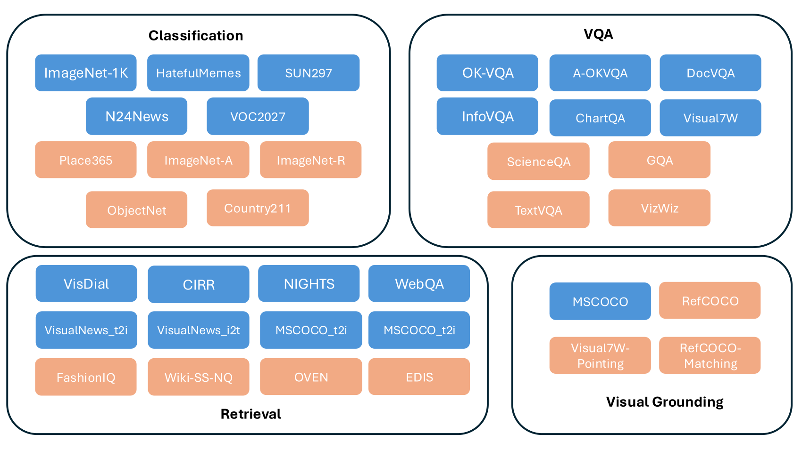
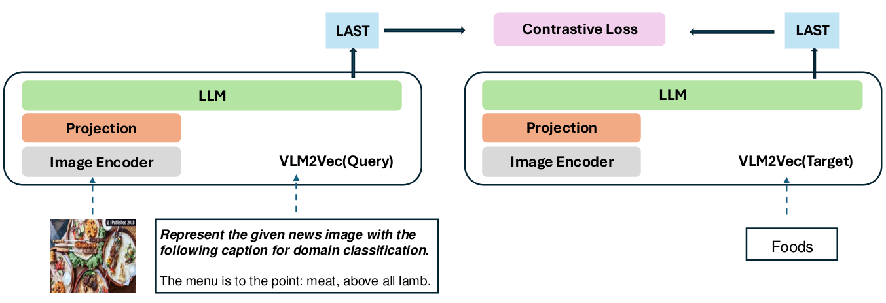
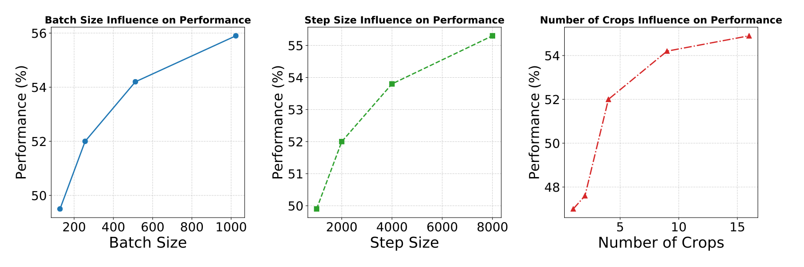

# VLM2Vec：把视觉语言模型训练成通用多模态表示模型

> VLM2Vec 用任务指令和对比学习把生成式视觉语言模型转为统一编码器，并用 MMEB 系统评测多种多模态表示任务。
>
> [论文](https://arxiv.org/abs/2410.05160) · 本文依据 v3 · [代码与数据](https://github.com/TIGER-AI-Lab/VLM2Vec)

CLIP 擅长图文对齐，但分类、视觉问答、组合检索和区域定位所需要的相关性并不相同。VLM2Vec 将这些任务统一成“查询与正确候选匹配”，在视觉语言模型输入中加入任务指令，用末尾表示进行对比训练。作者同时构建含 36 个数据集的 MMEB，以 20 个训练内任务和 16 个未参与训练的任务检验泛化。主表中高分辨率 LLaVA 版本达到 62.9 的平均 Precision@1。其结果支持指令化多模态编码，但评测使用指定候选集合，不能直接等同于开放式问答或百万级检索性能。

## 为什么需要 MMEB

已有模型与数据集往往只覆盖一种模态组合或一种任务。MMEB 把 10 个分类、10 个 VQA、12 个检索和 4 个视觉定位数据集组织为相同的表示评测接口，查询与候选可以分别是文字、图像或图文组合。

分类把类别名称当作候选，视觉问答把答案文字当作候选，视觉定位把预先裁好的区域当作候选。检索则包含图文匹配、组合图像检索以及图文证据检索。统一成匹配任务后，可以比较同一编码器是否适应不同关系。

IND/OOD 的区分依据对应任务数据集是否参与训练，而非是否完全没有相似预训练语料。非分类任务通常为一个正例加 999 个干扰项，分类使用其类别集合；指标为 Precision@1。因而 VQA 得分不是自由生成准确率，grounding 得分也不是模型自行预测边界框的质量。

## 编码与对比学习

输入包含任务指令及内容，经 VLM 后取 EOS 位置隐藏状态并归一化：

$$
e(x)=\operatorname{normalize}(h_{\mathrm{EOS}}(x)),\quad
\mathcal L_i=-\log\frac{\exp(e(q_i)^\top e(d_i)/\tau)}{\sum_j\exp(e(q_i)^\top e(d_j)/\tau)}.
$$

正例来自对应任务标注，其他候选提供批内负例。相同内容可因指令不同而表示不同检索目标；这与只把说明文字拼接给未经指令训练的 CLIP 有区别。

框架复用预训练 VLM 的视觉和语言理解能力，再让表示适应匹配目标。论文研究 Phi-3.5-Vision 和 LLaVA-1.6，并比较全参数与 LoRA 微调。

## 大批量训练：GradCache

多模态模型占用显存较大，而对比学习需要足够多的批内负例。作者采用 GradCache：先分块无梯度编码一个大批次，基于所有表示计算损失及表示梯度，再分块重新前向并把缓存的表示梯度反传到参数。

其依据是链式法则：

$$
\frac{\partial\mathcal L}{\partial\theta}
=\sum_i\frac{\partial\mathcal L}{\partial e_i}\frac{\partial e_i}{\partial\theta}.
$$

因此无需同时保存大批次全部模型激活。它增加重计算，换取更大的有效对比批量；普通梯度累积不会自动得到同样的跨微批次负例集合。

## 数据与主实验

训练来自 MMEB 的 20 个 IND 数据集，包括分类、问答、图文/图图检索及区域匹配；16 个 OOD 数据集用于观察迁移。对照包含 CLIP、OpenCLIP、SigLIP、BLIP2，以及 UniIR、E5-V、MagicLens。论文也微调 CLIP/OpenCLIP，区分“更强预训练模型”与“在 MMEB 上训练”的影响。

| 设置 | IND | OOD | 全部 36 集 |
| --- | --- | --- | --- |
| CLIP，未在 MMEB 微调 | 37.1 | 38.7 | 37.8 |
| UniIR CLIP-SF | 47.1 | 41.7 | 44.7 |
| OpenCLIP，全参微调 | 50.5 | 43.1 | 47.2 |
| Phi-3.5-V，全参，批量 1,024 | 62.8 | 47.4 | 55.9 |
| Phi-3.5-V，LoRA，批量 1,024 | 66.5 | 52.0 | 60.1 |
| LLaVA，LoRA，336×336 | 61.0 | 47.5 | 55.0 |
| LLaVA，LoRA，1344×1344 | 67.5 | 57.1 | 62.9 |

高分辨率版本在分类、检索及区域定位上受益明显，但不同骨干并非所有子任务都一起提高。例如 Phi 版本的 VQA 平均值可高于表中 LLaVA 版本。

## 消融：指令、LoRA 与数据迁移

在批量 256 的受控设置中，Phi 全参数训练平均 52.0，LoRA rank=4/8 为 58.4/58.2，而 rank=16/32 为 50.8/53.4。较小 rank 在该配方下表现更好，但结论受学习率和训练预算约束。

指令对经过相应训练的 VLM2Vec 很关键：无指令 34.8，有指令 52.0，增加 17.2 个百分点；原论文还报告相对提升 49.4%。直接给 CLIP 加同类指令却从 37.8 降至 26.7。这说明“输入有指令”和“模型学会以指令决定表示”是两回事。

作者比较批量、训练步数和图像裁剪等设置，并分析只用单类任务训练时的跨任务迁移。检索数据训练的迁移较强，但多任务训练仍用于形成更全面的能力。

## 附录中的候选规模实验与结论

候选库从 100 扩大到 1,000，再到 5,000 时，Phi 版本总体分数从 76.6 降到 60.1、49.5；分类任务的候选数保持类别集合不变。这是解释主榜结果时非常关键的边界：在小候选集合中排第一，不等于在大索引中稳定召回。

附录还给出各数据集的查询/候选格式、指令、细分成绩及 Flickr30k 评测。论文的贡献是建立统一任务形式，并证明 VLM 经指令化对比训练能获得较强迁移；其代价包括较重的编码开销、分辨率成本，以及有限候选评测与实际检索环境之间的差距。
