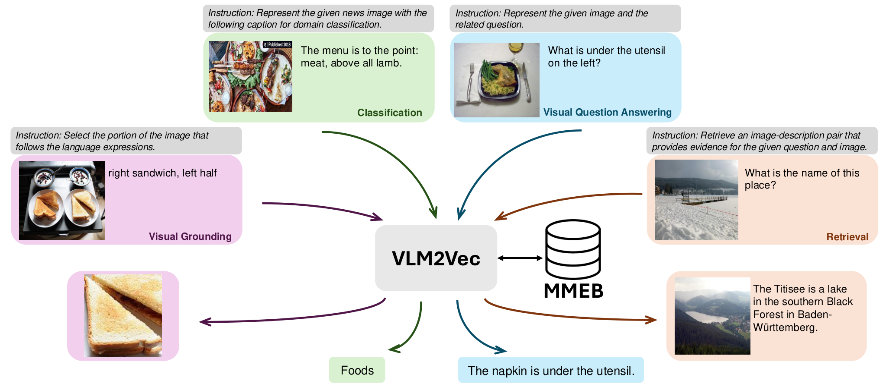
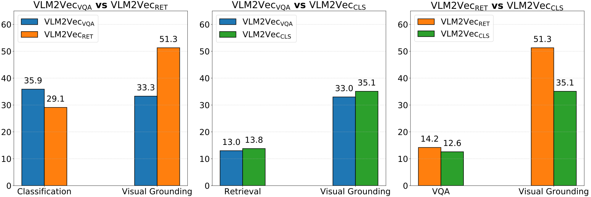

# VLM2Vec: Training Vision-Language Models for Massive Multimodal Embedding Tasks / 全文中英对照

> 来源：[arXiv:2410.05160v3](https://arxiv.org/abs/2410.05160v3)。英文段落后紧接中文，覆盖所取 HTML 版本的主文、附录、图表、脚注与参考文献；公式、数字表和书目信息共用。中文以机器初译为底稿，进行了术语整理与结构核对，尚未逐句人工审定；遇到歧义请以紧邻英文和原论文为准。 本文对照整理基于仓库原有论文副本，原作版权归所列作者。

## Authors and affiliations / 作者与机构

Ziyan Jiang [^id1] Affiliation: University of Waterloo Email: ziyanjiang528@gmail.com Rui Meng Affiliation: Salesforce Research Email: ruimeng@salesforce.com Xinyi Yang Affiliation: Salesforce Research Email: wenhuchen@uwaterloo.ca Semih Yavuz Affiliation: Salesforce Research Yingbo Zhou Affiliation: Salesforce Research Wenhu Chen Affiliation: University of Waterloo

## Abstract / 摘要

**EN.** Embedding models have been crucial in enabling various downstream tasks such as semantic similarity, information retrieval, and clustering. Recently, there has been a surge of interest in developing universal text embedding models that can generalize across tasks (e.g., MTEB). However, progress in learning universal multimodal embedding models has been relatively slow despite its importance and practicality. In this work, we aim to explore the potential of building universal multimodal embeddings capable of handling a wide range of downstream tasks. Our contributions are two fold: (1) we propose MMEB (Massive Multimodal Embedding Benchmark), which covers 4 meta-tasks (i.e. classification, visual question answering, multimodal retrieval, and visual grounding) and 36 datasets, including 20 training datasets and 16 evaluation datasets covering both in-distribution and out-of-distribution tasks, and (2) Vlm2Vec (Vision-Language Model $\rightarrow$ Vector), a contrastive training framework that converts any vision-language model into an embedding model via contrastive training on MMEB. Unlike previous models such as CLIP or BLIP, which encodes text or images independently without any task instruction, Vlm2Vec can process any combination of images and text to generate a fixed-dimensional vector based on the given task instructions . We build a series of Vlm2Vec models on SoTA VLMs like Phi-3.5-V, LLaVA-1.6 and evaluate them on MMEB’s evaluation split. With LoRA tuning, Vlm2Vec can achieve an improvement of 10% to 20% over existing multimodal embedding models on MMEB evaluation sets. We show that VLMs are secretly strong embedding models.

**中.** 嵌入模型对于实现语义相似性、信息检索和聚类等各种下游任务至关重要。最近，人们对开发可以跨任务泛化的通用文本嵌入模型（例如 MTEB）产生了浓厚的兴趣。然而，尽管其重要性和实用性，学习通用多模态嵌入模型的进展相对缓慢。在这项工作中，我们的目标是探索构建能够处理各种下游任务的通用多模态嵌入的潜力。我们的贡$\rightarrow$ Vector），一个对比训练框架，可通过 MMEB 上的对比训练将任何视觉语言模型转换为嵌入模型。与之前的模型（例如 CLIP 或 BLIP）在没有任何任务指令的情况下独立编码文本或图像不同，Vlm2Vec 可以处理图像和文本的任意组合，以根据给定的任务指令生成固定维度的向量。我们在 Phi-3.5-V、LLaVA-1.6 等 SoTA VLM 上构建了一系列 Vlm2Vec 模型，并在 MMEB 的评估分割上对其进行评估。通过 LoRA 调优，Vlm2Vec 可以在 MMEB 评估集上实现比现有多模态嵌入模型 10% 到 20% 的改进。我们证明 VLM 是隐秘的强嵌入模型。

**EN.** [https://tiger-ai-lab.github.io/VLM2Vec/](https://tiger-ai-lab.github.io/VLM2Vec/)

**中.** [https://tiger-ai-lab.github.io/VLM2Vec/](https://tiger-ai-lab.github.io/VLM2Vec/)

## Introduction / 简介

**EN.** Figure 1: We develop a universal multimodal embedding benchmark, MMEB, along with Vlm2Vec , an embedding model adapted from vision-language models (VLMs). Vlm2Vec is capable of following instructions and performing various multimodal embedding tasks, accommodating any combination of image and text modalities.

**中.** 图 1：我们开发了通用多模态嵌入基准 MMEB 以及 Vlm2Vec，这是一种改编自视觉语言模型 (VLM) 的嵌入模型。 Vlm2Vec 能够遵循指令并执行各种多模态嵌入任务，适应图像和文本模态的任意组合。

**EN.** Embeddings, or distributed representations, encode inputs (whether text or images) as fixed-dimensional vectors, enabling a range of downstream tasks. Since the advent of Word2Vec ( Mikolov, 2013 ) and GloVe ( Pennington et al., 2014 ) , substantial research efforts have focused on learning textual embeddings ( Kiros et al., 2015 ; Conneau et al., 2017 ) and image embeddings ( Radford et al., 2021 ; Li et al., 2022 ; Jia et al., 2021 ; Yu et al., 2022 ) . These embeddings facilitate a variety of applications, including textual and visual semantic similarity ( Agirre et al., 2012 ; Marelli et al., 2014 ; Chechik et al., 2010 ; Cer et al., 2017 ) , information retrieval ( Mitra et al., 2017 ; Karpukhin et al., 2020 ; Lin et al., 2014 ) , automatic evaluation ( Zhang et al., 2020 ; Sellam et al., 2020 ) , prompt retrieval for in-context learning ( Liu et al., 2022 ; Rubin et al., 2022 ; Hongjin et al., 2022 ) , and retrieval-augmented generation ( Lewis et al., 2020 ; Guu et al., 2020 ; Izacard & Grave, 2020 ) . A recent shift in research has focused on developing universal embeddings that can generalize across a wide range of tasks. For instance, Muennighoff et al. (2023) introduced MTEB (Massive Text Embedding Benchmark) to comprehensively assess text embeddings across tasks such as classification and clustering. MTEB has become the standard for evaluating universal text embeddings. Recent works ( Wang et al., 2022a ; Su et al., 2023 ; Wang et al., 2024 ; Springer et al., 2024 ; BehnamGhader et al., 2024 ) have demonstrated promising results on the MTEB benchmark. However, progress in multimodal embeddings has been relatively slower. Despite advancements in text embeddings, the lack of both benchmarks and methodologies in the multimodal embedding domain remains a challenge.

**中.** 嵌入或分布式表示将输入（无论是文本还是图像）编码为固定维度向量，从而支持一系列下游任务。自从 Word2Vec（Mikolov，2013）和 GloVe（Pennington 等人，2014）出现以来，大量的研究工作集中在学习文本嵌入（Kiros 等人，2015；Conneau 等人，2017）和图像嵌入（Radford 等人，2021；Li 等人，2022；贾等人，2021；余等人，2022）。这些嵌入促进了各种应用，包括文本和视觉语义相似性（Agirre 等人，2012；Marelli 等人，2014；Chechik 等人，2010；Cer 等人，2017）、信息检索（Mitra 等人，2017；Karpukhin 等人，2020；Lin 等人，2014） ）、自动评估（Zhang et al., 2020; Sellam et al., 2020）、上下文学习的提示检索（Liu et al., 2022; Rubin et al., 2022; Hongjin et al., 2022）和检索增强生成（Lewis et al., 2020; Guu et al., 2020;伊扎卡德和格雷夫，2020）。最近的研究重点是开发可以泛化到广泛任务的通用嵌入。例如，Muennighoff 等人。 (2023) 引入了 MTEB（大规模文本嵌入基准）来全面评估跨分类和聚类等任务的文本嵌入。 MTEB 已成为评估通用文本嵌入的标准。最近的工作（Wang 等人，2022a；Su 等人，2023；Wang 等人，2024；Springer 等人，2024；BehnamGhader 等人，2024）在 MTEB 基准上展示了有希望的结果。然而，多模态嵌入的进展相对较慢。尽管文本嵌入取得了进步，但多模态嵌入领域缺乏基准和方法仍然是一个挑战。

**EN.** Current research in multimodal embeddings faces two primary limitations: (1) existing studies typically evaluate visual embeddings on isolated tasks, such as ImageNet classification ( Deng et al., 2009 ; Hendrycks et al., 2021a ; Hendrycks et al., 2021b ) or MSCOCO/Flickr retrieval ( Lin et al., 2014 ; Plummer et al., 2015 ) ; (2) most existing models, such as CLIP ( Radford et al., 2021 ) , BLIP ( Li et al., 2022 ) , and SigLIP ( Zhai et al., 2023 ) , either process text and images separately or perform shallow fusion of visual and textual information ( Wei et al., 2023 ) , limiting their ability to fully capture the relationships between text and image modalities. Furthermore, these models exhibit limited reasoning and generalization capabilities, particularly in zero-shot scenarios for complex reasoning tasks.

**中.** 目前多模态嵌入的研究面临两个主要局限性：（1）现有研究通常评估孤立任务上的视觉嵌入，例如 ImageNet 分类（Deng 等人，2009；Hendrycks 等人，2021a；Hendrycks 等人，2021b）或 MSCOCO/Flickr 检索（Lin 等人，2014；Plummer 等人， 2015）； （2）大多数现有模型，例如CLIP（Radford et al.，2021）、BLIP（Li et al.，2022）和SigLIP（Zhai et al.，2023），要么分别处理文本和图像，要么执行视觉和文本信息的浅层融合（Wei et al.，2023），限制了它们充分捕获文本和图像模态之间关系的能力。此外，这些模型的推理和泛化能力有限，特别是在复杂推理任务的零样本场景中。

**EN.** In this paper, we attempt to build an universal multimodal embedding framework to pave road for the future research, which consists of two efforts:

**中.** 在本文中，我们尝试构建一个通用的多模态嵌入框架，为未来的研究铺平道路，其中包括两项工作：

**EN.** - MMEB: We introduce a novel benchmark, MMEB (Massive Multimodal Embedding Benchmark), which includes 36 datasets spanning four meta-task categories: classification, visual question answering, retrieval, and visual grounding. MMEB provides a comprehensive framework for training and evaluating embedding models across various combinations of text and image modalities. All tasks are reformulated as ranking tasks, where the model follows instructions, processes a query, and selects the correct target from a set of candidates. The query and target can be an image, text, or a combination of both. MMEB is divided into 20 in-distribution datasets, which can be used for training, and 16 out-of-distribution datasets, reserved for evaluation.

**中.** - MMEB：我们引入了一个新颖的基准，MMEB（大规模多模态嵌入基准），其中包括跨越四个元任务类别的 36 个数据集：分类、视觉问答、检索和视觉基础。 MMEB 提供了一个全面的框架，用于跨文本和图像模式的各种组合来训练和评估嵌入模型。所有任务都被重新表述为排名任务，其中模型遵循指令、处理查询并从一组候选者中选择正确的目标。查询和目标可以是图像、文本或两者的组合。 MMEB分为20个分布内数据集，可用于训练，以及16个分布外数据集，保留用于评估。

**EN.** - Vlm2Vec : We adopt the pre-trained vision-language models like Phi-3.5-V ( Abdin et al., 2024 ) and LLaVA-1.6 ( Li et al., 2024 ) as the backbone for Vlm2Vec . In contrast to other multimodal embedding models like UniIR ( Wei et al., 2023 ) and MagicLens ( Zhang et al., 2024 ) , which rely on late fusion of CLIP ( Radford et al., 2021 ) features, our approach leverages the deep integration of vision and language features within a transformer architecture. There are several advantages to this approach: (1) VLMs are trained on massive multimodal datasets and can handle any combination of images and text, as well as high-resolution images and long text inputs; (2) vision and language features are deeply fused in the transformer model, improving the model’s ability to capture cross-modal relationships; and (3) these models are well-suited for generalizing across diverse tasks, particularly those requiring instruction-following capabilities. These factors make Vlm2Vec an ideal choice for task generalization. We trained Vlm2Vec on the 20 MMEB training datasets using contrastive learning and compared its performance with various baselines.

**中.** - Vlm2Vec：我们采用预训练的视觉语言模型，如 Phi-3.5-V（Abdin 等人，2024）和 LLaVA-1.6（Li 等人，2024）作为 Vlm2Vec 的骨干。与 UniIR (Wei et al., 2023) 和 MagicLens (Zhang et al., 2024) 等依赖于 CLIP (Radford et al., 2021) 特征后期融合的其他多模态嵌入模型相比，我们的方法利用了 Transformer 架构中视觉和语言特征的深度集成。这种方法有几个优点：（1）VLM 在海量多模态数据集上进行训练，可以处理图像和文本的任意组合，以及高分辨率图像和长文本输入； （2）视觉和语言特征在Transformer模型中深度融合，提高模型捕捉跨模态关系的能力； (3)这些模型非常适合泛化不同的任务，特别是那些需要遵循指令能力的任务。这些因素使 Vlm2Vec 成为任务泛化的理想选择。我们使用对比学习在 20 个 MMEB 训练数据集上训练 Vlm2Vec，并将其性能与各种基线进行比较。

**EN.** Following extensive contrastive training, Vlm2Vec can handle any combination of images and text, producing fixed-dimensional vectors . We evaluate Vlm2Vec against a wide array of multimodal embedding models, including CLIP ( Radford et al., 2021 ) , BLIP2 ( Li et al., 2023a ) , SigLIP ( Zhai et al., 2023 ) , MagicLens ( Zhang et al., 2024 ) , UniIR ( Wei et al., 2023 ) and E5-V ( Jiang et al., 2024 ) , demonstrating consistent improvements across all task categories. Notably, compared to the best baseline model without fine-tuning, our model achieves a 18.2 point improvement (from 44.7 to 62.9) across all 36 MMEB datasets and a 15.4-point increase (from 41.7 to 57.1) on 16 out-of-distribution datasets for zero-shot evaluation. Compared to the best baseline model with fine-tuning, our model achieves a 15.7 point improvement (from 47.2 to 62.9) across all 36 MMEB datasets and a 14.0-point increase (from 43.1 to 57.1) on 16 out-of-distribution datasets for zero-shot evaluation. Moreover, as a general multimodal representation model, Vlm2Vec can still achieve competitive zero-shot T2I (Text-to-Image) and I2T (Image-to-Text) performance on Flickr30K compared to existing CLIP-like models, as presented in Table 11 .

**中.** 经过广泛的对比训练，Vlm2Vec 可以处理图像和文本的任意组合，生成固定维度的向量。我们针对多种多模态嵌入模型评估 Vlm2Vec，包括 CLIP (Radford et al., 2021)、BLIP2 (Li et al., 2023a)、SigLIP (Zhai et al., 2023)、MagicLens (Zhang et al., 2024)、UniIR (Wei et al., 2023) 和E5-V（Jiang 等人，2024），展示了所有任务类别的一致改进。值得注意的是，与没有微调的最佳基线模型相比，我们的模型在所有 36 个 MMEB 数据集上实现了 18.2 点的改进（从 44.7 到 62.9），在 16 个分布外数据集的零样本评估上实现了 15.4 点的提高（从 41.7 到 57.1）。与经过微调的最佳基线模型相比，我们的模型在所有 36 个 MMEB 数据集上实现了 15.7 点的改进（从 47.2 到 62.9），在 16 个分布外数据集的零样本评估上实现了 14.0 点的提高（从 43.1 到 57.1）。此外，作为通用的多模态表示模型，与现有的类 CLIP 模型相比，Vlm2Vec 在 Flickr30K 上仍然可以实现有竞争力的零样本 T2I（文本到图像）和 I2T（图像到文本）性能，如表 11 所示。

## MMEB: A Benchmark for Multimodal Embeddings / MMEB：多模态嵌入的基准

### Dataset Overview / 数据集概述

**EN.** We present MMEB (Massive Multimodal Embedding Benchmark), a comprehensive benchmark designed to evaluate multimodal embeddings across a diverse set of tasks. MMEB consists of 36 datasets organized into four meta-tasks: classification, visual question answering, retrieval, and visual grounding. Each task is reformulated as a ranking problem, where the model is provided with an instruction and a query (which may consist of text, images, or both) and is tasked with selecting the correct answer from a set of candidates. These candidates could be text, images, or additional instructions. The datasets are divided into two categories: 20 in-distribution datasets for training and 16 out-of-distribution datasets for evaluation. We report performance metrics across all 36 tasks. An overview of MMEB is provided in Figure 2 and the dataset statistics are provided in Table 1 .

**中.** 我们提出了 MMEB（大规模多模态嵌入基准），这是一个综合基准，旨在评估跨不同任务集的多模态嵌入。 MMEB 由 36 个数据集组成，分为四个元任务：分类、视觉问答、检索和视觉基础。每个任务都被重新表述为排名问题，其中为模型提供指令和查询（可能由文本、图像或两者组成），并负责从一组候选者中选择正确的答案。这些候选可以是文本、图像或附加说明。数据集分为两类：20 个用于训练的分布内数据集和 16 个用于评估的分布外数据集。我们报告所有 36 项任务的绩效指标。图 2 提供了 MMEB 概述，表 1 提供了数据集统计数据。

**EN.** The embedding models are supposed to compress the query side into a vector and the target candidates into a set of vectors. The candidate with the highest dot-product will be selected as the prediction for evaluation. We measure the Precision@1 to reflect the percentage of top candidate matching the groundtruth. For the number of target candidates, a higher count could increase evaluation costs and hinder rapid model iteration, while a lower count might make the benchmark too simple and prone to saturation. To strike a balance between these extremes, we have chosen 1,000 candidates. Further details about this decision can be found in Section A.2 .

**中.** 嵌入模型应该将查询端压缩为一个向量，并将目标候选压缩为一组向量。具有最高点积的候选者将被选择作为评估的预测。我们测量 Precision@1 以反映与基本事实匹配的最佳候选者的百分比。对于目标候选的数量，较高的计数可能会增加评估成本并阻碍模型的快速迭代，而较低的计数可能会使基准过于简单并容易饱和。为了在这些极端之间取得平衡，我们选择了 1,000 名候选人。有关此决定的更多详细信息请参见 A.2 节。

**EN.** MMEB offers a wide range of tasks from various domains, such as common, news, Wikipedia, web, and fashion. The benchmark incorporates diverse combinations of modalities for both queries and targets, including text, images, and text-image pairs. Additionally, tasks are designed to follow different types of instructions. For instance, tasks may involve object recognition (e.g., “Identify the object shown in the image.” ), retrieval (e.g., “Find an image that matches the given caption.” ), or visual grounding (e.g., “Select the portion of the image that answers the question.” ). Examples for each dataset in MMEB are provided in Tables 7 , 8 , 9 and 10 . The diversity in MMEB makes it an ideal testbed for universal embeddings.

**中.** MMEB 提供来自不同领域的广泛任务，例如常见、新闻、维基百科、网络和时尚。该基准测试结合了查询和目标的多种模式组合，包括文本、图像和文本图像对。此外，任务被设计为遵循不同类型的指令。例如，任务可能涉及对象识别（例如，“识别图像中显示的对象。”）、检索（例如，“查找与给定标题匹配的图像。”）或视觉基础（例如，“选择图像中回答问题的部分。”）。表 7、8、9 和 10 提供了 MMEB 中每个数据集的示例。 MMEB 的多样性使其成为通用嵌入的理想测试平台。

| Meta-Task 元任务 | Dataset 数据集 | Query 查询 | Target 目标 | OOD? OOD？ | #Training #训练 | #Eval #评估 | #Candidates #候选人 |
| --- | --- | --- | --- | --- | --- | --- | --- |
| Classification (10 Tasks) 分类（10 个任务） | ImageNet-1K | I | T |  | 100K | 1000 | 1000 |
| Classification (10 Tasks) 分类（10 个任务） | N24News N24新闻 | I + T | I |  | 49K | 1000 | 24 |
| Classification (10 Tasks) 分类（10 个任务） | HatefulMemes 仇恨模因 | I | T |  | 8K | 1000 | 2 |
| Classification (10 Tasks) 分类（10 个任务） | VOC2007 | I | T |  | 8K | 1000 | 20 |
| Classification (10 Tasks) 分类（10 个任务） | SUN397 太阳397 | I | T |  | 20K | 1000 | 397 |
| Classification (10 Tasks) 分类（10 个任务） | Place365 地点365 | I | T | ✓ | - | 1000 | 365 |
| Classification (10 Tasks) 分类（10 个任务） | ImageNet-A | I | T | ✓ | - | 1000 | 1000 |
| Classification (10 Tasks) 分类（10 个任务） | ImageNet-R | I | T | ✓ | - | 1000 | 200 |
| Classification (10 Tasks) 分类（10 个任务） | ObjectNet 对象网 | I | T | ✓ | - | 1000 | 313 |
| Classification (10 Tasks) 分类（10 个任务） | Country-211 国家211 | I | T | ✓ | - | 1000 | 211 |
| VQA (10 Tasks) VQA（10 项任务） | OK-VQA | I + T | T |  | 9K | 1000 | 1000 |
| VQA (10 Tasks) VQA（10 项任务） | A-OKVQA | I + T | T |  | 17K | 1000 | 1000 |
| VQA (10 Tasks) VQA（10 项任务） | DocVQA 文档VQA | I + T | T |  | 40K | 1000 | 1000 |
| VQA (10 Tasks) VQA（10 项任务） | InfographicVQA 信息图VQA | I + T | T |  | 24K | 1000 | 1000 |
| VQA (10 Tasks) VQA（10 项任务） | ChartQA 图表质量保证 | I + T | T |  | 28K | 1000 | 1000 |
| VQA (10 Tasks) VQA（10 项任务） | Visual7W 视觉7W | I + T | T |  | 70K | 1000 | 1000 |
| VQA (10 Tasks) VQA（10 项任务） | ScienceQA 科学质量保证 | I + T | T | ✓ | - | 1000 | 1000 |
| VQA (10 Tasks) VQA（10 项任务） | VizWiz 维兹维兹 | I + T | T | ✓ | - | 1000 | 1000 |
| VQA (10 Tasks) VQA（10 项任务） | GQA 质量保证局 | I + T | T | ✓ | - | 1000 | 1000 |
| VQA (10 Tasks) VQA（10 项任务） | TextVQA 文本VQA | I + T | T | ✓ | - | 1000 | 1000 |
| Retrieval (12 Tasks) 检索（12 项任务） | VisDial 可视拨号 | T | I |  | 123K | 1000 | 1000 |
| Retrieval (12 Tasks) 检索（12 项任务） | CIRR | I + T | I |  | 26K | 1000 | 1000 |
| Retrieval (12 Tasks) 检索（12 项任务） | VisualNews_t2i 视觉新闻_t2i | T | I |  | 100K | 1000 | 1000 |
| Retrieval (12 Tasks) 检索（12 项任务） | VisualNews_i2t 视觉新闻_i2t | I | T |  | 100K | 1000 | 1000 |
| Retrieval (12 Tasks) 检索（12 项任务） | MSCOCO_t2i | T | I |  | 100K | 1000 | 1000 |
| Retrieval (12 Tasks) 检索（12 项任务） | MSCOCO_i2t | I | T |  | 113K | 1000 | 1000 |
| Retrieval (12 Tasks) 检索（12 项任务） | NIGHTS 夜晚 | I | I |  | 16K | 1000 | 1000 |
| Retrieval (12 Tasks) 检索（12 项任务） | WebQA 网络质量保证 | T | I + T |  | 17K | 1000 | 1000 |
| Retrieval (12 Tasks) 检索（12 项任务） | OVEN 烤箱 | I + T | I + T | ✓ | - | 1000 | 1000 |
| Retrieval (12 Tasks) 检索（12 项任务） | FashionIQ 时尚智商 | I + T | I | ✓ | - | 1000 | 1000 |
| Retrieval (12 Tasks) 检索（12 项任务） | EDIS 电子数据显示系统 | T | I + T | ✓ | - | 1000 | 1000 |
| Retrieval (12 Tasks) 检索（12 项任务） | Wiki-SS-NQ 维基-SS-NQ | T | I | ✓ | - | 1000 | 1000 |
| Visual Grounding (4 Tasks) 视觉基础（4 项任务） | MSCOCO 莫斯科可可 | I + T | I |  | 100K | 1000 | 1000 |
| Visual Grounding (4 Tasks) 视觉基础（4 项任务） | Visual7W-Pointing Visual7W-指向 | I + T | I | ✓ | - | 1000 | 1000 |
| Visual Grounding (4 Tasks) 视觉基础（4 项任务） | RefCOCO 参考COCO | I + T | I | ✓ | - | 1000 | 1000 |
| Visual Grounding (4 Tasks) 视觉基础（4 项任务） | RefCOCO-Matching RefCOCO-匹配 | I + T | I + T | ✓ | - | 1000 | 1000 |

**EN.** Table 1: The statistics of MMEB: 36 datasets across 4 meta-task categories, with 20 in-distribution datasets used for training and 16 out-of-distribution datasets used exclusively for evaluation.

**中.** 表 1：MMEB 的统计数据：跨 4 个元任务类别的 36 个数据集，其中 20 个分布内数据集用于训练，16 个分布外数据集专门用于评估。

### Meta-task and Dataset Design / 元任务和数据集设计

**EN.** MMEB is organized into four primary meta-task categories:

**中.** MMEB 分为四个主要元任务类别：

**EN.** Classification The query consists of an instruction, an image, optionally accompanied by related text, while the target is the class label. The number of candidates equals the number of classes.

**中.** 分类查询由指令、图像、可选地伴随相关文本组成，而目标是类别标签。考生人数等于班级人数。

**EN.** Visual Question Answering The query consists of an instruction, an image, and a piece of text as the question, while the target is the answer. Each query has 1 ground truth and 999 distractors as candidates.

**中.** 视觉问答 查询由指令、图像和一段文本组成，作为问题，而目标是答案。每个查询都有 1 个真实值和 999 个干扰项作为候选。

**EN.** Information Retrieval Both the query and target sides can involve a combination of text, images, and instructions. Each query has 1 ground truth and 999 distractors as candidates.

**中.** 信息检索查询端和目标端都可以涉及文本、图像和指令的组合。每个查询都有 1 个真实值和 999 个干扰项作为候选。

**EN.** Visual Grounding The category is adapted from object detection tasks. The query combines an instruction (e.g., “Select the portion of the image that isolates the object of the given label: red apple”) with the full image. This instruction guides the model to focus on a specific object within the image. Each candidate corresponds to cropped regions (bounding boxes) of the image, including both the object of interest and distractor regions. Each query includes 1,000 candidates: 1 ground truth and 999 distractors. These distractors may include hard negatives from the same object class, other objects in the image, or random objects from different images.

**中.** 视觉基础 该类别改编自物体检测任务。该查询将指令（例如，“选择图像中隔离给定标签的对象的部分：红苹果”）与完整图像结合起来。该指令引导模型聚焦于图像中的特定对象。每个候选对应于图像的裁剪区域（边界框），包括感兴趣的对象和干扰区域。每个查询包含 1,000 个候选项：1 个基本事实和 999 个干扰项。这些干扰因素可能包括来自同一对象类的难负例、图像中的其他对象或来自不同图像的随机对象。

**EN.** Further details on dataset processing can be found in Section A.1 .

**中.** 有关数据集处理的更多详细信息，请参阅 A.1 节。

**EN.** Figure 2: An overview of the tasks and datasets in MMEB. MMEB includes four meta-tasks and 36 datasets: 20 in-distribution datasets (blue) used for training and 16 out-of-distribution (orange) datasets used exclusively for evaluation.

**中.** 图 2：MMEB 中的任务和数据集概述。 MMEB 包括 4 个元任务和 36 个数据集：20 个分布内数据集（蓝色）用于训练，16 个分布外数据集（橙色）专门用于评估。

## Vlm2Vec : Transforming LVMs to Embedders / Vlm2Vec：将 LVM 转换为嵌入器

### Contrastive Training / 对比训练

**EN.** We develop Vlm2Vec , a contrastive training framework designed to convert any state-of-the-art vision-language model into an embedding model, as illustrated in Figure 3 . A relevant query-target pair is denoted as ( $q,t^{+}$ ). Both $q$ and $t^{+}$ could be either single image, text or single image + text. We define $q:(q_{t},q_{i})$ and $t^{+}:(t_{t}^{+},t_{i}^{+})$ .

**中.** 我们开发了 Vlm2Vec，这是一个对比训练框架，旨在将任何最先进的视觉语言模型转换为嵌入模型，如图 3 所示。相关查询目标对表示为（$q,t^{+}$）。 $q$和$t^{+}$都可以是单图、文字或单图+文字。我们定义 $q:(q_{t},q_{i})$ 和 $t^{+}:(t_{t}^{+},t_{i}^{+})$ 。

**EN.** We then apply the instruction to the original query $q$ to generate a new one $q_{\text{inst}}$ :

**中.** 然后，我们将该指令应用于原始查询 $q$ 以生成新查询 $q_{\text{inst}}$ ：

$$
q_{\text{inst}}=\text{{[IMAGE\_TOKEN]}}\text{Instruct: {\lx@text@lbrace task\_definition\lx@text@rbrace}}\ \backslash n\ \text{Query:\ }\{q\}\tag{1}
$$

**EN.** where “ { task_definition } ” is a placeholder for a one-sentence description of the embedding task. To enhance the embedding model’s generalizability by better understanding instructions, we have crafted task-specific instructions, as shown in Tables 7 , 8 , 9 and 10 .

**中.** 其中“{task_definition}”是嵌入任务的一句话描述的占位符。为了通过更好地理解指令来增强嵌入模型的通用性，我们精心设计了特定于任务的指令，如表 7、8、9 和 10 所示。

**EN.** Given a pretrained VLM, we feed query and target into it to obtain the query and target embeddings ( $\mathbf{h}_{q_{\text{inst}}},\mathbf{h}_{t^{+}}$ ) by taking the last layer vector representation of the last token. To train the embedding model, we adopt the standard InfoNCE loss $\mathcal{L}$ over the in-batch negatives and hard negatives:

**中.** 给定一个预训练的 VLM，我们将查询和目标输入其中，通过获取最后一个标记的最后一层向量表示来获得查询和目标嵌入（ $\mathbf{h}_{q_{\text{inst}}},\mathbf{h}_{t^{+}}$ ）。为了训练嵌入模型，我们针对批内负例和难负例采用标准 InfoNCE 损失 $\mathcal{L}$：

$$
\min\ \ \mathcal{L}=-\log\frac{\phi(\mathbf{h}_{q_{\text{inst}}},\mathbf{h}_{t^{+}})}{\phi(\mathbf{h}_{q_{\text{inst}}},\mathbf{h}_{t^{+}})+\displaystyle\sum_{t^{-}\in\mathbb{N}}(\phi(\mathbf{h}_{q_{\text{inst}}},\mathbf{h}_{t^{-}}))}\tag{2}
$$

**EN.** where $\mathbb{N}$ denotes the set of all negatives, and $\phi(\mathbf{h}_{q},\mathbf{h}_{t})$ is a function that computes the matching score between query $q$ and target $t$ . In this paper, we adopt the temperature-scaled cosine similarity function as $\phi(\mathbf{h}_{q},\mathbf{h}_{t})=\text{exp}(\frac{1}{\tau}\cos(\mathbf{h}_{q},\mathbf{h}_{t}))$ ,where $\tau$ is a temperature hyper-parameter.

**中.** 其中 $\mathbb{N}$ 表示所有否定的集合， $\phi(\mathbf{h}_{q},\mathbf{h}_{t})$ 是计算查询 $q$ 和目标 $t$ 之间的匹配分数的函数。在本文中，我们采用温度尺度余弦相似度函数$\phi(\mathbf{h}_{q},\mathbf{h}_{t})=\text{exp}(\frac{1}{\tau}\cos(\mathbf{h}_{q},\mathbf{h}_{t}))$，其中$\tau$是温度超参数。

### Increasing Batch Size Through GradCache / 通过 GradCache 增加批处理大小

**EN.** Since hard negatives are often difficult or ambiguous to collect for most multimodal datasets, using larger batch sizes becomes crucial. This increases the number of in-batch random negatives, which in turn helps improve the performance of the embedding model.

**中.** 由于对于大多数多模式数据集来说，难负例的收集通常很困难或不明确，因此使用更大的批量大小变得至关重要。这增加了批量随机负数的数量，进而有助于提高嵌入模型的性能。

**EN.** A bottleneck lies in the GPU memory that limits us from increasing the batch size and the number of in-batch random negatives during training, as each training instance may include one image (either from the query or target side) or multiple images (from both query and target sides), resulting in substantial memory consumption. We apply GradCache ( Gao et al., 2021a ) , a gradient caching technique that decouples backpropagation between contrastive loss and the encoder, removing encoder backward pass data dependency along the batch dimension.

**中.** 瓶颈在于 GPU 内存，它限制我们在训练期间增加批量大小和批量随机负数的数量，因为每个训练实例可能包含一张图像（来自查询端或目标端）或多张图像（来自查询端和目标端），从而导致大量内存消耗。我们应用 GradCache（Gao 等人，2021a），这是一种梯度缓存技术，可以解耦对比损失和编码器之间的反向传播，消除编码器沿批量维度向后传递数据的依赖性。

**EN.** Mathematically, supposed we have a large batch of queries $\mathcal{Q}$ , and we divide it into a set of sub-batches, each of which can fit into memory for gradient computation: $\mathcal{Q}=\{\hat{Q}_{1},\hat{Q}_{2},\dots\}$ . There are two major steps: “Representation Gradient Computation and Caching” and “Sub-batch Gradient Accumulation”. First, gradient tensors within each subbatch is calculated and stored: $\mathbf{u}_{i}=\frac{\partial\mathcal{L}}{\partial f(q_{i})}$ .

**中.** 从数学上讲，假设我们有大量查询 $\mathcal{Q}$ ，我们将其分为一组子批次，每个子批次都可以放入内存中进行梯度计算： $\mathcal{Q}=\{\hat{Q}_{1},\hat{Q}_{2},\dots\}$ 。主要有两个步骤：“表示梯度计算和缓存”和“子批次梯度累积”。首先，计算并存储每个子批次内的梯度张量： $\mathbf{u}_{i}=\frac{\partial\mathcal{L}}{\partial f(q_{i})}$ 。

**EN.** Then gradients are accumulated for encoder parameters across all sub-batches:

**中.** 然后累积所有子批次的编码器参数的梯度：

$$
\displaystyle\begin{split}\frac{\partial\mathcal{L}}{\partial\Theta}=\sum_{\hat{Q}_{j}\in\mathcal{Q}}\sum_{q_{i}\in\hat{Q}_{j}}\frac{\partial\mathcal{L}}{\partial f(q_{i})}\frac{\partial f(q_{i})}{\partial\Theta}=\sum_{\hat{Q}_{j}\in\mathbb{Q}}\sum_{q_{i}\in\hat{Q}_{j}}\mathbf{u}_{i}\frac{\partial f(q_{i})}{\partial\Theta}\end{split}\tag{3}
$$

**EN.** Figure 3: Vlm2Vec uses a VLM as the backbone to deeply integrate image and text features. It is trained with a contrastive loss between the query and target, following task-specific instructions. The training data consists of diverse combinations of modalities on both the query and target sides, which may include images, text, or image-text pairs.

**中.** 图 3：Vlm2Vec 使用 VLM 作为骨干，深度集成图像和文本特征。它按照特定于任务的指令，通过查询和目标之间的对比损失进行训练。训练数据由查询端和目标端的多种模态组合组成，其中可能包括图像、文本或图像文本对。

## Experiments / 实验

**EN.** In this section, we adopt Phi-3.5-V and LLaVA-1.6 as the backbone VLMs, with training conducted via either full model fine-tuning or LoRA. The temperature for the loss function is set to 0.02, with a batch size of 1,024, a maximum text length of 256 tokens, and 2K training steps. The LoRA variant uses a rank of 8. For Vlm2Vec leveraging Phi-3.5-V as the backbone, we configure the number of sub-image crops to 4. For Vlm2Vec using LLaVA-1.6 as the backbone, we resize the input images to a uniform resolution, employing two setups: a high-resolution configuration of 1344 × 1344 and a low-resolution configuration of 336 × 336.

**中.** 在本节中，我们采用 Phi-3.5-V 和 LLaVA-1.6 作为骨干 VLM，通过全模型微调或 LoRA 进行训练。损失函数的温度设置为 0.02，批量大小为 1,024，最大文本长度为 256 个标记，训练步骤为 2K。 LoRA 变体使用等级 8。对于利用 Phi-3.5-V 作为主干的 Vlm2Vec，我们将子图像裁剪的数量配置为 4。对于使用 LLaVA-1.6 作为主干的 Vlm2Vec，我们将输入图像的大小调整为统一的分辨率，采用两种设置：1344 × 1344 的高分辨率配置和 336 × 336 的低分辨率配置。

**EN.** For the 20 training datasets, if a dataset contains more than 50K samples, we randomly select 50K for consistency, resulting in a total training set of 662K data points. When using GradCache, we set a sub-batch size of 4 to enable full model tuning, with the total batch size accumulated to 1,024. All experiments were run on 8 H100 GPUs.

**中.** 对于20个训练数据集，如果数据集包含超过50K个样本，我们随机选择50K以保持一致性，从而得到总共662K个数据点的训练集。使用 GradCache 时，我们将子批次大小设置为 4 以启用完整的模型调整，总批次大小累计为 1,024。所有实验均在 8 个 H100 GPU 上运行。

**EN.** We report Precision@1 for all models in Table 2 . It measures the ratio of positive candidates being ranked in the top place for all queries.

**中.** 我们在表 2 中报告了所有模型的 Precision@1。它衡量所有查询中排名靠前的积极候选者的比例。

### Baselines / 基线

**EN.** Four groups of baselines are reported in this study.

**中.** 本研究报告了四组基线。

**EN.** CLIP-family: We utilize vision/language encoders such as CLIP ( Radford et al., 2021 ) , OpenCLIP ( Cherti et al., 2023 ) , SigLIP ( Zhai et al., 2023 ) , and BLIP2 ( Li et al., 2023a ) as our baseline. Due to the length limitations of the text encoder, some queries or target text in certain tasks may be truncated. We apply score-level fusion by combining multimodal features using element-wise addition with equal weights ( $w_{1}=w_{2}=1$ ). We do not use instructions, as they could potentially degrade performance. For more details, please refer to Section 4.3.4 .

**中.** CLIP 系列：我们利用视觉/语言编码器，例如 CLIP (Radford et al., 2021)、OpenCLIP (Cherti et al., 2023)、SigLIP (Zhai et al., 2023) 和 BLIP2 (Li et al., 2023a) 作为我们的基线。由于文本编码器的长度限制，某些任务中的某些查询或目标文本可能会被截断。我们通过使用等权重的元素加法来组合多模态特征来应用分数级融合（$w_{1}=w_{2}=1$）。我们不使用指令，因为它们可能会降低性能。详细内容请参见4.3.4节。

**EN.** UniIR: UniIR ( Wei et al., 2023 ) is a unified, instruction-guided multimodal retriever designed to handle eight different retrieval tasks across multiple modalities. The model builds on CLIP and BLIP, employing shallow fusion techniques such as score-level and feature-level fusion to integrate modalities. In this study, we use the CLIP_SF and BLIP_FF variations as baselines.

**中.** UniIR：UniIR（Wei et al., 2023）是一种统一的、指令引导的多模态检索器，旨在跨多种模态处理八种不同的检索任务。该模型建立在 CLIP 和 BLIP 的基础上，采用浅层融合技术（例如分数级和特征级融合）来集成模态。在本研究中，我们使用 CLIP_SF 和 BLIP_FF 变体作为基线。

**EN.** MagicLens: MagicLens ( Zhang et al., 2024 ) is a self-supervised image retrieval model capable of handling open-ended instructions. It utilizes a dual-encoder architecture with shared parameters, initializing the vision and language encoders with either CoCa or CLIP. The model uses a multi-head attention pooler to unify multimodal inputs into a single embedding. For this study, we report results using the CLIP-Large backbone.

**中.** MagicLens：MagicLens（Zhang et al., 2024）是一种自监督图像检索模型，能够处理开放式指令。它采用具有共享参数的双编码器架构，使用 CoCa 或 CLIP 初始化视觉和语言编码器。该模型使用多头注意力池将多模态输入统一到单个嵌入中。在本研究中，我们使用 CLIP-Large 主干报告结果。

**EN.** E5-V: E5-V ( Jiang et al., 2024 ) is a contemporary model that also leverages vision-language models for multimodal embedding tasks. It proposes a single-modality training approach, where the model is trained exclusively on text pairs. In contrast, our model is trained on multimodal pairs, which include various combinations of image and text modalities on both the query and target sides.

**中.** E5-V：E5-V（Jiang et al., 2024）是一种当代模型，它也利用视觉语言模型进行多模态嵌入任务。它提出了一种单模态训练方法，其中模型专门针对文本对进行训练。相比之下，我们的模型是在多模态对上进行训练的，其中包括查询端和目标端的图像和文本模态的各种组合。

**EN.** For all our baselines, we first use their original versions. Additionally, we have fine-tuned both CLIP and OpenCLIP on MMEB training datasets. We adopt the same experimental configurations as Vlm2Vec to ensure a fair comparison. For the remaining baseline models, UniIR and MagicLens also utilize a shallow fusion approach based on CLIP models, with their primary contribution being the datasets they were trained on. E5-V proposes training exclusively on text pairs, making it unsuitable for fine-tuning on our datasets. Therefore, we have not included the fine-tuned versions of these three models in this comparison.

**中.** 对于我们所有的基线，我们首先使用它们的原始版本。此外，我们还在 MMEB 训练数据集上对 CLIP 和 OpenCLIP 进行了微调。我们采用与 Vlm2Vec 相同的实验配置以确保公平的比较。对于其余的基线模型，UniIR 和 MagicLens 还利用基于 CLIP 模型的浅层融合方法，其主要贡献是训练的数据集。 E5-V 建议仅在文本对上进行训练，因此不适合对我们的数据集进行微调。因此，我们在这次比较中没有包括这三个模型的微调版本。

### Main Result / 主要结果

| Model 型号 | Per Meta-Task Score 每个元任务分数 | Per Meta-Task Score 每个元任务分数 | Per Meta-Task Score 每个元任务分数 | Per Meta-Task Score 每个元任务分数 |  | Average Score 平均分 | Average Score 平均分 | Average Score 平均分 |
| --- | --- | --- | --- | --- | --- | --- | --- | --- |
| Model 型号 | Classification 分类 | VQA 质量保证 | Retrieval 检索 | Grounding 接地 |  | IND 临床试验 | OOD 面向对象设计 | Overall 整体 |
| # of datasets $\rightarrow$ 数据集数量 $\rightarrow$ | 10 | 10 | 12 | 4 |  | 20 | 16 | 36 |
| Baseline Models (No Fine-tuning on MMEB Training) 基线模型（MMEB 训练无需微调） | Baseline Models (No Fine-tuning on MMEB Training) 基线模型（MMEB 训练无需微调） | Baseline Models (No Fine-tuning on MMEB Training) 基线模型（MMEB 训练无需微调） | Baseline Models (No Fine-tuning on MMEB Training) 基线模型（MMEB 训练无需微调） | Baseline Models (No Fine-tuning on MMEB Training) 基线模型（MMEB 训练无需微调） | Baseline Models (No Fine-tuning on MMEB Training) 基线模型（MMEB 训练无需微调） | Baseline Models (No Fine-tuning on MMEB Training) 基线模型（MMEB 训练无需微调） | Baseline Models (No Fine-tuning on MMEB Training) 基线模型（MMEB 训练无需微调） | Baseline Models (No Fine-tuning on MMEB Training) 基线模型（MMEB 训练无需微调） |
| CLIP ( Radford et al., 2021 ) CLIP（Radford 等人，2021） | 42.8 | 9.1 | 53.0 | 51.8 |  | 37.1 | 38.7 | 37.8 |
| BLIP2 ( Li et al., 2023a ) BLIP2（李等人，2023a） | 27.0 | 4.2 | 33.9 | 47.0 |  | 25.3 | 25.1 | 25.2 |
| SigLIP ( Zhai et al., 2023 ) SigLIP（Zhai 等人，2023） | 40.3 | 8.4 | 31.6 | 59.5 |  | 32.3 | 38.0 | 34.8 |
| OpenCLIP ( Cherti et al., 2023 ) OpenCLIP（Cherti 等人，2023） | 47.8 | 10.9 | 52.3 | 53.3 |  | 39.3 | 40.2 | 39.7 |
| UniIR (BLIP_FF) ( Wei et al., 2023 ) UniIR (BLIP_FF)（Wei 等人，2023） | 42.1 | 15.0 | 60.1 | 62.2 |  | 44.7 | 40.4 | 42.8 |
| UniIR (CLIP_SF) ( Wei et al., 2023 ) UniIR (CLIP_SF) (Wei et al., 2023) | 44.3 | 16.2 | 61.8 | 65.3 |  | 47.1 | 41.7 | 44.7 |
| E5-V ( Jiang et al., 2024 ) E5-V（Jiang等人，2024） | 21.8 | 4.9 | 11.5 | 19.0 |  | 14.9 | 11.5 | 13.3 |
| Magiclens ( Zhang et al., 2024 ) Magiclens（张等人，2024） | 38.8 | 8.3 | 35.4 | 26.0 |  | 31.0 | 23.7 | 27.8 |
| Baseline Models (Fine-tuning on MMEB Training) 基线模型（MMEB 训练微调） | Baseline Models (Fine-tuning on MMEB Training) 基线模型（MMEB 训练微调） | Baseline Models (Fine-tuning on MMEB Training) 基线模型（MMEB 训练微调） | Baseline Models (Fine-tuning on MMEB Training) 基线模型（MMEB 训练微调） | Baseline Models (Fine-tuning on MMEB Training) 基线模型（MMEB 训练微调） | Baseline Models (Fine-tuning on MMEB Training) 基线模型（MMEB 训练微调） | Baseline Models (Fine-tuning on MMEB Training) 基线模型（MMEB 训练微调） | Baseline Models (Fine-tuning on MMEB Training) 基线模型（MMEB 训练微调） | Baseline Models (Fine-tuning on MMEB Training) 基线模型（MMEB 训练微调） |
| CLIP-FFT 快速傅里叶变换 | 55.2 | 19.7 | 53.2 | 62.2 |  | 47.6 | 42.8 | 45.4 |
| OpenCLIP-FFT | 56.0 | 21.9 | 55.4 | 64.1 |  | 50.5 | 43.1 | 47.2 |
| Ours ( Vlm2Vec ) 我们的（Vlm2Vec） | Ours ( Vlm2Vec ) 我们的（Vlm2Vec） | Ours ( Vlm2Vec ) 我们的（Vlm2Vec） | Ours ( Vlm2Vec ) 我们的（Vlm2Vec） | Ours ( Vlm2Vec ) 我们的（Vlm2Vec） | Ours ( Vlm2Vec ) 我们的（Vlm2Vec） | Ours ( Vlm2Vec ) 我们的（Vlm2Vec） | Ours ( Vlm2Vec ) 我们的（Vlm2Vec） | Ours ( Vlm2Vec ) 我们的（Vlm2Vec） |
| Phi-3.5-V, FFT (bs=1024) Phi-3.5-V，FFT (bs=1024) | 52.8 | 50.3 | 57.8 | 72.3 |  | 62.8 | 47.4 | 55.9 |
| Phi-3.5-V, LoRA (bs=1024) Phi-3.5-V，LoRA (bs=1024) | 54.8 | 54.9 | 62.3 | 79.5 |  | 66.5 | 52.0 | 60.1 |
| LLaVA-1.6, LoRA (bs=1024,res=336×336) LLaVA-1.6，LoRA（bs=1024，res=336×336） | 54.7 | 50.3 | 56.2 | 64.0 |  | 61.0 | 47.5 | 55.0 |
| LLaVA-1.6, LoRA (bs=1024,res=1344×1344) LLaVA-1.6，LoRA（bs=1024，res=1344×1344） | 61.2 | 49.9 | 67.4 | 86.1 |  | 67.5 | 57.1 | 62.9 |
| $\Delta$ - Best baseline (No Fine-tuning) $\Delta$ - 最佳基线（无微调） | +16.9 | +33.7 | +5.6 | +20.8 |  | +20.4 | +15.4 | +18.2 |
| $\Delta$ - Best baseline (Fine-tuning) $\Delta$ - 最佳基线（微调） | +5.2 | +28.0 | +12.0 | +22.0 |  | +17.0 | +14.0 | +15.7 |

**EN.** Table 2: Results on the MMEB benchmark. The scores are averaged per meta-task. For detailed scores per dataset, see Table 6 . We include baselines with and without fine-tuning on MMEB training datasets and our models with LLaVA-1.6 and Phi-3.5 backbones. FFT means fully fine-tuned.

**中.** 表 2：MMEB 基准测试结果。每个元任务的分数是平均的。有关每个数据集的详细分数，请参阅表 6。我们包括对 MMEB 训练数据集进行微调和未微调的基线以及具有 LLaVA-1.6 和 Phi-3.5 主干的模型。 FFT 意味着完全微调。

**EN.** From Table 2 , the best variant of Vlm2Vec leverages LLaVA-1.6, is trained with LoRA, and processes input images at a relatively high resolution of 1344 × 1344. It achieves an average precision@1 of 62.9% across all 36 datasets from MMEB. Additionally, it maintains an average precision@1 of 57.1% on 16 out-of-distribution tasks in zero-shot evaluation, suggesting strong generalization ability. This indicates that our model, when well-trained on datasets from diverse task categories, domains, and modality combinations, can effectively follow instructions to align the visual and text spaces and generalize well to unseen tasks. It is important to emphasize that LLaVA-1.6 ( Li et al., 2024 ) has a transparent pre-training data recipe and nearly no overlap with our MMEB OOD datasets. This demonstrates that the strong zero-shot results achieved by Vlm2Vec are not attributable to prior exposure of the LLaVA-1.6 backbone to the OOD datasets. When using the same backbone, the full fine-tuning variant achieves slightly lower scores than the LoRA version. For a detailed discussion comparing full fine-tuning and LoRA, please refer to Section 4.3.1 .

**中.** 从表 2 中可以看出，Vlm2Vec 的最佳变体利用 LLaVA-1.6，使用 LoRA 进行训练，并以 1344 × 1344 的相对高分辨率处理输入图像。它在 MMEB 的所有 36 个数据集中实现了 62.9% 的平均精度@1。此外，它在零样本评估中的 16 个分布外任务上保持了 57.1% 的平均 precision@1，这表明其具有很强的泛化能力。这表明，当我们的模型在来自不同任务类别、领域和模态组合的数据集上进行良好训练时，可以有效地遵循指令来对齐视觉和文本空间，并很好地推广到看不见的任务。需要强调的是，LLaVA-1.6（Li et al., 2024）具有透明的预训练数据配方，并且与我们的 MMEB OOD 数据集几乎没有重叠。这表明 Vlm2Vec 实现的强大零样本结果不能归因于 LLaVA-1.6 主干网之前暴露于 OOD 数据集。当使用相同的主干网时，完整的微调变体获得的分数略低于 LoRA 版本。有关比较完整微调和 LoRA 的详细讨论，请参阅第 4.3.1 节。

**EN.** Compared to other baseline models, with or without fine-tuning on MMEB training data, our model demonstrates consistent improvements. Compared to the best baseline model without fine-tuning, our model achieves a 18.2 point improvement (from 44.7 to 62.9) across all 36 MMEB datasets and a 15.4-point increase (from 41.7 to 57.1) on 16 out-of-distribution datasets for zero-shot evaluation. Compared to the best baseline model with fine-tuning, our model achieves a 15.7 point improvement (from 47.2 to 62.9) across all 36 MMEB datasets and a 14.0-point increase (from 43.1 to 57.1) on 16 out-of-distribution datasets for zero-shot evaluation. Additionally, unlike the baseline models, which fail to demonstrate reasonable performance across all different task categories, Vlm2Vec achieves relatively strong performance (at least 50%) across all four meta-task categories. This highlights its capability to handle a wide range of multimodal embedding tasks effectively.

**中.** 与其他基线模型相比，无论是否对 MMEB 训练数据进行微调，我们的模型都表现出了一致的改进。与没有微调的最佳基线模型相比，我们的模型在所有 36 个 MMEB 数据集上实现了 18.2 点的改进（从 44.7 到 62.9），在 16 个分布外数据集的零样本评估上实现了 15.4 点的提高（从 41.7 到 57.1）。与经过微调的最佳基线模型相比，我们的模型在所有 36 个 MMEB 数据集上实现了 15.7 点的改进（从 47.2 到 62.9），在 16 个分布外数据集的零样本评估上实现了 14.0 点的提高（从 43.1 到 57.1）。此外，与无法在所有不同任务类别中表现出合理性能的基线模型不同，Vlm2Vec 在所有四个元任务类别中都实现了相对较强的性能（至少 50%）。这凸显了其有效处理各种多模态嵌入任务的能力。

### Result Analysis / 结果分析

**EN.** To train an effective and generalizable multimodal embedding, various factors need to be considered, ranging from the data to the training setup. In this section, we present detailed ablation studies on these factors. We will discuss two training setups: Full Fine-Tuning vs. LoRA, along with Training parameters, and two topics related to data: Meta-task generalization and Impact of instructions.

**中.** 为了训练有效且可推广的多模态嵌入，需要考虑从数据到训练设置的各种因素。在本节中，我们将介绍有关这些因素的详细消融研究。我们将讨论两种训练设置：完全微调与 LoRA，以及训练参数，以及与数据相关的两个主题：元任务泛化和指令影响。

#### Full Fine-Tuning vs. LoRA / 全面微调与 LoRA

**EN.** When fine-tuning the VLMs, a key decision is whether to conduct full fine-tuning, which updates all parameters in the model, or to use a parameter-efficient method such as LoRA. We compare the performance of fully fine-tuned Vlm2Vec with its LoRA variants at different ranks. The training and data setups are kept consistent across all models. We observe that LoRA achieves better performance when the rank is appropriately configured.

**中.** 在微调 VLM 时，一个关键的决定是是否进行全面微调（更新模型中的所有参数），还是使用参数高效的方法（例如 LoRA）。我们将完全微调的 Vlm2Vec 与其不同等级的 LoRA 变体的性能进行了比较。所有模型的训练和数据设置保持一致。我们观察到，当等级配置适当时，LoRA 可以获得更好的性能。

| Model 型号 | Meta-Task Average Score 元任务平均分 | Meta-Task Average Score 元任务平均分 | Meta-Task Average Score 元任务平均分 | Meta-Task Average Score 元任务平均分 |  | Average Score 平均分 | Average Score 平均分 | Average Score 平均分 |
| --- | --- | --- | --- | --- | --- | --- | --- | --- |
| Model 型号 | Classification 分类 | VQA 质量保证 | Retrieval 检索 | Grounding 接地 |  | IND 临床试验 | OOD 面向对象设计 | Overall 整体 |
| # of datasets $\rightarrow$ 数据集数量 $\rightarrow$ | 10 | 10 | 12 | 4 |  | 20 | 16 | 36 |
| Full Fine-Tuning (bs=256) 全面微调 (bs=256) | 50.4 | 46.4 | 52.6 | 68.6 |  | 57.9 | 44.7 | 52.0 |
| LoRA r = 4 (bs=256) | 52.7 | 53.6 | 60.1 | 80.2 |  | 64.9 | 50.4 | 58.4 |
| LoRA r = 8 (bs=256) | 52.9 | 52.5 | 60.3 | 80.0 |  | 64.2 | 50.8 | 58.2 |
| LoRA r = 16 (bs=256) | 51.1 | 40.5 | 52.0 | 72.5 |  | 54.9 | 45.8 | 50.8 |
| LoRA r = 32 (bs=256) | 50.6 | 47.8 | 53.9 | 72.5 |  | 58.9 | 46.5 | 53.4 |

**EN.** Table 3: We compare the performance of fully fine-tuned Vlm2Vec with its LoRA variants at different ranks. LoRA can achieve better performance when the rank is appropriately configured. All the models utilize Phi-3.5-V as their backbone.

**中.** 表 3：我们比较了完全微调的 Vlm2Vec 与其 LoRA 变体在不同级别的性能。当Rank配置得当时，LoRA可以获得更好的性能。所有模型均采用 Phi-3.5-V 作为骨干。

#### Training parameters / 训练参数

**EN.** During our experiments, we identified three key parameters that significantly impact the performance of Vlm2Vec : training batch size, the number of sub-image crops, and the number of training steps. In Figure 4 , we observe that the final performance gradually improves as we increase the batch size, training step size, and number of sub-image crops. We particularly want to highlight the impact of batch size. Due to the lack of hard negatives, using a large batch size with plenty of random negatives, supported by the GradCache technique, plays a crucial role in enhancing the performance of Vlm2Vec , as discussed in Section 3.2 .

**中.** 在我们的实验中，我们确定了对 Vlm2Vec 性能有显着影响的三个关键参数：训练批量大小、子图像裁剪的数量和训练步骤的数量。在图 4 中，我们观察到随着批量大小、训练步长和子图像裁剪数量的增加，最终性能逐渐提高。我们特别想强调批量大小的影响。由于缺乏难负例，在 GradCache 技术的支持下，使用具有大量随机负例的大批量大小对于增强 Vlm2Vec 的性能起着至关重要的作用，如第 3.2 节中所述。

**EN.** Figure 4: The figures demonstrate the influence of the training setup on Vlm2Vec ’s final performance. Here, we examine the effects of training batch size, the number of sub-image crops, and the number of training steps. All the models utilize Phi-3.5-V as their backbone.

**中.** 图 4：这些图展示了训练设置对 Vlm2Vec 最终性能的影响。在这里，我们检查训练批量大小、子图像裁剪数量和训练步骤数量的影响。所有模型均采用 Phi-3.5-V 作为骨干。

#### Meta-task generalization / 元任务泛化

**EN.** We have demonstrated that Vlm2Vec has the potential to transfer to out-of-distribution datasets after being trained on a diverse range of in-distribution datasets, with the instruction-following settings. An interesting question arises as to whether focusing on a specific meta-task can enhance the model’s overall generalizability. We have trained three models, each focused solely on one meta-task (classification, visual question answering, and retrieval). Visual grounding was not included due to the limited number of training datasets. We then evaluated the models’ transferability to other meta-tasks. We refer to these three models as Vlm2Vec ${}_{\text{RET}}$ , trained on 8 retrieval tasks, Vlm2Vec ${}_{\text{VQA}}$ , trained on 6 visual question answering tasks, and Vlm2Vec ${}_{\text{CLS}}$ , trained on 5 classification tasks.

**中.** 我们已经证明，Vlm2Vec 在使用指令跟踪设置的各种分布内数据集上进行训练后，有可能转移到分布外数据集。一个有趣的问题是，关注特定的元任务是否可以增强模型的整体通用性。我们训练了三个模型，每个模型仅专注于一项元任务（分类、视觉问答和检索）。由于训练数据集数量有限，未包括视觉基础。然后我们评估了模型向其他元任务的可迁移性。我们将这三个模型称为 Vlm2Vec ${}_{\text{RET}}$ ，在 8 个检索任务上进行训练， Vlm2Vec ${}_{\text{VQA}}$ ，在 6 个视觉问答任务上进行训练，以及 Vlm2Vec ${}_{\text{CLS}}$ ，在 5 个分类任务上进行训练。

**EN.** Figure 5 illustrates the generalizability of these three models on unseen meta-tasks. We could observe that Vlm2Vec ${}_{\text{RET}}$ has better generalizablilty on other meta-task, compared with other two models, especially on visual grounding categories. The reason is that retrieval tasks involve a more diverse combination of text and visual modalities from both the query and target sides, which helps the model generalize better to unseen meta-tasks. This observation highlights the benefits of using more diverse tasks in the Vlm2Vec training process.

**中.** 图 5 说明了这三个模型在未见过的元任务上的通用性。我们可以观察到，与其他两个模型相比，Vlm2Vec ${}_{\text{RET}}$ 在其他元任务上具有更好的泛化性，特别是在视觉基础类别上。原因是检索任务涉及来自查询和目标端的文本和视觉模式的更多样化的组合，这有助于模型更好地泛化到看不见的元任务。这一观察结果凸显了在 Vlm2Vec 训练过程中使用更多样任务的好处。

**EN.** Figure 5: The figures show the generalization ability of models trained on one meta-task to other unseen meta-tasks. For example, the first subplot compares the performance of Vlm2Vec trained exclusively on VQA datasets with Vlm2Vec trained exclusively on retrieval datasets across the other two meta-task categories: classification and visual grounding. Overall, Vlm2Vec trained on retrieval tasks demonstrate better generalization ability because retrieval tasks involve a more diverse combination of text and visual modalities from both the query and target sides. Vlm2Vec utilizes Phi-3.5-V as its backbone.

**中.** 图 5：这些图显示了在一项元任务上训练的模型对其他未见过的元任务的泛化能力。例如，第一个子图比较了仅在 VQA 数据集上训练的 Vlm2Vec 与仅在其他两个元任务类别（分类和视觉基础）的检索数据集上训练的 Vlm2Vec 的性能。总体而言，经过检索任务训练的 Vlm2Vec 表现出更好的泛化能力，因为检索任务涉及来自查询和目标双方的文本和视觉模式的更多样化的组合。 Vlm2Vec 利用 Phi-3.5-V 作为其骨干。

#### Impact of Instructions / 指令的影响

**EN.** Previous studies have shown the influence of instructions on addressing various tasks. Vlm2Vec , which leverages a VLM as its backbone and is trained on large-scale datasets with instructions, is expected to better generalize across tasks and improve performance in multimodal embedding tasks. In this section, we evaluate the performance of both CLIP and Vlm2Vec with and without task-specific instructions to quantify the impact of incorporating instructions into the embedding process. As shown in Table 4 , incorporating instructions reduces the CLIP model’s performance by 29.4%, while our Vlm2Vec achieves a 49.4% improvement. This highlights how a VLM backbone enhances the embedding model’s instruction-following capability and emphasizes the advantages of instruction-guided embeddings.

**中.** 先前的研究已经表明指令对解决各种任务的影响。 Vlm2Vec 利用 VLM 作为其骨干，并通过指令在大规模数据集上进行训练，有望更好地跨任务泛化并提高多模态嵌入任务的性能。在本节中，我们评估有或没有特定任务指令的 CLIP 和 Vlm2Vec 的性能，以量化将指令合并到嵌入过程中的影响。如表 4 所示，合并指令使 CLIP 模型的性能降低了 29.4%，而我们的 Vlm2Vec 则提高了 49.4%。这凸显了 VLM 主干如何增强嵌入模型的指令跟踪能力，并强调指令引导嵌入的优势。

| Model 型号 | Meta-Task Average Score 元任务平均分 | Meta-Task Average Score 元任务平均分 | Meta-Task Average Score 元任务平均分 | Meta-Task Average Score 元任务平均分 |  | Average Score 平均分 | Average Score 平均分 | Average Score 平均分 |
| --- | --- | --- | --- | --- | --- | --- | --- | --- |
| Model 型号 | Classification 分类 | VQA 质量保证 | Retrieval 检索 | Grounding 接地 |  | IND 临床试验 | OOD 面向对象设计 | Overall 整体 |
| # of datasets $\rightarrow$ 数据集数量 $\rightarrow$ | 10 | 10 | 12 | 4 |  | 20 | 16 | 36 |
| CILP | CILP | CILP | CILP | CILP | CILP | CILP | CILP | CILP |
| w/o instruction 无指令 | 42.8 | 9.1 | 53.0 | 51.8 |  | 37.1 | 38.7 | 37.8 |
| w/ instruction 带说明 | 17.4 | 8.0 | 41.3 | 52.9 |  | 23.8 | 30.3 | 26.7 |
| $\Delta$ | -59.3% | -12.1% | -22.1% | 2.1% |  | -35.8% | -21.7% | -29.4% |
| Ours ( Vlm2Vec ) 我们的（Vlm2Vec） | Ours ( Vlm2Vec ) 我们的（Vlm2Vec） | Ours ( Vlm2Vec ) 我们的（Vlm2Vec） | Ours ( Vlm2Vec ) 我们的（Vlm2Vec） | Ours ( Vlm2Vec ) 我们的（Vlm2Vec） | Ours ( Vlm2Vec ) 我们的（Vlm2Vec） | Ours ( Vlm2Vec ) 我们的（Vlm2Vec） | Ours ( Vlm2Vec ) 我们的（Vlm2Vec） | Ours ( Vlm2Vec ) 我们的（Vlm2Vec） |
| w/o instruction 无指令 | 36.7 | 33.5 | 31.1 | 44.3 |  | 37.3 | 31.6 | 34.8 |
| w/ instruction 带说明 | 50.4 | 46.4 | 52.6 | 68.6 |  | 57.9 | 44.7 | 52.0 |
| $\Delta$ | 37.3% | 38.5% | 69.1% | 54.9% |  | 55.2% | 41.5% | 49.4% |

**EN.** Table 4: Comparison of CLIP and our Vlm2Vec with and without task-specific instructions. Incorporating instructions could decrease CLIP’s performance by 29.4%, whereas our Vlm2Vec achieves a 49.4% improvement. Vlm2Vec utilizes Phi-3.5-V as its backbone.

**中.** 表 4：CLIP 和我们的 Vlm2Vec 在有或没有特定任务指令的情况下的比较。合并指令可能会使 CLIP 的性能降低 29.4%，而我们的 Vlm2Vec 则提高了 49.4%。 Vlm2Vec 利用 Phi-3.5-V 作为其骨干。

## Related Work / 相关工作

### Text Embedding / 文本嵌入

**EN.** Text embeddings have demonstrated significant potential in powering downstream applications such as information retrieval ( Karpukhin et al., 2020 ; Xiong et al., 2020 ) , text similarity ( Gao et al., 2021b ) , prompt retrieval for in-context learning ( Hongjin et al., 2022 ) , and classification ( Logeswaran & Lee, 2018 ; Reimers & Gurevych, 2019 ) . Early work focused on creating effective embeddings for specific tasks. With the rise of pretrained language models, efforts have shifted toward developing universal embedding models capable of handling a wide range of embedding tasks. Studies such as GTR ( Ni et al., 2022 ) and E5 ( Wang et al., 2022a ) leveraged large amounts of noisy paired data to pretrain and fine-tune dense retrievers. More recent works like TART ( Asai et al., 2022 ) and InstructOR ( Su et al., 2023 ) introduced natural language prompts to guide embedding models in producing task-relevant embeddings. Building on this, models like E5Mistral ( Wang et al., 2024 ) , SFR-Embedding ( Meng et al., 2024 ) , RepLLaMA ( Ma et al., 2024b ) , GTE-Qwen2 ( Li et al., 2023b ) , and NV-Embed ( Lee et al., 2024 ) have utilized pretrained large language models (LLMs) as their backbone, fine-tuning them with multi-task data and instructions. These models have delivered significant improvements over earlier approaches that did not use LLMs for initialization or instruction tuning.

**中.** 文本嵌入在支持下游应用方面表现出了巨大的潜力，例如信息检索（Karpukhin et al., 2020；Xiong et al., 2020）、文本相似性（Gao et al., 2021b）、上下文学习的提示检索（Hongjin et al., 2022）和分类（Logeswaran & Lee, 2018；Reimers &古列维奇，2019）。早期的工作重点是为特定任务创建有效的嵌入。随着预训练语言模型的兴起，人们的努力已经转向开发能够处理各种嵌入任务的通用嵌入模型。 GTR（Ni et al., 2022）和 E5（Wang et al., 2022a）等研究利用大量噪声配对数据来预训练和微调稠密检索器。最近的作品，如 TART（Asai 等人，2022）和 InstructOR（Su 等人，2023）引入了自然语言提示来指导嵌入模型生成任务相关的嵌入。在此基础上，E5Mistral (Wang et al., 2024)、SFR-Embedding (Meng et al., 2024)、RepLLaMA (Ma et al., 2024b)、GTE-Qwen2 (Li et al., 2023b) 和 NV-Embed (Lee et al., 2024) 等模型都利用了预训练的大型语言模型（法学硕士）作为他们的支柱，用多任务数据和指令对其进行微调。与早期不使用 LLM 进行初始化或指令调整的方法相比，这些模型有了显着的改进。

### Multimodal Embeddings / 多模态嵌入

**EN.** Multimodal embeddings have long been a significant research challenge. Early works like CLIP ( Radford et al., 2021 ) , BLIP ( Li et al., 2022 ; Li et al., 2023a ) , Align ( Jia et al., 2021 ) , SigLIP ( Zhai et al., 2023 ) , SimVLM Wang et al. (2022b) and CoCa ( Yu et al., 2022 ) primarily focused on learning universal representations from large-scale, weakly supervised image-text pairs. These models generally encode images and text separately, projecting them into a shared space. This approach has laid the groundwork for more recent multimodal models like LLaVA ( Liu et al., 2024 ) .

**中.** 多模态嵌入长期以来一直是一个重大的研究挑战。早期的工作包括 CLIP (Radford et al., 2021)、BLIP (Li et al., 2022; Li et al., 2023a)、Align (Jia et al., 2021)、SigLIP (Zhai et al., 2023)、SimVLM Wang et al.。 (2022b) 和 CoCa (Yu et al., 2022) 主要关注从大规模、弱监督的图像文本对中学习通用表示。这些模型通常分别对图像和文本进行编码，并将它们投影到共享空间中。这种方法为 LLaVA 等最近的多模式模型奠定了基础（Liu et al., 2024）。

**EN.** Most research on universal multimodal embeddings involves fine-tuning models like CLIP or BLIP, typically using simple fusion mechanisms to combine visual and language information. For instance, UniIR ( Wei et al., 2023 ) creates multimodal embeddings by simply adding text and visual features, while MagicLens ( Zhang et al., 2024 ) employs shallow self-attention layers to integrate these features more effectively. The study most similar to ours is E5-V ( Jiang et al., 2024 ) , a contemporary work that fine-tunes a vision-language model using only text training data.

**中.** 大多数关于通用多模态嵌入的研究都涉及微调模型，例如 CLIP 或 BLIP，通常使用简单的融合机制来组合视觉和语言信息。例如，UniIR（Wei et al., 2023）通过简单地添加文本和视觉特征来创建多模态嵌入，而MagicLens（Zhang et al., 2024）则采用浅层自注意力层来更有效地集成这些特征。与我们最相似的研究是 E5-V（Jiang et al., 2024），这是一项仅使用文本训练数据微调视觉语言模型的当代工作。

### Embedding Benchmarks / 嵌入基准

**EN.** Significant efforts have been made to develop benchmarks for evaluating retrieval systems. For text retrieval models, MS MARCO ( Nguyen et al., 2016 ) and Natural Questions ( Kwiatkowski et al., 2019b ) are two of the most widely used benchmarks in general domains. To broaden the evaluation across more diverse domains, BEIR ( Thakur et al., ) was introduced, incorporating 18 datasets from various fields. Building on this, MTEB ( Muennighoff et al., 2023 ) further expands BEIR’s scope by adding more tasks, such as classification, clustering, and semantic textual similarity (STS).

**中.** 为了开发评估检索系统的基准，人们付出了巨大的努力。对于文本检索模型，MS MARCO（Nguyen 等人，2016）和 Natural Questions（Kwiatkowski 等人，2019b）是一般领域中使用最广泛的两个基准。为了扩大更多样化领域的评估范围，引入了 BEIR（Thakur 等人），纳入了来自各个领域的 18 个数据集。在此基础上，MTEB（Muennighoff et al., 2023）通过添加更多任务（例如分类、聚类和语义文本相似性 (STS)）进一步扩展了 BEIR 的范围。

**EN.** For multimodal retrieval, several benchmarks have been introduced to evaluate model performance across different modalities. MBEIR ( Wei et al., 2023 ) includes 8 tasks and 16 datasets, designed to test models’ ability to retrieve information based on various forms of queries and instructions.

**中.** 对于多模态检索，引入了几个基准来评估不同模态的模型性能。 MBEIR（Wei et al., 2023）包括 8 个任务和 16 个数据集，旨在测试模型基于各种形式的查询和指令检索信息的能力。

## Conclusion / 结论

**EN.** In this paper, we aim to build the first large-scale multimodal embedding framework, comprising two main components: MMEB and Vlm2Vec . MMEB includes 36 datasets across four meta-task categories, providing a comprehensive and diverse framework for training and evaluating embedding models. Vlm2Vec leverages VLMs as a backbone to deeply fuse visual and textual spaces, enhancing generalization to unseen tasks through instruction following.

**中.** 在本文中，我们的目标是构建第一个大规模多模态嵌入框架，包括两个主要组件：MMEB 和 Vlm2Vec。 MMEB 包含跨四个元任务类别的 36 个数据集，为训练和评估嵌入模型提供了全面且多样化的框架。 Vlm2Vec 利用 VLM 作为骨干来深度融合视觉和文本空间，通过指令跟踪增强对看不见的任务的泛化。

## References / 参考文献

- Abdin et al. (2024) Marah Abdin, Sam Ade Jacobs, Ammar Ahmad Awan, Jyoti Aneja, Ahmed Awadallah, Hany Awadalla, Nguyen Bach, Amit Bahree, Arash Bakhtiari, Harkirat Behl, et al. Phi-3 technical report: A highly capable language model locally on your phone. arXiv preprint arXiv:2404.14219 , 2024.

- Agirre et al. (2012) Eneko Agirre, Daniel Cer, Mona Diab, and Aitor Gonzalez-Agirre. SemEval-2012 task 6: A pilot on semantic textual similarity. In Eneko Agirre, Johan Bos, Mona Diab, Suresh Manandhar, Yuval Marton, and Deniz Yuret (eds.), *SEM 2012: The First Joint Conference on Lexical and Computational Semantics – Volume 1: Proceedings of the main conference and the shared task, and Volume 2: Proceedings of the Sixth International Workshop on Semantic Evaluation (SemEval 2012) , pp. 385–393, Montréal, Canada, 7-8 June 2012. Association for Computational Linguistics. URL [https://aclanthology.org/S12-1051](https://aclanthology.org/S12-1051) .

- Asai et al. (2022) Akari Asai, Timo Schick, Patrick Lewis, Xilun Chen, Gautier Izacard, Sebastian Riedel, Hannaneh Hajishirzi, and Wen-tau Yih. Task-aware retrieval with instructions. arXiv preprint arXiv:2211.09260 , 2022.

- Barbu et al. (2019) Andrei Barbu, David Mayo, Julian Alverio, William Luo, Christopher Wang, Dan Gutfreund, Josh Tenenbaum, and Boris Katz. Objectnet: A large-scale bias-controlled dataset for pushing the limits of object recognition models. Advances in neural information processing systems , 32, 2019.

- BehnamGhader et al. (2024) Parishad BehnamGhader, Vaibhav Adlakha, Marius Mosbach, Dzmitry Bahdanau, Nicolas Chapados, and Siva Reddy. Llm2vec: Large language models are secretly powerful text encoders. arXiv preprint arXiv:2404.05961 , 2024.

- Cer et al. (2017) Daniel Cer, Mona Diab, Eneko Agirre, Iñigo Lopez-Gazpio, and Lucia Specia. SemEval-2017 task 1: Semantic textual similarity multilingual and crosslingual focused evaluation. In Steven Bethard, Marine Carpuat, Marianna Apidianaki, Saif M. Mohammad, Daniel Cer, and David Jurgens (eds.), Proceedings of the 11th International Workshop on Semantic Evaluation (SemEval-2017) , pp. 1–14, Vancouver, Canada, August 2017. Association for Computational Linguistics. doi: 10.18653/v1/S17-2001 . URL [https://aclanthology.org/S17-2001](https://aclanthology.org/S17-2001) .

- Chang et al. (2022) Yingshan Chang, Mridu Narang, Hisami Suzuki, Guihong Cao, Jianfeng Gao, and Yonatan Bisk. Webqa: Multihop and multimodal qa. In Proceedings of the IEEE/CVF conference on computer vision and pattern recognition , pp. 16495–16504, 2022.

- Chechik et al. (2010) Gal Chechik, Varun Sharma, Uri Shalit, and Samy Bengio. Large scale online learning of image similarity through ranking. Journal of Machine Learning Research , 11(3), 2010.

- Cherti et al. (2023) Mehdi Cherti, Romain Beaumont, Ross Wightman, Mitchell Wortsman, Gabriel Ilharco, Cade Gordon, Christoph Schuhmann, Ludwig Schmidt, and Jenia Jitsev. Reproducible scaling laws for contrastive language-image learning. In Proceedings of the IEEE/CVF Conference on Computer Vision and Pattern Recognition , pp. 2818–2829, 2023.

- Conneau et al. (2017) Alexis Conneau, Douwe Kiela, Holger Schwenk, Loïc Barrault, and Antoine Bordes. Supervised learning of universal sentence representations from natural language inference data. In Proceedings of the 2017 Conference on Empirical Methods in Natural Language Processing , pp. 670–680, 2017.

- Das et al. (2017) Abhishek Das, Satwik Kottur, Khushi Gupta, Avi Singh, Deshraj Yadav, José MF Moura, Devi Parikh, and Dhruv Batra. Visual dialog. In Proceedings of the IEEE conference on computer vision and pattern recognition , pp. 326–335, 2017.

- Deng et al. (2009) Jia Deng, Wei Dong, Richard Socher, Li-Jia Li, Kai Li, and Li Fei-Fei. Imagenet: A large-scale hierarchical image database. In 2009 IEEE conference on computer vision and pattern recognition , pp. 248–255. Ieee, 2009.

- Everingham et al. (2014) Mark Everingham, S. M. Ali Eslami, Luc Van Gool, Christopher K. I. Williams, John M. Winn, and Andrew Zisserman. The pascal visual object classes challenge: A retrospective. International Journal of Computer Vision , 111:98 – 136, 2014. URL [https://api.semanticscholar.org/CorpusID:207252270](https://api.semanticscholar.org/CorpusID:207252270) .

- Fu et al. (2023) Stephanie Fu, Netanel Tamir, Shobhita Sundaram, Lucy Chai, Richard Zhang, Tali Dekel, and Phillip Isola. Dreamsim: Learning new dimensions of human visual similarity using synthetic data. arXiv preprint arXiv:2306.09344 , 2023.

- Gao et al. (2021a) Luyu Gao, Yunyi Zhang, Jiawei Han, and Jamie Callan. Scaling deep contrastive learning batch size under memory limited setup. arXiv preprint arXiv:2101.06983 , 2021a.

- Gao et al. (2021b) Tianyu Gao, Xingcheng Yao, and Danqi Chen. Simcse: Simple contrastive learning of sentence embeddings. In Proceedings of the 2021 Conference on Empirical Methods in Natural Language Processing , pp. 6894–6910, 2021b.

- Gurari et al. (2018) Danna Gurari, Qing Li, Abigale J Stangl, Anhong Guo, Chi Lin, Kristen Grauman, Jiebo Luo, and Jeffrey P Bigham. Vizwiz grand challenge: Answering visual questions from blind people. In Proceedings of the IEEE conference on computer vision and pattern recognition , pp. 3608–3617, 2018.

- Guu et al. (2020) Kelvin Guu, Kenton Lee, Zora Tung, Panupong Pasupat, and Mingwei Chang. Retrieval augmented language model pre-training. In International conference on machine learning , pp. 3929–3938. PMLR, 2020.

- Hendrycks et al. (2021a) Dan Hendrycks, Steven Basart, Norman Mu, Saurav Kadavath, Frank Wang, Evan Dorundo, Rahul Desai, Tyler Zhu, Samyak Parajuli, Mike Guo, et al. The many faces of robustness: A critical analysis of out-of-distribution generalization. In Proceedings of the IEEE/CVF international conference on computer vision , pp. 8340–8349, 2021a.

- Hendrycks et al. (2021b) Dan Hendrycks, Kevin Zhao, Steven Basart, Jacob Steinhardt, and Dawn Song. Natural adversarial examples. In Proceedings of the IEEE/CVF conference on computer vision and pattern recognition , pp. 15262–15271, 2021b.

- Hongjin et al. (2022) SU Hongjin, Jungo Kasai, Chen Henry Wu, Weijia Shi, Tianlu Wang, Jiayi Xin, Rui Zhang, Mari Ostendorf, Luke Zettlemoyer, Noah A Smith, et al. Selective annotation makes language models better few-shot learners. In The Eleventh International Conference on Learning Representations , 2022.

- Hu et al. (2023) Hexiang Hu, Yi Luan, Yang Chen, Urvashi Khandelwal, Mandar Joshi, Kenton Lee, Kristina Toutanova, and Ming-Wei Chang. Open-domain visual entity recognition: Towards recognizing millions of wikipedia entities. In Proceedings of the IEEE/CVF International Conference on Computer Vision , pp. 12065–12075, 2023.

- Hudson & Manning (2019) Drew A Hudson and Christopher D Manning. Gqa: A new dataset for real-world visual reasoning and compositional question answering. In Proceedings of the IEEE/CVF conference on computer vision and pattern recognition , pp. 6700–6709, 2019.

- Izacard & Grave (2020) Gautier Izacard and Edouard Grave. Leveraging passage retrieval with generative models for open domain question answering, 2020. URL [https://arxiv.org/abs/2007.0128](https://arxiv.org/abs/2007.0128) .

- Jia et al. (2021) Chao Jia, Yinfei Yang, Ye Xia, Yi-Ting Chen, Zarana Parekh, Hieu Pham, Quoc Le, Yun-Hsuan Sung, Zhen Li, and Tom Duerig. Scaling up visual and vision-language representation learning with noisy text supervision. In International conference on machine learning , pp. 4904–4916. PMLR, 2021.

- Jiang et al. (2024) Ting Jiang, Minghui Song, Zihan Zhang, Haizhen Huang, Weiwei Deng, Feng Sun, Qi Zhang, Deqing Wang, and Fuzhen Zhuang. E5-v: Universal embeddings with multimodal large language models. arXiv preprint arXiv:2407.12580 , 2024.

- Karpukhin et al. (2020) Vladimir Karpukhin, Barlas Oguz, Sewon Min, Patrick Lewis, Ledell Wu, Sergey Edunov, Danqi Chen, and Wen-tau Yih. Dense passage retrieval for open-domain question answering. In Proceedings of the 2020 Conference on Empirical Methods in Natural Language Processing (EMNLP) , pp. 6769–6781, 2020.

- Kazemzadeh et al. (2014) Sahar Kazemzadeh, Vicente Ordonez, Mark Matten, and Tamara Berg. Referitgame: Referring to objects in photographs of natural scenes. In Proceedings of the 2014 conference on empirical methods in natural language processing (EMNLP) , pp. 787–798, 2014.

- Kiela et al. (2020) Douwe Kiela, Hamed Firooz, Aravind Mohan, Vedanuj Goswami, Amanpreet Singh, Pratik Ringshia, and Davide Testuggine. The hateful memes challenge: Detecting hate speech in multimodal memes. Advances in neural information processing systems , 33:2611–2624, 2020.

- Kiros et al. (2015) Ryan Kiros, Yukun Zhu, Russ R Salakhutdinov, Richard Zemel, Raquel Urtasun, Antonio Torralba, and Sanja Fidler. Skip-thought vectors. Advances in neural information processing systems , 28, 2015.

- Kwiatkowski et al. (2019a) Tom Kwiatkowski, Jennimaria Palomaki, Olivia Redfield, Michael Collins, Ankur Parikh, Chris Alberti, Danielle Epstein, Illia Polosukhin, Jacob Devlin, Kenton Lee, et al. Natural questions: a benchmark for question answering research. Transactions of the Association for Computational Linguistics , 7:453–466, 2019a.

- Kwiatkowski et al. (2019b) Tom Kwiatkowski, Jennimaria Palomaki, Olivia Redfield, Michael Collins, Ankur Parikh, Chris Alberti, Danielle Epstein, Illia Polosukhin, Jacob Devlin, Kenton Lee, et al. Natural questions: A benchmark for question answering research. Transactions of the Association for Computational Linguistics , 7:452–466, 2019b.

- Lee et al. (2024) Chankyu Lee, Rajarshi Roy, Mengyao Xu, Jonathan Raiman, Mohammad Shoeybi, Bryan Catanzaro, and Wei Ping. Nv-embed: Improved techniques for training llms as generalist embedding models. arXiv preprint arXiv:2405.17428 , 2024.

- Lewis et al. (2020) Patrick Lewis, Ethan Perez, Aleksandra Piktus, Fabio Petroni, Vladimir Karpukhin, Naman Goyal, Heinrich Küttler, Mike Lewis, Wen-tau Yih, Tim Rocktäschel, et al. Retrieval-augmented generation for knowledge-intensive nlp tasks. Advances in Neural Information Processing Systems , 33:9459–9474, 2020.

- Li et al. (2024) Feng Li, Renrui Zhang, Hao Zhang, Yuanhan Zhang, Bo Li, Wei Li, Zejun Ma, and Chunyuan Li. Llava-next-interleave: Tackling multi-image, video, and 3d in large multimodal models. arXiv preprint arXiv:2407.07895 , 2024.

- Li et al. (2022) Junnan Li, Dongxu Li, Caiming Xiong, and Steven Hoi. Blip: Bootstrapping language-image pre-training for unified vision-language understanding and generation. In International conference on machine learning , pp. 12888–12900. PMLR, 2022.

- Li et al. (2023a) Junnan Li, Dongxu Li, Silvio Savarese, and Steven Hoi. Blip-2: Bootstrapping language-image pre-training with frozen image encoders and large language models. In International conference on machine learning , pp. 19730–19742. PMLR, 2023a.

- Li et al. (2023b) Zehan Li, Xin Zhang, Yanzhao Zhang, Dingkun Long, Pengjun Xie, and Meishan Zhang. Towards general text embeddings with multi-stage contrastive learning. arXiv preprint arXiv:2308.03281 , 2023b.

- Lin et al. (2014) Tsung-Yi Lin, Michael Maire, Serge Belongie, James Hays, Pietro Perona, Deva Ramanan, Piotr Dollár, and C Lawrence Zitnick. Microsoft coco: Common objects in context. In Computer Vision–ECCV 2014: 13th European Conference, Zurich, Switzerland, September 6-12, 2014, Proceedings, Part V 13 , pp. 740–755. Springer, 2014.

- Liu et al. (2020) Fuxiao Liu, Yinghan Wang, Tianlu Wang, and Vicente Ordonez. Visual news: Benchmark and challenges in news image captioning. arXiv preprint arXiv:2010.03743 , 2020.

- Liu et al. (2024) Haotian Liu, Chunyuan Li, Qingyang Wu, and Yong Jae Lee. Visual instruction tuning. Advances in neural information processing systems , 36, 2024.

- Liu et al. (2022) Jiachang Liu, Dinghan Shen, Yizhe Zhang, Bill Dolan, Lawrence Carin, and Weizhu Chen. What makes good in-context examples for gpt-3? DeeLIO 2022 , pp. 100, 2022.

- Liu et al. (2023) Siqi Liu, Weixi Feng, Tsu-jui Fu, Wenhu Chen, and William Yang Wang. Edis: Entity-driven image search over multimodal web content. arXiv preprint arXiv:2305.13631 , 2023.

- Liu et al. (2021) Zheyuan Liu, Cristian Rodriguez-Opazo, Damien Teney, and Stephen Gould. Image retrieval on real-life images with pre-trained vision-and-language models. In Proceedings of the IEEE/CVF International Conference on Computer Vision , pp. 2125–2134, 2021.

- Logeswaran & Lee (2018) Lajanugen Logeswaran and Honglak Lee. An efficient framework for learning sentence representations. In International Conference on Learning Representations , 2018. URL [https://openreview.net/forum?id=rJvJXZb0W](https://openreview.net/forum?id=rJvJXZb0W) .

- Lu et al. (2022) Pan Lu, Swaroop Mishra, Tanglin Xia, Liang Qiu, Kai-Wei Chang, Song-Chun Zhu, Oyvind Tafjord, Peter Clark, and Ashwin Kalyan. Learn to explain: Multimodal reasoning via thought chains for science question answering. Advances in Neural Information Processing Systems , 35:2507–2521, 2022.

- Ma et al. (2024a) Xueguang Ma, Sheng-Chieh Lin, Minghan Li, Wenhu Chen, and Jimmy Lin. Unifying multimodal retrieval via document screenshot embedding. arXiv preprint arXiv:2406.11251 , 2024a.

- Ma et al. (2024b) Xueguang Ma, Liang Wang, Nan Yang, Furu Wei, and Jimmy Lin. Fine-tuning llama for multi-stage text retrieval. In Proceedings of the 47th International ACM SIGIR Conference on Research and Development in Information Retrieval , pp. 2421–2425, 2024b.

- Marelli et al. (2014) Marco Marelli, Stefano Menini, Marco Baroni, Luisa Bentivogli, Raffaella Bernardi, and Roberto Zamparelli. A SICK cure for the evaluation of compositional distributional semantic models. In Nicoletta Calzolari, Khalid Choukri, Thierry Declerck, Hrafn Loftsson, Bente Maegaard, Joseph Mariani, Asuncion Moreno, Jan Odijk, and Stelios Piperidis (eds.), Proceedings of the Ninth International Conference on Language Resources and Evaluation (LREC’14) , pp. 216–223, Reykjavik, Iceland, May 2014. European Language Resources Association (ELRA). URL [http://www.lrec-conf.org/proceedings/lrec2014/pdf/363_Paper.pdf](http://www.lrec-conf.org/proceedings/lrec2014/pdf/363_Paper.pdf) .

- Marino et al. (2019) Kenneth Marino, Mohammad Rastegari, Ali Farhadi, and Roozbeh Mottaghi. Ok-vqa: A visual question answering benchmark requiring external knowledge. In Proceedings of the IEEE/cvf conference on computer vision and pattern recognition , pp. 3195–3204, 2019.

- Masry et al. (2022) Ahmed Masry, Do Xuan Long, Jia Qing Tan, Shafiq Joty, and Enamul Hoque. Chartqa: A benchmark for question answering about charts with visual and logical reasoning. arXiv preprint arXiv:2203.10244 , 2022.

- Mathew et al. (2021) Minesh Mathew, Dimosthenis Karatzas, and CV Jawahar. Docvqa: A dataset for vqa on document images. In Proceedings of the IEEE/CVF winter conference on applications of computer vision , pp. 2200–2209, 2021.

- Mathew et al. (2022) Minesh Mathew, Viraj Bagal, Rubèn Tito, Dimosthenis Karatzas, Ernest Valveny, and CV Jawahar. Infographicvqa. In Proceedings of the IEEE/CVF Winter Conference on Applications of Computer Vision , pp. 1697–1706, 2022.

- Meng et al. (2024) Rui Meng, Ye Liu, Shafiq Joty, Caiming Xiong, Yingbo Zhou, and Semih Yavuz. Sfr-embedding-2: Advanced text embedding with multi-stage training, 2024. URL [https://huggingface.co/Salesforce/SFR-Embedding-2_R](https://huggingface.co/Salesforce/SFR-Embedding-2_R) .

- Mikolov (2013) Tomas Mikolov. Efficient estimation of word representations in vector space. arXiv preprint arXiv:1301.3781 , 2013.

- Mitra et al. (2017) Bhaskar Mitra, Fernando Diaz, and Nick Craswell. Learning to match using local and distributed representations of text for web search. In Proceedings of the 26th international conference on world wide web , pp. 1291–1299, 2017.

- Muennighoff et al. (2023) Niklas Muennighoff, Nouamane Tazi, Loic Magne, and Nils Reimers. Mteb: Massive text embedding benchmark. In Proceedings of the 17th Conference of the European Chapter of the Association for Computational Linguistics , pp. 2014–2037, 2023.

- Nguyen et al. (2016) Tri Nguyen, Mir Rosenberg, Xia Song, Jianfeng Gao, Saurabh Tiwary, Rangan Majumder, and Li Deng. Ms marco: A human generated machine reading comprehension dataset. November 2016. URL [https://www.microsoft.com/en-us/research/publication/ms-marco-human-generated-machine-reading-comprehension-dataset/](https://www.microsoft.com/en-us/research/publication/ms-marco-human-generated-machine-reading-comprehension-dataset/) .

- Ni et al. (2022) Jianmo Ni, Chen Qu, Jing Lu, Zhuyun Dai, Gustavo Hernandez Abrego, Ji Ma, Vincent Zhao, Yi Luan, Keith Hall, Ming-Wei Chang, et al. Large dual encoders are generalizable retrievers. In Proceedings of the 2022 Conference on Empirical Methods in Natural Language Processing , pp. 9844–9855, 2022.

- Pennington et al. (2014) Jeffrey Pennington, Richard Socher, and Christopher D Manning. Glove: Global vectors for word representation. In Proceedings of the 2014 conference on empirical methods in natural language processing (EMNLP) , pp. 1532–1543, 2014.

- Plummer et al. (2015) Bryan A Plummer, Liwei Wang, Chris M Cervantes, Juan C Caicedo, Julia Hockenmaier, and Svetlana Lazebnik. Flickr30k entities: Collecting region-to-phrase correspondences for richer image-to-sentence models. In Proceedings of the IEEE international conference on computer vision , pp. 2641–2649, 2015.

- Radford et al. (2021) Alec Radford, Jong Wook Kim, Chris Hallacy, Aditya Ramesh, Gabriel Goh, Sandhini Agarwal, Girish Sastry, Amanda Askell, Pamela Mishkin, Jack Clark, et al. Learning transferable visual models from natural language supervision. In International conference on machine learning , pp. 8748–8763. PMLR, 2021.

- Reimers & Gurevych (2019) Nils Reimers and Iryna Gurevych. Sentence-BERT: Sentence embeddings using Siamese BERT-networks. In Proceedings of the 2019 Conference on Empirical Methods in Natural Language Processing and the 9th International Joint Conference on Natural Language Processing (EMNLP-IJCNLP) , pp. 3982–3992, Hong Kong, China, November 2019. Association for Computational Linguistics. doi: 10.18653/v1/D19-1410 . URL [https://aclanthology.org/D19-1410](https://aclanthology.org/D19-1410) .

- Rubin et al. (2022) Ohad Rubin, Jonathan Herzig, and Jonathan Berant. Learning to retrieve prompts for in-context learning. In Proceedings of the 2022 Conference of the North American Chapter of the Association for Computational Linguistics: Human Language Technologies , pp. 2655–2671, 2022.

- Schwenk et al. (2022) Dustin Schwenk, Apoorv Khandelwal, Christopher Clark, Kenneth Marino, and Roozbeh Mottaghi. A-okvqa: A benchmark for visual question answering using world knowledge. In European conference on computer vision , pp. 146–162. Springer, 2022.

- Sellam et al. (2020) Thibault Sellam, Dipanjan Das, and Ankur Parikh. Bleurt: Learning robust metrics for text generation. In Proceedings of the 58th Annual Meeting of the Association for Computational Linguistics , pp. 7881–7892, 2020.

- Singh et al. (2019) Amanpreet Singh, Vivek Natarajan, Meet Shah, Yu Jiang, Xinlei Chen, Dhruv Batra, Devi Parikh, and Marcus Rohrbach. Towards vqa models that can read. In Proceedings of the IEEE/CVF conference on computer vision and pattern recognition , pp. 8317–8326, 2019.

- Springer et al. (2024) Jacob Mitchell Springer, Suhas Kotha, Daniel Fried, Graham Neubig, and Aditi Raghunathan. Repetition improves language model embeddings. arXiv preprint arXiv:2402.15449 , 2024.

- Su et al. (2023) Hongjin Su, Weijia Shi, Jungo Kasai, Yizhong Wang, Yushi Hu, Mari Ostendorf, Wen-tau Yih, Noah A Smith, Luke Zettlemoyer, and Tao Yu. One embedder, any task: Instruction-finetuned text embeddings. In Findings of the Association for Computational Linguistics: ACL 2023 , pp. 1102–1121, 2023.

- Sun et al. (2023) Quan Sun, Yuxin Fang, Ledell Wu, Xinlong Wang, and Yue Cao. Eva-clip: Improved training techniques for clip at scale. arXiv preprint arXiv:2303.15389 , 2023.

- (71) Nandan Thakur, Nils Reimers, Andreas Rücklé, Abhishek Srivastava, and Iryna Gurevych. Beir: A heterogeneous benchmark for zero-shot evaluation of information retrieval models. In Thirty-fifth Conference on Neural Information Processing Systems Datasets and Benchmarks Track (Round 2) .

- Wang et al. (2022a) Liang Wang, Nan Yang, Xiaolong Huang, Binxing Jiao, Linjun Yang, Daxin Jiang, Rangan Majumder, and Furu Wei. Text embeddings by weakly-supervised contrastive pre-training. arXiv preprint arXiv:2212.03533 , 2022a.

- Wang et al. (2024) Liang Wang, Nan Yang, Xiaolong Huang, Linjun Yang, Rangan Majumder, and Furu Wei. Improving text embeddings with large language models. arXiv preprint arXiv:2401.00368 , 2024.

- Wang et al. (2021) Zhen Wang, Xu Shan, Xiangxie Zhang, and Jie Yang. N24news: A new dataset for multimodal news classification. arXiv preprint arXiv:2108.13327 , 2021.

- Wang et al. (2022b) Zirui Wang, Jiahui Yu, Adams Wei Yu, Zihang Dai, Yulia Tsvetkov, and Yuan Cao. Simvlm: Simple visual language model pretraining with weak supervision. In International Conference on Learning Representations , 2022b.

- Wei et al. (2023) Cong Wei, Yang Chen, Haonan Chen, Hexiang Hu, Ge Zhang, Jie Fu, Alan Ritter, and Wenhu Chen. Uniir: Training and benchmarking universal multimodal information retrievers. arXiv preprint arXiv:2311.17136 , 2023.

- Wu et al. (2021) Hui Wu, Yupeng Gao, Xiaoxiao Guo, Ziad Al-Halah, Steven Rennie, Kristen Grauman, and Rogerio Feris. Fashion iq: A new dataset towards retrieving images by natural language feedback. In Proceedings of the IEEE/CVF Conference on computer vision and pattern recognition , pp. 11307–11317, 2021.

- Xiao et al. (2010) Jianxiong Xiao, James Hays, Krista A Ehinger, Aude Oliva, and Antonio Torralba. Sun database: Large-scale scene recognition from abbey to zoo. In 2010 IEEE computer society conference on computer vision and pattern recognition , pp. 3485–3492. IEEE, 2010.

- Xiong et al. (2020) Lee Xiong, Chenyan Xiong, Ye Li, Kwok-Fung Tang, Jialin Liu, Paul Bennett, Junaid Ahmed, and Arnold Overwijk. Approximate nearest neighbor negative contrastive learning for dense text retrieval. arXiv preprint arXiv:2007.00808 , 2020.

- Yu et al. (2022) Jiahui Yu, Zirui Wang, Vijay Vasudevan, Legg Yeung, Mojtaba Seyedhosseini, and Yonghui Wu. Coca: Contrastive captioners are image-text foundation models. Transactions on Machine Learning Research , 2022.

- Zhai et al. (2023) Xiaohua Zhai, Basil Mustafa, Alexander Kolesnikov, and Lucas Beyer. Sigmoid loss for language image pre-training. In Proceedings of the IEEE/CVF International Conference on Computer Vision , pp. 11975–11986, 2023.

- Zhang et al. (2024) Kai Zhang, Yi Luan, Hexiang Hu, Kenton Lee, Siyuan Qiao, Wenhu Chen, Yu Su, and Ming-Wei Chang. Magiclens: Self-supervised image retrieval with open-ended instructions. arXiv preprint arXiv:2403.19651 , 2024.

- Zhang et al. (2020) Tianyi Zhang, Varsha Kishore, Felix Wu, Kilian Q Weinberger, and Yoav Artzi. Bertscore: Evaluating text generation with bert. In International Conference on Learning Representations , 2020.

- Zhou et al. (2017) Bolei Zhou, Agata Lapedriza, Aditya Khosla, Aude Oliva, and Antonio Torralba. Places: A 10 million image database for scene recognition. IEEE Transactions on Pattern Analysis and Machine Intelligence , 2017.

- Zhu et al. (2016) Yuke Zhu, Oliver Groth, Michael Bernstein, and Li Fei-Fei. Visual7w: Grounded question answering in images. In Proceedings of the IEEE conference on computer vision and pattern recognition , pp. 4995–5004, 2016.

## Details of MMEB / MMEB 详细信息

**EN.** In this section, we provide additional details about our proposed benchmark, MMEB (Massive Multimodal Embedding Benchmark). Section A.1 outlines the specifics of the 36 datasets used in the MMEB benchmark. Section A.2 explains the process for determining the number of candidates in MMEB.

**中.** 在本节中，我们提供有关我们提议的基准 MMEB（大规模多模态嵌入基准）的更多详细信息。 A.1 节概述了 MMEB 基准测试中使用的 36 个数据集的具体情况。 A.2 节解释了确定 MMEB 候选人数量的过程。

### Dataset Details / 数据集详细信息

#### Classification / 分类

**EN.** There are a total of 10 datasets for classification tasks.

**中.** 分类任务总共有 10 个数据集。

**EN.** ImageNet-1K ( Deng et al., 2009 ) The dataset is s large-scale dataset commonly used in image classification, consisting of over 1 million images across 1K different classes.

**中.** ImageNet-1K (Deng et al., 2009) 该数据集是图像分类中常用的大规模数据集，由跨 1K 不同类别的超过 100 万张图像组成。

**EN.** ImageNet-A ( Hendrycks et al., 2021b ) The dataset contains images from a distribution unlike the ImageNet training distribution. ImageNet-A examples belong to ImageNet classes, but the examples are harder and can cause mistakes across various models. They cause consistent classification mistakes due to scene complications encountered in the long tail of scene configurations and by exploiting classifier blind spots.

**中.** ImageNet-A（Hendrycks 等人，2021b）该数据集包含来自与 ImageNet 训练分布不同的分布的图像。 ImageNet-A 示例属于 ImageNet 类，但示例更难，并且可能会在各种模型中导致错误。由于场景配置的长尾中遇到的场景复杂性以及利用分类器盲点，它们会导致一致的分类错误。

**EN.** ImageNet-R ( Hendrycks et al., 2021a ) The dataset contains set of images labeled with ImageNet labels obtained by collecting art, cartoons, deviantart, graffiti, embroidery, graphics, origami, paintings, patterns, plastic objects, plush objects, sculptures, sketches, tattoos, toys, and video game renditions of ImageNet classes.

**中.** ImageNet-R（Hendrycks 等人，2021a）该数据集包含一组标有 ImageNet 标签的图像，这些图像是通过收集 ImageNet 类的艺术、卡通、deviantart、涂鸦、刺绣、图形、折纸、绘画、图案、塑料物体、毛绒物体、雕塑、草图、纹身、玩具和视频游戏演绎而获得的。

**EN.** VOC2007 ( Everingham et al., 2014 ) The dataset focuses on recognizing objects in realistic scenarios and contains 20 object classes.

**中.** VOC2007 (Everingham et al., 2014) 该数据集专注于识别现实场景中的对象，包含 20 个对象类。

**EN.** N24News ( Wang et al., 2021 ) The dataset is sourced from the New York Times and consists of 24 categories, with each news article containing both text and image information. The task is to classify the given news image and its accompanying text into one of the 24 categories.

**中.** N24News ( Wang et al., 2021 ) 该数据集来源于《纽约时报》，由 24 个类别组成，每篇新闻文章都包含文本和图像信息。任务是将给定的新闻图像及其随附文本分类为 24 个类别之一。

**EN.** HatefulMemes ( Kiela et al., 2020 ) The dataset proposes a new challenge set for multimodal classification, focusing on detecting hate speech in multimodal memes.

**中.** HatefulMemes（Kiela 等人，2020）该数据集提出了多模态分类的新挑战集，重点是检测多模态模因中的仇恨言论。

**EN.** Place365 ( Zhou et al., 2017 ) The dataset is a repository of 10 million scene photographs, labeled with scene semantic categories, comprising a large and diverse list of the types of environments encountered in the world.

**中.** Place365（Zhou et al., 2017）该数据集是一个包含 1000 万张场景照片的存储库，标有场景语义类别，包含世界上遇到的环境类型的大量且多样化的列表。

**EN.** SUN397 ( Xiao et al., 2010 ) The dataset is a dataset for scene recognition consisting of 397 categories.

**中.** SUN397 (Xiao et al., 2010) 该数据集是用于场景识别的数据集，由 397 个类别组成。

**EN.** ObjectNet ( Barbu et al., 2019 ) The dataset is a crowd-sourced test set of 50K images featuring objects in unusual poses and cluttered scenes, designed to challenge recognition performance. It includes controls for rotation, background, and viewpoint, and covers 313 object classes.

**中.** ObjectNet（Barbu 等人，2019）该数据集是一个由 50K 图像组成的众包测试集，其中包含具有不寻常姿势和杂乱场景的对象，旨在挑战识别性能。它包括旋转、背景和视点控件，涵盖 313 个对象类。

**EN.** Country-211 ( Radford et al., 2021 ) The dataset is designed to assess the geolocation capability of visual representations. It filters the YFCC100M dataset to find 211 countries that have at least 300 photos with GPS coordinates.

**中.** Country-211（Radford 等人，2021）该数据集旨在评估视觉表示的地理定位能力。它会过滤 YFCC100M 数据集，以查找至少有 300 张带有 GPS 坐标的照片的 211 个国家/地区。

#### Visual Question Answering (VQA) / 视觉问答（VQA）

**EN.** There are a total of 10 datasets for VQA tasks.

**中.** VQA 任务共有 10 个数据集。

**EN.** OK-VQA ( Marino et al., 2019 ) The dataset includes questions that require external resources for answers.

**中.** OK-VQA (Marino et al., 2019) 数据集包含需要外部资源才能回答的问题。

**EN.** A-OKVQA ( Schwenk et al., 2022 ) The dataset is an augmented successor of OK-VQA, requiring a broad base of commonsense and world knowledge to answer. The questions generally cannot be answered by simply querying a knowledge base, and instead require some form of commonsense reasoning about the scene depicted in the image.

**中.** A-OKVQA（Schwenk 等人，2022）该数据集是 OK-VQA 的增强后继者，需要广泛的常识和世界知识基础才能回答。这些问题通常不能通过简单地查询知识库来回答，而是需要对图像中描绘的场景进行某种形式的常识推理。

**EN.** DocVQA ( Mathew et al., 2021 ) The dataset contains questions for document analysis and recognition over document images of various types and content.

**中.** DocVQA (Mathew et al., 2021) 该数据集包含对各种类型和内容的文档图像进行文档分析和识别的问题。

**EN.** InfographicsVQA ( Mathew et al., 2022 ) The dataset comprises a diverse collection of infographics accompanied by natural language question and answer annotations. The questions require methods capable of jointly reasoning over the document layout, textual content, graphical elements, and data visualizations.

**中.** InfographicsVQA（Mathew 等人，2022）该数据集包含各种信息图表集合，并附有自然语言问题和答案注释。这些问题需要能够对文档布局、文本内容、图形元素和数据可视化进行联合推理的方法。

**EN.** ChartQA ( Masry et al., 2022 ) The dataset is designed for question answering about charts, with a focus on visual and logical reasoning applied to real-world charts.

**中.** ChartQA（Masry 等人，2022）该数据集旨在回答有关图表的问题，重点关注应用于现实世界图表的视觉和逻辑推理。

**EN.** ScienceQA ( Lu et al., 2022 ) The dataset contains questions with diverse science topics and annotations of their answers with corresponding lectures and explanations.

**中.** ScienceQA（Lu et al., 2022）该数据集包含具有不同科学主题的问题以及其答案的注释以及相应的讲座和解释。

**EN.** Visual7W-telling ( Zhu et al., 2016 ) The dataset establishes a semantic link between textual descriptions and image regions through object-level grounding. It has two types of questions: “telling” and “pointing”. It leverages the six W questions (what, where, when, who, why, and how) to systematically examine a model’s capability for visual understanding through telling questions. Additionally, a seventh “which” question is appended for visual answers as pointing questions. We use “Visual7W-telling” in our VQA category and “Visual7W-pointing” in our visual grounding category.

**中.** Visual7W-telling ( Zhu et al., 2016 ) 该数据集通过对象级基础在文本描述和图像区域之间建立语义链接。它有两种类型的问题：“讲述”和“指出”。它利用 6 个 W 问题（什么、哪里、何时、谁、为什么和如何）通过讲述问题来系统地检查模型的视觉理解能力。此外，还附加了第七个“哪个”问题作为指向问题的视觉答案。我们在 VQA 类别中使用“Visual7W-telling”，在视觉基础类别中使用“Visual7W-pointing”。

**EN.** VizWiz ( Gurari et al., 2018 ) The dataset originates from a natural visual question answering scenario, where blind individuals captured images and recorded spoken questions about them, along with 10 crowdsourced answers for each visual question. For our task, we select only the answerable questions.

**中.** VizWiz（Gurari 等人，2018）该数据集源自自然视觉问答场景，其中盲人捕获图像并记录有关图像的口头问题，以及每个视觉问题的 10 个众包答案。对于我们的任务，我们仅选择可回答的问题。

**EN.** TextVQA ( Singh et al., 2019 ) The dataset is designed to benchmark visual reasoning based on text within images. Models need to read and reason about the text in images to answer related questions.

**中.** TextVQA（Singh 等人，2019）该数据集旨在对基于图像中文本的视觉推理进行基准测试。模型需要阅读并推理图像中的文本来回答相关问题。

**EN.** GQA ( Hudson & Manning, 2019 ) The dataset is designed for real-world visual reasoning and compositional question answering. It uses real images from the Visual Genome dataset. Each image is accompanied by scene graph annotations that describe the classes and attributes of objects in the scene, as well as their pairwise relationships.

**中.** GQA（Hudson & Manning，2019）该数据集专为现实世界的视觉推理和组合问答而设计。它使用来自视觉基因组数据集的真实图像。每个图像都附有场景图注释，描述场景中对象的类和属性，以及它们的成对关系。

#### Retrieval / 检索

**EN.** There are a total of 12 datasets for retrieval tasks.

**中.** 检索任务共有 12 个数据集。

**EN.** VisDial ( Das et al., 2017 ) The dataset features dialogues created by two Amazon Mechanical Turk workers. One worker takes the role of the “questioner”, who only sees the text description of an image, while the other plays the “answerer”, who has access to the image. They engage in a 10-round Q&A session about the image. We repurpose this dataset as a retrieval task, where the goal is to retrieve the image based on the given dialogue.

**中.** VisDial（Das 等人，2017）该数据集包含由两名 Amazon Mechanical Turk 工作人员创建的对话。一名工作人员扮演“提问者”的角色，只能看到图像的文字描述，而另一名工作人员则扮演“回答者”的角色，可以访问图像。他们就该图像进行了 10 轮问答环节。我们将该数据集重新用作检索任务，其目标是根据给定的对话检索图像。

**EN.** CIRR ( Liu et al., 2021 ) The dataset is designed for the task of composed image retrieval. It consists of pairs of real-life reference and target images, along with a modification sentence that describes the changes made between the two images.

**中.** CIRR (Liu et al., 2021) 该数据集是为组合图像检索任务而设计的。它由成对的现实生活参考图像和目标图像以及描述两个图像之间所做的变化的修改语句组成。

**EN.** FashionIQ ( Wu et al., 2021 ) The dataset contains images of fashion products with crowd-sourced descriptions highlighting the differences between these products. Similar to CIRR, FashionIQ can also be used for the task of composed image retrieval, where each test case consists of a pair of reference and target images, along with a modification sentence that describes the changes between the two images.

**中.** FashionIQ（Wu et al., 2021）该数据集包含时尚产品的图像，以及突出这些产品之间差异的众包描述。与 CIRR 类似，FashionIQ 也可用于组合图像检索任务，其中每个测试用例由一对参考图像和目标图像以及描述两个图像之间变化的修改语句组成。

**EN.** VisualNews ( Liu et al., 2020 ) The dataset contains publicly available news image paired with captions. We split this task into two setups: “VisualNews_i2t” , which retrieves the caption given the news image and “VisualNews_t2i” , which retrieves the news image given the caption.

**中.** VisualNews（Liu et al., 2020）该数据集包含公开可用的新闻图像和字幕。我们将此任务分为两个设置：“VisualNews_i2t”，它检索给定新闻图像的标题；“VisualNews_t2i”，它检索给定标题的新闻图像。

**EN.** MSCOCO ( Lin et al., 2014 ) The dataset is a well-known image caption dataset. Similar to VisualNews, WE split this task into two setups: “MSCOCO_i2t’ , which retrieves the caption given the image and “MSCOCO_t2i” , which retrieves the image given the caption.

**中.** MSCOCO ( Lin et al., 2014 ) 该数据集是著名的图像描述数据集。与 VisualNews 类似，我们将此任务分为两个设置：“MSCOCO_i2t”，它检索给定图像的标题；“MSCOCO_t2i”，它检索给定标题的图像。

**EN.** WebQA ( Chang et al., 2022 ) The dataset is a multihop, multimodal QA dataset that requires retrieving a Wikipedia page to answer a given question. We use the Wikipedia page’s image and text descriptions as the candidates for retrieval.

**中.** WebQA（Chang 等人，2022）该数据集是一个多跳、多模式 QA 数据集，需要检索维基百科页面来回答给定问题。我们使用维基百科页面的图像和文本描述作为检索的候选者。

**EN.** NIGHTS ( Fu et al., 2023 ) The dataset contains human similarity judgments on image pairs that are alike in various ways. The original dataset consists of triplets: a reference image and two perturbed versions, along with human judgments indicating which version is most similar to the reference. Following M-BEIR ( Wei et al., 2023 ) , we refactor this dataset into a retrieval task to match pairwise images, where the reference image serves as the query, and the perturbed version that aligns with human judgment is the target.

**中.** NIGHTS (Fu et al., 2023) 该数据集包含人类对在各种方面相似的图像对的相似性判断。原始数据集由三元组组成：一个参考图像和两个扰动版本，以及指示哪个版本与参考最相似的人类判断。遵循 M-BEIR (Wei et al., 2023)，我们将该数据集重构为检索任务以匹配成对图像，其中参考图像作为查询，与人类判断一致的扰动版本作为目标。

**EN.** OVEN ( Hu et al., 2023 ) The dataset contains instances that include an image and a visual recognition text question. Additionally, each instance provides a related Wikipedia image along with its corresponding text description (the Wikipedia title and the first 100 tokens of its summary) as a reference for answering the question, which we treat as the target candidate.

**中.** OVEN（Hu et al., 2023）数据集包含包含图像和视觉识别文本问题的实例。此外，每个实例都提供相关的维基百科图像及其相应的文本描述（维基百科标题及其摘要的前 100 个标记）作为回答问题的参考，我们将其视为目标候选者。

**EN.** EDIS ( Liu et al., 2023 ) The dataset is a cross-modal image search in the news domain. This dataset contains entity-rich queries, requiring the model to understand both entities and events from the text queries. The candidate consists of the news image and its accompanying headline.

**中.** EDIS ( Liu et al., 2023 ) 该数据集是新闻领域的跨模态图像搜索。该数据集包含富含实体的查询，要求模型能够理解文本查询中的实体和事件。候选内容由新闻图像及其随附的标题组成。

**EN.** Wiki-SS-NQ ( Ma et al., 2024a ) The dataset is another retrieval-based VQA dataset. Unlike the original Natural Questions dataset ( Kwiatkowski et al., 2019a ) , which uses a Wikipedia paragraph to answer the question, this dataset leverages Wiki-SS, utilizing Wikipedia page screenshots as the corpus. The screenshot provides more comprehensive information than a plain Wikipedia paragraph.

**中.** Wiki-SS-NQ ( Ma et al., 2024a ) 该数据集是另一个基于检索的 VQA 数据集。与使用维基百科段落来回答问题的原始自然问题数据集（Kwiatkowski 等人，2019a）不同，该数据集利用 Wiki-SS，利用维基百科页面屏幕截图作为语料库。屏幕截图提供了比普通维基百科段落更全面的信息。

**EN.** For CIRR , FashionIQ , VisualNews , MSCOCO , WebQA , NIGHTS , OVEN and EDIS , we use the processed versions from M-BEIR ( Wei et al., 2023 ) .

**中.** 对于 CIRR、FashionIQ、VisualNews、MSCOCO、WebQA、NIGHTS、OVEN 和 EDIS，我们使用 M-BEIR 的处理版本（Wei 等人，2023）。

#### Visual Grounding / 视觉接地

**EN.** There are a total of 4 datasets for visual grounding tasks.

**中.** 视觉基础任务共有 4 个数据集。

**EN.** MSCOCO ( Lin et al., 2014 ) The dataset includes an object detection task, which involves recognizing an object from a given class in an image. We have repurposed this task into a ranking problem within the MMEB format. The query consists of the image and the object name, while the target is the cropped image of the specified object. We gather distractors from other objects in the same image as well as from different images. We discard test cases where the object is too small.

**中.** MSCOCO（Lin et al., 2014）该数据集包括对象检测任务，其中涉及从图像中的给定类别中识别对象。我们已将此任务重新调整为 MMEB 格式内的排名问题。查询由图像和对象名称组成，而目标是指定对象的裁剪图像。我们从同一图像中以及不同图像中的其他对象收集干扰因素。我们丢弃对象太小的测试用例。

**EN.** RefCOCO ( Kazemzadeh et al., 2014 ) The dataset includes an object detection task that requires more reasoning than MSCOCO. Unlike simply identifying the object class, the RefCOCO dataset uses language expressions to refer to specific objects within an image. In our MMEB, we have two tasks related to RefCOCO: “RefCOCO” and “RefCOCO-Matching” . In “RefCOCO”, the query consists of the image and the language expressions referring to a specific object, while the target is the cropped image of that object. In “RefCOCO-Matching”, both the query and the target contain the image and the language expressions referring to a specific object, where the two objects are identical.

**中.** RefCOCO ( Kazemzadeh et al., 2014 ) 该数据集包含一个比 MSCOCO 需要更多推理的对象检测任务。与简单地识别对象类别不同，RefCOCO 数据集使用语言表达式来引用图像中的特定对象。在我们的 MMEB 中，我们有两个与 RefCOCO 相关的任务：“RefCOCO”和“RefCOCO-Matching”。在“RefCOCO”中，查询由图像和涉及特定对象的语言表达组成，而目标是该对象的裁剪图像。在“RefCOCO-Matching”中，查询和目标都包含涉及特定对象的图像和语言表达，其中两个对象是相同的。

**EN.** Visual7W-pointing ( Zhu et al., 2016 ) The dataset establishes a semantic link between textual descriptions and image regions through object-level grounding. It has two types of questions: “telling” and “pointing”. It leverages the six W questions (what, where, when, who, why, and how) to systematically examine a model’s capability for visual understanding through telling questions. Additionally, a seventh “which” question is appended for visual answers as pointing questions. We use “Visual7W-telling” in our VQA category and “Visual7W-pointing” in our visual grounding category.

**中.** Visual7W-pointing ( Zhu et al., 2016 ) 该数据集通过对象级基础在文本描述和图像区域之间建立语义链接。它有两种类型的问题：“讲述”和“指出”。它利用 6 个 W 问题（什么、哪里、何时、谁、为什么和如何）通过讲述问题来系统地检查模型的视觉理解能力。此外，还附加了第七个“哪个”问题作为指向问题的视觉答案。我们在 VQA 类别中使用“Visual7W-telling”，在视觉基础类别中使用“Visual7W-pointing”。

### Selection of Number of Candidates / 候选人人数的选择

**EN.** A large number of candidates can make the benchmark more challenging and realistic. However, we also considered the computational cost when designing the benchmark. Choosing an excessively large number of candidates could result in very high inference costs, which may hinder rapid model iteration. As shown in Table 5 , we compare the performance of Vlm2Vec with different numbers of candidates in the MMEB benchmark. The results show that if the number of candidates is too small, the benchmark becomes saturated quickly. To balance evaluation cost with benchmark difficulty, we selected 1,000 as the optimal number of candidates.

**中.** 大量的候选者可以使基准测试更具挑战性和现实性。然而，我们在设计基准时也考虑了计算成本。选择过多的候选者可能会导致非常高的推理成本，这可能会阻碍模型的快速迭代。如表 5 所示，我们在 MMEB 基准测试中比较了 Vlm2Vec 与不同数量候选者的性能。结果表明，如果候选人数量太少，基准测试很快就会饱和。为了平衡评估成本和基准难度，我们选择 1000 人作为最佳候选人数。

| #Candidates #候选人 | Meta-Task Average Score 元任务平均分 | Meta-Task Average Score 元任务平均分 | Meta-Task Average Score 元任务平均分 | Meta-Task Average Score 元任务平均分 |  | Average Score 平均分 | Average Score 平均分 | Average Score 平均分 |
| --- | --- | --- | --- | --- | --- | --- | --- | --- |
| #Candidates #候选人 | Classification 分类 | VQA 质量保证 | Retrieval 检索 | Grounding 接地 |  | IND 临床试验 | OOD 面向对象设计 | Overall 整体 |
| # of datasets $\rightarrow$ 数据集数量 $\rightarrow$ | 10 | 10 | 12 | 4 |  | 20 | 16 | 36 |
| 100 | 54.8 | 81.8 | 86.1 | 89.6 |  | 85.2 | 65.9 | 76.6 |
| 500 | 54.8 | 65.9 | 72.6 | 82.8 |  | 74.6 | 57.3 | 66.9 |
| 1000 | 54.8 | 54.9 | 62.3 | 79.5 |  | 66.5 | 52.0 | 60.1 |
| 2000 | 54.8 | 50.1 | 56.7 | 71.0 |  | 62.2 | 48.0 | 55.9 |
| 5000 | 54.8 | 41.3 | 46.5 | 65.3 |  | 54.5 | 43.2 | 49.5 |

**EN.** Table 5: We compare the performance of Vlm2Vec using different numbers of candidates in MMEB. To balance evaluation cost with benchmark difficulty, we selected 1,000 as the optimal number of candidates.

**中.** 表 5：我们使用 MMEB 中不同数量的候选者来比较 Vlm2Vec 的性能。为了平衡评估成本和基准难度，我们选择 1000 人作为最佳候选人数。

|  | CLIP 剪辑 | OpenCLIP 开放式剪辑 | SigLIP 西格利普 | BLIP2 | MagicLens 魔镜 | E5-V | UniIR 大学红外 | Vlm2Vec |
| --- | --- | --- | --- | --- | --- | --- | --- | --- |
| Classification (10 tasks) 分类（10个任务） |  |  |  |  |  |  |  |  |
| ImageNet-1K | 55.8 | 63.5 | 45.4 | 10.3 | 48.0 | 9.6 | 58.3 | 74.5 |
| N24News N24新闻 | 34.7 | 38.6 | 13.9 | 36.0 | 33.7 | 23.4 | 42.5 | 80.3 |
| HatefulMemes 仇恨模因 | 51.1 | 51.7 | 47.2 | 49.6 | 49.0 | 49.7 | 56.4 | 67.9 |
| VOC2007 | 50.7 | 52.4 | 64.3 | 52.1 | 51.6 | 49.9 | 66.2 | 91.5 |
| SUN397 太阳397 | 43.4 | 68.8 | 39.6 | 34.5 | 57.0 | 33.1 | 63.2 | 75.8 |
| Place365 地点365 | 28.5 | 37.8 | 20.0 | 21.5 | 31.5 | 8.6 | 36.5 | 44.0 |
| ImageNet-A | 25.5 | 14.2 | 42.6 | 3.2 | 8.0 | 2.0 | 9.8 | 43.6 |
| ImageNet-R | 75.6 | 83.0 | 75.0 | 39.7 | 70.9 | 30.8 | 66.2 | 79.8 |
| ObjectNet 对象网 | 43.4 | 51.4 | 40.3 | 20.6 | 31.6 | 7.5 | 32.2 | 39.6 |
| Country-211 国家211 | 19.2 | 16.8 | 14.2 | 2.5 | 6.2 | 3.1 | 11.3 | 14.7 |
| All Classification 所有分类 | 42.8 | 47.8 | 40.3 | 27.0 | 38.8 | 21.8 | 44.3 | 61.2 |
| VQA (10 tasks) VQA（10 项任务） |  |  |  |  |  |  |  |  |
| OK-VQA | 7.5 | 11.5 | 2.4 | 8.7 | 12.7 | 8.9 | 25.4 | 69.0 |
| A-OKVQA | 3.8 | 3.3 | 1.5 | 3.2 | 2.9 | 5.9 | 8.8 | 54.4 |
| DocVQA 文档VQA | 4.0 | 5.3 | 4.2 | 2.6 | 3.0 | 1.7 | 6.2 | 52.0 |
| InfographicsVQA 信息图表VQA | 4.6 | 4.6 | 2.7 | 2.0 | 5.9 | 2.3 | 4.6 | 30.7 |
| ChartQA 图表质量保证 | 1.4 | 1.5 | 3.0 | 0.5 | 0.9 | 2.4 | 1.6 | 34.8 |
| Visual7W 视觉7W | 4.0 | 2.6 | 1.2 | 1.3 | 2.5 | 5.8 | 14.5 | 49.8 |
| ScienceQA 科学质量保证 | 9.4 | 10.2 | 7.9 | 6.8 | 5.2 | 3.6 | 12.8 | 42.1 |
| VizWiz 维兹维兹 | 8.2 | 6.6 | 2.3 | 4.0 | 1.7 | 2.6 | 24.3 | 43.0 |
| GQA 质量保证局 | 41.3 | 52.5 | 57.5 | 9.7 | 43.5 | 7.8 | 48.8 | 61.2 |
| TextVQA 文本VQA | 7.0 | 10.9 | 1.0 | 3.3 | 4.6 | 8.2 | 15.1 | 62.0 |
| All VQA 所有VQA | 9.1 | 10.9 | 8.4 | 4.2 | 8.3 | 4.9 | 16.2 | 49.9 |
| Retrieval (12 tasks) 检索（12 个任务） |  |  |  |  |  |  |  |  |
| VisDial 可视拨号 | 30.7 | 25.4 | 21.5 | 18.0 | 24.8 | 9.2 | 42.2 | 80.9 |
| CIRR | 12.6 | 15.4 | 15.1 | 9.8 | 39.1 | 6.1 | 51.3 | 49.9 |
| VisualNews_t2i 视觉新闻_t2i | 78.9 | 74.0 | 51.0 | 48.1 | 50.7 | 13.5 | 74.3 | 75.4 |
| VisualNews_i2t 视觉新闻_i2t | 79.6 | 78.0 | 52.4 | 13.5 | 21.1 | 8.1 | 76.8 | 80.0 |
| MSCOCO_t2i | 59.5 | 63.6 | 58.3 | 53.7 | 54.1 | 20.7 | 68.5 | 75.7 |
| MSCOCO_i2t | 57.7 | 62.1 | 55.0 | 20.3 | 40.0 | 14.0 | 72.1 | 73.1 |
| NIGHTS 夜晚 | 60.4 | 66.1 | 62.9 | 56.5 | 58.1 | 4.2 | 66.2 | 65.5 |
| WebQA 网络质量保证 | 67.5 | 62.1 | 58.1 | 55.4 | 43.0 | 17.7 | 89.6 | 87.6 |
| FashionIQ 时尚智商 | 11.4 | 13.8 | 20.1 | 9.3 | 11.2 | 2.8 | 40.2 | 16.2 |
| Wiki-SS-NQ 维基-SS-NQ | 55.0 | 44.6 | 55.1 | 28.7 | 18.7 | 8.6 | 12.2 | 60.2 |
| OVEN 烤箱 | 41.1 | 45.0 | 56.0 | 39.5 | 1.6 | 5.9 | 69.4 | 56.5 |
| EDIS 电子数据显示系统 | 81.0 | 77.5 | 23.6 | 54.4 | 62.6 | 26.8 | 79.2 | 87.8 |
| All Retrieval 全部检索 | 53.0 | 52.3 | 31.6 | 33.9 | 35.4 | 11.5 | 61.8 | 67.4 |
| Visual Grounding (4 tasks) 视觉基础（4 项任务） |  |  |  |  |  |  |  |  |
| MSCOCO 莫斯科可可 | 33.8 | 34.5 | 46.4 | 28.9 | 22.1 | 10.8 | 46.6 | 80.6 |
| RefCOCO 参考COCO | 56.9 | 54.2 | 70.8 | 47.4 | 22.8 | 11.9 | 67.8 | 88.7 |
| RefCOCO-matching RefCOCO-匹配 | 61.3 | 68.3 | 50.8 | 59.5 | 35.6 | 38.9 | 62.9 | 84.0 |
| Visual7W-pointing Visual7W-指向 | 55.1 | 56.3 | 70.1 | 52.0 | 23.4 | 14.3 | 71.3 | 90.9 |
| All Visual Grounding 所有视觉接地 | 51.8 | 53.3 | 59.5 | 47.0 | 26.0 | 19.0 | 65.3 | 86.1 |
| Final Score (36 tasks) 最终得分（36 项任务） |  |  |  |  |  |  |  |  |
| All 全部 | 37.8 | 39.7 | 34.8 | 25.2 | 27.8 | 13.3 | 44.7 | 62.9 |
| All IND 所有新药申请 | 37.1 | 39.3 | 32.3 | 25.3 | 31.0 | 14.9 | 47.1 | 67.5 |
| All OOD 全部面向对象 | 38.7 | 40.2 | 38.0 | 25.1 | 23.7 | 11.5 | 41.7 | 57.1 |

**EN.** Table 6: The detailed results of the baselines and our Vlm2Vec on MMEB, which includes 20 in-distribution datasets and 16 out-of-distribution datasets. The out-of-distribution datasets are highlighted with a yellow background in the table. We include only the best version of Vlm2Vec in the table, which uses LLaVA-1.6 as backbone.

**中.** 表 6：MMEB 上的基线和 Vlm2Vec 的详细结果，其中包括 20 个分布内数据集和 16 个分布外数据集。分布外的数据集在表中以黄色背景突出显示。我们在表中只包含 Vlm2Vec 的最佳版本，它使用 LLaVA-1.6 作为主干。

| Category 类别 | Dataset 数据集 | Query Text 查询文本 | Query Image 查询图片 | Target Text 目标文本 | Target Image 目标图像 |
| --- | --- | --- | --- | --- | --- |
| Classification 分类 | ImageNet-1K ( Deng et al., 2009 ) ImageNet-1K（邓等人，2009） | Represent the given image for classification 表示给定图像进行分类 |  | Italian greyhound 意大利灰狗 | - |
|  | ImageNet-A ( Hendrycks et al., 2021b ) ImageNet-A（Hendrycks 等人，2021b） | Represent the given image for classification. 表示给定的图像进行分类。 |  | sea anemone, anemone 海葵、海葵 | - |
|  | ImageNet-R ( Hendrycks et al., 2021a ) ImageNet-R（Hendrycks 等人，2021a） | Represent the given image for classification. 表示给定的图像进行分类。 |  | baseball player 棒球运动员 | - |
|  | N24News ( Wang et al., 2021 ) N24News（王等人，2021） | Represent the given news image with the following caption for domain classification. Ms. Goodman styled Amber Valletta with wings for a 1993 shoot by Peter Lindbergh for Harper’s Bazaar. 使用以下标题表示给定的新闻图像以进行域分类。 1993 年，古德曼女士在彼得·林德伯格 (Peter Lindbergh) 为《时尚芭莎》拍摄的照片中为 Amber Valletta 设计了翅膀。 |  | Style 风格 | - |
|  | VOC2007 ( Everingham et al., 2014 ) VOC2007（Everingham 等人，2014） | Identify the object shown in the image. 识别图像中显示的物体。 |  | bus 巴士 | - |
|  | SUN397 ( Xiao et al., 2010 ) SUN397（肖等人，2010） | Identify the scene shown in the image. 识别图像中显示的场景。 |  | firing range indoor 室内射击场 | - |
|  | ObjectNet ( Barbu et al., 2019 ) ObjectNet（Barbu 等人，2019） | Identify the object shown in the image. 识别图像中显示的物体。 |  | mug 杯子 | - |
|  | Country-211 ( Radford et al., 2021 ) Country-211（Radford 等人，2021） | Identify the country depicted in the image. 识别图像中描绘的国家/地区。 |  | China 中国 | - |
|  | HatefulMemes ( Kiela et al., 2020 ) HatefulMemes（Kiela 等人，2020） | Represent the given image for binary classification to determine whether it constitutes hateful speech or not. 表示给定图像进行二元分类，以确定其是否构成仇恨言论。 |  | No 否 | - |
|  | Place365 ( Zhou et al., 2017 ) Place365（周等人，2017） | Identify the scene shown in the image. 识别图像中显示的场景。 |  | Airport Terminal 机场航站楼 | - |

**EN.** Table 7: Examples of datasets in MMEB (Part 1 of 4). Instructions are written in italic font style.

**中.** 表 7：MMEB 中的数据集示例（第 1 部分，共 4 部分）。说明以斜体字体样式编写。

| Category 类别 | Dataset 数据集 | Query Text 查询文本 | Query Image 查询图片 | Target Text 目标文本 | Target Image 目标图像 |
| --- | --- | --- | --- | --- | --- |
| VQA 质量保证 | OK-VQA ( Marino et al., 2019 ) OK-VQA（Marino 等人，2019） | Represent the given image with the following question. What breed of dog is this? 用以下问题表示给定的图像。这是什么品种的狗？ |  | chihuahua 奇瓦瓦州 | - |
|  | A-OKVQA ( Schwenk et al., 2022 ) A-OKVQA（Schwenk 等人，2022） | Represent the given image with the following question. What is the metal basket near the net used to hold? 用以下问题表示给定的图像。网附近的金属篮子是用来装什么的？ |  | tennis balls 网球 | - |
|  | DocVQA ( Mathew et al., 2021 ) DocVQA（Mathew 等人，2021） | Represent the given image with the following question. What is name of university? 用以下问题表示给定的图像。大学名称是什么？ |  | university of california 加利福尼亚大学 | - |
|  | InfographicsVQA ( Mathew et al., 2022 ) 信息图表VQA（Mathew 等人，2022） | Represent the given image with the following question. Which social platform has heavy female audience? 用以下问题表示给定的图像。哪个社交平台女性受众较多？ |  | pinterest 兴趣 | - |
|  | ChartQA ( Masry et al., 2022 ) ChartQA（Masry 等人，2022） | Represent the given image with the following question. How many food item is shown in the bar graph? 用以下问题表示给定的图像。条形图中显示了多少种食物？ |  | 14 | - |
|  | ScienceQA ( Lu et al., 2022 ) ScienceQA（Lu 等人，2022） | Represent the given image with the following question. Which of these states is farthest north? 用以下问题表示给定的图像。以下哪个州最北？ |  | South Carolina 南卡罗来纳州 | - |
|  | Visual7W-telling ( Zhu et al., 2016 ) Visual7W-telling（Zhu et al., 2016） | Represent the given image with the following question. Where is the man sitting? 用以下问题表示给定的图像。那个男人坐在哪里？ |  | At the computer 在电脑上 | - |
|  | VizWiz ( Gurari et al., 2018 ) VizWiz（Gurari 等人，2018） | Represent the given image with the following question. Can you tell me what this medicine is please? 用以下问题表示给定的图像。请问您能告诉我这是什么药吗？ |  | night time 夜间 | - |
|  | GQA ( Hudson & Manning, 2019 ) GQA（Hudson & Manning，2019） | Represent the given image with the following question. What is under the utensil on the left? 用以下问题表示给定的图像。左边的器皿下面是什么？ |  | The napkin is under the utensil. 餐巾位于餐具下方。 | - |
|  | TextVQA ( Singh et al., 2019 ) TextVQA（Singh 等人，2019） | Represent the given image with the following question. What is the brand of this camera? 用以下问题表示给定的图像。这款相机是什么品牌的？ |  | dakota 达科他州 | - |

**EN.** Table 8: Examples of datasets in MMEB (Part 2 of 4). Instructions are written in italic font style.

**中.** 表 8：MMEB 中的数据集示例（第 2 部分，共 4 部分）。说明以斜体字体样式编写。

| Category 类别 | Dataset 数据集 | Query Text 查询文本 | Query Image 查询图片 | Target Text 目标文本 | Target Image 目标图像 |
| --- | --- | --- | --- | --- | --- |
| Retrieval 检索 | VisDial ( Das et al., 2017 ) VisDial（Das 等人，2017） | Represent the given dialogue about an image, which is used for image retrieval. Q:do you see a lot of people A:just 3 Q:what is the tennis player wearing A:white tennis dress Q:what color is her tennis racket A:black Q:is she wearing a hat A:a visor Q:is she close to the net A:no Q:do you see another player A:no Q:do you see a tennis bag A:no 表示给定的有关图像的对话，用于图像检索。问：你看到很多人吗 A：只有 3 个 问：网球运动员穿什么 A：白色网球服 问：她的网球拍是什么颜色 A：黑色 Q：她戴帽子吗 A：遮阳板 Q：她靠近网吗 A：没有 Q：你看到另一个运动员 A：没有 Q：你看到网球包 A：没有 | - | Represent the given image. 表示给定的图像。 |  |
|  | VisualNews_t2i ( Liu et al., 2020 ) VisualNews_t2i（刘等人，2020） | Retrieve an image of this news caption. US goalkeeper Hope Solo makes a save. 检索此新闻标题的图像。美国门将霍普·索洛做出扑救。 | - | Represent the given image. 表示给定的图像。 |  |
|  | MSCOCO_t2i ( Lin et al., 2014 ) MSCOCO_t2i（林等人，2014） | Find me an everyday image that matches the given caption. Man riding a motor bike on a dirt road on the countryside. 给我找一张与给定标题相匹配的日常图片。一名男子骑着摩托车在乡村的土路上行驶。 | - | Represent the given image. 表示给定的图像。 |  |
|  | WebQA ( Chang et al., 2022 ) WebQA（Chang 等人，2022） | Find a Wikipedia image-passage pair that answers this question. Do both the Hays County Courthouse in San Marcos, Texas and the Ike Wood House at 227 Mitchell Street in San Marcos, Texas have six columns on their front entrance? 查找可以回答此问题的维基百科图像段落对。德克萨斯州圣马科斯市的海斯县法院和位于德克萨斯州圣马科斯市米切尔街 227 号的艾克伍德故居的前门都有六根柱子吗？ | - | Represent the given Wikipedia image with related text information. Hays County Courthouse (2018), San Marcos, TX The Hays County Courthouse in San Marcos, Texas. Listed on the National Register of Historic Places. 227 Mitchell, San Marcos, Texas Ike Wood House at 227 Mitchell Street in San Marcos, Texas. 用相关文本信息表示给定的维基百科图像。海斯县法院 (2018)，德克萨斯州圣马科斯 位于德克萨斯州圣马科斯的海斯县法院。被列入国家历史名胜名录。 227 Mitchell, San Marcos, Texas Ike Wood House 位于德克萨斯州圣马科斯米切尔街 227 号。 |  |
|  | EDIS ( Liu et al., 2023 ) EDIS（刘等人，2023） | Find a news image that matches the provided caption. Tom Holland makes his debut in the Spidey suit in Captain America Civil War. 查找与所提供的标题相匹配的新闻图片。汤姆·赫兰德在《美国队长内战》中首次穿着蜘蛛侠套装亮相。 | - | Represent the given image with related text information. Comic RiffsJon Favreau is set to reprise his Iron Man role for Spider Man: Homecoming. 用相关文本信息表示给定图像。喜剧片乔恩·费儒将在《蜘蛛侠：英雄归来》中再次扮演钢铁侠角色。 |  |
|  | Wiki-SS-NQ ( Ma et al., 2024a ) Wiki-SS-NQ（Ma 等人，2024a） | Find the document screenshot that can answer the given query. 找到可以回答给定查询的文档屏幕截图。 | - | Represent the given document screenshot. 代表给定的文档屏幕截图。 |  |
|  | VisualNews_i2t ( Liu et al., 2020 ) VisualNews_i2t（刘等人，2020） | Find a caption for the news in the given photo. 找到给定照片中新闻的标题。 |  | Canadian Prime Minister Stephen Harper shakes hands with President Obama during the North American Leaders Summit in Toluca Mexico in February 2014. 2014 年 2 月，加拿大总理斯蒂芬·哈珀在墨西哥托卢卡举行的北美领导人峰会上与奥巴马总统握手。 | - |
|  | MSCOCO_i2t ( Lin et al., 2014 ) MSCOCO_i2t（林等人，2014） | Find an image caption describing the given everyday image. 找到描述给定日常图像的图像标题。 |  | A man on a bicycle riding next to a train. 一名男子骑着自行车在火车旁边行驶。 | - |

**EN.** Table 9: Examples of datasets in MMEB (Part 3 of 4). Instructions are written in italic font style.

**中.** 表 9：MMEB 中的数据集示例（第 3 部分，共 4 部分）。说明以斜体字体样式编写。

| Category 类别 | Dataset 数据集 | Query Text 查询文本 | Query Image 查询图片 | Target Text 目标文本 | Target Image 目标图像 |
| --- | --- | --- | --- | --- | --- |
| Retrieval 检索 | CIRR ( Liu et al., 2021 ) CIRR（刘等人，2021） | Given an image, find a similar everyday image with the described changes. Show three bottles of soft drink. 给定一张图像，找到具有所描述的变化的类似日常图像。出示三瓶软饮料。 |  | Represent the given image. 表示给定的图像。 |  |
|  | FashionIQ ( Wu et al., 2021 ) FashionIQ（吴等人，2021） | Find an image to match the fashion image and style note. Is shiny and silver with shorter sleeves and fit and flare. 查找与时尚图像和风格说明相匹配的图像。闪亮的银色，短袖，合身，喇叭形。 |  | Represent the given image. 表示给定的图像。 |  |
|  | NIGHTS ( Fu et al., 2023 ) 夜晚（Fu et al., 2023） | Find a day-to-day image that looks similar to the provided image. 查找与所提供的图像相似的日常图像。 |  | Represent the given image. 表示给定的图像。 |  |
|  | OVEN ( Hu et al., 2023 ) 烤箱（胡等人，2023） | Retrieve a Wikipedia image-description pair that provides evidence for the question of this image. What is the name of this place? 检索维基百科图像描述对，为该图像的问题提供证据。这个地方叫什么名字？ |  | Represent the given Wikipedia image with related text information. Titisee. The Titisee is a lake in the southern Black Forest in Baden-Württemberg. It covers an area of 1.3 (km2) and is an average of 20 (m) deep. It owes its formation to the Feldberg glacier, the moraines of which were formed in the Pleistocene epoch and nowadays form the shores of the lake. The lake’s outflow, at 840 (m) above sea level, is the River Gutach, which merges with the Haslach stream below Kappel to form the Wutach. The waters of the Titisee thus drain eventually into the Upper Rhine between Tiengen and Waldshut. On the north shore lies the. 用相关文本信息表示给定的维基百科图像。蒂蒂湖。蒂蒂湖是巴登-符腾堡州黑森林南部的一个湖泊。面积1.3（平方公里），平均深度20（米）。它的形成归功于费尔德伯格冰川，其冰碛形成于更新世，如今形成了湖岸。湖水的流出处是古塔赫河，海拔 840 米，与卡佩尔下方的哈斯拉赫河汇合，形成武塔赫河。蒂蒂湖的水最终流入蒂根和瓦尔茨胡特之间的上莱茵河。位于北岸。 |  |
| Grounding 接地 | MSCOCO ( Lin et al., 2014 ) MSCOCO（林等人，2014） | Select the portion of the image that isolates the object of the given label The lable of the object is “stop sign”. 选择图像中隔离给定标签的对象的部分 该对象的标签是“停车标志”。 |  | Represent the given cropped image of the object. 表示给定的对象裁剪图像。 |  |
|  | Visual7W-Pointing ( Zhu et al., 2016 ) Visual7W-Pointing（Zhu et al., 2016） | Select the portion of the image that answers the given question. Which door is behind a person sitting on a bench? 选择图像中回答给定问题的部分。坐在长凳上的人后面是哪扇门？ |  | Represent the given cropped image of the object. 表示给定的对象裁剪图像。 |  |
|  | RefCOCO ( Kazemzadeh et al., 2014 ) RefCOCO（Kazemzadeh 等人，2014） | Select the portion of the image that follows the language expressions. man in black coat 选择语言表达式后面的图像部分。穿黑外套的男人 |  | Represent the given cropped image of the object. 表示给定的对象裁剪图像。 |  |
|  | RefCOCO-Matching ( Kazemzadeh et al., 2014 ) RefCOCO 匹配（Kazemzadeh 等人，2014） | Select the portion of the image that follows the language expressions. kid on right in back, blondish hair 选择语言表达式后面的图像部分。右边后面的孩子，金发 |  | Select the portion of the image that follows the language expressions. top right kid 选择语言表达式后面的图像部分。右上角的孩子 |  |

**EN.** Table 10: Examples of datasets in MMEB (Part 4 of 4). Instructions are written in italic font style.

**中.** 表 10：MMEB 中的数据集示例（第 4 部分，共 4 部分）。说明以斜体字体样式编写。

| Model 型号 | image retrieval 图像检索 | image retrieval 图像检索 | image retrieval 图像检索 | text retrieval 文本检索 | text retrieval 文本检索 | text retrieval 文本检索 |
| --- | --- | --- | --- | --- | --- | --- |
|  | R@1 | R@5 | R@10 | R@1 | R@5 | R@10 |
| OpenAI CLIP-B/16 | 62.1 | 85.6 | 91.8 | 81.9 | 96.2 | 98.8 |
| Open CLIP-B/16 打开CLIP-B/16 | 69.8 | 90.4 | 94.6 | 86.3 | 97.9 | 99.4 |
| EVA-02-CLIP-B/16 | 71.2 | 91.0 | 94.7 | 85.7 | 96.7 | 98.9 |
| OpenAI CLIP-L/14 | 65.2 | 87.3 | 92.0 | 85.2 | 97.3 | 99.0 |
| Open CLIP-L/14 打开CLIP-L/14 | 75.0 | 92.5 | 95.6 | 88.7 | 98.4 | 99.2 |
| EVA-02-CLIP-L/14 | 77.3 | 93.6 | 96.8 | 89.7 | 98.6 | 99.2 |
| MagicLens-B 魔镜-B | 76.2 | 93.7 | 96.5 | 87.9 | 97.7 | 99.5 |
| MagicLens-L | 79.7 | 95.0 | 97.4 | 89.6 | 98.7 | 99.4 |
| Vlm2Vec | 80.3 | 95.0 | 97.4 | 94.6 | 99.5 | 99.8 |

**EN.** Table 11: Zero-shot text-image retrieval performance on Flickr30K. As a general multimodal representation model, Vlm2Vec can still achieve competitive T2I (Text-to-Image) and I2T (Image-to-Text) scores when compared to existing CLIP-like models. The baseline numbers are sourced from Sun et al. (2023) and Zhang et al. (2024) . We use the best version of Vlm2Vec here, which is built upon the LLaVA-1.6 backbone.

**中.** 表 11：Flickr30K 上的零样本文本图像检索性能。作为通用的多模态表示模型，与现有的类似 CLIP 的模型相比，Vlm2Vec 仍然可以获得有竞争力的 T2I（文本到图像）和 I2T（图像到文本）分数。基线数字来自 Sun 等人。 （2023）和张等人。 （2024）。我们在这里使用 Vlm2Vec 的最佳版本，它构建在 LLaVA-1.6 主干之上。

## Footnotes / 脚注

[^id1]: **EN.** Work done during an internship at University of Waterloo in collaboration with Salesforce Research. Corresponding authors are Ziyan Jiang, Rui Meng and Wenhu Chen **中.** 在滑铁卢大学实习期间与 Salesforce Research 合作完成的工作。通讯作者为蒋子彦、孟锐、陈文虎
