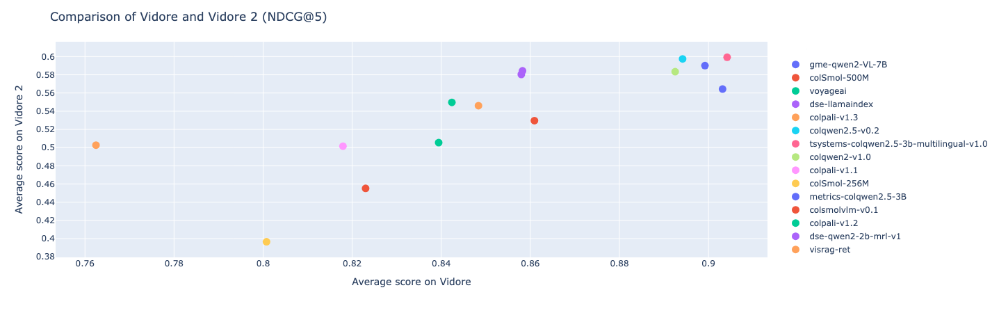
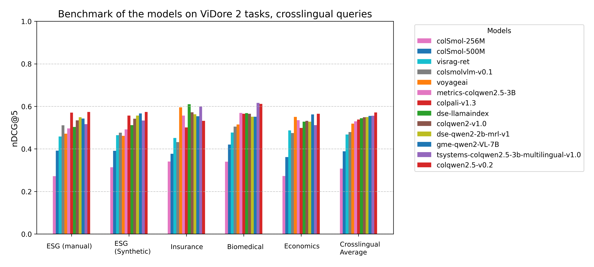

# ViDoRe v2：更贴近真实用户的视觉文档检索评测

> ViDoRe v2 用有限上下文生成查询、人工修订和跨页相关性标注，提高视觉文档检索基准的难度与真实性。
>
> [技术报告](https://arxiv.org/abs/2505.17166) · 本文依据 v2 · [评测代码](https://github.com/illuin-tech/vidore-benchmark)

[补充解读](ViDoRe-v2解读.md)

## 摘要

ViDoRe v1 上领先模型已超过 90 的 nDCG@5，部分数据集难以继续区分模型能力。v2 针对从原文摘取问题、只找单页答案及合成问题质量不稳定等问题，构建保险、生物医学、经济和 ESG 四类资料，并加入人工查询及多语言版本。它让模型面对更长、更间接且涉及多个页面的真实信息需求。新基准与 v1 排名仍相关，但留下更大的提升空间；其规模较小且部分问题经过合成或翻译，不能代表全部企业文档场景。

## 为什么需要新基准

ViDoRe v1 的强模型平均 nDCG@5 已超过 90，部分任务趋于饱和。单凭旧榜单难以判断新模型在真实文档库中的提升，v2 因而重新设计查询与相关性标注。

## 创建 ViDoRe v2 的动机

原有查询常从已知页面抽取，用户却通常不知道目标原文；单页正例忽略跨页、跨文档的信息需求；完全合成还会产生无关或过于简单的问题。这三点决定新基准不只是更换 PDF。

## 设计决策

**盲上下文查询：** 标注模型只看摘要、元数据等有限线索，降低照抄页面文字的偏置，之后过滤大量不相关问题。

**长查询与跨文档需求：** 问题可以需要多个页面，多篇文档都可贡献相关证据，不能继续默认每个查询只有一个正页。

**合成加人工：** 先自动产生候选，再由人工检查、精炼与判断相关性。这样仍有人工成本，却能减少纯合成的琐碎问题和错误标签。

## 数据集选择

| Dataset | Orig. Lang | Query Lang | # Unique Docs | # Pages | Query Subset | # Queries | # Qrels | Avg. Pages/Query | Comments |
| --- | --- | --- | --- | --- | --- | --- | --- | --- | --- |
| Insurance Terms of Service  | Fr | Fr | 4 | 260 | - | 18 | 86 | 4.8 | Small but challenging, multi-document |
| Biomedical | En | En | 27 | 1,016 | - | 160 | 515 | 3.2 | Largest dataset, most extractive |
| Economics | En | En | 5 | 452 | - | 58 | 907 | 15.6 | Cross-document queries, high complexity |
| ESG Reports | En | En | 30 | 1,538 | Synthetic | 57 | 222 | 3.9 | Natively cross-lingual, industry-specific |
| ESG Reports | En | En | 30 | 1,538 | Human | 52 | 128 | 2.5 |  |

Insurance 是法语保险条款，规模小但同一需求可涉及多个条款页面；Biomedical 覆盖较多生物医学文档，词面抽取性相对更强；Economics 的跨文档查询平均关联约 15.6 页；ESG 分人工和合成查询子集。各集合还有英、法、西、德翻译查询版本，文档库不一定随查询语言改变，因此也考察跨语检索。

原始四类语料总计 66 篇文档、3,266 页，数据集小而同领域干扰密集。表中的 Qrels 是已标相关的查询—页面对数，和查询数、独立文档数分别计数。

## 评估模型

### 命令行

```bash
vidore-benchmark evaluate-retriever \
    --model-class colpali \
    --model-name vidore/colpali-v1.3 \
    --collection-name vidore/vidore-benchmark-v2-dev-67ae03e3924e85b36e7f53b0 \
    --dataset-format beir \
    --split test
```

这是原报告的命令与集合标识；复现实验需固定评测包和模型版本。BEIR 格式分别存 corpus、queries 与 qrels，页级相关性可以是一对多。

### 自定义检索器

官方 [vidore-benchmark](https://github.com/illuin-tech/vidore-benchmark) 定义图像编码、查询编码与相似度接口；多向量模型应保留对应打分函数。报告也提出迁移到 MTEB 的计划，这不等于当时所有模型已使用同一实现。

## 结果

原文 Table 2 的历史快照使用 nDCG@5，九列包括原语种、翻译查询和 ESG 人工子集，平均并非仅四个英文任务的平均。

| 模型 | ESG人工 | Insurance | Economics | Biomedical | 九项平均 |
| --- | --- | --- | --- | --- | --- |
| ColPali-v1.2 | 0.321 | 0.560 | 0.531 | 0.585 | 0.505 |
| ColPali-v1.3 | 0.511 | 0.598 | 0.516 | 0.597 | 0.546 |
| ColQwen2-v1.0 | 0.622 | 0.651 | 0.615 | 0.618 | 0.583 |
| ColQwen2.5-v0.2 | 0.684 | 0.603 | 0.598 | 0.636 | 0.597 |
| GME-Qwen2-VL-7B | 0.658 | 0.607 | 0.629 | 0.640 | 0.590 |
| T-Systems ColQwen2.5-3B multi | 0.721 | 0.693 | 0.548 | 0.653 | 0.599 |




v1 与 v2 的模型表现整体相关，但高分区的饱和得到缓解。部分模型在 v2 上明显低于 v1 所暗示的水平，作者将其视作泛化不足的迹象，而非已经单独证明了某种训练数据泄漏。



多语言切分暴露出英语骨干和英语训练模型的不足。人工 ESG 查询提供了更明显的区分信号；更大模型通常较强，但也增加编码时间与推理延迟。

模型在 v1、v2 上总体仍相关，但 v2 留有更明显提升空间。部分小模型在新分布下退步超过旧榜单所预期，提示训练分布适配可能限制泛化；这是跨基准观察，不能单凭一张图证明过拟合原因。跨语差距揭示只用英语检索数据和英语骨干的局限，ESG 人工问题也更能区分模型。大模型通常更强，但计算和延迟更高。

## 后续方向

v2 被设计为持续扩展的评测资源：增加领域、语言与模态，探索置信度等指标。它测量复杂文档的检索排序，不直接评价最终 RAG 回答；同题多个相关页面也不意味着系统已经完成跨页推理。
