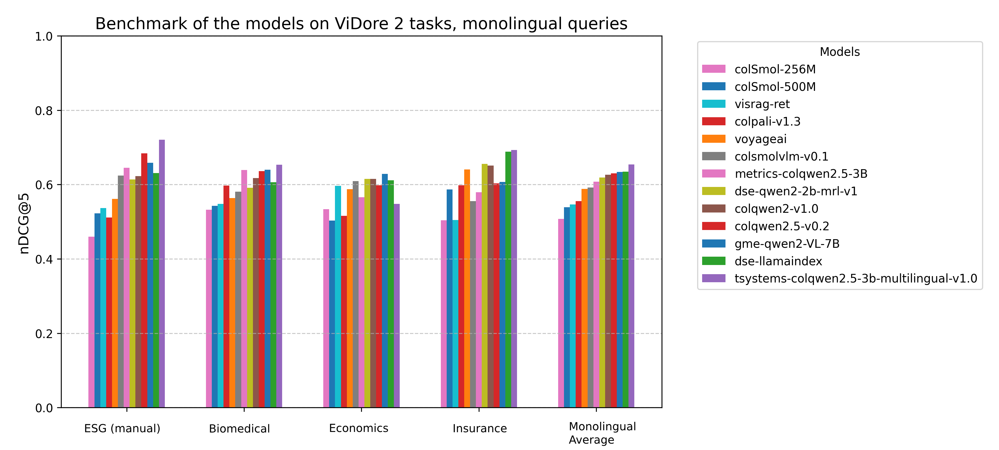

# ViDoRe Benchmark V2: Raising the Bar for Visual Retrieval / 全文中英对照

> 来源：[arXiv:2505.17166v2](https://arxiv.org/abs/2505.17166v2)。英文段落后紧接中文，覆盖所取 HTML 版本的主文、附录、图表、脚注与参考文献；公式、数字表和书目信息共用。中文以机器初译为底稿，进行了术语整理与结构核对，尚未逐句人工审定；遇到歧义请以紧邻英文和原论文为准。 原作版权归所列作者，许可见 [原作许可](http://creativecommons.org/publicdomain/zero/1.0/)；中文译文与版式改写在该许可条件下提供（涉及 SA 时沿用相同许可，涉及 NC 时仅限非商业使用）。

## Authors and affiliations / 作者与机构

Quentin Macé Affiliation: Illuin Technology António Loison Affiliation: Illuin Technology Manuel Faysse Affiliation: Illuin Technology Affiliation: CentraleSupélec

## Abstract / 摘要

**EN.** The ViDoRe Benchmark V1 was approaching saturation with top models exceeding 90% nDCG@5, limiting its ability to discern improvements. ViDoRe Benchmark V2 introduces realistic, challenging retrieval scenarios via blind contextual querying, long and cross-document queries, and a hybrid synthetic and human-in-the-loop query generation process. It comprises four diverse, multilingual datasets and provides clear evaluation instructions. Initial results demonstrate substantial room for advancement and highlight insights on model generalization and multilingual capability. This benchmark is designed as a living resource, inviting community contributions to maintain relevance through future evaluations.

**中.** ViDoRe Benchmark V1 接近饱和，顶级模型超过 90% nDCG@5，限制了其识别改进的能力。 ViDoRe Benchmark V2 通过盲目上下文查询、长文档和跨文档查询以及混合合成和人机交互查询生成过程引入了现实的、具有挑战性的检索场景。它包含四个不同的多语言数据集，并提供清晰的评估说明。初步结果表明了巨大的进步空间，并突出了对模型泛化和多语言能力的见解。该基准被设计为一种生活资源，邀请社区做出贡献，以通过未来的评估保持相关性。

## Why a new benchmark? / 为什么要制定新基准？

**EN.** Since the release of the original ViDoRe Benchmark ( Faysse et al., 2025 ) , evaluating visual models on document retrieval tasks, visual retrieval models have significantly advanced! While the original ColPali model reported an average score of 81.3 nDCG@5, current SOTA models on the leaderboard surpass a nDCG@5 of 90, with some tasks becoming “too easy” to yield a meaningful signal! With the benchmark approaching saturation for SOTA models, there is limited room to truly measure improvements and understand model capabilities in realistic scenarios. To continue pushing the boundaries of visual retrieval, it became essential to introduce a new benchmark designed specifically to challenge these advanced models: ViDoRe Benchmark V2 .

**中.** 自从原始 ViDoRe Benchmark（Faysse 等人，2025）发布以来，在文档检索任务上评估视觉模型，视觉检索模型取得了显着的进步！虽然最初的 ColPali 模型报告的平均得分为 81.3 nDCG@5，但排行榜上当前的 SOTA 模型的 nDCG@5 超过了 90，有些任务变得“太容易”而无法产生有意义的信号！随着 SOTA 模型的基准接近饱和，真正衡量改进和了解现实场景中模型功能的空间有限。为了继续突破视觉检索的界限，必须引入专门为挑战这些先进模型而设计的新基准：ViDoRe Benchmark V2。

## Motivating the Creation of ViDoRe Benchmark V2 / 推动 ViDoRe 基准测试 V2 的创建

**EN.** In developing ViDoRe Benchmark V2, our main goal was to create a benchmark reflective of real-world retrieval challenges—difficult, diverse, and meaningful. Current benchmarks exhibit limitations that prevent them from accurately reflecting real user behavior and complex retrieval scenarios ( Thakur et al., 2025 ) . We identified three critical issues in existing benchmarks:

**中.** 在开发 ViDoRe Benchmark V2 时，我们的主要目标是创建一个反映现实世界检索挑战的基准——困难、多样化且有意义。当前的基准测试存在局限性，无法准确反映真实的用户行为和复杂的检索场景（Thakur 等人，2025）。我们确定了现有基准中的三个关键问题：

**EN.** 1.

**中.** 1.

**EN.** Extractive Nature of Queries: Current benchmarks typically rely on extractive queries, providing unrealistic retrieval contexts since real users rarely formulate queries from exact phrases in documents.

**中.** 查询的提取性质：当前的基准通常依赖于提取查询，提供不切实际的检索上下文，因为真实用户很少根据文档中的确切短语制定查询。

**EN.** 2.

**中.** 2.

**EN.** Single-Page Query Bias: Many benchmarks overly emphasize retrieval from single-page contexts, neglecting complex, multi-document or cross-document queries common in real-world applications.

**中.** 单页查询偏差：许多基准测试过度强调从单页上下文中检索，而忽略了现实应用程序中常见的复杂、多文档或跨文档查询。

**EN.** 3.

**中.** 3.

**EN.** Challenges in Synthetic Query Generation: Purely synthetic benchmarks, while appealing in theory, are difficult to implement effectively without extensive manual oversight. They often produce outliers, irrelevant or trivial queries, making human filtering essential yet costly.

**中.** 综合查询生成中的挑战：纯综合基准虽然在理论上很有吸引力，但如果没有大量的人工监督，就很难有效实施。它们经常产生异常值、不相关或琐碎的查询，使得人工过滤必不可少但成本高昂。

## Design Decisions and Techniques Used / 设计决策和使用的技术

**EN.** To address these challenges and create a robust, realistic benchmark, ViDoRe Benchmark V2 includes several innovative features:

**中.** 为了应对这些挑战并创建强大、现实的基准，ViDoRe Benchmark V2 包含多项创新功能：

**EN.** Blind Contextual Querying: In practice, users don’t often know the content of the corpus they are querying. To reduce the widespread extractive bias in most synthetic query-document datasets (datasets are often created with knowledge of the document content), we only provided query annotator models with limited information about the document (summaries, metadata, etc) and filtered out the many irrelevant queries that resulted, better reproducing real-world user interactions with the corpus.

**中.** 盲上下文查询：在实践中，用户通常不知道他们正在查询的语料库的内容。为了减少大多数综合查询文档数据集中普遍存在的提取偏差（数据集通常是在了解文档内容的情况下创建的），我们只提供了具有有限的文档信息（摘要、元数据等）的查询注释器模型，并过滤掉了由此产生的许多不相关的查询，从而更好地再现了现实世界的用户与语料库的交互。

**EN.** Long and Cross-Document Queries: Unlike traditional benchmarks, ViDoRe Benchmark V2 emphasizes long-form and cross-document queries, closely mirroring real-world retrieval situations. Multiple datasets specifically focus on scenarios involving comprehensive documents or multi-document retrieval tasks.

**中.** 长查询和跨文档查询：与传统基准测试不同，ViDoRe Benchmark V2 强调长格式查询和跨文档查询，密切反映现实世界的检索情况。多数据集特别关注涉及综合文档或多文档检索任务的场景。

**EN.** Hybrid Synthetic and Human-in-the-Loop Creation: Recognizing the limitations of synthetic query generation alone, we adopted a hybrid approach—generating queries synthetically and extensively refining them through human review. This process, though intensive, ensured significantly higher query quality and dataset reliability.

**中.** 混合综合和人在环创建：认识到单独生成综合查询的局限性，我们采用了一种混合方法——综合生成查询并通过人工审查广泛改进它们。这个过程虽然很密集，但确保了显着提高的查询质量和数据集可靠性。

## Dataset Selection for ViDoRe Benchmark V2 / ViDoRe Benchmark V2 的数据集选择

**EN.** The selected datasets ( Table 1 ) for ViDoRe Benchmark V2 are diverse, publicly available, and challenging. Each dataset presents distinct visual complexity and is suitable for realistic retrieval tasks, including multilingual versions with queries translated into French, English, Spanish, and German. This multilingual approach further extends the applicability and challenge level of the benchmark. Each dataset is associated to a multilingual version with translated queries.

**中.** ViDoRe Benchmark V2 所选数据集（表 1）多种多样、公开且具有挑战性。每个数据集都呈现出独特的视觉复杂性，适合现实的检索任务，包括将查询翻译成法语、英语、西班牙语和德语的多语言版本。这种多语言方法进一步扩展了基准的适用性和挑战水平。每个数据集都与带有翻译查询的多语言版本相关联。

| Dataset<br>数据集 | Orig. Lang<br>原始。郎 | Query Lang<br>查询语言 | # Unique Docs<br># 独特的文档 | # Pages<br># 页数 | Query Subset<br>查询子集 | # Queries<br># 查询 | # Qrels | Avg. Pages/Query<br>平均。页面/查询 | Comments<br>评论 |
| --- | --- | --- | --- | --- | --- | --- | --- | --- | --- |
| Insurance Terms of Service [^footnote1]<br>保险服务条款 [^footnote1] | Fr | Fr | 4 | 260 | - | 18 | 86 | 4.8 | Small but challenging, multi-document<br>小但具有挑战性的多文档 |
| Biomedical<br>生物医学 | En<br>恩 | En<br>恩 | 27 | 1,016 | - | 160 | 515 | 3.2 | Largest dataset, most extractive<br>最大的数据集，最具提取性 |
| Economics<br>经济学 | En<br>恩 | En<br>恩 | 5 | 452 | - | 58 | 907 | 15.6 | Cross-document queries, high complexity<br>跨文档查询，复杂度高 |
| ESG Reports<br>环境、社会及管治报告 | En<br>恩 | En<br>恩 | 30 | 1,538 | Synthetic<br>合成的 | 57 | 222 | 3.9 | Natively cross-lingual, industry-specific<br>原生跨语言、针对特定行业 |
| ESG Reports<br>环境、社会及管治报告 | En<br>恩 | En<br>恩 | 30 | 1,538 | Human<br>人类 | 52 | 128 | 2.5 |  |

**EN.** Table 1: Summary of dataset statistics. Feel free to explore datasets on HuggingFace.

**中.** 表 1：数据集统计数据摘要。请随意探索 HuggingFace 上的数据集。

## Evaluating Models / 评估模型

**EN.** To evaluate models on ViDoRe Benchmark 2, we follow these steps:

**中.** 为了在 ViDoRe Benchmark 2 上评估模型，我们遵循以下步骤：

### Option 1: Using the CLI / 选项 1：使用 CLI

**EN.** Here is a CLI example for using a colpali type retriever on vidore benchmark 2. For other retrievers, please refer to this repo.

**中.** 以下是在 vidore benchmark 2 上使用 colpali 类型检索器的 CLI 示例。对于其他检索器，请参阅此存储库。

```text
vidore-benchmark evaluate-retriever \\
    --model-class colpali \\
    --model-name vidore/colpali-v1.3 \\
    --collection-name vidore/vidore-benchmark-v2-dev-67ae03e3924e85b36e7f53b0 \\
    --dataset-format beir \\
    --split test
```

### Option 2: Creating a custom retriever / 选项 2：创建自定义检索器

**EN.** Detailed instructions on how to create a custom retriever are available at [https://github.com/illuin-tech/vidore-benchmark](https://github.com/illuin-tech/vidore-benchmark) . We will soon transition to using the MTEB ( Muennighoff et al., 2022 ) library to evaluate all models.

**中.** 有关如何创建自定义检索器的详细说明，请访问 [https://github.com/illuin-tech/vidore-benchmark](https://github.com/illuin-tech/vidore-benchmark)。我们很快将过渡到使用 MTEB (Muennighoff et al., 2022) 库来评估所有模型。

## Results / 结果

**EN.** Here are for example some nDCG@5 results of visual retrieval models on ViDoRe Benchmark 2 ( Faysse et al., 2025 ; Ma et al., 2024 ; Zhang et al., 2024 ; Yu et al., 2024 ; Team, 2025 ) . [^footnote2]

**中.** 例如，以下是 ViDoRe Benchmark 2 上视觉检索模型的一些 nDCG@5 结果（Faysse 等人，2025；Ma 等人，2024；Zhang 等人，2024；Yu 等人，2024；Team，2025）。 [^footnote2]

| Model<br>型号 | ESG Reports (Manual)<br>ESG报告（手册） | Insurance<br>保险 | Insurance Multilingual<br>保险多语种 | Economics<br>经济学 | Biomedical<br>生物医学 | Bio Multilingual<br>生物多语言 | ESG Reports<br>环境、社会及管治报告 | ESG Reports Multilingual<br>ESG 报告多语言 | Economics Multilingual<br>经济学多语种 | Average<br>平均 |
| --- | --- | --- | --- | --- | --- | --- | --- | --- | --- | --- |
| voyageai<br>航行爱 | 0.561 | 0.641 | 0.595 | 0.588 | 0.564 | 0.515 | 0.472 | 0.462 | 0.550 | 0.550 |
| metrics-AI/colqwen2.5-3B<br>指标-AI/colqwen2.5-3B | 0.645 | 0.579 | 0.557 | 0.566 | 0.639 | 0.569 | 0.496 | 0.492 | 0.535 | 0.564 |
| colsmolvlm-v0.1 | 0.624 | 0.555 | 0.432 | 0.609 | 0.581 | 0.505 | 0.511 | 0.476 | 0.474 | 0.530 |
| colqwen2-v1.0 | 0.622 | 0.651 | 0.572 | 0.615 | 0.618 | 0.565 | 0.534 | 0.542 | 0.532 | 0.583 |
| colpali-v1.2 | 0.321 | 0.560 | 0.458 | 0.531 | 0.585 | 0.557 | 0.519 | 0.540 | 0.479 | 0.505 |
| dse-qwen2-2b-mrl-v1 | 0.614 | 0.655 | 0.563 | 0.615 | 0.592 | 0.551 | 0.549 | 0.557 | 0.528 | 0.580 |
| colSmol-256M | 0.460 | 0.504 | 0.341 | 0.534 | 0.532 | 0.340 | 0.272 | 0.313 | 0.273 | 0.397 |
| colpali-v1.3 | 0.511 | 0.598 | 0.501 | 0.516 | 0.597 | 0.565 | 0.570 | 0.557 | 0.499 | 0.546 |
| colqwen2.5-v0.2 | 0.684 | 0.603 | 0.532 | 0.598 | 0.636 | 0.611 | 0.574 | 0.574 | 0.565 | 0.597 |
| dse-llamaindex<br>塞拉玛指数 | 0.631 | 0.688 | 0.610 | 0.612 | 0.606 | 0.569 | 0.503 | 0.512 | 0.528 | 0.584 |
| tsystems/colqwen2.5-3b-multi-v1.0 | 0.721 | 0.693 | 0.600 | 0.548 | 0.653 | 0.617 | 0.517 | 0.533 | 0.512 | 0.599 |
| gme-qwen2-VL-7B | 0.658 | 0.607 | 0.554 | 0.629 | 0.640 | 0.551 | 0.543 | 0.567 | 0.562 | 0.590 |
| visrag-ret<br>维拉格热特 | 0.537 | 0.505 | 0.452 | 0.596 | 0.548 | 0.477 | 0.459 | 0.464 | 0.487 | 0.503 |
| colSmol-500M | 0.522 | 0.587 | 0.377 | 0.503 | 0.543 | 0.421 | 0.392 | 0.391 | 0.361 | 0.455 |
| colpali-v1.1 | 0.465 | 0.547 | 0.484 | 0.567 | 0.564 | 0.507 | 0.461 | 0.481 | 0.438 | 0.502 |

**EN.** Table 2: Model performance across datasets (nDCG@5). Highest per column in bold .

**中.** 表 2：跨数据集的模型性能 (nDCG@5)。每列最高的以粗体显示。


**EN.** Figure 1: Performance results across models for V1 and V2. We observe strong correlations, although a clear saturation on V1 for top models. Results are in nDCG@5.

**中.** 图 1：V1 和 V2 模型的性能结果。我们观察到很强的相关性，尽管顶级模型的 V1 明显饱和。结果在 nDCG@5 中。

**EN.** Analyzing the results, we can extract a few general takeaways:

**中.** 分析结果，我们可以得出一些一般性结论：

**EN.** ViDoRe v2 maintains strong correlation with v1, with consistent model rankings across versions ( Figure 1 ).

**中.** ViDoRe v2 与 v1 保持了很强的相关性，各个版本的模型排名保持一致（图 1）。

**EN.** ViDoRe v2 leaves substantial room for future improvements, contrasting with ViDoRe v1, which was approaching performance saturation (scores exceeding 90% as seen in Figure 2 ).

**中.** 与 ViDoRe v1 相比，ViDoRe v2 为未来的改进留下了巨大的空间，ViDoRe v1 已接近性能饱和（分数超过 90%，如图 2 所示）。

**EN.** Certain models exhibit signs of slightly overfitting to the training distribution, resulting in reduced generalization to novel data (e.g., vidore/colSmol-256M, vidore/colSmol-500M, Metric-AI/ColQwen2.5-3b-multilingual-v1.0). These models perform worst on the V2 than what their performance on the V1 would lead to believe ( Figure 1 ).

**中.** 某些模型表现出对训练分布稍微过度拟合的迹象，导致对新数据的泛化能力降低（例如 vidore/colSmol-256M、vidore/colSmol-500M、Metric-AI/ColQwen2.5-3b-multilingual-v1.0）。这些模型在 V2 上的表现比在 V1 上的表现要差（图 1）。

**EN.** The multilingual splits in ViDoRe v2 provide a more accurate assessment of non-english capabilities in visual retriever models. We observe a significant performance gap between models trained exclusively in English using an English-only VLM and those that are not.( Figure 3 )

**中.** ViDoRe v2 中的多语言分割可以更准确地评估视觉检索器模型中的非英语能力。我们观察到使用纯英语 VLM 进行专门英语训练的模型与未使用纯英语 VLM 训练的模型之间存在显着的性能差距。（图 3）

**EN.** Larger model scale is beneficial; notably, the gme-qwen7B model achieves strong overall performance but incurs significant computational cost and inference latency. Inversely, while impressive for their sizes, models under 1B parameters tend to lag behind, especially on previously unseen data distributions.

**中.** 较大的模型规模是有利的；值得注意的是，gme-qwen7B 模型实现了强大的整体性能，但会产生大量的计算成本和推理延迟。相反，虽然其规模令人印象深刻，但 1B 参数下的模型往往会落后，尤其是在以前未见过的数据分布上。

**EN.** We tend to see better separation between model performances with the human labeled dataset (ESG human), indicating it is of slightly higher quality than the synthetic datasets and is a more discriminating signal ( Figure 2 ).

**中.** 我们倾向于看到模型性能与人类标记数据集（ESG human）之间有更好的分离，这表明它的质量比合成数据集稍高，并且是更具辨别力的信号（图 2）。



**EN.** Figure 2: Performance results across monolingual tasks. ViDoRe v2 leaves substantial room for future improvements, contrasting with ViDoRe v1, which was approaching performance saturation.

**中.** 图 2：单语言任务的性能结果。与接近性能饱和的 ViDoRe v1 相比，ViDoRe v2 为未来的改进留下了巨大的空间。


**EN.** Figure 3: Performance results across crosslingual tasks.We observe a significant performance gap between models trained exclusively in English using an English-only VLM and those that are not.

**中.** 图 3：跨语言任务的性能结果。我们观察到使用纯英语 VLM 专门用英语训练的模型与不使用纯英语 VLM 的模型之间存在显着的性能差距。

## Moving Forward / 前进

**EN.** Our goal is for ViDoRe V2 to become a dynamic, ”living benchmark” that regularly grows with new tasks and datasets. To achieve this, we welcome and encourage the community to contribute datasets and evaluation tasks. This collaborative approach helps ensure that the benchmark stays relevant, useful, and reflective of real-world challenges.

**中.** 我们的目标是让 ViDoRe V2 成为一个动态的“活基准”，随着新任务和数据集的出现而定期增长。为了实现这一目标，我们欢迎并鼓励社区贡献数据集和评估任务。这种协作方法有助于确保基准保持相关性、有用性并反映现实世界的挑战。

**EN.** We are also open on integrating new retrieval metrics such as confidence estimation measures ( Gisserot-Boukhlef et al., 2024 ) , increasing multilingual coverage allowed by ever better base models ( Yang et al., 2025 ; Boizard et al., 2025 ) , and extending the leaderboard to new modalities (audio, image querying, etc…)

**中.** 我们还愿意整合新的检索指标，例如置信度估计措施（Gisserot-Boukhlef 等人，2024），通过更好的基础模型增加多语言覆盖范围（Yang 等人，2025；Boizard 等人，2025），并将排行榜扩展到新的模式（音频、图像查询等……）

## Acknowledgements / 致谢

**EN.** Training compute for running evaluations is obtained on the Jean Zay supercomputer operated by GENCI IDRIS through compute grant AD011016393.

**中.** 用于运行评估的训练计算是通过计算拨款 AD011016393 在 GENCI IDRIS 运营的 Jean Zay 超级计算机上获得的。

**EN.** For deeper discussions and projects around Visual RAG, ColPali, or agentic systems, please contact contact@illuin.tech or visit [https://www.illuin.tech](https://www.illuin.tech) . We welcome community contributions of document-query sets to enhance this living benchmark.

**中.** 有关 Visual RAG、ColPali 或代理系统的更深入讨论和项目，请联系 contact@illuin.tech 或访问 [https://www.illuin.tech](https://www.illuin.tech)。我们欢迎社区贡献文档查询集，以增强这一生活基准。

## References / 参考文献

- Boizard et al. (2025) Nicolas Boizard, Hippolyte Gisserot-Boukhlef, Duarte M. Alves, André Martins, Ayoub Hammal, Caio Corro, Céline Hudelot, Emmanuel Malherbe, Etienne Malaboeuf, Fanny Jourdan, Gabriel Hautreux, João Alves, Kevin El-Haddad, Manuel Faysse, Maxime Peyrard, Nuno M. Guerreiro, Patrick Fernandes, Ricardo Rei, and Pierre Colombo. Eurobert: Scaling multilingual encoders for european languages, 2025. URL [https://arxiv.org/abs/2503.05500](https://arxiv.org/abs/2503.05500) .

- Faysse et al. (2025) Manuel Faysse, Hugues Sibille, Tony Wu, Bilel Omrani, Gautier Viaud, Céline Hudelot, and Pierre Colombo. Colpali: Efficient document retrieval with vision language models, 2025. URL [https://arxiv.org/abs/2407.01449](https://arxiv.org/abs/2407.01449) .

- Gisserot-Boukhlef et al. (2024) Hippolyte Gisserot-Boukhlef, Manuel Faysse, Emmanuel Malherbe, Céline Hudelot, and Pierre Colombo. Towards trustworthy reranking: A simple yet effective abstention mechanism, 2024. URL [https://arxiv.org/abs/2402.12997](https://arxiv.org/abs/2402.12997) .

- Ma et al. (2024) Xueguang Ma, Sheng-Chieh Lin, Minghan Li, Wenhu Chen, and Jimmy Lin. Unifying multimodal retrieval via document screenshot embedding, 2024. URL [https://arxiv.org/abs/2406.11251](https://arxiv.org/abs/2406.11251) .

- Muennighoff et al. (2022) Niklas Muennighoff, Nouamane Tazi, Loïc Magne, and Nils Reimers. MTEB: Massive Text Embedding Benchmark, 2022. URL [https://arxiv.org/abs/2210.07316](https://arxiv.org/abs/2210.07316) . Version Number: 3.

- Team (2025) Nomic Team. Nomic embed multimodal: Interleaved text, image, and screenshots for visual document retrieval, 2025. URL [https://nomic.ai/blog/posts/nomic-embed-multimodal](https://nomic.ai/blog/posts/nomic-embed-multimodal) .

- Thakur et al. (2025) Nandan Thakur, Jimmy Lin, Sam Havens, Michael Carbin, Omar Khattab, and Andrew Drozdov. Freshstack: Building realistic benchmarks for evaluating retrieval on technical documents, 2025. URL [https://arxiv.org/abs/2504.13128](https://arxiv.org/abs/2504.13128) .

- Yang et al. (2025) An Yang, Bowen Yu, Chengyuan Li, Dayiheng Liu, Fei Huang, Haoyan Huang, Jiandong Jiang, Jianhong Tu, Jianwei Zhang, Jingren Zhou, Junyang Lin, Kai Dang, Kexin Yang, Le Yu, Mei Li, Minmin Sun, Qin Zhu, Rui Men, Tao He, Weijia Xu, Wenbiao Yin, Wenyuan Yu, Xiafei Qiu, Xingzhang Ren, Xinlong Yang, Yong Li, Zhiying Xu, and Zipeng Zhang. Qwen2.5-1m technical report, 2025. URL [https://arxiv.org/abs/2501.15383](https://arxiv.org/abs/2501.15383) .

- Yu et al. (2024) Shi Yu, Chaoyue Tang, Bokai Xu, Junbo Cui, Junhao Ran, Yukun Yan, Zhenghao Liu, Shuo Wang, Xu Han, Zhiyuan Liu, and Maosong Sun. Visrag: Vision-based retrieval-augmented generation on multi-modality documents, 2024. URL [https://arxiv.org/abs/2410.10594](https://arxiv.org/abs/2410.10594) .

- Zhang et al. (2024) Xin Zhang, Yanzhao Zhang, Wen Xie, Mingxin Li, Ziqi Dai, Dingkun Long, Pengjun Xie, Meishan Zhang, Wenjie Li, and Min Zhang. Gme: Improving universal multimodal retrieval by multimodal llms, 2024. URL [http://arxiv.org/abs/2412.16855](http://arxiv.org/abs/2412.16855) .

## Footnotes / 脚注

[^footnote1]: **EN.** Since the dataset release, the insurance dataset was removed from the dataset for legal copyright reasons.<br>**中.** 自数据集发布以来，出于合法版权原因，保险数据集已从数据集中删除。

[^footnote2]: **EN.** We adapted the evaluation procedure for the voyageAI API, resulting in slightly lower performance on the ViDoRe benchmark v1 compared to the values reported by voyageAI. This discrepancy likely arises from our resizing of input images to a maximum image height of 1200 pixels to facilitate efficient benchmarking, a preprocessing step presumably not applied in voyageAI’s original benchmarking setup.<br>**中.** 我们调整了 voyageAI API 的评估程序，导致 ViDoRe 基准 v1 的性能略低于 voyageAI 报告的值。这种差异可能是由于我们将输入图像的大小调整为最大图像高度 1200 像素，以促进高效的基准测试，这一预处理步骤可能未应用于 voyageAI 的原始基准测试设置中。
