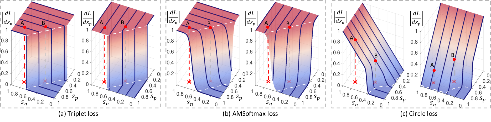
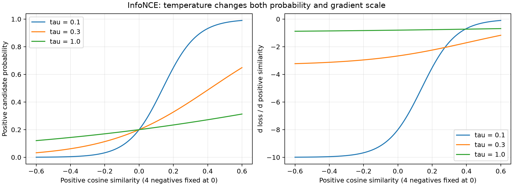
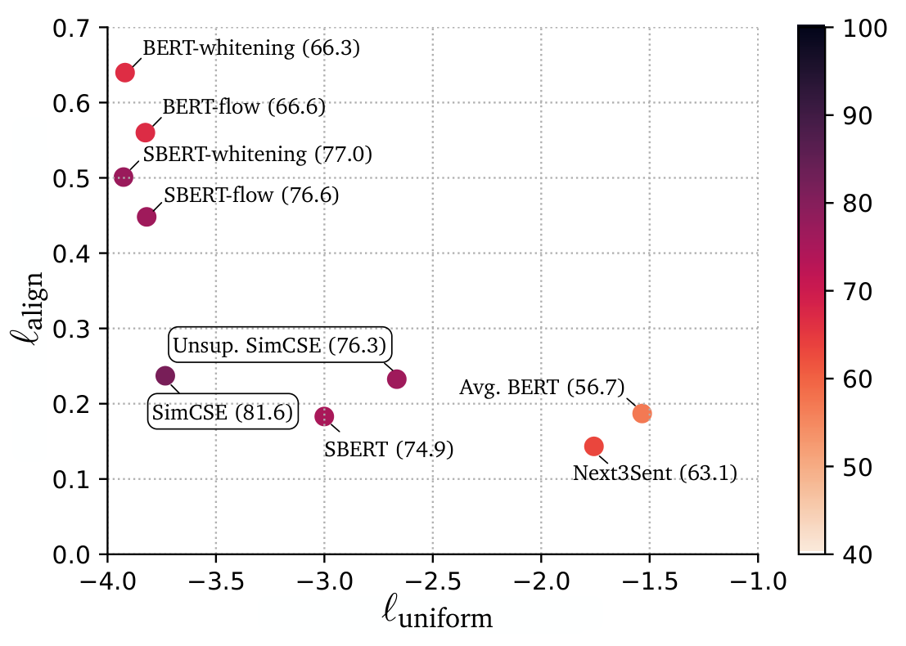
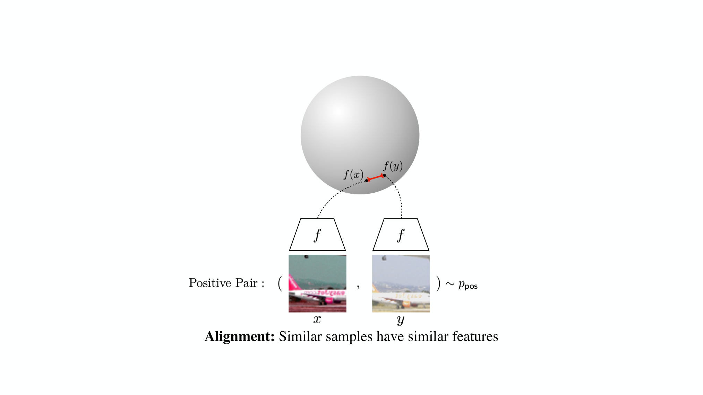
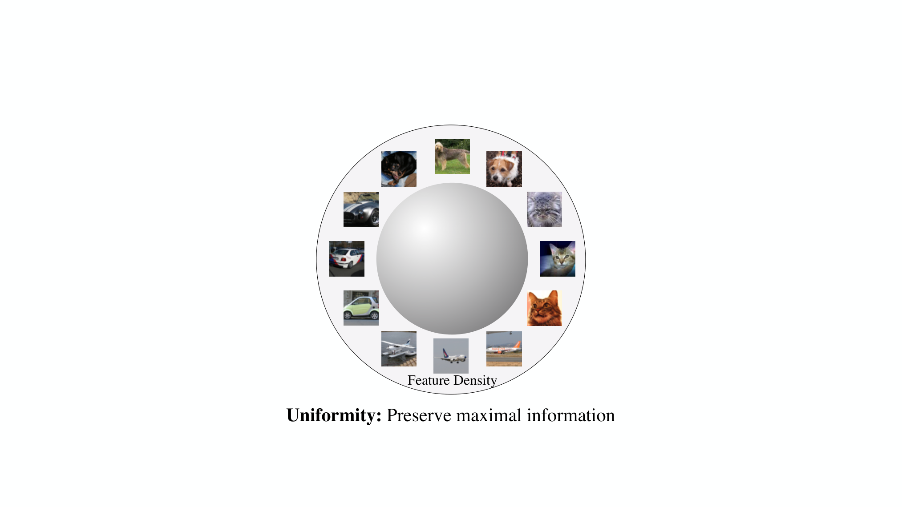
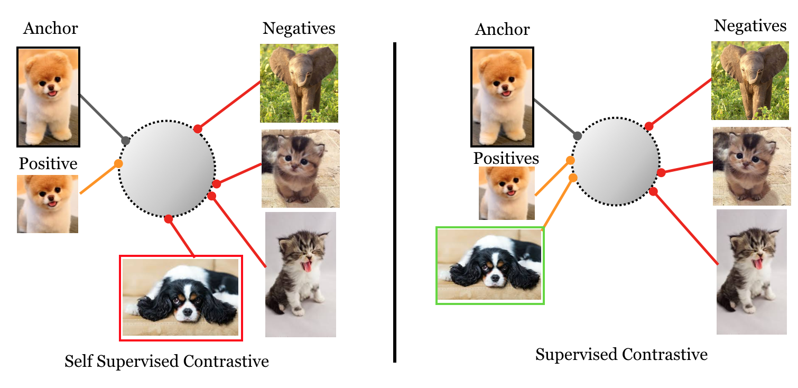
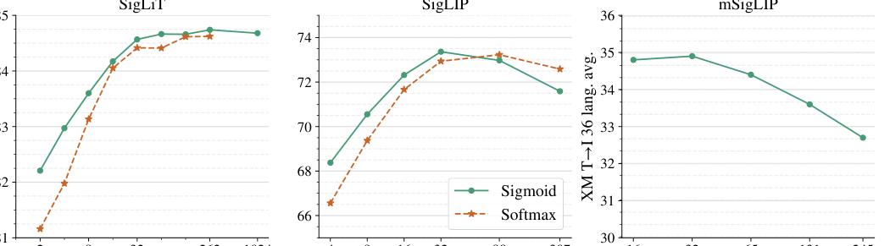

# Embedding 损失函数精讲：度量学习、对比学习、排序与蒸馏

> 从“哪些样本应相近、哪些应区分”出发，系统解释 Embedding 损失的监督、候选、公式与梯度。度量学习、对比学习、分数回归和教师蒸馏分别约束什么，是本文贯穿的问题。
>
> **新增原始来源**：[SupCon](https://arxiv.org/abs/2004.11362) · [Circle Loss](https://arxiv.org/abs/2002.10857) · [CosFace](https://arxiv.org/abs/1801.09414) · [ArcFace](https://arxiv.org/abs/1801.07698) · [MRL](https://arxiv.org/abs/2205.13147)。
>
> **相关论文**：[InfoNCE / CPC (Oord 2018)](https://arxiv.org/abs/1807.03748) · [N-pair loss (Sohn 2016)](https://papers.nips.cc/paper/2016/hash/6b180037abbebea991d8b1232f8a8ca9-Abstract.html) · [Multi-Similarity Loss (Wang 2019)](https://arxiv.org/abs/1904.06627) · [Multiple Negatives Ranking Loss (Henderson 2017)](https://arxiv.org/abs/1705.00652) · [Triplet loss (FaceNet 2015)](https://arxiv.org/abs/1503.03832) · [Alignment & Uniformity (Wang & Isola 2020)](https://arxiv.org/abs/2005.10242) · [MoCo (He 2019)](https://arxiv.org/abs/1911.05722) · [SimCLR (Chen 2020)](https://arxiv.org/abs/2002.05709) · [SimCSE (Gao 2021)](https://arxiv.org/abs/2104.08821) · [DPR (Karpukhin 2020)](https://arxiv.org/abs/2004.04906) · [CLIP (Radford 2021)](https://arxiv.org/abs/2103.00020) · [SigLIP (Zhai 2023)](https://arxiv.org/abs/2303.15343) · [Margin MSE / TAS-B (Hofstätter 2020)](https://arxiv.org/abs/2010.02666) · [CoSENT (苏剑林 2022)](https://kexue.fm/archives/8847) · [BGE-M3 (Chen 2024)](https://arxiv.org/abs/2402.03216) · [GritLM (Muennighoff 2024)](https://arxiv.org/abs/2402.09906) · [Vec2Vec (2025)](https://arxiv.org/abs/2505.12540)
>
> **本文定位**：把「向量检索/嵌入」用的损失函数按**信号演化路径**一次讲透 —— 从 N-pair/CPC 的候选分类结构，到 MNRL/SimCSE 在文本配对上的应用，到 CLIP 跨模态对称化，到 SigLIP 把 softmax 换成 sigmoid，到 BGE-M3 对 dense/sparse/multi-vec 三种表示分别训练并融合监督、Conan/RocketQA 把 CE 蒸馏到 BE。各部分围绕动机、数学式、样本与索引定义、适用条件及工程取舍展开；多条路线并行发展，不按“较新损失替代所有旧损失”理解。
>
> **配套**：机制层面的模型深读在同目录的《[无监督对比检索三部曲：SimCSE / Contriever / Condenser+coCondenser](无监督对比检索三部曲_SimCSE-Contriever-Condenser.md)》《[CLIP 详解](CLIP/CLIP详解.md)》《[SigLIP 与 SigLIP 2 详解](SigLIP/SigLIP与SigLIP2详解.md)》《[E5 详解](E5/E5详解.md)》《[BGE-M3 三功能统一详解报告](BGE/M3/BGE-M3三功能统一详解报告.md)》。

---

## 从监督信号理解 Embedding 损失

Embedding 训练要决定什么关系应被保留：两个句子是否表达同一意思、一个段落是否回答查询、两张图是否为同一实例，或学生是否复现教师的排序。损失把这些监督变成对表示和参数的约束。仅比较公式名称还不够，同一公式配不同的标签、候选与采样，可能训练出用途完全不同的空间。

### 度量学习与对比学习如何区分

**度量学习**关注如何学习距离、相似度或嵌入，使相关样本更近、不相关样本更远，常用类标签、实例 ID 或相关性标注。它可以使用样本对、三元组、多个样本，或者用可学习的类别向量作为参照。

**对比学习**强调利用相匹配与不匹配关系构造学习目标，例如在候选中识别正例，或分别约束正负 pair。正例可以来自标注，也可以来自数据增强、同一对象的不同视图或上下文预测，因此对比学习既可自监督，也可有监督。

两者不是互斥的算法目录。Triplet、N-pair、MS、Circle 都可用于度量学习；N-pair 又具有候选分类式结构，SupCon 则将类标签与对比训练结合。还有两种容易混淆的用法：早期 **contrastive loss** 是特定的成对 margin 损失；今天说“contrastive learning”通常指更宽的训练方式，不能认为它们都等于 InfoNCE。

| 观察维度 | 要回答的问题 | 例子 |
| --- | --- | --- |
| 监督是什么 | 类别、配对、三元组、连续分数还是教师信号 | 类别标签可用于 SupCon；相关性配对可用于 MNRL |
| 比较什么 | 距离、相似度、概率、相对间隔还是向量坐标 | Triplet 比距离差，KL 比候选分布 |
| 如何聚合 | 每个 pair、每个 triplet，还是整个候选池 | SigLIP 逐对 sigmoid，InfoNCE 候选 softmax |
| 正例有几个 | 每个 anchor 单正例还是多正例 | NT-Xent 通常一个正视图，SupCon 可有多个 |
| 谁贡献梯度 | 全部候选、挖掘后的 pair、冻结教师或 stop-gradient 权重 | MS 挖掘与加权；Circle 需明确权重的求导约定 |
| 最后如何归约 | 按 pair、正例数、anchor 或任务求平均 | 改平均方式可能改变不同类别和任务的权重 |

### 统一符号与候选集合

原始编码输出为 $v=f_\theta(x)$。需要单位球面表示时记 $z=v/\|v\|_2$，两个单位向量的点积就是余弦相似度。下面用 $s_{ij}$ 表示相似度，$u_{ij}=s_{ij}/\tau$ 表示送入 softmax 的 logit；$D_{ij}=\|z_i-z_j\|_2^2$ 表示平方欧氏距离。归一化时有 $D_{ij}=2-2s_{ij}$，未归一化时不能直接套用。

对 anchor $i$，用 $C_i$ 表示参与计算的候选索引，用 $P_i\subseteq C_i$ 和 $N_i\subseteq C_i$ 表示正负例。类别标签场景可由同类／异类划分；查询检索必须由查询—文档相关性定义，类别相同不自动意味着可以回答查询。全文局部章节可能用 $B$ 表示匹配对数，也可能表示参与平均的 anchor 数，具体以该节定义为准。

**候选索引不等于样本角色。** 在 query×document 矩阵中，对角线常是匹配对；在同一批视图的相似度矩阵中，对角线则是自身匹配，需要排除。读到 $j\ne i$ 时必须先确定矩阵两条轴是什么，不能仅凭不等号判断分母没有正例。

### 监督类型与目标函数的对应

| 已有监督 | 可以考虑的目标 | 关键条件 |
| --- | --- | --- |
| 匹配对 $(q,d^+)$ | InfoNCE／MNRL、双向对比 | 需要构造可靠的竞争候选，处理同批假负例 |
| 同一样本的两种增强 | NT-Xent、其他自监督目标 | 增强不能破坏任务需要的语义或实例身份 |
| 类别／实例 ID | Contrastive、Triplet、N-pair、SupCon、MS、Circle、角度 margin 分类 | 每个 batch 的正例数量、类别定义与泛化协议都影响目标 |
| 连续相似度标签 | 相似度 MSE、CoSENT 等排序目标 | 先确定需要绝对分数校准还是只需要次序 |
| 教师相关性或向量 | KL、Margin-MSE、分数／向量蒸馏 | 候选一致、尺度明确，教师目标与任务相容 |
| 多维度／多表示输出 | MRL、多个头的任务损失及正则 | 这些多为基础损失的组合或约束，不是负例采样方法 |

“In-batch”“hard negative”“跨卡 gather”和“GradCache”主要改变候选、采样或执行方式，本身不唯一决定损失。反过来，改用 Circle 或 SupCon 也不会自动解决标签错误与全库挖掘问题。

## 一句话定位

嵌入质量由数据、骨干、表示读出、训练损失和样本组织共同决定。本文聚焦损失：InfoNCE 是候选分类式对比学习的重要形式，MNRL 是其常见的同批候选组织方式；Triplet、Multi-Similarity、SigLIP 和蒸馏等则具有不同目标，不能全部当作 InfoNCE 的改名。比较时先看下面几个坐标：

1. **正对怎么来**（数据/增强/挖掘）
2. **负对怎么来**（in-batch / MoCo queue / ANN hard neg / cross-GPU）
3. **归一方式**（softmax vs sigmoid vs margin）
4. **损失方向与编码角色**（是否平均 q→d、d→q；另行区分参数共享与输入模板）
5. **附加信号**（KL 蒸馏、Margin MSE、alignment 正则）

搞清这五条，才能在具体项目里判断「换个 loss 会不会掉、加不加 hard neg、用不用蒸馏」。

## 谱系导览

```text
监督度量学习：根据类标签或明确的相关性组织样本对
├── Contrastive loss：正负 pair 的距离约束
├── Triplet loss：比较正例与负例的相对距离
├── N-pair loss：一个正例和多个负例的候选分类
├── Multi-Similarity loss：多个正负 pair 的挖掘与分别加权
└── Circle loss：按相似度的优化状态自适应加权

候选分类式对比学习：softmax 分母包括当前正例与负例
└── InfoNCE（CPC 中提出）
    ├── MNRL：batch 中其他配对文档提供负例
    ├── MoCo / SimCLR / SimCSE / Contriever：不同视图、字典与采样
    ├── NT-Xent：SimCLR 的两视图、排除自身的候选交叉熵
    ├── SupCon：类标签提供多个正例；单正例时可退化到 NT-Xent
    ├── DPR / ANCE / RocketQA：检索监督、难例挖掘与过滤
    └── CLIP / ALIGN / OpenCLIP：图文双塔，常用两个方向的平均

其他监督和组合
├── SigLIP / SigLIP 2：逐对 sigmoid，而非候选 softmax
├── CoSENT：按标注顺序比较句对分数
├── Margin-MSE / TAS-B / RocketQAv2 / Jasper：分数或分布蒸馏
├── BGE-M3 / Conan-CBB / GritLM：多表示、多任务或生成与表示组合
└── BYOL / DINO：无显式负例的自蒸馏支线，不是标准 InfoNCE

表示与系统扩展：Late Chunking / Vec2Vec / 2D-Matryoshka
（需分别说明作用层次，不由名称推断为一种新对比损失）
```

后文按上面这条路径逐个展开。

---

## 度量学习：从样本对和三元组到多样本加权

### Pair-based contrastive loss（Hadsell 2006）

给一对样本 $(x_1, x_2)$，标签 $y \in \{0, 1\}$（1 表示同类）：

$$
\mathcal{L} = y \cdot d(x_1, x_2)^2 + (1-y)\cdot \max\bigl(0, m - d(x_1, x_2)\bigr)^2
$$

- $d$ 通常是欧氏或余弦距离，$m$ 是 margin。
- 直觉：同类越近越好，异类保持至少 $m$ 的距离。

**取舍**：每个损失项只约束一对样本，但多个 pair 可以批量并行计算；学习信号取决于组对方式和 margin，不能将其描述成“一次前向只能算一对”。

### Triplet loss（FaceNet 2015）

给 (anchor, positive, negative) 三元组：

$$
\mathcal{L} = \max\bigl(0, \;\|f(a) - f(p)\|^2 - \|f(a) - f(n)\|^2 + m\bigr)
$$

- 每个三元组同时比较 anchor 的一个正例和一个负例，监督的是相对距离。
- FaceNet 用这个训人脸识别，取得 SOTA。

**问题**：

1. **负例挖掘困难**：随机负太易（loss 恒为 0），全 hard 又抖动。需要「semi-hard mining」的复杂流程。
2. **信号利用取决于组法**：单个 triplet 项只比较一个正例和一个负例；batch-all／batch-hard 等方法可利用更多组合，并非一次前向只能处理三个样本。
3. **margin 敏感**：不同任务的 $m$ 差异大，跨任务复用难。

#### Triplet 的梯度、距离尺度与采样

令 $D_{ap}=\|a-p\|_2^2$、$D_{an}=\|a-n\|_2^2$，单项为 $\ell=[D_{ap}-D_{an}+m_D]_+$。当括号内大于零时，按表示求导：

$$
\nabla_a\ell=2(n-p),\qquad
\nabla_p\ell=2(p-a),\qquad
\nabla_n\ell=2(a-n).
$$

梯度下降将正例拉向 anchor、负例推离 anchor，anchor 的移动同时取决于两者；当间隔已满足时，该项梯度为零，边界处按实现选择次梯度。这里是表示变量的梯度，若前面还有归一化，仍需继续通过归一化的 Jacobian 反传。

| 负例类型 | 平方距离条件 | 对该 triplet 的作用 |
| --- | --- | --- |
| Hard | $D_{an}\leq D_{ap}$ | 负例至少和正例一样近，约束被明显违反 |
| Semi-hard | $D_{ap}<D_{an}<D_{ap}+m_D$ | 排序正确但间隔不足，仍产生梯度 |
| Easy | $D_{an}\geq D_{ap}+m_D$ | 此项已满足间隔，hinge 为零 |

Batch-hard 选择同 anchor 下最远正例与最近负例，batch-all 聚合所有有效组合。前者较聚焦，也容易选到错标、异常图或假负例；后者利用更多组合，但大量容易样本可能影响归约权重。FaceNet 的 semi-hard 策略是具体训练设计，不是所有 Triplet 实现必须采用的唯一规则。原始定义见 [FaceNet](https://arxiv.org/abs/1503.03832)。

归一化表示下：

$$
[D_{ap}-D_{an}+m_D]_+
=2[s_{an}-s_{ap}+m_D/2]_+.
$$

所以平方距离 margin $m_D$ 对应相似度 margin $m_S=m_D/2$，并多一个整体尺度 2。若改用未平方的欧氏距离，以上线性换算不成立；不同库中同名 `margin=0.2` 未必表达相同约束。

一种平滑版本是 $T\log(1+e^{(D_{ap}-D_{an}+m_D)/T})$，当 $T\to0^+$ 时趋近 hinge。平滑后容易样本也可能有小梯度，但它仍是一个正负间隔项，并没有自动变成整个候选池上的 InfoNCE。

### N-pair loss（Sohn 2016）

Triplet 的多负例扩展：一个正对 + $N-1$ 个负对，softmax 归一：

$$
\mathcal{L} = -\log \frac{\exp(f(a)^\top f(p))}{\sum_{n=1}^{N-1} \exp(f(a)^\top f(n)) + \exp(f(a)^\top f(p))}
$$

这是在 $N$ 个候选中识别当前正例的 softmax 交叉熵，其排序项也可写为 $\log(1+\sum_n e^{s_n-s_+})$。其中的 1 对应原分母的正例项；原文还有表示的 L2 正则，这里没有展开。它早于 CPC 的 InfoNCE，二者存在相关的代数结构，但采样、约束与原论文完整目标并不因此完全相同。

#### N-pair 如何利用一批样本

原始 multi-class N-pair 设计从 $B$ 个不同类别各取一对样本 $(a_i,p_i)$，共享其他类别的正例端作为负例，避免为每个 anchor 分别构建互不共享的大组。其排序部分为：

$$
\mathcal L_{\mathrm{Npair}}=
\frac1B\sum_i\log\left(1+\sum_{j\ne i}
e^{a_i^\top p_j-a_i^\top p_i}\right).
$$

因此它并不是“只利用一个孤立 triplet”，也不是“一个 batch 只能算一个正对”。关键是多个类的候选共享。原论文还对表示范数施加正则，以限制仅靠放大向量范数降低排序损失；把表示单位化、加入温度、加入新 margin 都需要说明是何种实现，而不能当作原文默认步骤。[N-pair 原论文](https://papers.nips.cc/paper/2016/hash/6b180037abbebea991d8b1232f8a8ca9-Abstract.html)

在“一个正例 + $B-1$ 个竞争候选”、相同打分和尺度的条件下，这个排序项与 MNRL 的 softmax 形式代数一致；两篇工作的任务、样本构造及完整训练方案仍不同。同类多正例一旦进入 batch，就需重新定义 mask 或多正例目标，不能沿用“所有非对角线都不相关”的假设。

### Multi-Similarity Loss：多正例、多负例的挖掘与加权

[Multi-Similarity Loss with General Pair Weighting for Deep Metric Learning](https://arxiv.org/abs/1904.06627)（Wang et al., CVPR 2019）属于**监督式深度度量学习中的 pair-based 损失**。它与 N-pair、Triplet 放在同一条问题线上理解：如何使用一个 anchor 周围的多个相关和不相关样本。它不是把多个相似度函数混在一起，也不是 InfoNCE 换个名字。

令 $z_i$ 为 L2 归一化表示，$S_{ij}=z_i^\top z_j$ 为余弦相似度。若类别标签可以定义任务相关性，先构造同类正例集合 $P_i^0=\{j\ne i:y_j=y_i\}$ 与异类负例集合 $N_i^0=\{j:y_j\ne y_i\}$，再进行 **mining → weighting** 两步。

**挖掘阶段**比较正负两侧的相对难度，保留：

$$
P_i=\left\{p\in P_i^0:
S_{ip}<\max_{n\in N_i^0}S_{in}+\epsilon\right\},
$$

$$
N_i=\left\{n\in N_i^0:
S_{in}>\min_{p\in P_i^0}S_{ip}-\epsilon\right\}.
$$

即正例不能比最像的负例远远更容易，负例也不能比最远的正例远远更容易。例如正例相似度是 0.8、0.4，负例是 0.5、0.1，取 $\epsilon=0.1$ 时，选中正例 0.4 与负例 0.5。这里的数值仅用于说明规则，不是论文评测结果。若 anchor 缺少同类正例或异类负例，上述极值无法定义，应通过 batch 采样避免，或按实现约定跳过。

**加权阶段**对选中的样本对使用原论文 Equation 15：

$$
\mathcal L_{\mathrm{MS}}=\frac1B\sum_{i=1}^{B}
\left[
\frac1\alpha\log\left(1+\sum_{p\in P_i}
e^{-\alpha(S_{ip}-\lambda)}\right)
+\frac1\beta\log\left(1+\sum_{n\in N_i}
e^{\beta(S_{in}-\lambda)}\right)
\right].
$$

其中 $B$ 为参与平均的 anchor 数，$\alpha,\beta>0$ 控制正负分支的尺度，$\lambda$ 是相似度的软参考位置，$\epsilon$ 是前一步挖掘的容差，二者作用不同。正例相似度越低，正分支中的指数项越大；负例相似度越高，负分支中的指数项越大。某个选中集合为空时，该分支为 $\log 1=0$。

在选中集合固定时，忽略外面的 batch 平均系数，梯度为：

$$
\frac{\partial\ell_i}{\partial S_{ip}}
=-\frac{e^{-\alpha(S_{ip}-\lambda)}}
{1+\sum_{k\in P_i}e^{-\alpha(S_{ik}-\lambda)}},
\qquad
\frac{\partial\ell_i}{\partial S_{in}}
=\frac{e^{\beta(S_{in}-\lambda)}}
{1+\sum_{k\in N_i}e^{\beta(S_{ik}-\lambda)}}.
$$

梯度下降分别提高选中正例的相似度、降低选中负例的相似度；梯度幅度决定每个 pair 的权重。同一 pair 的权重既受自身分数影响，也受同一分支其他 pair 影响。论文所谓 **Multi-Similarity** 综合了自身相似度，以及与正例、负例的相对关系：正负间的关系用于挖掘，自身和同侧关系用于加权，并不是同时计算 cosine、L2、内积。

与 InfoNCE 的关键区别是**正负分支分别聚合**。InfoNCE 把当前正例和负例放进共同 softmax 候选池，回答“哪个候选是匹配项”；MS Loss 分别拉近多个正例、推开多个负例，并让挖掘和梯度权重选择有信息的 pair。MS 公式中两个分支的归一化项不能与 InfoNCE 的共同概率分母混为一谈。

在本文框架中，它接在 Triplet／N-pair 之后，属于“**监督标签 → 多个正负样本对 → 挖掘与加权**”的分支。类别标注、同实例图像、图搜图及有明确正负关系的文本度量学习都可以考虑；查询相关性不等于类别相同的检索任务，应按真实 qrels 定义 pair，不能直接把同主题文档都当正例。原论文实验是视觉度量检索，不能直接视为文本 RAG 中优于 MNRL 的证据。

实现可回查[作者代码](https://github.com/MalongTech/research-ms-loss)；参数使用具体实现的相似度尺度与默认约定，不能把它的 $\lambda$、$\epsilon$ 当作 InfoNCE 的温度照搬。

### Circle Loss：按每个相似度的优化状态调整权重

[Circle Loss: A Unified Perspective of Pair Similarity Optimization](https://arxiv.org/abs/2002.10857)（Sun et al., CVPR 2020）从度量学习的 pair 相似度出发。相对间隔目标常优化 $s_n-s_p$，对提高正例和降低负例施加对称的局部要求；Circle 则用不同权重分别调节二者，更多关注尚未充分优化的相似度。这里的 Circle 是圆形决策边界，不是“循环训练”。

#### 从正负相似度差到自适应加权

对一个 anchor，令正例相似度为 $s_p$、负例为 $s_n$。一组常用参数化为：

$$
\alpha_p=[O_p-s_p]_+,\qquad
\alpha_n=[s_n-O_n]_+,
$$

$$
O_p=1+m,\quad O_n=-m,\quad
\Delta_p=1-m,\quad\Delta_n=m,
\quad\gamma>0.
$$

$[\cdot]_+$ 为截断到非负，$m$ 控制 margin，$\gamma$ 为整体 logit 尺度。多个正负 pair 的单 anchor 目标为：

$$
\ell_{\mathrm{Circle}}=
\log\left[
1+
\left(\sum_{n\in N}e^{\gamma\alpha_n(s_n-\Delta_n)}\right)
\left(\sum_{p\in P}e^{-\gamma\alpha_p(s_p-\Delta_p)}\right)
\right].
$$

低相似度正例获得较大的 $\alpha_p$，高相似度负例获得较大的 $\alpha_n$。取说明性 $m=0.25$，$(s_p,s_n)=(0.9,0.6)$ 和 $(0.5,0.2)$ 的相似度差相同，但权重分别为 $(0.35,0.85)$ 与 $(0.75,0.45)$：前者更侧重降低过高的负例，后者更侧重改善落后的正例。这个例子说明权重分配，不是性能实验。

#### 为什么得到圆形边界

考虑一个正例和一个负例，且上述截断权重位于激活区。代入相似度，指数中的量为：

$$
\alpha_n(s_n-\Delta_n)-\alpha_p(s_p-\Delta_p)
=s_n^2+(s_p-1)^2-2m^2.
$$

于是该量等于 0 的等值线为：

$$
s_n^2+(s_p-1)^2=2m^2.
$$

这就是 Circle 命名的几何来源。它讨论的是单对、激活区下的等值边界；完整多 pair 目标由 log-sum-exp 聚合，不能把任意 batch 的整个表示空间都理解为二维圆面。softplus 也是平滑目标，不像 hinge 一过边界就必然严格为零。

#### 权重是否参与求导必须说明

常见成对实现会用当前分数计算权重，再对权重执行 **stop-gradient**，只让加权后的相似度反传。例如：

```python
alpha_p = (1 + margin - s_pos.detach()).clamp_min(0)
alpha_n = (s_neg.detach() + margin).clamp_min(0)
logit_p = -gamma * alpha_p * (s_pos - (1 - margin))
logit_n = gamma * alpha_n * (s_neg - margin)
loss = softplus(logsumexp(logit_p) + logsumexp(logit_n))
```

代码是核心步骤的示意，省略了每个 anchor 的集合构造与空集合处理；与[公开参考实现](https://github.com/TinyZeaMays/CircleLoss)的权重分离约定一致，该仓库是参考实现，不将其标成官方代码。

在这一约定下，令 $A=\operatorname{LSE}(\text{logit}_p)+\operatorname{LSE}(\text{logit}_n)$，$\pi_p,\pi_n$ 为各自分支的 softmax 权重，有：

$$
\frac{\partial\ell}{\partial s_p}
=-\gamma\alpha_p\,\sigma(A)\pi_p,
\qquad
\frac{\partial\ell}{\partial s_n}
=\gamma\alpha_n\,\sigma(A)\pi_n.
$$

梯度由整体难度、分支内相对分数和当前 pair 的自适应权重共同决定。若把 $\alpha(s)$ 也当普通可微函数求全导数，会多出 $d\alpha/ds$ 项，梯度不再是上式。**用于解释前向数值的圆形展开，不能被直接全微分后当作 stop-gradient 实现的反向公式。**



图中分别展示对正、负相似度的梯度幅度。前两种目标主要围绕相似度差安排更新；Circle 对两个方向分配不同幅度，使已经较好的正例与仍困难的负例不必承受相同更新。读图需区分梯度幅度与符号，图不表示所有任务上 Circle 都优于其他目标。

#### 与 N-pair、SupCon、MS 的关系

将 $\alpha_p=\alpha_n=1$、$\Delta_p=\Delta_n=0$ 固定，并且只有一个正例时，Circle 的形式退化为带尺度的 N-pair 排序项。多个正例时，它聚合正负间的多个组合，不能直接当作 SupCon outside-log 的平均。

MS 分别对正、负分支取 log 并相加；Circle 在一个 log 中耦合正负分支，并显式引入随当前相似度变化的权重。SupCon 则在共同候选概率中为各正例分配目标份额。这些区别都超过了“是否使用 cosine”或“是否有 margin”。

原论文同时讨论 pair-wise 标签与 class-level 标签；前者的参照是实际样本，后者可由类别权重提供类内／类间相似度。它们共享优化视角，但数据组织与分类器开销不同。在文本任务中采用 Circle 时仍需相关性、候选和标签依据，不能仅因它最初用于视觉身份任务就假定迁移有效。

### 两条相关路线：候选分类与样本对加权

N-pair、InfoNCE 和基础 MNRL 可以在共同候选 softmax 上理解，区别主要在正负样本来源、编码与训练设置。Multi-Similarity 则显式保留多个正负 pair，在挖掘之后分别加权。Triplet 和 pair-based 方法仍可用于实例检索等任务；应按监督结构与实验选择，而不是仅因出现时间更早就判为过时。

---

## InfoNCE：在候选中识别正例

### 从 CPC 的信息论视角推导

CPC（Contrastive Predictive Coding，Oord et al. 2018）在潜在空间预测未来，并提出 InfoNCE 损失。给定上下文 $c$，从条件分布采一个正例 $x^+\sim p(x\mid c)$，从边缘分布独立采 $K$ 个负例 $x_k^-\sim p(x)$；候选总数是 $K+1$。学习正值打分 $f_\theta(x,c)>0$，识别哪一项来自条件分布：

$$
\mathcal L_{\mathrm{InfoNCE}}=
-\mathbb E\log\frac{f_\theta(x^+,c)}
{f_\theta(x^+,c)+\sum_{k=1}^{K}f_\theta(x_k^-,c)}.
$$

最优打分与密度比 $p(x\mid c)/p(x)$ 成比例。按上述采样条件，互信息满足：

$$
I(X;C)\geq\log(K+1)-\mathcal L_{\mathrm{InfoNCE}}.
$$

若用 $N$ 表示总候选数，同一关系就是 $\log N-\mathcal L_N$。负例数和候选总数不能混用。降低损失可提高这个下界，但不表示真实互信息一定等量增加；实际检索采用条件化 hard negative 后，也不能不检查采样假设就直接套用该互信息解释。原始定义见 [CPC 原文的 InfoNCE 部分](https://arxiv.org/html/1807.03748#S2.SS3)。

### 落地形式：温度 + 余弦

在 embedding 场景里，令 $h_i$ 为 anchor，$h_i^+$ 为它的正例表示，$h_j^-$ 为索引集合 $\mathcal N_i$ 中的负例表示。标准写法明确列出两部分：

$$
\ell_i=-\log\frac{\exp(\mathrm{sim}(h_i,h_i^+)/\tau)}
{\exp(\mathrm{sim}(h_i,h_i^+)/\tau)+
\sum_{j\in\mathcal N_i}\exp(\mathrm{sim}(h_i,h_j^-)/\tau)}.
$$

$\mathrm{sim}$ 可为余弦或点积，需与模型训练及归一化约定一致；$\tau>0$ 是温度。若改写为单个候选求和，候选集合必须包含正例，不能将集合里的每项都解释成负例。

$\tau$ 是最容易被误用的超参：

- 在固定相似度尺度下，较大的 $\tau$ 使候选概率更平滑，并缩小对相似度的梯度尺度；是否影响学习需结合数据和损失判断。
- 较小的 $\tau$ 会放大所有相似度差，而不只放大正例；排序正确时可能饱和，错误高分负例仍可能产生强梯度。实现应使用稳定的 `log_softmax`／`logsumexp`，并留意噪声和假负例。
- 经验值：句向量 $\tau=0.05$；检索 $\tau=0.01$–$0.02$（正负分数差本身就大）；CLIP 用可学 $\tau$，初始化 $\log(1/0.07)$、上界 clip 到 $\log 100$。

### 为什么分母必须包含当前正例

标准 InfoNCE 的 softmax 概率定义在**完整候选集合**上。给定当前查询 $q$，记其匹配文档为 $d^+$，真正作为负例使用的集合为 $\mathcal N(q)$，则：

$$
\ell(q)=-\log
\frac{e^{s(q,d^+)/\tau}}
{e^{s(q,d^+)/\tau}+\sum_{d\in\mathcal N(q)}e^{s(q,d)/\tau}}.
$$

分母的含义是“所有候选的总权重”，而非“只有负例的总权重”。正例在分母中出现，是 softmax 归一化的一部分，**不表示将它当负例推开**。对温度缩放后的 logit $u=s/\tau$ 求导：

$$
\frac{\partial\ell}{\partial u_+}=p_+-1\leq0,
\qquad
\frac{\partial\ell}{\partial u_n}=p_n\geq0.
$$

因此梯度下降仍会提高当前正例的 logit、降低负例的 logit。若正例的指数权重为 4、两个负例各为 1，正例概率是 $4/(4+1+1)=2/3$。若漏掉分母的正例项，得到的 $4/(1+1)=2$ 就不再是这个候选分类问题的概率。

这个关系也可从 N-pair 常用形式直接看出：

$$
\ell=\log\left(1+\sum_{d\in\mathcal N(q)}
e^{[s(q,d)-s(q,d^+)]/\tau}\right).
$$

它与上面的负对数 softmax **代数等价**，括号里的 **1 就来自分母的正例项除以自身**。N-pair 的原始排序项、CPC 的 InfoNCE 和基础 MNRL 都有这项结构；采样方式、特征约束、温度及原论文的额外正则则可能不同。

如果一个公式确实只对负例求和，既没有显式正例项，也没有等价改写后的 1，那便改变了损失。设 $r=\sum_n e^{u_n-u_+}$，标准 InfoNCE 为 $\log(1+r)$，仅负例分母对应 $\log r$；二者不是相差一个常数。后者可以用于专门的解耦目标，但不能不加说明地当作同一个标准 InfoNCE。

**排除 anchor 自身也不等于排除正例。** SimCLR 的候选里有同一样本的两种视图，常写 $\sum_{k\ne i}$ 排除 $z_i$ 与自身的匹配；另一个正视图 $z_{p(i)}$ 的索引不同，仍在分母内。MNRL 的 query×document 矩阵则通常用对角线表示匹配文档，对角线正是要保留的目标项。

#### 从 softmax 交叉熵完整求导

固定当前 anchor，只看其候选集合 $C$。正例索引为 $+$，记 $u_j=s_j/\tau$、$Z=\sum_{k\in C}e^{u_k}$、$p_j=e^{u_j}/Z$。单项损失可展开为：

$$
\ell=-\log p_+=-u_++\log Z.
$$

对任意候选 $j$：

$$
\frac{\partial\ell}{\partial u_j}
=-\mathbf1[j=+]+\frac1Z\frac{\partial Z}{\partial u_j}
=-\mathbf1[j=+]+\frac{e^{u_j}}Z
=p_j-\mathbf1[j=+].
$$

再用 $u_j=s_j/\tau$ 的链式法则：

$$
\frac{\partial\ell}{\partial s_+}
=\frac{p_+-1}{\tau},\qquad
\frac{\partial\ell}{\partial s_n}
=\frac{p_n}{\tau}.
$$

这给出三个直接结论。第一，分母中的正例产生正向导数 $p_+/\tau$，但分子对应的 $-s_+/\tau$ 同时产生 $-1/\tau$；两者相加仍非正，不能只看分母一项判断优化方向。第二，负例的梯度幅度随它在候选中的概率增大，因此高分负例获得更多注意。第三，当 $p_+\approx1$ 时，这一行的全部梯度接近零，说明**当前候选集合**已容易区分，并不证明全库检索已完成。

上式将各个相似度视为独立变量来分析局部方向；实际网络共享参数，更新某个样本也会影响其他分数，因此不能承诺一次优化后所有正例相似度都单调上涨。

#### 为什么 log-sum-exp 里有 1

对分子分母同时除以 $e^{u_+}$：

$$
\ell=\log\left(1+\sum_{n\in N}e^{u_n-u_+}\right).
$$

这个 1 不是人为加的数值稳定项，而是当前正例的归一化贡献。若只有一个负例，令 $g=u_n-u_+$，则 $\ell=\operatorname{softplus}(g)$，其对 $g$ 的导数为 $\sigma(g)$。多负例版本则把多个分数差共同放入 log-sum-exp。

如果将正例从分母删除，得到 $\tilde\ell=\log\sum_n e^{u_n}-u_+$，有：

$$
\frac{\partial\tilde\ell}{\partial u_+}=-1,\qquad
\frac{\partial\tilde\ell}{\partial u_n}
=\frac{e^{u_n}}{\sum_k e^{u_k}}.
$$

标准目标中的“正例已很有把握时减弱更新”这一耦合消失了。在未约束的 logits 上，$\tilde\ell$ 还可随 $u_+\to+\infty$ 降至负无穷；单位向量、固定温度下分数受限，但两种梯度仍然不同。专门的解耦对比方法可以研究这种变化，不能把它误写成标准 InfoNCE。

#### 从分数继续反传到向量与编码器

若 $s_j=q^\top d_j$，当前行对表示的梯度为：

$$
\nabla_q\ell=\frac1\tau\left(\sum_j p_jd_j-d_+\right),
\qquad
\nabla_{d_j}\ell=\frac1\tau\left(p_j-\mathbf1[j=+]\right)q.
$$

query 需要靠近匹配表示，并与当前概率较高的候选形成区分。若两塔共享参数，候选一侧的梯度也通过同一编码器累加；若采用双向损失，每个样本还会参与另一方向。**单向损失并不意味着文档塔没有梯度。**

若单位向量来自原始输出 $v$ 的归一化 $z=v/\|v\|_2$，则：

$$
\frac{\partial z}{\partial v}
=\frac1{\|v\|_2}(I-zz^\top),\qquad
\nabla_v\ell=\frac1{\|v\|_2}(I-zz^\top)\nabla_z\ell.
$$

归一化会移除径向分量，学习主要调整向量方向。它也解释了为何“对相似度的梯度是某常数”不代表各骨干参数的梯度相同。实际实现还要处理零范数，通常由归一化算子的 epsilon 保护。

#### 温度如何同时影响分布与梯度尺度

温度一方面改变 $p_j$，另一方面显式乘上 $1/\tau$。因此不能仅凭“温度小，所以梯度一定大／一定小”判断：正确而容易的正例可能更快饱和，错误高分负例则可能获得很强更新。



该图由本文公式绘制，设一个正例、四个负例，负例相似度均为 0，横轴为正例相似度。左图为 $p_+$，右图为 $\partial\ell/\partial s_+$；不同曲线只改变温度。正例分数已经较高时，小温度下梯度更接近零；正例分数落后时，小温度下负梯度幅度更大。图是教学计算，不是某个模型的实验结果。

#### 从矩阵和边界情况检查目标

| 情况 | 标准目标应有的行为 | 可定位的问题 |
| --- | --- | --- |
| 所有 $\lvert C\rvert$ 个候选 logit 相等 | $p_+=1/\lvert C\rvert$，$\ell=\log\lvert C\rvert$ | 基线用总候选数，不能只用负例数 |
| 给同一行全部 logits 加同一常数 | 概率、损失与梯度不变 | softmax 使用相对分数，不应靠偏置整体下降 |
| 候选只有当前正例 | $p_+=1$，损失与梯度为 0 | 基础 MNRL 的单对、无额外候选情形没有区分信号 |
| 排除当前 query 的匹配文档 | 标签指向缺失候选 | 不是合法的基础 MNRL mask |
| 排除同一视图的自身匹配 | 正视图仍可保留 | NT-Xent 的对角线 mask 与 q×d 的对角线目标不同 |
| 负候选实为另一个相关文档 | 损失会压低它的当前得分 | 假负例需在数据或目标层处理 |

### Wang & Isola：把 InfoNCE 拆成 alignment + uniformity

在论文采用的归一化表示等假设下，当负例数 $K\to\infty$，先去掉随候选数增长的常数 $\log K$，期望 InfoNCE 可分解为对齐项与分布项：

$$
\mathcal{L}_{\text{InfoNCE}}-\log K \;\rightarrow\; \underbrace{-\frac{1}{\tau}\mathbb{E}\bigl[f(x)^\top f(x^+)\bigr]}_{\text{alignment 项}} \;+\; \underbrace{\mathbb{E}\log \mathbb{E}\bigl[\exp\bigl(f(x)^\top f(x^-)/\tau\bigr)\bigr]}_{\text{uniformity 项}}
$$

对应两个可测度指标：

$$
\ell_{\text{align}} = \mathbb{E}_{(x, x^+)}\lVert f(x)-f(x^+)\rVert^2
\qquad
\ell_{\text{uniform}} = \log\,\mathbb{E}_{x,y}\bigl[e^{-2\lVert f(x)-f(y)\rVert^2}\bigr]
$$

$\ell_{\text{align}}$ 越小 ⇔ 正对越紧；$\ell_{\text{uniform}}$ 越小 ⇔ 表征越均匀分布在球面。



上图（SimCSE 论文 Figure 3）画的正是这个坐标系。三个诊断结论：

1. **BERT 直接出来 mean-pool** 位于「对齐还行、均匀极差」的右上区——各向异性严重、cosine 相似度普遍偏高。
2. **删词/替换** 类离散增强会**破坏对齐**（正对被扰动到不同语义），$\ell_{\text{align}}$ 变差。
3. **Dropout as noise（SimCSE）** 同时改善两个指标——是无监督对比想要的样本。

这套分析工具直接影响了后续所有句向量论文：**画不画 align-uniform 轨迹，成了「你懂不懂对比学习」的分水岭**。

#### 两个指标分别测量什么



图来自 [Wang & Isola, ICML 2020](https://proceedings.mlr.press/v119/wang20k.html)：正样本对经过编码后，应在球面上靠近。这里的“正”来自指定的联合分布 $p_{\mathrm{pos}}$，可以是同一图像的两种视图，也可以是语义配对；这个定义是否符合目标任务，直接影响指标含义。

当 $\alpha=2$ 且表示单位归一化时，alignment 还有等价表达：

$$
\mathcal L_{\mathrm{align}}(f;2)
=\mathbb E_{(x,y)\sim p_{\mathrm{pos}}}\|f(x)-f(y)\|_2^2
=2-2\mathbb E_{p_{\mathrm{pos}}}f(x)^\top f(y).
$$

它越低，指定正对平均越近。只优化它存在坍塌解：所有输入映射到同一个单位向量，alignment 就是 0，却无法区分文档。



第二幅原图强调总体表示分布需要充分使用球面，而不是挤在少数方向。uniformity 用高斯势能度量整体聚集程度：

$$
\mathcal L_{\mathrm{uniform}}(f;t)
=\log\mathbb E_{x,y\overset{\mathrm{iid}}\sim p_{\mathrm{data}}}
e^{-t\|f(x)-f(y)\|_2^2},\qquad t>0.
$$

它同样越低越好，数值通常为负。坍塌时所有距离为 0，uniformity 为 $\log1=0$；点分散后，多数核值小于 1，指标下降。这里的独立采样对**不保证都是语义负例**，也包含偶然同类的样本，因此不能把它简单称为“负例平均距离”。归一化向量的平方距离在 $[0,4]$，相应有 $-4t\le\mathcal L_{\mathrm{uniform}}\le0$；下界只是逐对距离给出的粗界，不意味着所有点对能同时相距 4。

| 表示状态 | Alignment | Uniformity | 为什么不能单看一个指标 |
| --- | --- | --- | --- |
| 所有输入变成同一点 | 0，表面上最好 | 0，表示高度聚集 | 正例靠近，但检索能力消失 |
| 输入被映射到彼此分散的随机方向 | 正对未必靠近 | 可能较低 | 空间分散不等于保留任务语义 |
| 相关样本靠近，整体分布仍有区分 | 较低 | 较低 | 是期望方向，仍须用任务评估验证 |

#### 为什么不能直接写成两个指标相加

上一段的大负例数极限说明了 alignment 与分布扩散的联系，但它的第二项是“先对候选求期望，再取 log，最后对 anchor 求期望”。令单位向量 $z=f(x)$、$z'=f(y)$，温度为 $\tau$，$M$ 是 iid 边缘负例数。按原论文的渐近结论：

$$
\lim_{M\to\infty}\bigl(\mathcal L_{\mathrm{InfoNCE}}-\log M\bigr)
=-\frac1\tau\mathbb E_{p_{\mathrm{pos}}}z^\top z'
+\mathbb E_x\log\mathbb E_y e^{z^\top z'/\tau}.
$$

利用 $z^\top z'=1-\|z-z'\|^2/2$，两处常数抵消，得到：

$$
=\frac{\mathcal L_{\mathrm{align}}(f;2)}{2\tau}
+\mathbb E_x\log\mathbb E_y
e^{-\|f(x)-f(y)\|^2/(2\tau)}.
$$

但 uniformity 指标在 $t=1/(2\tau)$ 时是：

$$
\log\mathbb E_x\mathbb E_y
e^{-\|f(x)-f(y)\|^2/(2\tau)}.
$$

一般有 $\mathbb E\log A\ne\log\mathbb E A$。由 Jensen 不等式，前一种分布项不大于后一种；只有在每个 anchor 周围的核期望相同等条件下才取等号。原论文讨论了球面均匀分布与最优解的联系，不能据此把任意模型、有限 batch、任意采样下的 InfoNCE 都写成“alignment 指标 + uniformity 指标”的精确恒等式。ANN 难负例也不满足这里的 iid 边缘采样前提。

#### 有限样本怎么计算、怎么比较

以下代码对应常用的 $\alpha=2,t=2$，与 [作者实现](https://github.com/ssnl/align_uniform) 的 pair-distance 思路一致；额外显式完成单位归一化，并用 log-sum-exp 避免数值下溢：

```python
import math
import torch
import torch.nn.functional as F

def alignment_uniformity(x_pos, y_pos, population, t=2.0):
    # x_pos[k], y_pos[k] 是一个真实正对；population 是总体样本表示。
    if len(population) < 2 or t <= 0:
        raise ValueError("需要至少两个总体样本，且 t > 0")
    x = F.normalize(x_pos.float(), dim=-1)
    y = F.normalize(y_pos.float(), dim=-1)
    z = F.normalize(population.float(), dim=-1)
    alignment = (x - y).square().sum(dim=-1).mean()
    # pdist 仅取不同样本的无序对，排除自身对角线。
    sq_dist = torch.pdist(z, p=2).square()
    uniformity = torch.logsumexp(-t * sq_dist, dim=0)
    uniformity = uniformity - math.log(sq_dist.numel())
    return alignment, uniformity
```

有限总体样本的均值再取 log 是指标估计，不是无偏估计的承诺。比较模型时应固定评估样本、正对来源、是否归一化、维度及 $\alpha,t$，并报告采样量；不同维度下的几何基线不同。双塔任务最好分别观察 query 和 document 的边缘分布，不能随意混合两侧后解释一个分数。

这两个量既可用于诊断，也可直接构成 $\lambda_a\mathcal L_{\mathrm{align}}+\lambda_u\mathcal L_{\mathrm{uniform}}$ 训练目标；直接优化它们是另一种设计，不与某个有限候选 InfoNCE 自动等价。它们应与 Recall@K、nDCG、STS 等任务指标一起看：更均匀不保证相关文档排名更高，也不应把合理的类别结构一概视为缺陷。

### InfoNCE 的三大工程实现分歧

给一对正对，负例从哪里来？三条主流路径：

1. **In-batch negatives**：同 batch 里其它样本当负。**简单、无额外内存**，但需要 batch 足够大（1k+）。DPR / SimCSE / CLIP / SigLIP 都是这条路。
2. **MoCo queue**：维护过去若干 batch 的 key embedding；query encoder 用 SGD 更新、key encoder 用动量 EMA 更新。**小 batch 也能吃到 10 万级负例**。MoCo / Contriever / 部分 BGE 系。
3. **ANN hard mining**：训到中途 dump 一份权重，用 FAISS 挖 top-K 高分负例；下轮训用这批 hard neg 替换 in-batch neg 的一部分。ANCE / RocketQA / BGE / Conan-DHNM。

三者可以**叠加**：BGE-M3 用「大 in-batch + cross-GPU 共享 + ANN hard neg + 蒸馏」的组合拳。工程复杂度递增。

---

## NT-Xent：SimCLR 如何组织两种视图

[SimCLR](https://proceedings.mlr.press/v119/chen20j.html) 将其目标称为 **Normalized Temperature-scaled Cross Entropy Loss**，即 NT-Xent。它不是一种分母不含正例的新概率模型，而是归一化相似度、温度和两视图候选组织下的 InfoNCE 式交叉熵。

### 候选数量与自身 mask

一个 batch 有 $B$ 个原始样本，每个产生两种增强，得到 $2B$ 个表示。对视图 $i$，同一原样本的另一视图索引为 $p(i)$，候选集合为 $A(i)=\{1,\ldots,2B\}\setminus\{i\}$：

$$
\ell_{i,p(i)}=-\log
\frac{\exp(s_{i,p(i)}/\tau)}
{\sum_{a\in A(i)}\exp(s_{ia}/\tau)}.
$$

对每个 anchor，分母有 **$2B-1$ 项：一个正例与 $2B-2$ 个负例**。排除的是索引 $i$ 本身，保留的正例索引是 $p(i)\ne i$。若第 $k$ 个原样本的两个视图为 $a_k,b_k$，总目标为：

$$
\mathcal L_{\mathrm{NTXent}}=
\frac1{2B}\sum_{k=1}^{B}
\left(\ell_{a_k,b_k}+\ell_{b_k,a_k}\right).
$$

两个方向共用这些视图，但各自按当前 anchor 重新归一化。取 $B=3$ 时共有六个视图，每行五个候选，其中一个正例、四个负例；不是五个负例，也不是将正视图从分母排除。

### 与 MNRL、CLIP 的相同点和区别

| 目标的基础组织 | 当前 anchor 的候选 | 通常排除什么 | 正例在哪里 |
| --- | --- | --- | --- |
| q→d MNRL，$B$ 对 | $B$ 个配对文档，可再加显式负例 | 无需屏蔽 q×d 的匹配对角线 | 文档索引 $i$ |
| SimCLR NT-Xent，$2B$ 个视图 | 除当前视图外的 $2B-1$ 个视图 | 当前表示与自身的对角线 | 配对视图 $p(i)$ |
| 对称 CLIP，$B$ 对图文 | 图→文与文→图各 $B$ 个候选 | 基础式不加入同模态的自身对比 | 图文匹配对角线 |

三者都可写成带温度的候选交叉熵，但候选规模、模态、正例来源和方向不同。仅把某个函数命名为 `NTXentLoss`，并不能确认它实现了哪一种候选组织，应检查 mask 和 reduction。

SimCLR 中 $h=f(x)$ 后还有投影 $z=g(h)$，对比目标作用于投影表示；论文的下游线性评估主要使用投影之前的表示。因而比较“哪个 loss 更好”时，还需固定读出与投影结构，不能把整个训练系统的差异都归因于公式名称。

## SupCon：有监督的多正例对比学习

[Supervised Contrastive Learning](https://arxiv.org/abs/2004.11362)（Khosla et al., NeurIPS 2020）在两视图结构中使用类别标签：不仅同一样本的另一视图是正例，同类其他样本的视图也可以是正例。与 NT-Xent 相比，关键变化是**目标中的正例集合**，不是把其他正例简单从分母删掉。



左侧只把同一图片的增强视图设为正例，另一只狗仍可能被当负例；右侧使用类标签，将同类图片也纳入正例。该图说明监督定义的变化，不表示同类关系一定适用于所有实例检索或文本相关性任务。

### 公式：先对每个正例取 log，再平均

继续令 $A(i)$ 排除当前视图自身，$P(i)=\{p\in A(i):y_p=y_i\}$ 为正例集合。假设 $|P(i)|>0$，原论文主要采用的 outside-log 形式为：

$$
\ell_i^{\mathrm{SupCon}}=
-\frac1{|P(i)|}\sum_{p\in P(i)}
\log\frac{e^{s_{ip}/\tau}}{\sum_{a\in A(i)}e^{s_{ia}/\tau}},
\qquad
\mathcal L_{\mathrm{SupCon}}=
\frac1{2B}\sum_{i=1}^{2B}\ell_i^{\mathrm{SupCon}}.
$$

每个正例都进入分子对应的项，**所有正例也都进入共同分母**。若 batch 中有 $r$ 个原样本属于 anchor 的类别，每个有两种视图，则该 anchor 有 $2r-1$ 个正例。若每个类别恰好只有一个原样本，则只剩另一增强视图，退化为该候选组织下的 NT-Xent。

### 多正例不能只看分子是否求和

固定 $Z_i=\sum_{a\in A(i)}e^{u_{ia}}$，三种常见写法表达不同的监督：

$$
\ell_i^{\mathrm{out}}=-\frac1{|P|}\sum_{p\in P}
\log\frac{e^{u_{ip}}}{Z_i},
$$

$$
\ell_i^{\mathrm{set}}=-\log\frac{\sum_{p\in P}e^{u_{ip}}}{Z_i},
$$

$$
\ell_i^{\mathrm{in}}=-\log\left(
\frac1{|P|}\frac{\sum_{p\in P}e^{u_{ip}}}{Z_i}\right)
=\ell_i^{\mathrm{set}}+\log|P|.
$$

`out` 对每个正例分别施加目标，防止只让少数容易正例占据全部概率；`set` 更侧重将总概率分配到正例集合；原论文比较的 `in` 多一个平均因子。正例集合固定时，`set` 与 `in` 的参数梯度相同，但数值相差 $\log|P|$，不能把三者统称为一模一样的 SupCon。

原论文 Table 1 在 ResNet-50、batch 6144 的 ImageNet 设置中报告 `out` 78.7%、`in` 67.4% 的 top-1，显示这个选择在其设置中影响显著。这是视觉分类实验，不能直接推出所有文本数据或任务下的相同差距。

### 梯度：正例之间也有概率分配

outside-log 可改写为候选分布与目标分布的交叉熵：令 $t_{ia}=1/|P(i)|$（$a\in P(i)$），否则为 0，模型候选概率为 $p_{ia}=e^{u_{ia}}/Z_i$，则：

$$
\frac{\partial\ell_i^{\mathrm{out}}}{\partial u_{ia}}
=p_{ia}-t_{ia}.
$$

负例梯度仍非负；某个正例的概率若低于 $1/|P|$，其 logit 会受到提升。若某个容易正例独占概率、超过这个目标份额，它的局部 logit 梯度可以为正，以便把概率分给其他正例。因此多正例时不能照搬单正例的“每个正例分数梯度始终为负”。

当总正例概率接近 1、正例内部均匀分配时，单行 `out` 损失趋近 $\log|P|$，而不是 0。这是交叉熵包含目标熵的结果，不一定是训练失败。相反，`set` 的梯度为 $p_{ia}-r_{ia}$，其中正例内部 $r_{ip}=e^{u_{ip}}/\sum_{k\in P}e^{u_{ik}}$；它按当前正例分数分配目标，容易正例可承担较大份额。

### 文本检索中如何使用

类别标签较可靠、同类确实应相近时，SupCon 可用于句子分类、意图聚类或实例表示。对问答、法律证据、商品属性检索，同主题或同类不一定都相关，需用真实相关性构造 $P(i)$。若要处理方向不同的 q→d 相关性，可以保留多正例交叉熵结构，但应明确这是非对称候选实现，而不是原论文全部同类视图结构的直接复刻。

实现回查[作者仓库 SupContrast](https://github.com/HobbitLong/SupContrast)。其代码还含 `temperature / base_temperature` 的整体缩放；比较数值或梯度时应记录这个实现约定。只有一视图且某类在 batch 中只出现一次时可能没有正例，需要合适的类采样、有效 anchor 处理或重新组织监督。

## 句向量三大变体：MNRL / SimCSE / SBERT-CoSENT

### Multiple Negatives Ranking Loss（MNRL）

基础 MNRL 给 batch 中 $B$ 对匹配样本 $\{(q_i,d_i)\}_{i=1}^B$：$d_i$ 是 $q_i$ 的正例；对当前 $q_i$，其他 $d_j$ 被假定为负例。这里不加全局的 $+$ 上标，以免将“对自己配对查询相关”误解为“对所有查询都相关”。

$$
\mathcal L_{\mathrm{MNRL}}
=-\frac1B\sum_{i=1}^{B}\log
\frac{e^{s(q_i,d_i)/\tau}}
{\sum_{j=1}^{B}e^{s(q_i,d_j)/\tau}}
=-\frac1B\sum_{i=1}^{B}\log
\frac{e^{s(q_i,d_i)/\tau}}
{e^{s(q_i,d_i)/\tau}+\sum_{j\ne i}e^{s(q_i,d_j)/\tau}}.
$$

第一式的 $j=1,\ldots,B$ 包括 $j=i$，因此两种写法等价。若文献写 $d_j^+$，上标只是说明它属于匹配对 $(q_j,d_j^+)$；对当前 $q_i$ 而言，$j=i$ 是正例，$j\ne i$ 才是被用作负例的候选。

例如 batch 包含“重置路由器 → 路由器重置步骤”和“重置手机 → 手机重置步骤”。对路由器查询，手机步骤被当负例；对手机查询，手机步骤又是正例。**正负关系属于查询—文档对，不是文档的永久属性。** 若另一份文档也确实回答当前查询，将它当负例就会制造假负例，需要屏蔽、去重或采用合适的多正例目标。

从目标函数看，基础 MNRL 是 InfoNCE 式候选分类在 in-batch 配对数据上的实现。Henderson 等的 [2017 年配对响应检索工作](https://arxiv.org/abs/1705.00652)早于 CPC；这里比较的是数学结构，不表示所有实现按名称有同一条时间继承线。加入显式难例时，应把这些文档加入候选集合；当前正例仍在分母内。API 常接受 `(anchor, positive, negative_1, ...)` 的数据结构，具体损失调用与候选方向见 [Sentence Transformers 官方文档](https://www.sbert.net/docs/package_reference/sentence_transformer/losses.html#multiplenegativesrankingloss)。

### SimCSE：Dropout as data augmentation

无监督版：同一句话两次前向、两次不同 dropout mask，得到 $h^{z}_i, h^{z'}_i$：

$$
\ell_i = -\log\frac{\exp\bigl(\mathrm{sim}(h^{z_i}_i, h^{z'_i}_i)/\tau\bigr)}{\sum_{j=1}^N \exp\bigl(\mathrm{sim}(h^{z_i}_i, h^{z'_j}_j)/\tau\bigr)}
$$

监督版：加上 NLI 蕴含+矛盾三元组 $(x_i, x_i^+, x_i^-)$：

$$
\ell_i = -\log \frac{\exp\bigl(\mathrm{sim}(h_i, h_i^+)/\tau\bigr)}{\sum_j \bigl[\exp\bigl(\mathrm{sim}(h_i, h_j^+)/\tau\bigr) + \exp\bigl(\mathrm{sim}(h_i, h_j^-)/\tau\bigr)\bigr]}
$$

这一步的关键设计：**矛盾对同时进分母**，等价于把它们视为 batch 里额外的 hard neg。BERT-base STS-B 从 84.9（只用 entailment）拉到 **86.2**（+1.3）。

### CoSENT：把 STS 分数排序转成 pairwise 对比

苏剑林 2022 提出的 CoSENT loss，专为 STS（有连续相似度分数的任务）设计。核心思想：**不去逼近具体分数，只保证「分数高的对相似度也高」**。给定所有对及其 label $y_{ij}$：

$$
\mathcal{L}_{\text{cos}} = \log\Bigl(1 + \sum_{y_{ij} > y_{kl}} \exp\Bigl(\frac{\cos(x_k, x_l) - \cos(x_i, x_j)}{\tau}\Bigr)\Bigr)
$$

- 对所有 label 严格高的对 $(i,j)$ 与所有 label 严格低的对 $(k,l)$，希望它们的余弦排序也一致。
- 与 MSE 的区别：**不关心绝对值，只关心排序**——对 STS 的评价指标（Spearman）天然对齐。
- Conan-embedding-v1 就是 STS 用 CoSENT + 检索用 InfoNCE 的组合。

### 三者的分工

| 任务         | 首选 loss           | 备注                                             |
| ------------ | ------------------- | ------------------------------------------------ |
| 大规模检索   | InfoNCE / MNRL      | 大 batch + hard neg + cross-GPU                  |
| 语义相似度 STS | CoSENT / MSE regression | Spearman 目标，排序驱动                          |
| 弱监督预训练 | InfoNCE + dropout as noise | SimCSE 系                                        |
| 分类/去重     | InfoNCE + 类内正 / 类间负 | Conan / gte-Qwen 都在用                          |

---

## 双塔检索：DPR → ANCE → RocketQA 的负例迭代

### DPR：in-batch 负 + 少量 BM25 hard neg

DPR（Karpukhin et al., 2020）将 BERT 双编码器与监督式开放域段落检索结合。用统一温度记号表示，设 $\mathcal H_i$ 是当前查询额外使用的显式负例候选：

$$
\ell_i^{\mathrm{DPR}}=-\log
\frac{e^{s(q_i,d_i)/\tau}}
{e^{s(q_i,d_i)/\tau}
+\sum_{j\ne i}e^{s(q_i,d_j)/\tau}
+\sum_{n\in\mathcal H_i}e^{s(q_i,n)/\tau}}.
$$

分母各项都使用**当前查询 $q_i$**；其他配对文档 $d_j$ 与显式难例 $n$ 竞争当前正例 $d_i$。不能写成 $s(q_j,d_j)$，那是在给别人的匹配对打分。实际候选实现需说明 hard negative 是否也跨 batch 共享，以及是否过滤重复或相关文档；原始 DPR 使用点积，未单独引入这里的温度，即相当于 $\tau=1$。

BM25 难例补充同批负例的覆盖；是否增加收益仍取决于难度与假负例控制。原始设置与实验见 [DPR 研读](DPR/DPR详解.md)。

### ANCE：训中异步 ANN 刷新 hard neg

Xiong 2020：训到某个 checkpoint，用当前 encoder + FAISS 全库 ANN 挖 hard neg，写盘；继续训，隔一段时间再刷新。

- 好处：hard neg 与当前模型能力对齐，训到后期还有梯度。
- 坏处：全库 ANN 刷新开销大、需要一套调度。
- 后续 [ANCE 详解](ANCE/ANCE详解.md) 有详细工业实现。

### RocketQA：CE 去噪 + hard neg + 数据合成

Qu 2021：ANCE 的下一步。用 cross-encoder 给 ANN 挖出来的 hard neg 打分，**把 CE 判为相关的负例剔除**（防止「假负例」），再从生成模型合成更多正对。

- 引入了「假负例治理」的工程范式。
- v2 进一步把 KD 变成 listwise loss。

见本仓库 [RocketQA 详解](RocketQA/RocketQA详解.md)。

### NV-Retriever：Positive-aware hard neg

Moreira 2024：观察到 ANN top-K 里有很多是「与正例相似度接近但语义仍相关」的假负例。NV-Retriever 提出：

- 挖 hard neg 时，先算 anchor 与正例的相似度 $s^+$，**再挖那些相似度**在 $[\alpha \cdot s^+, \beta \cdot s^+]$ 区间**的样本作 hard neg**（MarginPos）。
- 或者用**百分位分层**（PercPos），保证 hard neg 分布多样。

见 [NV-Retriever 详解](NV-Retriever/NV-Retriever详解.md)。

### 三者的负例挖掘对比

| 方法             | 挖掘时机           | 挖掘策略                                | 假负治理           |
| ---------------- | ------------------ | --------------------------------------- | ------------------ |
| DPR              | 训前一次           | BM25 top-100                            | 无                 |
| ANCE             | 训中异步刷新       | 当前模型 ANN top-K                      | 无                 |
| RocketQA v1      | 训中               | ANN + **CE 去噪** + 生成合成正对         | ✓（CE 判相关就丢） |
| NV-Retriever     | 训前 + 训中        | **Positive-anchored 区间挖**             | ✓（区间截断）       |
| Conan-v1 DHNM    | 训中每 100 步       | 判负例「变易」触发换池                    | 部分（相似度阈值）  |
| Conan-v2         | 训中细粒度         | 同族替换 + 相似度阈值                   | ✓                   |

难负例配方是「同一个 InfoNCE 骨架 + 不同的负例源」，可以并存也可以叠加。见综合专题 [难负例挖掘工业实践](难负例挖掘工业实践.md)。

---

## CLIP：双向对称 InfoNCE，跨模态标配

CLIP 把 InfoNCE 首次搬到图文双塔，公式与句向量 InfoNCE 一致但**做双向平均**：

$$
\mathcal{L}_{\text{img}\rightarrow\text{txt}} = -\frac{1}{N}\sum_i \log \frac{\exp\bigl(t \cdot x_i \cdot y_i\bigr)}{\sum_j \exp\bigl(t \cdot x_i \cdot y_j\bigr)}
$$

$$
\mathcal{L}_{\text{txt}\rightarrow\text{img}} = -\frac{1}{N}\sum_i \log \frac{\exp\bigl(t \cdot x_i \cdot y_i\bigr)}{\sum_j \exp\bigl(t \cdot x_j \cdot y_i\bigr)}
$$

$$
\mathcal{L}_{\text{CLIP}} = \tfrac{1}{2}\bigl(\mathcal{L}_{\text{img}\rightarrow\text{txt}} + \mathcal{L}_{\text{txt}\rightarrow\text{img}}\bigr)
$$

**双向的动机**：文本塔与图像塔梯度都能通到；只做单向的话另一侧长期缺少直接监督。

CLIP 的三处工程细节被后续所有跨模态 embedding 直接继承：

1. **L2 归一化到球面 + 内积**（等价 cosine）
2. **温度 $\tau$ 可学**，初始化 $\log(1/0.07)$，上界 clip
3. **相似度矩阵分片计算**（超大 batch 32k 才能训）

详见 [CLIP 详解](CLIP/CLIP详解.md)。

单向 q→d 的点积损失已经会给文档表示反传，除非文档侧被冻结或 detach。增加 d→q 的意义是补充反向候选分类与对称监督；是否符合非对称查询任务，应依据数据与相关性定义判断，不能只为“给 doc 梯度”而增加。

### 「双向 InfoNCE」不止用于图文

- INSTRUCTOR 用双向 InfoNCE 让非对称检索的 doc 侧也能拿到梯度。
- GritLM 里生成 + 表征联合训练，表征分支同样是双向 InfoNCE。
- 后续 E5-instruct / bge-en-icl 都保留了「x → y 与 y → x 两次损失」的模板。

---

## SigLIP：Sigmoid Loss 打破 softmax 瓶颈

### 动机：softmax 的三个瓶颈

CLIP-style softmax loss 在 batch 增大时暴露三个问题：

1. **All-gather 通信量爆炸**：分母要看整行/整列，分布式必须把 $x_i$、$y_j$ 都同步到每个 device。
2. **数值稳定要减 max**：又要多一遍全 batch 扫描。
3. **单对梯度耦合到全 batch**：换个 shard 里的样本，本对的 loss 也变。

### SigLIP 改法：pairwise binary CE

对每一对 $(I_i, T_j)$ 独立做二元 logistic 回归：

$$
z_{ij} = t \cdot (x_i \cdot y_j) + b, \qquad y_{ij} = \begin{cases}+1 & i = j \\ -1 & \text{else}\end{cases}
$$

$$
\mathcal{L}_{\text{sigmoid}} = -\frac{1}{N}\sum_{i,j} \log \sigma(y_{ij} \cdot z_{ij})
$$

- $\sigma$：sigmoid。
- $t = \exp(t')$：可学温度。
- $b$：**可学偏置**，初始化为大负数（如 $-10$）以补偿类不平衡（每 batch 正 : 负 = $1 : N-1$）。

**优势**：

- **每对独立**，可 chunked、可 permute，**去掉 all-gather**。
- 显存与 batch 无关（每步只物化 $b \times b$ 块）。
- **小 batch 也训得比 softmax 好**；大 batch 上限拉到 100 万仍不炸。



上图论文 Figure 2：**batch < 16k 时 sigmoid 显著优于 softmax**；≥32k 时持平；1M 时两者饱和。这也是 SigLIP 后来被 Qwen-VL、Gemma-VLM、InternVL 选为默认视觉塔的原因——训练成本低、可扩展。

上述优势与下表是特定训练和分布式组织下的经验。逐对 sigmoid 不要求共同的 softmax 归一化，但跨卡使用其他设备的候选仍需要通信；softmax 也可分块、流式计算，并非数学上必须保存完整平方矩阵。batch 的最优点与上限取决于数据、算力、候选质量和训练预算，不是损失定义的固定常数。

### softmax vs sigmoid 的核心差异

| 维度              | Softmax InfoNCE                            | SigLIP-style sigmoid                        |
| ----------------- | ------------------------------------------ | ------------------------------------------- |
| 归一化范围        | 整行 / 整列（全 batch）                     | 单对独立                                    |
| 分布式通信        | 需要 all-gather                            | 只需 permute / no comm                      |
| 显存              | $O(N^2)$ 完整相似度矩阵                     | $O(b^2)$ 单 chunk                           |
| 类不平衡          | 天然平衡（正对是 top-1）                   | 需 bias $b$ 补偿                            |
| 小 batch          | 差                                          | 好                                          |
| 大 batch 上限     | 32k–64k                                     | 100 万级                                     |
| Hard neg 敏感度   | 从最难负例拿信息                            | 需大量随便的负对，**不要**换成全 hard      |

**选择原则**：

- 小规模、单机、hard neg 主导 → **softmax InfoNCE**（DPR / SimCSE / E5 / BGE 都是）。
- 大规模、多卡、需要极大 batch → **sigmoid**（SigLIP / SigLIP 2）。
- 中规模、想省算力 → **sigmoid 也可尝试**，但如果依赖 hard neg 主导性能（如 MS MARCO 精调），softmax 更保险。

详见 [SigLIP 与 SigLIP 2 详解](SigLIP/SigLIP与SigLIP2详解.md)。

---

## 对比目标之外：回归、类别代理与表示约束

前面的度量与对比损失是 Embedding 训练的重要部分，但并不覆盖全部监督。连续标签回归、类别原型分类、教师蒸馏和表示压缩分别解决不同问题，不能都改称 InfoNCE。

### 相似度回归：学绝对分数还是只学顺序

若句对标注 $y_i$ 是连续相似度，可以直接训练：

$$
\mathcal L_{\mathrm{simMSE}}
=\frac1B\sum_i\bigl(s(x_i,y_i')-r_i\bigr)^2.
$$

这里用 $y_i'$ 表示第二个输入，$r_i$ 表示连续标注，避免输入与分数混用符号。余弦分数通常在 $[-1,1]$，STS 标注可能在 $[0,5]$，需要先约定标签映射。对单项相似度 $s_i$，梯度是 $2(s_i-r_i)$：超过标注就降低，低于标注就提高；它约束绝对值，与 InfoNCE 在一个候选池里分配概率不同。

CoSENT 则比较“句对的分数顺序”，见后文已有章节。Spearman 只依赖顺序，MSE 同时关心分数间隔与标定；若业务需要统一阈值，标定也可能有价值。仅有正对而没有其他约束时，把所有余弦拉到 1 仍可能坍塌，不能只因损失在下降就认为空间可检索。

### 类别代理：Normalized Softmax、CosFace 与 ArcFace

以单位样本表示 $z_i$ 和单位类别权重 $w_c$ 计算 $\cos\theta_{ic}=w_c^\top z_i$。这些可学习的权重可视作类别代理：每个样本与类别向量比较，无需在 batch 中为每个类别都凑齐正负样本。

设 $y_i$ 是类别标签，$\gamma>0$ 是 logit 尺度，基本归一化分类损失为：

$$
\ell_i=-\log\frac{e^{\gamma\cos\theta_{i,y_i}}}
{e^{\gamma\cos\theta_{i,y_i}}+\sum_{c\ne y_i}e^{\gamma\cos\theta_{ic}}}.
$$

[CosFace（CVPR 2018）](https://arxiv.org/abs/1801.09414) 将目标类别 logit 改为 $\gamma(\cos\theta_{i,y_i}-m_c)$；[ArcFace（CVPR 2019）](https://arxiv.org/abs/1801.07698) 改为 $\gamma\cos(\theta_{i,y_i}+m_a)$。非目标类别 logit 仍为 $\gamma\cos\theta_{ic}$，再做同一交叉熵。

| 目标 | margin 加在哪里 | 希望产生的约束 |
| --- | --- | --- |
| Normalized Softmax | 不加 margin | 真类 logit 高于其余类别 |
| CosFace | 余弦分数减 $m_c$ | 在余弦尺度上扩大真类与其他类的间隔 |
| ArcFace | 角度加 $m_a$ | 在角度尺度上要求更紧的类内结构与类间间隔 |
| Triplet | 样本距离差加 margin | 相对某个真实负样本，正样本更近 |
| Circle | 样本／类别相似度的自适应权重与阈值 | 按当前优化状态分配正负 pair 的权重 |

CosFace 的 margin 是余弦单位，ArcFace 是角度单位，Triplet 又依赖距离定义，不能直接复用数值。ArcFace 实现还需按原论文处理角度范围与单调性、稳定计算 $\sin\theta$；不是把任意余弦分数无保护地送进 `acos` 即可。

这种目标适合有稳定身份／类别标签的场景，例如人脸、商品实例或某些图像检索训练；推理仍可丢掉分类头，用 Embedding 比较未见样本。但“类别同一”是否等于业务相关性必须单独检查。它们也使用 softmax，**分母的类别代理并不等于 MNRL 的文档候选**；不能只看交叉熵外形，就认为两者的监督和泛化机制完全相同。

### MRL 与稀疏正则：改变输出约束，而非重新定义正负例

[Matryoshka Representation Learning](https://arxiv.org/abs/2205.13147) 让同一输出的不同前缀都能使用。若维度集合为 $\mathcal D$，可以将各维度前缀分别归一化、计算基础损失：

$$
\mathcal L_{\mathrm{MRL}}=
\sum_{m\in\mathcal D}w_m\,
\mathcal L_{\mathrm{base}}
\left(\left\{\frac{v_i[:m]}{\|v_i[:m]\|_2}\right\}_i\right).
$$

$\mathcal L_{\mathrm{base}}$ 可以是对比或其他适配任务的目标；实际还可采样部分维度以节约计算。MRL 是在多个表示维度上组织基础损失，不是新的负例类型。小维度前缀同时承受多个尺度的监督，训练与推理必须统一前缀裁剪和归一化方式。$w_m$ 是否和为 1 会影响总梯度尺度。

稀疏检索还需要表示成本约束。例如 SPLADE 家族常在检索损失之外加入 FLOPS 类正则。对一批非负词权重 $a_{iv}$，一种常用形式是：

$$
R_{\mathrm{FLOPS}}=\sum_{v=1}^{|V|}
\left(\frac1B\sum_{i=1}^{B}a_{iv}\right)^2,
\qquad
\mathcal L=\mathcal L_{\mathrm{rank}}
+\lambda_qR_q+\lambda_dR_d.
$$

它惩罚大量文档在同一词维度上反复激活，以约束倒排访问成本；query／document 的正则和权重可不同，具体以模型设置为准。MRL 与稀疏正则都可能和 InfoNCE 联用，但一个控制可截断表示，一个控制稀疏访问成本，不能与温度、hard negative 或候选归一化混为一类。

该正则的原始设置和变体可回查 [SPLADE](https://arxiv.org/abs/2107.05720)、[SPLADE v2](https://arxiv.org/abs/2109.10086)，仓库已有 [SPLADE 研读](SPLADE/SPLADE/SPLADE详解.md) 与 [SPLADE v2 研读](SPLADE/SPLADE-v2/SPLADE-v2详解.md)。

### 没有显式负例，也不等于只拉近正例

BYOL、DINO 等方法在无显式负例的自蒸馏体系中学习表示，还依赖目标网络、stop-gradient、预测头、中心化／温度等不同机制。它们说明“Embedding 一定需要显式负例”过强；也不能反过来推断，仅用同一编码器把所有正对余弦拉到 1 就足够。应比较完整训练系统如何避免坍塌，而不是只截取最后一行损失。

## 蒸馏损失：把 Cross-Encoder 的排序知识灌进 Bi-Encoder

Bi-encoder（双塔）快但精度不如 Cross-encoder（联合编码）；能不能**让 BE 学 CE 的排序**？这就是蒸馏系损失家族。

### KL 散度：概率对齐

给 $(q, \{p_i\})$，教师 CE 打分 $s_i^T$、学生 BE 打分 $s_i^S$，各自 softmax：

$$
P^T_i = \frac{e^{s_i^T / \tau_T}}{\sum_j e^{s_j^T / \tau_T}}, \quad P^S_i = \frac{e^{s_i^S / \tau_S}}{\sum_j e^{s_j^S / \tau_S}}
$$

$$
\mathcal{L}_{\text{KL}} = \sum_i P^T_i \log \frac{P^T_i}{P^S_i}
$$

- **优点**：直接对齐排序概率分布，语义丰富。
- **注意**：$\tau_T$ 通常固定为较大的值（softmax 更软），$\tau_S$ 与学生 InfoNCE 保持一致。

BGE-M3 的 self-KD（同一模型的 Dense 头 + Sparse 头互蒸）就是这个形式。

### Margin MSE（TAS-B / Hofstätter 2020）

对齐**分数差**而非分数绝对值：

$$
\mathcal{L}_{\text{Margin MSE}} = \left[\bigl(s^T(q, p^+) - s^T(q, p^-)\bigr) - \bigl(s^S(q, p^+) - s^S(q, p^-)\bigr)\right]^2
$$

- 只关心「正-负差」，对温度不敏感。
- TAS-B 用它把 CE 蒸馏进 BE，MS MARCO MRR@10 提升明显。

Margin-MSE 对同一查询下全部候选加相同偏置不敏感，但对分数乘法尺度敏感：若学生分数差被放大，平方误差仍会变化。因此这里的“不敏感”不能理解为随意改变教师／学生温度；需要约定尺度。它还需要一个比较对，单独一个 STS 句对没有 margin 可供回归。

### 蒸嵌入向量（Vector Distillation）

对齐向量本身：

$$
\mathcal{L}_{\text{vec}} = 1 - \cos\bigl(v^T(x), v^S(x)\bigr)
$$

- 强制学生的 embedding 空间与教师完全对齐。
- Jasper 600M（[Jasper 详解](Jasper/Jasper-Token-Compression-600M详解.md)）用这个 + logit KL 做双教师蒸馏。

纯 cosine 向量蒸馏对齐的是方向，不约束范数；教师与学生维度不同还需要投影或其他适配。“空间完全对齐”仅适合作为目标直觉，不能据此推出范数、坐标与全体几何关系都已完全一致。

### 蒸 logit 分数

$$
\mathcal{L}_{\text{logit}} = \bigl\|s^T(q, p) - s^S(q, p)\bigr\|^2
$$

- 直接对齐 relevance 分数标量。
- Conan-v2 KD 阶段包含这一项。

### 蒸馏三种信号如何组合

在 [Embedding 蒸馏技术详解](Embedding蒸馏技术详解.md) 里详细展开：**排序 KL + 向量对齐 + Margin MSE** 常联合使用。核心原则：

- 排序型蒸馏（KL / Margin MSE）适合**检索/重排**目标。
- 向量对齐蒸馏适合**通用嵌入**（教师是大 BE 而非 CE 时用）。
- 不要把 Margin MSE 单独用在 STS 类对称任务，会退化到普通回归。

---

## 组合系：BGE-M3 / Conan-CBB / GritLM

### BGE-M3：三头联合 + Self-KD

BGE-M3 输出三种表示：Dense 单向量、Sparse 词权重、Multi-vector（ColBERT 风格）。同一个骨干对三种表示各自计算 InfoNCE：

$$
\mathcal{L}_{\text{M3}} = \lambda_D \mathcal{L}_{\text{Dense}} + \lambda_S \mathcal{L}_{\text{Sparse}} + \lambda_M \mathcal{L}_{\text{Multi-vec}} + \lambda_{\text{KD}} \mathcal{L}_{\text{Self-KD}}
$$

- 三头分别学，但同一 backbone 共享；
- Self-KD：把 **Dense + Sparse + Multi-vec 三头的分数**做 ensemble 教师，反向蒸馏每一头。
- 见 [BGE-M3 三功能统一详解报告](BGE/M3/BGE-M3三功能统一详解报告.md)。

### Conan-CBB：Cross-GPU Batch Balance

Conan-v1 的观察：多任务合训（STS + Retrieval）时按 iteration 抽任务会**震荡**；单卡 batch 装不下足够负例。

CBB 做两件事：

1. **同 iteration 内跨卡分摊负例**：GPU 0 存 query、GPU 1 存正例、GPU 2..N 存负例，广播相似度做统一 InfoNCE。
2. **多任务同步更新**：同 iteration 里 STS 与 Retrieval 都算 loss，加权合并。

数学上仍是 InfoNCE，但**负例池扩大到跨 GPU 全 batch**，同时不同任务的梯度**同步**。见 [Conan-embedding 详解](Conan-embedding/v1/Conan-embedding详解.md)。

### GritLM：Generative + Representational 联合

Muennighoff 2024。同一个 LLM 有两种 forward 模式：

- **生成模式**：因果注意力，next-token loss $\mathcal{L}_{\text{Gen}}$。
- **表征模式**：双向注意力（或 mean-pool 因果），InfoNCE $\mathcal{L}_{\text{Rep}}$。

联合训练：

$$
\mathcal{L}_{\text{Grit}} = \lambda_G \mathcal{L}_{\text{Gen}} + \lambda_R \mathcal{L}_{\text{Rep}}
$$

结果：**一个模型同时是 SOTA 生成器 + SOTA 嵌入器**，无损失合并。这是 2024–2025 主流 LLM-embedding（SFR-2、NV-Embed-v2、Qwen3-Embedding）的直接前身。

---

这里的“联合”指目标函数与训练系统同时支持两种能力；是否存在性能取舍，必须分别看生成与表征实验，不能把“无损失合并”当成适用于所有模型的结论，也不能仅凭相似架构断言后续模型存在直接技术继承。

## 温度、Batch、正负比：三个最容易调错的旋钮

### 温度 $\tau$

- 检索任务：**$\tau = 0.01$ – $0.02$**（分数动态范围大）。
- 句向量 / STS：**$\tau = 0.05$**（SimCSE 默认）。
- 图文：**$\tau$ 可学**，初始化 $\log(1/0.07)$，clip 上界（CLIP / SigLIP）。
- **调错的症状**：温度太大 → 训练早期 loss 卡在 $\log N$；温度太小 → 梯度尖锐、只对最难负敏感、fp16 溢出。

以上温度范围是常见设置示例，不是统一默认值；未归一化点积、单位余弦、不同候选规模对应的合理尺度可能不同。下表也应作为特定路线的经验起点，不能读成 DPR／E5 共享同一个原始 batch 设置或各损失的理论上限。

### Batch size

**batch 越大越好，但有天花板**：

| 场景                     | 甜点 batch     | 上限意义                                   |
| ------------------------ | -------------- | ------------------------------------------ |
| 句向量（SimCSE）         | 64–512         | 更大提升有限；模型小时噪声成为主因         |
| 检索（DPR / E5）         | 4k–16k         | 越大越好，直至 hard neg 的边际收益         |
| CLIP / OpenCLIP          | 32k            | Softmax 归一后 32k 之后收益微弱             |
| **SigLIP**               | **32k**         | 论文实测：超过 32k 收益饱和（甚至下降）     |
| SigLIP + LiT             | 100 万         | 可训但意义不大                               |
| MoCo queue（Contriever） | 1024 + 130k 队列 | 用队列扩负例，batch 本身不必超大          |

### 正负对比例

- **Softmax InfoNCE**：更多 hard neg 可增加候选覆盖，也可能增加假负例与训练成本；数量、难度和质量需联合验证（见 RocketQA / NV-Retriever）。
- **Sigmoid SigLIP**：**大量随便的负对**才能训好；换成 hard neg batch 反而崩。
- **CoSENT**：pair-based，不区分正负绝对，只看排序。

**跨 loss 的一条通用建议**：训练时**监控相似度分布**——正对均值、负对均值、hard neg 均值、假负比例。任何一个组件飘了，很可能就是 loss 崩溃的前兆。

---

## Cross-GPU / 分布式实现

InfoNCE 可用较大候选集合扩大对比范围；sigmoid 目标也可在大批量上训练，但两者都没有“必须使用大 batch”的数学要求。分布式实现有几种：

### All-gather + softmax

- 每 device 把本地 $\{x_i, y_i\}$ **all-gather** 到所有 device。
- 每 device 独立算 $N \times N$ 相似度、softmax、loss。
- **通信量 $O(N \cdot d)$**（$d$ 是 embedding 维），显存 $O(N^2)$。
- CLIP / E5 / BGE 都用这个（PyTorch DDP + `all_gather_into_tensor`）。

### Chunked + permute（SigLIP 式）

- 每 device 只算本地 $b \times b$ 相似度块。
- 用 `collective_permute` 逐轮交换 text（或 image），累计所有 pair 的 loss。
- **通信量 $O(N \cdot d)$**（与 all-gather 相当），**显存 $O(b^2)$**。
- 详见 [SigLIP 与 SigLIP 2 详解](SigLIP/SigLIP与SigLIP2详解.md) 的分布式图。

### Gradient Cache（coCondenser / GRIT-Cache）

- **无梯度前向** 整 batch，只算 embedding，不留计算图。
- 用整 batch 的 embedding 算 loss，只对 embedding 求梯度 $\partial \mathcal{L} / \partial h$。
- **分块重新前向**，用第 2 步的 embedding 梯度做 backward，累加参数梯度。
- 显存 ≈ 一个 chunk，等效梯度 = 大 batch。
- 见 [无监督对比检索三部曲](无监督对比检索三部曲_SimCSE-Contriever-Condenser.md) 的 coCondenser 部分。

选择：

- 小模型（≤ 1B）+ 中等 batch（≤ 32k）：**All-gather** 简单可靠。
- 大模型（LLM 骨干）+ 极大 batch：**Chunked permute** 或 **Gradient Cache**。
- SigLIP 系：**Chunked permute** 默认。

---

## 常见错误用法与调试清单

### 症状 A：训练早期 loss 一直卡在 $\log N$，不下降

- 检查温度：可能 $\tau$ 太大（softmax 太软）→ 减小到 0.01–0.05。
- 检查温度：可能 $\tau$ 太小（正对分数刚开始也不高）→ 学不动。**用可学 $\tau$** 或换 warm-up。
- 检查归一化：embedding 有没有 L2 归一？没归一化的内积尺度不稳，$\tau$ 无法调好。

### 症状 B：训练中期分数震荡，且负例分布向 1 靠拢

- 可能是**假负例**污染：hard neg 里混入了真正相关的样本。
- 解法：用 CE 或强 BE 教师给 hard neg 打分，滤掉 top 相关。参考 RocketQA / NV-Retriever。
- 或提高 hard neg 相似度阈值下限（不要挖太靠近正例的负）。

### 症状 C：STS 分好但 Retrieval 掉

- 常见于「用 SBERT / SimCSE + STS-B 微调后拿来做检索」。
- STS 优化的是**排序 Spearman**，不是「查询 → 长文档」的非对称检索。
- 解法：**分开训**（STS 用 CoSENT，Retrieval 用 InfoNCE + hard neg + 指令），或用 INSTRUCTOR-style **指令化嵌入**统一。

### 症状 D：CLIP 训了很久 ImageNet 零样本仍 < 40%

- 检查 prompt：是否用了 `A photo of a {c}.` 而非裸类名？
- 检查温度：是否 clip 到上界？超过 100 会不稳定。
- 检查数据：WIT / LAION 数据里英文比例足不足？
- 检查 batch：是否至少 8k？CLIP 论文最小实验是 32k，小 batch 训 CLIP 通常吃亏。

### 症状 E：把 SigLIP 换成 hard neg batch，训崩

- SigLIP **不喜欢 hard neg 主导的 batch**。
- 保持大量随机负；hard neg 可以少量掺入（例如 batch 里 1–5% 是 ANN 挖来的）。
- 或干脆切回 softmax InfoNCE + hard neg。

### 症状 F：多任务合训（STS + Retrieval）后互相拉扯

- **加指令**（INSTRUCTOR / E5-instruct）让模型知道当前是哪种任务；
- 或用 Conan-CBB 式**同步多任务更新**；
- 或干脆分两阶段：先弱监督对比撑空间、再监督多任务微调。

---

## 用定义对齐各族损失

比较下面的公式时固定一个 anchor，忽略 batch 平均。记 $s_p,s_n$ 为正负相似度，$u=s/\tau$，$P,N$ 为有效正负集合；$[x]_+=\max(0,x)$。表中的“共同候选”指样本候选，不包含类别代理。

| 损失／目标 | 单 anchor 的核心定义 | 正负如何组织 | 是否与单正例 InfoNCE 同形 |
| --- | --- | --- | --- |
| 成对 Contrastive | $yD+(1-y)[m-\sqrt D]_+^2$，$D$ 为平方欧氏距离 | 每个 pair 单独标记 | 否，正负分别约束 |
| Triplet | $[D_{ap}-D_{an}+m]_+$ | 一个正负比较，可批量挖掘组合 | 否，hinge 超过间隔就停止 |
| N-pair 排序项 | $\log(1+\sum_n e^{s_n-s_p})$ | 一个正例、多个候选负例 | 同形；原始完整目标另含 L2 正则 |
| InfoNCE／基础 MNRL | $-u_p+\log\sum_{j\in P\cup N}e^{u_j}$，$P$ 只有一个元素 | 正例与负例共同 softmax | 是；MNRL 指定了同批配对候选 |
| NT-Xent | 同上；候选为其余 $2B-1$ 个视图 | 一正视图、其他视图作负；排除自己 | 是；区别在视图与对称平均 |
| SupCon（outside-log） | $-\frac1{\lvert P\rvert}\sum_{p\in P}\log\frac{e^{u_p}}{\sum_{j\in P\cup N}e^{u_j}}$ | 多正例共享分母，正例等权目标 | 单正例时退化；多正例时目标改变 |
| 多正例集合概率 | $-\log\frac{\sum_{p\in P}e^{u_p}}{\sum_{j\in P\cup N}e^{u_j}}$ | 给正例集合分配总概率 | 单正例时退化；不要求正例概率均分 |
| Multi-Similarity | 正、负两支各自 log-sum-exp，再相加 | mining 后分别拉正、推负 | 否，不是共同候选概率 |
| Circle | $\log(1+\sum_n e^{l_n}\sum_p e^{l_p})$ | 自适应权重、正负分支耦合 | 特殊参数下可退化为 N-pair；一般不同 |
| Sigmoid／SigLIP | $\sum_j\log(1+e^{-y_j l_j})$，$y_j\in\{-1,1\}$ | 每个 pair 独立二分类，再按约定归约 | 否，无共同 softmax 分母 |
| CoSENT | $\log(1+\sum_{r_a>r_b}e^{(s_b-s_a)/\tau})$ | 比较两个句对的标注顺序 | 否，候选对象是句对分数差 |
| 类别 margin softmax | 以类别代理 logit 做交叉熵，改动真类 margin | 样本对类别权重 | 外形相似，候选语义与监督不同 |
| 相似度 MSE／Margin-MSE | $(s-r)^2$／$(\Delta^S-\Delta^T)^2$ | 连续标注／教师的分数差 | 否，属于回归 |
| KL 蒸馏 | $\sum_j p_j^T\log(p_j^T/p_j^S)$ | 同一候选集的教师软标签 | 使用 softmax，但目标不再是单一正例 |
| Alignment／Uniformity | 正对距离期望／总体高斯势能的 log | 正对分布／边缘独立采样 | 可解释渐近机制，非有限 batch 恒等替换 |

由此看，“度量 vs 对比”是学习问题与监督组织的视角；“hinge vs softmax vs sigmoid vs regression”是目标数学结构的视角；“pair vs triplet vs multi-positive vs proxy”是比较对象的视角。它们描述不同维度，不能排成一组互斥、按年份升级的类别。

### 多正例任务最容易选错的目标

若每个 query 都有多个真实相关文档，先问想奖励什么。outside-log SupCon 式目标要求每个正例都占到概率；集合概率只要求正例集合拿到概率，容易的正例可能主导；逐对 sigmoid 则能对每个文档赋独立相关标签，但需要控制正负归约与比例。不存在一个仅凭“有多正例”就自动最优的选择。

若每个 query 只有一个标注正例，但其他候选“没有被标注”，也不能直接把未知都视为确定负例。去重、相关性过滤、负例置信度与候选覆盖，常比在几种相近 softmax 写法之间切换更关键。

### 读实现时沿着梯度核对

先确认输入是距离还是相似度、是否归一化，再检查目标索引和 self mask。接着确认一个 anchor 有几个正例、分母包括谁、权重是否 stop-gradient、不同任务如何平均。最后看采样和跨卡候选是否与论文一致：同一名字的库函数可能默认不同的距离、scale、归约或可用样本过滤。这些改变都可能让数学式看起来相近、实际更新却不一样。

## 一张图对照全家谱

| 损失                     | 归一         | 正对来源                    | 负对来源                                        | 典型用途                          |
| ------------------------ | ------------ | --------------------------- | ----------------------------------------------- | --------------------------------- |
| Triplet (FaceNet) | margin | 显式 pos | 显式 neg（可批量挖掘） | 人脸、实例检索与度量学习 |
| NT-Xent (SimCLR) | softmax | 同一样本的另一增强视图 | 其余不同样本的视图；排除自己 | 自监督视觉表示 |
| SupCon | 多正例 softmax 交叉熵 | 同类其他视图 | 不同类视图 | 有监督表示与分类 |
| Circle | 自适应权重、耦合 log-sum-exp | 明确相关 pair／类别代理 | 明确不相关 pair／类别代理 | 深度度量学习 |
| N-pair (Sohn)             | softmax      | 显式 pos                    | 显式 N-1 negs                                   | Deep metric learning              |
| Multi-Similarity (MS) | 正／负分支分别 log-sum-exp | 同 anchor 的多个正例 | 有标注负例，经 mining 后加权 | 监督度量学习、实例检索 |
| InfoNCE (CPC)             | softmax      | 上下文 → 未来               | 采样                                           | 表征学习通用理论                   |
| MNRL                      | softmax      | (q, p⁺) 对                 | 其他查询的匹配文档，假定对当前查询不相关                                | SBERT 生态默认                     |
| SimCSE (unsup)            | softmax      | 同句 dropout ×2             | in-batch                                        | 句向量无监督                       |
| SimCSE (sup)              | softmax      | NLI entailment              | NLI contradiction + in-batch                    | 句向量监督                         |
| DPR                       | softmax      | (q, gold p)                | BM25 hard + in-batch                            | 双塔检索                           |
| ANCE                      | softmax      | (q, gold p)                | 当前模型 ANN top-K                              | 双塔检索                           |
| RocketQA                  | softmax + KD | (q, gold p)                | ANN + CE 去噪 + 生成合成                        | 双塔检索                           |
| CoSENT                    | pairwise log | 高分对                      | 低分对                                          | STS 排序                           |
| CLIP                      | 双向 softmax | (image, alt-text)           | in-batch 其它                                   | 图文双塔                           |
| SigLIP                    | pairwise sigmoid | (image, alt-text)         | in-batch 其它（+ 可学 bias）                    | 图文双塔（大 batch 首选）           |
| BGE-M3                    | softmax + KD | 弱对 + 监督对               | in-batch + cross-GPU + hard                     | Dense + Sparse + Multi-vec 三头   |
| Conan-CBB                 | softmax      | (q, p⁺)                    | Cross-GPU 全 batch 负例                          | 多任务合训                         |
| Margin MSE                | 回归         | (q, p⁺, p⁻)                | 显式 hard neg                                   | CE→BE 蒸馏                         |
| KL 蒸馏                   | softmax       | (q, {p_i})                 | 教师概率分布                                    | 排序知识迁移                       |
| Vector 蒸馏               | cosine       | 同一样本                   | ——                                             | 通用嵌入蒸馏                       |
| GritLM                    | 双 loss       | 生成 next-token + 表征 InfoNCE | —                                            | LLM 一体化生成 + 表征              |

---

## 与本仓库既有报告的挂接

- 模型深读：[无监督对比检索三部曲：SimCSE / Contriever / Condenser+coCondenser](无监督对比检索三部曲_SimCSE-Contriever-Condenser.md) · [CLIP 详解](CLIP/CLIP详解.md) · [SigLIP 与 SigLIP 2 详解](SigLIP/SigLIP与SigLIP2详解.md) · [E5 详解](E5/E5详解.md) · [BGE-M3 三功能统一详解报告](BGE/M3/BGE-M3三功能统一详解报告.md) · [INSTRUCTOR 详解](INSTRUCTOR/INSTRUCTOR详解.md) · [LLM2Vec 详解](LLM2Vec/LLM2Vec详解.md)
- 负例工业实践：[难负例挖掘工业实践](难负例挖掘工业实践.md) · [ANCE 详解](ANCE/ANCE详解.md) · [RocketQA 详解](RocketQA/RocketQA详解.md) · [NV-Retriever 详解](NV-Retriever/NV-Retriever详解.md) · [Conan-embedding 详解](Conan-embedding/v1/Conan-embedding详解.md)
- 蒸馏损失：[Embedding 蒸馏技术详解](Embedding蒸馏技术详解.md) · [Jasper 详解](Jasper/Jasper-Token-Compression-600M详解.md)
- 主文对应章节：见 [Embedding 调研报告](Embedding调研报告.md) “三种表示范式”、“核心损失函数”、“Embedding 蒸馏与压缩”

---

*本报告按机制汇总多篇论文，具体分数、消融数字请回查各自 model 深读。公式与图取自各原论文的 arXiv / ar5iv 或 GitHub 官方代码。*
