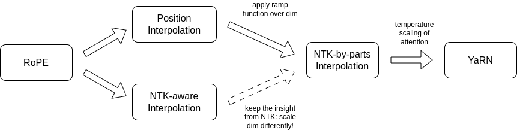
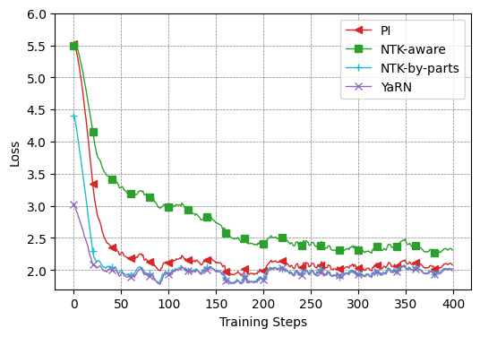
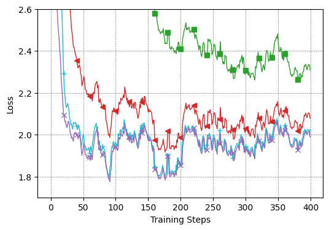
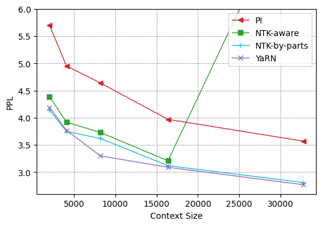
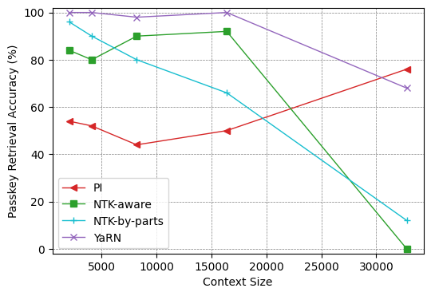
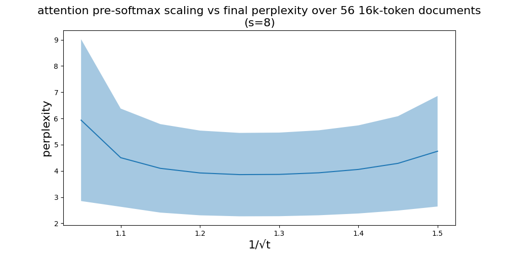
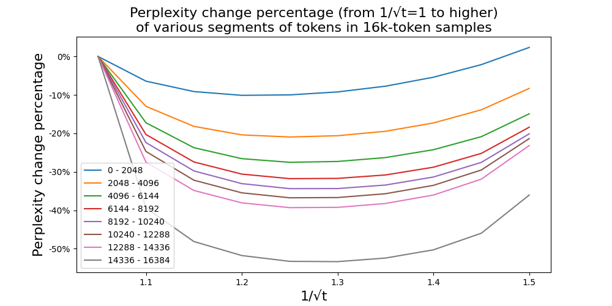
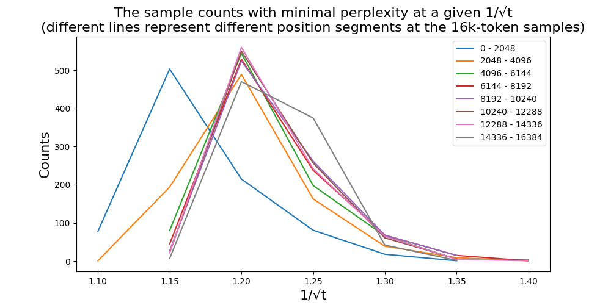
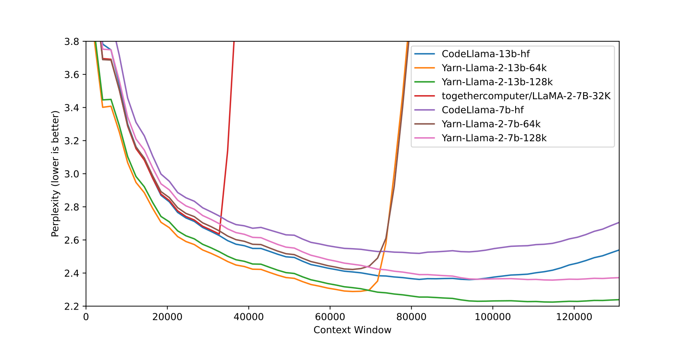
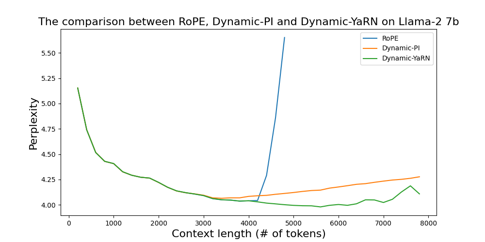

# YaRN: Efficient Context Window Extension of Large Language Models

# YaRN：大型语言模型的高效上下文窗口扩展

> 原文：[arXiv:2309.00071v3](https://arxiv.org/html/2309.00071v3) · [ICLR 2024](https://openreview.net/forum?id=wHBfxhZu1u)。本文采用 2026-02-06 修订的 v3，保留该版本主文、附录、公式、图表、脚注和参考文献。英文段落后紧接中文；公式与相同的书目信息共用，表头与图注双语对应。中文以机器初译为底稿，统一术语并校订摘要、关键方法与已发现的翻译问题，不将其标作人工审定译本。

> 原作作者 Bowen Peng、Jeffrey Quesnelle、Honglu Fan、Enrico Shippole；原作采用 [CC BY 4.0](https://creativecommons.org/licenses/by/4.0/)。此处调整版式并提供中文翻译；首次发布于 2023 年 8 月，发表于 ICLR 2024。

## Authors and affiliations / 作者与机构

Bowen Peng Jeffrey Quesnelle Honglu Fan Enrico Shippole

Nous Research；EleutherAI；University of Geneva（日内瓦大学）。

## Abstract / 摘要

**EN.** Rotary Position Embeddings (RoPE) have been shown to effectively encode positional information in transformer-based language models. However, these models fail to generalize past the sequence length they were trained on. We present YaRN (Yet another RoPE extensioN method), a compute-efficient method to extend the context window of such models, requiring 10x less tokens and 2.5x less training steps than previous methods. Using YaRN, we show that LLaMA models can effectively utilize and extrapolate to context lengths much longer than their original pre-training would allow, while also surpassing previous the state-of-the-art at context window extension. In addition, we demonstrate that YaRN exhibits the capability to extrapolate beyond the limited context of a fine-tuning dataset. Code is available at [https://github.com/jquesnelle/yarn](https://github.com/jquesnelle/yarn) .

**中.** 旋转位置嵌入（RoPE）已经能够在基于 Transformer 的语言模型中有效编码位置信息，但这些模型无法泛化到超出训练序列长度的输入。我们提出 YaRN（Yet another RoPE extensioN method），一种计算高效的上下文窗口扩展方法，相比既有方法所需 token 数量减少约 10 倍、训练步数减少约 2.5 倍。通过 YaRN，我们表明 LLaMA 模型能够有效利用并外推到远超原始预训练所允许的上下文长度，同时超越此前上下文窗口扩展方法的最佳水平。此外，我们还展示了 YaRN 外推到超过微调数据有限上下文长度的能力。代码见 https://github.com/jquesnelle/yarn 。

## Introduction / 引言

**EN.** Transformer-based Large Language Models ( Vaswani et al., 2017 ) (LLMs) have become the near-ubiquitous choice for many natural language processing (NLP) tasks where long-range abilities such as in-context learning (ICL) has been crucial.

**中.** 基于 Transformer 的大型语言模型（Vaswani 等人，2017）（LLM）已成为许多自然语言处理（NLP）任务的几乎普遍的选择，其中上下文学习（ICL）等远程能力至关重要。

**EN.** In performing the NLP tasks, the maximal length of the sequences (the context window ) determined by its training processes has been one of the major limits of a pretrained LLM. Being able to dynamically extend the context window via a small amount of fine-tuning (or without fine-tuning) has become more and more desirable. To this end, the position encodings of transformers are the center of the discussions.

**中.** 在执行 NLP 任务时，由训练过程决定的序列最大长度（上下文窗口）一直是预训练 LLM 的主要限制之一。能够通过少量微调（或无需微调）来动态扩展上下文窗口已经变得越来越可取。为此，Transformer的位置编码是讨论的中心。

**EN.** The original Transformer architecture used an absolute sinusoidal position encoding, which was later improved to a learnable absolute position encoding ( Gehring et al., 2017 ) . Since then, relative positional encoding schemes ( Shaw et al., 2018 ) have further increased the performance of Transformers. Currently, the most popular relative positional encodings are T5 Relative Bias ( Roberts et al., 2019 ) , RoPE ( Su et al., 2022 ) , XPos ( Sun et al., 2022 ) , and ALiBi ( Press et al., 2022 ) .

**中.** 最初的 Transformer 架构使用绝对正弦位置编码，后来改进为可学习的绝对位置编码（Gehring et al., 2017）。从那时起，相对位置编码方案（Shaw et al., 2018）进一步提高了 Transformers 的性能。目前，最流行的相对位置编码是 T5 相对偏差 (Roberts et al., 2019)、RoPE (Su et al., 2022)、XPos (Sun et al., 2022) 和 ALiBi (Press et al., 2022)。

**EN.** One reoccurring limitation with positional encodings is the inability to generalize past the context window seen during training. While some methods such as ALiBi are able to do limited generalization, none are able to generalize to sequences significantly longer than their pre-trained length ( Kazemnejad et al., 2023 ) .

**中.** 位置编码的一个反复出现的限制是无法泛化到训练期间所见上下文窗口之外。虽然 ALiBi 等一些方法能够进行有限的泛化，但没有一种方法能够泛化到明显长于其预训练长度的序列（Kazemnejad 等人，2023）。

**EN.** Some works have been done to overcome such limitation. ( Chen et al., 2023 ) and concurrently ( kaiokendev, 2023 ) proposed to extend the context length by slightly modifying RoPE via Position Interpolation (PI) and fine-tuning on a small amount of data. As an alternative, ( bloc97, 2023b ) proposed the "NTK-aware" interpolation by taking the loss of high frequency into account. Since then, two improvements of the "NTK-aware" interpolation have been proposed, with different emphasis:

**中.** 已经做了一些工作来克服这种限制。 ( Chen et al., 2023 ) 和同时 ( kaiokendev, 2023 ) 提出通过位置插值 (PI) 稍微修改 RoPE 并在少量数据上进行微调来扩展上下文长度。作为替代方案，（bloc97，2023b）通过考虑高频损失提出了“NTK-aware”插值。此后，提出了“NTK-aware”插值的两种改进，各有侧重：

- **EN.** the "Dynamic NTK" interpolation method ( emozilla, 2023 ) for pre-trained models without fine-tuning.

  **中.** 用于预训练模型的“动态NTK”插值方法（emozilla，2023），无需微调。

- **EN.** the "NTK-by-parts" interpolation method ( bloc97, 2023a ) which performs the best when fine-tuned on a small amount of longer-context data.

  **中.** “NTK-by-parts”插值方法（bloc97, 2023a）在对少量较长上下文数据进行微调时效果最佳。

**EN.** The "NTK-aware" interpolation and the "Dynamic NTK" interpolation have already seen their presence in the open-source models such as Code Llama ( Rozière et al., 2023 ) (using "NTK-aware" interpolation) and Qwen 7B ( 17 ) (using "Dynamic NTK").

**中.** “NTK-aware”插值和“动态 NTK”插值已经出现在开源模型中，例如 Code Llama (Rozière et al., 2023)（使用“NTK-aware”插值）和 Qwen 7B (17)（使用“动态 NTK”）。

**EN.** In this paper, in addition to making a complete account of the previous unpublished works on the "NTK-aware", the "Dynamic NTK" and the "NTK-by-parts" interpolations, we present YaRN (Yet another RoPE extensioN method), an improved method to efficiently extend the context window of models trained with Rotary Position Embeddings (RoPE) including the LLaMA ( Touvron et al., 2023a ) , the GPT-NeoX ( Black et al., 2022 ) , and the PaLM ( Chowdhery et al., 2022 ) families of models.

**中.** 在本文中，除了对之前未发表的“NTK-aware”、“Dynamic NTK”和“NTK-by-parts”插值的工作进行了完整的说明之外，我们还提出了 YaRN（另一种 RoPE 扩展方法），这是一种改进的方法，可以有效地扩展使用旋转位置嵌入（RoPE）训练的模型的上下文窗口，包括 LLaMA（Touvron 等人，2023a）、 GPT-NeoX（Black 等人，2022）和 PaLM（Chowdhery 等人，2022）系列模型。

**EN.** The relationship between different methods and how they evolve into YaRN can be summarized into the following diagram:

**中.** 不同方法之间的关系以及它们如何演变为YaRN可以总结为下图：

**EN.** Figure 1: An outline of the relationship between different interpolation methods.

**中.** 图 1：不同插值方法之间关系的概述。

**EN.** YaRN reaches state-of-the-art performances in context window extensions after fine-tuning on less than $\sim$ 0.1% of the original pre-training data. In the meantime, by combining with the inference-time technique called Dynamic Scaling, the Dynamic-YaRN allows for more than 2x context window extension without any fine-tuning.

**中.** 在对小于 $\sim$ 0.1% 的原始预训练数据进行微调后，YaRN 在上下文窗口扩展方面达到了最先进的性能。同时，通过与称为动态缩放的推理时间技术相结合，Dynamic-YaRN 无需任何微调即可实现超过 2 倍的上下文窗口扩展。

## Background and Related Work / 背景及相关工作

### Rotary Position Embeddings / 旋转位置嵌入

**EN.** The basis of our work is the Rotary Position Embedding (RoPE) introduced in ( Su et al., 2022 ) . We work on a hidden layer where the set of hidden neurons are denoted by $D$ . Given a sequence of vectors ${\bm{x}}_{1},\cdots,{\bm{x}}_{L}\in\mathbb{R}^{|D|}$ , following the notation of ( Su et al., 2022 ) , the attention layer first converts the vectors into the query vectors and the key vectors:

**中.** 我们工作的基础是 (Su et al., 2022) 中引入的旋转位置嵌入 (RoPE)。我们研究隐藏层，其中隐藏神经元集用 $D$ 表示。给定一个向量序列 ${\bm{x}}_{1},\cdots,{\bm{x}}_{L}\in\mathbb{R}^{|D|}$ ，遵循 ( Su et al., 2022 ) 的符号，注意力层首先将向量转换为查询向量和键向量：

$$
\displaystyle{\bm{q}}_{m}=f_{q}({\bm{x}}_{m},m)\in\mathbb{R}^{|D|},~{\bm{k}}_{n}=f_{k}({\bm{x}}_{n},n)\in\mathbb{R}^{|D|}.\tag{1}
$$

**EN.** Next, the attention weights are calculated as

**中.** 接下来，注意力权重计算为

$$
\text{softmax}(\dfrac{{\bm{q}}_{m}^{T}{\bm{k}}_{n}}{\sqrt{|D|}}),\tag{2}
$$

**EN.** where ${\bm{q}}_{m},{\bm{k}}_{n}$ are considered as column vectors so that ${\bm{q}}_{m}^{T}{\bm{k}}_{n}$ is simply the Euclidean inner product. In RoPE, we first assume that $|D|$ is even and identify the embedding space and the hidden states as complex vector spaces:

**中.** 其中 ${\bm{q}}_{m},{\bm{k}}_{n}$ 被视为列向量，因此 ${\bm{q}}_{m}^{T}{\bm{k}}_{n}$ 只是欧几里德内积。在 RoPE 中，我们首先假设 $|D|$ 是偶数，并将嵌入空间和隐藏状态视为复向量空间：

$$
\mathbb{R}^{|D|}\cong\mathbb{C}^{|D|/2}
$$

**EN.** where the inner product ${\bm{q}}^{T}{\bm{k}}$ becomes the real part of the standard Hermitian inner product $\text{Re}({\bm{q}}^{*}{\bm{k}})$ . More specifically, the isomorphisms interleave the real part and the complex part

**中.** 其中内积 ${\bm{q}}^{T}{\bm{k}}$ 成为标准 Hermitian 内积 $\text{Re}({\bm{q}}^{*}{\bm{k}})$ 的实部。更具体地说，同构交错排列实部与虚部

$$
\displaystyle\big(({\bm{x}}_{m})_{1},\cdots,({\bm{x}}_{m})_{|D|}\big)\mapsto\big(({\bm{x}}_{m})_{1}+i({\bm{x}}_{m})_{2},\cdots,(({\bm{x}}_{m})_{|D|-1}+i({\bm{x}}_{m})_{|D|})\big),\tag{3}
$$

$$
\displaystyle\big((\textbf{q}_{m})_{1},\cdots,(\textbf{q}_{m})_{|D|}\big)\mapsto\big((\textbf{q}_{m})_{1}+i(\textbf{q}_{m})_{2},\cdots,((\textbf{q}_{m})_{|D|-1}+i(\textbf{q}_{m})_{|D|})\big).\tag{4}
$$

**EN.** To convert embeddings ${\bm{x}}_{m},{\bm{x}}_{n}$ into query and key vectors, we are first given $\mathbb{R}$ -linear operators

**中.** 为了将嵌入 ${\bm{x}}_{m},{\bm{x}}_{n}$ 转换为查询向量和键向量，我们首先给出 $\mathbb{R}$ 线性运算符

$$
{\bm{W}}_{q},{\bm{W}}_{k}:\mathbb{R}^{|D|}\rightarrow\mathbb{R}^{|D|}.
$$

**EN.** Let $\bm{\theta}=\text{diag}(\theta_{1},\cdots,\theta_{|D|/2})$ . In complex coordinates, we define

**中.** 让 $\bm{\theta}=\text{diag}(\theta_{1},\cdots,\theta_{|D|/2})$ 。在复坐标中，我们定义

$$
f_{{\bm{W}}}({\bm{x}}_{m},m,\bm{\theta})=e^{im\bm{\theta}}{\bm{W}}{\bm{x}}_{m},\tag{5}
$$

**EN.** for any linear operator ${\bm{W}}$ . The functions $f_{q},f_{k}$ in RoPE are given by

**中.** 对于任何线性算子 ${\bm{W}}$ 。 RoPE 中的函数 $f_{q},f_{k}$ 由下式给出

$$
f_{q}=f_{{\bm{W}}_{q}},~f_{k}=f_{{\bm{W}}_{k}}.\tag{6}
$$

**EN.** where $\theta_{d}=b^{-2d/|D|}$ and $b=10000$ . This way, RoPE associates each (complex-valued) hidden neuron with a separate frequency $\theta_{d}$ . The benefit of doing so is that the dot product between the query vector and the key vector only depends on the relative distance $m-n$ .

**中.** 其中 $\theta_{d}=b^{-2d/|D|}$ 和 $b=10000$ 。这样，RoPE 将每个（复值）隐藏神经元与单独的频率 $\theta_{d}$ 相关联。这样做的好处是查询向量和键向量之间的点积仅取决于相对距离 $m-n$ 。

**EN.** In later discussions, a context length interpolation usually aims to modify the equation Eq. 5 . To set up a uniform convention for these discussions, note that a modification $f^{\prime}_{{\bm{W}}}$ can take the following form:

**中.** 在后面的讨论中，上下文长度插值通常旨在修改方程 Eq. 5.要为这些讨论建立统一的约定，请注意修改 $f^{\prime}_{{\bm{W}}}$ 可以采用以下形式：

$$
\displaystyle f^{\prime}_{{\bm{W}}}({\bm{x}}_{m},m,\bm{\theta})=f_{{\bm{W}}}({\bm{x}}_{m},g(m),{\bm{h}}(\bm{\theta})),\tag{7}
$$

**EN.** where $g(m)$ is a map between real numbers and ${\bm{h}}(\bm{\theta})$ acts on the entries of the diagonal matrix $\bm{\theta}$ uniformly by $\text{diag}(h(\theta_{1}),\cdots,h(\theta_{|D|/2}))$ according to a function $h$ . $g$ and $h$ are method-dependent functions.

**中.** 其中 $g(m)$ 是实数之间的映射，并且 ${\bm{h}}(\bm{\theta})$ 根据函数 $h$ 由 $\text{diag}(h(\theta_{1}),\cdots,h(\theta_{|D|/2}))$ 统一作用于对角矩阵 $\bm{\theta}$ 的条目。 $g$ 和 $h$ 是方法相关函数。

**EN.** In the subsequent sections, when we introduce a new interpolation method of the form Eq. 7 , we only specify the functions $g(m)$ and $h(\theta_{d})$ .

**中.** 在接下来的章节中，当我们介绍一种新的插值方法时，形式为： 7、我们只指定函数$g(m)$和$h(\theta_{d})$。

### Additional notations / 附加符号

**EN.** Given the pretrained maximal context length $L$ , our goal is to extend it to $L^{\prime}>L$ either with or without finetuning. We introduce the notion of scale factor $s$ defined by $s=\frac{L^{\prime}}{L}$ .

**中.** 给定预训练的最大上下文长度 $L$ ，我们的目标是将其扩展到 $L^{\prime}>L$ ，无论是否进行微调。我们引入由 $s=\frac{L^{\prime}}{L}$ 定义的比例因子 $s$ 的概念。

**EN.** For the convenience of some discussions, we also introduce wavelength $\lambda_{d}$ associated with the $d$ -th hidden dimension of RoPE as follows:

**中.** 为了方便讨论，我们还引入了与 RoPE 的第 $d$ 隐藏维度相关的波长 $\lambda_{d}$，如下所示：

$$
\displaystyle\lambda_{d}=\dfrac{2\pi}{\theta_{d}}=2\pi b^{\frac{2d}{|D|}}.\tag{8}
$$

**EN.** The wavelength describes the length of tokens needed in order for the rotary position embedding at dimension $d$ to perform a full rotation ( $2\pi$ ).

**中.** 波长描述了尺寸 $d$ 处的旋转位置嵌入执行完整旋转 ( $2\pi$ ) 所需的令牌长度。

### Related work / 相关工作

**EN.** Position Interpolation (PI) is one of the earlier works extending context lengths of RoPE proposed by Chen et al. (2023) , and concurrently kaiokendev (2023) . Under the notation of Eq. 7 , it is setting

**中.** 位置插值（PI）是 Chen 等人提出的扩展 RoPE 上下文长度的早期工作之一。 (2023) ，同时 kaiokendev (2023) 。根据方程的符号。 7、正在设置

$$
g(m)=s\cdot m,~{\bm{h}}(\bm{\theta})=\bm{\theta},\tag{9}
$$

> **译注**：本式照录原文。按 $s=L^{\prime}/L$ 的定义，PI 应为 $g(m)=m/s$，与附录式 (16) 的 $mL/L^{\prime}$ 一致；正文此式的 $s\cdot m$ 与之不一致。

**EN.** where $s$ is the scale factor $\frac{L^{\prime}}{L}$ . We include some details in Appendix A.1 .

**中.** 其中 $s$ 是比例因子 $\frac{L^{\prime}}{L}$ 。我们在附录 A.1 中包含了一些详细信息。

**EN.** ReRoPE ( Su, 2023 ) also aims to extend the context size of existing models pre-trained with RoPE, and claims "infinite" context length without needing any fine-tuning. This claim is backed by a monotonically decreasing loss with increasing context length up to 16k on the Llama 2 13B model. It achieves context extension by modifying the attention mechanism and thus is not purely an embedding interpolation method. Since it is currently not compatible with Flash Attention 2 ( Dao, 2023 ) and requires two attention passes during inference, we do not consider it for comparison.

**中.** ReRoPE（Su，2023）还旨在扩展使用 RoPE 预训练的现有模型的上下文大小，并声称“无限”上下文长度，无需任何微调。在 Llama 2 13B 模型上，随着上下文长度增加到 16k，损失单调递减支持了这一说法。它通过修改注意力机制来实现上下文扩展，因此并不是纯粹的嵌入插值方法。由于它目前与 Flash Attention 2 (Dao, 2023) 不兼容，并且在推理过程中需要两次注意力传递，因此我们不考虑将其进行比较。

**EN.** Concurrently with our work, LM-Infinite ( Han et al., 2023 ) proposes similar ideas to YaRN, but focuses on "on-the-fly" length generalization for non-fine-tuned models. Since they also modify the attention mechanism of the models, it is not an embedding interpolation method and is not immediately compatible with Flash Attention 2.

**中.** 与我们的工作同时，LM-Infinite（Han et al., 2023）提出了与 YaRN 类似的想法，但侧重于非微调模型的“即时”长度泛化。由于它们还修改了模型的注意力机制，因此它不是嵌入插值方法，并且不能立即与 Flash Attention 2 兼容。

## Methodology / 方法

**EN.** Whereas PI stretches all RoPE dimensions equally, we find that the theoretical interpolation bound described by PI ( Chen et al., 2023 ) is insufficient at predicting the complex dynamics between RoPE and the LLM’s internal embeddings. In the following subsections, we describe the main issues with PI we have individually identified and solved, so as to give the readers the context, origin and justifications of each method which we use in concert to obtain the full YaRN method.

**中.** 尽管 PI 同等地拉伸所有 RoPE 维度，但我们发现 PI 描述的理论插值界限（Chen et al., 2023）不足以预测 RoPE 和 LLM 内部嵌入之间的复杂动态。在下面的小节中，我们将描述我们单独识别和解决的 PI 的主要问题，以便为读者提供我们协同使用的每种方法的背景、起源和理由，以获得完整的 YaRN 方法。

### Loss of High Frequency information - "NTK-aware" interpolation / 高频信息损失与 NTK-aware 插值

**EN.** If we look at rotary position embeddings (RoPE) only from an information encoding perspective, it was shown in ( Tancik et al., 2020 ) , using Neural Tangent Kernel (NTK) theory, that deep neural networks have trouble learning high frequency information if the input dimension is low and the corresponding embeddings lack high frequency components. Here we can see the similarities: a token’s positional information is one-dimensional, and RoPE expands it to an n-dimensional complex vector embedding. RoPE closely resembles Fourier Features ( Tancik et al., 2020 ) in many aspects, as it is possible to define RoPE as a special 1D case of a Fourier Feature.

**中.** 如果我们仅从信息编码的角度来看待旋转位置嵌入（RoPE），（Tancik et al., 2020）中使用神经正切核（NTK）理论表明，如果输入维度较低并且相应的嵌入缺乏高频分量，则深度神经网络难以学习高频信息。在这里我们可以看到相似之处：令牌的位置信息是一维的，而 RoPE 将其扩展为 n 维复向量嵌入。 RoPE 在许多方面与傅里叶特征（Tancik et al., 2020）非常相似，因为可以将 RoPE 定义为傅里叶特征的特殊一维情况。

**EN.** In the case of Positional Interpolation (PI), as we strech all dimensions equally by a factor $s$ , it removes the high frequency components of RoPE. This degradation is worsened as the scaling factor $s$ grows, and at some point, the network will not be able to recover. Previous fine-tunes ( kaiokendev, 2023 ) ( Chen et al., 2023 ) ( Together.ai, 2023 ) ( Quesnelle et al., 2023 ) using PI were only able to achieve a scaling factor of roughly $s=8$ before the LLM’s outputs starts to degrade, even after fine-tuning.

**中.** 在位置插值 (PI) 的情况下，当我们将所有维度平均拉伸 $s$ 因子时，它会消除 RoPE 的高频分量。随着比例因子 $s$ 的增长，这种退化现象会更加严重，并且在某个时刻，网络将无法恢复。之前使用 PI 进行的微调（kaiokendev，2023）（Chen 等人，2023）（Together.ai，2023）（Quesnelle 等人，2023）只能在 LLM 的输出开始降级之前实现大约 $s=8$ 的缩放因子，即使在微调之后也是如此。

**EN.** In order to alleviate this issue, the "NTK-aware" interpolation was developed in ( bloc97, 2023b ) . Instead of scaling every dimension of RoPE equally by a factor $s$ , we spread out the interpolation pressure across multiple dimensions by scaling high frequencies less and low frequencies more. One can obtain such a transformation in many ways, but the simplest would be to perform a base change on the value of $\theta$ . The details are described in the Appendix A.2 and the method has seen some open-source adoptions [^footnote1] .

**中.** 为了缓解这个问题，（bloc97，2023b）开发了“NTK-aware”插值。我们不是将 RoPE 的每个维度均等地缩放 $s$ 因子，而是通过减少高频和增加低频来将插值压力分散到多个维度。可以通过多种方式获得这种转换，但最简单的方法是对 $\theta$ 的值执行基本更改。详细信息在附录 A.2 中描述，该方法已被一些开源采用 [^footnote1] 。

**EN.** One main issue of this "NTK-aware" scaling is that it is very difficult to determine what optimal base should be used for an intended context extension by $s$ times. The best base to use for "NTK-aware" interpolation usually has to be found empirically, which significantly increases the difficulty and cost of obtaining a successful fine-tuned model. Despite its limitations, the observations from the NTK theory is valid and the following idea is still maintained and executed in a different way in the "NTK-by-parts" interpolation introduced in the next section.

**中.** 这种“NTK-aware”缩放的一个主要问题是，很难确定应该使用哪种最佳基础来进行 $s$ 次的预期上下文扩展。用于“NTK-aware”插值的最佳基础通常必须根据经验找到，这显着增加了获得成功的微调模型的难度和成本。尽管有其局限性，NTK 理论的观察结果是有效的，并且在下一节介绍的“按部分 NTK”插值中仍然保留并以不同的方式执行以下想法。

### Loss of Relative Local Distances - "NTK-by-parts" interpolation / 局部相对距离损失与 NTK-by-parts 插值

**EN.** To understand why "NTK-aware" interpolation works better than PI and to eliminate its disadvantages, we have to take a closer look at RoPE. In this section, we think heavily in terms of the wavelengths $\lambda_{d}$ defined in Eq. 8 in the formula of RoPE. For simplicity, we omit the subscript $d$ in $\lambda_{d}$ and the reader is encouraged to think about $\lambda$ as the wavelength of an arbitrary periodic function.

**中.** 为了理解为什么“NTK-aware”插值比 PI 效果更好并消除其缺点，我们必须仔细研究 RoPE。在本节中，我们重点考虑方程 1 中定义的波长 $\lambda_{d}$。 RoPE公式中的8。为简单起见，我们省略了 $\lambda_{d}$ 中的下标 $d$，并鼓励读者将 $\lambda$ 视为任意周期函数的波长。

**EN.** In theory, as RoPE is a relative position embedding, it should be quite surprising that it fails to generalize to unseen longer context sizes. However, we can show that in practice, RoPE does not only encode relative position. One observation we can make is that given a context size $L$ , there are some dimensions $d$ where the wavelength is longer than the maximum context length seen during pretraining ( $\lambda>L$ ), this suggests that some dimensions’ rotary embeddings might not be distributed evenly in the rotational domain (i.e. does not perform a full rotation for the entire training context size). In such cases, we presume having unique position pairs [^footnote2] implies that the absolute positional information remains intact in those dimensions. On the contrary, when the wavelength is short, only relative positional information is accessible to the network.

**中.** 理论上，由于 RoPE 是一种相对位置嵌入，因此它无法泛化到未见过的较长上下文大小，这应该是相当令人惊讶的。然而，我们可以证明，在实践中，RoPE 不仅仅编码相对位置。我们可以观察到，给定上下文大小 $L$ ，有一些维度 $d$ 的波长比预训练期间看到的最大上下文长度长（ $\lambda>L$ ），这表明某些维度的旋转嵌入可能不会均匀分布在旋转域中（即不会对整个训练上下文大小执行完整旋转）。在这种情况下，我们假设具有唯一的位置对 [^footnote2] 意味着绝对位置信息在这些维度中保持完整。相反，当波长较短时，网络只能访问相对位置信息。

**EN.** Given these observations, we can see that it is important to not touch the dimensions that only encode relative positional information, as they are crucial for the network to distinguish the relative order of nearby tokens. Meanwhile, dimensions that only encode absolute positional information should always be interpolated, as larger distances will be out of distribution. Instead of arbitrarily changing the base in "NTK-aware" interpolation (which basically does something similar to what is described here), we can formulate an explicit and targeted interpolation method that takes in account all of the above.

**中.** 根据这些观察，保持仅编码相对位置信息的维度不变十分重要，因为它们对于网络区分相邻 token 的相对顺序至关重要。与此同时，仅编码绝对位置信息的维度应始终采用插值，因为更大的距离会落到分布之外。与其像 NTK-aware 插值那样任意改变基数（其作用与这里的思路大致相似），我们可以构造一种明确且有针对性的插值方法，将上述因素统一考虑。

**EN.** In other words,

**中.** 换句话说，

- **EN.** if the wavelength $\lambda$ is much smaller than the context size $L$ , we do not interpolate;

  **中.** 如果波长$\lambda$ 远小于上下文大小$L$，我们不进行插值；

- **EN.** if the wavelength $\lambda$ is equal to or bigger than the context size $L$ , we want to only interpolate and avoid any extrapolation (unlike the previous "NTK-aware" method);

  **中.** 如果波长 $\lambda$ 等于或大于上下文大小 $L$ ，我们只想进行插值并避免任何外推（与之前的“NTK-aware”方法不同）；

- **EN.** dimensions in-between can have a bit of both, similar to the "NTK-aware" interpolation.

  **中.** 中间的尺寸可以同时具有两者，类似于“NTK-aware”插值。

**EN.** As a result, it is more convenient to introduce the ratio $r=\frac{L}{\lambda}$ between the original context size $L$ and the wavelength $\lambda$ . This ratio represents the number of rotations a certain RoPE dimension makes given a fixed pretrained context length $L$ . In the $d$ -th hidden state, the ratio $r$ depends on $d$ in the following way:

**中.** 结果，更方便地引入原始上下文尺寸$L$与波长$\lambda$之间的比率$r=\frac{L}{\lambda}$。该比率表示给定固定预训练上下文长度 $L$ 时某个 RoPE 维度进行的旋转次数。在第 $d$ 隐藏状态中，比率 $r$ 取决于 $d$，如下所示：

$$
r(d)=\dfrac{L}{\lambda_{d}}=\dfrac{L}{2\pi b^{\frac{2d}{|D|}}}.\tag{10}
$$

**EN.** In order to define the boundary of the different interpolation strategies as above, we introduce two extra parameters $\alpha,\beta$ . All hidden dimensions $d$ where $r(d)<\alpha$ are those where we linearly interpolate by a scale $s$ (exactly like PI, avoiding any extrapolation), and the $d$ where $r(d)>\beta$ are those where we do not interpolate at all. Define the ramp function $\gamma$ to be

**中.** 为了定义上述不同插值策略的边界，我们引入了两个额外的参数 $\alpha,\beta$ 。所有隐藏维度 $d$ 其中 $r(d)<\alpha$ 是我们按比例 $s$ 线性插值的维度（与 PI 完全相同，避免任何外推），而 $d$ 其中 $r(d)>\beta$ 是我们根本不插值的维度。将斜坡函数 $\gamma$ 定义为

$$
\displaystyle\gamma(r)=\begin{cases}0,&\text{if }r<\alpha\\
1,&\text{if }r>\beta\\
\dfrac{r-\alpha}{\beta-\alpha},&\text{otherwise}.\end{cases}\tag{11}
$$

**EN.** With the help of the ramp function, the "NTK-by-parts" method can be described as follows.

**中.** 借助斜坡函数，“NTK-by-parts”方法可以描述如下。

#### Definition 1 / 定义1

**EN.** The "NTK-by-parts" interpolation is a modification of RoPE using Eq. 7 with the following functions [^footnote3] .

**中.** “NTK-by-parts”插值是使用等式 1 的 RoPE 的修改。 7.具有以下功能[^footnote3]。

$$
\displaystyle g(m) \displaystyle=m\tag{12}
$$

$$
\displaystyle h(\theta_{d}) \displaystyle=\Big(1-\gamma\big(r(d)\big)\Big)\frac{\theta_{d}}{s}+\gamma\big(r(d)\big)\theta_{d}.\tag{13}
$$

**EN.** The values of $\alpha$ and $\beta$ should be tuned on a case-by-case basis. For example, we have found experimentally that for the Llama family of models, good values for $\alpha$ and $\beta$ are $\alpha=1$ and $\beta=32$ .

**中.** $\alpha$ 和 $\beta$ 的值应根据具体情况进行调整。例如，我们通过实验发现，对于 Llama 系列模型，$\alpha$ 和 $\beta$ 的良好值为 $\alpha=1$ 和 $\beta=32$ 。

**EN.** Using the techniques described in this section, a variant of the resulting method was released under the name "NTK-by-parts" interpolation ( bloc97, 2023a ) . This improved method performs better than the previous PI ( Chen et al., 2023 ) and "NTK-aware" 3.1 interpolation methods, both with non-fine-tuned models and with fine-tuned models, as shown in ( bloc97, 2023a ) and Section 4.2 .

**中.** 使用本节中描述的技术，生成的方法的变体以“NTK-by-parts”插值的名称发布（bloc97，2023a）。这种改进的方法比之前的 PI (Chen et al., 2023) 和“NTK-aware”3.1 插值方法表现得更好，无论是使用非微调模型还是微调模型，如 (bloc97, 2023a) 和第 4.2 节所示。

### YaRN

**EN.** In addition to the previous interpolation techniques, we also observe that introducing a temperature $t$ on the logits before the attention softmax has a uniform impact on perplexity regardless of the data sample and the token position over the extended context window (See Appendix A.3 ). More precisely, instead of Eq. 2 , we modify the computation of attention weights into

**中.** 除了前面的插值技术之外，我们还观察到，在注意 softmax 之前在 logits 上引入温度 $t$ 对困惑度具有均匀的影响，无论数据样本和扩展上下文窗口上的标记位置如何（参见附录 A.3）。更准确地说，而不是等式。 2 ，我们将注意力权重的计算修改为

$$
\text{softmax}\left(\dfrac{{\bm{q}}_{m}^{T}{\bm{k}}_{n}}{t\sqrt{|D|}}\right).\tag{14}
$$

**EN.** The reparametrization of RoPE as a set of 2D matrices has a clear benefit on the implementation of this attention scaling: we can instead use a "length scaling" trick which scales both ${\bm{q}}_{m}$ and ${\bm{k}}_{n}$ by a constant factor $\sqrt{1/t}$ by simply scaling the complex rotary position embeddings by the same amount. With this, YaRN can effectively alter the attention mechanism without modifying its code. Furthermore, it has zero overhead during both inference and training, as rotary position embeddings are generated in advance and are reused for all forward passes. Combining it with the "NTK-by-parts" interpolation, we have the YaRN method.

**中.** 把 RoPE 重参数化为一组二维矩阵，为实现注意力缩放带来明显便利：只需将复数旋转位置嵌入乘以常数 $\sqrt{1/t}$，即可通过长度缩放技巧使 ${\bm{q}}_{m}$ 与 ${\bm{k}}_{n}$ 同时乘以相同系数。这样，无需修改注意力代码，YaRN 就能有效改变注意力机制。此外，旋转位置嵌入可以预先生成并在所有前向传播中复用，因此这种修改在推理和训练中都没有额外开销。将其与 NTK-by-parts 插值结合，就得到 YaRN 方法。

#### Definition 2 / 定义2

**EN.** By the "YaRN method", we refer to a combination of the attention scaling in Eq. 14 and the "NTK-by-parts" interpolation introduced in Section 3.2 .

**中.** 通过“YaRN方法”，我们指的是等式1中注意力缩放的组合。 14 和第 3.2 节中介绍的“NTK-by-parts”插值。

**EN.** For LLaMA and Llama 2 models, we recommend the following values:

**中.** 对于 LLaMA 和 Llama 2 型号，我们建议使用以下值：

$$
\displaystyle\sqrt{\frac{1}{t}}=0.1\ln({s})+1.\tag{15}
$$

**EN.** The equation above is found by fitting $\sqrt{1/t}$ at the lowest perplexity against the scale extension by various factors $s$ using the "NTK-by-parts" method (Section 3.2 ) on LLaMA 7b, 13b, 33b and 65b models without fine-tuning. We note that the same values of $t$ also apply fairly well to Llama 2 models (7b, 13b and 70b). It suggests that the property of increased entropy and the temperature constant $t$ may have certain degree of "universality" and may be generalizable across some models and training data.

**中.** 上述公式来自如下拟合：在不微调的 LLaMA 7B、13B、33B 和 65B 模型上使用 NTK-by-parts 方法（第 3.2 节），针对不同扩展倍率 $s$，寻找困惑度最低时的 $\sqrt{1/t}$ 并拟合其关系。我们注意到，相同的 $t$ 值也较好地适用于 Llama 2（7B、13B 和 70B）模型。这说明，熵增加的现象和温度常数 $t$ 可能具有一定普适性，能够在某些模型和训练数据之间迁移。

**EN.** The YaRN method combines all our findings and surpasses all previous methods in both fine-tuned and non-fine-tuned scenarios. Thanks to its low footprint, YaRN allows for direct compatibility with libraries that modify the attention mechanism such as Flash Attention 2 ( Dao, 2023 ) .

**中.** YaRN 方法结合了我们所有的发现，并在微调和非微调场景中超越了之前的所有方法。由于占用空间小，YaRN 允许与修改注意力机制的库直接兼容，例如 Flash Attention 2（Dao，2023）。

### Dynamic Scaling - "Dynamic NTK" interpolation / 动态缩放与 Dynamic NTK 插值

**EN.** In a lot of use cases, multiple forward-passes are performed with varying sequence lengths from $1$ to the maximal context size. A typical example is the autoregressive generation where the sequence lengths increment by $1$ after each step. There are two ways of applying an interpolation method that uses a scale factor $s$ (including PI, "NTK-aware", "NTK-by-parts" and YaRN):

**中.** 在许多用例中，使用从 $1$ 到最大上下文大小的不同序列长度执行多次前向传递。一个典型的例子是自回归生成，其中序列长度在每一步后增加 $1$。有两种方法可以应用使用比例因子 $s$ 的插值方法（包括 PI、“NTK-aware”、“NTK-by-parts”和 YaRN）：

- **EN.** 1. Throughout the whole inference cycle, the embedding layer is fixed including the scale factor $s=L^{\prime}/L$ where $L^{\prime}$ is the fixed number of extended context size.

  **中.** 1.在整个推理周期中，嵌入层是固定的，包括比例因子$s=L^{\prime}/L$，其中$L^{\prime}$是扩展上下文大小的固定数量。

- **EN.** 2. In each forward-pass, the position embedding updates the scale factor $s=\text{max}(1,l^{\prime}/L)$ where $l^{\prime}$ is the sequence length of the current sequence.

  **中.** 2. 在每次前向传递中，位置嵌入都会更新比例因子 $s=\text{max}(1,l^{\prime}/L)$，其中 $l^{\prime}$ 是当前序列的序列长度。

**EN.** The problem of (1) is that the model may experience a performance discount at a length less than $L$ and an abrupt degradation when the sequence length is longer than $L^{\prime}$ . But by doing Dynamic Scaling as (2), it allows the model to gracefully degrade instead of immediately breaking when hitting the trained context limit $L^{\prime}$ . We call this inference-time method the Dynamic Scaling method. When it is combined with "NTK-aware" interpolation, we call it "Dynamic NTK" interpolation. It first appeared in public as a reddit post in ( emozilla, 2023 ) .

**中.** (1) 的问题是，当序列长度小于 $L$ 时，模型可能会出现性能折扣，而当序列长度大于 $L^{\prime}$ 时，模型可能会出现突然退化。但是，通过按照 (2) 进行动态缩放，它允许模型在达到训练的上下文限制 $L^{\prime}$ 时优雅地降级，而不是立即中断。我们将这种推理时间方法称为动态缩放方法。当它与“NTK-aware”插值相结合时，我们将其称为“动态NTK”插值。它首次作为 Reddit 帖子在 (emozilla, 2023) 中公开出现。

**EN.** One notable fact is that the "Dynamic NTK" interpolation works exceptionally well on models pretrained on $L$ without any finetuning ( $L^{\prime}=L$ ). This is supported by the experiment in Appendix B.7 .

**中.** 一个值得注意的事实是，“动态 NTK”插值在 $L$ 上预训练的模型上运行得非常好，无需任何微调 ( $L^{\prime}=L$ )。附录 B.7 中的实验支持了这一点。

**EN.** Often in the repeated forward-passes, the kv-caching ( Chen, 2022 ) is applied so that we can reuse the previous key-value vectors and improve the overall efficiency. We point out that in some implementations when the rotary position embeddings are cached, some care has to be taken in order to modify it for Dynamic Scaling with kv-caching. The correct implementation should cache the kv-embeddings before applying rotary position embeddings, as the RoPE of every token changes when $s$ changes.

**中.** 在多次前向传播中，通常使用 KV cache（Chen, 2022）复用先前的键值向量，以提高整体效率。需要指出的是，在某些会缓存旋转位置嵌入的实现中，必须谨慎修改代码，才能让动态缩放与 KV cache 正确配合。正确实现应缓存施加旋转位置嵌入之前的 KV 表示，因为当 $s$ 改变时，每个 token 的 RoPE 都会改变。

## Experiments / 实验

### Training / 训练

**EN.** We broadly followed the training and evaluation procedures as outlined in Chen et al. (2023) .

**中.** 我们大致遵循 Chen 等人中概述的培训和评估程序。 （2023）。

**EN.** For training the 128k context window size models, we extended the Llama 2 ( Touvron et al., 2023b ) 7B and 13B parameter models. No changes were made to the LLaMA model architecture other than the calculation of the embedding frequencies as described in Section 3.3 with $s=16$ and $s=32$ .

**中.** 为了训练 128k 上下文窗口大小模型，我们扩展了 Llama 2（Touvron 等人，2023b）7B 和 13B 参数模型。除了第 3.3 节中所述的 $s=16$ 和 $s=32$ 的嵌入频率计算之外，LLaMA 模型架构没有进行任何更改。

**EN.** We used a learning rate of $2\times 10^{-5}$ with no weight decay and a linear warmup of 20 steps along with AdamW ( Loshchilov and Hutter, 2019 ) $\beta_{1}=0.9$ and $\beta_{2}=0.95$ . For the $s=16$ model, we fine-tuned for 400 steps with global batch size $64$ using PyTorch ( Paszke et al., 2019 ) Fully Sharded Data Parallelism ( Zhao et al., 2023 ) and Flash Attention 2 ( Dao, 2023 ) on the PG19 dataset ( Rae et al., 2020 ) chunked into 64k segments bookended with the BOS and EOS token. For $s=32$ we followed the same procedure, but due to compute constraints, we started from the finished $s=16$ checkpoint and trained for only an additional 200 steps. Note that the $s=32$ model is also trained with 64k context data, but we show that it is able to extrapolate to a context size of 128k in Section 4.2 .

**中.** 我们使用了 $2\times 10^{-5}$ 的学习率，没有权重衰减和 20 步的线性预热以及 AdamW（Loshchilov 和 Hutter，2019）$\beta_{1}=0.9$ 和 $\beta_{2}=0.95$。对于 $s=16$ 模型，我们在 PG19 数据集（Rae 等人，2023）上使用 PyTorch（Paszke 等人，2019）、完全分片数据并行（Zhao 等人，2023）和 Flash Attention 2（Dao，2023）对全局批量大小 $64$ 进行了 400 个步骤的微调。 2020）分成 64k 个段，用 BOS 和 EOS token预订。对于 $s=32$，我们遵循相同的过程，但由于计算限制，我们从完成的 $s=16$ 检查点开始，仅进行额外 200 个步骤的训练。请注意，$s=32$ 模型也使用 64k 上下文数据进行训练，但我们在第 4.2 节中表明它能够外推到 128k 的上下文大小。

**EN.** For the ablation studies, we used the LLaMA 7B model. It has the same architecture as the newer Llama 2 models except for a shorter pretrained context window size [^footnote4] , which reduces compute requirements and allows for faster training and evaluations. The training procedure is similar to the 128k models, but we chunk the PG19 dataset into 32k segments instead, and train using $s=16$ for 400 steps. As shown in Figure 2 , YaRN converges faster compared to other interpolation techniques during training and consistently has lower loss.

**中.** 对于消融研究，我们使用 LLaMA 7B 模型。它具有与较新的 Llama 2 模型相同的架构，只是预训练上下文窗口大小 [^footnote4] 更短，这减少了计算要求并允许更快的训练和评估。训练过程与 128k 模型类似，但我们将 PG19 数据集分成 32k 段，并使用 $s=16$ 进行 400 个步骤的训练。如图 2 所示，与其他插值技术相比，YaRN 在训练期间收敛速度更快，并且始终具有较低的损失。

**EN.** Figure 2: Training loss curves for the LLaMA 7B model extended to 32k context size using different interpolation techniques. The graph on the right is zoomed in.

**中.** 图 2：使用不同插值技术扩展到 32k 上下文大小的 LLaMA 7B 模型的训练损失曲线。右侧的图表已放大。

### Long Sequence Language Modeling / 长序列语言建模

**EN.** To evaluate the long sequence language modeling performances, we use the GovReport ( Huang et al., 2021 ) and Proof-pile ( Azerbayev et al., 2022 ) datasets both of which contain many long sequence samples. For all evaluations, the test splits of both datasets were used exclusively. All perplexity evaluations were calculated using the sliding window method from Press et al. (2022) with $S=256$ , which takes in account the entire documents’ perplexity contribution, even if the context window of the model is shorter.

**中.** 为了评估长序列语言建模性能，我们使用 GovReport（Huang et al., 2021）和 Proof-pile（Azerbayev et al., 2022）数据集，这两个数据集都包含许多长序列样本。对于所有评估，仅使用两个数据集的测试分割。所有困惑度评估均使用 Press 等人的滑动窗口方法计算。 (2022) 和 $S=256$ ，它考虑了整个文档的困惑度贡献，即使模型的上下文窗口较短。

**EN.** First, we select 10 random samples from Proof-pile with at least 128k tokens each and evaluate the perplexity of each of these samples when truncated at 2k steps from a sequence length of 2k tokens through 128k tokens. Table 1 shows the long sequence performance of fine-tuned Llama 2 $s=16$ and $s=32$ models. We demonstrate that YaRN is able to generalize and extrapolate to unseen context lengths and benefit from transfer learning, since the $s=32$ model was only further trained for 200 steps using the $s=16$ checkpoint with 64k data and is able to extrapolate to 128k context.

**中.** 首先，我们从证明堆中选择 10 个随机样本，每个样本至少有 128k 个令牌，并评估每个样本在从 2k 个令牌到 128k 个令牌的序列长度以 2k 步截断时的困惑度。表 1 显示了经过微调的 Llama 2 $s=16$ 和 $s=32$ 模型的长序列性能。我们证明 YaRN 能够泛化和外推到未见过的上下文长度，并从迁移学习中受益，因为 $s=32$ 模型仅使用具有 64k 数据的 $s=16$ 检查点进一步训练 200 个步骤，并且能够外推到 128k 上下文。

| Model 模型 | Extension 扩展 | Fine- 是否 | Training 训练 | Extension 扩展 | Evaluation Context Window Size 评测上下文窗口长度 | Evaluation Context Window Size 评测上下文窗口长度 | Evaluation Context Window Size 评测上下文窗口长度 | Evaluation Context Window Size 评测上下文窗口长度 | Evaluation Context Window Size 评测上下文窗口长度 |
| --- | --- | --- | --- | --- | --- | --- | --- | --- | --- |
| Size 规模 | Method 方法 | tuned 微调 | Steps 步数 | Scale $s$ 倍率 $s$ | 8192 | 16384 | 32768 | 65536 | 131072 |
| 7B | YaRN | ✓ | 400 | 4k $\times$ 16 | 3.51 | 2.99 | 2.65 | 2.42 | $>10^{1}$ |
| 7B | YaRN | ✓ | 400+200 | 4k $\times$ 32 | 3.56 | 3.04 | 2.70 | 2.45 | 2.37 |
| 13B | YaRN | ✓ | 400 | 4k $\times$ 16 | 3.25 | 2.79 | 2.50 | 2.29 | $>10^{1}$ |
| 13B | YaRN | ✓ | 400+200 | 4k $\times$ 32 | 3.29 | 2.83 | 2.53 | 2.31 | 2.24 |

**EN.** Table 1: Sliding window perplexity ( $S=256$ ) of ten 128k Proof-pile documents over Llama 2 models extended via YaRN. We show successful context size extrapolation and transfer learning from 64k to 128k given only 64k context as training data.

**中.** 表 1：通过 YaRN 扩展的 Llama 2 模型上 10 个 128k 证明堆文档的滑动窗口困惑度 ($S=256$)。我们展示了成功的上下文大小外推和从 64k 到 128k 的迁移学习，仅将 64k 上下文作为训练数据。

**EN.** In order to further confirm the effectiveness of YaRN, we compare all four interpolation methods in Figure 3 on the left and Table 5 from Appendix B.1 as an ablation study. YaRN consistently outperforms (has lower perplexity than) other methods in both non fine-tuned and fine-tuned scenarios when using the same number of training steps. We also demonstrate that YaRN has better training efficiency compared to PI in Appendix B.2 . More comparisons against open models can be found in Appendix B.3 .

**中.** 为了进一步确认 YaRN 的有效性，我们比较了左侧图 3 和附录 B.1 中表 5 中的所有四种插值方法，作为消融研究。当使用相同数量的训练步骤时，在非微调和微调场景中，YaRN 始终优于其他方法（困惑度更低）。我们还在附录 B.2 中证明了 YaRN 与 PI 相比具有更好的训练效率。与开放模型的更多比较可以在附录 B.3 中找到。

**EN.** Figure 3: Sliding window perplexity ( $S=256$ ) of ten 128k Proof-pile documents and passkey retrieval accuracy at different prompt lengths for finetuned LLaMA 7B models fine-tuned to 32k context for 400 steps using different interpolation techniques. YaRN outperforms other interpolation methods given the same training budget.

**中.** 图 3：针对使用不同插值技术在 400 个步骤中微调至 32k 上下文的微调 LLaMA 7B 模型，十个 128k 证明堆文档的滑动窗口困惑度 ($S=256$) 和不同提示长度下的密钥检索准确性。在相同的训练预算下，YaRN 的性能优于其他插值方法。

### Passkey Retrieval / 口令检索

**EN.** The passkey retrieval task as defined in Mohtashami and Jaggi (2023) measures a model’s ability to retrieve a simple passkey (i.e., a five-digit number) from amongst a large amount of otherwise meaningless text. For our evaluation of the fine-tuned 32k LLaMA 7B models, we performed 50 iterations of the passkey retrieval task with the passkey placed at a random location uniformly distributed across the evaluation context window on different prompt lengths ranging from 2k to 32k. YaRN achieves higher scores compared to other interpolation methods when given similar training budget, as seen in Figure 3 on the right. More results and comparisons for Llama 2 models are shown in Appendix B.5 .

**中.** Mohtashami 和 Jaggi（2023）中定义的密钥检索任务衡量模型从大量无意义文本中检索简单密钥（即五位数字）的能力。为了评估经过微调的 32k LLaMA 7B 模型，我们对密钥检索任务进行了 50 次迭代，并将密钥放置在评估上下文窗口中均匀分布的随机位置，提示长度从 2k 到 32k 不等。在给定类似的训练预算时，与其他插值方法相比，YaRN 获得了更高的分数，如右图 3 所示。 Llama 2 模型的更多结果和比较显示在附录 B.5 中。

### Standardized Benchmarks / 标准化基准

**EN.** The Hugging Face Open LLM Leaderboard ( Hugging Face, 2023 ) compares a multitude of LLMs across a standardized set of four public benchmarks. Specifically, we use 25-shot ARC-Challenge ( Clark et al., 2018 ) , 10-shot HellaSwag ( Zellers et al., 2019 ) , 5-shot MMLU ( Hendrycks et al., 2021 ) , and 0-shot TruthfulQA ( Lin et al., 2022 ) .

**中.** Hugging Face 开放法学硕士排行榜（Hugging Face，2023）通过一组标准化的四个公共基准对众多法学硕士进行了比较。具体来说，我们使用 25-shot ARC-Challenge (Clark et al., 2018)、10-shot HellaSwag (Zellers et al., 2019)、5-shot MMLU (Hendrycks et al., 2021) 和 0-shot TruthfulQA (Lin et al., 2022)。

**EN.** To test the degradation of models’ short context performance under context extension, we evaluated our Llama 2 and 32k LLaMA 7B models using this suite and compared it to established scores for the baselines. The results are summarized in Table 10 and Table 3 . More results for Llama 2 models are shown in Appendix B.6 .

**中.** 为了测试上下文扩展下模型的短上下文性能的退化，我们使用该套件评估了 Llama 2 和 32k LLaMA 7B 模型，并将其与基线的既定分数进行比较。结果总结于表10和表3中。 Llama 2 模型的更多结果显示在附录 B.6 中。

| Extension 扩展 | Fine- 是否 | Extension 扩展 | ARC-c | Hellaswag | MMLU | TruthfulQA |
| --- | --- | --- | --- | --- | --- | --- |
| Method 方法 | tuned 微调 | Scale $s$ 倍率 $s$ | ARC-c | Hellaswag | MMLU | TruthfulQA |
| None 无 | ✗ | - | 51.0 | 77.8 | 35.7 | 34.3 |
| PI | ✓ | 2k $\times$ 16 | 44.8 | 70.2 | 25.9 | 34.1 |
| NTK-aware | ✓ | 2k $\times$ 16 | 47.4 | 73.9 | 27.7 | 32.6 |
| NTK-by-parts | ✓ | 2k $\times$ 16 | 48.5 | 76.6 | 32.7 | 33.4 |
| YaRN | ✓ | 2k $\times$ 16 | 48.1 | 77.2 | 30.0 | 35.1 |

**EN.** Table 2: Performance of context window extensions methods, fine-tuned for 400 steps, on the Hugging Face Open LLM benchmark suite compared with original LLaMA 7B baselines.

**中.** 表 2：在 Hugging Face Open LLM 基准套件上与原始 LLaMA 7B 基准相比，上下文窗口扩展方法的性能（微调了 400 个步骤）。

| Model 模型 | Extension 扩展 | Fine- 是否 | Extension 扩展 | ARC-c | Hellaswag | MMLU | TruthfulQA |
| --- | --- | --- | --- | --- | --- | --- | --- |
| Size 规模 | Method 方法 | tuned 微调 | Scale $s$ 倍率 $s$ | ARC-c | Hellaswag | MMLU | TruthfulQA |
| 7B | None 无 | ✗ | - | 53.1 | 77.8 | 43.8 | 39.0 |
| 7B | YaRN | ✓ | 4k $\times$ 16 | 52.3 | 78.8 | 42.5 | 38.2 |
| 7B | YaRN | ✓ | 4k $\times$ 32 | 52.1 | 78.4 | 41.7 | 37.3 |
| 13B | None 无 | ✗ | - | 59.4 | 82.1 | 55.8 | 37.4 |
| 13B | YaRN | ✓ | 4k $\times$ 16 | 58.1 | 82.3 | 52.8 | 37.8 |
| 13B | YaRN | ✓ | 4k $\times$ 32 | 58.0 | 82.2 | 51.9 | 37.3 |

**EN.** Table 3: Performance of YaRN on the Hugging Face Open LLM benchmark suite compared with original Llama 2 baselines.

**中.** 表 3：YaRN 在 Hugging Face Open LLM 基准套件上的性能与原始 Llama 2 基准相比。

**EN.** We observe that there is minimal performance degradation between the YaRN models and their respective Llama 2 baselines. Some variance is to be expected as the PG19 dataset ( Rae et al., 2020 ) we used for fine-tuning is very different from the original pre-training datased used for LLaMA and Llama 2 models. We also observe that there was on average a 0.49% drop in scores between the YaRN $s=16$ and $s=32$ models and can conclude that the the iterative extension from 64k to 128k results in negligible performance loss.

**中.** 我们观察到，YaRN 模型与其各自的 Llama 2 基线之间的性能下降很小。由于我们用于微调的 PG19 数据集（Rae 等人，2020）与用于 LLaMA 和 Llama 2 模型的原始预训练数据有很大不同，因此存在一些差异是可以预料的。我们还观察到，YaRN $s=16$ 和 $s=32$ 模型之间的分数平均下降了 0.49%，并且可以得出结论，从 64k 到 128k 的迭代扩展导致的性能损失可以忽略不计。

### Computational Efficiency / 计算效率

**EN.** Given that rotary position embeddings are cached during training and inference when the context window size is fixed to a preset length $L$ , modifying the interpolation on rotary position embeddings incurs no additional computational or memory cost compared to previous context extension methods, which is the case for all four interpolation methods outlined in this work. YaRN converges the fastest during training compared to other methods, thus is the most computationally efficient, as shown in Table 4 .

**中.** 鉴于当上下文窗口大小固定为预设长度 $L$ 时，旋转位置嵌入在训练和推理过程中被缓存，与以前的上下文扩展方法相比，修改旋转位置嵌入的插值不会产生额外的计算或内存成本，这是本工作中概述的所有四种插值方法的情况。与其他方法相比，YaRN 在训练过程中收敛速度最快，因此计算效率最高，如表 4 所示。

| Model 模型 | Model 模型 | Extension 扩展 | Extension 扩展 | Effective 有效 | Training Time in 训练用时 |
| --- | --- | --- | --- | --- | --- |
| Size 规模 | Name 名称 | Method 方法 | Scale $s$ 倍率 $s$ | Context 上下文 | GPU-Hours (A100) A100 GPU 小时 |
| 7B | LLaMA YaRN | YaRN | 2k $\times$ 16 | 32k | 128 |
| 7B | Llama 2 YaRN | YaRN | 4k $\times$ 16 | 64k | 256 |
| 7B | Llama 2 YaRN | YaRN | 4k $\times$ 32 | 128k | 256 + 128 |
| 7B | ( Chen et al., 2023 ) | PI | 2k $\times$ 8 | 16k | 640 |
| 7B | ( Together.ai, 2023 ) | PI | 4k $\times$ 8 | 32k | ? |
| 7B | ( Xiong et al., 2023 ) | NTK-aware | 4k $\times$ 44.2 | $\approx$ 50k | 64000 |
| 7B | ( Rozière et al., 2023 ) | NTK-aware | 4k $\times$ 88.6 | $\approx$ 100k | 6400 |

**EN.** Table 4: Comparison of training time in A100-hours for different open and closed models using different extension methods.

**中.** 表 4：使用不同扩展方法的不同开放和封闭模型的 A100 小时训练时间比较。

## Conclusion / 结论

**EN.** In conclusion, we have shown that YaRN improves upon all existing RoPE interpolation methods and can act as a drop-in replacement to PI, with no downsides and minimal implementation effort. The fine-tuned models preserve their original abilities on multiple benchmarks while being able to attend to a very large context size. Furthermore, YaRN allows efficient extrapolation with fine-tuning on shorter datasets and can take advantage of transfer learning for faster convergence, both of which are crucial under compute-constrained scenarios. Finally, we have shown the effectiveness of extrapolation with YaRN where it is able to "train short, and test long".

**中.** 总之，我们已经证明 YaRN 改进了所有现有的 RoPE 插值方法，并且可以作为 PI 的直接替代品，没有任何缺点，并且实现工作量最少。经过微调的模型在多个基准上保留了其原始能力，同时能够处理非常大的上下文大小。此外，YaRN 允许通过对较短数据集进行微调来进行有效外推，并且可以利用迁移学习来实现更快的收敛，这两者在计算受限的情况下都至关重要。最后，我们展示了 YaRN 外推法的有效性，它能够“短训练，长测试”。

## Reproducibility / 可复现性

**EN.** To aid in reproducibility, we provide, as supplementary material, the entirety of of the code used to train the YaRN models in Table 7 , as well as the evaluation code that produced Figure 7 and Tables 6 , 7 , 10 , 8 , and 9 . The code also contains implementations of various extension methods referenced throughout the paper. For training YaRN, we used the publicly available PG19 dataset ( Rae et al., 2020 ) tokenized to contiguous chunks of 64k tokens.

**中.** 为了提高可重复性，我们提供了表 7 中用于训练 YaRN 模型的完整代码，以及生成图 7 和表 6、7、10、8 和 9 的评估代码作为补充材料。该代码还包含本文中引用的各种扩展方法的实现。为了训练 YaRN，我们使用了公开可用的 PG19 数据集（Rae 等人，2020），该数据集被标记为 64k 标记的连续块。

## References / 参考文献

- Azerbayev et al. (2022) Z. Azerbayev, E. Ayers, and B. Piotrowski Proof-pile . External Links: [Link](https://github.com/zhangir-azerbayev/proof-pile) Cited by: §4.2 .

- Black et al. (2022) S. Black, S. Biderman, E. Hallahan, Q. Anthony, L. Gao, L. Golding, H. He, C. Leahy, K. McDonell, J. Phang, M. Pieler, U. S. Prashanth, S. Purohit, L. Reynolds, J. Tow, B. Wang, and S. Weinbach GPT-NeoX-20B: an open-source autoregressive language model . Note: arXiv: 2204.06745 External Links: 2204.06745 Cited by: §1 .

- bloc97 (2023a) bloc97 Add NTK-Aware interpolation "by parts" correction . External Links: [Link](https://github.com/jquesnelle/scaled-rope/pull/1) Cited by: 2nd item , §3.2 .

- bloc97 (2023b) bloc97 NTK-Aware Scaled RoPE allows LLaMA models to have extended (8k+) context size without any fine-tuning and minimal perplexity degradation. . External Links: [Link](https://www.reddit.com/r/LocalLLaMA/comments/14lz7j5/ntkaware_scaled_rope_allows_llama_models_to_have/) Cited by: §A.2 , §1 , §3.1 .

- Chen (2022) Carol. Chen Transformer Inference Arithmetic . External Links: [Link](https://kipp.ly/blog/transformer-inference-arithmetic/) Cited by: §3.4 .

- Chen et al. (2023) S. Chen, S. Wong, L. Chen, and Y. Tian Extending context window of large language models via positional interpolation . Note: arXiv: 2306.15595 External Links: 2306.15595 Cited by: §A.1 , §A.2 , §B.2 , §1 , §2.3 , §3.1 , §3.2 , §3 , §4.1 , Table 4 .

- Chowdhery et al. (2022) A. Chowdhery, S. Narang, J. Devlin, M. Bosma, G. Mishra, A. Roberts, P. Barham, H. W. Chung, C. Sutton, S. Gehrmann, P. Schuh, K. Shi, S. Tsvyashchenko, J. Maynez, A. Rao, P. Barnes, Y. Tay, N. Shazeer, V. Prabhakaran, E. Reif, N. Du, B. Hutchinson, R. Pope, J. Bradbury, J. Austin, M. Isard, G. Gur-Ari, P. Yin, T. Duke, A. Levskaya, S. Ghemawat, S. Dev, H. Michalewski, X. Garcia, V. Misra, K. Robinson, L. Fedus, D. Zhou, D. Ippolito, D. Luan, H. Lim, B. Zoph, A. Spiridonov, R. Sepassi, D. Dohan, S. Agrawal, M. Omernick, A. M. Dai, T. S. Pillai, M. Pellat, A. Lewkowycz, E. Moreira, R. Child, O. Polozov, K. Lee, Z. Zhou, X. Wang, B. Saeta, M. Diaz, O. Firat, M. Catasta, J. Wei, K. Meier-Hellstern, D. Eck, J. Dean, S. Petrov, and N. Fiedel PaLM: scaling language modeling with pathways . Note: arXiv: 2204.02311 External Links: 2204.02311 Cited by: §1 .

- Clark et al. (2018) P. Clark, I. Cowhey, O. Etzioni, T. Khot, A. Sabharwal, C. Schoenick, and O. Tafjord Think you have solved question answering? try ARC, the AI2 Reasoning Challenge . Note: arXiv: 1803.05457 External Links: 1803.05457 Cited by: §4.4 .

- Computer (2023) T. Computer RedPajama: an open source recipe to reproduce llama training dataset . External Links: [Link](https://github.com/togethercomputer/RedPajama-Data) Cited by: §A.3 , footnote ∥ .

- Dao (2023) T. Dao FlashAttention-2: faster attention with better parallelism and work partitioning . Note: arXiv: 2307.08691 External Links: 2307.08691 Cited by: §2.3 , §3.3 , §4.1 .

- emozilla (2023) emozilla Dynamically Scaled RoPE further increases performance of long context LLaMA with zero fine-tuning . External Links: [Link](https://www.reddit.com/r/LocalLLaMA/comments/14mrgpr/dynamically_scaled_rope_further_increases/) Cited by: 1st item , §3.4 .

- Gehring et al. (2017) J. Gehring, M. Auli, D. Grangier, D. Yarats, and Y. N. Dauphin Convolutional sequence to sequence learning . Note: arXiv: 1705.03122 External Links: 1705.03122 Cited by: §1 .

- Han et al. (2023) C. Han, Q. Wang, W. Xiong, Y. Chen, H. Ji, and S. Wang LM-Infinite: simple on-the-fly length generalization for large language models . Note: arXiv: 2308.16137 External Links: 2308.16137 Cited by: §2.3 .

- Hendrycks et al. (2021) D. Hendrycks, C. Burns, S. Basart, A. Zou, M. Mazeika, D. Song, and J. Steinhardt Measuring massive multitask language understanding . Proceedings of the International Conference on Learning Representations (ICLR) . Cited by: §4.4 .

- Huang et al. (2021) L. Huang, S. Cao, N. Parulian, H. Ji, and L. Wang Efficient attentions for long document summarization . In Proceedings of the 2021 Conference of the North American Chapter of the Association for Computational Linguistics: Human Language Technologies , pp. 1419–1436 . Cited by: §4.2 .

- Hugging Face (2023) Hugging Face Open LLM Leaderboard . External Links: [Link](https://huggingface.co/spaces/HuggingFaceH4/open_llm_leaderboard) Cited by: §4.4 .

- [17] Introducing Qwen-7B: Open foundation and human-aligned models (of the state-of-the-arts) . External Links: [Link](https://github.com/QwenLM/Qwen-7B/blob/main/tech_memo.md) Cited by: §1 .

- kaiokendev (2023) kaiokendev Things I’m learning while training superhot. . External Links: [Link](https://kaiokendev.github.io/til#extending-context-to-8k) Cited by: §1 , §2.3 , §3.1 .

- Kazemnejad et al. (2023) A. Kazemnejad, I. Padhi, K. N. Ramamurthy, P. Das, and S. Reddy The impact of positional encoding on length generalization in transformers . Note: arXiv: 2305.19466 External Links: 2305.19466 Cited by: §1 .

- Lin et al. (2022) S. Lin, J. Hilton, and O. Evans TruthfulQA: measuring how models mimic human falsehoods . In Proceedings of the 60th Annual Meeting of the Association for Computational Linguistics (Volume 1: Long Papers) , pp. 3214–3252 . Cited by: §4.4 .

- Loshchilov and Hutter (2019) I. Loshchilov and F. Hutter Decoupled weight decay regularization . In International Conference on Learning Representations , Cited by: §4.1 .

- Mohtashami and Jaggi (2023) A. Mohtashami and M. Jaggi Landmark attention: random-access infinite context length for transformers . Note: arXiv: 2305.16300 External Links: 2305.16300 Cited by: §4.3 .

- Paszke et al. (2019) A. Paszke, S. Gross, F. Massa, A. Lerer, J. Bradbury, G. Chanan, T. Killeen, Z. Lin, N. Gimelshein, L. Antiga, A. Desmaison, A. Köpf, E. Yang, Z. DeVito, M. Raison, A. Tejani, S. Chilamkurthy, B. Steiner, L. Fang, J. Bai, and S. Chintala PyTorch: an imperative style, high-performance deep learning library. . In NeurIPS , pp. 8024–8035 . Cited by: §4.1 .

- Press et al. (2022) O. Press, N. Smith, and M. Lewis Train Short, Test Long: attention with linear biases enables input length extrapolation . In International Conference on Learning Representations , Cited by: §1 , §4.2 .

- Quesnelle et al. (2023) J. Quesnelle, E. Shippole, and "Kaiokendev" LLongMA: scaling rotary embeddings through linear positional interpolation . HuggingFace . Note: [https://huggingface.co/conceptofmind/LLongMA-2-7b/](https://huggingface.co/conceptofmind/LLongMA-2-7b/) Cited by: §3.1 , footnote ∥ .

- Rae et al. (2020) J. W. Rae, A. Potapenko, S. M. Jayakumar, C. Hillier, and T. P. Lillicrap Compressive transformers for long-range sequence modelling . In International Conference on Learning Representations , Cited by: §4.1 , §4.4 , §6 .

- Roberts et al. (2019) A. Roberts, C. Raffel, K. Lee, M. Matena, N. Shazeer, P. J. Liu, S. Narang, W. Li, and Y. Zhou Exploring the limits of transfer learning with a unified text-to-text transformer . Technical report Google . Cited by: §1 .

- Rozière et al. (2023) B. Rozière, J. Gehring, F. Gloeckle, S. Sootla, I. Gat, X. E. Tan, Y. Adi, J. Liu, T. Remez, J. Rapin, A. Kozhevnikov, I. Evtimov, J. Bitton, M. Bhatt, C. C. Ferrer, A. Grattafiori, W. Xiong, A. Défossez, J. Copet, F. Azhar, H. Touvron, L. Martin, N. Usunier, T. Scialom, and G. Synnaeve Code Llama: open foundation models for code . Note: arXiv: 2308.12950 External Links: 2308.12950 Cited by: §B.3 , §1 , Table 4 , footnote * .

- Shaw et al. (2018) P. Shaw, J. Uszkoreit, and A. Vaswani Self-attention with relative position representations . In Proceedings of the 2018 Conference of the North American Chapter of the Association for Computational Linguistics: Human Language Technologies, Volume 2 (Short Papers) , New Orleans, Louisiana , pp. 464–468 . Cited by: §1 .

- Su et al. (2022) J. Su, Y. Lu, S. Pan, A. Murtadha, B. Wen, and Y. Liu RoFormer: enhanced transformer with rotary position embedding . Note: arXiv: 2104.09864 External Links: 2104.09864 Cited by: §1 , §2.1 .

- Su (2023) J. Su Rectified rotary position embeddings . Note: [https://github.com/bojone/rerope](https://github.com/bojone/rerope) Cited by: §2.3 .

- Sun et al. (2022) Y. Sun, L. Dong, B. Patra, S. Ma, S. Huang, A. Benhaim, V. Chaudhary, X. Song, and F. Wei A length-extrapolatable transformer . Note: arXiv: 2212.10554 External Links: 2212.10554 Cited by: §1 .

- Tancik et al. (2020) M. Tancik, P. P. Srinivasan, B. Mildenhall, S. Fridovich-Keil, N. Raghavan, U. Singhal, R. Ramamoorthi, J. T. Barron, and R. Ng Fourier features let networks learn high frequency functions in low dimensional domains . In Proceedings of the 34th International Conference on Neural Information Processing Systems , NIPS’20 , Red Hook, NY, USA . External Links: ISBN 9781713829546 Cited by: §3.1 .

- Together.ai (2023) Together.ai LLaMA-2-7B-32K . External Links: [Link](https://huggingface.co/togethercomputer/LLaMA-2-7B-32K) Cited by: §B.3 , §3.1 , Table 4 .

- Touvron et al. (2023a) H. Touvron, T. Lavril, G. Izacard, X. Martinet, M. Lachaux, T. Lacroix, B. Rozière, N. Goyal, E. Hambro, F. Azhar, A. Rodriguez, A. Joulin, E. Grave, and G. Lample LLaMA: open and efficient foundation language models . Note: arXiv: 2302.13971 External Links: 2302.13971 Cited by: §1 .

- Touvron et al. (2023b) H. Touvron, L. Martin, K. Stone, P. Albert, A. Almahairi, Y. Babaei, N. Bashlykov, S. Batra, P. Bhargava, S. Bhosale, D. Bikel, L. Blecher, C. C. Ferrer, M. Chen, G. Cucurull, D. Esiobu, J. Fernandes, J. Fu, W. Fu, B. Fuller, C. Gao, V. Goswami, N. Goyal, A. Hartshorn, S. Hosseini, R. Hou, H. Inan, M. Kardas, V. Kerkez, M. Khabsa, I. Kloumann, A. Korenev, P. S. Koura, M. Lachaux, T. Lavril, J. Lee, D. Liskovich, Y. Lu, Y. Mao, X. Martinet, T. Mihaylov, P. Mishra, I. Molybog, Y. Nie, A. Poulton, J. Reizenstein, R. Rungta, K. Saladi, A. Schelten, R. Silva, E. M. Smith, R. Subramanian, X. E. Tan, B. Tang, R. Taylor, A. Williams, J. X. Kuan, P. Xu, Z. Yan, I. Zarov, Y. Zhang, A. Fan, M. Kambadur, S. Narang, A. Rodriguez, R. Stojnic, S. Edunov, and T. Scialom Llama 2: open foundation and fine-tuned chat models . External Links: 2307.09288 Cited by: §4.1 .

- Vaswani et al. (2017) A. Vaswani, N. Shazeer, N. Parmar, J. Uszkoreit, L. Jones, A. N. Gomez, \. Kaiser, and I. Polosukhin Attention is all you need . In Advances in Neural Information Processing Systems , Vol. 30 , pp. . Cited by: §1 .

- Xiong et al. (2023) W. Xiong, J. Liu, I. Molybog, H. Zhang, P. Bhargava, R. Hou, L. Martin, R. Rungta, K. A. Sankararaman, B. Oguz, M. Khabsa, H. Fang, Y. Mehdad, S. Narang, K. Malik, A. Fan, S. Bhosale, S. Edunov, M. Lewis, S. Wang, and H. Ma Effective long-context scaling of foundation models . External Links: 2309.16039 Cited by: Table 4 .

- Zellers et al. (2019) R. Zellers, A. Holtzman, Y. Bisk, A. Farhadi, and Y. Choi HellaSwag: can a machine really finish your sentence? . In Proceedings of the 57th Annual Meeting of the Association for Computational Linguistics , Cited by: §4.4 .

- Zhao et al. (2023) Y. Zhao, A. Gu, R. Varma, L. Luo, C. Huang, M. Xu, L. Wright, H. Shojanazeri, M. Ott, S. Shleifer, A. Desmaison, C. Balioglu, B. Nguyen, G. Chauhan, Y. Hao, and S. Li PyTorch FSDP: experiences on scaling fully sharded data parallel . Note: arXiv: 2304.11277 External Links: 2304.11277 Cited by: §4.1 .

## Additional details on interpolation methods / 有关插值方法的其他详细信息

### Position Interpolation / 位置插值

**EN.** As mentioned in Section 2.2 , PI is one of the earlier works extending context lengths of RoPE. We include some extra details here:

**中.** 正如2.2节中提到的，PI是扩展RoPE上下文长度的早期作品之一。我们在这里包含一些额外的细节：

**EN.** While a direct extrapolation does not perform well on sequences $w_{1},\cdots,w_{L}$ with $L$ larger than the pre-trained limit, they discovered that interpolating the position indicies within the pre-trained limit works well with the help of a small amount of fine-tuning. Specifically, given a pre-trained language model with RoPE, they modify the RoPE by

**中.** 虽然直接外推法在序列 $w_{1},\cdots,w_{L}$ 和 $L$ 大于预训练限制的情况下表现不佳，但他们发现，在少量微调的帮助下，在预训练限制内插值位置索引效果很好。具体来说，给定一个带有 RoPE 的预训练语言模型，他们通过以下方式修改 RoPE：

$$
\displaystyle f^{\prime}_{\bm{W}}\left({\bm{x}}_{m},m,\bm{\theta}\right)=f_{\bm{W}}\left({\bm{x}}_{m},\dfrac{mL}{L^{\prime}},\bm{\theta}\right),\tag{16}
$$

**EN.** where $L^{\prime}>L$ is a new context window beyond the pre-trained limit. With the original pre-trained model plus the modified RoPE formula, they fine-tuned the language model further on several orders of magnitude fewer tokens (a few billion in Chen et al. [2023] ) and successfully acheived context window extension.

**中.** 其中 $L^{\prime}>L$ 是超出预训练限制的新上下文窗口。利用原始的预训练模型加上修改后的 RoPE 公式，他们在减少几个数量级的标记（Chen 等人[2023]中为几十亿）上进一步微调语言模型，并成功实现了上下文窗口扩展。

### Details of "NTK-aware" interpolation / “NTK-aware”插值的详细信息

**EN.** In Section 3.1 , we introduce a change of basis from $b$ to $b^{\prime}$ in the definition of "NTK-aware" interpolation method.

**中.** 在3.1节中，我们在“NTK-aware”插值方法的定义中引入了从$b$到$b^{\prime}$的基数变换。

**EN.** Precisely, following the notations set out in Section 2.1 Eq. 7 , we define the "NTK-aware" interpolation scheme as follows:

**中.** 准确地说，遵循第 2.1 节等式中规定的符号。如图7所示，我们定义“NTK-aware”插值方案如下：

#### Definition 3 / 定义3

**EN.** The "NTK-aware" interpolation is a modification of RoPE using Eq. 7 with the following functions, given $s$ as the scale factor.

**中.** “NTK-aware”插值是使用等式 1 的 RoPE 的修改。 7.具有以下函数，给出$s$作为比例因子。

$$
\displaystyle g(m) \displaystyle=m\tag{17}
$$

$$
\displaystyle h(\theta_{d}) \displaystyle={b^{\prime}}^{-2d/|D|},\tag{18}
$$

**EN.** where

**中.** 哪里

$$
\displaystyle{b^{\prime}} \displaystyle=b\cdot s^{\frac{|D|}{|D|-2}}\tag{19}
$$

$$
\displaystyle{s} \displaystyle=\frac{L^{\prime}}{L}.\tag{20}
$$

**EN.** Given the results from [ bloc97, 2023b ] , this method performs much better at extending the context size of non-fine-tuned models compared to PI [ Chen et al., 2023 ] . However, one major disadvantage of this method is that given it is not just an interpolation scheme, some dimensions are slightly extrapolated to "out-of-bound" values, thus fine-tuning with "NTK-aware" interpolation [ bloc97, 2023b ] yields inferior results to PI [ Chen et al., 2023 ] . Furthermore, due to the "out-of-bound" values, the theoretical scale factor $s$ does not accurately describe the true context extension scale. In practice, the scale value $s$ has to be set higher than the expected scale for a given context length extension.

**中.** 鉴于 [bloc97, 2023b] 的结果，与 PI 相比，该方法在扩展非微调模型的上下文大小方面表现得更好 [Chen et al., 2023]。然而，这种方法的一个主要缺点是，鉴于它不仅仅是一种插值方案，某些维度会稍微外推到“越界”值，因此使用“NTK-aware”插值进行微调 [bloc97, 2023b] 会产生比 PI 差的结果 [Chen et al., 2023]。此外，由于“出界”值，理论比例因子$s$不能准确地描述真实的上下文扩展比例。实际上，缩放值 $s$ 必须设置为高于给定上下文长度扩展的预期缩放。

**EN.** The mathematical derivation of the base change is the following:

**中.** 基数变化的数学推导如下：

**EN.** Recall that our goal is to spread out the interpolation pressure across the hidden dimensions using a base-change instead of scaling the frequencies by a fixed factor $s$ . The property we want to guarantee is that: The lowest frequency needs to be scaled as much as linear positional scaling and the highest frequency to stay constant.

**中.** 回想一下，我们的目标是使用基数变换将插值压力分散到隐藏维度上，而不是按固定因子 $s$ 缩放频率。我们要保证的特性是：最低频率需要与线性位置缩放一样多，而最高频率需要保持恒定。

**EN.** We introduce a new base $b^{\prime}$ such that the last dimension matches the wavelength of linear interpolation with a scale factor $s$ . Since the original RoPE method skips odd dimensions in order to concatenate both $\cos(\frac{2\pi x}{\lambda})$ and $\sin(\frac{2\pi x}{\lambda})$ components into a single embedding, the last dimension $d\in D$ is $|D|-2$ .

**中.** 我们引入了一个新的基数 $b^{\prime}$ ，使得最后一个维度与具有比例因子 $s$ 的线性插值波长相匹配。由于原始 RoPE 方法跳过奇数维度以便将 $\cos(\frac{2\pi x}{\lambda})$ 和 $\sin(\frac{2\pi x}{\lambda})$ 分量连接到单个嵌入中，因此最后一个维度 $d\in D$ 是 $|D|-2$ 。

**EN.** The new base $b^{\prime}$ can be chosen so that

**中.** 可以选择新底座 $b^{\prime}$，以便

$$
{b^{\prime}}^{\frac{|D|-2}{|D|}}=s\cdot b^{\frac{|D|-2}{|D|}}.\tag{21}
$$

**EN.** Solving for $b^{\prime}$ yields

**中.** 求解 $b^{\prime}$ 产量

$$
{b^{\prime}}=b\cdot s^{\frac{|D|}{|D|-2}}.\tag{22}
$$

### The impact of pre-softmax scaling of YaRN on perplexity / YaRN pre-softmax 缩放对困惑度的影响

**EN.** In Section 3.3 , we mention the impact of the factor $t$ inside the softmax computation of attention weights. Here we fix $896$ $16$ k-token documents from RedPajama [ Computer, 2023 ] [^footnote5] , and calculate their perplexity scores with different scaling $1/\sqrt{t}$ . The result is in Figure 4 . For comparison, recall that our recommended factor in this case ( $s=8$ ) is given by the following.

**中.** 在3.3节中，我们提到了注意力权重的softmax计算中因子$t$的影响。在这里，我们修复了 RedPajama [Computer, 2023] [^footnote5] 中的 $896$ $16$ k-token 文档，并使用不同的缩放比例 $1/\sqrt{t}$ 计算它们的困惑度分数。结果如图4所示。为了进行比较，请记住我们在这种情况下推荐的因子（$s=8$）由以下给出。

$$
\sqrt{\frac{1}{t}}=0.1\ln({s})+1\approx 1.208.\tag{23}
$$

**EN.** Figure 4: Fix $s=8$ , compare the LLaMA 7b perplexity on $896$ $16$ k-token documents over different scaling $1/\sqrt{t}$ . The shaded area represents $1$ standard deviation ( $68\%$ ).

**中.** 图 4：修复 $s=8$ ，比较 $896$ $16$ k-token 文档在不同缩放 $1/\sqrt{t}$ 上的 LLaMA 7b 困惑。阴影区域代表 $1$ 标准差 ( $68\%$ )。

**EN.** To show the impact of the factor $1/\sqrt{t}$ on different token positions, we cut each $16$ k-token document into chunks of $2048$ tokens, and further plot the mean perplexity change comparing to $t=1$ in percentages

**中.** 为了显示因子 $1/\sqrt{t}$ 对不同令牌位置的影响，我们将每个 $16$ k 令牌文档切成 $2048$ 令牌块，并进一步以百分比绘制与 $t=1$ 相比的平均困惑度变化

$$
\dfrac{\text{ppl}(t)-\text{ppl}(t=1)}{\text{ppl}(t=1)}\tag{24}
$$

**EN.** of each chunk. The plot is shown in Figure 5 .

**中.** 每个块的。该图如图 5 所示。

**EN.** Figure 5: Fix $s=8$ , compare the mean of perplexity change percentages $\dfrac{\text{ppl}(t)-\text{ppl}(t=1)}{\text{ppl}(t=1)}$ at different segments of token positions on $896$ $16$ k-token documents over different scaling $1/\sqrt{t}$ .

**中.** 图 5：修复 $s=8$ ，比较不同缩放 $1/\sqrt{t}$ 上 $896$ $16$ k token文档上不同token位置段的困惑度变化百分比 $\dfrac{\text{ppl}(t)-\text{ppl}(t=1)}{\text{ppl}(t=1)}$ 的平均值。

**EN.** To further demonstrate the best values of $t$ across all samples over different token positions, we plot the sample counts with minimal perplexity at a given $1/\sqrt{t}$ for each of the $8$ position segments over the $16$ k-token range in Figure 6 .

**中.** 为了进一步证明 $t$ 在不同令牌位置上的所有样本中的最佳值，我们在图 6 中绘制了 $16$ k 令牌范围上的每个 $8$ 位置段在给定 $1/\sqrt{t}$ 处具有最小困惑度的样本计数。

**EN.** Figure 6: The sample counts (out of the $896$ samples) with minimal perplexity at a given $1/\sqrt{t}$ for a given segment of token positions over the $16$ k-token range.

**中.** 图 6：对于 $16$ k token范围内给定的token位置段，在给定 $1/\sqrt{t}$ 上具有最小困惑度的样本计数（在 $896$ 样本中）。

**EN.** We observe that:

**中.** 我们观察到：

- **EN.** for a suitable $t$ , a sample may obtain better perplexity scores across the extended context window;

  **中.** 对于合适的 $t$ ，样本可以在扩展上下文窗口中获得更好的困惑度分数；

- **EN.** the best value of $t$ is mostly consistent across different samples and different positions.

  **中.** $t$ 的最佳值在不同样本和不同位置上基本一致。

**EN.** We remark that this finding is consistent for different values of $s$ and the best value of $t$ follows our recommended formula (Eq. 15 ) closely.

**中.** 我们注意到，这一发现对于 $s$ 的不同值是一致的，并且 $t$ 的最佳值紧密遵循我们推荐的公式（方程 15）。

## Additional tables and charts / 附加表格和图表

### Ablation Study / 消融研究

| Extension 扩展 | Fine- 是否 | Training 训练 | Extension 扩展 | Evaluation Context Window Size 评测上下文窗口长度 | Evaluation Context Window Size 评测上下文窗口长度 | Evaluation Context Window Size 评测上下文窗口长度 | Evaluation Context Window Size 评测上下文窗口长度 | Evaluation Context Window Size 评测上下文窗口长度 |
| --- | --- | --- | --- | --- | --- | --- | --- | --- |
| Method 方法 | tuned 微调 | Steps 步数 | Scale $s$ 倍率 $s$ | 2048 | 4096 | 8192 | 16384 | 32768 |
| None 无 | ✗ | - | - | 4.05 | - | - | - | - |
| PI | ✗ | - | 2k $\times$ 2 | 4.36 | 3.90 | - | - | - |
| NTK-aware | ✗ | - | 2k $\times$ 2 | 4.08 | 5.97 | - | - | - |
| NTK-by-parts | ✗ | - | 2k $\times$ 2 | 4.12 | 3.71 | - | - | - |
| YaRN | ✗ | - | 2k $\times$ 2 | 4.07 | 3.67 | - | - | - |
| PI | ✗ | - | 2k $\times$ 4 | 7.09 | 6.39 | 6.18 | - | - |
| NTK-aware | ✗ | - | 2k $\times$ 4 | 4.27 | 3.84 | $>10^{1}$ | - | - |
| NTK-by-parts | ✗ | - | 2k $\times$ 4 | 4.39 | 4.03 | 4.11 | - | - |
| YaRN | ✗ | - | 2k $\times$ 4 | 4.19 | 3.77 | 3.65 | - | - |
| PI | ✗ | - | 2k $\times$ 8 | $>10^{1}$ | $>10^{1}$ | $>10^{1}$ | $>10^{1}$ | - |
| NTK-aware | ✗ | - | 2k $\times$ 8 | 4.64 | 4.27 | 4.24 | $>10^{1}$ | - |
| NTK-by-parts | ✗ | - | 2k $\times$ 8 | 4.98 | 4.91 | 5.33 | 5.79 | - |
| YaRN | ✗ | - | 2k $\times$ 8 | 4.37 | 3.95 | 3.81 | 3.33 | - |
| PI | ✗ | - | 2k $\times$ 16 | $>10^{2}$ | $>10^{2}$ | $>10^{2}$ | $>10^{2}$ | $>10^{2}$ |
| NTK-aware | ✗ | - | 2k $\times$ 16 | 5.23 | 5.02 | 5.22 | 6.85 | $>10^{1}$ |
| NTK-by-parts | ✗ | - | 2k $\times$ 16 | 6.04 | 7.54 | $>10^{1}$ | $>10^{1}$ | $>10^{1}$ |
| YaRN | ✗ | - | 2k $\times$ 16 | 4.61 | 4.24 | 4.18 | 3.66 | 3.45 |
| PI | ✗ | - | Dynamic 动态 | 4.05 | 3.90 | 6.18 | $>10^{1}$ | $>10^{2}$ |
| NTK-aware | ✗ | - | Dynamic 动态 | 4.05 | 5.97 | $>10^{1}$ | $>10^{1}$ | $>10^{1}$ |
| NTK-by-parts | ✗ | - | Dynamic 动态 | 4.05 | 3.71 | 4.11 | 5.79 | $>10^{1}$ |
| YaRN | ✗ | - | Dynamic 动态 | 4.05 | 3.67 | 3.65 | 3.33 | 3.45 |
| PI | ✓ | 400 | 2k $\times$ 16 | 5.70 | 4.95 | 4.64 | 3.97 | 3.57 |
| NTK-aware | ✓ | 400 | 2k $\times$ 16 | 4.39 | 3.92 | 3.73 | 3.21 | 8.49 |
| NTK-by-parts | ✓ | 400 | 2k $\times$ 16 | 4.14 | 3.75 | 3.62 | 3.12 | 2.81 |
| YaRN | ✓ | 400 | 2k $\times$ 16 | 4.19 | 3.77 | 3.30 | 3.09 | 2.77 |

**EN.** Table 5: Sliding window perplexity ( $S=256$ ) of ten 128k Proof-pile documents over the LLaMA 7B model extended via different methods.

**中.** 表 5：通过不同方法扩展的 LLaMA 7B 模型上十个 128k 证明堆文档的滑动窗口困惑度 ($S=256$)。

### Training Efficiency of YaRN / YaRN 的训练效率

**EN.** Table 6 shows a side-by-side comparison of the Llama 2 7B model extended from $4096$ to $8192$ context length via PI (LLongMA-2 7B [^footnote6] ) and YaRN. Note that the PI model was trained using the methodology in Chen et al. [2023] , while YaRN used the same methodology but 2.5x less training steps and data, as described in Section 4 . Even if YaRN was only fine-tuned for 400 steps compared to PI’s 1000 steps, we obtain similar results to PI.

**中.** 表 6 显示了通过 PI (LLongMA-2 7B [^footnote6] ) 和 YaRN 从 $4096$ 上下文长度扩展到 $8192$ 的 Llama 2 7B 模型的并排比较。请注意，PI 模型是使用 Chen 等人的方法进行训练的。 [2023]，而 YaRN 使用相同的方法，但训练步骤和数据减少了 2.5 倍，如第 4 节所述。即使与 PI 的 1000 个步骤相比，YaRN 仅微调了 400 个步骤，我们也获得了与 PI 相似的结果。

| Model 模型 | Extension 扩展 | Fine- 是否 | Training 训练 | Extension 扩展 | Evaluation Context Window Size 评测上下文窗口长度 | Evaluation Context Window Size 评测上下文窗口长度 | Evaluation Context Window Size 评测上下文窗口长度 | Evaluation Context Window Size 评测上下文窗口长度 |
| --- | --- | --- | --- | --- | --- | --- | --- | --- |
| Size 规模 | Method 方法 | tuned 微调 | Steps 步数 | Scale $s$ 倍率 $s$ | 2048 | 4096 | 6144 | 8192 |
| 7B | None 无 | ✗ | - | - | 4.00 | 3.58 | - | - |
| 7B | PI | ✗ | - | 4k $\times$ 2 | 4.30 | 3.84 | 3.83 | 3.65 |
| 7B | YaRN | ✗ | - | 4k $\times$ 2 | 4.03 | 3.61 | 3.60 | 3.49 |
| 7B | PI | ✓ | 1000 | 4k $\times$ 2 | 3.92 | 3.51 | 3.51 | 3.34 |
| 7B | YaRN | ✓ | 400 | 4k $\times$ 2 | 3.91 | 3.50 | 3.51 | 3.35 |

**EN.** Table 6: Sliding window perplexity ( $S=256$ ) of ten 128k Proof-pile documents over the Llama-2 7b model extended via PI and YaRN with different training steps. YaRN obtains comparable results to PI using much less training steps.

**中.** 表 6：通过具有不同训练步骤的 PI 和 YaRN 扩展的 Llama-2 7b 模型上 10 个 128k 证明堆文档的滑动窗口困惑度 ( $S=256$ )。 YaRN 使用更少的训练步骤获得了与 PI 相当的结果。

### Comparing the perplexity of various methods over a sliding window / 滑动窗口下不同方法的困惑度比较

**EN.** We further evaluated the Llama 2 models fine-tuned using YaRN at the scale factor $s=16,32$ and compared them against a few long-context open-source models fine-tuned from Llama-2 such as Together.ai [ Together.ai, 2023 ] and "NTK-aware" Code Llama [ Rozière et al., 2023 ] . The results are summarized in Table 7 (with a more detailed plot in Figure 7 ).

**中.** 我们进一步评估了使用 YaRN 在比例因子 $s=16,32$ 上微调的 Llama 2 模型，并将它们与从 Llama-2 微调的一些长上下文开源模型进行了比较，例如 Together.ai [Together.ai, 2023] 和“NTK-aware”Code Llama [Rozière et al., 2023]。结果总结在表 7 中（图 7 中有更详细的图）。

| Model 模型 | Model 模型 | Context 上下文 | Extension 扩展 | Evaluation Context Window Size 评测上下文窗口长度 | Evaluation Context Window Size 评测上下文窗口长度 | Evaluation Context Window Size 评测上下文窗口长度 | Evaluation Context Window Size 评测上下文窗口长度 | Evaluation Context Window Size 评测上下文窗口长度 |
| --- | --- | --- | --- | --- | --- | --- | --- | --- |
| Size 规模 | Name 名称 | Window 窗口 | Method 方法 | 8192 | 32768 | 65536 | 98304 | 131072 |
| 7B | Together | 32k | PI | 3.50 | 2.64 | $>10^{2}$ | $>10^{3}$ | $>10^{4}$ |
| 7B | Code Llama | 100k | NTK | 3.71 | 2.74 | 2.55 | 2.54 | 2.71 |
| 7B | YaRN ( $s=16$ ) | 64k | YaRN | 3.51 | 2.65 | 2.42 | $>10^{1}$ | $>10^{1}$ |
| 7B | YaRN ( $s=32$ ) | 128k | YaRN | 3.56 | 2.70 | 2.45 | 2.36 | 2.37 |
| 13B | Code Llama | 100k | NTK | 3.54 | 2.63 | 2.41 | 2.37 | 2.54 |
| 13B | YaRN ( $s=16$ ) | 64k | YaRN | 3.25 | 2.50 | 2.29 | $>10^{1}$ | $>10^{1}$ |
| 13B | YaRN ( $s=32$ ) | 128k | YaRN | 3.29 | 2.53 | 2.31 | 2.23 | 2.24 |

**EN.** Table 7: Sliding window perplexity ( $S=256$ ) of ten 128k Proof-pile documents truncated to evaluation context window size

**中.** 表 7：十个 128k 证明堆文档的滑动窗口困惑度（$S=256$）被截断为评估上下文窗口大小

**EN.** We observe that the model exhibits strong performance across the entire targeted context size, with YaRN interpolation being the first method to successfully extend the effective context size of Llama 2 to 128k.

**中.** 我们观察到该模型在整个目标上下文大小上表现出强大的性能，YaRN 插值是第一个成功地将 Llama 2 的有效上下文大小扩展到 128k 的方法。

**EN.** Furthermore, in Appendix B.4 , we show the results of the average perplexity on 50 untruncated GovReport documents with at least 16k tokens per sample evaluated on the setting of 32k maximal context window without Dynamic Scaling in Table 8 . Similar to the Proof-pile results, the GovReport results show that fine-tuning with YaRN achieves good performance on long sequences.

**中.** 此外，在附录 B.4 中，我们在表 8 中显示了在没有动态缩放的 32k 最大上下文窗口设置下评估的 50 个未截断的 GovReport 文档（每个样本至少有 16k 个标记）的平均困惑度结果。与 Proof-pile 结果类似，GovReport 结果表明，使用 YaRN 进行微调在长序列上取得了良好的性能。

**EN.** Table 7 summarizes the results and a visualized and more detailed view is presented in Figure 7 here.

**中.** 表 7 总结了结果，图 7 中提供了可视化且更详细的视图。

**EN.** Figure 7: Sliding window perplexity ( $S=256$ ) of a 1.28M-token Proof-pile documents truncated to the context window size of the fine-tuned model

**中.** 图 7：1.28M token证明堆文档的滑动窗口困惑度（$S=256$）被截断为微调模型的上下文窗口大小

### GovReport evaluations / GovReport 评估

**EN.** In Section 4.2 , we mention the evaluation on GovReport documents. The evaluation results are detailed in Table 8 below.

**中.** 在4.2节中，我们提到了对GovReport文件的评估。评估结果详述于下表8中。

| Model 模型 | Model 模型 | Context 上下文 | Extension 扩展 | Perplexity 困惑度 |
| --- | --- | --- | --- | --- |
| Size 规模 | Name 名称 | Window 窗口 | Method 方法 | Perplexity 困惑度 |
| 7B | Together | 32k | PI | 3.67 |
| 7B | Code Llama | 100k | NTK | 4.44 |
| 7B | YaRN ( $s=16$ ) | 64k | YaRN | 3.59 |
| 7B | YaRN ( $s=32$ ) | 128k | YaRN | 3.64 |
| 13B | Code Llama | 100k | NTK | 4.22 |
| 13B | YaRN ( $s=16$ ) | 64k | YaRN | 3.35 |
| 13B | YaRN ( $s=32$ ) | 128k | YaRN | 3.39 |

**EN.** Table 8: Sliding window perplexity ( $S=256$ ) of 50 long GovReport documents with a fixed context window size of 32k

**中.** 表 8：固定上下文窗口大小为 32k 的 50 个长 GovReport 文档的滑动窗口困惑度 ( $S=256$ )

### Passkey Retrieval / 口令检索

**EN.** For our evaluation of the 64k and 128k models, we performed 10 iterations of the passkey retrieval task with the passkey placed at a random location uniformly distributed across the evaluation context window on different context window sizes ranging from 8k to 128k. Both 7b and 13b models fine-tuned using YaRN at 128k context size passes the passkey retrieval task with very high accuracy ( $>99\%$ ) within the entire context window size.

**中.** 为了评估 64k 和 128k 模型，我们执行了 10 次密钥检索任务迭代，并将密钥放置在均匀分布在评估上下文窗口中的随机位置，上下文窗口大小范围从 8k 到 128k。使用 YaRN 在 128k 上下文大小上进行微调的 7b 和 13b 模型都在整个上下文窗口大小内以非常高的准确度（ $>99\%$ ）通过了密钥检索任务。

| Model 模型 | Model 模型 | Scaling 缩放 | Context 上下文 | Training 训练 | Extension 扩展 | Passkey 口令检索 | Passkey 口令检索 |
| --- | --- | --- | --- | --- | --- | --- | --- |
| Size 规模 | Name 名称 | Factor $(s)$ 倍率 $(s)$ | Window 窗口 | Data Context 数据上下文长度 | Method 方法 | Context 上下文 | Accuracy 准确率 |
| 7B | Together | 4 | 32k | 32k | PI | 32k | 100% |
| 7B | Code Llama | 88.6 | 100k | 16k | NTK | 112k | 94.3% |
| 7B | YaRN | 16 | 64k | 64k | YaRN | 64k | 96.3% |
| 7B | YaRN | 32 | 128k | 64k | YaRN | 128k | 99.4% |
| 13B | Code Llama | 88.6 | 100k | 16k | NTK | 128k | 99.4% |
| 13B | YaRN | 16 | 64k | 64k | YaRN | 64k | 97.5% |
| 13B | YaRN | 32 | 128k | 64k | YaRN | 128k | 99.4% |

**EN.** Table 9: Passkey retrieval performance of various models. The passkey context denotes the maximum tested context window size where the accuracy of passkey retrieval was $>=80\%$ , and the passkey accuracy is the average accuracy of passkey retrieval on all context sizes tested that were smaller or equal than the passkey context size.

**中.** 表 9：各种模型的密钥检索性能。密钥上下文表示最大测试上下文窗口大小，其中密钥检索的准确性为 $>=80\%$ ，并且密钥准确性是在小于或等于密钥上下文大小的所有测试上下文大小上密钥检索的平均准确性。

**EN.** Here we can observe that the lowest perplexity point alone does not provide a comprehensive depiction on the "effective context size" that an LLM can attend to. While the Code Llama 13b model exhibits increasing perplexity above 100k context lengths, it was still able to accurately retrieve the passkey at a context length of 128k. This suggest that while the output of Code Llama might start to degrade in quality above 100k context size, it is still able to maintain strong retrieval capabilities.

**中.** 在这里我们可以观察到，仅最低困惑点并不能全面描述法学硕士可以关注的“有效背景大小”。虽然 Code Llama 13b 模型在上下文长度超过 100k 时表现出越来越大的复杂性，但它仍然能够在 128k 上下文长度下准确检索密钥。这表明，虽然 Code Llama 的输出质量在超过 100k 上下文大小时可能开始下降，但它仍然能够保持强大的检索能力。

**EN.** In addition, as YaRN with $s=32$ was trained for 200 more steps than YaRN with $s=16$ while having a higher passkey accuracy with similar perplexity, we hypothesize that perplexity may not be a great indicator of whether an LLM is able to attend to all tokens and does not exhaustively determine long context performance. This also suggests that the YaRN models with $s=16$ might be relatively undertrained for the passkey retrieval task.

**中.** 此外，由于使用 $s=32$ 的 YaRN 比使用 $s=16$ 的 YaRN 多了 200 个步骤，同时具有更高的密钥准确性和类似的困惑度，因此我们假设困惑度可能不是 LLM 是否能够处理所有令牌的一个很好的指标，并且不能详尽地确定长上下文性能。这也表明具有 $s=16$ 的 YaRN 模型对于密钥检索任务的训练可能相对不足。

### Standardized Benchmarks / 标准化基准

**EN.** To test the degradation of model performance under context extension, we evaluated our models using this suite and compared it to established scores for the Llama 2 baselines as well as publicly available PI and "NTK-aware" models.

**中.** 为了测试上下文扩展下模型性能的下降，我们使用该套件评估了我们的模型，并将其与 Llama 2 基线以及公开可用的 PI 和“NTK-aware”模型的既定分数进行比较。

| Model 模型 | Model 模型 | Context 上下文 | Extension 扩展 | ARC-c | Hellaswag | MMLU | TruthfulQA |
| --- | --- | --- | --- | --- | --- | --- | --- |
| Size 规模 | Name 名称 | Window 窗口 | Method 方法 | ARC-c | Hellaswag | MMLU | TruthfulQA |
| 7B | Llama 2 | 4k | None 无 | 53.1 | 77.8 | 43.8 | 39.0 |
| 7B | Together | 32k | PI | 47.6 | 76.1 | 43.3 | 39.2 |
| 7B | Code Llama | 100k | NTK-a | 39.9 | 60.8 | 31.1 | 37.8 |
| 7B | YaRN ( $s=16$ ) | 64k | YaRN | 52.3 | 78.8 | 42.5 | 38.2 |
| 7B | YaRN ( $s=32$ ) | 128k | YaRN | 52.1 | 78.4 | 41.7 | 37.3 |
| 13B | Llama 2 | 4k | None 无 | 59.4 | 82.1 | 55.8 | 37.4 |
| 13B | Code Llama | 100k | NTK-a | 40.9 | 63.4 | 32.8 | 43.8 |
| 13B | YaRN ( $s=16$ ) | 64k | YaRN | 58.1 | 82.3 | 52.8 | 37.8 |
| 13B | YaRN ( $s=32$ ) | 128k | YaRN | 58.0 | 82.2 | 51.9 | 37.3 |

**EN.** Table 10: Performance of context window extensions methods on the Hugging Face Open LLM benchmark suite compared with original Llama 2 baselines

**中.** 表 10：与原始 Llama 2 基线相比，Hugging Face Open LLM 基准套件上的上下文窗口扩展方法的性能

### Dynamic scaling on models without any fine-tuning / 无需任何微调的模型动态缩放

**EN.** We first recall from Section 3.4 that the Dynamic Scaling technique is an inference-time technique that dynamically update the factor $s$ in interpolation methods such as PI, "NTK-by-parts" and YaRN. We choose the original Llama 2, fix a sample in GovReport and calculate its perplexity on a sliding window of $256$ tokens using RoPE, Dynamic-PI and Dynamic-YaRN.

**中.** 我们首先回顾 3.4 节，动态缩放技术是一种推理时间技术，可动态更新 PI、“NTK-by-parts”和 YaRN 等插值方法中的因子 $s$。我们选择原始的 Llama 2，在 GovReport 中固定样本，并使用 RoPE、Dynamic-PI 和 Dynamic-YaRN 在 $256$ token的滑动窗口上计算其困惑度。

**EN.** Figure 8: The comparison between RoPE, Dynamic-PI and Dynamic-YaRN using Llama 2 on a long GovReport sample. This model has not been finetuned for long context.

**中.** 图 8：在长 GovReport 样本上使用 Llama 2 进行 RoPE、Dynamic-PI 和 Dynamic-YaRN 之间的比较。该模型尚未针对长上下文进行微调。

**EN.** Since the original maximal context length of Llama 2 is $4096$ , we observe that Dynamic Scaling effectively extend the inference length and Dynamic-YaRN achieves better performance than Dynamic-PI. The resulting chart is in Figure 8 .

**中.** 由于 Llama 2 的原始最大上下文长度为 $4096$ ，我们观察到 Dynamic Sc​​aling 有效地扩展了推理长度，并且 Dynamic-YaRN 实现了比 Dynamic-PI 更好的性能。生成的图表如图 8 所示。

**EN.** We see that

**中.** 我们看到

- **EN.** Dynamic Scaling effectively prevents the blow-up of perplexity score beyond pretrained context window;

  **中.** 动态缩放有效防止困惑度分数超出预训练上下文窗口的范围；

- **EN.** Dynamic-YaRN outperforms Dynamic-PI in terms of long-range perplexity on pretrained Llama-2 without any finetuning.

  **中.** Dynamic-YaRN 在预训练 Llama-2 上的远程困惑度方面优于 Dynamic-PI，无需任何微调。

## Footnotes / 脚注

[^footnotex1]: **EN.** Correspondence: {bloc,emozilla}@nousresearch.com **中.** 通讯地址：{bloc,emozilla}@nousresearch.com

[^footnote1]: **EN.** We note that shortly before the release of this article, Code Llama ( Rozière et al., 2023 ) was released and uses ”NTK-aware” scaling by manually scaling the base $b$ to 1M, in which they call this method as RoPE ”adjusted base frequency” (ABF). **中.** 我们注意到，在本文发布前不久，Code Llama（Rozière et al., 2023）发布，并通过手动将基础 $b$ 缩放到 1M 来使用“NTK-aware”缩放，他们将这种方法称为 RoPE“调整基础频率”（ABF）。

[^footnote2]: **EN.** Since the dimension never rotates fully at least once during pre-training, if we pick the first token as the anchor, every other token during pre-training has an unique distance to it, which the neural network can use to determine its absolute position. **中.** 由于维度在预训练期间至少不会完全旋转一次，因此如果我们选择第一个标记作为锚点，则预训练期间的每个其他标记都具有唯一的距离，神经网络可以使用该距离来确定其绝对位置。

[^footnote3]: **EN.** The interpolation by linear ramp on $h$ may have alternatives, such as a harmonic mean over $\theta_{d}/s$ and $\theta_{d}$ converted from a linear interpolation on wavelengths. The choice of $h$ here was for the simplicity of implementation, but both would work. **中.** $h$ 上的线性斜坡插值可以有替代方案，例如从波长上的线性插值转换而来的 $\theta_{d}/s$ 和 $\theta_{d}$ 上的调和平均值。这里选择 $h$ 是为了实现简单，但两者都可以工作。

[^footnote4]: **EN.** LLaMA models have a pretrained context size of 2k tokens, while Llama 2 models have 4k. **中.** LLaMA 模型的预训练上下文大小为 2k 个标记，而 Llama 2 模型有 4k 个。

[^footnote5]: **EN.** We choose RedPajama because it is the open-source dataset closest to the training dataset of LLaMA as far as we are aware of. **中.** 我们选择 RedPajama 是因为据我们所知，它是最接近 LLaMA 训练数据集的开源数据集。

[^footnote6]: **EN.** LLongMA-2 7B [ Quesnelle et al., 2023 ] is fine-tuned from Llama 2 7B, trained at 8k context length with PI using the RedPajama dataset [ Computer, 2023 ] . **中.** LLongMA-2 7B [Quesnelle et al., 2023] 是根据 Llama 2 7B 进行微调的，使用 RedPajama 数据集 [Computer, 2023] 通过 PI 以 8k 上下文长度进行训练。
