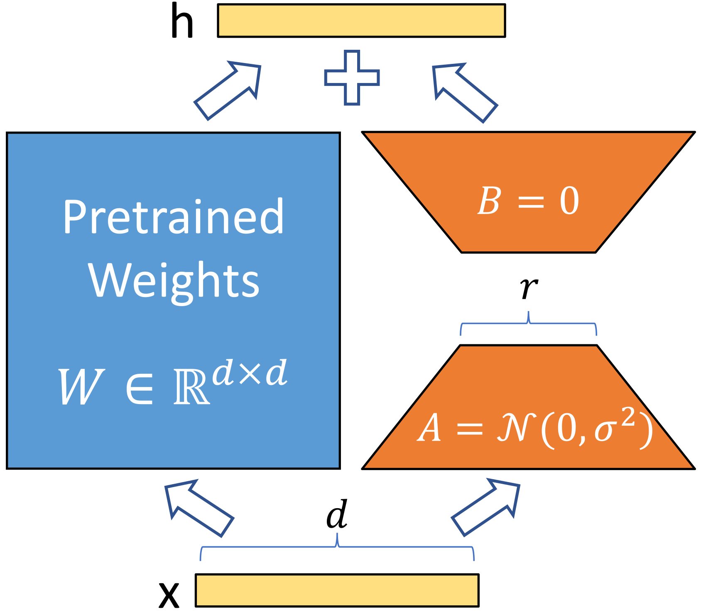
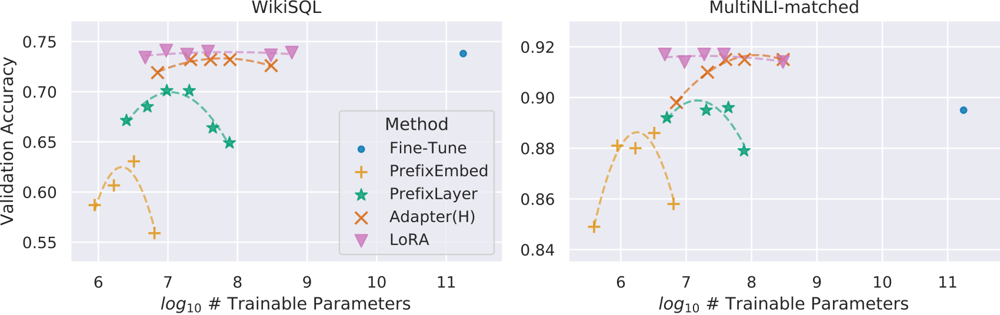
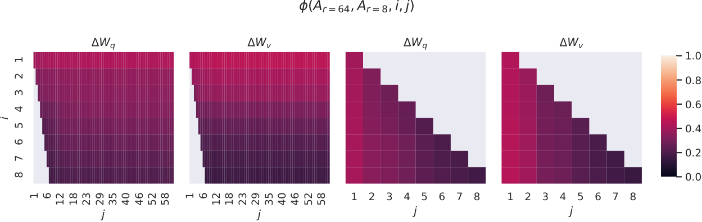

# LoRA 论文研读：低秩适配的提出、证据与解释

> **简述**：冻结预训练权重，用两个可训练小矩阵表示低秩增量，完成任务适配后可将增量合回原权重。 
> **paper**：[LoRA: Low-Rank Adaptation of Large Language Models](https://arxiv.org/abs/2106.09685) · ICLR 2022 
> **code**：[microsoft/LoRA](https://github.com/microsoft/LoRA) · **refs**：[Adapter](https://arxiv.org/abs/1902.00751)、[Prefix-Tuning](https://arxiv.org/abs/2101.00190) 
> **backbone**：RoBERTa、DeBERTa、GPT-2、GPT-3 175B · **date**：2021-06（预印本） 
> **modality / languages**：文本；原论文主要评测英语，方法本身不限定语言。

## 论文简介

大模型全量微调需要为全部权重保存梯度和优化器状态，每个任务还要维护一份完整模型。LoRA 假设任务适配所需的权重增量具有较低的内在秩：冻结原权重，在选定线性层旁加入两个小矩阵的乘积，只优化这条增量分支；训练后可将其合入原权重，保留原有网络结构。论文在语言理解、结构化数据生成和摘要等任务上，以很少的可训练参数达到接近或超过全量微调的结果，并通过投影位置、秩和子空间分析讨论这一假设。不过，最佳秩及插入位置依赖模型和任务；低秩约束并不保证能覆盖任意全量更新，原文的资源收益也不能直接套用到所有训练配置。

## 摘要译文

自然语言处理的一个重要范式，是先在通用领域数据上大规模预训练，再适配到特定任务或领域。随着预训练模型越来越大，重新训练全部参数的全量微调变得不再可行。例如 GPT-3 有 1750 亿参数，为每个任务部署一份微调模型的独立副本代价极高。

我们提出低秩适配（LoRA）：冻结预训练模型权重，在 Transformer 的每层注入可训练的秩分解矩阵，大幅减少下游任务的可训练参数。相较使用 Adam 的 GPT-3 175B 全量微调，LoRA 可将可训练参数减少一万倍，将 GPU 显存需求减少三倍。尽管可训练参数更少，LoRA 在 RoBERTa、DeBERTa、GPT-2 和 GPT-3 上取得与微调相当或更好的质量，并具有更高的训练吞吐；与 Adapter 不同，它不会引入额外推理延迟。我们还对语言模型适配中的秩亏现象进行了实证研究，为 LoRA 的有效性提供解释，并发布了便于接入 PyTorch 的软件包和模型实现。

**解读**：上述资源和效果数字来自论文各自的实验条件。推理延迟结论对应可合并到原浮点权重的部署路径，以下分别解释其适用范围。

## 为什么任务适配可以比模型本身小

预训练模型需要用大量参数表示广泛知识，但一个下游任务只是在已有能力上作有限调整。全量微调直接优化所有权重，并没有利用这种不对称性。对于 GPT-3 175B，即便每个任务只保存一套半精度权重，也已经是约 350 GB；训练还需要梯度、Adam 状态和激活。

Adapter 在层间插入瓶颈网络，能减少可训练参数，但增加了串行计算。Prefix-Tuning 学习供注意力读取的连续前缀，同样共享基座，但引入了额外前缀位置。LoRA 寻找的是另一种适配接口：直接改变已有线性变换，却把改变的自由度限制在很小的空间内。

这里的假设是 **增量低秩**。它没有要求预训练矩阵本身低秩，也没有把大矩阵用低秩近似替换掉。

## 相关工作：低秩更新区别于压缩预训练权重

论文从三条路线定位贡献。全量微调表达能力强，但每个任务要维护全部参数；Adapter 等方法增加较小模块，却可能引入额外串行计算；连续提示方法冻结基座，改为学习条件化向量，但需要在模型输入或注意力中保留提示路径。

此前低秩结构也被用于分解、压缩或训练神经网络。本文的切入点是保留原始预训练矩阵，只对任务增量施加低秩约束。两者即使用到同样的矩阵乘积，优化对象与保留的基座信息也不同。LoRA 与 Prefix 等方法还可以组合，并非互斥路线。

## 用两个小矩阵表示更新

对一个线性层，设冻结权重为 $W_0\in\mathbb{R}^{d\times k}$，输入为 $x\in\mathbb{R}^k$。全量微调会学习任意的 $\Delta W$；LoRA 改为

$$
h=W_0x+\Delta Wx=W_0x+\frac{\alpha}{r}BAx,
\qquad B\in\mathbb{R}^{d\times r},\quad A\in\mathbb{R}^{r\times k}.
$$

$r$ 是秩预算，$\alpha/r$ 控制更新幅度。因为 $\operatorname{rank}(BA)\le r$，更新只能落在所选低秩空间中。每个层的可训练参数从 $dk$ 降为 $r(d+k)$；对方阵，比例是 $2r/d$。例如 $d=4096,r=8$ 时，一层由约 1678 万个可训练参数降为 65536 个，约占 0.39%。这是单层增量的参数比例，不能当成整个训练任务的显存比例。

图中蓝色分支保留预训练变换，橙色分支先将输入映射到 $r$ 维，再映射回输出维度，两者相加。两个小矩阵共同学习一个更新，增量分支不需要改变主干的宽度或深度。

### 初始化为什么不会改变起始模型

原论文对 $A$ 采用随机高斯初始化，对 $B$ 采用零初始化，因此训练开始时 $BA=0$，模型输出与基座一致。若记输出梯度为 $g$，则忽略缩放系数时

$$
\nabla_B\mathcal L=g(Ax)^\top,
\qquad
\nabla_A\mathcal L=B^\top g x^\top.
$$

第一步 $A$ 的梯度为零，而 $B$ 通常可以先更新；随后两者都参与学习。两者同时置零会使这条分支无法启动。现代库可能对 $A$ 使用 Kaiming 等其他随机初始化，阅读实现时应与论文设置分开。

$\alpha/r$ 是原始缩放方式，改变秩也会影响优化动态。论文中的小秩有效不能推出所有任务都应固定 $r=1$，也不能推出只增加秩就一定改善结果。

### 梯度只更新适配器，仍需经过主干

训练时 $W_0$ 不计算权重梯度，也不维护对应的优化器状态；反向传播仍然需要经过冻结层，才能把损失传给较早层的 $A,B$。因此 LoRA 节省的是大量参数相关状态，并没有省掉主干权重和全部激活。长序列、大 batch 下，激活依然可能是主要开销。

## 放在哪些层：原论文的选择与证据

Transformer 中注意力的 $W_q,W_k,W_v,W_o$ 以及 MLP 的投影都可以使用这种参数化。原论文为控制研究范围，主要讨论注意力权重，并冻结 MLP；这是一项实验取舍，不能据此认为 MLP 不值得适配。

原论文表 5 固定 GPT-3 的可训练参数预算约为 18M，在不同注意力投影之间分配秩：

| 更新位置 | 每个矩阵的秩 | WikiSQL Acc. | MNLI-m Acc. |
|---|---:|---:|---:|
| Q | 8 | 70.4 | 91.0 |
| K | 8 | 70.0 | 90.8 |
| V | 8 | 73.0 | 91.0 |
| O | 8 | 73.2 | 91.3 |
| Q、K | 4 | 71.4 | 91.3 |
| Q、V | 4 | 73.7 | 91.3 |
| Q、K、V、O | 2 | 73.7 | 91.7 |

同样预算下，覆盖多个投影可以比单个矩阵堆更高秩更有效。Q/V 是原文中有吸引力的折中，但表中并不存在一个在全部指标上严格最优的位置组合。QLoRA 和后续工程研究进一步说明，指令微调中覆盖 MLP 等线性层值得单独验证。

## 数据与评测分别在检验什么

| 数据 / 任务 | 主要模型 | 要检验的能力与指标 |
|---|---|---|
| GLUE 中的多项理解任务 | RoBERTa、DeBERTa | 情感、推断、句子关系等；各子任务使用自己的分类指标 |
| E2E、WebNLG、DART | GPT-2 | 将属性表或三元组转成自然语言；BLEU、METEOR、ROUGE-L 等 |
| WikiSQL | GPT-3 | 从自然语言问题和表结构生成 SQL；原文报告逻辑形式准确率 |
| MNLI-m | GPT-3 | 判断句子对的蕴含、中立或矛盾关系；匹配域准确率 |
| SAMSum | GPT-3 | 将日常对话概括为摘要；ROUGE-1/2/L |

这些实验覆盖判别和生成任务，但仍主要是英语基准。不能把其结果直接视作多语言、长上下文、复杂推理或持续预训练的结论。

## 主要结果：参数少，任务分数仍可接近全量微调

以下摘自原论文表 4，均为 GPT-3 175B。参数列是参与训练的参数数量，SAMSum 依次为 ROUGE-1/2/L。

| 方法 | 可训练参数 | WikiSQL | MNLI-m | SAMSum R1/R2/RL |
|---|---:|---:|---:|---|
| 全量微调 | 175255.8M | 73.8 | 89.5 | 52.0 / 28.0 / 44.5 |
| BitFit | 14.2M | 71.3 | 91.0 | 51.3 / 27.4 / 43.5 |
| PreEmbed | 3.2M | 63.1 | 88.6 | 48.3 / 24.2 / 40.5 |
| PreLayer | 20.2M | 70.1 | 89.5 | 50.8 / 27.3 / 43.5 |
| Adapter-H | 40.1M | 73.2 | 91.5 | 53.2 / 29.0 / 45.1 |
| LoRA | 4.7M | 73.4 | 91.7 | 53.8 / 29.8 / 45.9 |
| LoRA | 37.7M | 74.0 | 91.6 | 53.4 / 29.2 / 45.1 |

LoRA 4.7M 在 WikiSQL 略低于全量微调，在 MNLI 和 SAMSum 更高。37.7M 在 WikiSQL 又有提高，但并没有在其余指标上全面超过 4.7M。论文支持的是“很小的增量容量可以完成这些任务”，而非参数越多必然越好。

图中把可训练参数作为横轴，可以看到 LoRA 在小预算区域已经有较强表现。曲线比较的是适配器容量和任务分数，不是实际训练时间、总显存或服务成本。

生成侧，原论文表 3 中 GPT-2 Medium 的全量微调与 LoRA 在 E2E 上分别为 68.2 和 70.4 BLEU，可训练参数分别约为 354.92M 和 0.35M。这为低秩更新提供了另一组证据，但不同任务的指标不能合并为一个通用“能力提升比例”。

### 资源收益需要看清分母

论文给出的 GPT-3 资源示例中，训练总显存从约 1.2 TB 降至 350 GB；当仅适配 Q/V 且 $r=4$ 时，单任务 checkpoint 从约 350 GB 降至 35 MB，约缩小一万倍。后者只是任务增量，运行时仍要加载共享基座。这个配置也不应与上表某一行的参数数量强行视为同一设置。

## 秩与子空间分析：低秩假设得到了什么支持

原论文表 6 固定更新 Q/V，在 GPT-3 上改变秩：

| 秩 | WikiSQL Acc. | MNLI-m Acc. |
|---:|---:|---:|
| 1 | 73.4 | 91.3 |
| 2 | 73.3 | 91.4 |
| 4 | 73.7 | 91.3 |
| 8 | 73.8 | 91.6 |
| 64 | 73.5 | 91.4 |

在这两个任务上，$r=1$ 已经有效，增至 64 没有持续提高。作者进一步比较不同秩学习到的方向：

图中比较 $r=8$ 与 $r=64$ 的 $A$ 矩阵子空间，主要方向有明显重合。它说明较大秩中的一些有效方向可以被较小秩捕获；它不是对所有任务最小所需秩的证明。子空间相似度也不能直接等同于模型输出或泛化能力完全一致。

## 更新相对于预训练权重，究竟改变了什么

原文不仅比较不同秩，还把预训练权重投影到更新所选的方向中。设 $U_\Delta,V_\Delta$ 是 $\Delta W$ 的主要左右奇异向量，则考察 $\|U_\Delta^\top W V_\Delta\|_F$，并与原始 $W$ 的主方向和随机方向作比较。

原文表 7 在 GPT-3 的被分析权重上，$r=4$ 时，更新方向内的预训练权重范数为 0.32，原始权重顶部方向为 21.67，随机方向为 0.02；$\|W_q\|_F=61.95$，$\|\Delta W_q\|_F=6.91$。作者据此提出：更新比随机方向更贴近已有权重，却没有简单重复预训练权重的最强方向，而可能放大原本较弱、对当前任务有用的特征。该方向内的增量与原权重之比约为 $6.91/0.32=21.6$。

**解读**：这是选定模型、层与任务的几何分析，不是“所有知识都早已存在”的证明，也不是说整个模型权重放大了二十多倍。原文附录还显示不同随机种子和不同秩存在不完全重合的方向，主方向相似不等于全部矩阵一致。

## 合并、切换与推理成本

在相同浮点表示下，可以先计算

$$
W_{\mathrm{merge}}=W_0+\frac{\alpha}{r}BA,
\qquad h=W_{\mathrm{merge}}x.
$$

合并后不再执行独立 LoRA 分支，线性层形状保持不变，因此避免了该分支的额外推理运算。如果服务需要同时切换许多适配器，通常会保留共享基座和各自增量，通过专门内核批处理；此时成本由运行时决定。量化基座上的合并还涉及舍入或重新量化，不能把浮点合并公式直接解释成任意低位格式都无损。

## 附录如何补充主文

附录 A 讨论只有上下文学习仍可能不足，解释为什么需要参数适配；B 比较 Adapter 的推理延迟；C/D 补充各数据集、超参数和任务配置。E 研究 LoRA 与 Prefix-Tuning 的组合，说明更新权重与学习条件前缀可以互补。F 增加 GPT-2、GPT-3 与低数据量实验。G 定义基于子空间投影的相似度，H 将不同层、随机种子、秩和权重相关性的分析展开。

子空间相似度归一化到零至一，衡量选定奇异方向的重合程度，而不是直接计算两个完整模型的行为相似度。附录中的这些分析与主表共同支持低秩适配的经验有效性，但没有给出任意任务的最优秩或统一训练配方。

## 结论与局限

LoRA 的核心贡献是一种容易嵌入现有模型的增量参数化：只保存任务变化，并把变化约束在低秩空间。它兼顾了训练状态、任务存储和合并部署的便利。但它仍需要主干前后向计算；表达能力、最优层位置和优化动态都有任务依赖。数据分布变化很大、任务容量需求提高或训练规模接近预训练时，应重新与全量微调及更高容量方案比较。

## 参考资料

- Hu et al. [LoRA: Low-Rank Adaptation of Large Language Models](https://arxiv.org/abs/2106.09685)，ICLR 2022；正文、附录与表 3–7。
- [官方代码 microsoft/LoRA](https://github.com/microsoft/LoRA)。

- [LoRA 技术总章](../LoRA技术深度调研报告.md)：跨论文理解 rank、alpha、目标权重、训练与部署。
