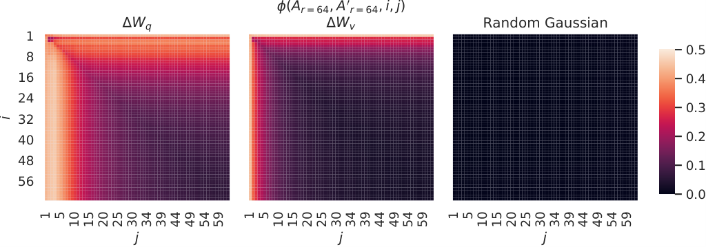
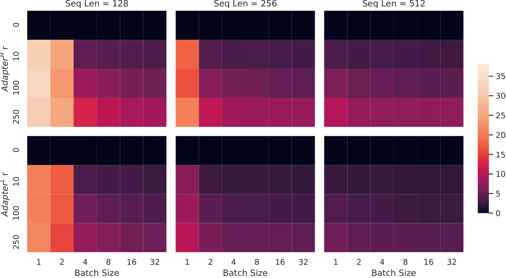
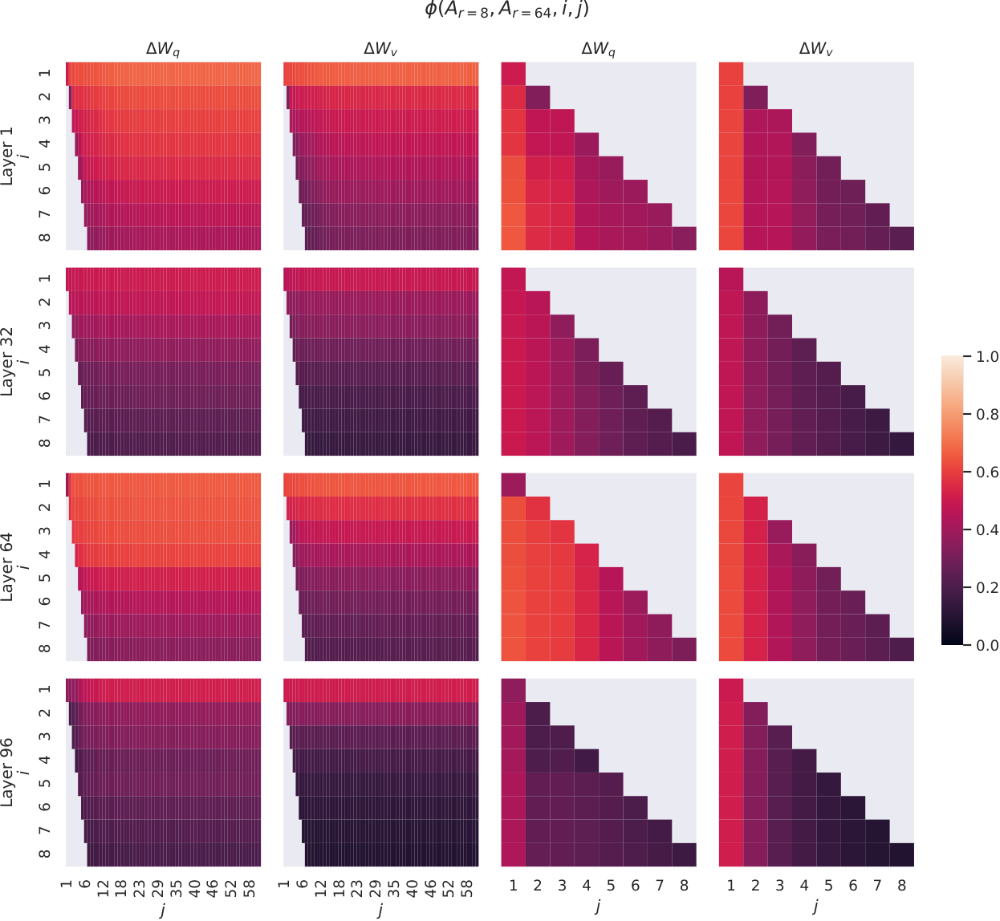
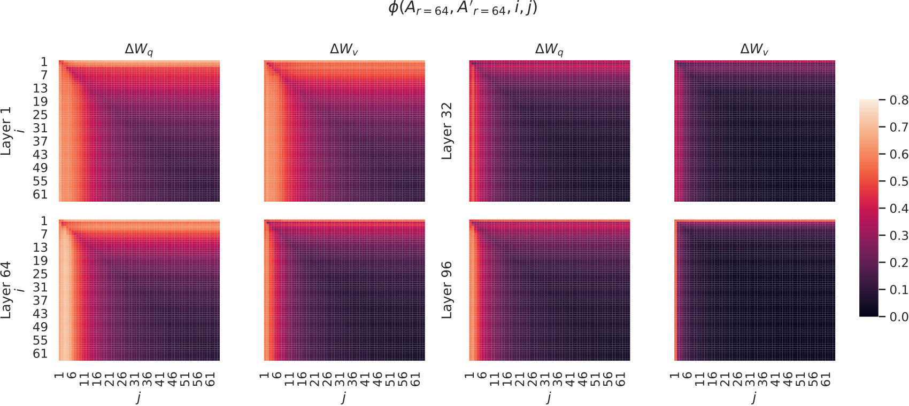
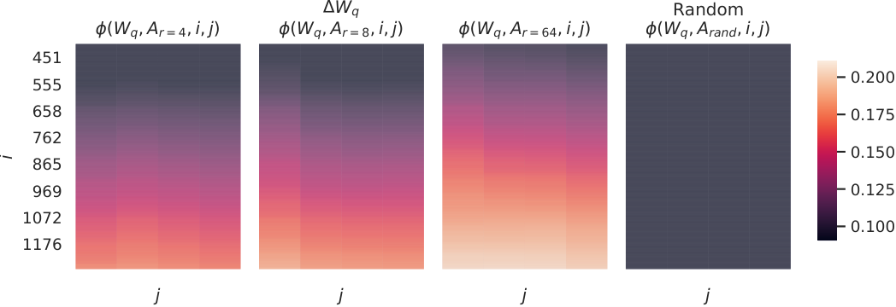

# LoRA：大型语言模型的低秩适配

> 原文：[arXiv:2106.09685v2](https://arxiv.org/html/2106.09685v2)，作者及机构信息见下。
> 中文全译稿：以机器初译为底稿，统一技术术语，并校订摘要和关键方法段落；覆盖主文、附录、表格、图注和脚注。参考文献保留原始书目，原图内部文字保留英文。英文转写见 [en.md](en.md)，方法分析另见 [LoRA详解.md](LoRA详解.md)。

## 作者与机构

## Authors and affiliations

Edward Hu [^id1] Yelong Shen * Phillip Wallis Zeyuan Allen-Zhu Affiliation: Yuanzhi Li Shean Wang Lu Wang Weizhu Chen Affiliation: Microsoft Corporation Affiliation: {edwardhu, yeshe, phwallis, zeyuana, Affiliation: yuanzhil, swang, luw, wzchen}@microsoft.com Email: yuanzhil@andrew.cmu.edu Affiliation: (Version 2)

## 摘要

自然语言处理的一个重要范式，是先在通用领域数据上大规模预训练，再适配到特定任务或领域。随着预训练模型越来越大，重新训练全部参数的全量微调变得不再可行。例如 GPT-3 有 1750 亿参数，为每个任务部署一份微调模型的独立副本代价极高。

我们提出低秩适配（LoRA）：冻结预训练模型权重，在 Transformer 的每层注入可训练的秩分解矩阵，大幅减少下游任务的可训练参数。相较使用 Adam 的 GPT-3 175B 全量微调，LoRA 可将可训练参数减少一万倍，将 GPU 显存需求减少三倍。尽管可训练参数更少，LoRA 在 RoBERTa、DeBERTa、GPT-2 和 GPT-3 上取得与微调相当或更好的质量，并具有更高的训练吞吐；与 Adapter 不同，它不会引入额外推理延迟。我们还对语言模型适配中的秩亏现象进行了实证研究，为 LoRA 的有效性提供解释，并发布了便于接入 PyTorch 的软件包和模型实现。

|  |
| --- |

## 简介

图 1：我们的重参数化。我们只训练$A$和$B$。

自然语言处理中的许多应用程序依赖于将一种大规模的、预训练的语言模型适配多个下游应用程序。这种适应通常是通过微调来完成的，它会更新预训练模型的所有参数。微调的主要缺点是新模型包含与原始模型一样多的参数。随着每隔几个月训练一次更大的模型，这从 GPT-2（Radford 等人，b）或 RoBERTa Large（Liu 等人，2019）的单纯“不便”转变为具有 1750 亿个可训练参数的 GPT-3（Brown 等人，2020）的关键部署挑战。 [^footnote1]

许多人试图通过仅调整一些参数或学习新任务的外部模块来缓解这种情况。这样，除了每个任务的预训练模型之外，我们只需要存储和加载少量特定于任务的参数，大大提高了部署时的运行效率。然而，现有技术经常通过扩展模型深度或减少模型的可用序列长度来引入推理延迟（Houlsby et al., 2019；Rebuffi et al., 2017）（Li＆Liang，2021；Lester et al., 2021；Hambadzumyan et al., 2020；Liu et al., 2021）（第3节）。更重要的是，这些方法通常无法匹配微调基线，从而在效率和模型质量之间进行权衡。

我们从 Li 等人那里汲取灵感。 (2018a);阿加詹扬等人。 （2020）表明，学习的过参数化模型实际上存在于较低的内在维度上。我们假设模型适配期间权重的变化也具有较低的“内在秩”，从而导致我们提出的低等级适应（LoRA）方法。 LoRA 允许我们通过优化适应过程中密集层变化的秩分解矩阵来间接训练神经网络中的一些密集层，同时保持预训练权重冻结，如图 1 所示。以 GPT-3 175B 为例，我们表明即使满秩（即 d ）高达 12,288，非常低的秩（即图 1 中的 r 可以是 1 或 2）也足够了，从而使 LoRA 具有存储和计算效率。

LoRA 拥有几个关键优势。

- • 预训练模型可以共享并用于构建许多用于不同任务的小型LoRA 模块。我们可以通过替换图1中的矩阵$A$和$B$来冻结共享模型并有效地切换任务，从而显着降低存储需求和任务切换开销。

- • 使用自适应优化器时，LoRA 使训练更加高效，并将硬件进入门槛降低了多达 3 倍，因为我们不需要计算梯度或维护大多数参数的优化器状态。相反，我们只优化注入的、小得多的低秩矩阵。

- • 我们简单的线性设计使我们能够在部署时将可训练矩阵与冻结权重合并，通过构造，与全量微调的模型相比，不会引入推理延迟。

- • LoRA 与许多现有方法正交，并且可以与其中许多方法相结合，例如前缀调整。我们在附录 E 中提供了一个示例。

#### 术语和约定

我们经常引用 Transformer 架构，并使用传统术语来表示其维度。我们将 Transformer 层的输入和输出维度大小称为 $d_{model}$ 。我们使用 $W_{q}$ 、 $W_{k}$ 、 $W_{v}$ 和 $W_{o}$ 来引用自注意力模块中的查询/键/值/输出投影矩阵。 $W$或$W_{0}$是指预训练的权重矩阵，$\Delta W$是指适应过程中累积的梯度更新。我们使用 $r$ 来表示 LoRA 模块的等级。我们遵循 (Vaswani et al., 2017; Brown et al., 2020) 制定的约定，并使用 Adam (Leshchilov & Hutter, 2019; Kingma & Ba, 2017) 进行模型优化，并使用 Transformer MLP 前馈维度 $d_{ffn}=4\times d_{model}$ 。

## 问题陈述

虽然我们的建议与训练目标无关，但我们专注于语言建模作为我们的激励用例。下面是对语言建模问题的简要描述，特别是在给定特定任务提示的情况下条件概率的最大化。

假设我们给出了一个由 $\Phi$ 参数化的预训练自回归语言模型 $P_{\Phi}(y|x)$ 。例如，$P_{\Phi}(y|x)$ 可以是基于 Transformer 架构（Vaswani 等人，2017）的通用多任务学习器，例如 GPT（Radford 等人，b；Brown 等人，2020）。考虑使此预训练模型适配下游条件文本生成任务，例如摘要、机器阅读理解 (MRC) 和自然语言到 SQL (NL2SQL)。每个下游任务都由上下文目标对的训练数据集表示： $\mathcal{Z}=\{(x_{i},y_{i})\}_{i=1,..,N}$ ，其中 $x_{i}$ 和 $y_{i}$ 都是标记序列。例如，在NL2SQL中，$x_{i}$是自然语言查询，$y_{i}$是其对应的SQL命令；作为摘要，$x_{i}$ 是文章内容，$y_{i}$ 是摘要。

在全量微调过程中，模型被初始化为预训练权重 $\Phi_{0}$，并通过重复遵循梯度更新为 $\Phi_{0}+\Delta\Phi$，以最大化条件语言建模目标：

$$
\displaystyle\max_{\Phi}\sum_{(x,y)\in\mathcal{Z}}\sum_{t=1}^{|y|}\text{log}\left(P_{\Phi}(y_{t}|x,y_{<t})\right)
$$

全量微调的主要缺点之一是，对于每个下游任务，我们学习一组不同的参数 $\Delta\Phi$ ，其维度 $|\Delta\Phi|$ 等于 $|\Phi_{0}|$ 。因此，如果预训练模型很大（例如带有 $|\Phi_{0}|\approx 175\text{~Billion}$ 的 GPT-3 ），那么存储和部署微调模型的许多独立实例可能会具有挑战性（如果可行的话）。

在本文中，我们采用了一种参数效率更高的方法，其中特定于任务的参数增量 $\Delta\Phi=\Delta\Phi(\Theta)$ 由一组更小的参数 $\Theta$ 和 $|\Theta|\ll|\Phi_{0}|$ 进一步编码。因此，找到 $\Delta\Phi$ 的任务就变成了对 $\Theta$ 进行优化：

$$
\displaystyle\max_{\Theta}\sum_{(x,y)\in\mathcal{Z}}\sum_{t=1}^{|y|}\log\left({p_{\Phi_{0}+\Delta\Phi(\Theta)}(y_{t}|x,y_{<t}})\right)
$$

在后续部分中，我们建议使用低秩表示来编码 $\Delta\Phi$，这既具有计算效率又具有内存效率。当预训练模型为 GPT-3 175B 时，可训练参数 $|\Theta|$ 的数量可以与 $|\Phi_{0}|$ 的 $0.01\%$ 一样小。

## 现有的解决方案还不够好吗？

我们要解决的问题绝不是新问题。自迁移学习诞生以来，已有数十项工作试图提高模型适配的参数和计算效率。请参阅第 6 节对一些著名作品的调查。以语言建模为例，在有效适应方面有两种突出的策略：添加适配器层（Houlsby et al., 2019；Rebuffi et al., 2017；Pfeiffer et al., 2021；Rücklé et al., 2020）或优化某些形式的输入层激活（Li & Liang, 2021；Lester et al., 2021； Hambardzumyan 等人，2020；Liu 等人，2021）。然而，这两种策略都有其局限性，特别是在大规模且对延迟敏感的生产场景中。

#### 适配器层引入推理延迟

适配器有多种变体。我们专注于 Houlsby 等人的原创设计。 (2019)，每个 Transformer 块有两个适配器层，Lin 等人最近有一个适配器层。 (2020)，每个块只有一个，但有一个额外的 LayerNorm (Ba et al., 2016)。虽然可以通过修剪层或利用多任务设置来减少总体延迟（Rücklé 等人，2020；Pfeiffer 等人，2021），但没有直接的方法可以绕过适配器层中的额外计算。这似乎不是问题，因为适配器层被设计为具有很少的参数（有时是原始模型的 $<$ 1%），并且具有较小的瓶颈尺寸，这限制了它们可以添加的 FLOP。然而，大型神经网络依赖硬件并行性来保持低延迟，并且适配器层必须按顺序处理。这对在线推理设置产生了影响，其中批量大小通常小至 1。在没有模型并行性的一般场景中，例如在单个 GPU 上的 GPT-2（Radford 等人，b）介质上运行推理，我们发现使用适配器时延迟会显着增加，即使瓶颈维度非常小（表 1）。

| 批量大小 | 32 | 16 | 1 |
| --- | --- | --- | --- |
| 序列长度 | 512 | 256 | 128 |
| $\|\Theta\|$ | 0.5M | 11M | 11M |
| 微调/LoRA | 1449.4 $\pm$ 0.8 | 338.0 $\pm$ 0.6 | 19.8 $\pm$ 2.7 |
| $\text{Adapter}^{\text{L}}$ | 1482.0 $\pm$ 1.0 ( +2.2% ) | 354.8 $\pm$ 0.5 ( +5.0% ) | 23.9 $\pm$ 2.1 ( +20.7% ) |
| $\text{Adapter}^{\text{H}}$ | 1492.2 $\pm$ 1.0 ( +3.0% ) | 366.3 $\pm$ 0.5 ( +8.4% ) | 25.8 $\pm$ 2.2 ( +30.3% ) |

表 1：GPT-2 介质中单次前向传递的推理延迟（以毫秒为单位），超过 100 次试验的平均值。我们使用 NVIDIA Quadro RTX8000。 “ $|\Theta|$ ”表示适配器层中可训练参数的数量。 $\text{Adapter}^{\text{L}}$ 和 $\text{Adapter}^{\text{H}}$ 是适配器调整的两种变体，我们将在第 5.1 节中进行描述。在在线、短序列长度场景中，适配器层引入的推理延迟可能会很大。请参阅附录 B 中的完整研究。

当我们需要像 Shoeybi 等人所做的那样对模型进行分片时，这个问题会变得更糟。 (2020);莱皮欣等人。 (2020) ，因为额外的深度需要更多的同步 GPU 操作，例如 AllReduce 和 Broadcast ，除非我们多次冗余存储适配器参数。

#### 直接优化提示很难

另一个方向，例如前缀调整（Li＆Liang，2021），面临着不同的挑战。我们观察到前缀调整很难优化，并且其性能在可训练参数中非单调变化，这证实了原始论文中的类似观察结果。更根本的是，保留一部分序列长度用于适应必然会减少可用于处理下游任务的序列长度，我们怀疑与其他方法相比，这会使调整提示的性能降低。我们将任务绩效的研究推迟到第 5 节。

## 我们的方法

我们描述了 LoRA 的简单设计及其实际好处。这里概述的原则适用于深度学习模型中的任何密集层，尽管我们在实验中只关注 Transformer 语言模型中的某些权重作为激励用例。

### 低秩参数化更新矩阵

神经网络包含许多执行矩阵乘法的稠密层，这些层的权重矩阵通常是满秩的。Aghajanyan 等（2020）表明，在特定任务适配中，预训练语言模型具有较低的“内在维度”：即使随机投影到较小子空间，仍可有效学习。受此启发，我们假设适配过程中的权重更新也具有较低的“内在秩”。对于预训练权重矩阵 $W_{0}\in\mathbb{R}^{d\times k}$，我们用低秩分解 $W_{0}+\Delta W=W_{0}+BA$ 约束其更新，其中 $B\in\mathbb{R}^{d\times r},A\in\mathbb{R}^{r\times k}$，且 $r\ll\min(d,k)$。训练时 $W_{0}$ 冻结，不接收梯度更新，而 $A$ 和 $B$ 包含可训练参数。$W_{0}$ 和 $\Delta W=BA$ 作用于相同输入，各自的输出向量逐坐标相加。对于 $h=W_{0}x$，修改后的前向传播为：

$$
h=W_{0}x+\Delta Wx=W_{0}x+BAx
$$

图 1 展示了我们的重参数化。$A$ 使用随机高斯初始化，$B$ 初始化为零，因此训练开始时 $\Delta W=BA$ 为零。随后，我们用 $\frac{\alpha}{r}$ 缩放 $\Delta Wx$，其中 $\alpha$ 不随 $r$ 改变。采用 Adam 优化时，如果适当缩放初始化，调整 $\alpha$ 与调整学习率大致相似。因此，我们只将 $\alpha$ 设为最初尝试的 $r$，不再单独调节。改变 $r$ 时，这一缩放有助于减少重新调节超参数的需要（Yang 和 Hu，2021）。

全量微调的推广。更通用的微调形式允许训练预训练参数的子集。 LoRA 更进一步，不需要对权重矩阵进行累积梯度更新来在适应过程中获得满秩。这意味着，当将 LoRA 应用于所有权重矩阵并训练所有偏差 [^footnote2] 时，我们通过将 LoRA 等级 $r$ 设置为预训练权重矩阵的等级来粗略地恢复全量微调的表达能力。换句话说，当我们增加可训练参数 [^footnote3] 的数量时，训练 LoRA 大致收敛到训练原始模型，而基于适配器的方法收敛到 MLP，基于前缀的方法收敛到不能接受长输入序列的模型。

无额外推理延迟。当部署在生产中时，我们可以显式计算和存储 $W=W_{0}+BA$ 并像往常一样执行推理。请注意， $W_{0}$ 和 $BA$ 都在 $\mathbb{R}^{d\times k}$ 中。当我们需要切换到另一个下游任务时，我们可以通过减去 $BA$ 然后添加不同的 $B^{\prime}A^{\prime}$ 来恢复 $W_{0}$ ，这是一个快速操作，内存开销非常小。至关重要的是，与通过构建进行微调的模型相比，这保证了我们在推理过程中不会引入任何额外的延迟。

### 将 LoRA 应用于 Transformer

原则上，我们可以将 LoRA 应用于神经网络中权重矩阵的任何子集，以减少可训练参数的数量。在 Transformer 架构中，自注意力模块（$W_{q},W_{k},W_{v},W_{o}$）中有四个权重矩阵，MLP 模块中有两个权重矩阵。我们将 $W_{q}$ （或 $W_{k}$ 、 $W_{v}$ ）视为维度为 $d_{model}\times d_{model}$ 的单个矩阵，即使输出维度通常被分割为注意力头。为了简单性和参数效率，我们将我们的研究限制为仅调整下游任务的注意力权重，并冻结 MLP 模块（因此它们不在下游任务中进行训练）。我们在第 7.1 节中进一步研究了在 Transformer 中调整不同类型的注意力权重矩阵的效果。我们将调整 MLP 层、LayerNorm 层和偏差的实证研究留给未来的工作。

实际的好处和局限性。最显着的好处来自内存和存储使用量的减少。对于使用 Adam 训练的大型 Transformer，如果 $r\ll d_{model}$，我们将 VRAM 使用量减少最多 $2/3$，因为我们不需要存储冻结参数的优化器状态。在 GPT-3 175B 上，我们将训练期间的 VRAM 消耗从 1.2TB 减少到 350GB。使用 $r=4$ 并且仅调整查询和值投影矩阵，检查点大小减少了大约 10,000 $\times$ （从 350GB 到 35MB） [^footnote4] 。这使我们能够使用更少的 GPU 进行训练并避免 I/O 瓶颈。另一个好处是，我们可以通过仅交换 LoRA 权重而不是所有参数来以更低的成本在部署时切换任务。这允许创建许多定制模型，这些模型可以在将预训练的权重存储在 VRAM 中的机器上动态地换入和换出。与全量微调 [^footnote5] 相比，我们还观察到在 GPT-3 175B 上训练期间加速了 25%，因为我们不需要计算绝大多数参数的梯度。

LoRA 也有其局限性。例如，如果选择将 $A$ 和 $B$ 吸收到 $W$ 中以消除额外的推理延迟，那么在一次前向传递中将不同的 $A$ 和 $B$ 批量输入到不同的任务并不简单。尽管在延迟不重要的情况下，可以不合并权重并动态选择用于批量样本的 LoRA 模块。

## 实证实验

我们评估了 RoBERTa（Liu et al., 2019）、DeBERTa（He et al., 2021）和 GPT-2（Radford et al., b）上 LoRA 的下游任务性能，然后扩展到 GPT-3 175B（Brown et al., 2020）。我们的实验涵盖了广泛的任务，从自然语言理解（NLU）到生成（NLG）。具体来说，我们对 RoBERTa 和 DeBERTa 的 GLUE（Wang et al., 2019）基准进行评估。我们遵循Li＆Liang（2021）在GPT-2上的设置进行直接比较，并添加WikiSQL（Zhong等人，2017）（NL到SQL查询）和SAMSum（Gliwa等人，2019）（对话摘要）在GPT-3上进行大规模实验。有关我们使用的数据集的更多详细信息，请参阅附录 C。我们使用 NVIDIA Tesla V100 进行所有实验。

### 基线

为了与其他基线进行广泛比较，我们复制了先前工作中使用的设置，并尽可能重复使用其报告的数字。然而，这意味着某些基线可能只出现在某些实验中。

微调（FT）是一种常见的适应方法。在微调过程中，模型被初始化为预训练的权重和偏差，并且所有模型参数都进行梯度更新。一个简单的变体是仅更新某些层，同时冻结其他层。我们在 GPT-2 的先前工作 (Li & Liang, 2021) 中报告了一个这样的基线，它仅适应最后两层 ($\textbf{FT}^{\textbf{Top2}}$)。

仅偏差或 BitFit 是一个基线，我们仅训练偏差向量，同时冻结其他所有内容。与此同时，BitFit 也研究了这一基线（Zaken 等人，2021）。

前缀嵌入调整 (PreEmbed) 在输入标记中插入特殊标记。这些特殊标记具有可训练的词嵌入，并且通常不在模型的词汇表中。放置此类令牌的位置可能会对性能产生影响。我们重点关注“前缀”（将此类标记添加到提示符之前）和“中缀”（附加到提示符后）； Li＆Liang（2021）对两者进行了讨论。我们使用 $l_{p}$ （或 $l_{i}$ ）表示前缀（或中缀）标记的数量。可训练参数的数量为 $|\Theta|=d_{model}\times(l_{p}+l_{i})$ 。

前缀层调整（PreLayer）是前缀嵌入调整的扩展。我们不只是学习一些特殊标记的词嵌入（或者等效地，嵌入层之后的激活），而是学习每个 Transformer 层之后的激活。从先前层计算的激活被简单地替换为可训练的激活。结果可训练参数的数量为 $|\Theta|=L\times d_{model}\times(l_{p}+l_{i})$ ，其中 $L$ 是 Transformer 层的数量。

Houlsby 等人提出的适配器调整。 (2019) 在自注意力模块（和 MLP 模块）和后续残差连接之间插入适配器层。有两个完全连接的层，其中适配器层存在偏差，中间存在非线性。我们将这个原创设计称为$\textbf{Adapter}^{\textbf{H}}$。最近，林等人。 (2020) 提出了一种更高效的设计，仅在 MLP 模块和 LayerNorm 之后应用适配器层。我们称之为 $\textbf{Adapter}^{\textbf{L}}$ 。这与 Pfeiffer 等人提出的另一种设计非常相似。 (2021) ，我们称之为 $\textbf{Adapter}^{\textbf{P}}$ 。我们还包括另一个基线调用 AdapterDrop（Rücklé 等人，2020），它删除了一些适配器层以提高效率（$\textbf{Adapter}^{\textbf{D}}$）。我们尽可能引用先前作品中的数字，以最大限度地增加我们比较的基线数量；它们位于第一列带有星号 (*) 的行中。在所有情况下，我们都有 $|\Theta|=\hat{L}_{Adpt}\times(2\times d_{model}\times r+r+d_{model})+2\times\hat{L}_{LN}\times d_{model}$，其中 $\hat{L}_{Adpt}$ 是适配器层的数量，$\hat{L}_{LN}$ 是可训练 LayerNorm 的数量（例如，在 $\text{Adapter}^{\text{L}}$ 中）。

LoRA 与现有权重矩阵并行添加可训练的秩分解矩阵对。正如4.2节中提到的，为了简单起见，我们在大多数实验中仅将LoRA应用于$W_{q}$和$W_{v}$。可训练参数的数量由排名 $r$ 和原始权重的形状决定： $|\Theta|=2\times\hat{L}_{LoRA}\times d_{model}\times r$ ，其中 $\hat{L}_{LoRA}$ 是我们应用 LoRA 的权重矩阵的数量。

### RoBERTa 底座/大号

| 模型与方法 | # 可训练 |  |  |  |  |  |  |  |  |  |
| --- | --- | --- | --- | --- | --- | --- | --- | --- | --- | --- |
|  | 参数 | MNLI | SST-2 | 物料循环过程控制 | 辅酶A | QNLI | QQP | 即时通讯 | STS-B | 平均。 |
| $\text{RoB}_{\text{base}}$ (FT)* | 125.0M | 87.6 | 94.8 | 90.2 | 63.6 | 92.8 | 91.9 | 78.7 | 91.2 | 86.4 |
| $\text{RoB}_{\text{base}}$（BitFit）* | 0.1M | 84.7 | 93.7 | 92.7 | 62.0 | 91.8 | 84.0 | 81.5 | 90.8 | 85.2 |
| $\text{RoB}_{\text{base}}$ ( $\text{Adpt}^{\text{D}}$ )* | 0.3M | 87.1 $\pm$ .0 | 94.2 $\pm$ .1 | 88.5 $\pm$ 1.1 | 60.8 $\pm$ .4 | 93.1 $\pm$ .1 | 90.2 $\pm$ .0 | 71.5 $\pm$ 2.7 | 89.7 $\pm$ .3 | 84.4 |
| $\text{RoB}_{\text{base}}$ ( $\text{Adpt}^{\text{D}}$ )* | 0.9M | 87.3 $\pm$ .1 | 94.7 $\pm$ .3 | 88.4 $\pm$ .1 | 62.6 $\pm$ .9 | 93.0 $\pm$ .2 | 90.6 $\pm$ .0 | 75.9 $\pm$ 2.2 | 90.3 $\pm$ .1 | 85.4 |
| $\text{RoB}_{\text{base}}$ (LoRA) | 0.3M | 87.5 $\pm$ .3 | 95.1 $\pm$ .2 | 89.7 $\pm$ .7 | 63.4 $\pm$ 1.2 | 93.3 $\pm$ .3 | 90.8 $\pm$ .1 | 86.6 $\pm$ .7 | 91.5 $\pm$ .2 | 87.2 |
| $\text{RoB}_{\text{large}}$ (FT)* | 355.0M | 90.2 | 96.4 | 90.9 | 68.0 | 94.7 | 92.2 | 86.6 | 92.4 | 88.9 |
| $\text{RoB}_{\text{large}}$ (LoRA) | 0.8M | 90.6 $\pm$ .2 | 96.2 $\pm$ .5 | 90.9 $\pm$ 1.2 | 68.2 $\pm$ 1.9 | 94.9 $\pm$ .3 | 91.6 $\pm$ .1 | 87.4 $\pm$ 2.5 | 92.6 $\pm$ .2 | 89.0 |
| $\text{RoB}_{\text{large}}$ ( $\text{Adpt}^{\text{P}}$ ) $\dagger$ | 3.0M | 90.2 $\pm$ .3 | 96.1 $\pm$ .3 | 90.2 $\pm$ .7 | 68.3 $\pm$ 1.0 | 94.8 $\pm$ .2 | 91.9 $\pm$ .1 | 83.8 $\pm$ 2.9 | 92.1 $\pm$ .7 | 88.4 |
| $\text{RoB}_{\text{large}}$ ( $\text{Adpt}^{\text{P}}$ ) $\dagger$ | 0.8M | 90.5 $\pm$ .3 | 96.6 $\pm$ .2 | 89.7 $\pm$ 1.2 | 67.8 $\pm$ 2.5 | 94.8 $\pm$ .3 | 91.7 $\pm$ .2 | 80.1 $\pm$ 2.9 | 91.9 $\pm$ .4 | 87.9 |
| $\text{RoB}_{\text{large}}$ ( $\text{Adpt}^{\text{H}}$ ) $\dagger$ | 6.0M | 89.9 $\pm$ .5 | 96.2 $\pm$ .3 | 88.7 $\pm$ 2.9 | 66.5 $\pm$ 4.4 | 94.7 $\pm$ .2 | 92.1 $\pm$ .1 | 83.4 $\pm$ 1.1 | 91.0 $\pm$ 1.7 | 87.8 |
| $\text{RoB}_{\text{large}}$ ( $\text{Adpt}^{\text{H}}$ ) $\dagger$ | 0.8M | 90.3 $\pm$ .3 | 96.3 $\pm$ .5 | 87.7 $\pm$ 1.7 | 66.3 $\pm$ 2.0 | 94.7 $\pm$ .2 | 91.5 $\pm$ .1 | 72.9 $\pm$ 2.9 | 91.5 $\pm$ .5 | 86.4 |
| $\text{RoB}_{\text{large}}$ (LoRA) $\dagger$ | 0.8M | 90.6 $\pm$ .2 | 96.2 $\pm$ .5 | 90.2 $\pm$ 1.0 | 68.2 $\pm$ 1.9 | 94.8 $\pm$ .3 | 91.6 $\pm$ .2 | 85.2 $\pm$ 1.1 | 92.3 $\pm$ .5 | 88.6 |
| $\text{DeB}_{\text{XXL}}$ (FT)* | 1500.0M | 91.8 | 97.2 | 92.0 | 72.0 | 96.0 | 92.7 | 93.9 | 92.9 | 91.1 |
| $\text{DeB}_{\text{XXL}}$ (LoRA) | 4.7M | 91.9 $\pm$ .2 | 96.9 $\pm$ .2 | 92.6 $\pm$ .6 | 72.4 $\pm$ 1.1 | 96.0 $\pm$ .1 | 92.9 $\pm$ .1 | 94.9 $\pm$ .4 | 93.0 $\pm$ .2 | 91.3 |

表 2：在 GLUE 基准上采用不同适配方法的 $\text{RoBERTa}_{\text{base}}$ 、 $\text{RoBERTa}_{\text{large}}$ 和 $\text{DeBERTa}_{\text{XXL}}$ 。我们报告了 MNLI 的总体（匹配和不匹配）准确度、CoLA 的 Matthew 相关性、STS-B 的 Pearson 相关性以及其他任务的准确度。所有指标越高越好。 * 表示之前作品中发表的数量。 $\dagger$ 表示在类似于 Houlsby 等人的设置中配置的运行。 （2019）进行公平比较。

RoBERTa（Liu et al., 2019）优化了 BERT（Devlin et al., 2019a）最初提出的预训练方案，并在不引入更多可训练参数的情况下提升了后者的任务性能。尽管 RoBERTa 近年来在 NLP 排行榜上已被 GLUE 基准（Wang 等人，2019）等更大的模型超越，但就其规模而言，它在从业者中仍然是一个有竞争力且受欢迎的预训练模型。我们从 HuggingFace Transformers 库（Wolf 等人，2020）中获取预训练的 RoBERTa base (125M) 和 RoBERTa Large (355M)，并根据 GLUE 基准评估不同高效适应方法在任务上的性能。我们还复制了Houlsby 等人的研究。 （2019）和 Pfeiffer 等人。 （2021）根据他们的设置。为了确保公平比较，我们在与适配器进行比较时对 LoRA 的评估方式做出了两项重要改变。首先，我们对所有任务使用相同的批量大小，并使用序列长度 128 来匹配适配器基线。其次，我们将模型初始化为 MRPC、RTE 和 STS-B 的预训练模型，而不是像微调基线那样已经适应 MNLI 的模型。按照 Houlsby 等人提供的更受限制的设置运行。 (2019) 标记为 $\dagger$ 。结果如表 2 所示（前三部分）。有关所使用的超参数的详细信息，请参阅第 D.1 节。

### 德贝塔 XXL

DeBERTa（He 等人，2021）是 BERT 的最新变体，它经过更大规模的训练，并且在 GLUE（Wang 等人，2019）和 SuperGLUE（Wang 等人，2020）等基准测试上表现非常有竞争力。我们评估 LoR​​A 是否仍然可以与 GLUE 上全量微调的 DeBERTa XXL (1.5B) 的性能相匹配。结果如表 2（底部）所示。有关所使用的超参数的详细信息，请参阅第 D.2 节。

### GPT-2 中型/大型

在证明 LoRA 可以成为 NLU 上全量微调的有竞争力的替代方案之后，我们希望回答 LoRA 是否仍然在 NLG 模型（例如 GPT-2 中型和大型）上占主导地位（Radford 等人，b）。我们使我们的设置尽可能接近 Li & Liang (2021)，以便进行直接比较。由于篇幅限制，本节我们仅展示我们在 E2E NLG Challenge 上的结果（表 3）。有关 WebNLG（Gardent et al.，2017）和 DART（Nan et al.，2020）的结果，请参阅第 F.1 节。我们提供了 D.3 节中使用的超参数列表。

| 模型与方法 | # 可训练 | 端到端 NLG 挑战赛 | 端到端 NLG 挑战赛 | 端到端 NLG 挑战赛 | 端到端 NLG 挑战赛 | 端到端 NLG 挑战赛 |
| --- | --- | --- | --- | --- | --- | --- |
|  | 参数 | 蓝线 | 美国国家标准技术研究院 | 梅特 | 胭脂-L | 西德 |
| GPT-2 M (FT)* | 354.92M | 68.2 | 8.62 | 46.2 | 71.0 | 2.47 |
| GPT-2M（$\text{Adapter}^{\text{L}}$）* | 0.37M | 66.3 | 8.41 | 45.0 | 69.8 | 2.40 |
| GPT-2M（$\text{Adapter}^{\text{L}}$）* | 11.09M | 68.9 | 8.71 | 46.1 | 71.3 | 2.47 |
| GPT-2M（$\text{Adapter}^{\text{H}}$） | 11.09M | 67.3 $\pm$ .6 | 8.50 $\pm$ .07 | 46.0 $\pm$ .2 | 70.7 $\pm$ .2 | 2.44 $\pm$ .01 |
| GPT-2M（$\text{FT}^{\text{Top2}}$）* | 25.19M | 68.1 | 8.59 | 46.0 | 70.8 | 2.41 |
| GPT-2 M（预层）* | 0.35M | 69.7 | 8.81 | 46.1 | 71.4 | 2.49 |
| GPT-2M（LoRA） | 0.35M | 70.4 $\pm$ .1 | 8.85 $\pm$ .02 | 46.8 $\pm$ .2 | 71.8 $\pm$ .1 | 2.53 $\pm$ .02 |
| GPT-2 L (FT)* | 774.03M | 68.5 | 8.78 | 46.0 | 69.9 | 2.45 |
| GPT-2L（$\text{Adapter}^{\text{L}}$） | 0.88M | 69.1 $\pm$ .1 | 8.68 $\pm$ .03 | 46.3 $\pm$ .0 | 71.4 $\pm$ .2 | 2.49 $\pm$ .0 |
| GPT-2L（$\text{Adapter}^{\text{L}}$） | 23.00M | 68.9 $\pm$ .3 | 8.70 $\pm$ .04 | 46.1 $\pm$ .1 | 71.3 $\pm$ .2 | 2.45 $\pm$ .02 |
| GPT-2 L（预层）* | 0.77M | 70.3 | 8.85 | 46.2 | 71.7 | 2.47 |
| GPT-2 L (LoRA) | 0.77M | 70.4 $\pm$ .1 | 8.89 $\pm$ .02 | 46.8 $\pm$ .2 | 72.0 $\pm$ .2 | 2.47 $\pm$ .02 |

表 3：E2E NLG 挑战赛中具有不同适应方法的 GPT-2 中型 (M) 和大型 (L)。对于所有指标来说，越高越好。 LoRA 的性能优于多个可训练参数相当或更少的基线。显示了我们进行的实验的置信区间。 * 表示之前作品中发表的数量。

| 模型与方法 | # 可训练 | 维基SQL | MNLI-m | SAM总和 |
| --- | --- | --- | --- | --- |
| 模型与方法 | 参数 | 附件。 (%) | 附件。 (%) | R1/R2/RL |
| GPT-3 (FT) | 175,255.8M | 73.8 | 89.5 | 52.0/28.0/44.5 |
| GPT-3（BitFit） | 14.2M | 71.3 | 91.0 | 51.3/27.4/43.5 |
| GPT-3（预嵌入） | 3.2M | 63.1 | 88.6 | 48.3/24.2/40.5 |
| GPT-3（预层） | 20.2M | 70.1 | 89.5 | 50.8/27.3/43.5 |
| GPT-3（$\text{Adapter}^{\text{H}}$） | 7.1M | 71.9 | 89.8 | 53.0/28.9/44.8 |
| GPT-3（$\text{Adapter}^{\text{H}}$） | 40.1M | 73.2 | 91.5 | 53.2/29.0/45.1 |
| GPT-3（LoRA） | 4.7M | 73.4 | 91.7 | 53.8/29.8/45.9 |
| GPT-3（LoRA） | 37.7M | 74.0 | 91.6 | 53.4/29.2/45.1 |

表 4：不同适配方法在 GPT-3 175B 上的性能。我们报告了 WikiSQL 上的逻辑形式验证准确性、MultiNLI-matched 上的验证准确性以及 SAMSum 上的 Rouge-1/2/L。 LoRA 的性能比以前的方法更好，包括全量微调。对于这三个指标，WikiSQL 上的结果在 $\pm 0.5\%$ 附近波动，MNLI-m 在 $\pm 0.1\%$ 附近波动，SAMSum 在 $\pm 0.2$ / $\pm 0.2$ / $\pm 0.1$ 附近波动。

### 扩展到 GPT-3 175B

作为 LoRA 的最终压力测试，我们扩展到具有 1750 亿个参数的 GPT-3。由于训练成本较高，我们仅报告给定任务在随机种子上的典型标准差，而不是为每个条目提供一个标准差。有关所使用的超参数的详细信息，请参阅第 D.4 节。

如表 4 所示，LoRA 在所有三个数据集上都匹配或超过了微调基线。请注意，并非所有方法都能从拥有更多可训练参数中单调受益，如图 2 所示。当我们使用超过 256 个特殊标记进行前缀嵌入调整或使用超过 32 个特殊标记进行前缀层调整时，我们观察到性能显着下降。这证实了Li＆Liang（2021）中的类似观察。虽然对这种现象的彻底调查超出了这项工作的范围，但我们怀疑拥有更多特殊标记会导致输入分布进一步远离预训练数据分布。另外，我们在 F.3 节中研究了低数据情况下不同适应方法的性能。

图 2：GPT-3 175B 验证精度与 WikiSQL 和 MNLI 匹配上的几种自适应方法的可训练参数数量的关系。 LoRA 表现出更好的可扩展性和任务性能。有关绘制数据点的更多详细信息，请参阅第 F.2 节。

## 相关作品

Transformer 语言模型。 Transformer（Vaswani 等人，2017）是一种序列到序列的架构，大量使用自注意力。雷德福等人。 (a) 通过使用一堆 Transformer 解码器将其应用于自回归语言建模。从那时起，基于 Transformer 的语言模型就主导了 NLP，在许多任务中实现了最先进的技术。 BERT（Devlin 等人，2019b）和 GPT-2（Radford 等人，b）出现了一种新范式——两者都是在大量文本上训练的大型 Transformer 语言模型——与直接对特定任务数据进行训练相比，在对通用领域数据进行预训练后对特定任务数据进行微调可提供显着的性能增益。训练更大的 Transformer 通常会带来更好的性能，并且仍然是一个活跃的研究方向。 GPT-3（Brown 等人，2020）是迄今为止使用 175B 个参数训练的最大的单一 Transformer 语言模型。

及时的工程和微调。虽然 GPT-3 175B 只需几个额外的训练示例即可调整其行为，但结果在很大程度上取决于输入提示（Brown 等人，2020）。这就需要一种编写和格式化提示的经验艺术，以最大限度地提高模型在所需任务上的性能，这被称为提示工程或提示黑客。微调将在一般领域预训练的模型重新训练到特定任务 Devlin 等人。 (2019b);雷德福等人。 (一).它的变体包括仅学习 Devlin 等人的参数的子集。 (2019b); Collobert & Weston (2008)，但从业者经常对所有这些人员进行重新培训，以最大限度地提高下游绩效。然而，GPT-3 175B 的庞大性使得以通常的方式执行微调变得具有挑战性，因为它产生的检查点很大，而且由于它具有与预训练相同的内存占用，进入的硬件门槛很高。

参数有效的适应。许多人建议在神经网络的现有层之间插入适配器层（Houlsby 等人，2019；Rebuffi 等人，2017；Lin 等人，2020）。我们的方法使用类似的瓶颈结构对权重更新施加低秩约束。关键的功能区别在于，我们学习的权重可以在推理过程中与主要权重合并，因此不会引入任何延迟，而适配器层则不是这种情况（第 3 节）。适配器的临时扩展更加紧凑（Mahabadi 等人，2021），它本质上是使用 Kronecker 产品和一些预定的权重共享方案来参数化适配器层。同样，将 LoRA 与其他基于张量积的方法相结合可能会提高其参数效率，我们将其留给未来的工作。最近，许多人提出优化输入词嵌入来代替微调，类似于提示工程的连续且可微的概括（Li＆Liang，2021；Lester等人，2021；Hambardzumyan等人，2020；Liu等人，2021）。我们在实验部分中包含了与 Li & Liang (2021) 的比较。然而，这一系列工作只能通过在提示中使用更多特殊标记来扩展，当学习位置嵌入时，这些标记会占用任务标记的可用序列长度。

深度学习中的低阶结构。低秩结构在机器学习中非常常见。许多机器学习问题都具有一定的内在低秩结构(Li et al., 2016; Cai et al., 2010; Li et al., 2018b; Grasedyck et al., 2013)。此外，众所周知，对于许多深度学习任务，特别是那些具有严重过度参数化神经网络的任务，学习的神经网络在训练后将具有低秩属性（Oymak et al., 2019）。一些先前的工作甚至在训练原始神经网络时明确地施加低秩约束（Sainath等人，2013；Povey等人，2018；Zhang等人，2014；Jaderberg等人，2014；Zhao等人，2016；Khodak等人，2021；Denil等人，2014）；然而，据我们所知，这些工作都没有考虑对冻结模型进行低秩更新以适应下游任务。在理论文献中，众所周知，当底层概念类具有一定的低秩结构时（Ghorbani et al., 2020；Allen-Zhu & Li, 2019；Allen-Zhu & Li, 2020a），神经网络优于其他经典学习方法，包括相应的（有限宽度）神经切线核（Allen-Zhu et al., 2019；Li＆Liang，2018）。 Allen-Zhu & Li (2020b) 的另一个理论结果表明，低秩适配对于对抗训练很有用。总之，我们相信我们提出的低秩适配更新受到文献的充分启发。

## 了解低级别更新

鉴于 LoRA 的经验优势，我们希望进一步解释从下游任务中学习到的低秩适配的特性。请注意，低秩结构不仅降低了硬件进入门槛，使我们能够并行运行多个实验，而且还可以更好地解释更新权重与预训练权重的相关性。我们的研究重点是 GPT-3 175B，其中我们实现了可训练参数的最大减少（高达 10,000 $\times$ ），而不会对任务性能产生不利影响。

我们进行了一系列实证研究来回答以下问题：1）给定参数预算约束，我们应该调整预训练 Transformer 中的哪个权重矩阵子集来最大化下游性能？ 2）“最优”适配矩阵 $\Delta W$ 真的是秩亏的吗？如果是这样，在实践中使用什么等级比较好？ 3）$\Delta W$和$W$之间有什么联系？ $\Delta W$ 与 $W$ 高度相关吗？ $\Delta W$ 与 $W$ 相比有多大？

我们相信，我们对问题（2）和（3）的回答揭示了使用预训练语言模型进行下游任务的基本原则，这是 NLP 的一个关键主题。

### LoRA 应该应用于 Transformer 中的哪些权重矩阵？

给定有限的参数预算，我们应该使用 LoRA 调整哪些类型的权重才能在下游任务上获得最佳性能？正如 4.2 节中提到的，我们只考虑自注意力模块中的权重矩阵。我们在 GPT-3 175B 上设置了 18M 的参数预算（如果存储在 FP16 中，则约为 35MB），对于所有 96 层，如果我们采用一种类型的注意力权重，则对应于 $r=8$；如果我们采用两种类型，则对应于 $r=4$。结果如表5所示。

|  | 可训练参数的数量 = 18M | 可训练参数的数量 = 18M | 可训练参数的数量 = 18M | 可训练参数的数量 = 18M | 可训练参数的数量 = 18M | 可训练参数的数量 = 18M | 可训练参数的数量 = 18M |
| --- | --- | --- | --- | --- | --- | --- | --- |
| 重量类型 | $W_{q}$ | $W_{k}$ | $W_{v}$ | $W_{o}$ | $W_{q},W_{k}$ | $W_{q},W_{v}$ | $W_{q},W_{k},W_{v},W_{o}$ |
| 排名 $r$ | 8 | 8 | 8 | 8 | 4 | 4 | 2 |
| 维基 SQL ( $\pm 0.5$ %) | 70.4 | 70.0 | 73.0 | 73.2 | 71.4 | 73.7 | 73.7 |
| 多 NLI ( $\pm 0.1$ %) | 91.0 | 90.8 | 91.0 | 91.3 | 91.3 | 91.3 | 91.7 |

表 5：在给定相同数量的可训练参数的情况下，将 LoRA 应用于 GPT-3 中不同类型的注意力权重后，WikiSQL 和 MultiNLI 的验证准确性。同时采用 $W_{q}$ 和 $W_{v}$ 可提供最佳的整体性能。我们发现随机种子的标准差对于给定的数据集是一致的，我们在第一列中报告了这一点。

请注意，将所有参数放入 $\Delta W_{q}$ 或 $\Delta W_{k}$ 会导致性能显着降低，而同时调整 $W_{q}$ 和 $W_{v}$ 会产生最佳结果。这表明即使是四阶也能在 $\Delta W$ 中捕获足够的信息，因此适应更多的权重矩阵比适应具有更大阶的单一类型的权重更好。

### LoRA 的最佳排名 $r$ 是多少？

我们将注意力转向排名 $r$ 对模型性能的影响。我们调整 $\{W_{q},W_{v}\}$ 、 $\{W_{q},W_{k},W_{v},W_{c}\}$ 和 $W_{q}$ 进行比较。

|  | 重量类型 | $r=1$ | $r=2$ | $r=4$ | $r=8$ | $r=64$ |
| --- | --- | --- | --- | --- | --- | --- |
| WikiSQL( $\pm 0.5$ %) | $W_{q}$ | 68.8 | 69.6 | 70.5 | 70.4 | 70.0 |
| WikiSQL( $\pm 0.5$ %) | $W_{q},W_{v}$ | 73.4 | 73.3 | 73.7 | 73.8 | 73.5 |
|  | $W_{q},W_{k},W_{v},W_{o}$ | 74.1 | 73.7 | 74.0 | 74.0 | 73.9 |
| 多 NLI ( $\pm 0.1$ %) | $W_{q}$ | 90.7 | 90.9 | 91.1 | 90.7 | 90.7 |
| 多 NLI ( $\pm 0.1$ %) | $W_{q},W_{v}$ | 91.3 | 91.4 | 91.3 | 91.6 | 91.4 |
| 多 NLI ( $\pm 0.1$ %) | $W_{q},W_{k},W_{v},W_{o}$ | 91.2 | 91.7 | 91.7 | 91.5 | 91.4 |

表 6：不同等级 $r$ 的 WikiSQL 和 MultiNLI 的验证准确性。令我们惊讶的是，小到 1 的排名足以在这些数据集上适应 $W_{q}$ 和 $W_{v}$ ，而单独训练 $W_{q}$ 需要更大的 $r$ 。我们在 H.2 节中对 GPT-2 进行了类似的实验。

令人惊讶的是，表 6 表明 LoRA 的性能已经可以与非常小的 $r$ 竞争（对于 $\{W_{q},W_{v}\}$ 来说更是如此，而不仅仅是 $W_{q}$ ）。这表明更新矩阵 $\Delta W$ 可能具有非常小的“内在秩”。[^footnote6] 为了进一步支持这一发现，我们检查了通过不同选择的 $r$ 和不同随机种子学习到的子空间的重叠。我们认为增加 $r$ 并不能覆盖更有意义的子空间，这表明低秩适配矩阵就足够了。

不同$r$之间的子空间相似性。给定$A_{r=8}$和$A_{r=64}$（使用相同的预训练模型学习到的秩为$r=8$和$64$的适配矩阵），我们进行奇异值分解并获得右奇异酉矩阵$U_{A_{r=8}}$和$U_{A_{r=64}}$。 [^footnote7] 我们希望回答：$U_{A_{r=8}}$（对于 $1\leq i\leq 8$ ）中顶部 $i$ 奇异向量所跨越的子空间有多少包含在 $U_{A_{r=64}}$ （对于 $1\leq j\leq 64$ ）顶部 $j$ 奇异向量所跨越的子空间中？我们使用基于格拉斯曼距离的归一化子空间相似度来测量这个量（有关更正式的讨论，请参阅附录 G）

$$
\phi(A_{r=8},A_{r=64},i,j)=\frac{||U_{A_{r=8}}^{i\top}U_{A_{r=64}}^{j}||_{F}^{2}}{\min(i,j)}\in[0,1]
$$

其中 $U_{A_{r=8}}^{i}$ 表示 $U_{A_{r=8}}$ 对应于顶部 $i$ 奇异向量的列。

$\phi(\cdot)$ 具有 $[0,1]$ 的范围，其中 $1$ 表示子空间的完全重叠，而 $0$ 表示完全分离。请参阅图 3，了解 $\phi$ 当我们改变 $i$ 和 $j$ 时如何变化。由于空间限制，我们只查看第 48 层（共 96 层），但结论也适用于其他层，如 H.1 节所示。

图 3：$\Delta W_{q}$ 和 $\Delta W_{v}$ 的 $A_{r=8}$ 和 $A_{r=64}$ 的列向量之间的子空间相似性。第三和第四张图放大了前两张图中的左下三角形。 $r=8$ 中的顶部方向包含在 $r=64$ 中，反之亦然。

我们从图 3 中得到了一个重要的观察结果。

与顶部奇异向量对应的方向在 $A_{r=8}$ 和 $A_{r=64}$ 之间显着重叠，而其他方向则不然。具体来说，$A_{r=8}$ 的 $\Delta W_{v}$ （分别为 $\Delta W_{q}$ ）和 $A_{r=64}$ 的 $\Delta W_{v}$ （分别为 $\Delta W_{q}$ ）共享一个具有归一化相似性的 1 维子空间 $>0.5$ ，这解释了为什么 $r=1$ 执行我们在 GPT-3 的下游任务中表现出色。

由于 $A_{r=8}$ 和 $A_{r=64}$ 都是使用相同的预训练模型学习的，因此图 3 表明 $A_{r=8}$ 和 $A_{r=64}$ 的顶部奇异向量方向是最有用的，而其他方向可能主要包含训练期间积累的随机噪声。因此，适配矩阵确实可以具有非常低的秩。

图 4：左图和中图：第 48 层中的 $\Delta W_{q}$ 和 $\Delta W_{v}$ 的两个随机种子的 $A_{r=64}$ 的列向量之间的归一化子空间相似性。右：两个随机高斯矩阵的列向量之间的相同热图。其他层请参见第 H.1 节。

不同随机种子之间的子空间相似性。我们通过使用 $r=64$ 绘制两次随机种子运行之间的归一化子空间相似性来进一步确认这一点，如图 4 所示。 $\Delta W_{q}$ 似乎比 $\Delta W_{v}$ 具有更高的“内在秩”，因为 $\Delta W_{q}$ 的两次运行都学到了更常见的奇异值方向，这与我们在表 6 中的经验观察一致。作为比较，我们还绘制了两个随机高斯矩阵，它们彼此不共享任何共同的奇异值方向。

### 适配矩阵 $\Delta W$ 与 $W$ 相比如何？

我们进一步研究 $\Delta W$ 和 $W$ 之间的关系。特别是， $\Delta W$ 与 $W$ 高度相关吗？ （或者从数学上讲，$\Delta W$ 是否主要包含在 $W$ 的顶部奇异方向中？）此外，$\Delta W$ 与其在 $W$ 中的相应方向相比有多大？这可以揭示适应预训练语言模型的底层机制。

为了回答这些问题，我们通过计算 $U^{\top}WV^{\top}$ 将 $W$ 投影到 $\Delta W$ 的 $r$ 维子空间上，其中 $U$ / $V$ 是 $\Delta W$ 的左/右奇异向量矩阵。然后，我们比较 $\|U^{\top}WV^{\top}\|_{F}$ 和 $\|W\|_{F}$ 之间的 Frobenius 范数。作为比较，我们还通过将 $U,V$ 替换为 $W$ 的顶部 $r$ 奇异向量或随机矩阵来计算 $\|U^{\top}WV^{\top}\|_{F}$。

|  | $r=4$ | $r=4$ | $r=4$ | $r=64$ | $r=64$ | $r=64$ |
| --- | --- | --- | --- | --- | --- | --- |
|  | $\Delta W_{q}$ | $W_{q}$ | 随机 | $\Delta W_{q}$ | $W_{q}$ | 随机 |
| $\|\|U^{\top}W_{q}V^{\top}\|\|_{F}=$ | 0.32 | 21.67 | 0.02 | 1.90 | 37.71 | 0.33 |
| $\|\|W_{q}\|\|_{F}=61.95$ | $\|\|\Delta W_{q}\|\|_{F}=6.91$ | $\|\|\Delta W_{q}\|\|_{F}=6.91$ | $\|\|\Delta W_{q}\|\|_{F}=6.91$ | $\|\|\Delta W_{q}\|\|_{F}=3.57$ | $\|\|\Delta W_{q}\|\|_{F}=3.57$ | $\|\|\Delta W_{q}\|\|_{F}=3.57$ |

表 7：$U^{\top}W_{q}V^{\top}$ 的 Frobenius 范数，其中 $U$ 和 $V$ 是 (1) $\Delta W_{q}$ 、(2) $W_{q}$ 或 (3) 随机矩阵的左/右上 $r$ 奇异向量方向。权重矩阵取自 GPT-3 的第 48 层。

我们从表 7 中得出几个结论。首先，与随机矩阵相比， $\Delta W$ 与 $W$ 具有更强的相关性，这表明 $\Delta W$ 放大了 $W$ 中已有的一些特征。其次， $\Delta W$ 没有重复 $W$ 的顶部奇异方向，而是仅放大 $W$ 中未强调的方向。第三，放大倍数相当大：$21.5\approx 6.91/0.32$为$r=4$。 $r=64$ 放大倍数较小的原因参见 H.4 节。我们还在 H.3 节中提供了可视化，说明当我们包含来自 $W_{q}$ 的更多顶级奇异方向时相关性如何变化。这表明低秩适配矩阵可能会放大特定下游任务的重要特征，这些特征是在一般预训练模型中学习但未强调的。

## 结论和未来的工作

就所需的硬件以及托管不同任务的独立实例的存储/交换成本而言，微调巨大的语言模型的成本极其昂贵。我们提出了 LoRA，一种有效的适应策略，既不会引入推理延迟，也不会减少输入序列长度，同时保持高模型质量。重要的是，当它部署为服务时，通过共享绝大多数模型参数，可以实现快速任务切换。虽然我们专注于 Transformer 语言模型，但所提出的原理通常适用于任何具有密集层的神经网络。

未来的工作有很多方向。 1）LoRA可以与其他有效的适应方法相结合，有可能提供正交改进。 2）微调或 LoRA 背后的机制还远不清楚——如何将预训练期间学到的特征转化为在下游任务中表现出色？我们相信 LoRA 比全量微调更容易回答这个问题。 3）我们主要依靠启发式方法来选择应用 LoRA 的权重矩阵。有没有更有原则性的方法来做？ 4）最后，$\Delta W$的等级不足表明$W$也可能是等级不足的，这也可以成为未来作品的灵感来源。

## 参考文献

- Aghajanyan et al. (2020) Armen Aghajanyan, Luke Zettlemoyer, and Sonal Gupta. Intrinsic Dimensionality Explains the Effectiveness of Language Model Fine-Tuning. arXiv:2012.13255 [cs] , December 2020. URL http://arxiv.org/abs/2012.13255 .

- Allen-Zhu & Li (2019) Zeyuan Allen-Zhu and Yuanzhi Li. What Can ResNet Learn Efficiently, Going Beyond Kernels? In NeurIPS , 2019. Full version available at http://arxiv.org/abs/1905.10337 .

- Allen-Zhu & Li (2020a) Zeyuan Allen-Zhu and Yuanzhi Li. Backward feature correction: How deep learning performs deep learning. arXiv preprint arXiv:2001.04413 , 2020a.

- Allen-Zhu & Li (2020b) Zeyuan Allen-Zhu and Yuanzhi Li. Feature purification: How adversarial training performs robust deep learning. arXiv preprint arXiv:2005.10190 , 2020b.

- Allen-Zhu et al. (2019) Zeyuan Allen-Zhu, Yuanzhi Li, and Zhao Song. A convergence theory for deep learning via over-parameterization. In ICML , 2019. Full version available at http://arxiv.org/abs/1811.03962 .

- Ba et al. (2016) Jimmy Lei Ba, Jamie Ryan Kiros, and Geoffrey E. Hinton. Layer normalization, 2016.

- Brown et al. (2020) Tom B. Brown, Benjamin Mann, Nick Ryder, Melanie Subbiah, Jared Kaplan, Prafulla Dhariwal, Arvind Neelakantan, Pranav Shyam, Girish Sastry, Amanda Askell, Sandhini Agarwal, Ariel Herbert-Voss, Gretchen Krueger, Tom Henighan, Rewon Child, Aditya Ramesh, Daniel M. Ziegler, Jeffrey Wu, Clemens Winter, Christopher Hesse, Mark Chen, Eric Sigler, Mateusz Litwin, Scott Gray, Benjamin Chess, Jack Clark, Christopher Berner, Sam McCandlish, Alec Radford, Ilya Sutskever, and Dario Amodei. Language Models are Few-Shot Learners. arXiv:2005.14165 [cs] , July 2020. URL http://arxiv.org/abs/2005.14165 .

- Cai et al. (2010) Jian-Feng Cai, Emmanuel J Candès, and Zuowei Shen. A singular value thresholding algorithm for matrix completion. SIAM Journal on optimization , 20(4):1956–1982, 2010.

- Cer et al. (2017) Daniel Cer, Mona Diab, Eneko Agirre, Inigo Lopez-Gazpio, and Lucia Specia. Semeval-2017 task 1: Semantic textual similarity multilingual and crosslingual focused evaluation. Proceedings of the 11th International Workshop on Semantic Evaluation (SemEval-2017) , 2017. doi: 10.18653/v1/s17-2001 . URL http://dx.doi.org/10.18653/v1/S17-2001 .

- Collobert & Weston (2008) Ronan Collobert and Jason Weston. A unified architecture for natural language processing: deep neural networks with multitask learning. In Proceedings of the 25th international conference on Machine learning , ICML ’08, pp. 160–167, New York, NY, USA, July 2008. Association for Computing Machinery. ISBN 978-1-60558-205-4. doi: 10.1145/1390156.1390177 . URL https://doi.org/10.1145/1390156.1390177 .

- Denil et al. (2014) Misha Denil, Babak Shakibi, Laurent Dinh, Marc’Aurelio Ranzato, and Nando de Freitas. Predicting parameters in deep learning, 2014.

- Devlin et al. (2019a) Jacob Devlin, Ming-Wei Chang, Kenton Lee, and Kristina Toutanova. Bert: Pre-training of deep bidirectional transformers for language understanding, 2019a.

- Devlin et al. (2019b) Jacob Devlin, Ming-Wei Chang, Kenton Lee, and Kristina Toutanova. BERT: Pre-training of Deep Bidirectional Transformers for Language Understanding. arXiv:1810.04805 [cs] , May 2019b. URL http://arxiv.org/abs/1810.04805 . arXiv: 1810.04805.

- Dolan & Brockett (2005) William B. Dolan and Chris Brockett. Automatically constructing a corpus of sentential paraphrases. In Proceedings of the Third International Workshop on Paraphrasing (IWP2005) , 2005. URL https://aclanthology.org/I05-5002 .

- Gardent et al. (2017) Claire Gardent, Anastasia Shimorina, Shashi Narayan, and Laura Perez-Beltrachini. The webnlg challenge: Generating text from rdf data. In Proceedings of the 10th International Conference on Natural Language Generation , pp. 124–133, 2017.

- Ghorbani et al. (2020) Behrooz Ghorbani, Song Mei, Theodor Misiakiewicz, and Andrea Montanari. When do neural networks outperform kernel methods? arXiv preprint arXiv:2006.13409 , 2020.

- Gliwa et al. (2019) Bogdan Gliwa, Iwona Mochol, Maciej Biesek, and Aleksander Wawer. Samsum corpus: A human-annotated dialogue dataset for abstractive summarization. CoRR , abs/1911.12237, 2019. URL http://arxiv.org/abs/1911.12237 .

- Grasedyck et al. (2013) Lars Grasedyck, Daniel Kressner, and Christine Tobler. A literature survey of low-rank tensor approximation techniques. GAMM-Mitteilungen , 36(1):53–78, 2013.

- Ham & Lee (2008) Jihun Ham and Daniel D. Lee. Grassmann discriminant analysis: a unifying view on subspace-based learning. In ICML , pp. 376–383, 2008. URL https://doi.org/10.1145/1390156.1390204 .

- Hambardzumyan et al. (2020) Karen Hambardzumyan, Hrant Khachatrian, and Jonathan May. WARP: Word-level Adversarial ReProgramming. arXiv:2101.00121 [cs] , December 2020. URL http://arxiv.org/abs/2101.00121 . arXiv: 2101.00121.

- He et al. (2021) Pengcheng He, Xiaodong Liu, Jianfeng Gao, and Weizhu Chen. Deberta: Decoding-enhanced bert with disentangled attention, 2021.

- Houlsby et al. (2019) Neil Houlsby, Andrei Giurgiu, Stanislaw Jastrzebski, Bruna Morrone, Quentin de Laroussilhe, Andrea Gesmundo, Mona Attariyan, and Sylvain Gelly. Parameter-Efficient Transfer Learning for NLP. arXiv:1902.00751 [cs, stat] , June 2019. URL http://arxiv.org/abs/1902.00751 .

- Jaderberg et al. (2014) Max Jaderberg, Andrea Vedaldi, and Andrew Zisserman. Speeding up convolutional neural networks with low rank expansions. arXiv preprint arXiv:1405.3866 , 2014.

- Khodak et al. (2021) Mikhail Khodak, Neil Tenenholtz, Lester Mackey, and Nicolò Fusi. Initialization and regularization of factorized neural layers, 2021.

- Kingma & Ba (2017) Diederik P. Kingma and Jimmy Ba. Adam: A method for stochastic optimization, 2017.

- Lepikhin et al. (2020) Dmitry Lepikhin, HyoukJoong Lee, Yuanzhong Xu, Dehao Chen, Orhan Firat, Yanping Huang, Maxim Krikun, Noam Shazeer, and Zhifeng Chen. Gshard: Scaling giant models with conditional computation and automatic sharding, 2020.

- Lester et al. (2021) Brian Lester, Rami Al-Rfou, and Noah Constant. The Power of Scale for Parameter-Efficient Prompt Tuning. arXiv:2104.08691 [cs] , April 2021. URL http://arxiv.org/abs/2104.08691 . arXiv: 2104.08691.

- Li et al. (2018a) Chunyuan Li, Heerad Farkhoor, Rosanne Liu, and Jason Yosinski. Measuring the Intrinsic Dimension of Objective Landscapes. arXiv:1804.08838 [cs, stat] , April 2018a. URL http://arxiv.org/abs/1804.08838 . arXiv: 1804.08838.

- Li & Liang (2021) Xiang Lisa Li and Percy Liang. Prefix-Tuning: Optimizing Continuous Prompts for Generation. arXiv:2101.00190 [cs] , January 2021. URL http://arxiv.org/abs/2101.00190 .

- Li & Liang (2018) Yuanzhi Li and Yingyu Liang. Learning overparameterized neural networks via stochastic gradient descent on structured data. In Advances in Neural Information Processing Systems , 2018.

- Li et al. (2016) Yuanzhi Li, Yingyu Liang, and Andrej Risteski. Recovery guarantee of weighted low-rank approximation via alternating minimization. In International Conference on Machine Learning , pp. 2358–2367. PMLR, 2016.

- Li et al. (2018b) Yuanzhi Li, Tengyu Ma, and Hongyang Zhang. Algorithmic regularization in over-parameterized matrix sensing and neural networks with quadratic activations. In Conference On Learning Theory , pp. 2–47. PMLR, 2018b.

- Lin et al. (2020) Zhaojiang Lin, Andrea Madotto, and Pascale Fung. Exploring versatile generative language model via parameter-efficient transfer learning. In Findings of the Association for Computational Linguistics: EMNLP 2020 , pp. 441–459, Online, November 2020. Association for Computational Linguistics. doi: 10.18653/v1/2020.findings-emnlp.41 . URL https://aclanthology.org/2020.findings-emnlp.41 .

- Liu et al. (2021) Xiao Liu, Yanan Zheng, Zhengxiao Du, Ming Ding, Yujie Qian, Zhilin Yang, and Jie Tang. GPT Understands, Too. arXiv:2103.10385 [cs] , March 2021. URL http://arxiv.org/abs/2103.10385 . arXiv: 2103.10385.

- Liu et al. (2019) Yinhan Liu, Myle Ott, Naman Goyal, Jingfei Du, Mandar Joshi, Danqi Chen, Omer Levy, Mike Lewis, Luke Zettlemoyer, and Veselin Stoyanov. Roberta: A robustly optimized bert pretraining approach, 2019.

- Loshchilov & Hutter (2017) Ilya Loshchilov and Frank Hutter. Decoupled weight decay regularization. arXiv preprint arXiv:1711.05101 , 2017.

- Loshchilov & Hutter (2019) Ilya Loshchilov and Frank Hutter. Decoupled weight decay regularization, 2019.

- Mahabadi et al. (2021) Rabeeh Karimi Mahabadi, James Henderson, and Sebastian Ruder. Compacter: Efficient low-rank hypercomplex adapter layers, 2021.

- Nan et al. (2020) Linyong Nan, Dragomir Radev, Rui Zhang, Amrit Rau, Abhinand Sivaprasad, Chiachun Hsieh, Xiangru Tang, Aadit Vyas, Neha Verma, Pranav Krishna, et al. Dart: Open-domain structured data record to text generation. arXiv preprint arXiv:2007.02871 , 2020.

- Novikova et al. (2017) Jekaterina Novikova, Ondřej Dušek, and Verena Rieser. The e2e dataset: New challenges for end-to-end generation. arXiv preprint arXiv:1706.09254 , 2017.

- Oymak et al. (2019) Samet Oymak, Zalan Fabian, Mingchen Li, and Mahdi Soltanolkotabi. Generalization guarantees for neural networks via harnessing the low-rank structure of the jacobian. arXiv preprint arXiv:1906.05392 , 2019.

- Pfeiffer et al. (2021) Jonas Pfeiffer, Aishwarya Kamath, Andreas Rücklé, Kyunghyun Cho, and Iryna Gurevych. Adapterfusion: Non-destructive task composition for transfer learning, 2021.

- Povey et al. (2018) Daniel Povey, Gaofeng Cheng, Yiming Wang, Ke Li, Hainan Xu, Mahsa Yarmohammadi, and Sanjeev Khudanpur. Semi-orthogonal low-rank matrix factorization for deep neural networks. In Interspeech , pp. 3743–3747, 2018.

- Radford et al. (a) Alec Radford, Karthik Narasimhan, Tim Salimans, and Ilya Sutskever. Improving Language Understanding by Generative Pre-Training. pp. 12, a.

- Radford et al. (b) Alec Radford, Jeffrey Wu, Rewon Child, David Luan, Dario Amodei, and Ilya Sutskever. Language Models are Unsupervised Multitask Learners. pp. 24, b.

- Rajpurkar et al. (2018) Pranav Rajpurkar, Robin Jia, and Percy Liang. Know what you don’t know: Unanswerable questions for squad. CoRR , abs/1806.03822, 2018. URL http://arxiv.org/abs/1806.03822 .

- Rebuffi et al. (2017) Sylvestre-Alvise Rebuffi, Hakan Bilen, and Andrea Vedaldi. Learning multiple visual domains with residual adapters. arXiv:1705.08045 [cs, stat] , November 2017. URL http://arxiv.org/abs/1705.08045 . arXiv: 1705.08045.

- Rücklé et al. (2020) Andreas Rücklé, Gregor Geigle, Max Glockner, Tilman Beck, Jonas Pfeiffer, Nils Reimers, and Iryna Gurevych. Adapterdrop: On the efficiency of adapters in transformers, 2020.

- Sainath et al. (2013) Tara N Sainath, Brian Kingsbury, Vikas Sindhwani, Ebru Arisoy, and Bhuvana Ramabhadran. Low-rank matrix factorization for deep neural network training with high-dimensional output targets. In 2013 IEEE international conference on acoustics, speech and signal processing , pp. 6655–6659. IEEE, 2013.

- Shoeybi et al. (2020) Mohammad Shoeybi, Mostofa Patwary, Raul Puri, Patrick LeGresley, Jared Casper, and Bryan Catanzaro. Megatron-lm: Training multi-billion parameter language models using model parallelism, 2020.

- Socher et al. (2013) Richard Socher, Alex Perelygin, Jean Wu, Jason Chuang, Christopher D. Manning, Andrew Ng, and Christopher Potts. Recursive deep models for semantic compositionality over a sentiment treebank. In Proceedings of the 2013 Conference on Empirical Methods in Natural Language Processing , pp. 1631–1642, Seattle, Washington, USA, October 2013. Association for Computational Linguistics. URL https://aclanthology.org/D13-1170 .

- Vaswani et al. (2017) Ashish Vaswani, Noam Shazeer, Niki Parmar, Jakob Uszkoreit, Llion Jones, Aidan N Gomez, Łukasz Kaiser, and Illia Polosukhin. Attention is all you need. In Proceedings of the 31st International Conference on Neural Information Processing Systems , pp. 6000–6010, 2017.

- Wang et al. (2019) Alex Wang, Amanpreet Singh, Julian Michael, Felix Hill, Omer Levy, and Samuel R. Bowman. Glue: A multi-task benchmark and analysis platform for natural language understanding, 2019.

- Wang et al. (2020) Alex Wang, Yada Pruksachatkun, Nikita Nangia, Amanpreet Singh, Julian Michael, Felix Hill, Omer Levy, and Samuel R. Bowman. Superglue: A stickier benchmark for general-purpose language understanding systems, 2020.

- Warstadt et al. (2018) Alex Warstadt, Amanpreet Singh, and Samuel R Bowman. Neural network acceptability judgments. arXiv preprint arXiv:1805.12471 , 2018.

- Williams et al. (2018) Adina Williams, Nikita Nangia, and Samuel Bowman. A broad-coverage challenge corpus for sentence understanding through inference. In Proceedings of the 2018 Conference of the North American Chapter of the Association for Computational Linguistics: Human Language Technologies, Volume 1 (Long Papers) , pp. 1112–1122, New Orleans, Louisiana, June 2018. Association for Computational Linguistics. doi: 10.18653/v1/N18-1101 . URL https://www.aclweb.org/anthology/N18-1101 .

- Wolf et al. (2020) Thomas Wolf, Lysandre Debut, Victor Sanh, Julien Chaumond, Clement Delangue, Anthony Moi, Pierric Cistac, Tim Rault, Rémi Louf, Morgan Funtowicz, Joe Davison, Sam Shleifer, Patrick von Platen, Clara Ma, Yacine Jernite, Julien Plu, Canwen Xu, Teven Le Scao, Sylvain Gugger, Mariama Drame, Quentin Lhoest, and Alexander M. Rush. Transformers: State-of-the-art natural language processing. In Proceedings of the 2020 Conference on Empirical Methods in Natural Language Processing: System Demonstrations , pp. 38–45, Online, October 2020. Association for Computational Linguistics. URL https://www.aclweb.org/anthology/2020.emnlp-demos.6 .

- Yang & Hu (2021) Greg Yang and Edward J. Hu. Feature Learning in Infinite-Width Neural Networks. arXiv:2011.14522 [cond-mat] , May 2021. URL http://arxiv.org/abs/2011.14522 . arXiv: 2011.14522.

- Zaken et al. (2021) Elad Ben Zaken, Shauli Ravfogel, and Yoav Goldberg. Bitfit: Simple parameter-efficient fine-tuning for transformer-based masked language-models, 2021.

- Zhang et al. (2014) Yu Zhang, Ekapol Chuangsuwanich, and James Glass. Extracting deep neural network bottleneck features using low-rank matrix factorization. In 2014 IEEE international conference on acoustics, speech and signal processing (ICASSP) , pp. 185–189. IEEE, 2014.

- Zhao et al. (2016) Yong Zhao, Jinyu Li, and Yifan Gong. Low-rank plus diagonal adaptation for deep neural networks. In 2016 IEEE International Conference on Acoustics, Speech and Signal Processing (ICASSP) , pp. 5005–5009. IEEE, 2016.

- Zhong et al. (2017) Victor Zhong, Caiming Xiong, and Richard Socher. Seq2sql: Generating structured queries from natural language using reinforcement learning. CoRR , abs/1709.00103, 2017. URL http://arxiv.org/abs/1709.00103 .

## 大型语言模型仍需要参数更新

当我们只有少量训练样本时，少样本学习或即时工程是非常有利的。然而，在实践中，我们通常可以为性能敏感的应用程序策划几千个或更多的训练示例。如表 8 所示，与大大小小的数据集上的少样本学习相比，微调极大地提高了模型性能。我们从 GPT-3 论文 (Brown et al., 2020) 中获取 RTE 上的 GPT-3 几次样本结果。对于 MNLI 匹配，我们每个班级使用两个演示，总共使用六个上下文示例。

| 方法 | MNLI-m（验证值/%） | RTE（价值百分比/%） |
| --- | --- | --- |
| GPT-3 少发 | 40.6 | 69.0 |
| GPT-3 微调 | 89.5 | 85.4 |

表 8：微调显着优于 GPT-3 上的少样本学习（Brown 等人，2020）。

## 适配器层引入的推理延迟

适配器层是以顺序方式添加到预训练模型的外部模块，而我们的提议 LoRA 可以看作以并行方式添加的外部模块。因此，除了基本模型之外，还必须计算适配器层，这不可避免地会引入额外的延迟。正如 Rücklé 等人指出的那样。 (2020)，当模型批量大小和/或序列长度足够大以充分利用硬件并行性时，可以减轻适配器层引入的延迟。我们通过 GPT-2 介质上的类似延迟研究证实了他们的观察结果，并指出在某些情况下，特别是批量大小较小的在线推理，增加的延迟可能会很显着。

我们通过 100 多次试验的平均值来测量 NVIDIA Quadro RTX8000 上单次前向传递的延迟。我们改变输入批量大小、序列长度和适配器瓶颈尺寸 $r$ 。我们测试了两种适配器设计：由 Houlsby 等人设计的原始设计。 (2019) ，我们称之为 $\text{Adapter}^{\text{H}}$ ，以及 Lin 等人最近提出的更有效的变体。 (2020) ，我们称之为 $\text{Adapter}^{\text{L}}$ 。有关设计的更多详细信息，请参见第 5.1 节。我们在图 5 中绘制了与无适配器基线相比的减速百分比。

图 5：与无适配器 ($r=0$) 基线相比，推理延迟的减慢百分比。顶行显示 $\text{Adapter}^{\text{H}}$ 的结果，底行显示 $\text{Adapter}^{\text{L}}$ 的结果。较大的批量大小和序列长度有助于减轻延迟，但在在线、短序列长度场景中，速度减慢可能高达 30% 以上。我们调整颜色图以获得更好的可见性。

## 数据集详细信息

GLUE Benchmark 是自然语言理解任务的广泛集合。它包括 MNLI（推理，Williams 等人（2018））、SST-2（情感分析，Socher 等人（2013））、MRPC（释义检测，Dolan & Brockett（2005））、CoLA（语言可接受性，Warstadt 等人（2018））、QNLI（推理，Rajpurkar 等人（2018）） ）、QQP [^footnote8]（问答）、RTE（推理）和 STS-B（文本相似性，Cer 等人（2017））。广泛的覆盖范围使 GLUE 基准测试成为评估 RoBERTa 和 DeBERTa 等 NLU 模型的标准指标。各个数据集根据不同的许可协议发布。

WikiSQL 是由Zhong 等人介绍的。 (2017) 并包含 $56,355$ / $8,421$ 训练/验证示例。任务是从自然语言问题和表模式生成 SQL 查询。我们将上下文编码为 $x=\{\text{table schema},\text{query}\}$ ，将目标编码为 $y=\{\text{SQL}\}$ 。该数据集根据 BSD 3-Clause License 发布。

Gliwa 等人介绍了 SAMSum。 (2019) 并包含 $14,732$ / $819$ 训练/测试示例。它由两个人之间的分阶段聊天对话以及语言学家撰写的相应抽象摘要组成。我们将上下文编码为“\n”串联话语，后跟“\n\n”，目标为 $y=\{\text{summary}\}$ 。该数据集根据非商业许可发布：Creative Commons BY-NC-ND 4.0。

E2E NLG 挑战赛首次由 Novikova 等人提出。 (2017) 作为训练端到端、数据驱动的自然语言生成系统的数据集，通常用于数据到文本的评估。 E2E 数据集大致由餐厅领域的 $42,000$ 训练、$4,600$ 验证和 $4,600$ 测试示例组成。每个用作输入的源表可以有多个引用。每个样本输入 $(x,y)$ 均由一系列槽值对以及相应的自然语言参考文本组成。该数据集根据 Creative Commons BY-NC-SA 4.0 发布。

DART 是 Nan 等人描述的开放域数据到文本数据集。 （2020）。 DART 输入的结构为 ENTITY — RELATION — ENTITY 三元组的序列。与 E2E 相比，DART 总共有 $~82K$ 示例，是一个更大、更复杂的数据到文本任务。该数据集是在 MIT 许可下发布的。

WebNLG 是另一个常用的数据到文本评估数据集（Gardent et al., 2017）。对于 $~22K$ 示例，WebNLG 总共包含 14 个不同的类别，其中 9 个在训练期间出现。由于 14 个类别中的 5 个在训练期间未见，但在测试集中有所体现，因此评估通常按“已见”类别 (S)、“未见”类别 (U) 和“全部”(A) 进行细分。每个输入示例都由一系列 SUBJECT — PROPERTY — OBJECT 三元组表示。该数据集根据 Creative Commons BY-NC-SA 4.0 发布。

## 实验中使用的超参数

### D.1 罗伯塔

我们使用 AdamW 和线性学习率衰减时间表进行训练。我们扫描 LoRA 的学习率、训练周期数和批量大小。继刘等人之后。 (2019)，我们在适应 MRPC、RTE 和 STS-B 时将 LoRA 模块初始化为最佳的 MNLI 检查点，而不是通常的初始化；预训练模型对于所有任务都保持冻结状态。我们报告 5 个随机种子的中位数；每次运行的结果都取自最佳时期。为了与 Houlsby 等人的设置进行公平比较。 （2019）和 Pfeiffer 等人。 (2021)，我们将模型序列长度限制为 128，并对所有任务使用固定的批量大小。重要的是，我们在适应 MRPC、RTE 和 STS-B 时从预训练的 RoBERTa 大模型开始，而不是已经适应 MNLI 的模型。使用此受限设置的运行标记为 $\dagger$ 。请参阅表 9 中运行中使用的超参数。

| 方法 | 数据集 | MNLI | SST-2 | 物料循环过程控制 | 辅酶A | QNLI | QQP | 即时通讯 | STS-B |
| --- | --- | --- | --- | --- | --- | --- | --- | --- | --- |
|  | 优化器 | 亚当·W | 亚当·W | 亚当·W | 亚当·W | 亚当·W | 亚当·W | 亚当·W | 亚当·W |
|  | 预热比率 | 0.06 | 0.06 | 0.06 | 0.06 | 0.06 | 0.06 | 0.06 | 0.06 |
|  | LR 时间表 | 线性 | 线性 | 线性 | 线性 | 线性 | 线性 | 线性 | 线性 |
| RoBERTa 基础 LoRA | 批量大小 | 16 | 16 | 16 | 32 | 32 | 16 | 32 | 16 |
| RoBERTa 基础 LoRA | # 纪元 | 30 | 60 | 30 | 80 | 25 | 25 | 80 | 40 |
| RoBERTa 基础 LoRA | 学习率 | 5E-04 | 5E-04 | 4E-04 | 4E-04 | 4E-04 | 5E-04 | 5E-04 | 4E-04 |
| RoBERTa 基础 LoRA | LoRA 配置。 | $r_{q}=r_{v}=8$ | $r_{q}=r_{v}=8$ | $r_{q}=r_{v}=8$ | $r_{q}=r_{v}=8$ | $r_{q}=r_{v}=8$ | $r_{q}=r_{v}=8$ | $r_{q}=r_{v}=8$ | $r_{q}=r_{v}=8$ |
| RoBERTa 基础 LoRA | 洛拉 $\alpha$ | 8 | 8 | 8 | 8 | 8 | 8 | 8 | 8 |
|  | 最大序列莱恩. | 512 | 512 | 512 | 512 | 512 | 512 | 512 | 512 |
| 罗伯塔大LoRA | 批量大小 | 4 | 4 | 4 | 4 | 4 | 4 | 8 | 8 |
| 罗伯塔大LoRA | # 纪元 | 10 | 10 | 20 | 20 | 10 | 20 | 20 | 30 |
| 罗伯塔大LoRA | 学习率 | 3E-04 | 4E-04 | 3E-04 | 2E-04 | 2E-04 | 3E-04 | 4E-04 | 2E-04 |
| 罗伯塔大LoRA | LoRA 配置。 | $r_{q}=r_{v}=8$ | $r_{q}=r_{v}=8$ | $r_{q}=r_{v}=8$ | $r_{q}=r_{v}=8$ | $r_{q}=r_{v}=8$ | $r_{q}=r_{v}=8$ | $r_{q}=r_{v}=8$ | $r_{q}=r_{v}=8$ |
| 罗伯塔大LoRA | 洛拉 $\alpha$ | 16 | 16 | 16 | 16 | 16 | 16 | 16 | 16 |
|  | 最大序列莱恩. | 128 | 128 | 512 | 128 | 512 | 512 | 512 | 512 |
| RoBERTa大LoRA $\dagger$ | 批量大小 | 4 | 4 | 4 | 4 | 4 | 4 | 4 | 4 |
| RoBERTa大LoRA $\dagger$ | # 纪元 | 10 | 10 | 20 | 20 | 10 | 20 | 20 | 10 |
| RoBERTa大LoRA $\dagger$ | 学习率 | 3E-04 | 4E-04 | 3E-04 | 2E-04 | 2E-04 | 3E-04 | 4E-04 | 2E-04 |
| RoBERTa大LoRA $\dagger$ | LoRA 配置。 | $r_{q}=r_{v}=8$ | $r_{q}=r_{v}=8$ | $r_{q}=r_{v}=8$ | $r_{q}=r_{v}=8$ | $r_{q}=r_{v}=8$ | $r_{q}=r_{v}=8$ | $r_{q}=r_{v}=8$ | $r_{q}=r_{v}=8$ |
| RoBERTa大LoRA $\dagger$ | 洛拉 $\alpha$ | 16 | 16 | 16 | 16 | 16 | 16 | 16 | 16 |
|  | 最大序列莱恩. | 128 | 128 | 128 | 128 | 128 | 128 | 128 | 128 |
| 罗贝尔塔大号 $\text{Adpt}^{\text{P}}$ (3M) $\dagger$ | 批量大小 | 32 | 32 | 32 | 32 | 32 | 32 | 32 | 32 |
| 罗贝尔塔大号 $\text{Adpt}^{\text{P}}$ (3M) $\dagger$ | # 纪元 | 10 | 20 | 20 | 20 | 10 | 20 | 20 | 20 |
| 罗贝尔塔大号 $\text{Adpt}^{\text{P}}$ (3M) $\dagger$ | 学习率 | 3E-05 | 3E-05 | 3E-04 | 3E-04 | 3E-04 | 3E-04 | 3E-04 | 3E-04 |
| 罗贝尔塔大号 $\text{Adpt}^{\text{P}}$ (3M) $\dagger$ | 瓶颈 $r$ | 64 | 64 | 64 | 64 | 64 | 64 | 64 | 64 |
|  | 最大序列莱恩. | 128 | 128 | 128 | 128 | 128 | 128 | 128 | 128 |
| RoBERTa 大号 $\text{Adpt}^{\text{P}}$ (0.8M) $\dagger$ | 批量大小 | 32 | 32 | 32 | 32 | 32 | 32 | 32 | 32 |
| RoBERTa 大号 $\text{Adpt}^{\text{P}}$ (0.8M) $\dagger$ | # 纪元 | 5 | 20 | 20 | 20 | 10 | 20 | 20 | 20 |
| RoBERTa 大号 $\text{Adpt}^{\text{P}}$ (0.8M) $\dagger$ | 学习率 | 3E-04 | 3E-04 | 3E-04 | 3E-04 | 3E-04 | 3E-04 | 3E-04 | 3E-04 |
| RoBERTa 大号 $\text{Adpt}^{\text{P}}$ (0.8M) $\dagger$ | 瓶颈 $r$ | 16 | 16 | 16 | 16 | 16 | 16 | 16 | 16 |
|  | 最大序列莱恩. | 128 | 128 | 128 | 128 | 128 | 128 | 128 | 128 |
| 罗伯塔大号 $\text{Adpt}^{\text{H}}$(6M) $\dagger$ | 批量大小 | 32 | 32 | 32 | 32 | 32 | 32 | 32 | 32 |
| 罗伯塔大号 $\text{Adpt}^{\text{H}}$(6M) $\dagger$ | # 纪元 | 10 | 5 | 10 | 10 | 5 | 20 | 20 | 10 |
| 罗伯塔大号 $\text{Adpt}^{\text{H}}$(6M) $\dagger$ | 学习率 | 3E-05 | 3E-04 | 3E-04 | 3E-04 | 3E-04 | 3E-04 | 3E-04 | 3E-04 |
| 罗伯塔大号 $\text{Adpt}^{\text{H}}$(6M) $\dagger$ | 瓶颈 $r$ | 64 | 64 | 64 | 64 | 64 | 64 | 64 | 64 |
|  | 最大序列莱恩. | 128 | 128 | 128 | 128 | 128 | 128 | 128 | 128 |
| RoBERTa 大号 $\text{Adpt}^{\text{H}}$ (0.8M) $\dagger$ | 批量大小 | 32 | 32 | 32 | 32 | 32 | 32 | 32 | 32 |
| RoBERTa 大号 $\text{Adpt}^{\text{H}}$ (0.8M) $\dagger$ | # 纪元 | 10 | 5 | 10 | 10 | 5 | 20 | 20 | 10 |
| RoBERTa 大号 $\text{Adpt}^{\text{H}}$ (0.8M) $\dagger$ | 学习率 | 3E-04 | 3E-04 | 3E-04 | 3E-04 | 3E-04 | 3E-04 | 3E-04 | 3E-04 |
| RoBERTa 大号 $\text{Adpt}^{\text{H}}$ (0.8M) $\dagger$ | 瓶颈 $r$ | 8 | 8 | 8 | 8 | 8 | 8 | 8 | 8 |
|  | 最大序列莱恩. | 128 | 128 | 128 | 128 | 128 | 128 | 128 | 128 |

表 9：我们在 GLUE 基准测试中用于 RoBERTa 的超参数。

### D.2 德贝尔塔

我们再次使用 AdamW 和线性学习率衰减时间表进行训练。跟随何等人。 (2021)，我们调整学习率、丢失概率、预热步骤和批量大小。我们使用（He et al., 2021）使用的相同模型序列长度来保持我们的比较公平。跟随何等人。 (2021)，我们在适应MRPC、RTE和STS-B时将LoRA模块初始化为我们最好的MNLI检查点，而不是通常的初始化；预训练模型对于所有任务都保持冻结状态。我们报告 5 个随机种子的中位数；每次运行的结果都取自最佳时期。请参阅表 10 中运行中使用的超参数。

| 方法 | 数据集 | MNLI | SST-2 | 物料循环过程控制 | 辅酶A | QNLI | QQP | 即时通讯 | STS-B |
| --- | --- | --- | --- | --- | --- | --- | --- | --- | --- |
|  | 优化器 | 亚当·W | 亚当·W | 亚当·W | 亚当·W | 亚当·W | 亚当·W | 亚当·W | 亚当·W |
|  | 预热比率 | 0.1 | 0.1 | 0.1 | 0.1 | 0.1 | 0.1 | 0.1 | 0.1 |
|  | LR 时间表 | 线性 | 线性 | 线性 | 线性 | 线性 | 线性 | 线性 | 线性 |
| 德伯特 XXL 洛拉 | 批量大小 | 8 | 8 | 32 | 4 | 6 | 8 | 4 | 4 |
| 德伯特 XXL 洛拉 | # 纪元 | 5 | 16 | 30 | 10 | 8 | 11 | 11 | 10 |
| 德伯特 XXL 洛拉 | 学习率 | 1E-04 | 6E-05 | 2E-04 | 1E-04 | 1E-04 | 1E-04 | 2E-04 | 2E-04 |
| 德伯特 XXL 洛拉 | 体重衰减 | 0 | 0.01 | 0.01 | 0 | 0.01 | 0.01 | 0.01 | 0.1 |
| 德伯特 XXL 洛拉 | CLS 辍学 | 0.15 | 0 | 0 | 0.1 | 0.1 | 0.2 | 0.2 | 0.2 |
|  | LoRA 配置。 | $r_{q}=r_{v}=8$ | $r_{q}=r_{v}=8$ | $r_{q}=r_{v}=8$ | $r_{q}=r_{v}=8$ | $r_{q}=r_{v}=8$ | $r_{q}=r_{v}=8$ | $r_{q}=r_{v}=8$ | $r_{q}=r_{v}=8$ |
|  | 洛拉 $\alpha$ | 8 | 8 | 8 | 8 | 8 | 8 | 8 | 8 |
|  | 最大序列莱恩. | 256 | 128 | 128 | 64 | 512 | 320 | 320 | 128 |

表 10：DeBERTa XXL 在 GLUE 基准测试中包含的任务上的超参数。

### D.3 GPT-2

我们使用 AdamW（Loshchilov & Hutter，2017）和 5 个时期的线性学习率计划来训练所有 GPT-2 模型。我们使用 Li＆Liang (2021) 中描述的批量大小、学习率和波束搜索波束大小。因此，我们还调整了 LoRA 的上述超参数。我们报告 3 个随机种子的平均值；每次运行的结果都取自最佳时期。表 11 列出了 GPT-2 中 LoRA 使用的超参数。对于其他基线，请参阅 Li & Liang (2021)。

| 数据集 | E2E | 网络NLG | 飞镖 |
| --- | --- | --- | --- |
|  | 培训 | 培训 | 培训 |
| 优化器 | 亚当·W | 亚当·W | 亚当·W |
| 体重衰减 | 0.01 | 0.01 | 0.0 |
| 辍学概率 | 0.1 | 0.1 | 0.0 |
| 批量大小 | 8 | 8 | 8 |
| # 纪元 | 5 | 5 | 5 |
| 热身步骤 | 500 | 500 | 500 |
| 学习率表 | 线性 | 线性 | 线性 |
| 标签光滑 | 0.1 | 0.1 | 0.0 |
| 学习率 | 0.0002 | 0.0002 | 0.0002 |
| 适应 | $r_{q}=r_{v}=4$ | $r_{q}=r_{v}=4$ | $r_{q}=r_{v}=4$ |
| 洛拉 $\alpha$ | 32 | 32 | 32 |
|  | 推理 | 推理 | 推理 |
| 光束尺寸 | 10 | 10 | 10 |
| 长度惩罚 | 0.9 | 0.8 | 0.8 |
| 无重复 ngram 大小 | 4 | 4 | 4 |

表 11：E2E、WebNLG 和 DART 上 GPT-2 LoRA 的超参数。

### D.4 GPT-3

对于所有 GPT-3 实验，我们使用 AdamW (Losechilov & Hutter, 2017) 进行 2 个 epoch 的训练，批量大小为 128 个样本，权重衰减因子为 0.1。我们对 WikiSQL 使用 384 的序列长度（Zhong et al., 2017），对 MNLI 使用 768 的序列长度（Williams et al., 2018），对 SAMSum 使用 2048 的序列长度（Gliwa et al., 2019）。我们调整所有方法-数据集组合的学习率。有关所使用的超参数的更多详细信息，请参阅第 D.4 节。对于前缀嵌入调整，我们发现最佳 $l_{p}$ 和 $l_{i}$ 分别为 256 和 8，总共 $3.2M$ 可训练参数。我们使用 $l_{p}=8$ 和 $l_{i}=8$ 进行前缀层调整，并使用 $20.2M$ 可训练参数来获得整体最佳性能。我们为 LoRA 提供了两个参数预算：4.7M（$r_{q}=r_{v}=1$ 或 $r_{v}=2$）和 37.7M（$r_{q}=r_{v}=8$ 或 $r_{q}=r_{k}=r_{v}=r_{o}=2$）。我们报告每次运行的最佳验证性能。我们的 GPT-3 实验中使用的训练超参数列于表 12 中。

| 超参数 | 微调 | 预嵌入 | 预层 | 比特菲特 | $\text{Adapter}^{\text{H}}$ | 洛拉 |
| --- | --- | --- | --- | --- | --- | --- |
| 优化器 | 亚当·W | 亚当·W | 亚当·W | 亚当·W | 亚当·W | 亚当·W |
| 批量大小 | 128 | 128 | 128 | 128 | 128 | 128 |
| # 纪元 | 2 | 2 | 2 | 2 | 2 | 2 |
| 热身token | 250,000 | 250,000 | 250,000 | 250,000 | 250,000 | 250,000 |
| LR 时间表 | 线性 | 线性 | 线性 | 线性 | 线性 | 线性 |
| 学习率 | 5.00E-06 | 5.00E-04 | 1.00E-04 | 1.6E-03 | 1.00E-04 | 2.00E-04 |

表 12：用于不同 GPT-3 适应方法的训练超参数。调整学习率后，我们对所有数据集使用相同的超参数。

## 将 LoRA 与前缀调整相结合

LoRA 可以自然地与现有的基于前缀的方法相结合。在本节中，我们将评估 LoR​​A 的两种组合以及 WikiSQL 和 MNLI 上的前缀调整变体。

LoRA+PrefixEmbed (LoRA+PE) 将 LoRA 与前缀嵌入调整相结合，其中我们插入 $l_{p}+l_{i}$ 特殊令牌，其嵌入被视为可训练参数。有关前缀嵌入调整的更多信息，请参阅第 5.1 节。

LoRA+PrefixLayer (LoRA+PL) 将 LoRA 与前缀层调整相结合。我们还插入 $l_{p}+l_{i}$ 特殊令牌；然而，我们并没有让这些标记的隐藏表示自然演化，而是在每个 Transformer 块之后用输入不可知向量替换它们。因此，嵌入和随后的 Transformer 块激活都被视为可训练参数。有关前缀层调整的更多信息，请参阅第 5.1 节。

在表15中，我们展示了LoRA+PE和LoRA+PL在WikiSQL和MultiNLI上的评估结果。首先，LoRA+PE 在 WikiSQL 上显着优于 LoRA 和前缀嵌入调整，这表明 LoRA 与前缀嵌入调整在某种程度上是正交的。在 MultiNLI 上，LoRA+PE 的组合表现并不比 LoRA 更好，可能是因为 LoRA 本身已经达到了与人类基线相当的性能。其次，我们注意到即使有更多可训练参数，LoRA+PL 的性能也比 LoRA 稍差。我们将此归因于前缀层调整对学习率的选择非常敏感，从而使得 LoRA+PL 中 LoRA 权重的优化更加困难。

## 额外的实证实验

### F.1 GPT-2 的附加实验

我们还按照 Li & Liang (2021) 的设置在 DART (Nan et al., 2020) 和 WebNLG (Gardent et al., 2017) 上重复我们的实验。结果如表13所示。与我们在第 5 节中报告的 E2E NLG 挑战赛的结果类似，在给定相同数量的可训练参数的情况下，LoRA 的性能优于或至少与基于前缀的方法相当。

| 方法 | # 可训练 | 飞镖 | 飞镖 | 飞镖 |
| --- | --- | --- | --- | --- |
|  | 参数 | 蓝$\uparrow$ | 梅特 $\uparrow$ | TER $\downarrow$ |
| GPT-2 介质 | GPT-2 介质 | GPT-2 介质 | GPT-2 介质 | GPT-2 介质 |
| 微调 | 354M | 46.2 | 0.39 | 0.46 |
| $\text{Adapter}^{\text{L}}$ | 0.37M | 42.4 | 0.36 | 0.48 |
| $\text{Adapter}^{\text{L}}$ | 11M | 45.2 | 0.38 | 0.46 |
| $\text{FT}^{\text{Top2}}$ | 24M | 41.0 | 0.34 | 0.56 |
| 首选层 | 0.35M | 46.4 | 0.38 | 0.46 |
| 洛拉 | 0.35M | 47.1 $\pm$ .2 | 0.39 | 0.46 |
| GPT-2 大号 | GPT-2 大号 | GPT-2 大号 | GPT-2 大号 | GPT-2 大号 |
| 微调 | 774M | 47.0 | 0.39 | 0.46 |
| $\text{Adapter}^{\text{L}}$ | 0.88M | 45.7 $\pm$ .1 | 0.38 | 0.46 |
| $\text{Adapter}^{\text{L}}$ | 23M | 47.1 $\pm$ .1 | 0.39 | 0.45 |
| 首选层 | 0.77M | 46.7 | 0.38 | 0.45 |
| 洛拉 | 0.77M | 47.5 $\pm$ .1 | 0.39 | 0.45 |

表 13：DART 上具有不同适配方法的 GPT-2。对于所有适应方法，MET 和 TER 的方差均小于 $0.01$。

| 方法 | 网络NLG | 网络NLG | 网络NLG | 网络NLG | 网络NLG | 网络NLG | 网络NLG | 网络NLG | 网络NLG |
| --- | --- | --- | --- | --- | --- | --- | --- | --- | --- |
|  | 蓝$\uparrow$ | 蓝$\uparrow$ | 蓝$\uparrow$ | 梅特 $\uparrow$ | 梅特 $\uparrow$ | 梅特 $\uparrow$ | TER $\downarrow$ | TER $\downarrow$ | TER $\downarrow$ |
|  | U | S | A | U | S | A | U | S | A |
|  | GPT-2 介质 | GPT-2 介质 | GPT-2 介质 | GPT-2 介质 | GPT-2 介质 | GPT-2 介质 | GPT-2 介质 | GPT-2 介质 | GPT-2 介质 |
| 微调 (354M) | 27.7 | 64.2 | 46.5 | .30 | .45 | .38 | .76 | .33 | .53 |
| $\text{Adapter}^{\text{L}}$ (0.37M) | 45.1 | 54.5 | 50.2 | .36 | .39 | .38 | .46 | .40 | .43 |
| $\text{Adapter}^{\text{L}}$ (11M) | 48.3 | 60.4 | 54.9 | .38 | .43 | .41 | .45 | .35 | .39 |
| $\text{FT}^{\text{Top2}}$ (24M) | 18.9 | 53.6 | 36.0 | .23 | .38 | .31 | .99 | .49 | .72 |
| 前缀 (0.35M) | 45.6 | 62.9 | 55.1 | .38 | .44 | .41 | .49 | .35 | .40 |
| 洛拉 (0.35M) | 46.7 $\pm$ .4 | 62.1 $\pm$ .2 | 55.3 $\pm$ .2 | .38 | .44 | .41 | .46 | .33 | .39 |
|  | GPT-2 大号 | GPT-2 大号 | GPT-2 大号 | GPT-2 大号 | GPT-2 大号 | GPT-2 大号 | GPT-2 大号 | GPT-2 大号 | GPT-2 大号 |
| 微调 (774M) | 43.1 | 65.3 | 55.5 | .38 | .46 | .42 | .53 | .33 | .42 |
| $\text{Adapter}^{\text{L}}$ (0.88M) | 49.8 $\pm$ .0 | 61.1 $\pm$ .0 | 56.0 $\pm$ .0 | .38 | .43 | .41 | .44 | .35 | .39 |
| $\text{Adapter}^{\text{L}}$ (23M) | 49.2 $\pm$ .1 | 64.7 $\pm$ .2 | 57.7 $\pm$ .1 | .39 | .46 | .43 | .46 | .33 | .39 |
| 前缀 (0.77M) | 47.7 | 63.4 | 56.3 | .39 | .45 | .42 | .48 | .34 | .40 |
| 洛拉 (0.77M) | 48.4 $\pm$ .3 | 64.0 $\pm$ .3 | 57.0 $\pm$ .1 | .39 | .45 | .42 | .45 | .32 | .38 |

表 14：WebNLG 上具有不同适配方法的 GPT-2。对于我们运行的所有实验，MET 和 TER 的方差均小于 $0.01$。 “U”表示未见过的类别，“S”表示见过的类别，“A”表示WebNLG测试集中的所有类别。

### F.2 GPT-3 的附加实验

我们在表 15 中展示了使用不同适应方法在 GPT-3 上进行的其他运行。重点是确定性能和可训练参数数量之间的权衡。

| 方法 | 超参数 | # 可训练参数 | 维基SQL | MNLI-m |
| --- | --- | --- | --- | --- |
| 微调 | - | 175B | 73.8 | 89.5 |
| 前缀嵌入 | $l_{p}=32,l_{i}=8$ | 0.4 M | 55.9 | 84.9 |
| 前缀嵌入 | $l_{p}=64,l_{i}=8$ | 0.9 M | 58.7 | 88.1 |
| 前缀嵌入 | $l_{p}=128,l_{i}=8$ | 1.7 M | 60.6 | 88.0 |
| 前缀嵌入 | $l_{p}=256,l_{i}=8$ | 3.2 M | 63.1 | 88.6 |
| 前缀嵌入 | $l_{p}=512,l_{i}=8$ | 6.4 M | 55.9 | 85.8 |
| 前缀层 | $l_{p}=2,l_{i}=2$ | 5.1 M | 68.5 | 89.2 |
| 前缀层 | $l_{p}=8,l_{i}=0$ | 10.1 M | 69.8 | 88.2 |
| 前缀层 | $l_{p}=8,l_{i}=8$ | 20.2 M | 70.1 | 89.5 |
| 前缀层 | $l_{p}=32,l_{i}=4$ | 44.1 M | 66.4 | 89.6 |
| 前缀层 | $l_{p}=64,l_{i}=0$ | 76.1 M | 64.9 | 87.9 |
| $\text{Adapter}^{\text{H}}$ | $r=1$ | 7.1 M | 71.9 | 89.8 |
| $\text{Adapter}^{\text{H}}$ | $r=4$ | 21.2 M | 73.2 | 91.0 |
| $\text{Adapter}^{\text{H}}$ | $r=8$ | 40.1 M | 73.2 | 91.5 |
| $\text{Adapter}^{\text{H}}$ | $r=16$ | 77.9 M | 73.2 | 91.5 |
| $\text{Adapter}^{\text{H}}$ | $r=64$ | 304.4 M | 72.6 | 91.5 |
| 洛拉 | $r_{v}=2$ | 4.7 M | 73.4 | 91.7 |
| 洛拉 | $r_{q}=r_{v}=1$ | 4.7 M | 73.4 | 91.3 |
| 洛拉 | $r_{q}=r_{v}=2$ | 9.4 M | 73.3 | 91.4 |
| 洛拉 | $r_{q}=r_{k}=r_{v}=r_{o}=1$ | 9.4 M | 74.1 | 91.2 |
| 洛拉 | $r_{q}=r_{v}=4$ | 18.8 M | 73.7 | 91.3 |
|  | $r_{q}=r_{k}=r_{v}=r_{o}=2$ | 18.8 M | 73.7 | 91.7 |
|  | $r_{q}=r_{v}=8$ | 37.7 M | 73.8 | 91.6 |
|  | $r_{q}=r_{k}=r_{v}=r_{o}=4$ | 37.7 M | 74.0 | 91.7 |
|  | $r_{q}=r_{v}=64$ | 301.9 M | 73.6 | 91.4 |
|  | $r_{q}=r_{k}=r_{v}=r_{o}=64$ | 603.8 M | 73.9 | 91.4 |
| 洛拉+PE | $r_{q}=r_{v}=8,l_{p}=8,l_{i}=4$ | 37.8 M | 75.0 | 91.4 |
| 洛拉+PE | $r_{q}=r_{v}=32,l_{p}=8,l_{i}=4$ | 151.1 M | 75.9 | 91.1 |
| 洛拉+PE | $r_{q}=r_{v}=64,l_{p}=8,l_{i}=4$ | 302.1 M | 76.2 | 91.3 |
| 洛拉+PL | $r_{q}=r_{v}=8,l_{p}=8,l_{i}=4$ | 52.8 M | 72.9 | 90.2 |

表 15：WikiSQL 和 MNLI 上不同适应方法的超参数分析。随着可训练参数数量的增加，前缀嵌入调整 (PrefixEmbed) 和前缀层调整 (PrefixLayer) 的性能都会变差，而 LoRA 的性能则趋于稳定。性能是通过验证准确性来衡量的。

### F.3 低数据制度

评估低数据条件下不同适应方法的性能。我们从 MNLI 的完整训练集中随机采样 100、1k 和 10k 训练样本，形成低数据 MNLI-$n$ 任务。在表 16 中，我们展示了不同适应方法在 MNLI-$n$ 上的性能。令我们惊讶的是，PrefixEmbed 和 PrefixLayer 在 MNLI-100 数据集上的表现非常差，PrefixEmbed 的表现仅比随机机会稍好一点（37.6% vs. 33.3%）。 PrefixLayer 的性能比 PrefixEmbed 更好，但在 MNLI-100 上仍然比 Fine-Tune 或 LoRA 差很多。随着训练样本数量的增加，基于前缀的方法和 LoRA/Fine-tuning 之间的差距变得越来越小，这可能表明基于前缀的方法不适合 GPT-3 中的低数据任务。 LoRA 在 MNLI-100 和 MNLI-Full 上实现了比微调更好的性能，并且考虑到随机种子导致的 ( $\pm 0.3$ ) 方差，在 MNLI-1k 和 MNLI-10K 上获得了可比的结果。

| 方法 | MNLI(米)-100 | MNLI(米)-1k | MNLI(米)-10k | MNLI(m)-392K |
| --- | --- | --- | --- | --- |
| GPT-3（微调） | 60.2 | 85.8 | 88.9 | 89.5 |
| GPT-3（前缀嵌入） | 37.6 | 75.2 | 79.5 | 88.6 |
| GPT-3（前缀层） | 48.3 | 82.5 | 85.9 | 89.6 |
| GPT-3（LoRA） | 63.8 | 85.6 | 89.2 | 91.7 |

表 16：使用 GPT-3 175B 对 MNLI 子集的不同方法的验证准确性。 MNLI-$n$ 描述了包含 $n$ 训练示例的子集。我们使用完整的验证集进行评估。与其他方法（包括微调）相比，LoRA 表现出良好的样本效率。

MNLI-n 上不同适应方法的训练超参数如表 17 所示。我们在 MNLI-100 集上对 PrefixLayer 使用较小的学习率，因为训练损失不会随着较大的学习率而减少。

| 超参数 | 适应 | MNLI-100 | MNLI-1k | MNLI-10K | MNLI-392K |
| --- | --- | --- | --- | --- | --- |
| 优化器 | - | 亚当·W | 亚当·W | 亚当·W | 亚当·W |
| 热身token | - | 250,000 | 250,000 | 250,000 | 250,000 |
| LR 时间表 | - | 线性 | 线性 | 线性 | 线性 |
| 批量大小 | - | 20 | 20 | 100 | 128 |
| # 纪元 | - | 40 | 40 | 4 | 2 |
| 学习率 | 微调 | 5.00E-6 | 5.00E-6 | 5.00E-6 | 5.00E-6 |
| 学习率 | 前缀嵌入 | 2.00E-04 | 2.00E-04 | 4.00E-04 | 5.00E-04 |
| 学习率 | 前缀层 | 5.00E-05 | 5.00E-05 | 5.00E-05 | 1.00E-04 |
| 学习率 | 洛拉 | 2.00E-4 | 2.00E-4 | 2.00E-4 | 2.00E-4 |
|  | 前缀嵌入 $l_{p}$ | 16 | 32 | 64 | 256 |
| 适应- | 前缀嵌入 $l_{i}$ | 8 | 8 | 8 | 8 |
| 具体 | 前缀调谐 | $l_{p}=l_{i}=8$ | $l_{p}=l_{i}=8$ | $l_{p}=l_{i}=8$ | $l_{p}=l_{i}=8$ |
|  | 洛拉 | $r_{q}=r_{v}=8$ | $r_{q}=r_{v}=8$ | $r_{q}=r_{v}=8$ | $r_{q}=r_{v}=8$ |

表 17：MNLI(m)-$n$ 上不同 GPT-3 适应方法使用的超参数。

## 测量子空间之间的相似性

在本文中，我们使用测度 $\phi(A,B,i,j)=\psi(U_{A}^{i},U_{B}^{j})=\frac{\|U_{A}^{i\top}U_{B}\|_{F}^{2}}{\min\{i,j\}}$ 来测量两个列正交矩阵 $U_{A}^{i}\in\mathbb{R}^{d\times i}$ 和 $U_{B}^{j}\in\mathbb{R}^{d\times j}$ 之间的子空间相似性，这两个矩阵是通过取 $A$ 和 $B$ 的左奇异矩阵的列获得的。我们指出，这种相似性只是测量子空间之间距离的标准投影度量的反转 Ham & Lee (2008)。

具体来说，令 $U_{A}^{i\top}U_{B}^{j}$ 的奇异值为 $\sigma_{1},\sigma_{2},\cdots,\sigma_{p}$ 其中 $p=\min\{i,j\}$ 。我们知道投影度量 Ham & Lee (2008) 定义为：

$$
d(U_{A}^{i},U_{B}^{j})=\sqrt{p-\sum_{i=1}^{p}\sigma_{i}^{2}}\in[0,\sqrt{p}]
$$

其中我们的相似度定义为：

$$
\phi(A,B,i,j)=\psi(U_{A}^{i},U_{B}^{j})=\frac{\sum_{i=1}^{p}\sigma_{i}^{2}}{p}=\frac{1}{p}\left(1-d(U_{A}^{i},U_{B}^{j})^{2}\right)
$$

这种相似性满足：如果 $U_{A}^{i}$ 和 $U_{B}^{j}$ 共享相同的列跨度，则 $\phi(A,B,i,j)=1$ 。如果它们完全正交，则 $\phi(A,B,i,j)=0$ 。否则，$\phi(A,B,i,j)\in(0,1)$。

## 低秩矩阵的附加实验

我们展示了对低秩更新矩阵的调查的额外结果。

### H.1 LoRA模块之间的关联

请参阅图 6 和图 7，了解图 3 和图 4 中显示的结果如何推广到其他层。

图 6：96 层 Transformer 中第 1、32、64 和 96 层的 $\Delta W_{q}$ 和 $\Delta W_{v}$ 的 $A_{r=8}$ 和 $A_{r=64}$ 的列向量之间的归一化子空间相似性。

图 7：对于 96 层 Transformer 中第 1、32、64 和 96 层的 $\Delta W_{q}$ 和 $\Delta W_{v}$，两次随机种子运行的 $A_{r=64}$ 列向量之间的归一化子空间相似性。

### H.2 $r$对GPT-2的影响

我们对 GPT-2 中 $r$（第 7.2 节）的影响重复我们的实验。以 E2E NLG Challenge 数据集为例，我们报告了 $r$ 的不同选择在训练 26,000 步后实现的验证损失和测试指标。我们在表 18 中列出了我们的结果。 GPT-2 Medium 的最佳排名在 4 到 16 之间，具体取决于所使用的指标，这与 GPT-3 175B 的排名类似。请注意，模型大小和适应的最佳排名之间的关系仍然是一个悬而未决的问题。

| 排名 $r$ | 值损失 | 蓝线 | 美国国家标准技术研究院 | 流星 | 胭脂_L | 西德 |
| --- | --- | --- | --- | --- | --- | --- |
| 1 | 1.23 | 68.72 | 8.7215 | 0.4565 | 0.7052 | 2.4329 |
| 2 | 1.21 | 69.17 | 8.7413 | 0.4590 | 0.7052 | 2.4639 |
| 4 | 1.18 | 70.38 | 8.8439 | 0.4689 | 0.7186 | 2.5349 |
| 8 | 1.17 | 69.57 | 8.7457 | 0.4636 | 0.7196 | 2.5196 |
| 16 | 1.16 | 69.61 | 8.7483 | 0.4629 | 0.7177 | 2.4985 |
| 32 | 1.16 | 69.33 | 8.7736 | 0.4642 | 0.7105 | 2.5255 |
| 64 | 1.16 | 69.24 | 8.7174 | 0.4651 | 0.7180 | 2.5070 |
| 128 | 1.16 | 68.73 | 8.6718 | 0.4628 | 0.7127 | 2.5030 |
| 256 | 1.16 | 68.92 | 8.6982 | 0.4629 | 0.7128 | 2.5012 |
| 512 | 1.16 | 68.78 | 8.6857 | 0.4637 | 0.7128 | 2.5025 |
| 1024 | 1.17 | 69.37 | 8.7495 | 0.4659 | 0.7149 | 2.5090 |

表 18：LoRA 使用 GPT-2 介质以不同等级 $r$ 在 E2E NLG Challenge 上实现的验证损失和测试集指标。与 GPT-3 上的 $r=1$ 足以满足许多任务不同，这里验证损失的性能峰值为 $r=16$，BLEU 的性能峰值为 $r=4$，这表明 GPT-2 Medium 与 GPT-3 175B 相比具有相似的内在适应等级。请注意，我们的一些超参数是在 $r=4$ 上调整的，它与另一个基线的参数计数相匹配，因此对于 $r$ 的其他选择可能不是最佳的。

### H.3 $W$ 与 $\Delta W$ 之间的对应关系

请参阅图 8，了解 $W$ 和 $\Delta W$ 与不同 $r$ 之间的归一化子空间相似性。

再次注意， $\Delta W$ 不包含 $W$ 的顶部奇异方向，因为 $\Delta W$ 中的前 4 个方向与 $W$ 中前 10% 的方向之间的相似度勉强超过 0.2。这证明 $\Delta W$ 包含 $W$ 中未强调的“特定于任务”的方向。

接下来要回答的一个有趣的问题是，为了使模型适配良好地发挥作用，我们需要将这些特定于任务的方向放大到多“强”？

图 8：$W_{q}$ 的奇异方向与具有不同 $r$ 和随机基线的 $\Delta W_{q}$ 的奇异方向之间的归一化子空间相似性。 $\Delta W_{q}$ 放大了 $W$ 中重要但未强调的方向。 $\Delta W$ 与较大的 $r$ 往往会拾取更多已在 $W$ 中强调的方向。

### H.4 放大系数

人们自然可以将特征放大因子视为比率 $\frac{\|\Delta W\|_{F}}{\|U^{\top}WV^{\top}\|_{F}}$ ，其中 $U$ 和 $V$ 是 $\Delta W$ 的 SVD 分解的左奇异矩阵和右奇异矩阵。 （回想一下 $UU^{\top}WV^{\top}V$ 给出了 $W$ 到 $\Delta W$ 所跨越的子空间的“投影”。）

直观上，当 $\Delta W$ 主要包含特定于任务的指令时，该数量衡量其中有多少被 $\Delta W$ 放大。如第 7.3 节所示，对于 $r=4$ ，该放大因子高达 20。换句话说，每层（在预训练模型 $W$ 的整个特征空间之外）（一般来说）有四个特征方向，需要放大一个非常大的因子 20，以达到我们报告的下游特定任务的准确性。而且，人们应该期望针对每个不同的下游任务放大一组非常不同的特征方向。

然而，人们可能会注意到，对于 $r=64$ ，该放大系数仅为 2 左右，这意味着在 $\Delta W$ 和 $r=64$ 中学习的大多数方向都没有被放大太多。这应该不足为奇，并且事实上（再次）证明表示“特定于任务的方向”（因此用于模型适配）所需的内在排名较低。相比之下，$\Delta W$ 的 4 级版本（对应于 $r=4$ ）中的那些方向被放大了一个更大的因子 20。

## 脚注

[^id1]: 同等贡献。

[^footnotex1]: 与 V1 相比，该草案包括更好的基线、GLUE 实验以及更多有关适配器延迟的信息。

[^footnote1]: 虽然 GPT-3 175B 通过少量学习实现了不平凡的性能，但微调可显着提高其性能，如附录 A 所示。

[^footnote2]: 与权重相比，它们代表的参数数量可以忽略不计。

[^footnote3]: 适应艰巨任务时不可避免的。

[^footnote4]: 部署时我们仍然需要350GB型号；但是，存储 100 个适配模型仅需要 350GB + 35MB * 100 $\approx$ 354GB，而不是 100 * 350GB $\approx$ 35TB。

[^footnote5]: 对于GPT-3 175B，全量微调的训练吞吐量为每个V100 GPU 32.5 tokens/s；在模型并行性的权重分片数量相同的情况下，LoRA 的每个 V100 GPU 的吞吐量为 43.1 个令牌/秒。

[^footnote6]: 但是，我们并不期望小型 $r$ 能够适用于每个任务或数据集。考虑以下思想实验：如果下游任务使用的语言与预训练所使用的语言不同，则重新训练整个模型（类似于带有 $r=d_{model}$ 的 LoRA）肯定会优于带有小型 $r$ 的 LoRA。

[^footnote7]: 请注意，可以使用 $B$ 和左奇异酉矩阵进行类似的分析 - 我们坚持使用 $A$ 进行实验。

[^footnote8]: https://quoradata.quora.com/First-Quora-Dataset-Release-Question-Pairs
