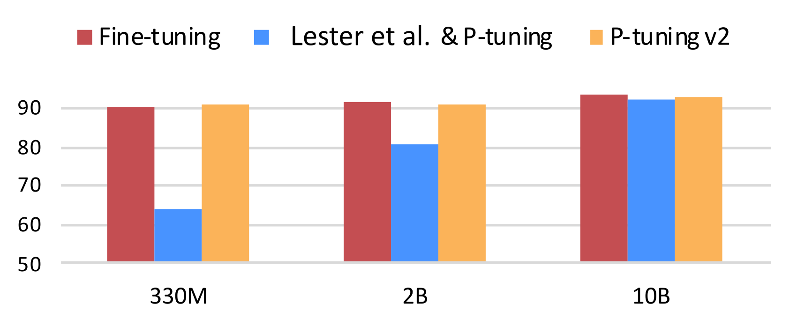
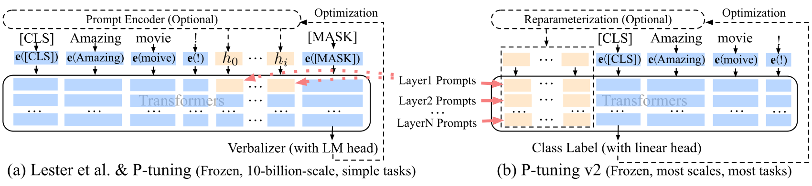
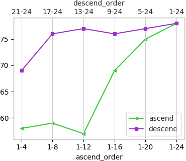
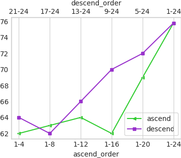
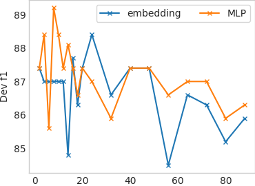
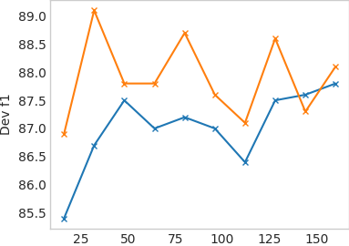
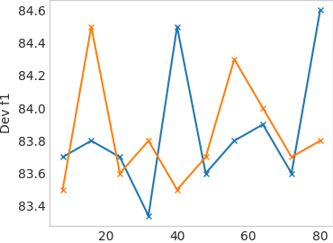
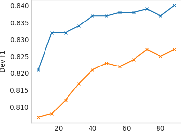

# P-Tuning v2：提示微调在不同规模和任务上可比全量微调

> 原文：[arXiv:2110.07602v3](https://arxiv.org/html/2110.07602v3)，作者及机构信息见下。
> 中文全译稿：以机器初译为底稿，统一技术术语，并校订摘要和关键方法段落；覆盖主文、附录、表格、图注和脚注。参考文献保留原始书目，原图内部文字保留英文。英文转写见 [en.md](en.md)，方法分析另见 [P-Tuning-v2详解.md](P-Tuning-v2详解.md)。

## 作者与机构

## Authors and affiliations

Xiao Liu Affiliation: Tsinghua University, KEG Email: liuxiao21@mails.tsinghua.edu.cn Kaixuan Ji Email: jkx19@mails.tsinghua.edu.cn Yicheng Fu Email: fyc19@mails.tsinghua.edu.cn Weng Lam Tam Affiliation: Tsinghua University, KEG Zhengxiao Du Affiliation: Tsinghua University, KEG Affiliation: Beijing Academy of Artificial Intelligence (BAAI) Zhilin Yang, Jie Tang Affiliation: Tsinghua University, KEG Affiliation: Shanghai Qi Zhi Institute

## 摘要

提示微调只学习连续提示并冻结语言模型，能大幅降低训练显存及每个任务的存储成本。然而，已有工作显示，在自然语言理解中，这种方法在常见规模的预训练模型上表现不佳。我们还发现，已有提示微调方法难以处理复杂的序列标注任务，表明其缺乏普适性。本文提出一项新的实证发现：恰当优化后的提示微调，可在广泛的模型规模和 NLU 任务上有效使用，仅训练 0.1%–3% 的参数便能达到与全量微调相当的表现。我们的方法 P-Tuning v2 是将深层提示微调（Li 和 Liang，2021；Qin 和 Eisner，2021）针对 NLU 进行优化与适配的实现。鉴于其普适性和简单性，我们认为它能作为全量微调的替代方案，并成为未来研究的强基线。 [^footnote1]

## 简介

预训练语言模型 Radford 等人。 (2019);德夫林等人。 (2018);杨等人。 (2019);拉斐尔等人。 (2019) 提高了各种自然语言理解 (NLU) 任务的性能。微调是一种广泛使用的方法，它更新目标任务的整套模型参数。虽然微调可以获得良好的性能，但在训练过程中会消耗内存，因为必须存储所有参数的梯度和优化器状态。此外，在推理过程中为每个任务保留模型参数的副本很不方便，因为预训练的模型通常很大。

另一方面，提示会冻结预训练模型的所有参数，并使用自然语言提示来查询语言模型 Brown 等人。 （2020）。例如，对于情感分析，我们可以将一个样本（例如“很棒的电影！”）与提示“这部电影是[MASK]”连接起来，并要求预训练的语言模型预测屏蔽标记“好”和“坏”的概率来决定样本的标签。提示根本不需要任何训练，并且存储一份模型参数的副本。然而，离散提示 Shin 等人。 (2020);高等人。与微调相比，（2020）在许多情况下可能会导致性能不佳。

图 1：SuperGLUE 开发人员在 RTE、BoolQ 和 CB 上的平均得分。通过 0.1% 的特定任务参数，P-tuning v2 可以匹配大范围预训练模型的微调，而 Lester 等人。 (2021) & P-tuning 可以有条件地使其达到 10B 规模。

提示调整 [^footnote2] 是一种仅调整连续提示的想法。具体来说，刘等人。 (2021);莱斯特等人。 (2021) 提出将可训练的连续嵌入（也称为连续提示）添加到输入词嵌入的原始序列中。训练期间仅更新连续提示。虽然提示调整改进了许多任务的提示，但 Liu 等人。 (2021);莱斯特等人。 (2021);钟等人。 (2021)，当模型规模不大时，特别是小于 100 亿个参数时，它仍然表现不佳 Lester 等人。 （2021）。此外，如我们的实验所示，在一些困难的序列标注任务（例如抽取式问答）上，与微调相比，即时调整的表现较差（参见第 4.2 节）。

我们在本文中的主要贡献是一个新颖的实证发现，即适当优化的提示调整可以与跨各种模型规模和 NLU 任务的普遍微调相媲美。与之前工作中的观察结果相比，我们的发现揭示了 NLU 即时调整的普遍性和潜力。

从技术上讲，我们的方法 P-tuning v2 在概念上并不新颖。它可以被视为 Deep Prompt Tuning Li 和 Yang (2021) 的优化和改编实现； Qing 和 Eisner (2021) 专为生成和知识探索而设计。最显着的改进源于对预训练模型的每一层应用连续提示，而不仅仅是输入层。深度提示调整增加了连续提示的能力，并缩小了跨各种设置进行微调的差距，特别是对于小型模型和困难任务。此外，我们提出了一系列优化和实施的关键细节，以确保微调可比的性能。

实验结果表明，P-tuning v2 与从 300M 到 10B 参数的不同模型规模以及抽取式问答和命名实体识别等各种困难的序列标注任务上的微调性能相匹配。与微调相比，P-tuning v2 每个任务的可训练参数为 0.1% 到 3%，这大大降低了训练时间内存成本和每个任务的存储成本。

## 预赛

自然语言理解任务。在这项工作中，我们将 NLU 挑战分为两类：简单分类任务和困难的序列标注任务。 [^footnote3] 简单的分类任务涉及标签空间上的分类。大多数数据集来自 GLUE Wang 等人。 (2018) 和 SuperGLUE Wang 等人。 （2019）属于这一类。困难的序列标注任务涉及对标记序列进行分类，例如命名实体识别和抽取式问答。

及时调整。令 $\mathcal{V}$ 为语言模型 $\mathcal{M}$ 的词汇表，并令 $\mathbf{e}$ 为 $\mathcal{M}$ 的嵌入层。在离散提示 Schick 和 Schütze (2020) 的情况下，提示标记 {"It", "is", "[MASK]"} $\subset\mathcal{V}$ 可用于对电影评论进行分类。例如，给定输入文本 $\mathbf{x}=$ “Amazing movie!”，输入嵌入序列被表述为 $[\mathbf{e}(\mathbf{x}),\mathbf{e}(\text{"It"}),\mathbf{e}(\text{"is"}),\mathbf{e}(\text{"[MASK]"})]$ 。

莱斯特等人。 （2021）和刘等人。 (2021) 引入可训练的连续提示作为 NLU 自然语言提示的替代品，并冻结预训练语言模型的参数。给定可训练的连续嵌入 $[h_{0},...,h_{i}]$ ，输入嵌入序列可写为 $[\mathbf{e}(\mathbf{x}),h_{0},...,h_{i},\mathbf{e}(\text{"[MASK]"})]$ ，如图 2 所示。 Lester 等人已证明，快速调整可与简单分类任务上的 100 亿参数模型的微调相媲美。 (2021);金等人。 (2021);刘等人。 （2021）。

图 2：来自 Lester 等人。 (2021) & P-tuning 到 P-tuning v2。橙色块（即 $h_{0},...,h_{i}$ ）指的是可训练的提示嵌入；蓝色块是由冻结的预训练语言模型存储或计算的嵌入。

## P-调整 v2

### 缺乏普遍性

莱斯特等人。 (2021);刘等人。 Wang 等人（2021）在许多 NLP 应用中被证明非常有效。 (2021a);王等人。 （2021b）；陈等人。 (2021);郑等人。 (2021);敏等人。 (2021)，但由于缺乏通用性，仍然无法取代微调，如下所述。

缺乏跨尺度的普遍性。莱斯特等人。 (2021) 表明，当模型扩展到超过 100 亿个参数时，即时调整可以与微调相媲美。然而，对于广泛使用的中型模型（从100M到1B），即时调优的效果比微调要差得多。

跨任务缺乏通用性。尽管莱斯特等人。 (2021);刘等人。 （2021）在一些 NLU 基准上表现出了优越性，但对困难的序列标注任务的提示调整的有效性尚未得到验证。序列标记预测每个输入标记的标签序列，这可能更难并且与语言描述器 Schick 和 Schütze (2020) 不兼容。在我们的实验中（参见第 4.2 节和表 3），我们表明 Lester 等人。 (2021);刘等人。与微调相比，（2021）在典型的序列标记任务上表现不佳。

考虑到这些挑战，我们提出了 P-tuning v2，它采用了深度提示微调 Li and Liang (2021)； Qin 和 Eisner (2021) 作为跨尺度和 NLU 任务的通用解决方案。

### 深度提示调整

Lester 等（2021）和 Liu 等（2021）仅在输入嵌入序列中插入连续提示，见图 2(a)。这带来两个挑战：一是受序列长度约束，可训练参数数量有限；二是输入嵌入对最终模型预测的影响相对间接。

为了应对这些挑战，P-tuning v2 采用了深度提示微调的思想 Li and Liang (2021)；秦和艾斯纳（2021）。如图2所示，不同层的提示被添加为前缀标记。一方面，P-tuning v2 具有更多可调整的特定于任务的参数（从 0.01% 到 0.1%-3%），以允许更多的每任务容量，同时保持参数高效；另一方面，添加到更深层次的提示对模型预测有更直接的影响（参见附录B中的分析）。

### 优化与实施

为了实现最佳性能，有一些有用的优化和实施细节。

重参数化。先前的工作通常利用重参数化编码器，例如 MLP Li 和 Liang (2021)；刘等人。 （2021）改变可训练的嵌入。然而，对于 NLU，我们发现它的有用性取决于任务和数据集。对于某些数据集（例如RTE和CoNLL04），MLP带来了一致的改进；对于其他模型，MLP 对结果的影响很小甚至是负面影响（例如 BoolQ 和 CoNLL12）。更多分析请参见附录 B。

提示长度。提示长度在 P-Tuning v2 中起着至关重要的作用。我们发现不同的 NLU 任务通常使用不同的提示长度来达到最佳性能（参见附录 B）。一般来说，简单的分类任务更喜欢较短的提示（少于20条）；困难的序列标注任务更喜欢较长的序列（大约 100）。

多任务学习。多任务学习在对单个任务进行微调之前，通过共享的连续提示联合优化多个任务。多任务对于 P-Tuning v2 来说是可选的，但可以通过提供更好的初始化来进一步提升性能 Gu 等人。 （2021）。

分类头。使用语言建模头来预测标签词映射 Schick 和 Schütze (2020) 一直是及时调整 Liu 等人的核心。 (2021)，但我们发现它在完整数据设置中是不必要的，并且与序列标记不兼容。相反，P-tuning v2 在 token 之上应用随机初始化的分类头，如 BERT Devlin 等人所述。 (2018)（参见图2）。

为了阐明 P-tuning v2 的主要贡献，我们在表 1 中对现有的提示调整方法进行了概念比较。

| 方法 | 任务 | 重新参数。 | 深度PT | 多任务 | 没有动词。 |
| --- | --- | --- | --- | --- | --- |
| P-调谐刘等人。 (2021) | KP自然语言单元 | 长短期记忆网络 | - | - | - |
| PromptTuning Lester 等人。 (2021) | 自然语言单元 | - | - | ✓ | - |
| 前缀调李梁 (2021) | NLG | 多层线性规划 | ✓ | - | - |
| 软提示秦和艾斯纳 (2021) | 凯普 | - | ✓ | - | - |
| P-tuning v2（我们的） | NLU 序列标签 | （视情况而定） | ✓ | ✓ | ✓ |

表 1：P-tuning v2 和现有 Prompt Tuning 方法之间的概念比较（KP：知识探测；SeqTag：序列标记；Re-param.：重参数化；No verb.：无标签词映射）。

## 实验

|  | #尺寸 | 布尔Q | 布尔Q | 布尔Q | CB | CB | CB | 科帕 | 科帕 | 科帕 | 多功能遥控 (F1a) | 多功能遥控 (F1a) | 多功能遥控 (F1a) |
| --- | --- | --- | --- | --- | --- | --- | --- | --- | --- | --- | --- | --- | --- |
|  | #尺寸 | 金融时报 | PT | PT-2 | 金融时报 | PT | PT-2 | 金融时报 | PT | PT-2 | 金融时报 | PT | PT-2 |
| BERT 大号 | 335M | 77.7 | 67.2 | 75.8 | 94.6 | 80.4 | 94.6 | 69.0 | 55.0 | 73.0 | 70.5 | 59.6 | 70.6 |
| 罗伯特·大 | 355M | 86.9 | 62.3 | 84.8 | 98.2 | 71.4 | 100 | 94.0 | 63.0 | 93.0 | 85.7 | 59.9 | 82.5 |
| GLM 超大 | 2B | 88.3 | 79.7 | 87.0 | 96.4 | 76.4 | 96.4 | 93.0 | 92.0 | 91.0 | 84.1 | 77.5 | 84.4 |
| GLM xxlarge | 10B | 88.7 | 88.8 | 88.8 | 98.7 | 98.2 | 96.4 | 98.0 | 98.0 | 98.0 | 88.1 | 86.1 | 88.1 |

|  | #尺寸 | 记录 (F1) | 记录 (F1) | 记录 (F1) | 即时通讯 | 即时通讯 | 即时通讯 | 无线通信 | 无线通信 | 无线通信 | 世界科学委员会 | 世界科学委员会 | 世界科学委员会 |
| --- | --- | --- | --- | --- | --- | --- | --- | --- | --- | --- | --- | --- | --- |
|  | #尺寸 | 金融时报 | PT | PT-2 | 金融时报 | PT | PT-2 | 金融时报 | PT | PT-2 | 金融时报 | PT | PT-2 |
| BERT 大号 | 335M | 70.6 | 44.2 | 72.8 | 70.4 | 53.5 | 78.3 | 74.9 | 63.0 | 75.1 | 68.3 | 64.4 | 68.3 |
| 罗伯特·大 | 355M | 89.0 | 46.3 | 89.3 | 86.6 | 58.8 | 89.5 | 75.6 | 56.9 | 73.4 | 63.5 | 64.4 | 63.5 |
| GLM 超大 | 2B | 91.8 | 82.7 | 91.9 | 90.3 | 85.6 | 90.3 | 74.1 | 71.0 | 72.0 | 95.2 | 87.5 | 92.3 |
| GLM xxlarge | 10B | 94.4 | 87.8 | 92.5 | 93.1 | 89.9 | 93.1 | 75.7 | 71.8 | 74.0 | 95.2 | 94.2 | 93.3 |

表 2：SuperGLUE 开发集的结果。 P-tuning v2 超越了 P-tuning 和 Lester 等人。 (2021) 在小于 10B 的模型上，匹配不同模型尺度的微调性能。 （FT：微调；PT：Lester et al. (2021) & P-tuning；PT-2：P-tuning v2；粗体：最好；下划线：第二好）。

|  | #尺寸 | CoNLL03 | CoNLL03 | CoNLL03 | CoNLL03 | OntoNotes 5.0 | OntoNotes 5.0 | OntoNotes 5.0 | OntoNotes 5.0 | CoNLL04 | CoNLL04 | CoNLL04 | CoNLL04 |
| --- | --- | --- | --- | --- | --- | --- | --- | --- | --- | --- | --- | --- | --- |
|  | #尺寸 | 金融时报 | PT | PT-2 | MPT-2 | 金融时报 | PT | PT-2 | MPT-2 | 金融时报 | PT | PT-2 | MPT-2 |
| BERT 大号 | 335M | 92.8 | 81.9 | 90.2 | 91.0 | 89.2 | 74.6 | 86.4 | 86.3 | 85.6 | 73.6 | 84.5 | 86.6 |
| 罗伯特·大 | 355M | 92.6 | 86.1 | 92.8 | 92.8 | 89.8 | 80.8 | 89.8 | 89.8 | 88.8 | 76.2 | 88.4 | 90.6 |
| 德伯塔 xlarge | 750M | 93.1 | 90.2 | 93.1 | 93.1 | 90.4 | 85.1 | 90.4 | 90.5 | 89.1 | 82.4 | 86.5 | 90.1 |

|  | #尺寸 | SQuAD 1.1 开发（EM / F1） | SQuAD 1.1 开发（EM / F1） | SQuAD 1.1 开发（EM / F1） | SQuAD 1.1 开发（EM / F1） | SQuAD 1.1 开发（EM / F1） | SQuAD 1.1 开发（EM / F1） | SQuAD 1.1 开发（EM / F1） | SQuAD 1.1 开发（EM / F1） | SQuAD 2.0 开发（EM / F1） | SQuAD 2.0 开发（EM / F1） | SQuAD 2.0 开发（EM / F1） | SQuAD 2.0 开发（EM / F1） | SQuAD 2.0 开发（EM / F1） | SQuAD 2.0 开发（EM / F1） | SQuAD 2.0 开发（EM / F1） | SQuAD 2.0 开发（EM / F1） |
| --- | --- | --- | --- | --- | --- | --- | --- | --- | --- | --- | --- | --- | --- | --- | --- | --- | --- |
|  | #尺寸 | 金融时报 | 金融时报 | PT | PT | PT-2 | PT-2 | MPT-2 | MPT-2 | 金融时报 | 金融时报 | PT | PT | PT-2 | PT-2 | MPT-2 | MPT-2 |
| BERT 大号 | 335M | 84.2 | 91.1 | 1.0 | 8.5 | 77.8 | 86.0 | 82.3 | 89.6 | 78.7 | 81.9 | 50.2 | 50.2 | 69.7 | 73.5 | 72.7 | 75.9 |
| 罗伯特·大 | 355M | 88.9 | 94.6 | 1.2 | 12.0 | 88.5 | 94.4 | 88.0 | 94.1 | 86.5 | 89.4 | 50.2 | 50.2 | 82.1 | 85.5 | 83.4 | 86.7 |
| 德伯塔 xlarge | 750M | 90.1 | 95.5 | 2.4 | 19.0 | 90.4 | 95.7 | 89.6 | 95.4 | 88.3 | 91.1 | 50.2 | 50.2 | 88.4 | 91.1 | 88.1 | 90.8 |

|  | #尺寸 | 辅酶NLL12 | 辅酶NLL12 | 辅酶NLL12 | 辅酶NLL12 | CoNLL05 华尔街日报 | CoNLL05 华尔街日报 | CoNLL05 华尔街日报 | CoNLL05 华尔街日报 | CoNLL05 棕色 | CoNLL05 棕色 | CoNLL05 棕色 | CoNLL05 棕色 |
| --- | --- | --- | --- | --- | --- | --- | --- | --- | --- | --- | --- | --- | --- |
|  | #尺寸 | 金融时报 | PT | PT-2 | MPT-2 | 金融时报 | PT | PT-2 | MPT-2 | 金融时报 | PT | PT-2 | MPT-2 |
| BERT 大号 | 335M | 84.9 | 64.5. | 83.2 | 85.1 | 88.5 | 76.0 | 86.3 | 88.5 | 82.7 | 70.0 | 80.7 | 83.1 |
| 罗伯特·大 | 355M | 86.5 | 67.2 | 84.6 | 86.2 | 90.2 | 76.8 | 89.2 | 90.0 | 85.6 | 70.7 | 84.3 | 85.7 |
| 德伯塔 xlarge | 750M | 86.5 | 74.1 | 85.7 | 87.1 | 91.2 | 82.3 | 90.6 | 91.2 | 86.9 | 77.7 | 86.3 | 87.0 |

表 3：命名实体识别 (NER)、问答（提取 QA）和语义角色标记 (SRL) 的结果。 NER 和 SRL 中的所有指标均为 micro-f1 分数。 （FT：微调；PT：P-tuning & Lester et al. (2021)；PT-2：P-tuning v2；MPT-2：多任务 P-tuning v2；粗体：最好；下划线：第二好）。

我们对不同常用的预训练模型和 NLU 任务进行了广泛的实验，以验证 P-tuning v2 的有效性。在这项工作中，除了微调之外的所有方法都是使用冻结的语言模型主干进行的，这符合 Lester 等人的观点。 (2021) 的设置但与 Liu 等人不同。 （2021）的调整设置。任务特定参数的比率（例如 0.1%）是通过将连续提示的参数与Transformer的参数进行比较得出的。另一件需要注意的事情是，我们的实验都是在全监督的环境中进行的，而不是在少数情况下进行的。

自然语言理解任务。首先，我们包含来自 SuperGLUE Wang 等人的数据集。 (2019) 测试 P-tuning v2 的通用 NLU 能力。此外，我们引入了一套序列标记任务，包括命名实体识别 Sang 和 De Meulder (2003)；韦舍德尔等人。 (2013); Carreras 和 Màrquez (2004)，抽取式问答 Rajpurkar 等人。 (2016) 以及语义角色标签 Carreras 和 Màrquez (2005) ；普拉丹等人。 （2012））。

预训练模型。我们包括 BERT-large Devlin 等人。 (2018)，RoBERTa-large Liu 等人。 (2019)，DeBERTa-xlarge He 等人。 (2020)，GLM-xlarge/xxlarge Du 等人。 （2021）进行评估。它们都是专为 NLU 任务设计的双向模型，涵盖从 300M 左右到 10B 左右的广泛尺寸。

多任务学习。对于多任务设置，我们组合每个任务类型中数据集的训练集（例如，组合语义角色标记的所有训练集）。我们对每个数据集使用单独的线性分类器，同时共享连续提示（参见附录 A）。

### P-tuning v2：跨尺度

表 2 给出 P-Tuning v2 在不同模型规模上的表现。SuperGLUE 中，Lester 等（2021）的方法及 P-Tuning 在较小规模上可能表现很差。相比之下，P-Tuning v2 在较小规模的所有所测任务上都达到与全量微调可比的表现，在 RTE 上甚至明显超过全量微调。

在更大的尺度（2B 到 10B）方面，GLM Du 等人。 （2021），莱斯特等人之间的差距。 (2021);刘等人。 （2021年），微调范围逐步缩小。在 10B 尺度上，我们有与 Lester 等人类似的观察结果。 (2021) 报告称，即时调整与微调相比具有竞争力。也就是说，P-tuning v2 始终与所有规模的微调相当，但与微调相比，只需要 0.1% 的特定于任务的参数。

### P-tuning v2：跨任务

从表 3 中，我们观察到 P-tuning v2 通常可以与所有任务的微调相媲美。 P-tuning 和 Lester 等人。 （2021）的表现要差得多，尤其是在质量保证方面，这可能是三项任务中最具挑战性的。我们还注意到Lester等人的结果存在一些异常。 (2021) 和 SQuAD 2.0 的 P-Tuning。这可能是因为SQuAD 2.0包含无法回答的问题，这给单层提示调整带来了优化挑战。相对于除 QA 之外的大多数任务，多任务学习通常会给 P-Tuning v2 带来显着改进。

### 消融研究

|  | SST-2 | 即时通讯 | 布尔Q | CB |
| --- | --- | --- | --- | --- |
| CLS & 线性头 | 96.3 | 88.4 | 84.8 | 96.4 |
| 标签词映射和 LM 头 | 95.8 | 86.6 | 84.6 | 94.6 |

表 4：RoBERTa-large 上带线性头的 [CLS] 标签与带 LM 头的标签词映射之间的比较。

语言建模头与标签词映射，还是 [CLS] 标签与线性头。用语言建模头预测标签词，一直是此前提示微调的重要组成部分。然而，全监督条件下，P-Tuning v2 完全可以负担一个仅含数千参数的线性头。表 4 保持其他超参数不变，仅把 [CLS] 加线性头替换为语言建模头加标签词映射。为简便起见，SST-2、RTE 和 BoolQ 使用 true/false，CB 使用 true/false/neutral。结果表明，标签词映射与 [CLS] 两种方式的表现没有显著差异。

图 3：使用 BERT-large 对提示深度的消融研究。 “[x-y]”指的是我们添加连续提示的层间隔（例如，“21-24”表示我们向从 21 到 24 的 Transformer 层添加提示）。添加到更深的转换器层（即更靠近输出层）的相同数量的连续提示可以比添加到开始层的连续提示产生更好的性能。

提示深度。莱斯特等人之间的主要区别。 (2021);刘等人。 (2021)而P-tuning v2是多层连续提示。为了验证其确切的影响，给定一定数量的$k$层来添加提示，我们按照升序和降序的顺序选择它们来添加提示；对于其余层，我们保持不变。如图3所示，在参数数量相同（即添加提示的Transformer层数）的情况下，按降序添加总是比按升序添加要好。在 RTE 情况下，仅向第 17-24 层添加提示即可产生与所有层非常接近的性能。

## 结论

我们提出了 P-tuning v2，一种即时调整方法。尽管其技术新颖性相对有限，但它促成了一项新颖的发现，即即时调整可以与跨尺度（从 330M 到 10B 参数）和任务的普遍微调相媲美。凭借高精度和参数效率，P-Tuning v2 可以成为微调的潜在替代方案，并为未来工作提供强有力的基线。

## 致谢

我们要感谢匿名审稿人的建议和意见。唐杰获得国家自然科学基金杰出青年基金（61825602）和国家自然科学基金委员会（61836013）的资助。季凯旋得到了清华大学自主科学研究计划和DCST学生学术培训计划的支持。

## 参考文献

- Brown et al. (2020) Tom B Brown, Benjamin Mann, Nick Ryder, Melanie Subbiah, Jared Kaplan, Prafulla Dhariwal, Arvind Neelakantan, Pranav Shyam, Girish Sastry, Amanda Askell, et al. 2020. Language models are few-shot learners. arXiv preprint arXiv:2005.14165 .

- Carreras and Màrquez (2004) Xavier Carreras and Lluís Màrquez. 2004. Introduction to the CoNLL-2004 shared task: Semantic role labeling. In Proceedings of the Eighth Conference on Computational Natural Language Learning (CoNLL-2004) at HLT-NAACL 2004 , pages 89–97, Boston, Massachusetts, USA. Association for Computational Linguistics.

- Carreras and Màrquez (2005) Xavier Carreras and Lluís Màrquez. 2005. Introduction to the CoNLL-2005 shared task: Semantic role labeling. In Proceedings of the Ninth Conference on Computational Natural Language Learning (CoNLL-2005) , pages 152–164, Ann Arbor, Michigan. Association for Computational Linguistics.

- Chen et al. (2021) Xiang Chen, Xin Xie, Ningyu Zhang, Jiahuan Yan, Shumin Deng, Chuanqi Tan, Fei Huang, Luo Si, and Huajun Chen. 2021. Adaprompt: Adaptive prompt-based finetuning for relation extraction. arXiv preprint arXiv:2104.07650 .

- Devlin et al. (2018) Jacob Devlin, Ming-Wei Chang, Kenton Lee, and Kristina Toutanova. 2018. Bert: Pre-training of deep bidirectional transformers for language understanding. arXiv preprint arXiv:1810.04805 .

- Devlin et al. (2018) Jacob Devlin, Ming-Wei Chang, Kenton Lee, and Kristina Toutanova. 2018. Bert: Pre-training of deep bidirectional transformers for language understanding. arXiv e-prints .

- Du et al. (2021) Zhengxiao Du, Yujie Qian, Xiao Liu, Ming Ding, Jiezhong Qiu, Zhilin Yang, and Jie Tang. 2021. All nlp tasks are generation tasks: A general pretraining framework. arXiv preprint arXiv:2103.10360 .

- Gao et al. (2020) Tianyu Gao, Adam Fisch, and Danqi Chen. 2020. Making pre-trained language models better few-shot learners. arXiv preprint arXiv:2012.15723 .

- Gu et al. (2021) Yuxian Gu, Xu Han, Zhiyuan Liu, and Minlie Huang. 2021. Ppt: Pre-trained prompt tuning for few-shot learning. arXiv preprint arXiv:2109.04332 .

- He et al. (2020) Pengcheng He, Xiaodong Liu, Jianfeng Gao, and Weizhu Chen. 2020. Deberta: Decoding-enhanced bert with disentangled attention.

- Kim et al. (2021) Boseop Kim, HyoungSeok Kim, Sang-Woo Lee, Gichang Lee, Donghyun Kwak, Dong Hyeon Jeon, Sunghyun Park, Sungju Kim, Seonhoon Kim, Dongpil Seo, et al. 2021. What changes can large-scale language models bring? intensive study on hyperclova: Billions-scale korean generative pretrained transformers. arXiv preprint arXiv:2109.04650 .

- Lester et al. (2021) Brian Lester, Rami Al-Rfou, and Noah Constant. 2021. The power of scale for parameter-efficient prompt tuning. arXiv preprint arXiv:2104.08691 .

- Li and Liang (2021) Xiang Lisa Li and Percy Liang. 2021. Prefix-tuning: Optimizing continuous prompts for generation. arXiv preprint arXiv:2101.00190 .

- Liu et al. (2021) Xiao Liu, Yanan Zheng, Zhengxiao Du, Ming Ding, Yujie Qian, Zhilin Yang, and Jie Tang. 2021. Gpt understands, too. arXiv:2103.10385 .

- Liu et al. (2019) Yinhan Liu, Myle Ott, Naman Goyal, Jingfei Du, Mandar Joshi, Danqi Chen, Omer Levy, Mike Lewis, Luke Zettlemoyer, and Veselin Stoyanov. 2019. RoBERTa: A Robustly Optimized BERT Pretraining Approach. arXiv e-prints .

- Min et al. (2021) Sewon Min, Mike Lewis, Hannaneh Hajishirzi, and Luke Zettlemoyer. 2021. Noisy channel language model prompting for few-shot text classification. arXiv preprint arXiv:2108.04106 .

- Pradhan et al. (2012) Sameer Pradhan, Alessandro Moschitti, Nianwen Xue, Olga Uryupina, and Yuchen Zhang. 2012. CoNLL-2012 shared task: Modeling multilingual unrestricted coreference in OntoNotes. In Joint Conference on EMNLP and CoNLL - Shared Task , pages 1–40, Jeju Island, Korea. Association for Computational Linguistics.

- Qin and Eisner (2021) Guanghui Qin and Jason Eisner. 2021. Learning how to ask: Querying lms with mixtures of soft prompts. arXiv preprint arXiv:2104.06599 .

- Radford et al. (2019) Alec Radford, Jeffrey Wu, Rewon Child, David Luan, Dario Amodei, and Ilya Sutskever. 2019. Language models are unsupervised multitask learners. OpenAI blog , 1(8):9.

- Raffel et al. (2019) Colin Raffel, Noam Shazeer, Adam Roberts, Katherine Lee, Sharan Narang, Michael Matena, Yanqi Zhou, Wei Li, and Peter J Liu. 2019. Exploring the limits of transfer learning with a unified text-to-text transformer. arXiv preprint arXiv:1910.10683 .

- Rajpurkar et al. (2016) Pranav Rajpurkar, Jian Zhang, Konstantin Lopyrev, and Percy Liang. 2016. Squad: 100,000+ questions for machine comprehension of text.

- Sang and De Meulder (2003) Erik F Sang and Fien De Meulder. 2003. Introduction to the conll-2003 shared task: Language-independent named entity recognition. arXiv preprint cs/0306050 .

- Schick and Schütze (2020) Timo Schick and Hinrich Schütze. 2020. It’s not just size that matters: Small language models are also few-shot learners. arXiv preprint arXiv:2009.07118 .

- Shin et al. (2020) Taylor Shin, Yasaman Razeghi, Robert L Logan IV, Eric Wallace, and Sameer Singh. 2020. Autoprompt: Eliciting knowledge from language models with automatically generated prompts. arXiv preprint arXiv:2010.15980 .

- Wang et al. (2019) Alex Wang, Yada Pruksachatkun, Nikita Nangia, Amanpreet Singh, Julian Michael, Felix Hill, Omer Levy, and Samuel R. Bowman. 2019. SuperGLUE: A Stickier Benchmark for General-Purpose Language Understanding Systems. In NeurIPS 2019 , pages 3261–3275.

- Wang et al. (2019) Alex Wang, Yada Pruksachatkun, Nikita Nangia, Amanpreet Singh, Julian Michael, Felix Hill, Omer Levy, and Samuel R. Bowman. 2019. Superglue: A stickier benchmark for general-purpose language understanding systems. arXiv e-prints .

- Wang et al. (2018) Alex Wang, Amanpreet Singh, Julian Michael, Felix Hill, Omer Levy, and Samuel R. Bowman. 2018. Glue: A multi-task benchmark and analysis platform for natural language understanding. arXiv e-prints .

- Wang et al. (2021a) Hongru Wang, Mingyu Cui, Zimo Zhou, Gabriel Pui Cheong Fung, and Kam-Fai Wong. 2021a. Topicrefine: Joint topic prediction and dialogue response generation for multi-turn end-to-end dialogue system. arXiv preprint arXiv:2109.05187 .

- Wang et al. (2021b) Shuo Wang, Zhaopeng Tu, Zhixing Tan, Wenxuan Wang, Maosong Sun, and Yang Liu. 2021b. Language models are good translators. arXiv preprint arXiv:2106.13627 .

- Weischedel et al. (2013) Ralph Weischedel, Martha Palmer, Mitchell Marcus, Eduard Hovy, Sameer Pradhan, Lance Ramshaw, Nianwen Xue, Ann Taylor, Jeff Kaufman, Michelle Franchini, et al. 2013. Ontonotes release 5.0 ldc2013t19. Linguistic Data Consortium, Philadelphia, PA , 23.

- Xu et al. (2021) Lu Xu, Zhanming Jie, Wei Lu, and Lidong Bing. 2021. Better feature integration for named entity recognition. arXiv preprint arXiv:2104.05316 .

- Yang et al. (2019) Zhilin Yang, Zihang Dai, Yiming Yang, Jaime Carbonell, Ruslan Salakhutdinov, and Quoc V Le. 2019. Xlnet: Generalized autoregressive pretraining for language understanding. arXiv preprint arXiv:1906.08237 .

- Zheng et al. (2021) Yanan Zheng, Jing Zhou, Yujie Qian, Ming Ding, Jian Li, Ruslan Salakhutdinov, Jie Tang, Sebastian Ruder, and Zhilin Yang. 2021. Fewnlu: Benchmarking state-of-the-art methods for few-shot natural language understanding. arXiv preprint arXiv:2109.12742 .

- Zhong et al. (2021) Zexuan Zhong, Dan Friedman, and Danqi Chen. 2021. Factual probing is [mask]: Learning vs. learning to recall. arXiv preprint arXiv:2104.05240 .

图 4：使用 RoBERTa-large 对提示长度和重参数化进行的消融研究。给定某些 NLU 任务和数据集，结论可能会大不相同。 （MQA：多项选择质量检查）

## 序列标记问题的表述

名称实体识别（NER）。 NER 旨在预测用句子表示某些给定实体类别的所有单词跨度。我们采用了 CoNLL03 Sang 和 De Meulder (2003)、OntoNotes 5.0 Weischedel 等人。 (2013) 和 CoNLL04 卡雷拉斯和马尔克斯 (2004)。对于 CoNLL03 和 CoNLL04，我们在标准的训练-开发-测试分割上训练了我们的模型。对于 OntoNotes 5.0，我们使用与 Xu 等人相同的训练、开发、测试拆分。 （2021）。所有数据集均以 IOB2 格式标记。我们使用序列标记来解决 NER 任务，方法是分配标记实体开始和某些类别内部的标签。语言模型为每个标记生成一个表示，我们使用线性分类器来预测标签。我们使用官方脚本来评估结果。对于多任务设置，我们结合三个数据集的训练集进行预训练。我们对每个数据集使用不同的线性分类器，同时共享连续提示。

（提取）问答（QA）。提取式 QA 旨在从给定上下文和问题的上下文中提取答案。我们使用 SQuAD Rajpurkar 等人。 (2016) 1.1 和 2.0，其中每个答案都在上下文的连续范围内。按照传统，我们通过为每个标记分配两个标签之一：“开始”或“结束”，将问题表述为序列标记，最后选择最置信的开始-结束对的范围作为提取的答案。如果最有信心的一对的概率低于阈值，模型将假设该问题无法回答。对于多任务设置，我们的预训练训练集结合了SQuAD 1.1和2.0的训练集。在预训练时，我们假设所有问题，无论其来源如何，都可能无法回答。

语义角色标签（SRL）。 SRL 为句子中的单词或短语分配标签，指示它们在句子中的语义角色。我们在 CoNLL05 Carreras 和 Màrquez (2005) 以及 CoNLL12 Pradhan 等人上评估 P-tuning v2。 （2012）。由于一个句子可以有多个动词，因此我们将目标动词标记添加到每个句子的末尾，以帮助识别哪个动词用于预测。我们根据相应的语义角色表示使用线性分类器对每个单词进行分类。对于多任务设置，预训练训练集是 CoNLL05 Carreras 和 Màrquez (2005)、CoNLL12 Pradhan 等人的训练集的组合。 (2012) 和 propbank-release（用于训练 SRL 的通用扩展数据）。多任务训练策略与NER类似。

## 更多消融研究

由于页面限制，我们在本节中介绍有关重参数化和提示长度的超参数和架构设计消融。

嵌入与嵌入MLP 重参数化。在前缀微调 Li 和 Liang (2021) 和 P 调音 Liu 等人中。 (2021)，作者发现重参数化对于提高训练速度、鲁棒性和性能很有用。然而，我们进行的实验表明，不同 NLU 任务和数据集的重参数化效果不一致。

如图 4 所示，在 RTE 和 CoNLL04 中，MLP 重参数化通常表明几乎所有提示长度都比嵌入具有更好的性能。然而，在BoolQ中，MLP和embedding的结果是有竞争力的；在 CoNLL12 中，嵌入始终优于 MLP。

提示长度。提示长度是 P-tuning v2 的另一个有影响力的超参数，其最佳值因任务而异。从图 4 中我们观察到，对于简单的 NLU 任务，通常较短的提示足以获得最佳性能；对于困难序列任务，通常，超过 100 的提示会有所帮助。

我们还发现重参数化与最佳提示长度有着密切的联系。例如，在 RTE、CoNLL04 和 BoolQ 中，MLP 重参数化比嵌入更早达到最佳结果。这个结论或许可以为 P-tuning 的优化特性提供一些思考。

## 脚注

[^footnote1]: 我们的代码和数据发布于 https://github.com/THUDM/P-tuning-v2 。

[^footnotex1]: 通讯作者：杨志林（zhiliny@tsinghua.edu.cn）、唐杰（jietang@tsinghua.edu.cn）

[^footnotex2]: 表示同等贡献。

[^footnote2]: 我们使用“即时调整”来指代一类方法而不是特定的方法。

[^footnote3]: 请注意，“简单”和“困难”的概念特定于提示调整，因为我们发现序列标记任务对于提示调整更具挑战性。
