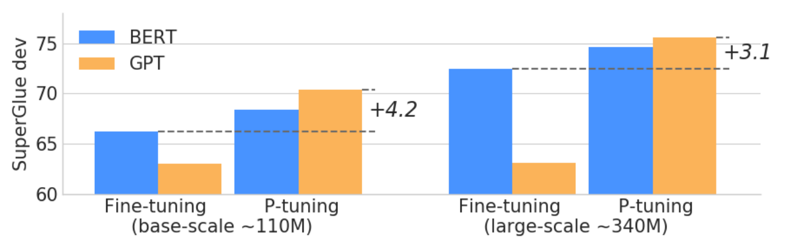
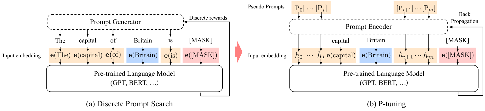

# GPT 也能理解：P-Tuning

> 原文：[arXiv:2103.10385v2](https://arxiv.org/html/2103.10385v2)，作者及机构信息见下。
> 中文全译稿：以机器初译为底稿，统一技术术语，并校订摘要和关键方法段落；覆盖主文、附录、表格、图注和脚注。参考文献保留原始书目，原图内部文字保留英文。英文转写见 [en.md](en.md)，方法分析另见 [P-Tuning详解.md](P-Tuning详解.md)。

## 作者与机构

## Authors and affiliations

Xiao Liu Yanan Zheng Zhengxiao Du Affiliation: Tsinghua University Ming Ding Affiliation: Tsinghua University Yujie Qian Affiliation: Massachusetts Institute of Technology Zhilin Yang Jie Tang

## 摘要

使用自然语言模式提示预训练语言模型，已被证明对自然语言理解（NLU）有效。然而，我们的初步研究发现，手写离散提示的表现往往不稳定——例如，只改动提示中的一个词，就可能导致明显下降。我们提出 P-Tuning，将可训练的连续提示嵌入与离散提示拼接。实验表明，P-Tuning 不仅通过缩小不同离散提示之间的差距使训练更稳定，而且在包括 LAMA 和 SuperGLUE 在内的多种 NLU 任务上显著改善表现。无论冻结还是微调语言模型，也无论全监督还是少样本设置，P-Tuning 通常都有效。

## 简介

预训练语言模型（Brown et al., 2020，PLM；）显着提高了自然语言理解 (NLU) 的性能。 PLM 采用不同的预训练目标进行训练，例如掩码语言建模 Devlin 等人。 (2018)，自回归语言建模 Radford 等人。 (2019)，seq2seq Raffel 等人。 (2019) 和排列语言建模 Yang 等人。 （2019）。 Brown 等人的建议可以进一步增强 PLM。 (2020); Schick 和 Schütze (2020)，它采用手动编写的提示模式作为语言模型的附加输入。通过提示，PLM 可以在小型标记数据集上进行微调，或者冻结以直接推断下游任务。提示显着提高了许多 NLU 任务的性能 Brown 等人。 (2020);希克和舒茨 (2020)。

然而，我们观察到手动离散提示存在很大程度的不稳定。如表 1 所示，对于冻结的语言模型，更改提示中的单个单词可能会导致性能大幅下降。正如我们将在第 3 节中展示的，当语言模型经过调整后，不稳定问题得到缓解，但不同提示之间的性能差异仍然很大，特别是在少样本设置中。这种离散提示的不稳定问题在实践中提出了严峻的挑战。最近的自动提示方法试图在给定任务的情况下搜索性能更好的提示 Shin 等人。 (2020);高等人。 (2020);江等人。 (2020b)，但这些方法并没有改变离散提示的不稳定本质。

图 1：使用 P-Tuning 在 SuperGLUE 的 7 个开发数据集上获得的平均分数。

| 提示 | P@1 无 PT | P@1 带 PT |
| --- | --- | --- |
| [X] 位于 [Y]。 （原文） | 31.3 | 57.8 |
| [X] 位于哪个国家或州？ [是]。 | 19.8 | 57.8 |
| [X] 位于哪个国家？ [是]。 | 31.4 | 58.1 |
| [X] 位于哪个国家？在[Y]中。 | 51.1 | 58.1 |

表 1：离散提示存在不稳定（高方差）的问题，而 P-Tuning 可以稳定并提高性能。在使用 BERT 基础外壳的 LAMA-TREx P17 上，结果为 precision@1。 “PT”指的是 P-Tuning，它训练与离散提示串联的附加连续提示。

为了减少离散提示的不稳定性，我们提出了一种新方法 P-Tuning，该方法采用可训练的连续提示嵌入与离散提示串联。具体来说，给定离散提示作为输入，P-Tuning 将连续提示嵌入与离散提示标记连接起来，并将它们作为语言模型的输入。通过反向传播更新连续提示以优化任务目标。直觉是，连续提示将一定程度的可学习性融入到输入中，这可能会学习抵消离散提示中微小变化的影响，从而提高训练稳定性。为了进一步提高性能，我们采用使用 LSTM 或 MLP 的提示编码器来对连续提示嵌入之间的依赖关系进行建模。

我们尝试了两个 NLU 基准：LAMA Petroni 等人。 (2019) 知识探索和 SuperGLUE Wang 等人。 （2019a）。在 LAMA 上，在语言模型冻结的情况下，使用相同的预训练模型，P-Tuning 的性能分别比手动离散提示和搜索提示高出 20 多分和 9 分。在 SuperGLUE 上，通过对语言模型进行微调，P-Tuning 的表现优于 PET Schick 和 Schütze (2020)，在全监督和少量设置下都提供了最佳离散提示。除了提高性能之外，我们的结果表明，在广泛的任务和设置中，P-Tuning 大大减少了不同离散提示之间的性能差距，从而提高了语言模型适配的稳定性。

## 方法

### 离散提示的问题

提示采用自然语言模式作为预训练语言模型的额外输入，以适应下游任务 Brown 等人。 (2020);希克和舒茨 (2020)。郑等人之前的工作。 （2021）指出，提示在许多 NLP 任务上取得了一致且实质性的改进。然而，如何编写高性能的离散提示仍然是一个具有挑战性的问题。

我们使用不同的手动提示对 LAMA 知识探索任务 Petroni 等人进行了初步实验。 (2019)，旨在通过预测尾部实体从语言模型中提取三元组知识。表1的结果表明，手动离散提示会导致性能不稳定。例如，如果我们比较表中的最后两个提示，更改提示中的单个单词会导致性能急剧下降 20 点。

鉴于这一挑战，最近的工作提出通过挖掘训练语料库来自动化离散提示的搜索过程。 (2020b)，基于梯度的搜索 Shin 等人。 (2020)，并使用预训练的生成模型Gao等人。 （2020）。然而，这些工作旨在寻找性能更好的提示，但并没有改变离散提示不稳定的本质。除了不稳定问题之外，离散空间中的搜索可能无法充分利用反向传播的梯度，这可能会导致次优解决方案。为此，我们探索训练连续提示来稳定和提高语言模型适配性能的可能性。

图 2：提示搜索“英国的首都是 [MASK]”的示例。给定上下文（蓝色区域，“英国”）和目标（红色区域，“[MASK]”），橙色区域指的是提示。在(a)中，提示生成器仅接收离散奖励；相反，在（b）中，连续提示嵌入和提示编码器可以以可微分的方式进行优化。

### P-调音

形式上，令 $\mathcal{M}$ 为预训练语言模型，隐藏大小为 $h$ ，词汇大小为 $|\mathcal{V}|$ 。令 $\{(\mathbf{x}_{i},\mathbf{y}_{i}))\}_{i}$ 为 NLU 任务的标记数据集，其中 $\mathbf{x}_{0:n}=\{x_{0},x_{1},...,x_{n}\}$ 是由离散标记序列组成的输入，$\mathbf{y}\in\mathcal{Y}$ 是标签。我们的目标是使用微调或冻结的 $\mathcal{M}$ 参数来估计分类 $f_{\mathcal{M}}(x)=\hat{p}(y|x)$ 的条件概率。

提示以离散标记 Schick 和 Schütze (2020) 的格式提出。令 $[\mathrm{D}_{i}]$ 为离散提示标记。每个提示都可以被描述为一个模板 $T=\{[\mathrm{D}_{0:i}],\mathbf{x},[\mathrm{D}_{(i+1):j}],\mathbf{y},[\mathrm{D}_{(j+1):k}]\}$ ，它可以将标记数据（包括输入 $\mathbf{x}$ 和标签 $\mathbf{y}$ ）组织成一系列文本标记，以便可以将任务重新表述为填充输入文本的空白。例如，对于预测国家首都的任务（LAMA-TREx P36），提示可能是“[INPUT]的首都是[LABEL]”。对于一段标记数据“（英国，伦敦）”，重新表述的文本将是“英国的首都是[MASK]。”，其中“[MASK]”应该预测给定的标签“伦敦”。离散提示和离散数据一起映射到输入嵌入中：

$$
\{\mathbf{e}(D_{0})...\mathbf{e}(D_{i}),\mathbf{e}(x_{0}),...,\mathbf{e}(x_{n}),...,\mathbf{e}(D_{k})\}
$$

通过预训练的嵌入层，其中 $\mathbf{e}\in\mathbb{R}^{|\mathcal{V}|\times d}$ 。

然而，正如第 2.1 节中所讨论的，这种离散提示往往极其不稳定，并且对于反向传播可能不是最佳的。因此，我们提出 P-Tuning，使用连续的提示嵌入来改进和稳定提示。令[$\mathrm{P}_{i}$]为$i^{\mathrm{th}}$连续提示嵌入。 P-Tuning的提示模板如下：

$$
T=\{[\mathrm{P}_{0:i}],\mathbf{x},[\mathrm{P}_{(i+1):j}],\mathbf{y},[\mathrm{P}_{(j+1):k}]\}
$$

P-Tuning 利用额外的嵌入函数 $f:[\mathrm{P}_{i}]\to h_{i}$ 将模板映射到

$$
\{h_{0},...,h_{i},\mathbf{e}(\mathbf{x}),h_{i+1},...,h_{j},\mathbf{e}(\mathbf{y}),h_{j+1},...,h_{k}\}
$$

最后，我们更新嵌入 $\{P_{i}\}_{i=1}^{k}$ 以优化任务损失函数。

值得注意的是，我们还可以将离散提示与连续提示连接起来，这样效果更好，并在我们的整个实验中得到采用。 P-Tuning 适用于冻结和微调的语言模型。

### 提示编码器

在上述框架中，我们采用映射函数 $f$ 将可训练嵌入 $\{P_{i}\}$ 映射到模型输入 $\{h_{i}\}$ 。直觉是，与使用独立的可学习嵌入相比，通过使用映射函数，可以更方便地对不同提示嵌入之间的依赖关系进行建模。在我们的实现中，我们使用轻量级神经网络来制定函数 $f$ 。具体来说，我们在第 3 节中尝试使用长短期记忆 (LSTM) 网络、多层感知器 (MLP) 和恒等映射函数。

## 实验

我们包括两个 NLU 基准：LAMA Petroni 等人。 (2019) 用于知识探索 (§ 3.1) 和 SuperGLUE Wang 等人。 (2019a) 用于一般自然语言理解。在 SuperGLUE 上，我们考虑全监督学习（第 3.2 节）和少样本学习（第 3.3 节）设置。

关于 LAMA，跟随 Shin 等人。 (2020);江等人。 (2020b)，语言模型被冻结，仅调整离散或连续提示。对于 SuperGLUE，遵循 Schick 和 Schütze (2020) ；郑等人。 (2021)，语言模型已调整。在我们的设置中，我们共同优化语言模型参数和连续提示。此设置不仅遵循先前工作中的常见标准设置，而且还允许使用已调整和冻结的语言模型来评估 P-Tuning。

总体任务设置和结果摘要如表 2 所示。

|  | 喇嘛 | 全SG | SG很少 |
| --- | --- | --- | --- |
|  | 冻结的 | 调谐 | 调谐 |
| 改进 | ✓ | ✓ | ✓ |
| 稳定化 | ✓ | ✗ | ✓ |

表 2：我们实验中的任务设置和结果摘要。 P-tuning 显示了所有任务设置相对于基线的改进，并且可以稳定 LAMA 和 Few SG 的性能。对于Full SG，离散提示之间的差距并不大，即使没有P-Tuning，训练也很稳定。 （Full SG：在 SuperGLUE 上进行全监督学习；Few SG：少样本 SuperGLUE；Improved：整体性能提高；Stabilized：通过最小化离散提示之间的差异来稳定训练）。

| 提示类型 | 型号 | P@1 |
| --- | --- | --- |
| 原版（MP） | BERT基础 | 31.1 |
| 原版（MP） | BERT-大 | 32.3 |
| 原版（MP） | 电子BERT | 36.2 |
| 离散型 | LPAQA（基于 BERT） | 34.1 |
| 离散型 | LPAQA（BERT-大） | 39.4 |
| 离散型 | 自动提示（基于 BERT） | 43.3 |
| P-调音 | BERT基础 | 48.3 |
| P-调音 | BERT-大 | 50.6 |

| 型号 | 国会议员 | P-调音 |
| --- | --- | --- |
| BERT-base (109M) | 31.7 | 52.3 (+20.6) |
| -AutoPrompt Shin 等人。 (2020) | - | 45.2 |
| BERT-大 (335M) | 33.5 | 54.6 (+21.1) |
| 罗伯特塔基 (125M) | 18.4 | 49.3 (+30.9) |
| -AutoPrompt Shin 等人。 (2020) | - | 40.0 |
| RoBERTa-大号 (355M) | 22.1 | 53.5 (+31.4) |
| GPT2-中型 (345M) | 20.3 | 46.5 (+26.2) |
| GPT2-xl (1.5B) | 22.8 | 54.4 (+31.6) |
| 威震天LM (11B) | 23.1 | 64.2 (+41.1) |

表 3：LAMA-34k（左）和 LAMA-29k（右）上的知识探测 Precision@1。 P-tuning 优于所有离散提示搜索基线。 （MP：手动提示；PT：P 调谐）。

### 知识探究

#### 设置

知识探测，或称为事实检索，评估语言模型从预训练中获得了多少现实世界的知识。喇嘛彼得罗尼等人。 (2019) 数据集使用从知识库中选择的三元组创建的完形填空测试对其进行评估。

数据集和词汇。 LAMA 强制所有答案采用单标记格式。我们首先采用原始的 LAMA-TREx 数据集，由 41 个 Wikidata 关系和总共 34,039 个测试三元组组成（即 LAMA-34k，涵盖了所有 BERT 词汇表）。由于不同的预训练模型共享不同的词汇表，为了进行直接比较，我们遵循 Shin 等人之前的工作。 （2020）采用涵盖 GPT 和 BERT 词汇表交集的子集。这被称为 LAMA-29k。我们再次关注 Shin 等人。 （2020）构建训练、开发和测试数据以进行公平比较。

设置。 LAMA 为每个关系提供了手工提示，如表 1 所示，这是有效的，但可能不是最优的。对于双向屏蔽语言模型，我们只需要将“[X]”替换为主题实体，将“[Y]”替换为[MASK]标记；对于 GPT 等单向语言模型，遵循 LAMA 在 Transformer-XL Dai 等人上的原始设置。 (2019) ，我们使用目标位置之前的网络输出。

提示标记和位置的数量是根据开发集选择的，为了简单起见，我们为双向模型选择 (3, sub, org_prompt, 3, obj, 3) 模板，为单向模型选择 (3, sub, org_prompt, 3, obj)，因为此配置对于大多数关系表现良好（其中数字表示连续提示标记的数量）。连续提示与原始离散提示连接在一起。在提示训练过程中，我们将学习率设置为1e-5并使用Adam优化器。

#### 主要结果

结果如表3所示。 P-tuning 显着提高了 LAMA-34k 上知识探测的最佳结果，从 43.3% 提高到 50.6%，在 LAMA-29k 上从 45.2% 提高到 64.2%。此外，P-tuning 优于以前的离散提示搜索方法，例如 AutoPrompt Shin 等人。 (2020) 和 LPAQA Jiang 等人。 (2020b) 在相同尺寸的模型上。这证实了我们在第 2 节中的直觉，即离散提示可能不是最佳的。

### 全监督学习

|  | 方法 | 布尔Q | CB | CB | 无线通信 | 即时通讯 | 多RC | 多RC | 世界科学委员会 | 科帕 | 平均。 |
| --- | --- | --- | --- | --- | --- | --- | --- | --- | --- | --- | --- |
|  | 方法 | （附件） | （附件） | (F1) | （附件） | （附件） | （新兴市场） | (F1a) | （附件） | （附件） | 平均。 |
| BERT-基础 (109M) | CLS-FT | 72.9 | 85.1 | 73.9 | 71.1 | 68.4 | 16.2 | 66.3 | 63.5 | 67.0 | 66.2 |
| BERT-基础 (109M) | PET-FT | 73.7 | 87.5 | 90.8 | 67.9 | 70.4 | 13.7 | 62.5 | 60.6 | 70.0 | 67.1 |
| BERT-基础 (109M) | P-调音 | 73.9 | 89.2 | 92.1 | 68.8 | 71.1 | 14.8 | 63.3 | 63.5 | 72.0 | 68.4 |
| GPT2-基础 (117M) | CLS-FT | 71.2 | 78.6 | 55.8 | 65.5 | 67.8 | 17.4 | 65.8 | 63.0 | 64.4 | 63.0 |
| GPT2-基础 (117M) | PET-FT | 74.8 | 87.5 | 88.1 | 68.0 | 70.0 | 23.5 | 69.7 | 66.3 | 78.0 | 70.2 |
| GPT2-基础 (117M) | P-调音 | 75.0 | 91.1 | 93.2 | 68.3 | 70.8 | 23.5 | 69.8 | 63.5 | 76.0 | 70.4 |

|  | 方法 | 布尔Q | CB | CB | 无线通信 | 即时通讯 | 多RC | 多RC | 世界科学委员会 | 科帕 | 平均。 |
| --- | --- | --- | --- | --- | --- | --- | --- | --- | --- | --- | --- |
|  | 方法 | （附件） | （附件） | (F1) | （附件） | （附件） | （新兴市场） | (F1a) | （附件） | （附件） | 平均。 |
| BERT-大 (335M) | CLS-FT 1 | 77.7 | 94.6 | 93.7 | 74.9 | 75.8 | 24.7 | 70.5 | 68.3 | 69.0 | 72.5 |
| BERT-大 (335M) | PET-FT | 77.2 | 91.1 | 93.5 | 70.5 | 73.6 | 17.7 | 67.0 | 80.8 | 75.0 | 73.1 |
| BERT-大 (335M) | P-调音 | 77.8 | 96.4 | 97.4 | 72.7 | 75.5 | 17.1 | 65.6 | 81.7 | 76.0 | 74.6 |
| GPT2-医学。 (345M) | CLS-FT | 71.0 | 73.2 | 51.2 | 65.2 | 72.2 | 19.2 | 65.8 | 62.5 | 66.0 | 63.1 |
| GPT2-医学。 (345M) | PET-FT | 78.3 | 96.4 | 97.4 | 70.4 | 72.6 | 32.1 | 74.4 | 73.0 | 80.0 | 74.9 |
| GPT2-医学。 (345M) | P-调音 | 78.9 | 98.2 | 98.7 | 69.4 | 75.5 | 29.3 | 74.2 | 74.0 | 81.0 | 75.6 |

表 4：SuperGLUE 开发集的全监督性能。

#### 设置

数据集。为了评估全监督学习任务上的 P-tuning，我们采用了 SuperGLUE 基准 Wang 等人。 (2019b)，由 8 个具有挑战性的自然语言理解 (NLU) 任务组成。自 ReCoRD 张 等人以来，我们重点关注其中的 7 个。 (2018)任务不采用离散提示，因此P-tuning不直接适用。这些任务包括问答（BoolQ Clark 等人（2019a）和 MultiRC Khashabi 等人（2018））、文本蕴涵（CB De Marneffe 等人（2019）和 RTE Dagan 等人（2005））、共指解析（WiC Pilehvar 和 Camacho-Collados（2018））、因果推理（COPA） Roemmele 等人 (2011) ) 和词义消歧 (WSC Levesque 等人 (2012))。

比较方法。我们在单向和双向预训练模型（即 GPT 和 BERT）上进行 P 调优实验。我们包括四个变体 BERT-Base、BERT-Large、GPT2-Base 和 GPT-medium。对于每个模型，我们比较标准分类微调、PET Schick 和 Schütze (2020)（基于手动离散提示的典型微调方法）和我们的 P 调优。

配置。我们使用与 Wang 等人相同的指标。 （2019b）。对于全监督学习，我们使用大型训练集来微调预训练模型，并使用开发集进行超参数和模型选择。具体来说，使用具有线性衰减学习率的 AdamW 优化器进行训练。我们使用 $\{1e-5,2e-5,3e-5\}$ 的学习率、 $\{16,32\}$ 的批量大小和 $\{0.0,0.05,0.1\}$ 的预热比率。对于小型数据集（即 COPA、WSC、CB、RTE），我们对 20 个 epoch 的预训练模型进行微调。对于较大的数据集（即 WiC、BoolQ、MultiRC），我们将训练纪元数减少到 10，因为模型收敛得更早。早期停止用于避免过度拟合训练数据。

#### 主要结果

全监督学习的主要结果如表4所示。我们观察到 P-tuning 可以提高 BERT 和 GPT 上的全监督学习性能。 (1) 具体而言，在 BERT-Base 模型上，P-tuning 在 5/7 任务上取得了最佳性能，而在 BERT-Large 上，P-tuning 在 4/7 任务上优于其他方法。 WiC 和 MultiRC 是例外，它们都有相对较大的训练集。我们发现，在此类高资源任务上，P-tuning 可能不会比 CLS-FT 有很大的收益，而在低资源任务上则有更多好处。平均而言，P-Tuning比所考虑的基线有所改善。 (2) 在 GPT2-Base 和 GPT2-Medium 模型上，P-tuning 在所有任务上始终达到最佳性能。

### 少样本学习

虽然 GPT-3 在手工提示下表现出了不错的少样本学习潜力，但它在一些具有挑战性的任务（例如自然语言推理）上仍然举步维艰。 （2020）。我们有动力研究 P-tuning 是否也可以提高预训练模型在挑战性任务上的少样本学习性能。

#### 设置

少镜头评估。少样本性能对许多因素（例如训练示例的顺序、随机种子和提示模式）很敏感，因此会受到高方差的影响。 (2021a);卢等人。 (2021);张等人。 （2020）。因此，few-shot评估策略应该确保改进确实来自改进的方法而不是方差。为此，我们遵循 Cheng 等人的 FewNLU 评估程序。 （2021）已经解决并处理了这个问题。具体来说，我们使用随机数据分割仅在小型标记集上执行模型选择，以防止过度拟合大型开发集。

数据集。我们使用少样本 SuperGLUE（也称为 FewGLUE）基准 Schick 和 Schütze (2020)，并遵循 Cheng 等人之前工作中的设置。 （2021）在数据分割构建方面。

基线和超参数。在少样本学习中，我们再次将 P-tuning 与 PET Schick 和 Schütze (2020) 进行比较，结果表明它在某些任务上优于 GPT-3。与 Schick 和 Schütze (2020) 类似，我们使用 ALBERT-xxLarge 作为基础模型。对于 PET 和 P-tuning 共享的超参数（例如学习率、最大训练步长、评估频率），我们使用相同的搜索空间进行公平比较。具体来说，我们在 $\{1e-5,2e-5\}$ 中搜索学习率，在 $\{250,500\}$ 中搜索最大训练步长，在 $\{0.02,0.04\}$ 中搜索评估频率。

| 方法 | BoolQ（加速） | RTE（加速） | WiC（附件） | CB（加速）（F1） | CB（加速）（F1） | MultiRC (F1a.) (EM.) | MultiRC (F1a.) (EM.) | WSC（加速） | COPA（加速） | 平均 |
| --- | --- | --- | --- | --- | --- | --- | --- | --- | --- | --- |
| 及时调整 | 58.47 $\pm$ 1.00 | 54.42 $\pm$ 3.05 | 52.74 $\pm$ 2.36 | 75.45 $\pm$ 2.25 | 67.73 $\pm$ 5.70 | 59.28 $\pm$ 4.73 | 15.03 $\pm$ 4.11 | 74.04 $\pm$ 2.99 | 61.50 $\pm$ 4.36 | 58.56 |
| PET-FT | 76.70 $\pm$ 1.85 | 72.83 $\pm$ 1.30 | 53.87 $\pm$ 4.47 | 84.38 $\pm$ 4.47 | 62.56 $\pm$ 7.66 | 76.51 $\pm$ 1.52 | 36.46 $\pm$ 2.13 | 80.05 $\pm$ 2.53 | 81.75 $\pm$ 4.03 | 70.74 |
| P-调音 | 76.55 $\pm$ 2.68 | 63.27 $\pm$ 3.63 | 55.49 $\pm$ 1.21 | 88.39 $\pm$ 3.72 | 84.24 $\pm$ 5.15 | 75.91 $\pm$ 1.74 | 38.01 $\pm$ 0.78 | 78.85 $\pm$ 1.76 | 85.25 $\pm$ 3.30 | 71.81 |

表 5：PET Schick 和 Schütze (2020)、Prompt Tuning Lester 等人的少数镜头性能。 （2021）以及我们基于 ALBERT 对七个任务进行 P 调优。每个结果是使用不同数据分割的 4 次运行的平均值。结果表明，与 PET 相比，P-tuning 始终将平均少样本性能提高了 1 个点以上，与 Prompt Tuning 相比，提高了 13 个点以上。

|  | 方法 | P#0 | P#1 | P#2 | P#3 | P#4 | P#5 | 性病 |
| --- | --- | --- | --- | --- | --- | --- | --- | --- |
| FSL (布尔Q) | PET-FT | 77.10 | 67.96 | 74.14 | 72.48 | 71.77 | 60.86 | 5.68 |
| FSL (布尔Q) | PET-FT | $\pm$ 2.21 | $\pm$ 2.69 | $\pm$ 1.38 | $\pm$ 4.31 | $\pm$ 2.56 | $\pm$ 3.99 | 5.68 |
| FSL (布尔Q) | P-调音 | 75.41 | 75.11 | 73.43 | 71.35 | 71.31 | 65.86 | 3.52 |
| FSL (布尔Q) | P-调音 | $\pm$ 3.09 | $\pm$ 1.61 | $\pm$ 2.60 | $\pm$ 4.57 | $\pm$ 8.58 | $\pm$ 3.80 | 3.52 |
| 喇嘛 (P17) | 国会议员 | 31.3 | 19.8 | 31.4 | 51.1 | 34.0 | 32.7 | 10.1 |
| 喇嘛 (P17) | P-调音 | 57.8 | 57.8 | 58.1 | 58.1 | 58.9 | 58.7 | 0.46 |

表 6：上表：PET 的少样本学习 (FSL) 和在 SuperGLUE 上使用 ALBERT 进行每个模式的 P 调优；下表：基于 BERT 的 LAMA-P17 上的手动提示 (MP) 和 P 调优性能。对于每一列，P-tuning 和比较方法共享相同的手动提示，而 P-tuning 还连接连续的提示标记。我们报告不同模式的多个结果的标准偏差。结果表明，P-tuning 实现了更小的标准偏差，证明 P-tuning 可以提高稳定性。离散模式的选择。

提示模式的构建。对于 PET，我们使用 Schick 和 Schütze (2020) 报告的相同手动提示。在构建P-tuning提示模式时，基于与PET相同的手动提示，我们在不同位置插入不同数量的连续提示标记，从而制定多个候选模式。然后，我们使用 FewNLU Cheng 等人的验证策略选择 P-tuning 的最佳模式。 （2021）。我们还对第3.3.3节中连续提示标记的数量和位置进行了进一步分析。

#### 主要结果

少镜头性能。表 5 显示了少样本学习的主要结果。我们发现，在 ALBERT 上，P-tuning 的平均表现始终优于 PET 1 个百分点以上。它的性能比 PromptTuning 高出 13 个点以上。它证明，通过自动学习连续提示标记，预训练模型可以在 NLU 任务上获得更好的小样本性能。

| 身份证号 | P 调的提示模式 | 段。 | 位置。 | #[P] | 附件。 | F1. | 平均。 |
| --- | --- | --- | --- | --- | --- | --- | --- |
| 1 | [前提]问题：[假设][P]？答案：[M]。 | 是的 | 中 | 1 | 87.95 | 76.70 | 82.33 |
| 2 | [前提]问题[P]：[假设]？答案：[M]。 | 是的 | 中 | 1 | 88.39 | 78.57 | 83.48 |
| 3 | [前提]问题：[假设]？ [P]答案：[M]。 | 否 | 中 | 1 | 89.29 | 79.86 | 84.58 |
| 4 | [前提] [P] 问题：[假设] ?答案：[M]。 | 否 | 米德 | 1 | 89.73 | 82.15 | 85.94 |
| 5 | [前提]问题：[假设]？答案：[M]。 [P] | 否 | 边缘 | 1 | 87.50 | 83.39 | 85.45 |
| 6 | [前提]问题：[假设]？ [P][P]答案：[M]。 | 否 | 中 | 2 | 88.39 | 84.74 | 86.57 |
| 7 | [前提]问题：[假设]？ [P][P][P][P]答案：[M]。 | 否 | 中 | 4 | 88.39 | 85.14 | 86.76 |
| 8 | [前提]问题：[假设]？ [P][P][P][P][P][P][P][P]答案：[M]。 | 否 | 中 | 8 | 83.48 | 73.32 | 78.40 |

表 7：具有不同提示模式的 ALBERT 上 CB 任务的 P-tuning 的少数样本性能。 “赛格。”表示插入的提示标记是否分段完整的句子。 “波斯。”表示在输入的边缘或中间插入提示标记。 “[P]”是连续提示符。 “[M]”是掩码标记。

#### 消融研究

提示编码器的类型 先前的工作 Shin 等人。 (2020)提出简单地使用MLP作为提示编码器，我们对提示编码器的选择进行进一步的消融分析，结果如表8所示。我们考虑 LSTM、MLP 和 EMB（即，我们直接优化词嵌入而不使用额外的参数）。从结果中我们可以看出，LSTM、MLP 和 EMB 都充当提示编码器。结果表明，LSTM 和 MLP 通常在这些任务上表现良好，而 EMB 不稳定，并且在某些任务（例如 WiC 和 CB）上的表现可能远远低于其他两种。综上所述，在处理新任务时，可以同时考虑 LSTM 和 MLP。

| 任务 | 长短期记忆网络 | 多层线性规划 | EMB |
| --- | --- | --- | --- |
| WiC-ACC | 56.27 $\pm$ 1.54 | 55.25 $\pm$ 3.09 | 53.96 $\pm$ 3.23 |
| CB-ACC。 | 81.70 $\pm$ 7.49 | 88.39 $\pm$ 3.72 | 82.59 $\pm$ 3.69 |
| CB-F1。 | 77.41 $\pm$ 9.15 | 84.24 $\pm$ 5.15 | 67.27 $\pm$ 6.78 |
| BoolQ-ACC。 | 75.41 $\pm$ 3.09 | 76.46 $\pm$ 2.84 | 76.87 $\pm$ 1.69 |

表 8：使用不同提示编码器的 ALBERT 在 WiC、CB 和 BoolQ 任务上的小样本性能。结果表明，LSTM 和 MLP 通常在这些任务上表现良好，而 EMB 不稳定，并且在某些任务（例如 WiC 和 CB）上的表现可能远远低于其他两种。 “EMB”意味着对提示编码器使用恒等映射。

提示标记的位置 为了研究在哪个位置插入连续提示标记，我们进行了表 7 所示的实验。从结果来看，我们有以下发现。

- 1. 通过比较#1（或#2）和#3（或#4），我们发现在不分段句子的位置插入连续的提示标记会更好。例如，在情况#1中，“[P]”破坏了句子“[假设]？”的完整性。而在 case#3 中，“[P]”位于句子之间。

- 2. 通过比较#2（或#3）和#4，我们发现放置在输入的边缘或中间没有特别的偏好。

- 3. 建议编写一些候选模式，然后在它们中搜索最适合每个任务的模式。

提示标记的数量 我们还研究了提示标记数量的影响，结果如表 7 所示。通过比较#3、#6、#7和#8，我们可以得出结论，提示标记的数量对few-shot性能有很大影响。然而，并不是提示令牌的数量越多越好。我们推测，可能是由于训练数据有限，当连续提示标记的数量过多时，参数的学习变得困难。在实践中，建议通过模型选择来搜索最佳的提示标记数量。

#### 与离散提示搜索的比较

| 任务 | LM-BFF（自动） | P-调音 |
| --- | --- | --- |
| SST-2 | 92.89 | 92.78 |
| MNLI | 57.53 | 58.70 |
| 物料循环过程控制 | 68.26 | 69.49 |

表 9：自动搜索提示和 P-Tuning 的小样本性能。我们使用根据我们的评估程序报告的前 3 个搜索模式来评估 LM-BFF（自动）。 P-Tuning 还使用相同的离散提示，与连续提示串联。结果表明，P-Tuning 可以有效地与现有离散模式结合，实现进一步的性能提升。

高等人之前的工作。 (2020)提出自动搜索离散提示并取得了比手动提示更好的结果。我们现在继续将 P-Tuning 与自动搜索离散提示进行比较。为了公平比较，我们遵循LM-BFF Gau等人的设置。 (2020) 还对 Wang 等人的一些 GLUE 任务进行了实验。 (2018) 与 RoBERTa-Large 模型 Liu 等人。 （2019）。由于评估协议对小样本性能有很大影响，因此我们使用 LM-BFF 搜索到的前 3 个离散提示，并尝试仅使用离散提示并另外应用 P-Tuning。对于 P-Tuning，提示模式是通过连接相同的离散提示和连续提示来构造的。表 9 中的结果表明，额外结合连续提示可以进一步提高小样本性能。 P-Tuning 很容易与现有的离散提示相结合，同时进一步提高稳定性，如第 3.4 节所述。

### 稳定语言模型适配

在上面的部分中，我们已经展示了 P-Tuning 可以提高多种设置的性能。现在我们展示结果来证明 P-Tuning 还可以稳定语言模型适配；即减少不同提示之间的差异。正如表 1 所示，手动提示对性能有很大影响。当涉及到少样本学习时，由于少样本学习的敏感性，不同提示的性能差距非常突出。 （2021）。表 6 中的结果表明，P-Tuning提高了表现最差模式（例如 P#5）的性能，并在多个模式上实现了更小的标准偏差。与 PET-FT 相比，P-tuning 提高了稳定性。图案的选择。

在 LAMA 上，我们观察到类似的现象，虽然手动提示通常会产生相当不稳定的结果，但在手动提示之上附加可训练的连续提示可以稳定其性能，将标准差从 10.1 降低到 0.46。

## 相关工作

语言模型提示。 GPT-3 布朗等人。 (2020) 使用上下文示例 Liu 等人。 (2021);赵等人。 （2021b）作为提示将知识从预训练转移到下游任务的一种方式。 Schick 和 Schütze (2020) 提出使用完形填空模式，这消除了屏蔽标记是句子的最后一个标记的约束。这进一步缩小了预训练和下游任务之间的差距。为了改进 NLU 的提示，最近的工作提出了通过挖掘训练语料库来自动搜索高性能提示的方法 Jiang 等人。 (2020b)，基于梯度的搜索 Shin 等人。 (2020)，或使用预训练的生成模型Gao等人。 （2020）。我们的方法与这些先前的工作不同，因为我们诉诸于使用连续的提示嵌入，在我们的实验中发现它是对离散提示的补充。

最近，一些并发作品也提出使用连续提示。前缀调整 Li 和 Yang（2021）在每层序列的开头添加连续提示。与我们的工作相反，前缀调整的目标是自然语言生成任务。

在NLU领域，提出了一些基于连续提示的并发方法，重点是改进知识探索Qin and Eisner (2021)；钟等人。 （2021）。莱斯特等人。 （2021）表明，对于大型预训练模型，只有使用冻结语言模型调整连续提示才能达到与全模型调整相当的性能。

与 NLU 上的这些并行工作相比，P-Tuning 得出了一个独特的结论，即在少样本和全监督的设置下，连续提示可以提高性能并稳定冻结或调整模型的训练。例如，没有并发的工作表明连续提示可以通过调整的语言模型提高性能。从技术上讲，P-Tuning 也有一些独特的设计，例如使用混合连续离散提示和采用提示编码器。

语言模型知识。自我监督刘等人。 (2020) 预训练语言模型 Han 等人。 (2021) 包括 GPT Radford 等人。 (2019)，BERT Devlin 等人。 (2018)，XLNet 杨等人。 (2019)，RoBERTa Liu 等人。据观察，（2019）不仅可以学习情境化的文本表示，还可以学习语言和世界知识。 Hewitt 和 Manning（2019）证明，语言模型生成的上下文表示可以在嵌入空间中形成解析树。维格（2019）；克拉克等人。 (2019b) 研究了 Transformer 中的多头注意力模式，发现某些注意力头可能对应于一些语法功能，包括共指和名词修饰语。喇嘛彼得罗尼等人。 (2019);彼得罗尼等人。 (2020) 提出了 LAMA 任务，利用完形填空测试来预测知识库的事实三元组，以检查语言模型记忆单标记格式答案的事实的能力。在王等人。 (2020)，作者研究了注意力矩阵，以寻找上下文中包含的知识三元组的证据。江等人。 (2020a) 开发了基于 LAMA 的多标记事实检索数据集。

## 结论

在本文中，我们提出了一种 P-Tuning 方法，该方法使用连续提示与离散提示串联。 P-Tuning 提高了预训练语言模型适配的性能并稳定了训练。在小样本和全监督的设置下，P-Tuning 对于调整和冻结的语言模型都有效。

## 参考文献

- Brown et al. (2020) Tom B Brown, Benjamin Mann, Nick Ryder, Melanie Subbiah, Jared Kaplan, Prafulla Dhariwal, Arvind Neelakantan, Pranav Shyam, Girish Sastry, Amanda Askell, et al. 2020. Language models are few-shot learners. arXiv preprint arXiv:2005.14165 .

- Clark et al. (2019a) Christopher Clark, Kenton Lee, Ming-Wei Chang, Tom Kwiatkowski, Michael Collins, and Kristina Toutanova. 2019a. Boolq: Exploring the surprising difficulty of natural yes/no questions. In Proceedings of the 2019 Conference of the North American Chapter of the Association for Computational Linguistics: Human Language Technologies, Volume 1 (Long and Short Papers) , pages 2924–2936.

- Clark et al. (2019b) Kevin Clark, Urvashi Khandelwal, Omer Levy, and Christopher D Manning. 2019b. What does bert look at? an analysis of bert’s attention. arXiv preprint arXiv:1906.04341 .

- Dagan et al. (2005) Ido Dagan, Oren Glickman, and Bernardo Magnini. 2005. The pascal recognising textual entailment challenge. In Machine Learning Challenges Workshop , pages 177–190. Springer.

- Dai et al. (2019) Zihang Dai, Zhilin Yang, Yiming Yang, Jaime Carbonell, Quoc V Le, and Ruslan Salakhutdinov. 2019. Transformer-xl: Attentive language models beyond a fixed-length context. arXiv preprint arXiv:1901.02860 .

- De Marneffe et al. (2019) Marie-Catherine De Marneffe, Mandy Simons, and Judith Tonhauser. 2019. The commitmentbank: Investigating projection in naturally occurring discourse. In proceedings of Sinn und Bedeutung , volume 23, pages 107–124.

- Devlin et al. (2018) Jacob Devlin, Ming-Wei Chang, Kenton Lee, and Kristina Toutanova. 2018. Bert: Pre-training of deep bidirectional transformers for language understanding. arXiv preprint arXiv:1810.04805 .

- Gao et al. (2020) Tianyu Gao, Adam Fisch, and Danqi Chen. 2020. Making pre-trained language models better few-shot learners. arXiv preprint arXiv:2012.15723 .

- Han et al. (2021) Xu Han, Zhengyan Zhang, Ning Ding, Yuxian Gu, Xiao Liu, Yuqi Huo, Jiezhong Qiu, Liang Zhang, Wentao Han, Minlie Huang, et al. 2021. Pre-trained models: Past, present and future. AI Open .

- Hewitt and Manning (2019) John Hewitt and Christopher D. Manning. 2019. A structural probe for finding syntax in word representations. In North American Chapter of the Association for Computational Linguistics: Human Language Technologies (NAACL) . Association for Computational Linguistics.

- Jiang et al. (2020a) Zhengbao Jiang, Antonios Anastasopoulos, Jun Araki, Haibo Ding, and Graham Neubig. 2020a. X-factr: Multilingual factual knowledge retrieval from pretrained language models. In Proceedings of the 2020 Conference on Empirical Methods in Natural Language Processing (EMNLP) , pages 5943–5959.

- Jiang et al. (2020b) Zhengbao Jiang, Frank F Xu, Jun Araki, and Graham Neubig. 2020b. How can we know what language models know? Transactions of the Association for Computational Linguistics , 8:423–438.

- Khashabi et al. (2018) Daniel Khashabi, Snigdha Chaturvedi, Michael Roth, Shyam Upadhyay, and Dan Roth. 2018. Looking beyond the surface: A challenge set for reading comprehension over multiple sentences. In Proceedings of the 2018 Conference of the North American Chapter of the Association for Computational Linguistics: Human Language Technologies, Volume 1 (Long Papers) , pages 252–262.

- Lester et al. (2021) Brian Lester, Rami Al-Rfou, and Noah Constant. 2021. The power of scale for parameter-efficient prompt tuning. ArXiv , abs/2104.08691.

- Levesque et al. (2012) Hector Levesque, Ernest Davis, and Leora Morgenstern. 2012. The winograd schema challenge. In Thirteenth International Conference on the Principles of Knowledge Representation and Reasoning . Citeseer.

- Li and Liang (2021) Xiang Lisa Li and Percy Liang. 2021. Prefix-tuning: Optimizing continuous prompts for generation. arXiv preprint arXiv:2101.00190 .

- Liu et al. (2021) Jiachang Liu, Dinghan Shen, Yizhe Zhang, Bill Dolan, Lawrence Carin, and Weizhu Chen. 2021. What makes good in-context examples for gpt- $3$ ? arXiv preprint arXiv:2101.06804 .

- Liu et al. (2020) Xiao Liu, Fanjin Zhang, Zhenyu Hou, Zhaoyu Wang, Li Mian, Jing Zhang, and Jie Tang. 2020. Self-supervised learning: Generative or contrastive. arXiv preprint arXiv:2006.08218 , 1(2).

- Liu et al. (2019) Yinhan Liu, Myle Ott, Naman Goyal, Jingfei Du, Mandar Joshi, Danqi Chen, Omer Levy, Mike Lewis, Luke Zettlemoyer, and Veselin Stoyanov. 2019. Roberta: A robustly optimized bert pretraining approach. arXiv preprint arXiv:1907.11692 .

- Lu et al. (2021) Yao Lu, Max Bartolo, Alastair Moore, Sebastian Riedel, and Pontus Stenetorp. 2021. Fantastically ordered prompts and where to find them: Overcoming few-shot prompt order sensitivity. CoRR , abs/2104.08786.

- Petroni et al. (2020) Fabio Petroni, Patrick Lewis, Aleksandra Piktus, Tim Rocktäschel, Yuxiang Wu, Alexander H Miller, and Sebastian Riedel. 2020. How context affects language models’ factual predictions. arXiv preprint arXiv:2005.04611 .

- Petroni et al. (2019) Fabio Petroni, Tim Rocktäschel, Patrick Lewis, Anton Bakhtin, Yuxiang Wu, Alexander H Miller, and Sebastian Riedel. 2019. Language models as knowledge bases? arXiv preprint arXiv:1909.01066 .

- Pilehvar and Camacho-Collados (2018) Mohammad Taher Pilehvar and José Camacho-Collados. 2018. Wic: 10, 000 example pairs for evaluating context-sensitive representations. CoRR , abs/1808.09121.

- Qin and Eisner (2021) Guanghui Qin and J. Eisner. 2021. Learning how to ask: Querying lms with mixtures of soft prompts. ArXiv , abs/2104.06599.

- Radford et al. (2019) Alec Radford, Jeffrey Wu, Rewon Child, David Luan, Dario Amodei, and Ilya Sutskever. 2019. Language models are unsupervised multitask learners. OpenAI blog , 1(8):9.

- Raffel et al. (2019) Colin Raffel, Noam Shazeer, Adam Roberts, Katherine Lee, Sharan Narang, Michael Matena, Yanqi Zhou, Wei Li, and Peter J Liu. 2019. Exploring the limits of transfer learning with a unified text-to-text transformer. arXiv preprint arXiv:1910.10683 .

- Roemmele et al. (2011) Melissa Roemmele, Cosmin Adrian Bejan, and Andrew S Gordon. 2011. Choice of plausible alternatives: An evaluation of commonsense causal reasoning. In AAAI Spring Symposium: Logical Formalizations of Commonsense Reasoning , pages 90–95.

- Schick and Schütze (2020) Timo Schick and Hinrich Schütze. 2020. It’s not just size that matters: Small language models are also few-shot learners. Computing Research Repository , arXiv:2009.07118.

- Shin et al. (2020) Taylor Shin, Yasaman Razeghi, Robert L Logan IV, Eric Wallace, and Sameer Singh. 2020. Autoprompt: Eliciting knowledge from language models with automatically generated prompts. arXiv preprint arXiv:2010.15980 .

- Vig (2019) Jesse Vig. 2019. A multiscale visualization of attention in the transformer model. arXiv preprint arXiv:1906.05714 .

- Wang et al. (2019a) Alex Wang, Yada Pruksachatkun, Nikita Nangia, Amanpreet Singh, Julian Michael, Felix Hill, Omer Levy, and Samuel R Bowman. 2019a. Superglue: A stickier benchmark for general-purpose language understanding systems. arXiv preprint arXiv:1905.00537 .

- Wang et al. (2019b) Alex Wang, Yada Pruksachatkun, Nikita Nangia, Amanpreet Singh, Julian Michael, Felix Hill, Omer Levy, and Samuel R. Bowman. 2019b. SuperGLUE: A Stickier Benchmark for General-Purpose Language Understanding Systems. In NeurIPS 2019 , pages 3261–3275.

- Wang et al. (2018) Alex Wang, Amanpreet Singh, Julian Michael, Felix Hill, Omer Levy, and Samuel R. Bowman. 2018. Glue: A multi-task benchmark and analysis platform for natural language understanding. ArXiv , abs/1804.07461.

- Wang et al. (2020) Chenguang Wang, Xiao Liu, and Dawn Song. 2020. Language models are open knowledge graphs. arXiv preprint arXiv:2010.11967 .

- Yang et al. (2019) Zhilin Yang, Zihang Dai, Yiming Yang, Jaime Carbonell, Ruslan Salakhutdinov, and Quoc V Le. 2019. Xlnet: Generalized autoregressive pretraining for language understanding. arXiv preprint arXiv:1906.08237 .

- Zhang et al. (2018) Sheng Zhang, Xiaodong Liu, Jingjing Liu, Jianfeng Gao, Kevin Duh, and Benjamin Van Durme. 2018. Record: Bridging the gap between human and machine commonsense reading comprehension. arXiv preprint arXiv:1810.12885 .

- Zhang et al. (2020) Tianyi Zhang, Felix Wu, Arzoo Katiyar, Kilian Q. Weinberger, and Yoav Artzi. 2020. Revisiting few-sample BERT fine-tuning. CoRR , abs/2006.05987.

- Zhao et al. (2021a) Tony Z. Zhao, Eric Wallace, Shi Feng, Dan Klein, and Sameer Singh. 2021a. Calibrate before use: Improving few-shot performance of language models. CoRR , abs/2102.09690.

- Zhao et al. (2021b) Tony Z Zhao, Eric Wallace, Shi Feng, Dan Klein, and Sameer Singh. 2021b. Calibrate before use: Improving few-shot performance of language models. arXiv preprint arXiv:2102.09690 .

- Zheng et al. (2021) Yanan Zheng, Jing Zhou, Yujie Qian, Ming Ding, Jian Li, Ruslan Salakhutdinov, Jie Tang, Sebastian Ruder, and Zhilin Yang. 2021. Fewnlu: Benchmarking state-of-the-art methods for few-shot natural language understanding .

- Zhong et al. (2021) Zexuan Zhong, Dan Friedman, and Danqi Chen. 2021. Factual probing is [mask]: Learning vs. learning to recall. ArXiv , abs/2104.05240.

## 脚注

[^footnotex1]: 通讯作者：杨志林（zhiliny@tsinghua.edu.cn）、唐杰（jietang@tsinghua.edu.cn）

[^footnotex2]: 表示同等贡献。
