# Prefix-Tuning: Optimizing Continuous Prompts for Generation

> Source: [arXiv:2101.00190v1](https://arxiv.org/html/2101.00190v1) · Original authors are credited below.
> Complete English transcription of the paper body, appendices, tables, captions, footnotes and references; layout is normalized from the original HTML.

## Authors and affiliations

Xiang Lisa Li Affiliation: Stanford University Email: xlisali@stanford.edu Percy Liang Affiliation: Stanford University Email: pliang@cs.stanford.edu

## Abstract

Fine-tuning is the de facto way to leverage large pretrained language models to perform downstream tasks. However, it modifies all the language model parameters and therefore necessitates storing a full copy for each task. In this paper, we propose prefix-tuning, a lightweight alternative to fine-tuning for natural language generation tasks, which keeps language model parameters frozen, but optimizes a small continuous task-specific vector (called the prefix). Prefix-tuning draws inspiration from prompting, allowing subsequent tokens to attend to this prefix as if it were “virtual tokens”. We apply prefix-tuning to GPT-2 for table-to-text generation and to BART for summarization. We find that by learning only 0.1% of the parameters, prefix-tuning obtains comparable performance in the full data setting, outperforms fine-tuning in low-data settings, and extrapolates better to examples with topics unseen during training.

## Introduction

Fine-tuning is the prevalent paradigm for using large pretrained language models (LMs) Radford et al. (2019) ; Devlin et al. (2019) to perform downstream tasks (e.g., summarization), but it requires updating and storing all the parameters of the LM. Consequently, to build and deploy NLP systems that rely on large pretrained LMs, one currently needs to store a modified copy of the LM parameters for each task. This can be prohibitively expensive, given the large size of current LMs; for example, GPT-2 has 774M parameters Radford et al. (2019) and GPT-3 has 175B parameters Brown et al. (2020) .

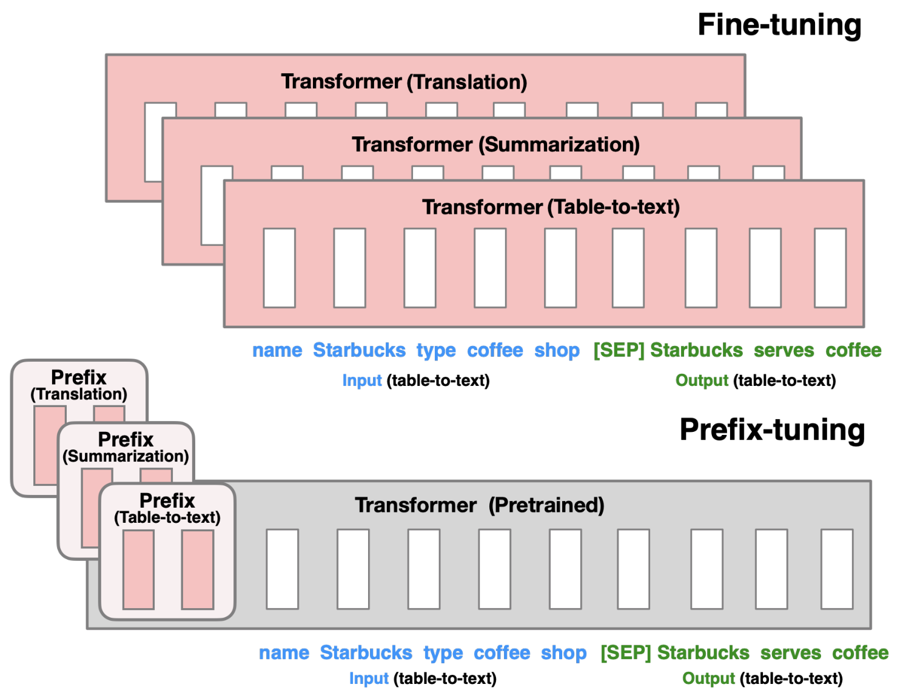

Figure 1: Fine-tuning (top) updates all Transformer parameters (the red Transformer box) and requires storing a full model copy for each task. We propose prefix-tuning (bottom), which freezes the Transformer parameters and only optimizes the prefix (the red prefix blocks). Consequently, we only need to store the prefix for each task, making prefix-tuning modular and space-efficient. Note that each vertical block denote transformer activations at one time step.

A natural approach to this problem is lightweight fine-tuning , which freezes most of the pretrained parameters and augments the model with small trainable modules. For example, adapter-tuning Rebuffi et al. (2017) ; Houlsby et al. (2019) inserts additional task-specific layers between the layers of pretrained language models. Adapter-tuning has promising performance on natural language understanding and generation benchmarks, attaining comparable performance with fine-tuning while adding only around 2-4% task-specific parameters Houlsby et al. (2019) ; Lin et al. (2020) .

On the extreme end, GPT-3 Brown et al. (2020) can be deployed without any task-specific tuning. Instead, users prepend a natural language task instruction (e.g., TL;DR for summarization) and a few examples to the task input; then generate the output from the LM. This approach is known as in-context learning or prompting .

In this paper, we propose prefix-tuning , a lightweight alternative to fine-tuning for natural language generation (NLG) tasks, inspired by prompting. Consider the task of generating a textual description of a data table, as shown in Figure 1 , where the task input is a linearized table (e.g., “name: Starbucks $|$ type: coffee shop”) and the output is a textual description (e.g., “Starbucks serves coffee.”). Prefix-tuning prepends a sequence of continuous task-specific vectors to the input, which we call a prefix , depicted by red blocks in Figure 1 (bottom). For subsequent tokens, the Transformer can attend to the prefix as if it were a sequence of “virtual tokens”, but unlike prompting, the prefix consists entirely of free parameters which do not correspond to real tokens. In contrast to fine-tuning in Figure 1 (top), which updates all Transformer parameters and thus requires storing a tuned copy of the model for each task, prefix-tuning only optimizes the prefix. Consequently, we only need to store one copy of the large Transformer and a learned task-specific prefix, yielding a very small overhead for each additional task (e.g., 250K parameters for table-to-text).

In contrast to fine-tuning, prefix-tuning is modular: we train an upstream prefix which steers a downstream LM, which remains unmodified. Thus, a single LM can support many tasks at once. In the context of personalization where the tasks correspond to different users Shokri and Shmatikov (2015) ; McMahan et al. (2016) , we could have a separate prefix for each user trained only on that user’s data, thereby avoiding data cross-contamination. Moreover, the prefix-based architecture enables us to even process examples from multiple users/tasks in a single batch, something that is not possible with other lightweight fine-tuning approaches.

We evaluate prefix-tuning on table-to-text generation using GPT-2 and abstractive summarization using BART. In terms of storage, prefix-tuning stores 1000x fewer parameters than fine-tuning. In terms of performance when trained on full datasets, prefix-tuning and fine-tuning are comparable for table-to-text ( § 6.1 ), while prefix-tuning suffers a small degradation for summarization ( § 6.2 ). In low-data settings, prefix-tuning on average outperforms fine-tuning on both tasks ( § 6.3 ). Prefix-tuning also extrapolates better to tables (for table-to-text) and articles (for summarization) with unseen topics ( § 6.4 ).

## Related Work

#### Fine-tuning for natural language generation.

Current state-of-the-art systems for natural language generation are based on fine-tuning pretrained LMs. For table-to-text generation, Kale (2020) fine-tunes a sequence-to-sequence model ( Raffel et al., 2020 , T5;) . For extractive and abstractive summarization, researchers fine-tune masked language models ( Devlin et al., 2019 , e.g., BERT;) and encode-decoder models ( Lewis et al., 2020 , e.g., BART;) respectively Zhong et al. (2020) ; Liu and Lapata (2019) ; Raffel et al. (2020) . For other conditional NLG tasks such as machine translation and dialogue generation, fine-tuning is also the prevalent paradigm Zhang et al. (2020c) ; Stickland et al. (2020) ; Zhu et al. (2020) ; Liu et al. (2020) . In this paper, we focus on table-to-text using GPT-2 and summarization using BART, but prefix-tuning can be applied to other generation tasks and pretrained models.

#### Lightweight fine-tuning.

Lightweight fine-tuning freezes most of the pretrained parameters and modifies the pretrained model with small trainable modules. The key challenge is to identify high-performing architectures of the modules and the subset of pretrained parameters to tune. One line of research considers removing parameters: some model weights are ablated away by training a binary mask over model parameters Zhao et al. (2020) ; Radiya-Dixit and Wang (2020) . Another line of research considers inserting parameters. For example, Zhang et al. (2020a) trains a “side” network that is fused with the pretrained model via summation; adapter-tuning inserts task-specific layers (adapters) between each layer of the pretrained LM Houlsby et al. (2019) ; Lin et al. (2020) ; Rebuffi et al. (2017) ; Pfeiffer et al. (2020) . Compared to this line of work, which tunes around $3.6\%$ of the LM parameters, our method obtains a further 30x reduction in task-specific parameters, tuning only 0.1% while maintaining comparable performance.

#### Prompting.

Prompting means prepending instructions and a few examples to the task input and generating the output from the LM. GPT-3 Brown et al. (2020) uses manually designed prompts to adapt its generation for different tasks, and this framework is termed in-context learning . However, since Transformers can only condition on a bounded-length context (e.g., 2048 tokens for GPT-3), in-context learning is unable to fully exploit training sets longer than the context window. Sun and Lai (2020) also prompt by keywords to control for sentiment or topic of the generated sentence. In natural language understanding tasks, prompt engineering has been explored in prior works for models like BERT and RoBERTa ( Liu et al., 2019 ; Jiang et al., 2020 ; Schick and Schütze, 2020 ) . For example, AutoPrompt Shin et al. (2020) searches for a sequence of discrete trigger words and concatenates it with each input to elicit sentiment or factual knowledge from a masked LM. In contrast with AutoPrompt, our method optimizes continuous prefixes, which are more expressive ( § 7.2 ); moreover, we focus on language generation tasks.

Continuous vectors have been used to steer language models; for example, Subramani et al. (2020) showed that a pretrained LSTM language model can reconstruct arbitrary sentences by optimizing a continuous vector for each sentence, making the vector input-specific . In contrast, prefix-tuning optimizes a task-specific prefix that applies to all instances of that task. As a result, unlike the previous work whose application is limited to sentence reconstruction, prefix-tuning can be applied to NLG tasks.

#### Controllable generation.

Controllable generation aims to steer a pretrained language model to match a sentence level attribute (e.g., positive sentiment or topic on sports). Such control can happen at training time: Keskar et al. (2019) pretrains the language model (CTRL) to condition on metadata such as keywords or URLs. Additionally, the control can happen at decoding time, by weighted decoding ( Krause et al., 2020 , GeDi,) or iteratively updating the past activations ( Dathathri et al., 2020 , PPLM,) . However, there is no straightforward way to apply these controllable generation techniques to enforce fine-grained control over generated contents, as demanded by tasks like table-to-text and summarization.

## Problem Statement

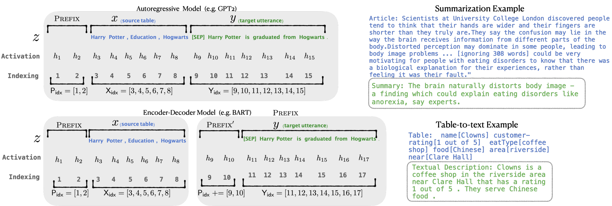

Figure 2: An annotated example of prefix-tuning using an autoregressive LM (top) and an encoder-decoder model (bottom). The prefix activations $\forall i\in\textsf{P${}_{\text{idx}}$},h_{i}$ are drawn from a trainable matrix $P_{\theta}$ . The remaining activations are computed by the Transformer.

Consider a conditional generation task where the input is a context $x$ and the output $y$ is a sequence of tokens. We focus on two tasks, shown in Figure 2 (right): In table-to-text, $x$ corresponds to a linearized data table and $y$ is a textual description; in summarization, $x$ is an article and $y$ is a short summary.

### Autoregressive LM

Assume we have an autoregressive language model $p_{\phi}(y\mid x)$ based on the Transformer Vaswani et al. (2017) architecture ( Radford et al., 2019 , e.g., GPT-2;) and parametrized by $\phi$ . As shown in Figure 2 (top), let $z=[x;y]$ be the concatenation of $x$ and $y$ ; let X ${}_{\text{idx}}$ denote the sequence of indices that corresponds to $x$ , and Y ${}_{\text{idx}}$ denote the same for $y$ .

The activation at time step $i$ is $h_{i}\in\mathbb{R}^{d}$ , where $h_{i}=[h_{i}^{(1)};\cdots;h_{i}^{(n)}]$ is a concatenation of all activation layers at this time step, and $h_{i}^{(j)}$ is the activation of the $j$ -th Transformer layer at time step $i$ . [^footnote1]

The autoregressive Transformer model computes $h_{i}$ as a function of $z_{i}$ and the past activations in its left context, as follows:

$$
\displaystyle h_{i}=\textsc{LM}_{\phi}(z_{i},h_{<i})\text{,}
$$

where the last layer of $h_{i}$ is used to compute the distribution for the next token: $p_{\phi}(z_{i+1}\mid h_{\leq i})=\Softmax(W_{\phi}~h_{i}^{(n)})$ and $W_{\phi}$ is a pretrained matrix that map $h_{i}^{(n)}$ to logits over the vocabulary.

### Encoder-Decoder Architecture

We can also use an encoder-decoder architecture ( Lewis et al., 2020 , e.g., BART;) to model $p_{\phi}(y\mid x)$ , where $x$ is encoded by the bidirectional encoder, and the decoder predicts $y$ autoregressively (conditioned on the encoded $x$ and its left context). We use the same indexing and activation notation, as shown in Figure 2 (bottom). $h_{i}$ for all $i\in\textsf{X${}_{\text{idx}}$}$ is computed by the bidirectional Transformer encoder; $h_{i}$ for all $i\in\textsf{Y${}_{\text{idx}}$}$ is computed by the autoregressive decoder using the same equation 1 .

### Method: Fine-tuning

In the fine-tuning framework, we initialize with the pretrained parameters $\phi$ . Here $p_{\phi}$ is a trainable language model distribution and we perform gradient updates on the following log-likelihood objective:

$$
\displaystyle\max_{\phi}~\log p_{\phi}(y\mid x)=\sum_{i\in\textsf{Y${}_{\text{idx}}$}}\log p_{\phi}(z_{i}\mid h_{<i})\text{.}
$$

## Prefix-Tuning

We propose prefix-tuning as an alternative to fine-tuning for conditional generation tasks. We first provide intuition in § 4.1 before defining our method formally in § 4.2 .

### Intuition

Based on intuition from prompting, we believe that having a proper context can steer the LM without changing its parameters. For example, if we want the LM to generate a word (e.g., Obama), we can prepend its common collocations as context (e.g., Barack), and the LM will assign much higher probability to the desired word. Extending this intuition beyond generating a single word or sentence, we want to find a context that steers the LM to solve an NLG task. Intuitively, the context can influence the encoding of $x$ by guiding what to extract from $x$ ; and can influence the generation of $y$ by steering the next token distribution. However, it’s non-obvious whether such a context exists. Natural language task instructions (e.g., ‘‘summarize the following table in one sentence’’) might guide an expert annotator to solve the task, but fail for most pretrained LMs. [^footnote2] Data-driven optimization over the discrete instructions might help, but discrete optimization is computationally challenging.

Instead of optimizing over discrete tokens, we can optimize the instruction as continuous word embeddings, whose effects will be propagated upward to all Transformer activation layers and rightward to subsequent tokens. This is strictly more expressive than a discrete prompt which requires matching the embedding of a real word. Meanwhile, this is less expressive than intervening all layers of the activations ( § 7.2 ), which avoids long-range dependencies and includes more tunable parameters. Prefix-tuning, therefore, optimizes all layers of the prefix.

### Method

Prefix-tuning prepends a prefix for an autoregressive LM to obtain $z=[\textsc{Prefix};x;y]$ , or prepends prefixes for both encoder and encoder to obtain $z=[\textsc{Prefix};x;\textsc{Prefix}^{\prime};y]$ , as shown in Figure 2 . Here, P ${}_{\text{idx}}$ denotes the sequence of prefix indices, and we use $|\textsf{P${}_{\text{idx}}$}|$ to denote the length of the prefix.

We follow the recurrence relation in equation 1 , except that the prefix are free parameters. Prefix-tuning initializes a trainable matrix $P_{\theta}$ (parametrized by $\theta$ ) of dimension $|\textsf{P${}_{\text{idx}}$}|\times\dim(h_{i})$ to store the prefix parameters.

$$
\displaystyle h_{i}=\begin{cases}P_{\theta}[i,:],&\text{if }i\in\textsf{P${}_{\text{idx}}$}\text{,}\\
\textsc{LM}_{\phi}(z_{i},h_{<i}),&\text{otherwise.}\end{cases}
$$

The training objective is the same as equation 2 , but the set of trainable parameters changes: the language model parameters $\phi$ are fixed and the prefix parameters $\theta$ are the only trainable parameters.

Here, $h_{i}$ (for all $i$ ) is a function of the trainable $P_{\theta}$ . When $i\in\textsf{P${}_{\text{idx}}$}$ , this is clear because $h_{i}$ copies directly from $P_{\theta}$ . When $i\not\in\textsf{P${}_{\text{idx}}$}$ , $h_{i}$ still depends on $P_{\theta}$ , because the prefix activations are always in the left context and will therefore affect any activations to its right.

### Parametrization of $P_{\theta}$

Empirically, directly updating the $P_{\theta}$ parameters leads to unstable optimization and a slight drop in performance. [^footnote3] So we reparametrize the matrix $P_{\theta}[i,:]=\textsc{MLP}_{\theta}(P^{\prime}_{\theta}[i,:])$ by a smaller matrix ( $P^{\prime}_{\theta}$ ) composed with a large feedforward neural network ( $\textsc{MLP}_{\theta}$ ). Note that $P_{\theta}$ and $P^{\prime}_{\theta}$ has the same rows dimension (i.e. the prefix length), but different columns dimension. [^footnote4] Once training is complete, these reparametrization parameters can be dropped, and only the prefix ( $P_{\theta}$ ) needs to be saved.

## Experimental Setup

### Datasets and Metrics

We evaluate on three standard neural generation datasets for the table-to-text task: E2E Novikova et al. (2017) , WebNLG Gardent et al. (2017) , and DART Radev et al. (2020) . The datasets are ordered by increasing complexity and size. E2E only has $1$ domain (i.e. restaurant reviews); WebNLG has $14$ domains, and DART is open-domain, using open-domain tables from Wikipedia.

The E2E dataset contains approximately 50K examples with 8 distinct fields; it contains multiple test references for one source table, and the average output length is $22.9$ . We use the official evaluation script, which reports BLEU Papineni et al. (2002) , NIST Belz and Reiter (2006) , METEOR Lavie and Agarwal (2007) , ROUGE-L Lin (2004) , and CIDEr Vedantam et al. (2015) .

The WebNLG Gardent et al. (2017) dataset consists of 22K examples, and the input $x$ is a sequence of (subject, property, object) triples. The average output length is $22.5$ . In the training and validation splits, the input describes entities from $9$ distinct DBpedia categories (e.g., Monument). The test split consists of two parts: the first half contains DB categories seen in training data, and the second half contains $5$ unseen categories. These unseen categories are used to evaluate extrapolation. We use the official evaluation script, which reports BLEU, METEOR and TER Snover et al. (2006) .

DART Radev et al. (2020) is an open domain table-to-text dataset, with similar input format (entity-relation-entity triples) as WebNLG. The average output length is $21.6$ . It consists of 82K examples from WikiSQL, WikiTableQuestions, E2E, and WebNLG and applies some manual or automated conversion. We use the official evaluation script and report BLEU, METEOR, TER, MoverScore Zhao et al. (2019) , BERTScore Zhang et al. (2020b) and BLEURT Sellam et al. (2020) .

For the summarization task, we use the XSUM Narayan et al. (2018) dataset, which is an abstractive summarization dataset on news articles. There are 225K examples. The average length of the articles is 431 words and the average length of the summaries is 23.3. We report ROUGE-1, ROUGE-2 and ROUGE-L.

### Methods

For table-to-text generation, we compare prefix-tuning with three other methods: fine-tuning ( Fine-tune ), fine-tuning only the top 2 layers ( FT-top2 ), and adapter-tuning ( Adapter ). [^footnote5] We also report the current state-of-the-art results on these datasets: On E2E, Shen et al. (2019) uses a pragmatically informed model without pretraining. On WebNLG, Kale (2020) fine-tunes T5-large. On DART, no official models trained on this dataset version are released. [^footnote6] For summarization, we compare against fine-tuning BART Lewis et al. (2020) .

### Architectures and Hyperparameters

For table-to-text, we use GPT-2 ${}_{\textsc{MEDIUM}}$ and GPT-2 ${}_{\textsc{LARGE}}$ ; the source tables are linearized. [^footnote7] For summarization, we use BART ${}_{\textsc{LARGE}}$ , [^footnote8] and the source articles are truncated to $512$ BPE tokens.

Our implementation is based on the Hugging Face Transformer models Wolf et al. (2020) . At training time, we use the AdamW optimizer Loshchilov and Hutter (2019) and a linear learning rate scheduler, as suggested by the Hugging Face default setup. The hyperparameters we tune include the number of epochs, batch size, learning rate, and prefix length. Hyperparameter details are in the appendix. A default setting trains for $10$ epochs, using a batch size of $5$ , a learning rate of $5\cdot 10^{-5}$ and a prefix length of $10$ . The table-to-text models are trained on TITAN Xp or GeForce GTX TITAN X machines. Prefix-tuning takes $0.2$ hours per epochs to train on 22K examples , whereas fine-tuning takes around $0.3$ hours. The summarization models are trained on Tesla V100 machines, taking $1.25$ h per epoch on the XSUM dataset.

At decoding time, for the three table-to-text datasets, we use beam search with a beam size of $5$ . For summarization, we use a beam size of $6$ and length normalization of $0.8$ . Decoding takes $1.2$ seconds per sentence (without batching) for table-to-text, and $2.6$ seconds per batch (using a batch size of 10) for summarization.

## Main Results

|  | E2E | E2E | E2E | E2E | E2E | WebNLG | WebNLG | WebNLG | WebNLG | WebNLG | WebNLG | WebNLG | WebNLG | WebNLG | DART | DART | DART | DART | DART | DART |
| --- | --- | --- | --- | --- | --- | --- | --- | --- | --- | --- | --- | --- | --- | --- | --- | --- | --- | --- | --- | --- |
|  | BLEU | NIST | MET | R-L | CIDEr | BLEU | BLEU | BLEU | MET | MET | MET | TER $\downarrow$ | TER $\downarrow$ | TER $\downarrow$ | BLEU | MET | TER $\downarrow$ | Mover | BERT | BLEURT |
|  |  |  |  |  |  | S | U | A | S | U | A | S | U | A |  |  |  |  |  |  |
|  | GPT-2 ${}_{\textsc{MEDIUM}}$ | GPT-2 ${}_{\textsc{MEDIUM}}$ | GPT-2 ${}_{\textsc{MEDIUM}}$ | GPT-2 ${}_{\textsc{MEDIUM}}$ | GPT-2 ${}_{\textsc{MEDIUM}}$ | GPT-2 ${}_{\textsc{MEDIUM}}$ | GPT-2 ${}_{\textsc{MEDIUM}}$ | GPT-2 ${}_{\textsc{MEDIUM}}$ | GPT-2 ${}_{\textsc{MEDIUM}}$ | GPT-2 ${}_{\textsc{MEDIUM}}$ | GPT-2 ${}_{\textsc{MEDIUM}}$ | GPT-2 ${}_{\textsc{MEDIUM}}$ | GPT-2 ${}_{\textsc{MEDIUM}}$ | GPT-2 ${}_{\textsc{MEDIUM}}$ | GPT-2 ${}_{\textsc{MEDIUM}}$ | GPT-2 ${}_{\textsc{MEDIUM}}$ | GPT-2 ${}_{\textsc{MEDIUM}}$ | GPT-2 ${}_{\textsc{MEDIUM}}$ | GPT-2 ${}_{\textsc{MEDIUM}}$ | GPT-2 ${}_{\textsc{MEDIUM}}$ |
| Fine-tune | 68.2 | 8.62 | 46.2 | 71.0 | 2.47 | 64.2 | 27.7 | 46.5 | 0.45 | 0.30 | 0.38 | 0.33 | 0.76 | 0.53 | 46.2 | 0.39 | 0.46 | 0.50 | 0.94 | 0.39 |
| FT-top2 | 68.1 | 8.59 | 46.0 | 70.8 | 2.41 | 53.6 | 18.9 | 36.0 | 0.38 | 0.23 | 0.31 | 0.49 | 0.99 | 0.72 | 41.0 | 0.34 | 0.56 | 0.43 | 0.93 | 0.21 |
| Adapter (3%) | 68.9 | 8.71 | 46.1 | 71.3 | 2.47 | 60.4 | 48.3 | 54.9 | 0.43 | 0.38 | 0.41 | 0.35 | 0.45 | 0.39 | 45.2 | 0.38 | 0.46 | 0.50 | 0.94 | 0.39 |
| Adapter (0.1%) | 66.3 | 8.41 | 45.0 | 69.8 | 2.40 | 54.5 | 45.1 | 50.2 | 0.39 | 0.36 | 0.38 | 0.40 | 0.46 | 0.43 | 42.4 | 0.36 | 0.48 | 0.47 | 0.94 | 0.33 |
| Prefix (0.1%) | 69.7 | 8.81 | 46.1 | 71.4 | 2.49 | 62.9 | 45.6 | 55.1 | 0.44 | 0.38 | 0.41 | 0.35 | 0.49 | 0.41 | 46.4 | 0.38 | 0.46 | 0.50 | 0.94 | 0.39 |
|  | GPT-2 ${}_{\textsc{LARGE}}$ | GPT-2 ${}_{\textsc{LARGE}}$ | GPT-2 ${}_{\textsc{LARGE}}$ | GPT-2 ${}_{\textsc{LARGE}}$ | GPT-2 ${}_{\textsc{LARGE}}$ | GPT-2 ${}_{\textsc{LARGE}}$ | GPT-2 ${}_{\textsc{LARGE}}$ | GPT-2 ${}_{\textsc{LARGE}}$ | GPT-2 ${}_{\textsc{LARGE}}$ | GPT-2 ${}_{\textsc{LARGE}}$ | GPT-2 ${}_{\textsc{LARGE}}$ | GPT-2 ${}_{\textsc{LARGE}}$ | GPT-2 ${}_{\textsc{LARGE}}$ | GPT-2 ${}_{\textsc{LARGE}}$ | GPT-2 ${}_{\textsc{LARGE}}$ | GPT-2 ${}_{\textsc{LARGE}}$ | GPT-2 ${}_{\textsc{LARGE}}$ | GPT-2 ${}_{\textsc{LARGE}}$ | GPT-2 ${}_{\textsc{LARGE}}$ | GPT-2 ${}_{\textsc{LARGE}}$ |
| Fine-tune | 68.5 | 8.78 | 46.0 | 69.9 | 2.45 | 65.3 | 43.1 | 55.5 | 0.46 | 0.38 | 0.42 | 0.33 | 0.53 | 0.42 | 47.0 | 0.39 | 0.46 | 0.51 | 0.94 | 0.40 |
| Prefix | 70.3 | 8.85 | 46.2 | 71.7 | 2.47 | 63.4 | 47.7 | 56.3 | 0.45 | 0.39 | 0.42 | 0.34 | 0.48 | 0.40 | 46.7 | 0.39 | 0.45 | 0.51 | 0.94 | 0.40 |
| SOTA | 68.6 | 8.70 | 45.3 | 70.8 | 2.37 | 63.9 | 52.8 | 57.1 | 0.46 | 0.41 | 0.44 | - | - | - | - | - | - | - | - | - |

Table 1: Metrics (higher is better, except for TER) for table-to-text generation on E2E (left), WebNLG (middle) and DART (right). With only $0.1\%$ parameters, Prefix-tuning outperforms other lightweight baselines and achieves a comparable performance with fine-tuning. The best score is boldfaced for both GPT-2 ${}_{\textsc{MEDIUM}}$ and GPT-2 ${}_{\textsc{LARGE}}$ .

### Table-to-text Generation

We find that adding only 0.1% task-specific parameters, [^footnote9] prefix-tuning is effective in table-to-text generation, outperforming other lightweight baselines ( Adapter and FT-top2 ) and achieving a comparable performance with fine-tuning. This trend is true across all three datasets: E2E, WebNLG, [^footnote10] and DART.

For a fair comparison, we match the number of parameters for prefix-tuning and adapter-tuning to be 0.1%. Table 1 shows that prefix-tuning is significantly better than Adapter (0.1%), attaining $4.1$ BLEU improvement per dataset on average. Even when we compare with fine-tuning (100%) and adapter-tuning (3.0%), which update significantly more parameters than prefix-tuning, prefix-tuning still achieves results comparable or better than those two systems. This demonstrates that prefix-tuning is more Pareto efficient than adapter-tuning, significantly reducing parameters while improving generation quality.

Additionally, attaining good performance on DART suggests that prefix-tuning can generalize to tables with diverse domains and a large pool of relations. We will delve deeper into extrapolation performance (i.e. generalization to unseen categories or topics) in § 6.4 .

Overall, prefix-tuning is an effective and space-efficient method to adapt GPT-2 to table-to-text generation. The learned prefix is expressive enough to steer GPT-2 in order to correctly extract contents from an unnatural format and generate a textual description. Prefix-tuning also scales well from GPT-2 ${}_{\textsc{MEDIUM}}$ to GPT-2 ${}_{\textsc{LARGE}}$ , suggesting it has the potential to scale to even larger models with a similar architecture, like GPT-3.

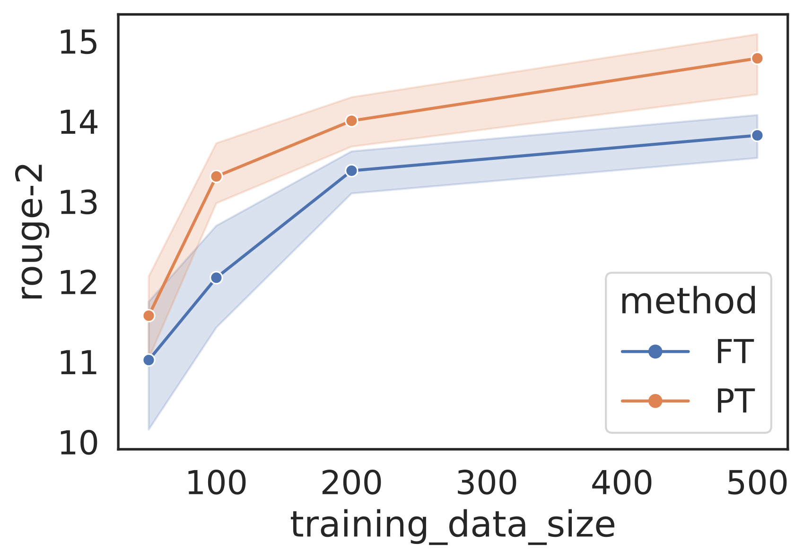

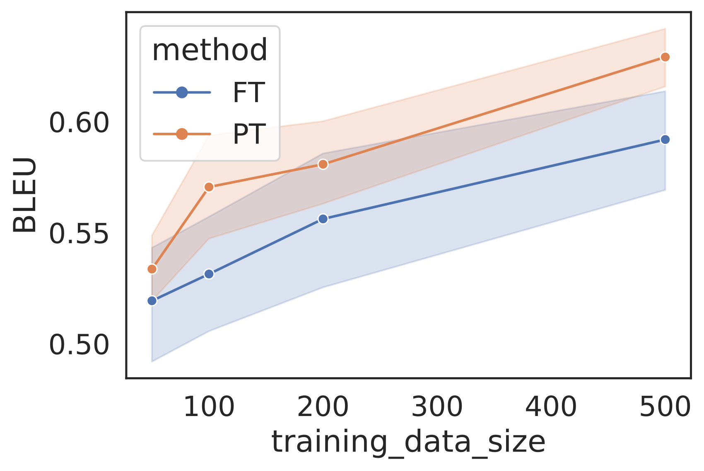

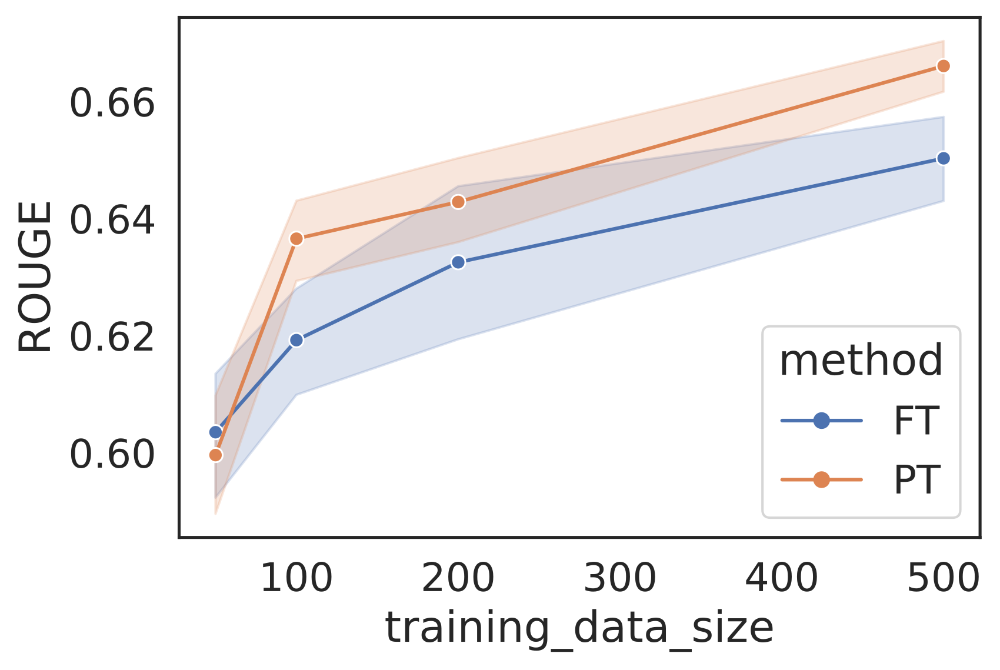

Figure 3: (Left) qualitative examples in lowdata settings. (Right) prefix-tuning (orange) outperforms fine-tuning (blue) in low-data regimes in addition to requiring many fewer parameters. The top two plots correspond to summarization, measured by ROUGE-1 and ROUGE-2. The bottom two plots correspond to table-to-text, measured by BLEU and ROUGE-L. The x-axis is the training size and the y-axis is the evaluation metric (higher is better).

### Summarization

|  | R-1 $\uparrow$ | R-2 $\uparrow$ | R-L $\uparrow$ |
| --- | --- | --- | --- |
| Fine-tune Lewis et al. (2020) | 45.14 | 22.27 | 37.25 |
| Prefix (2%) | 43.80 | 20.93 | 36.05 |
| Prefix (0.1%) | 42.92 | 20.03 | 35.05 |

Table 2: Metrics for summarization on XSUM. Prefix-tuning slightly underperforms fine-tuning.

As shown in Table 2 , with 2% parameters, prefix-tuning obtains slightly lower performance than fine-tuning (36.05 vs. 37.25 in ROUGE-L). With only 0.1% parameters, prefix-tuning underperforms full fine-tuning (35.05 vs. 37.25). There are several differences between XSUM and the three table-to-text datasets which could account for why prefix-tuning has comparative advantage in table-to-text: (1) XSUM contains 4x more examples than the three table-to-text datasets on average; (2) the input articles are 17x longer than the linearized table input of table-to-text datasets on average; (3) summarization might be more complex than table-to-text because it requires reading comprehension and identifying key contents from an article.

### Low-data Setting

Based on the results from table-to-text ( § 6.1 ) and summarization ( § 6.2 ), we observe that prefix-tuning has a comparative advantage when the number of training examples is smaller. To construct low-data settings, we subsample the full dataset (E2E for table-to-text and XSUM for summarization) to obtain small datasets of size $\{50,100,200,500\}$ . For each size, we sample $5$ different datasets and average over $2$ training random seeds. Thus, we average over $10$ models to get an estimate for each low-data setting. [^footnote11]

Figure 3 (right) shows that prefix-tuning outperforms fine-tuning in low-data regimes by $2.9$ BLEU on average, in addition to requiring many fewer parameters, but the gap narrows as the dataset size increases.

Qualitatively, Figure 3 (left) shows $8$ examples generated by both prefix-tuning and fine-tuning models trained on different data levels. While both methods tend to undergenerate (missing table contents) in low data regimes, prefix-tuning tends to be more faithful than fine-tuning. For example, fine-tuning (100, 200) [^footnote12] falsely claims a low customer rating while the true rating is average, whereas prefix-tuning (100, 200) generates a description that is faithful to the table.

### Extrapolation

We now investigate extrapolation performance to unseen topics for both table-to-text and summarization. In order to construct an extrapolation setting, we split the existing datasets so that training and test cover different topics. For table-to-text, the WebNLG dataset is labeled with table topics. There are $9$ categories that appear in training and dev, denoted as SEEN and $5$ categories that only appear at test time, denoted as UNSEEN. So we evaluate extrapolation by training on the SEEN categories and testing on the UNSEEN categories. For summarization, we construct two extrapolation data splits [^footnote13] : In news-to-sports , we train on news articles, and test on sports articles. In within-news , we train on $\{$ world, UK, business $\}$ news, and test on the remaining news categories (e.g., health, technology).

|  | news-to-sports | news-to-sports | news-to-sports | within-news | within-news | within-news |
| --- | --- | --- | --- | --- | --- | --- |
|  | R-1 $\uparrow$ | R-2 $\uparrow$ | R-L $\uparrow$ | R-1 $\uparrow$ | R-2 $\uparrow$ | R-L $\uparrow$ |
| Fine-tune | 38.15 | 15.51 | 30.26 | 39.20 | 16.35 | 31.15 |
| Prefix | 39.23 | 16.74 | 31.51 | 39.41 | 16.87 | 31.47 |

Table 3: Extrapolation performance on XSUM. Prefix-tuning outperforms fine-tuning on both news-to-sports and within-news splits.

On both table-to-text and summarization, prefix-tuning has better extrapolation than fine-tuning under all metrics, as shown in Table 3 and the ‘U’ columns of Table 1 (middle).

We also find that adapter-tuning achieves good extrapolation performance, comparable with prefix-tuning, as shown in Table 1 . This shared trend suggests that preserving LM parameters indeed has a positive impact on extrapolation. However, the reason for such gains is an open question and we will discuss further in § 8 .

## Intrinsic Evaluation

We compare different variants of prefix-tuning. § 7.1 studies the impact of the prefix length. § 7.2 studies tuning only the embedding layer, which is more akin to tuning a discrete prompt. § 7.3 compares prefixing and infixing, which inserts trainable activations between $x$ and $y$ . § 7.4 studies the impact of various prefix initialization strategies.

### Prefix Length

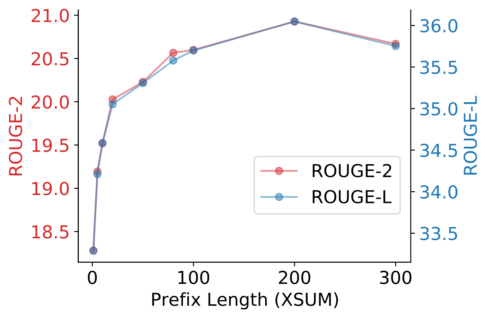

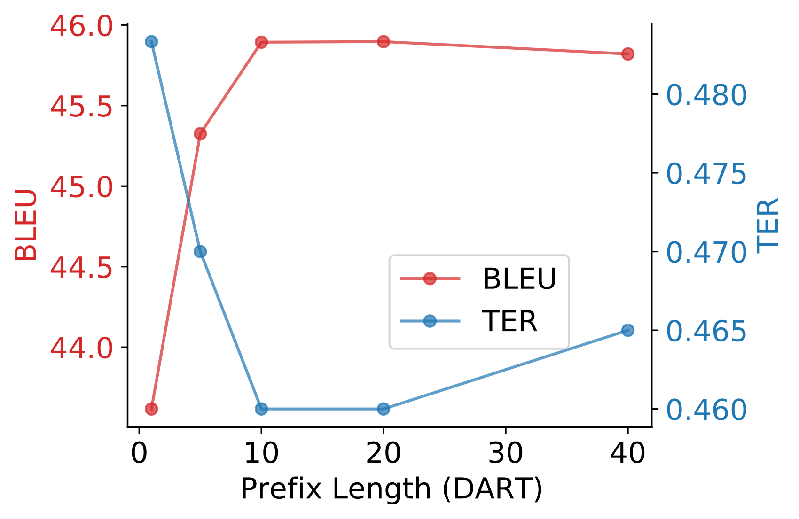

Figure 4: Prefix length vs. performance on summerization (left) and table-to-text (right). Performance increases as the prefix length increases up to a threshold (200 for summarization and 10 for table-to-text) and then a slight performance drop occurs. Each plot reports two metrics (on two vertical axes).

A longer prefix means more trainable parameters, and therefore more expressive power. Figure 4 shows that performance increases as the prefix length increases up to a threshold ( $200$ for summarization, $10$ for table-to-text) and then a slight performance drop occurs. [^footnote14]

Empirically, longer prefixes have a negligible impact on inference speed, because attention computation over the entire prefix is parallellized on GPUs.

### Full vs Embedding-only

|  | E2E | E2E | E2E | E2E | E2E |
| --- | --- | --- | --- | --- | --- |
|  | BLEU | NIST | MET | ROUGE | CIDEr |
| Prefix | 69.7 | 8.81 | 46.1 | 71.4 | 2.49 |
|  | Embedding-only: Emb -{PrefixLength} | Embedding-only: Emb -{PrefixLength} | Embedding-only: Emb -{PrefixLength} | Embedding-only: Emb -{PrefixLength} | Embedding-only: Emb -{PrefixLength} |
| Emb -1 | 48.1 | 3.33 | 32.1 | 60.2 | 1.10 |
| Emb -10 | 62.2 | 6.70 | 38.6 | 66.4 | 1.75 |
| Emb -20 | 61.9 | 7.11 | 39.3 | 65.6 | 1.85 |
|  | Infix-tuning: Infix -{PrefixLength} | Infix-tuning: Infix -{PrefixLength} | Infix-tuning: Infix -{PrefixLength} | Infix-tuning: Infix -{PrefixLength} | Infix-tuning: Infix -{PrefixLength} |
| Infix -1 | 67.9 | 8.63 | 45.8 | 69.4 | 2.42 |
| Infix -10 | 67.2 | 8.48 | 45.8 | 69.9 | 2.40 |
| Infix -20 | 66.7 | 8.47 | 45.8 | 70.0 | 2.42 |

Table 4: Intrinsic evaluation of Embedding-only ( § 7.2 ) and Infixing ( § 7.3 ). Both Embedding-only ablation and Infix-tuning underperforms full prefix-tuning.

Recall in § 4.1 , we discuss the option of optimizing the continuous embeddings of the “virtual tokens.” We instantiate that idea and call it embedding-only ablation. The word embeddings are free parameters, and the upper activation layers are computed by the Transformer. Table 4 (top) shows that the performance drops significantly, suggesting that tuning only the embedding layer is not sufficiently expressive.

The embedding-only ablation upper bounds the performance of discrete prompt optimization Shin et al. (2020) , because discrete prompt restricts the embedding layer to exactly match the embedding of a real word. Consequently, we have this chain of increasing expressive power: discrete prompting $<$ embedding-only ablation $<$ prefix-tuning.

### Prefixing vs Infixing

We also investigate how the trainable activations’ position in the sequence affects performance. In prefix-tuning, we place them at the beginning $[\textsc{Prefix};x;y]$ . We can also place the trainable activations between $x$ and $y$ (i.e. $[x;\textsc{Infix};y]$ ) and call this infix-tuning. Table 4 (bottom) shows that infix-tuning slightly underperforms prefix-tuning. We believe this is because prefix-tuning can affect the activations of $x$ and $y$ whereas infix-tuning can only influence the activations of $y$ .

### Initialization

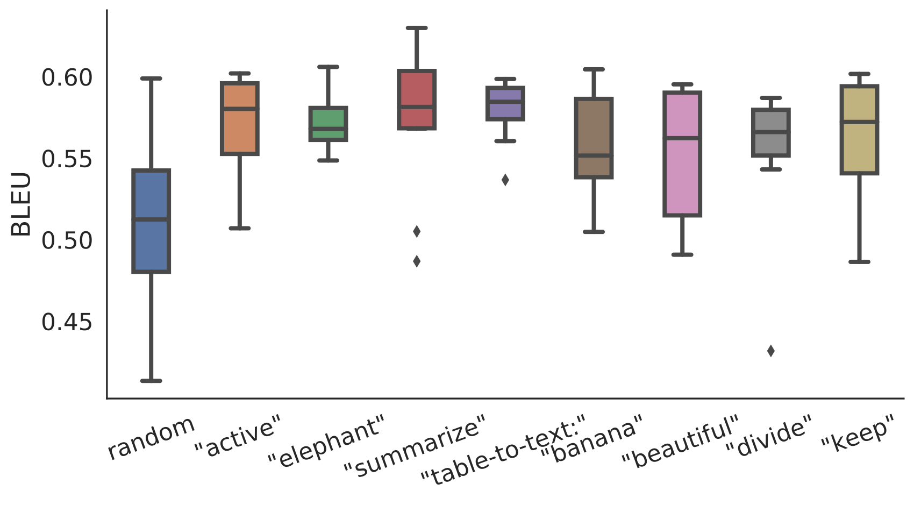

Figure 5: Initializing the prefix with activations of real words significantly outperforms random initialization, in low-data settings.

We find that how the prefix is initialized has a large impact in low-data settings. Random initialization leads to low performance with high variance. Initializing the prefix with activations of real words significantly improves generation, as shown in Figure 5 . In particular, initializing with task relevant words such as “summarization” and “table-to-text” obtains slightly better performance than task irrelevant words such as “elephant” and “divide”, but using real words is still better than random.

Since we initialize the prefix with activations of real words computed by the LM, this initialization strategy is concordant with preserving the pretrained LM as much as possible.

## Discussion

In this section, we will discuss several favorable properties of prefix-tuning and some open problems.

### Personalization

As we note in § 1 , prefix-tuning is advantageous when there are a large number of tasks that needs to be trained independently. One practical setting is user privacy Shokri and Shmatikov (2015) ; McMahan et al. (2016) . In order to preserve user privacy, each user’s data needs to be separated and a personalized model needs to be trained independently for each user. Consequently, each user can be regarded as an independent task. If there are millions of users, prefix-tuning can scale to this setting and maintain modularity, enabling flexible addition or deletion of users by adding or deleting their prefixes without cross-contamination.

### Batching Across Users

Under the same personalization setting, prefix-tuning allows batching different users’ queries even though they are backed by different prefixes. When multiple users query a cloud GPU device with their inputs, it is computationally efficient to put these users in the same batch. Prefix-tuning keeps the shared LM intact; consequently, batching requires a simple step of prepending the personalized prefix to user input, and all the remaining computation is unchanged. In contrast, we can’t batch across different users in adapter-tuning, which has personalized adapters between shared Transformer layers.

### Inductive Bias of Prefix-tuning

Recall that fine-tuning updates all pretrained parameters, whereas prefix-tuning and adapter-tuning preserve them. Since the language models are pretrained on general purpose corpus, preserving the LM parameters might help generalization to domains unseen during training. In concordance with this intuition, we observe that both prefix-tuning and adapter-tuning have significant performance gain in extrapolation settings ( § 6.4 ); however, the reason for such gain is an open question.

While prefix-tuning and adapter-tuning both freeze the pretrained parameters, they tune different sets of parameters to affect the activation layers of the Transformer. Recall that prefix-tuning keeps the LM intact and uses the prefix and the pretrained attention blocks to affect the subsequent activations; adapter-tuning inserts trainable modules between LM layers, which directly add residual vectors to the activations. Moreover, we observe that prefix-tuning requires vastly fewer parameters compared to adapter-tuning while maintaining comparable performance. We think this gain in parameter efficiency is because prefix-tuning keeps the pretrained LM intact as much as possible, and therefore exploits the LM more than adapter-tuning.

Concurrent work by Aghajanyan et al. (2020) uses intrinsic dimension to show that there exists a low dimension reparameterization that is as effective for fine-tuning as the full parameter space. This explains why good accuracy on downstream task can be obtained by updating only a small number of parameters. Our work echoes the finding by showing that good generation performance can be attained by updating a very small prefix.

## Conclusion

We have proposed prefix-tuning, a lightweight alternative to fine-tuning that prepends a trainable continuous prefix for NLG tasks. We discover that despite learning 1000x fewer parameters than fine-tuning, prefix-tuning can maintain a comparable performance in a full data setting and outperforms fine-tuning in both low-data and extrapolation settings.

## References

- Aghajanyan et al. (2020) Armen Aghajanyan, Luke Zettlemoyer, and Sonal Gupta. 2020. Intrinsic dimensionality explains the effectiveness of language model fine-tuning .

- Belz and Reiter (2006) Anja Belz and Ehud Reiter. 2006. Comparing automatic and human evaluation of NLG systems . In 11th Conference of the European Chapter of the Association for Computational Linguistics , Trento, Italy. Association for Computational Linguistics.

- Brown et al. (2020) Tom B. Brown, Benjamin Mann, Nick Ryder, Melanie Subbiah, Jared Kaplan, Prafulla Dhariwal, Arvind Neelakantan, Pranav Shyam, Girish Sastry, Amanda Askell, Sandhini Agarwal, Ariel Herbert-Voss, Gretchen Krueger, Tom Henighan, Rewon Child, Aditya Ramesh, Daniel M. Ziegler, Jeffrey Wu, Clemens Winter, Christopher Hesse, Mark Chen, Eric Sigler, Mateusz Litwin, Scott Gray, Benjamin Chess, Jack Clark, Christopher Berner, Sam McCandlish, Alec Radford, Ilya Sutskever, and Dario Amodei. 2020. Language models are few-shot learners .

- Dathathri et al. (2020) Sumanth Dathathri, Andrea Madotto, Janice Lan, Jane Hung, Eric Frank, Piero Molino, Jason Yosinski, and Rosanne Liu. 2020. Plug and play language models: A simple approach to controlled text generation . In International Conference on Learning Representations .

- Devlin et al. (2019) Jacob Devlin, Ming-Wei Chang, Kenton Lee, and Kristina Toutanova. 2019. BERT: Pre-training of deep bidirectional transformers for language understanding . In Proceedings of the 2019 Conference of the North American Chapter of the Association for Computational Linguistics: Human Language Technologies, Volume 1 (Long and Short Papers) , pages 4171–4186, Minneapolis, Minnesota. Association for Computational Linguistics.

- Gardent et al. (2017) Claire Gardent, Anastasia Shimorina, Shashi Narayan, and Laura Perez-Beltrachini. 2017. The WebNLG challenge: Generating text from RDF data . In Proceedings of the 10th International Conference on Natural Language Generation , pages 124–133, Santiago de Compostela, Spain. Association for Computational Linguistics.

- Houlsby et al. (2019) Neil Houlsby, Andrei Giurgiu, Stanislaw Jastrzebski, Bruna Morrone, Quentin De Laroussilhe, Andrea Gesmundo, Mona Attariyan, and Sylvain Gelly. 2019. Parameter-efficient transfer learning for NLP . In Proceedings of the 36th International Conference on Machine Learning , volume 97 of Proceedings of Machine Learning Research , pages 2790–2799, Long Beach, California, USA. PMLR.

- Jiang et al. (2020) Zhengbao Jiang, Frank F. Xu, Jun Araki, and Graham Neubig. 2020. How can we know what language models know? Transactions of the Association for Computational Linguistics , 8:423–438.

- Kale (2020) Mihir Kale. 2020. Text-to-text pre-training for data-to-text tasks .

- Keskar et al. (2019) N. Keskar, B. McCann, L. R. Varshney, Caiming Xiong, and R. Socher. 2019. Ctrl: A conditional transformer language model for controllable generation. ArXiv , abs/1909.05858.

- Krause et al. (2020) Ben Krause, Akhilesh Deepak Gotmare, Bryan McCann, Nitish Shirish Keskar, Shafiq Joty, Richard Socher, and Nazneen Fatema Rajani. 2020. GeDi: Generative Discriminator Guided Sequence Generation. arXiv preprint arXiv:2009.06367 .

- Lavie and Agarwal (2007) Alon Lavie and Abhaya Agarwal. 2007. Meteor: An automatic metric for mt evaluation with high levels of correlation with human judgments . In Proceedings of the Second Workshop on Statistical Machine Translation , StatMT ’07, pages 228–231, Stroudsburg, PA, USA. Association for Computational Linguistics.

- Lewis et al. (2020) Mike Lewis, Yinhan Liu, Naman Goyal, Marjan Ghazvininejad, Abdelrahman Mohamed, Omer Levy, Veselin Stoyanov, and Luke Zettlemoyer. 2020. BART: Denoising sequence-to-sequence pre-training for natural language generation, translation, and comprehension . In Proceedings of the 58th Annual Meeting of the Association for Computational Linguistics , pages 7871–7880, Online. Association for Computational Linguistics.

- Lin (2004) Chin-Yew Lin. 2004. ROUGE: A package for automatic evaluation of summaries . In Text Summarization Branches Out , pages 74–81, Barcelona, Spain. Association for Computational Linguistics.

- Lin et al. (2020) Zhaojiang Lin, Andrea Madotto, and Pascale Fung. 2020. Exploring versatile generative language model via parameter-efficient transfer learning . In Findings of the Association for Computational Linguistics: EMNLP 2020 , pages 441–459, Online. Association for Computational Linguistics.

- Liu and Lapata (2019) Yang Liu and Mirella Lapata. 2019. Text summarization with pretrained encoders . In Proceedings of the 2019 Conference on Empirical Methods in Natural Language Processing and the 9th International Joint Conference on Natural Language Processing (EMNLP-IJCNLP) , pages 3730–3740, Hong Kong, China. Association for Computational Linguistics.

- Liu et al. (2020) Yinhan Liu, Jiatao Gu, Naman Goyal, Xian Li, Sergey Edunov, Marjan Ghazvininejad, Mike Lewis, and Luke Zettlemoyer. 2020. Multilingual denoising pre-training for neural machine translation .

- Liu et al. (2019) Yinhan Liu, Myle Ott, Naman Goyal, Jingfei Du, Mandar Joshi, Danqi Chen, Omer Levy, Mike Lewis, Luke Zettlemoyer, and Veselin Stoyanov. 2019. Roberta: A robustly optimized BERT pretraining approach . CoRR , abs/1907.11692.

- Loshchilov and Hutter (2019) Ilya Loshchilov and Frank Hutter. 2019. Decoupled weight decay regularization . In International Conference on Learning Representations .

- McMahan et al. (2016) H. Brendan McMahan, Eider Moore, Daniel Ramage, and Blaise Agüera y Arcas. 2016. Federated learning of deep networks using model averaging . Proceedings of the 20 th International Conference on Artificial Intelligence and Statistics (AISTATS) 2017 , abs/1602.05629.

- Narayan et al. (2018) Shashi Narayan, Shay B. Cohen, and Mirella Lapata. 2018. Don’t give me the details, just the summary! Topic-aware convolutional neural networks for extreme summarization. In Proceedings of the 2018 Conference on Empirical Methods in Natural Language Processing , Brussels, Belgium.

- Novikova et al. (2017) Jekaterina Novikova, Ondrej Dusek, and Verena Rieser. 2017. The E2E dataset: New challenges for end-to-end generation . CoRR , abs/1706.09254.

- Papineni et al. (2002) Kishore Papineni, Salim Roukos, Todd Ward, and Wei-Jing Zhu. 2002. Bleu: A method for automatic evaluation of machine translation . In Proceedings of the 40th Annual Meeting on Association for Computational Linguistics , ACL ’02, pages 311–318, Stroudsburg, PA, USA. Association for Computational Linguistics.

- Pfeiffer et al. (2020) Jonas Pfeiffer, Aishwarya Kamath, Andreas Rücklé, Kyunghyun Cho, and Iryna Gurevych. 2020. Adapterfusion: Non-destructive task composition for transfer learning .

- Radev et al. (2020) Dragomir Radev, Rui Zhang, Amrit Rau, Abhinand Sivaprasad, Chiachun Hsieh, Nazneen Fatema Rajani, Xiangru Tang, Aadit Vyas, Neha Verma, Pranav Krishna, Yangxiaokang Liu, Nadia Irwanto, Jessica Pan, Faiaz Rahman, Ahmad Zaidi, Murori Mutuma, Yasin Tarabar, Ankit Gupta, Tao Yu, Yi Chern Tan, Xi Victoria Lin, Caiming Xiong, and Richard Socher. 2020. Dart: Open-domain structured data record to text generation .

- Radford et al. (2019) A. Radford, Jeffrey Wu, R. Child, David Luan, Dario Amodei, and Ilya Sutskever. 2019. Language models are unsupervised multitask learners.

- Radiya-Dixit and Wang (2020) Evani Radiya-Dixit and Xin Wang. 2020. How fine can fine-tuning be? learning efficient language models . In Proceedings of the Twenty Third International Conference on Artificial Intelligence and Statistics , volume 108 of Proceedings of Machine Learning Research , pages 2435–2443, Online. PMLR.

- Raffel et al. (2020) Colin Raffel, Noam Shazeer, Adam Roberts, Katherine Lee, Sharan Narang, Michael Matena, Yanqi Zhou, Wei Li, and Peter J. Liu. 2020. Exploring the limits of transfer learning with a unified text-to-text transformer . Journal of Machine Learning Research , 21(140):1–67.

- Rebuffi et al. (2017) Sylvestre-Alvise Rebuffi, Hakan Bilen, and Andrea Vedaldi. 2017. Learning multiple visual domains with residual adapters . In Advances in Neural Information Processing Systems , volume 30, pages 506–516. Curran Associates, Inc.

- Schick and Schütze (2020) Timo Schick and Hinrich Schütze. 2020. Exploiting cloze questions for few shot text classification and natural language inference .

- Sellam et al. (2020) Thibault Sellam, Dipanjan Das, and Ankur Parikh. 2020. BLEURT: Learning robust metrics for text generation . In Proceedings of the 58th Annual Meeting of the Association for Computational Linguistics , pages 7881–7892, Online. Association for Computational Linguistics.

- Shen et al. (2019) Sheng Shen, Daniel Fried, Jacob Andreas, and Dan Klein. 2019. Pragmatically informative text generation . In Proceedings of the 2019 Conference of the North American Chapter of the Association for Computational Linguistics: Human Language Technologies, Volume 1 (Long and Short Papers) , pages 4060–4067, Minneapolis, Minnesota. Association for Computational Linguistics.

- Shin et al. (2020) Taylor Shin, Yasaman Razeghi, Robert L. Logan IV au2, Eric Wallace, and Sameer Singh. 2020. Autoprompt: Eliciting knowledge from language models with automatically generated prompts .

- Shokri and Shmatikov (2015) Reza Shokri and Vitaly Shmatikov. 2015. Privacy-preserving deep learning . In Proceedings of the 22nd ACM SIGSAC Conference on Computer and Communications Security , CCS ’15, page 1310–1321, New York, NY, USA. Association for Computing Machinery.

- Snover et al. (2006) Matthew Snover, Bonnie Dorr, Richard Schwartz, Linnea Micciulla, and Ralph Weischedel. 2006. A study of translation error rate with targeted human annotation. In In Proceedings of the Association for Machine Transaltion in the Americas (AMTA 2006 .

- Stickland et al. (2020) Asa Cooper Stickland, Xian Li, and Marjan Ghazvininejad. 2020. Recipes for adapting pre-trained monolingual and multilingual models to machine translation .

- Subramani et al. (2020) Nishant Subramani, Samuel R. Bowman, and Kyunghyun Cho. 2020. Can unconditional language models recover arbitrary sentences?

- Sun and Lai (2020) Fan-Keng Sun and Cheng-I Lai. 2020. Conditioned natural language generation using only unconditioned language model: An exploration .

- Vaswani et al. (2017) Ashish Vaswani, Noam Shazeer, Niki Parmar, Jakob Uszkoreit, Llion Jones, Aidan N Gomez, Ł ukasz Kaiser, and Illia Polosukhin. 2017. Attention is all you need . In Advances in Neural Information Processing Systems , volume 30, pages 5998–6008. Curran Associates, Inc.

- Vedantam et al. (2015) Ramakrishna Vedantam, C. Lawrence Zitnick, and Devi Parikh. 2015. Cider: Consensus-based image description evaluation. In CVPR , pages 4566–4575. IEEE Computer Society.

- Wolf et al. (2020) Thomas Wolf, Lysandre Debut, Victor Sanh, Julien Chaumond, Clement Delangue, Anthony Moi, Pierric Cistac, Tim Rault, Rémi Louf, Morgan Funtowicz, Joe Davison, Sam Shleifer, Patrick von Platen, Clara Ma, Yacine Jernite, Julien Plu, Canwen Xu, Teven Le Scao, Sylvain Gugger, Mariama Drame, Quentin Lhoest, and Alexander M. Rush. 2020. Transformers: State-of-the-art natural language processing . In Proceedings of the 2020 Conference on Empirical Methods in Natural Language Processing: System Demonstrations , pages 38–45, Online. Association for Computational Linguistics.

- Zhang et al. (2020a) Jeffrey O Zhang, Alexander Sax, Amir Zamir, Leonidas Guibas, and Jitendra Malik. 2020a. Side-tuning: A baseline for network adaptation via additive side networks .

- Zhang et al. (2020b) Tianyi Zhang, Varsha Kishore, Felix Wu, Kilian Q. Weinberger, and Yoav Artzi. 2020b. BERTScore: Evaluating text generation with bert . In International Conference on Learning Representations .

- Zhang et al. (2020c) Yizhe Zhang, Siqi Sun, Michel Galley, Yen-Chun Chen, Chris Brockett, Xiang Gao, Jianfeng Gao, Jingjing Liu, and Bill Dolan. 2020c. DIALOGPT : Large-scale generative pre-training for conversational response generation . In Proceedings of the 58th Annual Meeting of the Association for Computational Linguistics: System Demonstrations , pages 270–278, Online. Association for Computational Linguistics.

- Zhao et al. (2020) Mengjie Zhao, Tao Lin, Fei Mi, Martin Jaggi, and Hinrich Schütze. 2020. Masking as an efficient alternative to finetuning for pretrained language models .

- Zhao et al. (2019) Wei Zhao, Maxime Peyrard, Fei Liu, Yang Gao, Christian M. Meyer, and Steffen Eger. 2019. MoverScore: Text generation evaluating with contextualized embeddings and earth mover distance . In Proceedings of the 2019 Conference on Empirical Methods in Natural Language Processing and the 9th International Joint Conference on Natural Language Processing (EMNLP-IJCNLP) , pages 563–578, Hong Kong, China. Association for Computational Linguistics.

- Zhong et al. (2020) Ming Zhong, Pengfei Liu, Yiran Chen, Danqing Wang, Xipeng Qiu, and Xuanjing Huang. 2020. Extractive summarization as text matching . In Proceedings of the 58th Annual Meeting of the Association for Computational Linguistics , pages 6197–6208, Online. Association for Computational Linguistics.

- Zhu et al. (2020) Jinhua Zhu, Yingce Xia, Lijun Wu, Di He, Tao Qin, Wengang Zhou, Houqiang Li, and Tieyan Liu. 2020. Incorporating bert into neural machine translation . In International Conference on Learning Representations .

## Supplementary Material

### A.1 Hyperparameters

In Table 5 , we report the hyperparameters used to train the models documented in the experiment section.

|  | learning rate | # epoch | batch size | prefix length |
| --- | --- | --- | --- | --- |
| Prefix: |  |  |  |  |
| E2E | 8e-05 | 5 | 10 | 5 |
| WebNLG | 5e-05 | 5 | 5 | 5 |
| DART | 5e-05 | 10 | 5 | 10 |
| XSUM | 5e-05 | 30 | 14 | 100 |
| Adapter: |  |  |  |  |
| E2E (3%) | 5e-05 | 5 | 5 | - |
| E2E (0.1%) | 8e-05 | 10 | 5 |  |
| WebNLG (3%) | 5e-05 | 5 | 5 | - |
| WebNLG (0.1%) | 5e-05 | 10 | 5 | - |
| DART (3%) | 5e-05 | 5 | 5 | - |
| DART (0.1%) | 8e-05 | 5 | 5 | - |
| Fine-tune: |  |  |  |  |
| E2E | 5e-05 | 5 | 10 | - |
| WebNLG | 1e-05 | 10 | 6 | - |
| DART | 1e-05 | 10 | 6 | - |
| FT-top2: |  |  |  |  |
| E2E | 5e-05 | 5 | 10 | - |
| WebNLG | 5e-05 | 10 | 9 | - |
| DART | 5e-05 | 5 | 5 | - |

Table 5: Hyperparameter settings for our method and baseline methods.

### A.2 Additional Results for Low-data Settings

Figure 6 supplements the low-data performance curves in Figure 3 by plotting the relationship between training size and generation metrics for both prefix-tuning and fine-tuning.

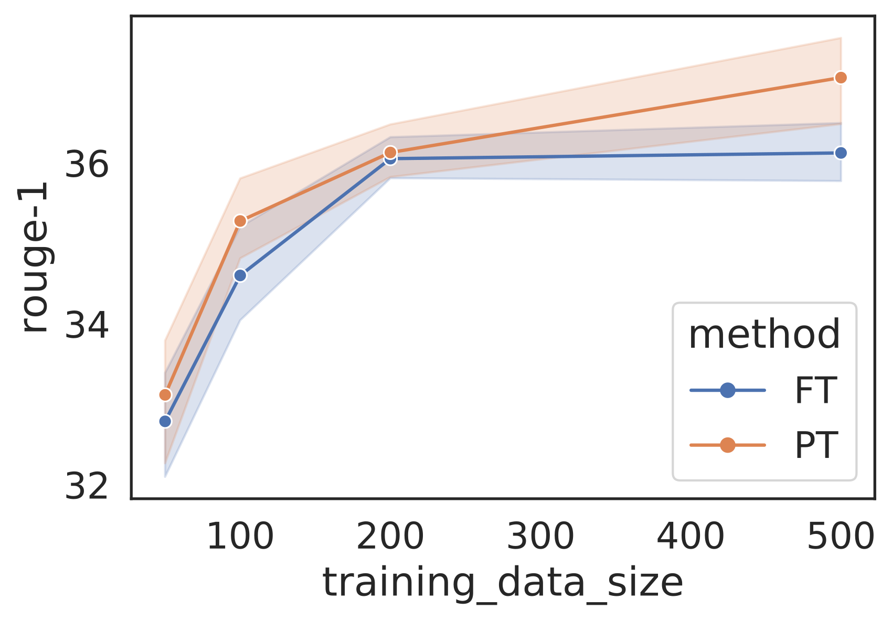

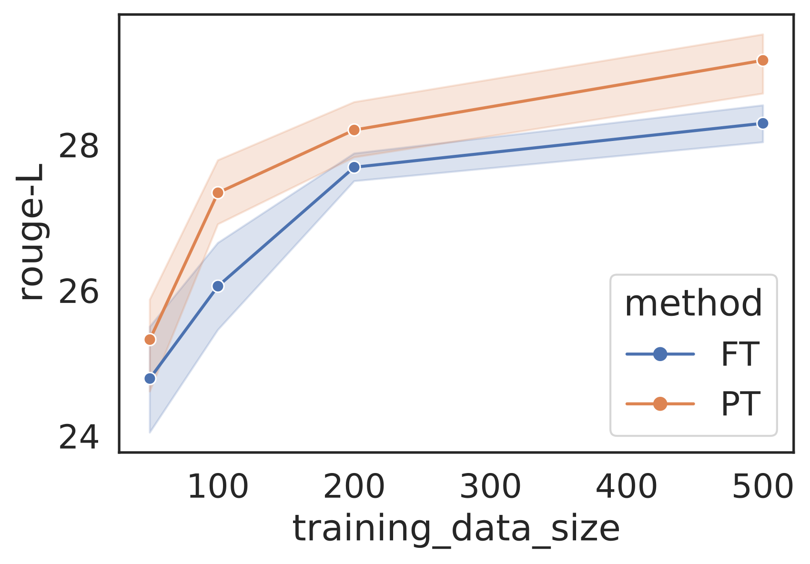

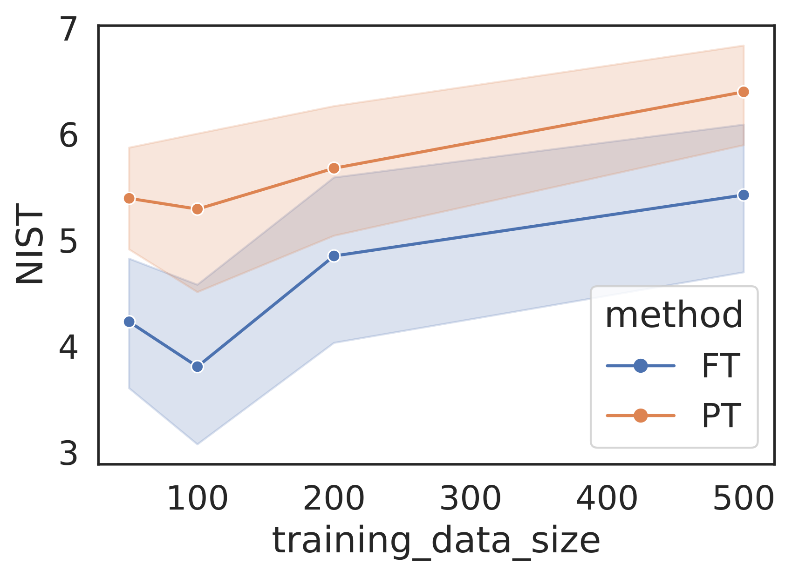

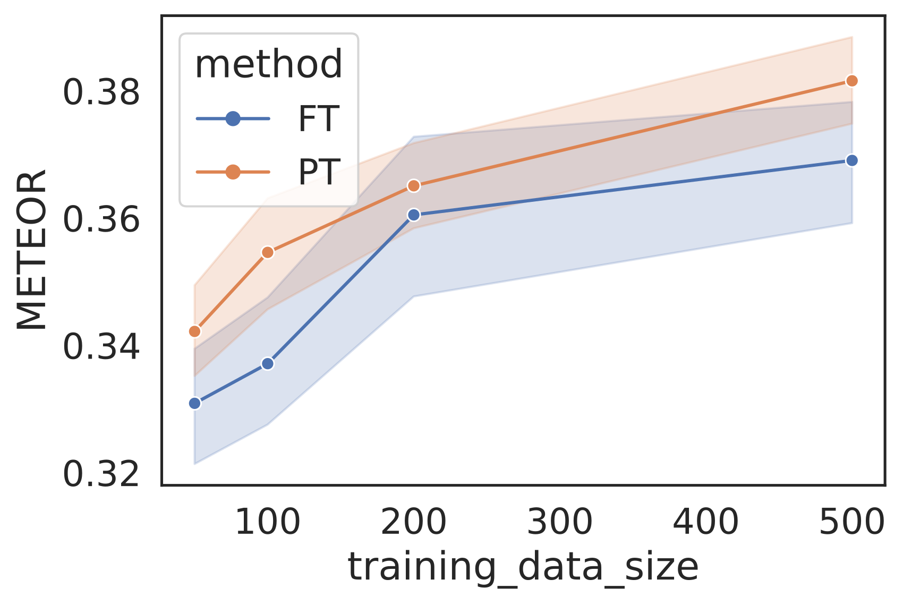

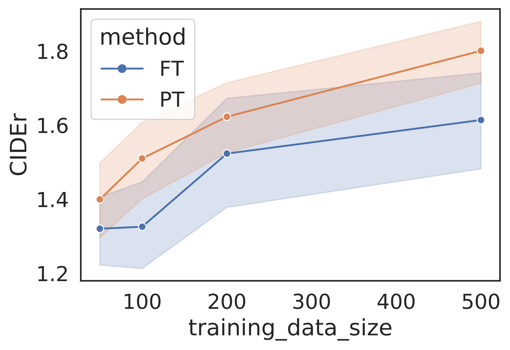

Figure 6: Prefix-tuning (orange) outperforms fine-tuning (blue) in low-data regimes in addition to requiring many fewer parameters. The top three plots correspond to summarization, measured by ROUGE-1, ROUGE-2, and ROUGE-L. The bottom three plots correspond to table-to-text, measured by NIST, METEOR, and CIDEr. The x-axis is the training size and the y-axis is the evaluation metric (higher is better).

### A.3 Additional Results for the Initialization Experiment

Figure 7 supplements Figure 3 by plotting additional metrics for our initialization technique § 7.4 . It validates that random initialization (from a uniform (0,1) distirbution) significantly underperforms initializing with real words; Additionally, initializing with task-relevant words (e.g., “summarization” and “table-to-text”) attains slightly better generation scores than initializing with task-irrelevant words (e.g., “elephant” and “banana”).

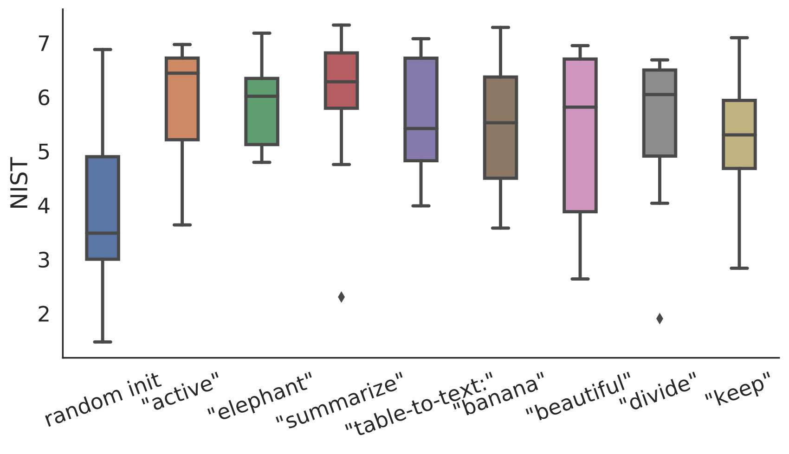

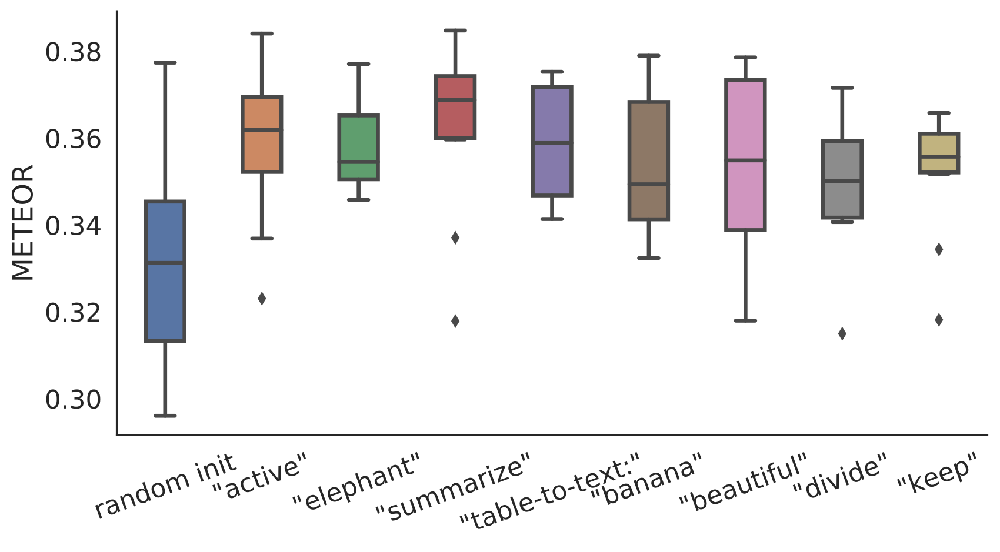

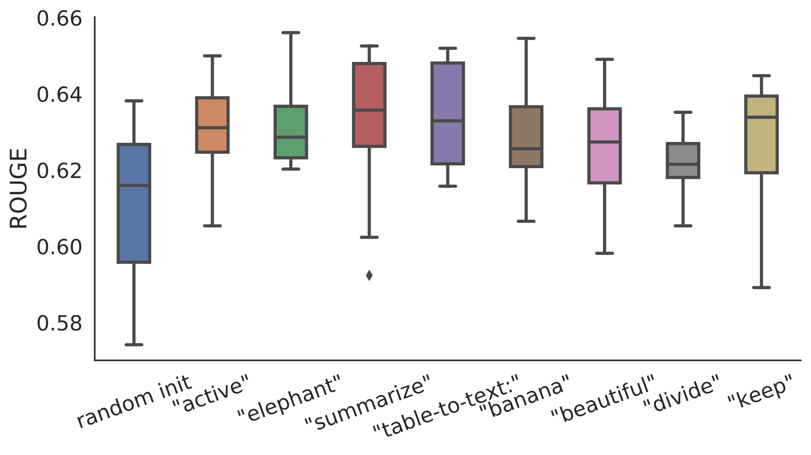

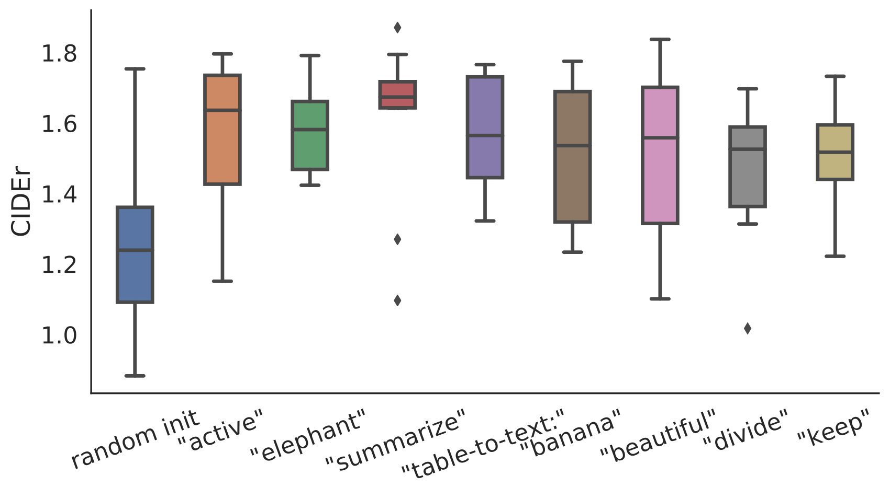

Figure 7: Initializing the prefix with activations of real words significantly outperforms random initialization, in a low-data setting with 100 training data.

### A.4 Qualitative Examples for Extrapolation

Table 6 contains qualitative examples from both seen and unseen categories in WebNLG. We find that for unseen categories, both prefix-tuning and fine-tuning tend to undergenerate (generated output do not cover full table contents) or generate untruthfully (generated output is inconsistent with table contents). In particular, prefix-tuning tends to undergenerate whereas fine-tuning tends to generate untruthfully. For seen categories, both perform fairly well in terms of coverage and truthfulness.

| Source [Unseen, Athelete] | (Al Kharaitiyat SC, club, Alaa Abdul-Zahra), (Al Khor, ground, Al Kharaitiyat SC), (Shabab Al-Ordon Club, club, Alaa Abdul-Zahra) (Amar Osim, manager, Al Kharaitiyat SC) |
| --- | --- |
| Prefix-tuning | Al Kharaitiyat SC are managed by Amar Osim and play at their ground at Al Khor. Al Kharaitiyat SC are also the club for which Alaa Abdul-Zahra is a player. |
| Fine-tuning | Alaa Abdul-Zahra plays for Al-Kharaitiyat SC and Shabab Al-Ordon Club. He also plays for Al-Khor and manages Al-Kharaitiyat SC. |
| Reference | Alaa Abdul Zahra plays for Al Kharaitiyat SC which is located at Al Khor and managed by Amar Osim. The Shabab Al-Ordon club is associated with Alaa Abdul-Zahra. |
| Source [Unseen, Transportation] | (Genoa, location, Costa Crociere), (AIDA Cruises, operator, AIDAstella), (Costa Crociere, owner, AIDAstella) |
| Prefix-tuning | AID Astella is operated by Aida Cruises and is owned by the Costa Rican tourist resort of Genoa. |
| Fine-tuning | AID Astella, operated by AIDA-Cruises, is located in Genoa and is owned by the Costa Rican government. |
| Reference | Costa Crociere is the owner of the AIDAstella and are based in Genoa. The operator of AIDAstella is AIDA Cruises. |
| Source [Unseen, Politician] | (Euro, currency, Netherlands), (Stellendam, birthPlace, Ab Klink ), (Netherlands, nationality, Ab Klink) |
| Prefix-tuning | Ab Klink was born in Stellendam and is a national of the Netherlands where the currency is the Euro. |
| Fine-tuning | Ab Klink is a national of the Netherlands where the currency is the Euro. He was born in Stellendam. |
| Reference | Ab Klink was born in Stellendam in the Netherlands, where the national currency is the euro. |
| Source [Unseen, Politician] | (Robert E, Lee, commander, Battle of Salem Church), (American Civil War, isPartOfMilitaryConflict, Battle of Salem Church), (Battle of Salem Church, battles, Aaron S. Daggett) |
| Prefix-tuning | Robert E. Lee was the commander of the Battle of Salem Church which was part of the military conflict in the American Civil war. |
| Fine-tuning | The Battle of Salem Church is part of the American Civil War and was commanded by Robert E. Lee. |
| Reference | Robert E Lee was a commander in the Battle of Salem Church, which was one of the military conflicts in the American Civil War. Aaron S Daggett fought in the same battle. |
| Source [Unseen, Artist] | (Christian alternative rock, musicSubgenre, Alternative rock), (Alternative rock, genre, Andrew White (musician)) |
| Prefix-tuning | Andrew White is a Christian alternative rock musician. |
| Fine-tuning | Andrew White, a Christian alternative rocker, performs. |
| Reference | The musician Andrew White’s genre is alternative rock, the genre which has the sub genre Christian alternative rock. |
| Source [Unseen, Artist] | (Hip hop music, genre, Allen Forrest), (solo singer, background, Allen Forrest) |
| Prefix-tuning | Allen Forrest is a solo singer. |
| Fine-tuning | Born in |
| Reference | Allen Forrest is a solo singer whose genre is Hip Hop music. |
| Source [Seen, ComicsCharacter] | (Americans, nationality, Ducan Rouleau), (Ducan Rouleau, creator, Baymax),(Alan Tudyk, starring, Big Hero 6 (film)), (Steven T Segle, creator, Baymax), (Big Hero 6 (film), serires, Baymax) |
| Prefix-tuning | Baymax is a character in Big Hero 6 which stars Alan Tudyk. He was created by Steven T. Seagle and the American, Duncan Rouleau. |
| Fine-tuning | Alan Tudyk stars in the film Big Hero 6 in which Baymax is a character created by Steven T. Seagle and the American, Duncan Rouleau. |
| Reference | Baymax is a character who appeared in Big Hero 6 starring Alan Tudyk. It was created by Steven T Seagle and the American, Duncan Rouleau. |
| Source [Seen, City] | (Washington, D.C., capital, United States), (White Americans, ethnicGroup, United States), (United States, country, New Jersey), (New York City, largest City, United States), (New Jersy, isPartOf, Atlantic City) |
| Prefix-tuning | Washington D.C. is the capital of the United States where the largest city is New York City and the White Americans are an ethnic group. Atlantic City, New Jersey is also part of the United States. |
| Fine-tuning | Atlantic City, New Jersey is part of New Jersey in the United States. The capital city is Washington D.C. and one of the ethnic groups is White Americans. |
| Reference | New York City (NYC) is the largest U.S. city. Atlantic City, New Jersey are also part of the United States with its capital as Washington, DC and home to White Americans. |

Table 6: Qualitative examples from WebNLG. The first 6 examples are from the unseen categories, labeled next to source; the last two examples are from the seen categories. For unseen categories, both prefix-tuning and fine-tuning tend to undergenerate (generated output do not cover full table contents) or generate untruthfully (generated output is inconsistent with table contents). In particular, prefix-tuning tends to undergenerate more often than generate untruthfully whereas fine-tuning tends to generate untruthfully. For seen categories, both perform fairly well in terms of coverage and truthfulness.

## Footnotes

[^footnote1]: $h_{i}^{(n)}$ is composed of a key-value pair. In GPT-2, the dimension of each key and value is $1024$ .

[^footnote2]: In our preliminary experiments, GPT-2 and BART fail in this setting; the only exception is GPT-3.

[^footnote3]: We find in preliminary experiments that directly optimizing the prefix is very sensitive to the learning rate and initialization.

[^footnote4]: $P_{\theta}$ has a dimension of $|\textsf{P${}_{\text{idx}}$}|\times\dim(h_{i})$ while $P_{\theta}$ has a dimension of $|\textsf{P${}_{\text{idx}}$}|\times k$ , where we choose $k=512$ for table-to-text and $800$ for summarization. $\textsc{MLP}_{\theta}$ maps from dimension $k$ to $\dim(h_{i})$

[^footnote5]: Same implementation as Lin et al. (2020) .

[^footnote6]: The official benchmark model is trained on v.1.0.0 while the release dataset is v1.1.1.

[^footnote7]: In comparison with natural language utterances, the linearized table is in an unnatural format, which might be challenging for pretrained LMs.

[^footnote8]: We didn’t include GPT-2 results for summarization because in our preliminary experiment, fine-tuning GPT-2 significantly underperforms fine-tuning BART on XSUM.

[^footnote9]: 250K for E2E, 250K for WebNLG, and 500K for DART vs. 345M GPT-2 parameters.

[^footnote10]: The S,U,A columns in WebNLG represents SEEN, UNSEEN, and ALL respectively; S EEN categories appear at training time; U NSEEN categories only appears at test time; and A LL is the combination of the two.

[^footnote11]: We also sample a dev split (with dev size = 30% $\times$ training size ) for each training set. We use the dev split to choose hyperparameters and do early stopping.

[^footnote12]: The number in the parenthesis refers to the training size.

[^footnote13]: XSUM dataset is drawn from BBC news, and we identify the topic of each article based on their URLs. Since “news” and “sports” are the two domains with the most articles, we create our first train/test split. Additionally, “news” has subdomains such as “UK”, “world”, and “technology”. Consequently, we create a second data split, using the top 3 news subdomains as training data and the rest as test data.

[^footnote14]: Prefixes longer than the threshold lead to lower training loss, but slightly worse test performance, suggesting that they tend to overfit the training data.
