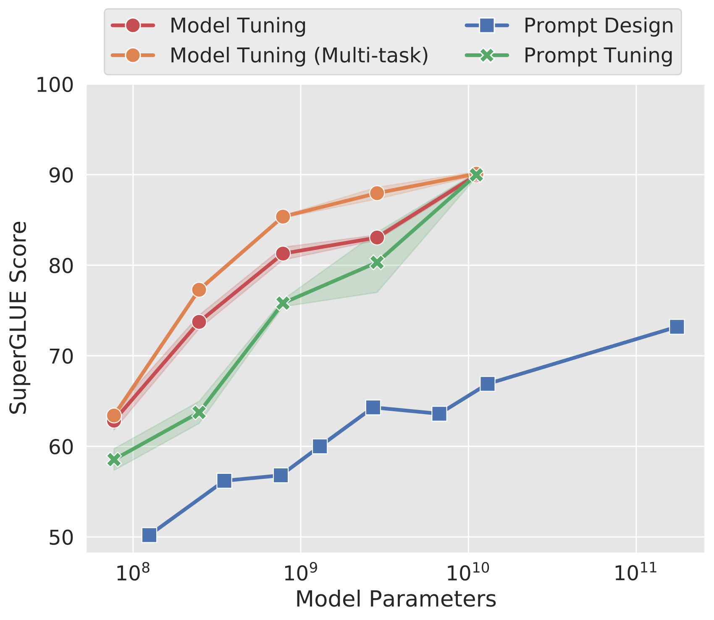
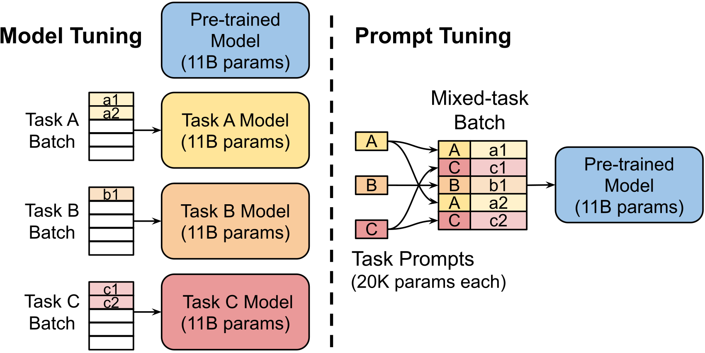
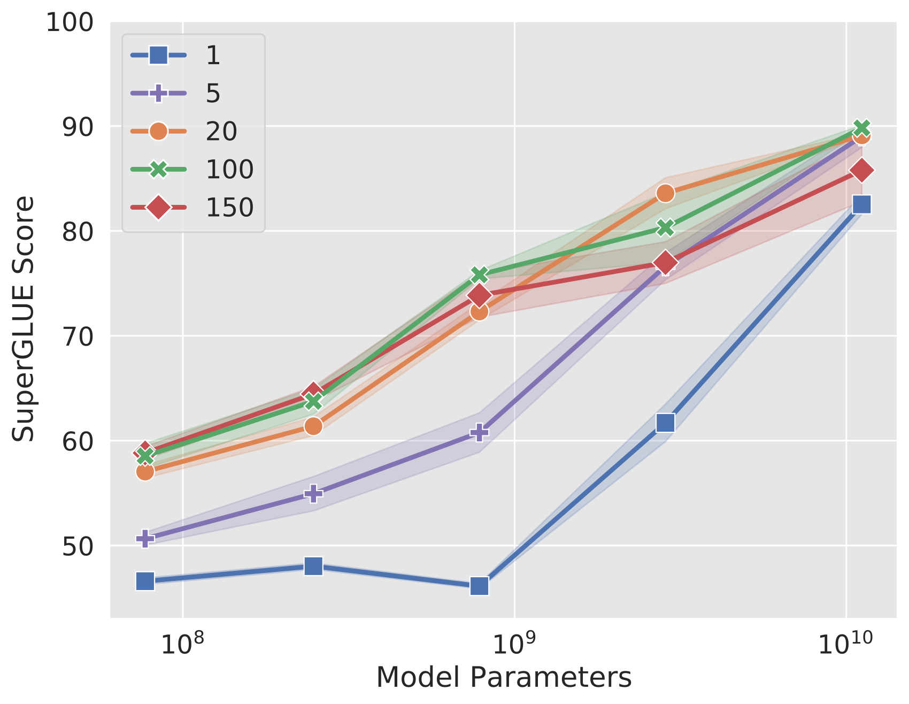
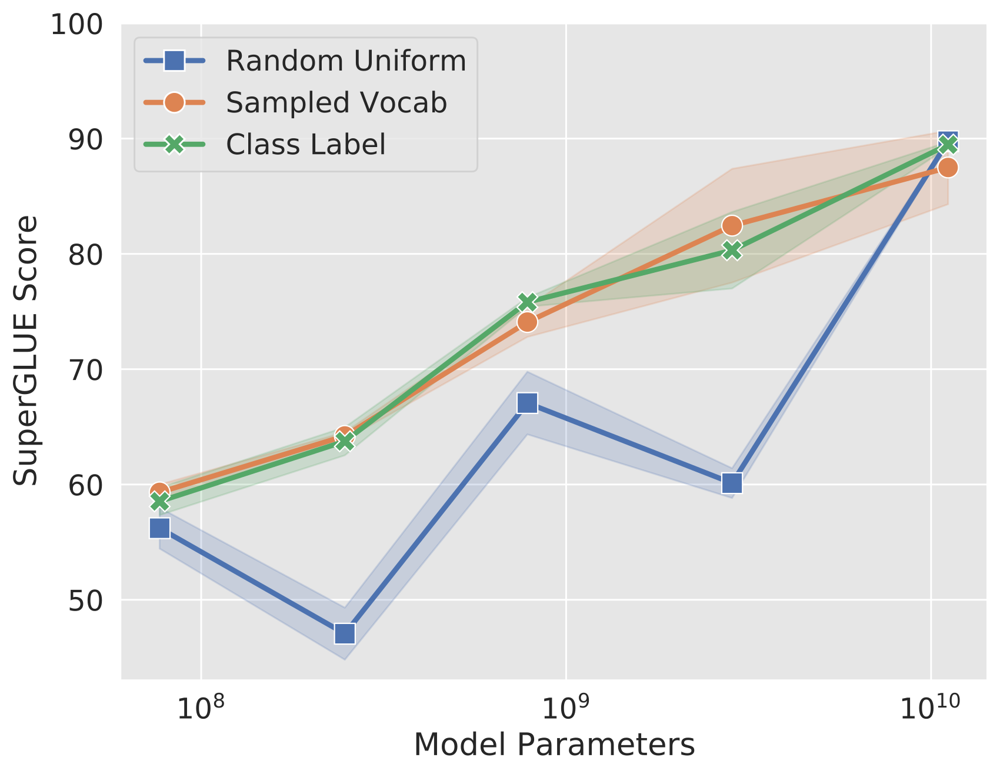
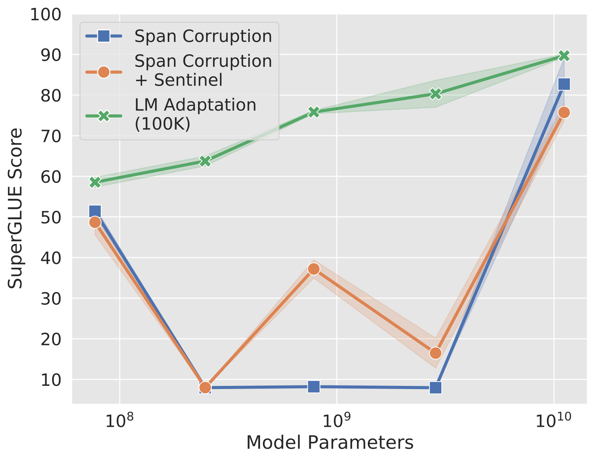
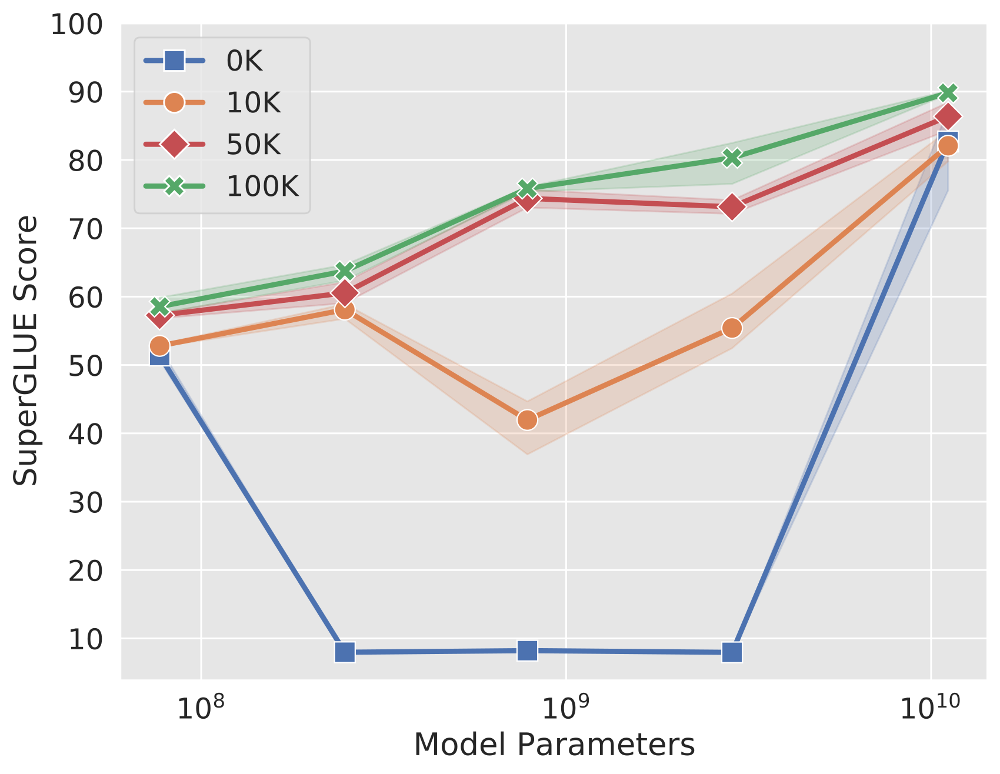
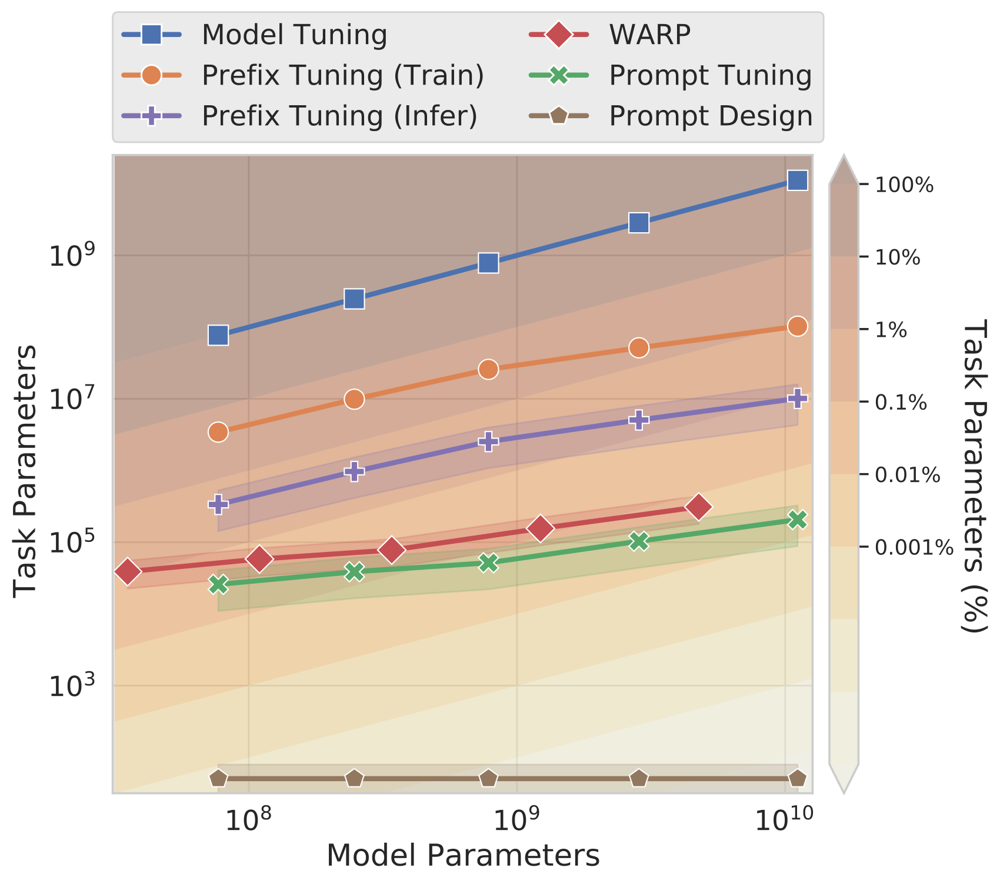

# 规模的力量：参数高效的提示微调

> 原文：[arXiv:2104.08691v2](https://arxiv.org/html/2104.08691v2)，作者及机构信息见下。
> 中文全译稿：以机器初译为底稿，统一技术术语，并校订摘要和关键方法段落；覆盖主文、附录、表格、图注和脚注。参考文献保留原始书目，原图内部文字保留英文。英文转写见 [en.md](en.md)，方法分析另见 [Prompt-Tuning详解.md](Prompt-Tuning详解.md)。

## 作者与机构

## Authors and affiliations

Brian Lester * Rami Al-Rfou Noah Constant Affiliation: Google Research Email: {brianlester,rmyeid,nconstant}@google.com

## 摘要

本文研究“提示微调”：一种简单而有效的机制，通过学习“软提示”，使冻结的语言模型完成特定下游任务。与 GPT-3 使用的离散文本提示不同，软提示通过反向传播学习，并能从任意数量的标注样本中吸收训练信号。我们的端到端学习方法大幅超过 GPT-3 的少样本学习。更显著的是，通过 T5 模型规模消融，我们发现提示微调随规模扩大而更具竞争力：模型达到数十亿参数以上时，方法能够“缩小差距”，达到模型微调（更新全部模型权重）的强表现。大型模型的共享和服务成本高，而多个下游任务复用同一冻结模型可减轻负担，因此这一发现尤其重要。本文方法可视为 Li 和 Liang（2021）近期提出的 Prefix-Tuning 的简化，我们将其与这类方法进行比较。最后，我们说明，用软提示条件化冻结模型能够改善领域迁移的鲁棒性，并支持高效的“提示集成”。

## 简介

随着预训练大型语言模型的广泛成功，出现了一系列技术来使这些通用模型适配下游任务。埃尔莫·彼得斯等人。 （2018）建议冻结预训练模型并学习其每层表示的特定于任务的权重。然而，自从 GPT Radford 等人。 (2018) 和 BERT Devlin 等人。 (2019) 中，主要的适应技术是模型调整（或“微调”），如 Howard 和 Ruder (2018) 所提出的，所有模型参数在适应过程中都会进行调整。

图 1：T5 的标准模型调优实现了强大的性能，但需要为每个最终任务存储单独的模型副本。随着规模的增加，我们对 T5 的及时调整与模型调整的质量相匹配，同时能够为所有任务重用单个冻结模型。我们的方法明显优于使用 GPT-3 的小样本提示设计。我们展示了 $3$ 运行中调整方法的平均值和标准差。

最近，布朗等人。 (2020) 表明，提示设计（或“启动”）在通过文本提示微调冻结的 GPT-3 模型的行为方面出奇地有效。提示通常由任务描述和/或几个规范示例组成。这种“冻结”预训练模型的回归很有吸引力，特别是随着模型尺寸的不断增加。单个通才模型不需要为每个下游任务提供单独的模型副本，而是可以同时服务于许多不同的任务。

图 2：模型调整需要为每个下游任务制作整个预训练模型的特定于任务的副本，并且推理必须分批执行。提示调整只需要为每个任务存储一个小的特定于任务的提示，并使用原始的预训练模型启用混合任务推理。对于 T5“XXL”模型，调整模型的每个副本都需要 $11$ 十亿个参数。相比之下，假设提示长度为 $5$ 令牌，我们调整的提示将只需要每个任务 $20{,}480$ 参数，减少超过五个数量级。

不幸的是，基于提示的适应有几个主要缺点。任务描述容易出错并且需要人工参与，提示的有效性受到模型输入中可以容纳多少条件文本的限制。因此，下游任务质量仍然远远落后于调整后的模型。例如，GPT-3 175B 在 SuperGLUE 上的少样本性能为 $17.5$ 点，低于微调的 T5-XXL Raffel 等人。 （2020）（ $71.8$ 与 $89.3$ ）尽管使用了 $16$ 多倍的参数。

最近已经提出了一些自动化提示设计的努力。申等人。 （2020）提出了一种在离散单词空间上的搜索算法，以下游应用训练数据为指导。虽然这种技术优于手动提示设计，但相对于模型调整仍然存在差距。

Li和Liang（2021）提出了“前缀调整”，并在生成任务上显示出强大的结果。此方法会冻结模型参数，并在调整到编码器堆栈中每一层（包括输入层）前面的前缀激活期间反向传播误差。哈姆巴祖米扬等人。 （2021）通过将可训练参数限制为掩码语言模型的输入和输出子网络来简化这个配方，并在分类任务上显示合理的结果。

在本文中，我们提出即时调优作为适应语言模型的进一步简化。我们冻结整个预训练模型，只允许将每个下游任务的额外 $k$ 可调标记添加到输入文本中。这种“软提示”经过端到端训练，可以压缩来自完整标记数据集的信号，使我们的方法能够超越少数样本提示，并通过模型调整缩小质量差距（图 1）。同时，由于单个预训练模型会被循环用于所有下游任务，因此我们保留了冻结模型的高效服务优势（图 2）。

虽然我们与 Li 和 Liang (2021) 以及 Hambardzumyan 等人同时开发了我们的方法。 (2021)，我们第一个证明仅提示调整（没有中间层前缀或特定于任务的输出层）就足以与模型调整竞争。通过第 2-3 节中的详细实验，我们证明语言模型能力是这些方法成功的关键因素。如图 1 所示，随着规模的扩大，即时调整变得更具竞争力。

我们在第 4 节中与类似方法进行比较。将特定于任务的参数与一般语言理解所需的“通才”参数明确分开具有一系列额外的好处。我们在第 5 节中表明，通过在提示中捕获任务定义，同时保持通才参数固定，我们能够实现更好的领域转换弹性。在第 6 节中，我们展示了“提示集成”，即为同一任务学习多个提示，可以提高质量，并且比经典模型集成更有效。最后，在第 7 节中，我们研究了所学软提示的可解释性。总之，我们的主要贡献是：

- 1. 提出即时调优，并在大语言模型领域展现其与模型调优的竞争力。

- 2. 消除许多设计选择，并显示质量和稳健性随着规模的扩大而提高。

- 3. 在域转移问题上，显示提示调整优于模型调整。

- 4. 提出“即时集成”并展示其有效性。

## 及时调整

遵循 T5 的“文本到文本”范式（Raffel 等，2020），我们将所有任务表示为文本生成。分类不再建模为给定输入 $X$ 时输出类别 $y$ 的概率 $\Pr(y|X)$——其中 $X$ 是 token 序列、$y$ 是单个类别标签——而是建模为条件生成，其中 $Y$ 是代表类别标签的 token 序列。T5 将分类表示为 $\Pr_{\theta}(Y|X)$，参数 $\theta$ 是构成其编码器和解码器的 Transformer 权重（Vaswani 等，2017）。

提示是为模型在生成 $Y$ 期间添加额外信息的方法。通常，提示是通过在输入 $X$ 前面添加一系列标记 $P$ 来完成的，以便模型最大化正确 $Y$ 和 $\Pr_{\theta}(Y|[P;X])$ 的可能性，同时保持模型参数 $\theta$ 固定。在 GPT-3 中，提示标记 $P=\{p_{1},p_{2},\dots,p_{n}\}$ 的表示是模型嵌入表的一部分，由冻结的 $\theta$ 参数化。因此，找到最佳提示需要通过手动搜索或不可微搜索方法来选择提示标记。 (2020);申等人。 （2020）。提示音整定取消了提示音$P$由$\theta$参数化的限制；相反，提示有其自己的专用参数 $\theta_{P}$ ，可以更新。虽然提示设计涉及从冻结嵌入的固定词汇中选择提示标记，但提示调整可以被认为是使用特殊标记的固定提示，其中只能更新这些提示标记的嵌入。我们新的条件生成现在是 $\Pr_{\theta;\theta_{P}}(Y|[P;X])$ ，可以通过反向传播最大化 $Y$ 的可能性来进行训练，同时仅对 $\theta_{P}$ 应用梯度更新。

给定一系列 $n$ 令牌 $\{x_{1},x_{2},\dots,x_{n}\}$ ，T5 所做的第一件事是嵌入令牌，形成矩阵 $X_{e}\in\mathbb{R}^{n\times e}$，其中 $e$ 是嵌入空间的维度。我们的软提示表示为参数 $P_{e}\in\mathbb{R}^{p\times e}$ ，其中 $p$ 是提示的长度。然后，我们的提示符连接到嵌入输入，形成单个矩阵 $[P_{e};X_{e}]\in\mathbb{R}^{(p+n)\times e}$，然后正常流经编码器-解码器。我们的模型经过训练以最大化 $Y$ 的概率，但仅更新提示参数 $P_{e}$ 。

### 设计决策

有许多可能的方法来初始化提示表示。最简单的方法是使用随机初始化从头开始训练。一个更复杂的选项是将每个提示标记初始化为从模型词汇表中提取的嵌入。从概念上讲，我们的软提示以与输入之前的文本相同的方式调节冻结网络的行为，因此，类似单词的表示可能作为一个很好的初始化点。对于分类任务，第三种选择是使用枚举输出类的嵌入来初始化提示，类似于 Schick 和 Schütze (2021) 的“标签词映射”。由于我们希望模型在输出中生成这些标记，因此使用有效目标标记的嵌入来初始化提示应该启动模型以将其输出限制为合法的输出类。

另一个设计考虑因素是提示的长度。我们方法的参数成本是 $EP$ ，其中 $E$ 是令牌嵌入维度，$P$ 是提示长度。提示越短，必须调整的新参数就越少，因此我们的目标是找到仍然表现良好的最小长度。

### 忘却腐败

与 GPT-3 等自回归语言模型不同，我们实验的 T5 模型使用编码器-解码器架构，并针对跨度损坏目标进行预训练。具体来说，T5 的任务是“重建”输入文本中的屏蔽跨度，这些跨度用唯一的哨兵标记进行标记。目标输出文本由所有屏蔽内容组成，由标记分隔，加上最终标记。例如，从文本“谢谢你上周邀请我参加你的聚会”中，我们可以构建一个预训练示例，其中输入是“谢谢你 $\langle$ X $\rangle$ 我参加你的聚会 $\langle$ Y $\rangle$ 周”，目标输出是“ $\langle$ X $\rangle$ 邀请$\langle$ Y $\rangle$ 最后 $\langle$ Z $\rangle$”。

而拉斐尔等人。 （2020）发现这种架构和预训练目标比传统语言建模更有效，我们假设这种设置不太适合生成可以通过即时调整轻松控制的冻结模型。特别是，专门针对跨度损坏进行预训练的 T5 模型（例如 T5.1.1）从未见过真正自然的输入文本（不含哨兵标记），也从未被要求预测真正自然的目标。事实上，由于 T5 跨度损坏预处理的细节，每个预训练目标都将从哨兵开始。虽然这种输出哨兵的“不自然”倾向很容易通过微调来克服，但我们怀疑仅通过提示来覆盖会更困难，因为解码器先验无法调整。

考虑到这些问题，我们在三种设置中对 T5 模型进行了实验。 (1)“Span Corruption”：我们使用预训练的现成 T5 作为我们的冻结模型，并测试其为下游任务输出预期文本的能力。 （2）“Span Corruption + Sentinel”：我们使用相同的模型，但在所有下游目标前面添加一个哨兵，以便更接近预训练中看到的目标。 (3)“LM适应”：我们继续T5的自我监督训练少量的额外步骤，但使用Raffel等人讨论的“LM”目标。 (2020);给定自然文本前缀作为输入，模型必须生成自然文本延续作为输出。至关重要的是，这种适应仅发生一次，产生一个单一的冻结模型，我们可以重复使用该模型来跨任意数量的下游任务进行快速调整。

通过 LM 适配，我们希望“快速”将 T5 转变为更类似于 GPT-3 的模型，GPT-3 始终输出真实的文本，并且作为“few-shot learner”能够很好地响应提示。与从头开始的预训练相比，这种后期转换有多成功尚不清楚，而且据我们所知，之前也没有对此进行过调查。因此，我们尝试了各种长度的适应，最多 100K 步。

图 3：各种超参数对即时调优性能的消融（$3$ 运行中的平均值和标准差）。在我们的“默认”( ) 配置中，质量随着模型尺寸的变化而稳定提高。在所有消融中，最大 (XXL) 模型对于超参数选择是最稳健的。 3(a) 提示长度：增加到 $20$ + 令牌通常会带来很大的提升，但 XXL 即使使用单令牌提示也能表现良好。 3(b) 提示初始化：随机统一初始化落后于使用采样词汇或类标签嵌入的更“高级”初始化，但差异在 XXL 大小时消失。 3(c) 预训练目标：即使将哨兵添加到下游任务目标中，LM 适应也优于跨度损坏，但 XXL 适用于任何方法。 3(d) LM适应：较长的适应通常会带来较大的增益，但XXL即使对于较短的适应也具有鲁棒性。

## 结果

我们的冻结模型建立在各种尺寸（小、基础、大、XL、XXL）的预训练 T5 检查点之上。我们利用公共 T5.1.1 检查点，其中包括对原始 T5 的改进。 [^footnote1]

我们的“默认”配置始终用绿色‘$\times$’（）绘制，使用经过额外 100K 步骤训练的 T5 的 LM 适配版本，使用类标签进行初始化（参见第 3.2 节），并使用 $100$ 令牌的提示长度。虽然这比 Li 和 Liang (2021) 使用的默认 10 个令牌前缀长，但我们的方法仍然使用较少的特定于任务的参数，因为我们只调整输入层，而不是覆盖所有网络层中的激活。详细比较请参见图 4。很快我们还将看到，随着模型大小的增加，甚至更短的提示也是可行的。

我们在 SuperGLUE 基准测试上测量性能 Wang 等人。 (2019a)，八个具有挑战性的英语语言理解任务的集合。 [^footnote2] 我们报告与每个数据集相关的开发集的指标。

我们的每个提示都针对单个 SuperGLUE 任务进行训练；没有多任务设置或跨任务混合训练数据。我们按照 Raffel 等人的方法将每个 SuperGLUE 数据集转换为文本到文本格式。 (2020) ，除了我们省略了输入前面的任务名称，指示示例属于哪个 SuperGLUE 任务。

我们使用 T5 的标准交叉熵损失来训练 $30{,}000$ 步骤的提示，学习率为 $0.3$ 的恒定学习率和 $32$ 的批量大小。检查点是通过在开发集上提前停止来选择的，其中停止指标是数据集的默认指标，或者是使用多个指标评估的数据集的指标平均值。所有实验均在 JAX Bradbury 等人中进行。 (2018) 使用 Adafactor 优化器 Shazeer 和 Stern (2018) 进行权重衰减 $1e{-5}$ 、 $\beta_{2}$ 衰减 $0.8$ 和参数缩放。这些模型在 Flax Heek 等人中实现。 （2020）。更多详细信息请参阅附录 A。

### 缩小差距

为了将我们的方法与标准模型调整进行比较，我们使用 T5 库中指定的默认超参数（学习率 $0.001$ 和恢复预训练参数状态的 Adafactor 优化器）调整 SuperGLUE 上的公共 T5.1.1 检查点。我们考虑两个基线。 (1)“模型调整”：为了进行同类比较，我们分别调整每个任务，就像我们的提示调整设置一样。 [^footnote3] (2)“模型调优（多任务）”：我们使用 T5 的多任务调优设置来实现更具竞争力的基线。 [^footnote4] 在这种情况下，单个模型在所有任务上联合调整，并带有指示任务名称的文本前缀。

在图 1 (p.1) 中，我们看到随着规模的增加，即时调优与模型调优相比变得更具竞争力。在 XXL 大小（110 亿个参数）下，即时调优甚至可以匹配更强的多任务模型调优基线，尽管任务特定参数的数量要少 $20{,}000$ 倍以上。

为了与即时设计进行比较，我们在 SuperGLUE 开发分组中纳入了 GPT-3 的小样本性能，正如 Brown 等人所报告的那样。 （2020）。 [^footnote5] 图 1 显示，提示微调大幅优于 GPT-3 提示设计，提示微调 T5-Small 匹配 GPT-3 XL（比 $16$ 大 1 倍），提示微调 T5-Large 优于 GPT-3 175B（比 $220$ 大 1 倍）。

### 消融研究

#### 提示长度

我们训练每个模型大小的提示，同时改变 $\{1,5,20,100,150\}$ 中的提示长度并将其他设置固定为我们的默认配置。图 3(a) 显示，对于大多数模型大小，将提示长度增加到超过单个标记对于实现良好的性能至关重要。值得注意的是，XXL 模型在单标记提示下仍然给出了很好的结果，这表明模型越大，实现目标行为所需的条件信号就越少。在所有模型中，增加超过 $20$ token只会产生边际收益。 [^footnote6]

#### 提示初始化

我们通过训练各种尺寸的模型来消除提示初始化的影响，同时将其他超参数固定为其默认值。对于随机初始化，我们从 [ $-0.5$ ， $0.5$ ] 范围内均匀采样。从采样词汇进行初始化时，我们将 T5 的 SentencePiece 词汇 Kudo 和 Richardson (2018) 中最“常见”的标记限制为 $5{,}000$，这些标记在预训练语料库中按可能性排序。对于“类标签”初始化，我们在下游任务中获取每个类的字符串表示形式的嵌入，并使用它们来初始化提示中的标记之一。当类标签是多标记时，我们对标记嵌入进行平均。在较长的提示长度下，我们经常在初始化所有提示标记之前就用完类标签。在这种情况下，我们会退回到采样词汇策略来填写提示。 [^footnote7]

图 3(b) 显示了我们对不同模型大小的初始化策略的消融，我们发现基于类的初始化表现最好。在较小的模型尺寸下，不同的初始化之间存在很大的差距，但一旦模型缩放到 XXL 尺寸，这些差异就会消失。

通过“类标签”初始化，我们观察到类标签通常保留在学习的提示中，使得最近的标记嵌入（余弦距离）与用于初始化的标记相匹配。除此之外，我们没有发现我们学到的提示是可解释的，类似于 Shin 等人的提示。 （2020）。详细信息请参见第 7 节。

#### 预训练目标

在图 3(c) 和 3(d) 中，我们看到预训练目标对即时调优质量有明显的影响。正如第 2.2 节中假设的那样，T5 的默认“跨度损坏”目标不太适合训练冻结模型，以便稍后通过提示进行调节。直观上，预训练用于读写哨兵标记的模型很难直接应用于没有哨兵的读写文本任务。如图 3(c) 所示，即使是向下游目标添加哨兵的“解决方法”也没有什么好处。虽然 LM 适应增加了所有模型尺寸的价值，但我们注意到我们最大的 XXL 模型是最宽容的，即使在跨度损坏的情况下也能给出很好的结果。

鉴于 LM 适应的好处，我们还探讨了适应多长时间是有帮助的。图 3(d) 显示较长的自适应可提供额外的增益，最高可达 $100$ K 步。这表明从跨度损坏到语言建模目标的“过渡”并不是一个微不足道的改变，并且进行有效的转换需要训练资源的投资（$10$ 原始 T5 预训练步骤的％）。同时，与我们的其他消融一样，我们观察到 XXL 模型即使对于非理想配置也具有鲁棒性。在这种规模下，适应带来的收益相当有限。

在非最佳“跨度损坏”设置中，我们观察到模型大小之间的不稳定性，小模型优于较大的 Base、Large 和 XL 模型。经过检查，我们发现对于许多任务，这些中型模型从未学会输出合法的类别标签，因此得分为 0%。两种最常见的错误模式是从输入复制子跨度和预测空字符串。此外，这种较差的性能并不是由于提示调整中的随机方差造成的，因为我们观察到每个大小的 $3$ 运行的方差较低。这些结果表明，使用通过“跨度损坏”目标进行预训练的模型可能不可靠，$5$ 模型中只有 $2$ 运行良好，而 LM 适应版本在所有模型大小上都能可靠运行。

我们发布了 T5 1.1 检查点，该检查点使用 LM 目标针对所有模型尺寸的 $100$ K 步进行了调整。 [^footnote8]

## 与类似方法的比较

图 4：各种适应技术的参数使用，将架构固定为 T5.1.1，将提示/前缀长度固定为 $1$ – $100$ 令牌（带显示平均值和标准偏差）。模型调整：所有参数都是特定于任务的。前缀调整：激活在每层的前缀中进行调整，需要 $0.1$ – $1$ % 任务特定参数进行推理，但更多用于训练。 WARP ：通过仅调整输入和输出层，任务参数减少到 $0.1$ % 以下。提示调整：仅调整提示嵌入，对于大多数模型尺寸达到 $0.01$ % 以下。提示设计：仅需要一系列提示 ID（$500$ – $2000$ 令牌）。

在本节中，我们回顾最近关于学习连续提示的工作，并与我们的方法进行比较。比较的一个重要轴是每种方法所需的特定于任务的参数数量，如图 4 所示。在具有可学习参数的方法中，即时调整是参数效率最高的，对于超过十亿个参数的模型，需要少于 $0.01$ % 的任务特定参数。 [^footnote9]

Li和Liang（2021）提出了“前缀调整”：学习每个Transformer层前面的前缀序列。这类似于学习Transformer激活，这些激活在每个网络层的示例中都是固定的。相反，提示调整使用附加到嵌入输入之前的单个提示表示。除了需要更少的参数之外，我们的方法还允许转换器更新中间层任务表示，如输入示例的上下文所示。他们的工作建立在 GPT-2 Radford 等人的基础上。 (2019) 和 BART Lewis 等人。 (2020)，而我们的重点是 T5，并检查随着模型尺寸的增加，性能和设计选择的稳健性的变化。使用 BART 时，前缀调整包括编码器和解码器网络上的前缀，而提示调整仅需要编码器上的提示。 Li 和 Liang (2021) 还依靠前缀的重参数化来稳定学习，这会在训练期间添加大量参数，而我们的配置不需要这种重参数化，并且在 SuperGLUE 任务和模型大小中具有鲁棒性。

哈姆巴祖米扬等人。 （2021）提出“WARP”，其中提示参数被添加到输入层。此方法适用于掩码语言模型，依靠 [MASK] 标记和可学习的输出层将掩码投影到类 logits。该公式将模型限制为产生单个输出，从而将其限制为分类。即时调整不需要对输入或特定于任务的头进行任何更改。提示微调的性能也相当接近模型调优的强大性能。

刘等人。 （2021）提出“P-tuning”，其中可学习的连续提示在整个嵌入式输入中交织，使用基于人类设计的模式。我们的方法通过简单地将提示添加到输入中来消除这种复杂性。为了获得强大的 SuperGLUE 结果，P 调优必须与模型调优结合使用，即模型联合更新提示参数和主要模型参数，而我们的方法保持原始语言模型冻结。 [^footnote10]

Qing 和 Eisner (2021) 使用“软词”来学习提示，以从预训练的 LM 中提取知识。提示的位置与基于手工设计的提示原型的输入相关，并且每层都包含学习的 $\Delta_{i}^{\ell}$ 参数，因此参数成本随模型深度而变化。

洛格斯瓦兰等人。 （2020）使用可学习的前置标记来使 Transformer 模型适配各种任务，但重点关注旨在适应组合任务表示的小型合成数据集，而不是更大的现实世界数据集。他们的基本模型是与任务表示联合从头开始训练的小型Transformer，而我们保持基本模型冻结并使用更大的Transformer研究缩放法则。

更一般地说，任务提示的工作与“适配器”Rebuffi 等人的工作密切相关。 (2017);霍尔斯比等人。 (2019)，在冻结的预训练网络层之间插入小瓶颈层。适配器提供了另一种减少任务特定参数的方法，Houlsby 等人。 (2019) 在冻结 BERT-Large 并且仅添加 $2$ – $4$ % 附加参数时，实现接近完整模型调整的 GLUE 性能。菲佛等人。 （2020）在多语言环境中使用多个适配器来明确地将语言理解与任务规范分开，类似于我们的方法。适配器和提示调整之间的核心区别在于这些方法如何改变模型行为。适配器通过允许在任何给定层重写激活来修改作用于由神经网络参数化的输入表示的实际函数。提示调整通过保持函数固定并添加可能影响后续输入处理方式的新输入表示来修改行为。

## 适应领域转移的能力

| 数据集 | 域名 | 型号 | 提示 | $\Delta$ |
| --- | --- | --- | --- | --- |
| 小队 | 维基百科 | 94.9 $\pm$ 0.2 | 94.8 $\pm$ 0.1 | $-$ 0.1 |
| 教科书质量保证 | 预订 | 54.3 $\pm$ 3.7 | 66.8 $\pm$ 2.9 | +12.5 |
| 生物ASQ | 简介 | 77.9 $\pm$ 0.4 | 79.1 $\pm$ 0.3 | +1.2 |
| 种族 | 考试 | 59.8 $\pm$ 0.6 | 60.7 $\pm$ 0.5 | +0.9 |
| 稀土 | 维基百科 | 88.4 $\pm$ 0.1 | 88.8 $\pm$ 0.2 | +0.4 |
| 杜奥RC | 电影 | 68.9 $\pm$ 0.7 | 67.7 $\pm$ 1.1 | $-$ 1.2 |
| 丢弃 | 维基百科 | 68.9 $\pm$ 1.7 | 67.1 $\pm$ 1.9 | $-$ 1.8 |

表 1：在 SQuAD 上训练并在 MRQA 2019 共享任务的域外数据集上进行评估的模型的 F1 平均值和标准差。快速调整往往比模型调整提供更强的零样本性能，特别是在像 TextbookQA 这样具有较大域变化的数据集上。

通过冻结核心语言模型参数，及时调整可以防止模型修改其对语言的一般理解。相反，提示表示间接地调制输入的表示。这降低了模型通过记住特定词汇线索和虚假相关性而过度拟合数据集的能力。这一限制表明，及时调整可以提高对域转换的鲁棒性，其中训练和评估之间的输入分布不同。

我们研究了两项任务的零样本域迁移：问答（QA）和释义检测。对于问题回答，我们使用 MRQA 2019 泛化共享任务 Fisch 等人。 （2019）。此任务以统一格式收集提取的 QA 数据集，并测试在“域内”数据集上训练的模型在“域外”数据集上进行评估时的表现。在我们的实验中，我们在 SQuAD Rajpurkar 等人上进行训练。 （2016）并对每个域外数据集进行评估。 [^footnote11]

表 1 显示，在大多数域外数据集上，即时调优优于模型调优，在 TextbookQA 上两种方法之间存在显着的 $12.5$ F1 点差距。我们观察到，在较大领域转移的情况下，及时调整会带来更大的收益（例如，BioASQ 中的生物医学或 TextbookQA 中的教科书）。在模型调整更好的数据集中，我们看到 DROP 与 SQuAD 共享一个域（维基百科），因此是最小的域传输之一。

作为域转移稳健性的第二个测试，我们探索了 GLUE Wang 等人的两个释义检测任务之间的转移。 （2019b）。第一个任务是 QQP Iyer 等人。 (2017)，其中询问社区问答网站 Quora 中的两个问题是否“重复”。第二个任务是 MRPC Dolan 和 Brockett (2005)，它询问从新闻文章中提取的两个句子是否是释义。我们测试双向传输（QQP $\Leftrightarrow$ MRPC）。和以前一样，我们训练“域内”任务，使用域内验证选择检查点，并评估“域外”任务的零样本。

| 火车 | 评估 | 调音 | 准确度 | F1 |
| --- | --- | --- | --- | --- |
| QQP | 物料循环过程控制 | 型号 | 73.1 $\pm$ 0.9 | 81.2 $\pm$ 2.1 |
|  |  | 提示 | 76.3 $\pm$ 0.1 | 84.3 $\pm$ 0.3 |
| 物料循环过程控制 | QQP | 型号 | 74.9 $\pm$ 1.3 | 70.9 $\pm$ 1.2 |
|  |  | 提示 | 75.4 $\pm$ 0.8 | 69.7 $\pm$ 0.3 |

表 2：两个释义检测任务之间零样本域转移的平均值和标准偏差。

表 2 显示，在 QQP 数据上训练轻量级提示并在 MRPC 上进行评估可提供比调整整个模型更好的性能（+ $3.2$ 准确度和 + $3.1$ F1）。另一个方向的结果更加接近，及时调整显示精度略有提高，F1 略有下降。这些结果支持这样的观点：模型调整可能过度参数化，并且更容易过度拟合训练任务，从而损害不同领域中的类似任务。

## 即时合奏

通过对相同数据进行不同初始化训练的神经模型集合被广泛观察到可以提高任务性能 Hansen 和 Salamon (1990)，并且对于估计模型不确定性非常有用 Lakshminarayanan 等人。 （2017）。然而，随着模型尺寸的增加，集成可能变得不切实际。除了存储 $N$ 模型所需的空间（例如，每个 T5-XXL 副本需要 $42$ GiB）之外，运行 $N$ 不同模型（无论是并行还是串行）都会产生大量推理成本。

即时调优提供了一种更有效的方法来集成预训练语言模型的多种适应性。通过在同一任务上训练 $N$ 提示，我们为任务创建 $N$ 单独的“模型”，同时仍然共享核心语言建模参数。除了大幅降低存储成本之外，即时集成还使推理更加高效。为了处理一个示例，我们可以执行批量大小为 $N$ 的单个前向传递，跨批次复制示例并改变提示，而不是计算 $N$ 不同模型的前向传递。这些节省反映了图 2 中多任务处理所看到的节省。

| 数据集 | 公制 | 平均 | 最佳 | 合奏团 |
| --- | --- | --- | --- | --- |
| 布尔Q | 附件 | 91.1 | 91.3 | 91.7 |
| CB | 加速/F1 | 99.3 / 99.0 | 100.00 / 100.00 | 100.0 / 100.0 |
| 科帕 | 附件 | 98.8 | 100.0 | 100.0 |
| 多RC | EM/F1a | 65.7 / 88.7 | 66.3 / 89.0 | 67.1 / 89.4 |
| 记录 | 电磁/F1 | 92.7 / 93.4 | 92.9 / 93.5 | 93.2 / 93.9 |
| 即时通讯 | 附件 | 92.6 | 93.5 | 93.5 |
| 无线通信 | 附件 | 76.2 | 76.6 | 77.4 |
| 世界科学委员会 | 附件 | 95.8 | 96.2 | 96.2 |
| SuperGLUE（开发） | SuperGLUE（开发） | 90.5 | 91.0 | 91.3 |

表 3：从单个冻结 T5-XXL 模型构建的五提示合奏的性能超过了五个提示中的平均水平和最佳水平。

为了演示提示集成的可行性，我们使用具有默认超参数的单个冻结 T5-XXL 模型为每个 SuperGLUE 任务训练五个提示。我们使用简单多数投票来计算整体的预测。表 3 显示，在所有任务中，整体击败了单个提示的平均值，并且击败或匹配了最佳的单个提示。

## 可解释性

理想的可解释提示应由自然语言组成，该语言可以清楚地描述手头的任务，明确地向模型询问某些结果或操作，并且可以轻松理解为什么提示会从模型中引发此类行为。

由于提示调整在连续嵌入空间而不是离散标记空间中进行，因此解释提示变得更加困难。为了测试我们学习的软提示的可解释性，我们从冻结模型的词汇中计算每个提示标记的最近邻居。我们使用词汇嵌入向量和提示标记表示之间的余弦距离作为相似性度量。

我们观察到，对于给定的学习提示标记，前 5 个最近邻形成紧密的语义簇。例如，我们看到词汇上相似的集群，例如 { Technology / technology / Technologies / Technical / Technologies }，以及更多样化但仍然密切相关的集群，例如 { Complete / Complete / Totally / Together / 100% }。这些簇的性质表明提示实际上是在学习“类似单词”的表示。我们发现从嵌入空间抽取的随机向量不显示这种语义聚类。

当使用“类标签”策略初始化提示时，我们经常发现类标签在训练中仍然存在。具体来说，如果提示标记被初始化为给定标签，则在调整后该标签通常位于学习标记的最近邻居中。当使用“Random Uniform”或“Sampled Vocab”方法初始化时，类标签也可以在提示的最近邻居中找到；然而，它们往往显示为多个提示标记的邻居。这表明模型正在学习将提示中的预期输出类存储为参考，并且将提示初始化为输出类使这变得更容易、更集中。

当检查较长的提示（例如大小 $100$ ）时，我们经常会发现多个具有相同最近邻居的提示标记。这表明提示中存在过剩容量，或者提示表示中缺乏顺序结构使得模型难以将信息定位到特定位置。

虽然学习到的提示作为序列显示出很少的可解释性，但我们确实观察到像科学、技术和工程这样的高频词是在 BoolQ 数据集上训练的提示的最近邻居，并且大约 $20$ % 的问题属于“自然/科学”类别。虽然需要更多的调查，但这表明提示的作用之一可能是启动模型来解释特定领域或上下文（例如“科学”）中的输入。

## 结论

在本文中，我们表明，即时调优是一种使冻结的预训练语言模型适配下游任务的竞争技术。在流行的 SuperGLUE 基准测试中，其任务性能可与传统模型调优相媲美，并且随着模型尺寸的增加，差距逐渐消失。在零样本域转移中，我们发现及时调整可以提高泛化能力。这似乎表明，冻结通用语言理解参数并将下游学习限制为轻量级参数足迹可以帮助避免过度拟合特定领域。

除了任务质量指标之外，我们还讨论了在存储和服务成本方面转向冻结预训练模型的吸引力。这一举措既可以实现高效的多任务服务，也可以实现高效的高性能提示集成。展望未来，我们相信，将任务定义参数与一般语言建模参数区分开来是一个令人兴奋的步骤，为新研究开辟了许多途径。

## 致谢

我们感谢 Lucas Dixon、Waleed Ammar、Slav Petrov 和 Sebastian Ruder 对早期草案提出的意见，并感谢以下人员进行有益的讨论：Colin Raffel、Adam Roberts 和 Noam Shazeer。我们感谢林婷雪对LM适应训练的帮助。

## 参考文献

- Bar-Haim et al. (2006) Roy Bar-Haim, Ido Dagan, Bill Dolan, Lisa Ferro, Danilo Giampiccolo, Bernardo Magnini, and Idan Szpektor. 2006. The second PASCAL recognising textual entailment challenge. In Proceedings of the second PASCAL challenges workshop on recognising textual entailment , volume 6, pages 6–4. Venice.

- Bentivogli et al. (2009) Luisa Bentivogli, Peter Clark, Ido Dagan, and Danilo Giampiccolo. 2009. The fifth PASCAL recognizing textual entailment challenge. In TAC .

- Bradbury et al. (2018) James Bradbury, Roy Frostig, Peter Hawkins, Matthew James Johnson, Chris Leary, Dougal Maclaurin, George Necula, Adam Paszke, Jake VanderPlas, Skye Wanderman-Milne, and Qiao Zhang. 2018. JAX: composable transformations of Python+NumPy programs .

- Brown et al. (2020) Tom Brown, Benjamin Mann, Nick Ryder, Melanie Subbiah, Jared D Kaplan, Prafulla Dhariwal, Arvind Neelakantan, Pranav Shyam, Girish Sastry, Amanda Askell, Sandhini Agarwal, Ariel Herbert-Voss, Gretchen Krueger, Tom Henighan, Rewon Child, Aditya Ramesh, Daniel Ziegler, Jeffrey Wu, Clemens Winter, Chris Hesse, Mark Chen, Eric Sigler, Mateusz Litwin, Scott Gray, Benjamin Chess, Jack Clark, Christopher Berner, Sam McCandlish, Alec Radford, Ilya Sutskever, and Dario Amodei. 2020. Language models are few-shot learners . In Advances in Neural Information Processing Systems , volume 33, pages 1877–1901. Curran Associates, Inc.

- Clark et al. (2019) Christopher Clark, Kenton Lee, Ming-Wei Chang, Tom Kwiatkowski, Michael Collins, and Kristina Toutanova. 2019. BoolQ: Exploring the surprising difficulty of natural yes/no questions . In Proceedings of the 2019 Conference of the North American Chapter of the Association for Computational Linguistics: Human Language Technologies, Volume 1 (Long and Short Papers) , pages 2924–2936, Minneapolis, Minnesota. Association for Computational Linguistics.

- Dagan et al. (2005) Ido Dagan, Oren Glickman, and Bernardo Magnini. 2005. The PASCAL recognising textual entailment challenge. In Machine Learning Challenges Workshop , pages 177–190. Springer.

- De Marneff et al. (2019) Marie-Catherine De Marneff, Mandy Simons, and Judith Tonhauser. 2019. The CommitmentBank: Investigating projection in naturally occurring discourse. Proceedings of Sinn und Bedeutung 23 .

- Devlin et al. (2019) Jacob Devlin, Ming-Wei Chang, Kenton Lee, and Kristina Toutanova. 2019. BERT: Pre-training of deep bidirectional transformers for language understanding . In Proceedings of the 2019 Conference of the North American Chapter of the Association for Computational Linguistics: Human Language Technologies, Volume 1 (Long and Short Papers) , pages 4171–4186, Minneapolis, Minnesota. Association for Computational Linguistics.

- Dolan and Brockett (2005) William B Dolan and Chris Brockett. 2005. Automatically constructing a corpus of sentential paraphrases. In Proceedings of the Third International Workshop on Paraphrasing (IWP2005) .

- Dua et al. (2019) Dheeru Dua, Yizhong Wang, Pradeep Dasigi, Gabriel Stanovsky, Sameer Singh, and Matt Gardner. 2019. DROP: A reading comprehension benchmark requiring discrete reasoning over paragraphs . In Proceedings of the 2019 Conference of the North American Chapter of the Association for Computational Linguistics: Human Language Technologies, Volume 1 (Long and Short Papers) , pages 2368–2378, Minneapolis, Minnesota. Association for Computational Linguistics.

- Fisch et al. (2019) Adam Fisch, Alon Talmor, Robin Jia, Minjoon Seo, Eunsol Choi, and Danqi Chen. 2019. MRQA 2019 shared task: Evaluating generalization in reading comprehension. In Proceedings of 2nd Machine Reading for Reading Comprehension (MRQA) Workshop at EMNLP .

- Giampiccolo et al. (2007) Danilo Giampiccolo, Bernardo Magnini, Ido Dagan, and Bill Dolan. 2007. The third PASCAL recognizing textual entailment challenge. In Proceedings of the ACL-PASCAL workshop on textual entailment and paraphrasing , pages 1–9. Association for Computational Linguistics.

- Hambardzumyan et al. (2021) Karen Hambardzumyan, Hrant Khachatrian, and Jonathan May. 2021. WARP: Word-level Adversarial ReProgramming . In Proceedings of the 59th Annual Meeting of the Association for Computational Linguistics and the 11th International Joint Conference on Natural Language Processing (Volume 1: Long Papers) , pages 4921–4933, Online. Association for Computational Linguistics.

- Hansen and Salamon (1990) L. K. Hansen and P. Salamon. 1990. Neural network ensembles . IEEE Transactions on Pattern Analysis and Machine Intelligence , 12(10):993–1001.

- Heek et al. (2020) Jonathan Heek, Anselm Levskaya, Avital Oliver, Marvin Ritter, Bertrand Rondepierre, Andreas Steiner, and Marc van Zee. 2020. Flax: A neural network library and ecosystem for JAX .

- Houlsby et al. (2019) Neil Houlsby, Andrei Giurgiu, Stanislaw Jastrzebski, Bruna Morrone, Quentin De Laroussilhe, Andrea Gesmundo, Mona Attariyan, and Sylvain Gelly. 2019. Parameter-efficient transfer learning for NLP . In Proceedings of the 36th International Conference on Machine Learning , volume 97 of Proceedings of Machine Learning Research , pages 2790–2799. PMLR.

- Howard and Ruder (2018) Jeremy Howard and Sebastian Ruder. 2018. Universal language model fine-tuning for text classification . In Proceedings of the 56th Annual Meeting of the Association for Computational Linguistics (Volume 1: Long Papers) , pages 328–339, Melbourne, Australia. Association for Computational Linguistics.

- Iyer et al. (2017) Shankar Iyer, Nikhil Dandekar, and Kornel Csernai. 2017. First Quora dataset release: Question pairs .

- Jiang et al. (2020) Zhengbao Jiang, Frank F. Xu, Jun Araki, and Graham Neubig. 2020. How can we know what language models know? Transactions of the Association for Computational Linguistics , 8:423–438.

- Kembhavi et al. (2017) A. Kembhavi, M. Seo, D. Schwenk, J. Choi, A. Farhadi, and H. Hajishirzi. 2017. Are you smarter than a sixth grader? textbook question answering for multimodal machine comprehension . In 2017 IEEE Conference on Computer Vision and Pattern Recognition (CVPR) , pages 5376–5384.

- Khashabi et al. (2018) Daniel Khashabi, Snigdha Chaturvedi, Michael Roth, Shyam Upadhyay, and Dan Roth. 2018. Looking beyond the surface: A challenge set for reading comprehension over multiple sentences. In Proceedings of North American Chapter of the Association for Computational Linguistics (NAACL) .

- Kocijan et al. (2019) Vid Kocijan, Ana-Maria Cretu, Oana-Maria Camburu, Yordan Yordanov, and Thomas Lukasiewicz. 2019. A surprisingly robust trick for the Winograd schema challenge . In Proceedings of the 57th Annual Meeting of the Association for Computational Linguistics , pages 4837–4842, Florence, Italy. Association for Computational Linguistics.

- Kudo and Richardson (2018) Taku Kudo and John Richardson. 2018. SentencePiece: A simple and language independent subword tokenizer and detokenizer for neural text processing . In Proceedings of the 2018 Conference on Empirical Methods in Natural Language Processing: System Demonstrations , pages 66–71, Brussels, Belgium. Association for Computational Linguistics.

- Lai et al. (2017) Guokun Lai, Qizhe Xie, Hanxiao Liu, Yiming Yang, and Eduard Hovy. 2017. RACE: Large-scale ReAding comprehension dataset from examinations . In Proceedings of the 2017 Conference on Empirical Methods in Natural Language Processing , pages 785–794, Copenhagen, Denmark. Association for Computational Linguistics.

- Lakshminarayanan et al. (2017) Balaji Lakshminarayanan, Alexander Pritzel, and Charles Blundell. 2017. Simple and scalable predictive uncertainty estimation using deep ensembles . In Advances in Neural Information Processing Systems , volume 30. Curran Associates, Inc.

- Levesque et al. (2012) Hector Levesque, Ernest Davis, and Leora Morgenstern. 2012. The Winograd schema challenge. In Thirteenth International Conference on the Principles of Knowledge Representation and Reasoning .

- Levy et al. (2017) Omer Levy, Minjoon Seo, Eunsol Choi, and Luke Zettlemoyer. 2017. Zero-shot relation extraction via reading comprehension . In Proceedings of the 21st Conference on Computational Natural Language Learning (CoNLL 2017) , pages 333–342, Vancouver, Canada. Association for Computational Linguistics.

- Lewis et al. (2020) Mike Lewis, Yinhan Liu, Naman Goyal, Marjan Ghazvininejad, Abdelrahman Mohamed, Omer Levy, Veselin Stoyanov, and Luke Zettlemoyer. 2020. BART: Denoising sequence-to-sequence pre-training for natural language generation, translation, and comprehension . In Proceedings of the 58th Annual Meeting of the Association for Computational Linguistics , pages 7871–7880, Online. Association for Computational Linguistics.

- Li and Liang (2021) Xiang Lisa Li and Percy Liang. 2021. Prefix-tuning: Optimizing continuous prompts for generation . In Proceedings of the 59th Annual Meeting of the Association for Computational Linguistics and the 11th International Joint Conference on Natural Language Processing (Volume 1: Long Papers) , pages 4582–4597, Online. Association for Computational Linguistics.

- Liu et al. (2021) Xiao Liu, Yanan Zheng, Zhengxiao Du, Ming Ding, Yujie Qian, Zhilin Yang, and Jie Tang. 2021. GPT understands, too . CoRR , abs/2103.10385.

- Logeswaran et al. (2020) Lajanugen Logeswaran, Ann Lee, Myle Ott, Honglak Lee, Marc’Aurelio Ranzato, and Arthur Szlam. 2020. Few-shot sequence learning with transformers . CoRR , abs/2012.09543.

- Nair and Hinton (2010) Vinod Nair and Geoffrey E. Hinton. 2010. Rectified linear units improve restricted Boltzmann machines. In Proceedings of the 27th International Conference on International Conference on Machine Learning , ICML’10, page 807–814, Madison, WI, USA. Omnipress.

- Peters et al. (2018) Matthew Peters, Mark Neumann, Mohit Iyyer, Matt Gardner, Christopher Clark, Kenton Lee, and Luke Zettlemoyer. 2018. Deep contextualized word representations . In Proceedings of the 2018 Conference of the North American Chapter of the Association for Computational Linguistics: Human Language Technologies, Volume 1 (Long Papers) , pages 2227–2237, New Orleans, Louisiana. Association for Computational Linguistics.

- Pfeiffer et al. (2020) Jonas Pfeiffer, Ivan Vulić, Iryna Gurevych, and Sebastian Ruder. 2020. MAD-X: An Adapter-Based Framework for Multi-Task Cross-Lingual Transfer . In Proceedings of the 2020 Conference on Empirical Methods in Natural Language Processing (EMNLP) , pages 7654–7673, Online. Association for Computational Linguistics.

- Pilehvar and Camacho-Collados (2018) Mohammad Taher Pilehvar and Jose Camacho-Collados. 2018. WiC: 10,000 example pairs for evaluating context-sensitive representations . CoRR , abs/1808.09121.

- Qin and Eisner (2021) Guanghui Qin and Jason Eisner. 2021. Learning how to ask: Querying LMs with mixtures of soft prompts . In Proceedings of the 2021 Conference of the North American Chapter of the Association for Computational Linguistics: Human Language Technologies , pages 5203–5212, Online. Association for Computational Linguistics.

- Radford et al. (2018) Alec Radford, Karthik Narasimhan, Tim Salimans, and Ilya Sutskever. 2018. Improving language understanding by generative pre-training .

- Radford et al. (2019) Alec Radford, Jeff Wu, Rewon Child, David Luan, Dario Amodei, and Ilya Sutskever. 2019. Language models are unsupervised multitask learners . OpenAI Blog .

- Raffel et al. (2020) Colin Raffel, Noam Shazeer, Adam Roberts, Katherine Lee, Sharan Narang, Michael Matena, Yanqi Zhou, Wei Li, and Peter J. Liu. 2020. Exploring the limits of transfer learning with a unified text-to-text transformer . Journal of Machine Learning Research , 21(140):1–67.

- Rajpurkar et al. (2016) Pranav Rajpurkar, Jian Zhang, Konstantin Lopyrev, and Percy Liang. 2016. SQuAD: 100,000+ questions for machine comprehension of text . In Proceedings of the 2016 Conference on Empirical Methods in Natural Language Processing , pages 2383–2392, Austin, Texas. Association for Computational Linguistics.

- Rebuffi et al. (2017) Sylvestre-Alvise Rebuffi, Hakan Bilen, and Andrea Vedaldi. 2017. Learning multiple visual domains with residual adapters . In Advances in Neural Information Processing Systems , volume 30. Curran Associates, Inc.

- Roemmele et al. (2011) Melissa Roemmele, Cosmin Adrian Bejan, and Andrew S Gordon. 2011. Choice of plausible alternatives: An evaluation of commonsense causal reasoning. In 2011 AAAI Spring Symposium Series .

- Saha et al. (2018) Amrita Saha, Rahul Aralikatte, Mitesh M. Khapra, and Karthik Sankaranarayanan. 2018. DuoRC: Towards complex language understanding with paraphrased reading comprehension . In Proceedings of the 56th Annual Meeting of the Association for Computational Linguistics (Volume 1: Long Papers) , pages 1683–1693, Melbourne, Australia. Association for Computational Linguistics.

- Schick and Schütze (2021) Timo Schick and Hinrich Schütze. 2021. Exploiting cloze-questions for few-shot text classification and natural language inference . In Proceedings of the 16th Conference of the European Chapter of the Association for Computational Linguistics: Main Volume , pages 255–269, Online. Association for Computational Linguistics.

- Shazeer (2020) Noam Shazeer. 2020. GLU variants improve transformer . CoRR , abs/2002.05202.

- Shazeer and Stern (2018) Noam Shazeer and Mitchell Stern. 2018. Adafactor: Adaptive learning rates with sublinear memory cost . In Proceedings of the 35th International Conference on Machine Learning , volume 80 of Proceedings of Machine Learning Research , pages 4596–4604. PMLR.

- Shin et al. (2020) Taylor Shin, Yasaman Razeghi, Robert L. Logan IV, Eric Wallace, and Sameer Singh. 2020. AutoPrompt: Eliciting Knowledge from Language Models with Automatically Generated Prompts . In Proceedings of the 2020 Conference on Empirical Methods in Natural Language Processing (EMNLP) , pages 4222–4235, Online. Association for Computational Linguistics.

- Vaswani et al. (2017) Ashish Vaswani, Noam Shazeer, Niki Parmar, Jakob Uszkoreit, Llion Jones, Aidan N Gomez, Łukasz Kaiser, and Illia Polosukhin. 2017. Attention is all you need . In Advances in Neural Information Processing Systems , volume 30, pages 5998–6008.

- Wang et al. (2019a) Alex Wang, Yada Pruksachatkun, Nikita Nangia, Amanpreet Singh, Julian Michael, Felix Hill, Omer Levy, and Samuel Bowman. 2019a. SuperGLUE: A stickier benchmark for general-purpose language understanding systems . In Advances in Neural Information Processing Systems , volume 32. Curran Associates, Inc.

- Wang et al. (2019b) Alex Wang, Amanpreet Singh, Julian Michael, Felix Hill, Omer Levy, and Samuel R. Bowman. 2019b. GLUE: A multi-task benchmark and analysis platform for natural language understanding. In the Proceedings of ICLR.

- Waskom (2021) Michael L. Waskom. 2021. seaborn: statistical data visualization . Journal of Open Source Software , 6(60):3021.

- Zhang et al. (2018) Sheng Zhang, Xiaodong Liu, Jingjing Liu, Jianfeng Gao, Kevin Duh, and Benjamin Van Durme. 2018. ReCoRD: Bridging the gap between human and machine commonsense reading comprehension . CoRR , abs/1810.12885.

## 再现性

### A.1 实验设置

我们使用基准测试中指定的指标来评估每个 GLUE 和 SuperGLUE 数据集。我们重用公开的 T5 开源版本中的评估代码来计算指标。 [^footnote12] 对于 SQuAD 和 MRQA 数据集，我们使用 F1 进行评估，F1 是 SQuAD 基准测试使用的指标之一，其中考虑了部分答案范围。同样，我们使用 T5 开源版本进行指标计算。 [^footnote13] 我们所有的模型都使用 T5 1.1 作为基础冻结模型，其他详细信息和预训练检查点可以在 GitHub 上找到。 [^footnote14] [^footnote15]

T5 Small 和 Base 模型的所有提示均在 $4$ TPU v2 芯片上进行训练，而较大模型的提示则在 $16$ TPU v3 芯片上进行训练。

| T5尺寸 | 提示长度 | 可训练参数 | 总参数 | 可训练百分比 |
| --- | --- | --- | --- | --- |
| 小号 | $1$ | $512$ | $76{,}961{,}664$ | $0.00067$ % |
|  | $5$ | $2{,}560$ | $76{,}963{,}712$ | $0.00333$ % |
|  | $20$ | $10{,}420$ | $76{,}971{,}572$ | $0.01330$ % |
|  | $50$ | $25{,}600$ | $76{,}986{,}752$ | $0.03325$ % |
|  | $100$ | $51{,}200$ | $77{,}012{,}352$ | $0.06648$ % |
|  | $150$ | $76{,}800$ | $77{,}037{,}952$ | $0.09969$ % |
| 基地 | $1$ | $768$ | $247{,}578{,}624$ | $0.00031$ % |
|  | $5$ | $3{,}840$ | $247{,}581{,}696$ | $0.00155$ % |
|  | $20$ | $15{,}360$ | $247{,}593{,}216$ | $0.00620$ % |
|  | $50$ | $38{,}400$ | $247{,}616{,}256$ | $0.01551$ % |
|  | $100$ | $76{,}800$ | $247{,}654{,}656$ | $0.03101$ % |
|  | $150$ | $115{,}200$ | $247{,}693{,}056$ | $0.04651$ % |
| 大号 | $1$ | $1{,}024$ | $783{,}151{,}104$ | $0.00013$ % |
|  | $5$ | $5{,}120$ | $783{,}155{,}200$ | $0.00065$ % |
|  | $20$ | $20{,}480$ | $783{,}170{,}560$ | $0.00262$ % |
|  | $50$ | $51{,}200$ | $783{,}201{,}280$ | $0.00654$ % |
|  | $100$ | $102{,}400$ | $783{,}252{,}480$ | $0.01907$ % |
|  | $150$ | $153{,}600$ | $783{,}303{,}680$ | $0.01961$ % |
| XL | $1$ | $2{,}048$ | $2{,}849{,}759{,}232$ | $0.00007$ % |
|  | $5$ | $10{,}240$ | $2{,}849{,}767{,}424$ | $0.00036$ % |
|  | $20$ | $40{,}960$ | $2{,}849{,}798{,}144$ | $0.00143$ % |
|  | $50$ | $102{,}400$ | $2{,}849{,}859{,}584$ | $0.00359$ % |
|  | $100$ | $204{,}800$ | $2{,}849{,}961{,}984$ | $0.00718$ % |
|  | $150$ | $307{,}200$ | $2{,}850{,}064{,}384$ | $0.01078$ % |
| 特大码 | $1$ | $4{,}096$ | $11{,}135{,}336{,}448$ | $0.00004$ % |
|  | $5$ | $20{,}480$ | $11{,}135{,}352{,}832$ | $0.00018$ % |
|  | $20$ | $81{,}920$ | $11{,}135{,}414{,}272$ | $0.00074$ % |
|  | $50$ | $204{,}800$ | $11{,}137{,}380{,}352$ | $0.00184$ % |
|  | $100$ | $409{,}600$ | $11{,}135{,}741{,}952$ | $0.00368$ % |
|  | $150$ | $614{,}400$ | $11{,}135{,}946{,}752$ | $0.00552$ % |

表 4：用于各种提示长度和 T5 模型尺寸的参数数量。可训练参数是提示本身的参数数量，而总参数包括提示加上原始 T5 参数。 T5 参数被冻结并在所有任务之间共享，并且包括 SentencePiece 查找表参数。最后一列是可训练参数总数的百分比。

每个提示的参数计数可在表 4 中找到。收敛之前的平均运行时间可以在表 5 中找到。

| 提示长度 | T5尺寸 | 时间 |
| --- | --- | --- |
| 1 | 大号 | 3:17 $\pm$ 02:10 |
|  | XL | 3:37 $\pm$ 02:11 |
|  | 特大码 | 21:23 $\pm$ 01:54 |
| 20 | XL | 49:08 $\pm$ 18:53 |
|  | 特大码 | 53:03 $\pm$ 16:25 |
| 50 | 小号 | 09:05 $\pm$ 05:07 |
|  | 基地 | 55:01 $\pm$ 27:48 |
|  | 大号 | 1:14:16 $\pm$ 13:12 |
|  | XL | 2:30:10 $\pm$ 25:40 |
|  | 特大码 | 3:13:13 $\pm$ 23:08 |
| 100 | 小号 | 16:25 $\pm$ 01:15 |
|  | 基地 | 29:57 $\pm$ 00:18 |
|  | 大号 | 1:23:36 $\pm$ 10:21 |
|  | XL | 3:35:00 $\pm$ 54:42 |
|  | 特大码 | 3:51:15 $\pm$ 45:53 |

表 5：BoolQ 数据集以及各种提示长度和模型大小收敛之前运行时间的平均值和标准差。收敛定义为达到该模型配置平均值的 $1$ % 范围内的性能。一些配置已被省略，因为它们的运行时间由于抢占而被人为延长。

### A.2 超参数搜索

这项工作使用了 $77$ 超参数搜索试验（$40$ 用于提示调整，$37$ 用于单任务模型调整），以及每个基线配置和消融设置的 $3$ 训练运行（带有验证评估），总共 $195$ 运行用于我们的主要结果和消融。还进行了额外的 $18$ 运行用于域转移实验，并进行了 $24$ 额外运行来创建整体。超参数范围可在表 6 中找到。超参数调整是通过手动调整完成的，并根据 SuperGLUE 分数选择设置。这项工作中的所有实验，除了被消除的超参数之外，都使用我们的默认配置，即 100K 步的 LM 自适应、提示长度为 100 以及“类标签”初始化。

我们实验结果的所有图表都绘制了由 Seaborn Waskom (2021) 计算的 3 次运行的平均值和标准差。某些设置的方差非常低，以至于标准差隐藏在线条本身后面，例如图 1 中的“模型调整（多任务）”以及图 3(b) 中根据“跨度损坏”预训练目标训练的 Base、Large 和 XL 提示。图 4 还显示了每种方法使用的参数数量的平均值和标准差，因为提示长度从 $1$ – $100$ 变化。 “前缀调整（训练）”曲线似乎没有标准偏差，因为参数计数很大程度上受重参数化参数的成本支配，以至于标准偏差带被遮挡。对于域转移实验，我们报告了 3 次运行的平均值和标准差。

| 超参数 | 搜索空间 |
| --- | --- |
| 学习率 | $0.001$ – $0.5$ |
| 参数缩放 | $\{$ 真，假 $\}$ |
| 批量大小 | $\{32,64,126,256,512\}$ |
| 步数 | $\{10{,}000,20{,}000,30{,}000\}$ |
| 热身步骤 | $\{\text{off},2{,}000,3{,}000\}$ |
| 衰减因子 | $\{\text{off},0.1,0.5\}$ |
| 每次衰减步数 | $\{\text{off},4{,}000,6{,}000,8{,}000\}$ |

表 6：考虑的每个超参数的搜索空间。参数缩放是指 Adafactor 设置，其中更新按其将应用的参数范数进行缩放。预热步骤是线性增加的学习率达到学习率值之前的步骤数，从零开始。衰减因子是每个“每次衰减的步数”步骤发生的学习率大小的减少。

### A.3 数据集

使用的所有数据集均为英文。对于 GLUE [^footnote16] 、 [^footnote17] 和 SuperGLUE [^footnote18] 数据集，我们使用了 TensorFlow 数据集附带的训练、验证和测试分割。我们对 GLUE 使用版本 1.0.0，对 SuperGLUE 数据集使用版本 1.0.2。对于 SQuAD [^footnote19]，我们使用 Tensorflow 数据集中的 v1.1:3.0.0，并遵循提供的训练、验证和测试拆分。对于域外数据集，我们使用作为 MRQA 共享任务的一部分分发的开发拆分。 [^footnote20] 数据集大小可在表 7 中找到。每个数据集的标签分布可在表 8 (BoolQ)、表 9 (CB)、表 10 (COPA)、表 11 (MultiRC)、表 14 (RTE)、表 12 (WiC)、表 13 (WSC)、表 15 (MRPC) 和表 16 (QQP) 中找到。

| 数据集 | 培训 | 验证 | 测试 |
| --- | --- | --- | --- |
| 布尔Q | $9{,}427$ | $3{,}270$ | $3{,}245$ |
| CB | $250$ | $56$ | $250$ |
| 科帕 | $400$ | $100$ | $500$ |
| 多RC | $27{,}243$ | $4{,}848$ | $9{,}693$ |
| 记录 | $100{,}730$ | $10{,}000$ | $10{,}000$ |
| 即时通讯 | $2{,}490$ | $277$ | $3{,}000$ |
| 无线通信 | $5{,}428$ | $638$ | $1{,}400$ |
| 世界科学委员会 | $259^{*}$ | $104$ | $146$ |
| 物料循环过程控制 | $3{,}668$ | $408$ | $1{,}725$ |
| QQP | $363{,}849$ | $40{,}430$ | $390{,}965$ |
| 小队 | $87{,}599$ | $10{,}570$ | - |
| 教科书质量保证 | - | $1{,}504$ | - |
| 种族 | - | $1{,}503$ | - |
| 生物ASQ | - | $1{,}501$ | - |
| 稀土 | - | $674$ | - |
| 杜奥RC | - | $2{,}948$ | - |
| 丢弃 | - | $1{,}503$ | - |

表 7：所使用的每个数据集的训练、验证和测试分割的大小。 * 在 T5 之后，我们将 WSC 转换为文本生成问题，这意味着我们只能在所提供的指称正确的示例上进行训练。这意味着我们的训练数据集比正常的 WSC 训练数据集小，后者包含 $554$ 示例。

| 斯普利特 | 错误 | 真实 |
| --- | --- | --- |
| 培训 | $37.7$ | $62.3$ |
| 验证 | $37.8$ | $62.2$ |

表 8：BoolQ 数据集的标签分布。

| 斯普利特 | 矛盾 | 蕴含 | 中立的 |
| --- | --- | --- | --- |
| 培训 | $47.6$ | $46.0$ | $6.4$ |
| 验证 | $50.0$ | $41.1$ | $8.9$ |

表 9：CB 数据集的标签分布。

| 斯普利特 | 选择1 | 选择2 |
| --- | --- | --- |
| 培训 | $48.8$ | $51.2$ |
| 验证 | $55.0$ | $45.0$ |

表 10：COPA 数据集的标签分布。

| 斯普利特 | 错误 | 真实 |
| --- | --- | --- |
| 培训 | $55.9$ | $44.1$ |
| 验证 | $57.2$ | $42.8$ |

表 11：MultiRC 数据集的标签分布。

| 斯普利特 | 错误 | 真实 |
| --- | --- | --- |
| 培训 | $50.0$ | $50.0$ |
| 验证 | $50.0$ | $50.0$ |

表 12：WiC 数据集的标签分布。

| 斯普利特 | 错误 | 真实 |
| --- | --- | --- |
| 培训 | $0.0$ | $100.0$ |
| 验证 | $63.5$ | $36.5$ |

表 13：WSC 数据集的标签分布。在 T5 之后，我们将 WSC 数据集转换为自由格式文本生成任务，其中模型生成突出显示范围的指称，而不是预测提供的实体是否是突出显示范围的正确指称。因此，我们只使用所提供的指示物正确的训练数据，使我们的训练标签分布完全集中在 True 上。

| 斯普利特 | 蕴含 | 不蕴涵 |
| --- | --- | --- |
| 培训 | $51.2$ | $49.8$ |
| 验证 | $52.7$ | $47.3$ |

表 14：RTE 数据集的标签分布。

| 斯普利特 | 同等 | 不等同 |
| --- | --- | --- |
| 培训 | $67.4$ | $32.6$ |
| 验证 | $68.4$ | $31.6$ |

表 15：MRPC 数据集的标签分布。

| 斯普利特 | 重复的 | 不重复 |
| --- | --- | --- |
| 培训 | $36.9$ | $63.1$ |
| 验证 | $36.8$ | $63.2$ |

表 16：QQP 数据集的标签分布。

问答数据集是具有各种答案的提取数据集，因此无需报告标签分布。类似地，ReCoRD 数据集是一个多项选择数据集，其中模型必须从可能的实体列表中预测被屏蔽的实体。由于这种表述，没有有意义的标签分布。

我们对每个数据集都遵循开源 T5 预处理过程 [^footnote21]，只是我们省略了表示示例所属 SuperGLUE 数据集的数据集前缀。对于 SQuAD 和 MRQA 数据集，我们使用 T5 SQuAD 预处理代码 [^footnote22] 。通过遵循 T5 预处理和文本到文本格式，我们将 WSC 数据集重新构建为文本生成任务。我们的模型不是预测所提供的指示对象对于突出显示的范围是否正确，而是直接预测正确的指示对象。因此，我们只能从指示对象正确的训练示例中学习，因此所提供的指示对象不正确的 WSC 训练数据将被忽略。

这项工作没有收集新数据。

## 脚注

[^footnotex1]: 作为 Google AI 常驻人员完成的工作。

[^footnote1]: 这些改进是 (1) 从预训练中删除所有监督数据，(2) 对超参数 $d_{\text{model}}$ 和 $d_{f\!f}$ 进行调整，以及 (3) 在 ReLU Nair 和 Hinton (2010) 激活上使用 GeGLU Shazeer (2020)。

[^footnote2]: 任务是 BoolQ Clark 等人。 (2019)，CB De Marneff 等人。 (2019)，COPA Roemmele 等人。 (2011)，MultiRC Khashabi 等人。 (2018)，ReCoRD 张等人。 (2018)，RTE Dagan 等人。 (2005);巴尔-海姆等人。 (2006);詹皮科洛等人。 (2007);本蒂沃利等人。 (2009)、WiC Pilehvar 和 Camacho-Collados (2018) 以及 WSC Levesque 等人。 （2012）。

[^footnote3]: 为了改进此基线，我们对批次大小超参数进行了扫描，并为每批次选择了 $2^{16}$ token。

[^footnote4]: T5 SuperGLUE 提交使用了更复杂的设置，首先将多任务监督数据混合到预训练中，然后进行单任务微调。由于我们自始至终都使用 T5.1.1，因此此设置不可用，因为预训练阶段是完全自我监督的。我们关注拉斐尔等人。 (2020) 每批使用 $2^{20}$ token并将 DPR 数据包含在多任务混合中，众所周知，这可以提高 WSC 任务性能 Kocijan 等人。 （2019）。

[^footnote5]: 我们还尝试直接将 GPT-3 的手动文本提示与我们的 LM 适配的 T5 检查点一起使用。然而，对于可比较的模型大小，性能远低于 GPT-3。这可能是由于预训练数据和模型架构的差异，以及T5的序列长度较短造成的。

[^footnote6]: 对于较大的模型来说，超越 $100$ token似乎有点不利。 Li 和Liang (2021) 观察到了类似的性能下降模式，超过一定的前缀长度。

[^footnote7]: T5 处理 ReCoRD 和 WSC 任务需要模型生成简短的自由格式文本。在这些情况下，我们用与任务相关的单词初始化提示：ReCoRD 的 commonsense 、 Reasoning 、 Reading 和 commplementation 以及 WSC 的 commonsense 、 pronoun 和 resolution 。

[^footnote8]: https://github.com/google-research/text-to-text-transfer-transformer/blob/main/released_checkpoints.md##lm-adapted-t511lm100k

[^footnote9]: 为了与提示设计进行比较，我们将提示中的每个令牌 ID 作为参数，并假设提示在 $500$ – $2000$ 令牌之间，以匹配 GPT-3 设置。虽然该技术是迄今为止参数效率最高的技术，但它是以任务质量为代价的。

[^footnote10]: 另一个区别是，P 调优需要在输入中添加“锚”标记（例如，RTE 任务中的假设后面的问号）以实现强大的性能，而即时调优则保持输入不变。

[^footnote11]: 我们根据 SQuAD 验证 F1 选择检查点。域外数据集是 TextbookQA Kembhavi 等人。 (2017)，RACE Lai 等人。 (2017)，BioASQ (http://bioasq.org/)，RE Levy 等人。 (2017)，DuoRC Saha 等人。 (2018) 和 DROP Dua 等人。 （2019）。

[^footnote12]: https://github.com/google-research/text-to-text-transfer-transformer/blob/master/t5/evaluation/metrics.py

[^footnote13]: https://github.com/google-research/text-to-text-transfer-transformer/blob/master/t5/evaluation/metrics.py##L151

[^footnote14]: https://github.com/google-research/text-to-text-transfer-transformer/blob/master/released_checkpoints.md##t511

[^footnote15]: https://github.com/google-research/text-to-text-transfer-transformer/blob/main/released_checkpoints.md##lm-adapted-t511lm100k

[^footnote16]: https://www.tensorflow.org/datasets/catalog/glue##gluemrpc

[^footnote17]: https://www.tensorflow.org/datasets/catalog/glue##glueqqp

[^footnote18]: https://www.tensorflow.org/datasets/catalog/super_glue

[^footnote19]: https://www.tensorflow.org/datasets/catalog/squad##squadv11_default_config

[^footnote20]: https://github.com/mrqa/MRQA-Shared-Task-2019##out-of-domain

[^footnote21]: https://github.com/google-research/text-to-text-transfer-transformer/blob/master/t5/data/preprocessors.py

[^footnote22]: https://github.com/google-research/text-to-text-transfer-transformer/blob/master/t5/data/preprocessors.py##L264
