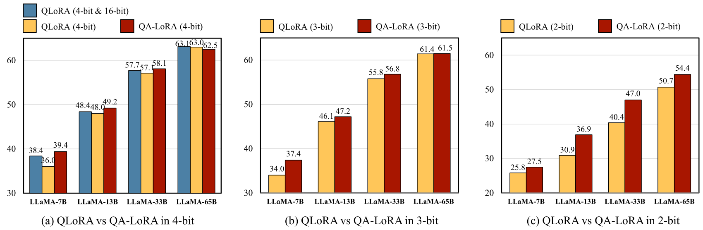
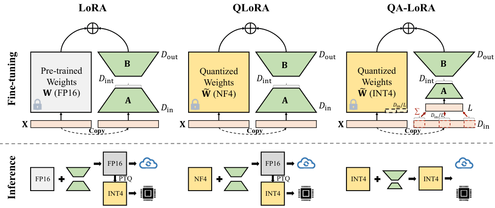
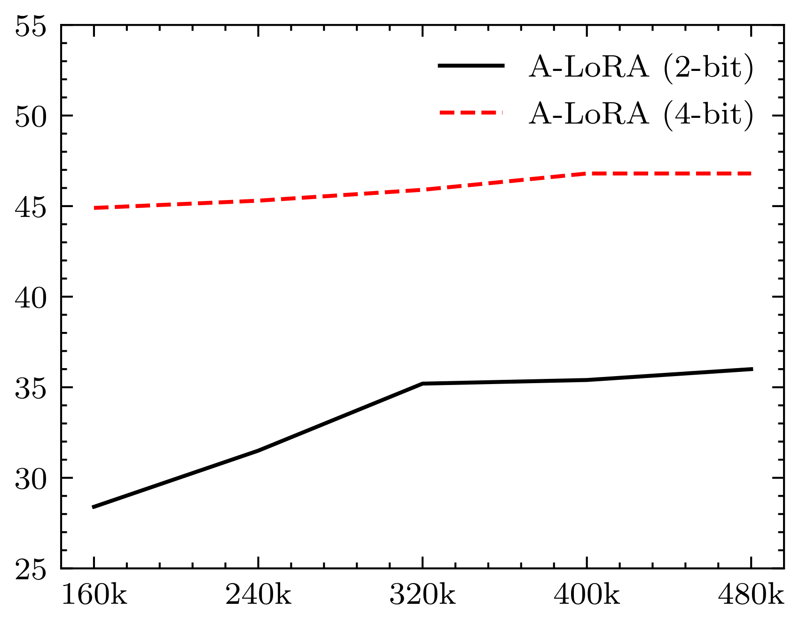

# QA-LoRA：大型语言模型的量化感知低秩适配

> 原文：[arXiv:2309.14717v2](https://arxiv.org/html/2309.14717v2)，作者及机构信息见下。
> 中文全译稿：以机器初译为底稿，统一技术术语，并校订摘要和关键方法段落；覆盖主文、附录、表格、图注和脚注。参考文献保留原始书目，原图内部文字保留英文。英文转写见 [en.md](en.md)，方法分析另见 [QA-LoRA详解.md](QA-LoRA详解.md)。

## 作者与机构

## Authors and affiliations

Yuhui Xu Lingxi Xie Xiaotao Gu Xin Chen Heng Chang Affiliation: Hengheng Zhang Zhengsu Chen Xiaopeng Zhang Qi Tian Affiliation: Huawei Inc. Email: {xyh6666,198808xc,guxt1994,chenxin061}@gmail.com Email: {changh.heng,imhmhm,chenzhengsu1,zxphistory}@gmail.com Email: tian.qi1@huawei.com

## 摘要

近年来，大型语言模型（LLM）发展迅速。尽管它们在许多语言理解任务中能力很强，沉重的计算负担仍大幅限制了其应用，尤其是在需要部署到边缘设备时。本文提出量化感知低秩适配（QA-LoRA）算法。

其动机在于量化与适配的自由度不平衡；解决办法是使用组级算子，在增加量化自由度的同时减少适配自由度。QA-LoRA 只需几行代码即可实现，并为原始 LoRA 提供两种能力：微调时，将 LLM 权重量化为低精度（例如 INT4）以降低时间和显存开销；微调后，将 LLM 权重与辅助权重自然整合为一个量化模型，而不损失精度。我们将 QA-LoRA 应用于 LLaMA 和 LLaMA 2 模型系列，并在不同微调数据集和下游场景中验证其有效性。代码将公开于官方仓库。

|  |
| --- |

## 简介

最近，大型语言模型（LLM）（Brown et al., 2020；Scao et al., 2022；Zhang et al., 2022；Touvron et al., 2023a；Chowdhery et al., 2022；OpenAI, 2023；Zeng et al., 2023）在广泛的语言理解任务中表现出了前所未有的性能（Wei et al., 2023） al., 2022a）并成为最先进聊天系统的基础（Bubeck et al., 2023）。现实世界应用的多样性需要一个可以对LLM进行微调以适应不同场景并量化部署到边缘设备（例如手机）的管道，而关键问题是摆脱LLM大量参数带来的繁重计算负担。

为此目的有两条研究路线。第一个是参数高效微调（PEFT）（Houlsby et al., 2019；Li & Liang, 2021；Liu et al., 2021；He et al., 2022；Hu et al., 2021），它引入了少量可学习参数，同时保持大多数预训练参数不变。其中，低秩适配（LoRA）（Hu et al., 2021）是一种流行的 PEFT 算法，提出对低秩矩阵进行微调以补充预训练的权重。尽管性能与全参数微调相当，但 LoRA 的内存使用量仍然很大，特别是当基础 LLM 很大时（例如 LLaMA-65B）。第二个研究参数量化（Yao et al., 2022；Dettmers et al., 2022；Wei et al., 2022b；Frantar et al., 2023；Lin et al., 2023；Xiao et al., 2023；Dettmers et al., 2023b），其中训练的权重被量化为低位整数或浮点数。尽管这些方法可以减轻计算负担，但它们经常报告精度不令人满意，尤其是当量化位宽较低时。

因此，将 PEFT 与量化相结合是一个重要的课题。一个简单的解决方案是在 PEFT 之后执行训练后量化 (PTQ)，但它的精度并不令人满意，尤其是当量化位宽较低时。先进的方法是存在的，但它们要么在微调阶段计算成本昂贵（Liu et al., 2023），要么在微调后无法保持量化属性（Dettmers et al., 2023a）。在本文中，我们提出了一种简单而有效的量化感知低秩适配方法（QA-LoRA）。我们的想法是基于量化和适应的不平衡自由度。具体来说，预训练权重矩阵的每一列仅伴随一对缩放和零参数，但伴随有更多的 LoRA 参数。这种不平衡不仅会导致较大的量化误差（从而损害LLM的准确性），而且还使得辅助权重难以集成到主模型中。 QA-LoRA 通过引入分组算子来解决这个问题，这些算子增加了低位量化的自由度（每个组单独量化）并降低了 LoRA 的自由度（每个组共享自适应参数）。 QA-LoRA 具有双重好处：（i）由于 LLM 的权重被量化为低位整数，因此具有高效的微调阶段； (ii) 轻量级、微调的模型，无需经常导致准确性损失的 PTQ。

QA-LoRA易于实现，适用场景广泛。我们在 LLaMA 和 LLAMA2 模型系列上评估 QA-LoRA（Touvron 等人，2023a；Touvron 等人，2023b），并在各种语言理解基准上对其进行验证。图 1 比较了 QA-LoRA 的 MMLU 基准和直接基线 QLoRA（Dettmers 等人，2023a）在有和没有 PTQ 的情况下的 $5$ 射击精度，两种方法都在 Alpaca 数据集上进行了微调。在不同规模的 LLM 之上，QA-LoRA 始终优于带 PTQ 的 QLoRA（当量化位宽较低时，优势变得更加明显），并且与不带 PTQ 的 QLoRA 相当。请注意，在推理过程中，QA-LoRA 与带 PTQ 的 QLoRA 具有完全相同的复杂度，并且比不带 PTQ 的 QLoRA 高效得多。因此，QA-LoRA 是一种有效且现成的方法，用于 LLM 的联合量化和自适应。

图 1：基于 LLaMA 模型系列的不同量化位宽的 $5$ 射击 MMLU 精度 (%) 的比较。 QLoRA ( NF4 & FP16 ) 是指在 INT4 中预训练权重和 FP16 中具有适配器权重的原始 QLoRA 模型，QLoRA ( INT4 ) 是指对合并的 QLoRA 模型执行训练后量化（到 INT4 中）。所有模型都在 Alpaca 数据集上进行了微调。完整结果如表 1 所示。

## 相关工作

大语言模型（LLM）（Devlin et al., 2019；Brown et al., 2020；Zhao et al., 2023a；Hadi et al., 2023）已成为自然语言处理的主导范式，在各种任务上取得了最先进的性能（Zhao et al., 2023b；Zhou et al., 2023），并成为聊天的基础系统（OpenAI，2023）。然而，它们在现实场景中的部署受到推理过程中高计算和内存要求的阻碍（Chang et al., 2023）。为了解决这个问题，人们提出了各种方法，包括蒸馏（Liu等，2023）、量化（Yao等，2022；Dettmers等，2022；Wei等，2022b；Frantar等，2023；Lin等，2023；Xiao等，2023）、剪枝（ Frantar 和 Alistarh，2023；Ma 等，2023；Sun 等，2023）等（Weng，2023）。本文主要关注LLM的量化。

使用适配器微调法学硕士。参数高效微调（PEFT）是法学硕士的一个重要主题。最流行的方法之一是低秩适配（LoRA）（Hu et al., 2021；Valipour et al., 2022），其中关键的见解是将适配器权重分解为两个低秩（因此参数高效）矩阵的乘法。 LoRA 声称其性能可与全量微调相媲美，同时使用的可学习参数要少得多。同时，LLM的适配器还有其他分支，例如串联适配器（Houlsby et al., 2019）和并行适配器（He et al., 2022）。请参阅（Mangrulkar 等人，2022 年；Hu 等人，2023 年）对这些适配器的回顾。

LLM 的量化。量化是一种压缩技术，可减少 LLM 的参数和/或激活的位宽，以提高其效率和可扩展性（Xiao 等人，2023；Dettmers 等人，2022；Dettmers 等人，2023a）。现有方法主要侧重于在推理阶段保留或恢复量化 LLM 的准确性（Zhu et al., 2023），其中关键是减少内存占用和计算成本，而无需重新训练 LLM。主要挑战之一是处理参数分布中的异常值（Xiao et al., 2023），这在量化时可能会导致重大错误。为了解决这个问题，一些方法提出使用自适应或动态量化方案，根据参数调整量化​​范围或精度（Xiao等人，2023；Dettmers等人，2022）。其他方法使用复杂的分组或聚类技术将参数划分为不同的组，并对每个组应用不同的量化策略（Park 等人，2022；Yao 等人，2022；Wu 等人，2023）。

联合适应和量化。本文旨在实现参数高效的自适应和计算高效的调整和部署的目标，这可以进一步提高LLM的效率和可扩展性，并减轻量化误差的负面影响。然而，这也带来了额外的挑战，例如通过离散值传播梯度和优化量化参数。为了克服这些挑战，有损量化方法提出使用随机舍入（Shen et al., 2020）或学习舍入（Esser et al., 2019）来逼近梯度并更新参数，但将这些方法应用于LLM通常很困难。其他方法建议使用转回层（Wortsman et al., 2023）或混合精度推理（Dettmers et al., 2023a）在量化和全/半精度值之间交替，这通常会导致推理速度较低。

据我们所知，最相关的工作是 QLoRA (Dettmers et al., 2023a)，它将预训练的权重压缩到 NF4 中并添加了 LoRA。然而，QLoRA 将自适应权重添加回预训练权重，并再次将其转换为 FP16，因此部署的模型仍然很慢。我们通过提出的 QA-LoRA 方法解决了这个问题。

## 提议的方法

### 基线：低秩适配和低比特量化

我们遵循 LoRA 中使用的符号系统（Hu et al., 2021），该系统假设预训练的权重形成矩阵 $\mathbf{W}$ ，特征形成向量 $\mathbf{x}$ 。该定义很容易应用于广泛的场景，并扩展到 $\mathbf{x}$ 是一组向量（例如，特征矩阵）。设 $\mathbf{W}$ 的大小为 $D_{\mathrm{in}}\times D_{\mathrm{out}}$ ， $\mathbf{x}$ 的长度为 $D_{\mathrm{in}}$ ，因此计算很容易写为 $\mathbf{y}=\mathbf{W}^{\top}\mathbf{x}$ ，其中 $\mathbf{y}$ 是长度为 $D_{\mathrm{out}}$ 的输出向量。

LoRA 的核心思想是引入一对矩阵 $\mathbf{A}$ 和 $\mathbf{B}$ 来补充 $\mathbf{W}$ 。 $\mathbf{A}$ 和 $\mathbf{B}$ 的大小分别为 $D_{\mathrm{in}}\times D_{\mathrm{int}}$ 和 $D_{\mathrm{int}}\times D_{\mathrm{out}}$ ，因此它们的乘法 $\mathbf{A}\mathbf{B}$ 的大小与 $\mathbf{W}$ 相同。中间维度 $D_{\mathrm{int}}$ 通常设置为一个较小的值（即 $D_{\mathrm{int}}\ll\min\{D_{\mathrm{in}},D_{\mathrm{out}}\}$ ），使 $\mathbf{A}\mathbf{B}$ 与 $\mathbf{W}$ 相比成为低秩矩阵。微调时，我们计算 $\mathbf{y}=\mathbf{W}^{\top}\mathbf{x}+s\cdot(\mathbf{A}\mathbf{B})^{\top}\mathbf{x}$ ，其中 $s$ 为权重调整系数，$\mathbf{W}$ 固定，而 $\mathbf{A}$ 和 $\mathbf{B}$ 可以调整，达到参数高效微调的目标。微调后，计算被重新表述为 $\mathbf{y}=(\mathbf{W}+s\cdot\mathbf{A}\mathbf{B})^{\top}\mathbf{x}$ ，其中 $\mathbf{W}$ 替换为 $\mathbf{W}^{\prime}=\mathbf{W}+s\cdot\mathbf{A}\mathbf{B}$ 以实现快速推理。

降低计算成本的另一个有效方法在于低位量化。在本文中我们只考虑权重的量化。特别是，我们应用了一种名为最小-最大量化的简单方法。从数学上讲，给定位宽 $N$ 和预训练的权重矩阵 $\mathbf{W}$ ，我们计算 $\mathbf{W}$ 所有元素的最小值和最大值，分别表示为 $\min(\mathbf{W})$ 和 $\max(\mathbf{W})$ 。然后，通过计算将$\mathbf{W}$量化为$\tilde{\mathbf{W}}$

$$
\tilde{\mathbf{W}}=\alpha\cdot\hat{\mathbf{W}}+\beta\doteq\alpha\cdot\left\lfloor\frac{\mathbf{W}-\beta}{\alpha}\right\rceil+\beta,
$$

其中 $\alpha=(\max(\mathbf{W})-\min(\mathbf{W}))/(2^{N}-1)$ 和 $\beta=\min(\mathbf{W})$ 分别称为缩放因子和零因子； $\left\lfloor\cdot\right\rceil$表示整数舍入运算。 $\hat{\mathbf{W}}$ 中的所有元素都在 $\{0,1,\ldots,2^{N}-1\}$ 集合中，因此存储为 $B$ 位整数。计算结果 $\mathbf{y}=\mathbf{W}^{\top}\mathbf{x}$ 近似为 $\mathbf{y}=\tilde{\mathbf{W}}^{\top}\mathbf{x}=\alpha\cdot\left\lfloor\frac{\mathbf{W}-\beta}{\alpha}\right\rceil^{\top}\mathbf{x}+\beta\mathbf{x}$ 。量化带来了双重好处，即减少了 $\mathbf{W}$ 的存储空间（例如从 FP16 到 INT4），并且 $\mathbf{W}^{\top}\mathbf{x}$ 的计算速度变得更快。代价是 $\tilde{\mathbf{W}}$ 是 $\mathbf{W}$ 的近似值，这可能会损害语言理解的准确性。

为了减少$\mathbf{W}$和$\tilde{\mathbf{W}}$之间的量化损失，一个有效的策略是对$\mathbf{W}$的每一列进行单独的量化。设 $\mathbf{W}=[w_{i,j}]_{D_{\mathrm{in}}\times D_{\mathrm{out}}}$ ，其中 $i\in\{1,\ldots,D_{\mathrm{in}}\}$ 和 $j\in\{1,\ldots,D_{\mathrm{out}}\}$ 是迭代变量。令 $\alpha_{j}$ 和 $\beta_{j}$ 为在 $j$ 第 $\mathbf{w}_{j}$ 列上计算的缩放因子和零因子。因此，等式 1 更新为 $\tilde{\mathbf{W}}=[\tilde{\mathbf{w}}_{j}]_{D_{\mathrm{out}}}=\left[\alpha_{j}\cdot\left\lfloor\frac{\mathbf{w}_{j}-\beta_{j}}{\alpha_{j}}\right\rceil+\beta_{j}\right]_{D_{\mathrm{out}}}$ ，并且计算重写为 $\mathbf{y}=\tilde{\mathbf{W}}^{\top}\mathbf{x}=\left[\alpha_{j}\cdot\left\lfloor\frac{\mathbf{w}_{j}-\beta_{j}}{\alpha_{j}}\right\rceil^{\top}\mathbf{x}+\beta_{j}\mathbf{x}\right]_{D_{\mathrm{out}}}$ 。与原始（整体）量化相比，计算成本不变，而缩放和零因子的存储成本从 $2$ 增加到 $2D_{\mathrm{out}}$ 浮点数。与存储全精度 $\mathbf{W}$ 所降低的成本相比，这可以忽略不计。

图 2：QA-LoRA 目标的图示。与之前的适应方法 LoRA 和 QLoRA 相比，我们的方法在微调和推理阶段的计算效率都很高。更重要的是，它不会遭受准确性损失，因为不需要训练后量化。我们在图中显示了 INT4 量化，但 QA-LoRA 被推广到 INT3 和 INT2 。

### 目标：高效适配和部署

如图 2 所示，我们旨在实现两个目标。首先，在微调阶段，预训练的权重 $\mathbf{W}$ 被量化为低位表示，以便 LLM 可以在尽可能少的 GPU 上进行微调。其次，在微调阶段之后，微调和合并的权重 $\mathbf{W}^{\prime}$ 仍然处于量化形式，以便可以以计算效率部署 LLM。

我们注意到 QLoRA（Dettmers 等人，2023a）是最近提出的 LoRA 变体，它实现了第一个目标。这个想法是在微调阶段将 $\mathbf{W}$ 从 FP16 量化为 NF4（高度压缩的浮点数类型）。我们从 QLoRA 了解到，量化和自适应的联合优化是容易处理的，因为 $\mathbf{W}$ 和 $\tilde{\mathbf{W}}$ 之间的精度损失由低秩权重 $s\cdot\mathbf{A}\mathbf{B}$ 补偿。微调后，必须将侧权重 $s\cdot\mathbf{A}\mathbf{B}$ 添加回 $\tilde{\mathbf{W}}$ ，再次成为 FP16 中的最终权重 $\mathbf{W}^{\prime}$ 。事实上，我们可以对 $\mathbf{W}^{\prime}$ 执行训练后量化（PTQ），但这种策略可能会导致精度的显着损失，尤其是当位宽较低时。详细请参考实验。此外，NF4还没有算子级的优化，很难加速微调和推理阶段。简而言之，QLoRA 带来的唯一好处是降低了微调的内存成本。

### 解决方案：具有低秩适配的分组量化

从上面的分析来看，实现第二个目标的关键在于$\tilde{\mathbf{W}}$（即量化后的$\mathbf{W}$）和$s\cdot\mathbf{A}\mathbf{B}$可以在不使用高精度数（例如FP16）的情况下进行合并。我们首先注意到，这在原始设置中是不可能的，即，$\mathbf{W}$ 以列方式量化为 $\tilde{\mathbf{W}}$，而 $\mathbf{A}$ 和 $\mathbf{B}$ 都是不受约束的。

我们用数学语言写下条件。从$\mathbf{W}^{\prime}=\tilde{\mathbf{W}}+s\cdot\mathbf{A}\mathbf{B}$开始，我们为所有$(i,j)$提供了$w_{i,j}^{\prime}=\tilde{w}_{i,j}+s\cdot\sum_{k}a_{i,k}b_{k,j}$。这里，对于任何 $j$ ，所有 $\tilde{w}_{i,j}$ 都使用相同的缩放比例和零因子集表示，即，存在 $\alpha_{j}$ 和 $\beta_{j}$ ，因此 $\tilde{w}_{i,j}=\alpha_{j}\times\hat{w}_{i,j}+\beta_{j}$ ， $\hat{w}_{i,j}\in\{0,1,\ldots,2^{N}-1\}$ 。每个 $\tilde{w}_{i,j}$ 与 $s\cdot\sum_{k}a_{i,k}b_{k,j}$（简写为 $c_{i,j}$ ）相加后，如果要保留该属性进行量化，就必须保证对于任何 $j$ ， $c_{i,j}$ 的所有可能值形成一个算术集，其公差为 $\alpha_{j}$ [^footnote1] 。这在连续和基于梯度的优化中是很棘手的，除非我们要求 $c_{i,j}$ 是一个常数，即对于任何 $j$ ， $c_{1,j}=\ldots=c_{i,j}=\ldots,c_{D_{\mathrm{in}},j}$ 。这相当于将 $\mathbf{A}$ 的所有行向量设置为相同，即 $\mathbf{a}_{1}\equiv\ldots\equiv\mathbf{a}_{i}\equiv\ldots\equiv\mathbf{a}_{D_{\mathrm{in}}}$ ，其中 $\equiv$ 表示两个向量之间的逐元素等价。

上述策略虽然易于处理，但在实践中会导致准确性显着下降。特别是，由于 $\mathbf{A}$ 的所有行都是相同的向量，因此我们有 $\mathrm{rank}(\mathbf{A})=1$ ，因此有 $\mathrm{rank}(\mathbf{A}\mathbf{B})=1$ ，而 $\mathbf{A}\mathbf{B}$ 的排名与新数据中微调 $\tilde{\mathbf{W}}$ 的能力相关（Hu et al., 2021 ; Valipour et al., 2022 ; Dettmers et al., 2022 ）等人，2023a）。为了解决这个问题，一个简单的想法是放松量化和适应的限制。

我们将 $\mathbf{W}$ 的每一列划分为 $L$ 组，为了便于实现，我们将 $L$ 设置为 $D_{\mathrm{in}}$ 的除数。我们没有完全量化 $\mathbf{W}$ 的每一列，而是使用一对单独的缩放因子和零因子进行量化，即，针对 $j$ 列中的 $D_{\mathrm{in}}/L$ 元素计算第 $l$ 组因子 $\alpha_{l,j}$ 和 $\beta_{l,j}$ 。相应地，我们只要求同一组内的$\mathbf{A}$的行向量具有相同的值即可。在我们的实现中，这是通过在输入向量 $\mathbf{x}$ 的每组内进行求和来实现的。这种无参数操作将 $\mathbf{x}$ 的维度从 $D_{\mathrm{in}}$ 减少到 $L$ ，因此我们可以将 $\mathbf{A}$ 设置为 $L\times D_{\mathrm{int}}$ 矩阵，而无需进一步的约束。

⬇

#

D_in，

D_输出，

D_int：

的

输入，

输出，

和

低等级

适应

尺寸

#

L:

的

量化

组

数字

的

重量

W

（D_in

//

L

是

的

组

尺寸）

#

s:

的

系数

为了

适应；

N:

的

一点

宽度

的

量化

QA = nn.AvgPool1d(D_in//L)

劳拉_A

=

恩

.

参数

(

火炬

.

空的

((

D_int

,

L

)))

劳拉_B

=

恩

.

参数

(

火炬

.

空的

((

D_输出

,

D_int

)))

定义

qalora_转发

(

x

,

W

,

劳拉_A

,

劳拉_B

):

W_波浪号

=

预量化

(

W

,

阿尔法

,

贝塔

)

结果

=

x

@

W_波浪号

结果

+=

(

QA(x)*(D_in//L)

)

@

劳拉_A

.

转置

(0,1)

@

劳拉_B

.

转置

(0,1)

*

s

返回

结果

定义

预量化

(

W

,

阿尔法

,

贝塔

):

W_帽子

=

火炬

.

圆形

(

W

/

阿尔法

)

+

贝塔

返回

阿尔法

*

(

W_帽子

-

贝塔

)

定义

与量化合并

(

贝塔

,

劳拉_A

,

劳拉_B

):

测试版_新

=

贝塔

-

s

*

(

劳拉_B

@

劳拉_A

).

转置

(0,1)

/

阿尔法

返回

测试版_新

算法 1 类似 PyTorch 风格的 QA-LoRA 伪代码

所提出的方法被称为量化感知低秩适配（QA-LoRA）。与基线LoRA和QLoRA相比，它是通过插入/修改几行代码来实现的，如算法1所示。与LoRA相比，QA-LoRA在时间和内存消耗上具有优势。与 QLoRA 相比，QA-LoRA 需要额外存储 $L\times D_{\mathrm{out}}$ 的缩放和零因子对，但将 $\mathbf{A}$ 的参数数量从 $D_{\mathrm{in}}\times D_{\mathrm{int}}$ 减少到 $L\times D_{\mathrm{int}}$ - 由于我们经常设置 $L\ll D_{\mathrm{in}}$ ，因此上述变化可以忽略不计。与 QLoRA 相比，QA-LoRA 的主要优势在于推理阶段更快、更准确。我们在表 2 中比较了 LoRA、QLoRA 和 QA-LoRA 的计算成本。

QA-LoRA 的见解：平衡。 QA-LoRA 与 QLoRA 的变体非常相似，其中 NF4 量化被 INT4 [^footnote2] 取代。在此版本中，量化参数（$D_{\mathrm{out}}$ 缩放和零因子对）的数量远小于自适应参数（$D_{\mathrm{in}}\times D_{\mathrm{int}}+D_{\mathrm{int}}\times D_{\mathrm{out}}$ 参数）。这导致量化和适应的自由度之间的显着不平衡。我们引入了分组操作，将量化参数数量从 $D_{\mathrm{out}}$ 增加到 $L\times D_{\mathrm{out}}$ ，同时减少自适应参数数量从 $D_{\mathrm{in}}\times D_{\mathrm{int}}+D_{\mathrm{int}}\times D_{\mathrm{out}}$ 到 $L\times D_{\mathrm{int}}+D_{\mathrm{int}}\times D_{\mathrm{out}}$ 。正如我们将在实验中看到的，中等的 $L$ 可以在保持计算效率的同时实现令人满意的语言理解准确性。

|  |  |  |  |  |  |  |  |  |  |  |  |  |
| --- | --- | --- | --- | --- | --- | --- | --- | --- | --- | --- | --- | --- |
|  |  |  |  |  |  |  |  |  |  |  |  |  |
|  |  |  |  |  |  |  |  |  |  |  |  |  |
|  |  |  |  |  |  |  |  |  |  |  |  |  |
|  |  |  |  |  |  |  |  |  |  |  |  |  |
|  |  |  |  |  |  |  |  |  |  |  |  |  |
|  |  |  |  |  |  |  |  |  |  |  |  |  |
|  |  |  |  |  |  |  |  |  |  |  |  |  |
| 方法 | 数据集 | #位 | MMLU（$0$-镜头） | MMLU（$0$-镜头） | MMLU（$0$-镜头） | MMLU（$0$-镜头） | MMLU（$0$-镜头） | MMLU（$5$-镜头） | MMLU（$5$-镜头） | MMLU（$5$-镜头） | MMLU（$5$-镜头） | MMLU（$5$-镜头） |
| 方法 | 数据集 |  | 嗡嗡声。 | 科学、技术、工程和数学 | 社交 | 其他 | 平均。 | 嗡嗡声。 | 科学、技术、工程和数学 | 社交 | 其他 | 平均。 |
| 拉马-7B | – | 16 | 32.4 | 26.6 | 31.4 | 37.2 | 32.1 | 33.3 | 29.8 | 37.8 | 38.0 | 34.6 |
| [0.8 点/1 点] QLoRA | 羊驼毛 | 4+16 | 38.1 | 31.1 | 41.6 | 46.9 | 39.4 | 36.1 | 31.9 | 42.0 | 44.5 | 38.4 |
| [0.8pt/1pt] QLoRA 带 GPTQ | 羊驼毛 | 4 | 35.7 | 30.9 | 38.0 | 44.0 | 37.1 | 33.8 | 31.3 | 37.4 | 42.2 | 36.0 |
| PEQA | 羊驼毛 | 4 | – | – | – | – | – | 34.9 | 28.9 | 37.5 | 40.1 | 34.8 |
| QA-LoRA | 羊驼毛 | 4 | 36.9 | 31.4 | 40.3 | 44.9 | 38.3 | 36.6 | 32.4 | 44.8 | 44.9 | 39.4 |
| 带 GPTQ 的 QLoRA | 羊驼毛 | 3 | 31.5 | 28.9 | 31.8 | 36.8 | 32.2 | 31.6 | 30.1 | 35.6 | 39.8 | 34.0 |
| QA-LoRA | 羊驼毛 | 3 | 36.0 | 34.1 | 42.0 | 42.3 | 38.3 | 35.6 | 30.5 | 41.5 | 42.7 | 37.4 |
| 带 GPTQ 的 QLoRA | 羊驼毛 | 2 | 24.1 | 22.1 | 22.5 | 23.7 | 23.2 | 23.4 | 26.2 | 26.4 | 28.4 | 25.8 |
| QA-LoRA | 羊驼毛 | 2 | 26.4 | 25.5 | 25.6 | 28.7 | 26.5 | 27.3 | 26.1 | 26.1 | 30.3 | 27.5 |
| [0.8 点/1 点] QLoRA | 局域网v2 | 4+16 | 40.9 | 32.5 | 47.8 | 49.5 | 42.6 | 41.4 | 35.0 | 49.8 | 52.0 | 44.3 |
| [0.8pt/1pt] QLoRA 带 GPTQ | 局域网v2 | 4 | 39.7 | 32.5 | 46.4 | 48.1 | 41.6 | 36.5 | 33.7 | 46.9 | 50.3 | 41.4 |
| QA-LoRA | 局域网v2 | 4 | 44.0 | 35.3 | 52.3 | 52.6 | 45.9 | 43.9 | 38.0 | 54.3 | 53.0 | 47.0 |
| 带 GPTQ 的 QLoRA | 局域网v2 | 3 | 36.7 | 30.2 | 38.4 | 40.1 | 36.5 | 32.2 | 31.7 | 42.7 | 42.8 | 36.9 |
| QA-LoRA | 局域网v2 | 3 | 41.4 | 35.1 | 52.0 | 50.2 | 44.4 | 41.3 | 36.0 | 52.8 | 50.2 | 44.7 |
| 带 GPTQ 的 QLoRA | 局域网v2 | 2 | 24.1 | 22.5 | 22.3 | 23.8 | 23.3 | 23.9 | 25.3 | 26.2 | 25.3 | 25.0 |
| QA-LoRA | 局域网v2 | 2 | 34.1 | 30.0 | 37.2 | 39.8 | 35.2 | 31.8 | 38.1 | 34.5 | 38.5 | 33.2 |
| LLaMA-13B | – | 16 | 40.6 | 36.7 | 48.9 | 48.0 | 43.3 | 44.0 | 35.9 | 53.2 | 52.9 | 46.3 |
| [0.8 点/1 点] QLoRA | 羊驼毛 | 4+16 | 45.2 | 38.3 | 55.0 | 54.6 | 48.1 | 46.0 | 37.3 | 55.8 | 55.1 | 48.4 |
| [0.8pt/1pt] QLoRA 带 GPTQ | 羊驼毛 | 4 | 44.7 | 38.0 | 54.4 | 54.0 | 47.6 | 45.4 | 37.4 | 55.7 | 54.3 | 48.0 |
| PEQA | 羊驼毛 | 4 | – | – | – | – | – | 43.0 | 37.7 | 53.6 | 49.0 | 45.0 |
| QA-LoRA | 羊驼毛 | 4 | 44.3 | 38.0 | 55.1 | 55.5 | 47.9 | 48.4 | 38.3 | 54.9 | 55.2 | 49.2 |
| 带 GPTQ 的 QLoRA | 羊驼毛 | 3 | 43.5 | 36.2 | 52.3 | 52.6 | 45.9 | 43.6 | 36.1 | 53.0 | 52.7 | 46.1 |
| QA-LoRA | 羊驼毛 | 3 | 43.9 | 37.3 | 53.1 | 54.3 | 46.9 | 44.3 | 38.8 | 53.4 | 53.8 | 47.3 |
| 带 GPTQ 的 QLoRA | 羊驼毛 | 2 | 27.7 | 27.6 | 31.8 | 29.7 | 29.0 | 29.0 | 27.1 | 33.4 | 34.8 | 30.9 |
| QA-LoRA | 羊驼毛 | 2 | 35.7 | 33.3 | 40.9 | 42.0 | 37.8 | 35.6 | 30.6 | 39.9 | 41.7 | 36.9 |
| [0.8 点/1 点] QLoRA | 局域网v2 | 4+16 | 48.0 | 39.2 | 58.2 | 56.7 | 50.3 | 49.9 | 40.1 | 60.2 | 57.9 | 51.9 |
| [0.8pt/1pt] QLoRA 带 GPTQ | 局域网v2 | 4 | 47.6 | 39.6 | 57.6 | 56.0 | 50.0 | 49.4 | 40.9 | 59.7 | 57.6 | 51.7 |
| QA-LoRA | 局域网v2 | 4 | 47.7 | 41.4 | 59.6 | 57.2 | 51.1 | 50.0 | 41.5 | 60.5 | 58.4 | 52.4 |
| 带 GPTQ 的 QLoRA | 局域网v2 | 3 | 46.6 | 37.9 | 55.9 | 55.7 | 48.9 | 46.5 | 38.2 | 57.2 | 56.1 | 49.3 |
| QA-LoRA | 局域网v2 | 3 | 47.4 | 39.4 | 57.7 | 56.0 | 49.9 | 49.3 | 40.0 | 60.0 | 57.5 | 51.5 |
| 带 GPTQ 的 QLoRA | 局域网v2 | 2 | 36.2 | 30.3 | 40.8 | 44.1 | 37.8 | 36.6 | 32.0 | 43.8 | 44.2 | 38.9 |
| QA-LoRA | 局域网v2 | 2 | 40.8 | 36.4 | 39.3 | 50.1 | 43.9 | 40.9 | 36.1 | 50.7 | 46.7 | 44.1 |
| LLaMA-33B | – | 16 | 51.0 | 42.7 | 63.3 | 60.4 | 54.1 | 56.2 | 45.9 | 67.1 | 63.9 | 58.2 |
| [0.8 点/1 点] QLoRA | 羊驼毛 | 4+16 | 52.2 | 44.9 | 64.3 | 61.8 | 55.5 | 55.4 | 46.0 | 66.4 | 63.6 | 57.7 |
| [0.8pt/1pt] QLoRA 带 GPTQ | 羊驼毛 | 4 | 51.7 | 44.7 | 63.4 | 61.0 | 54.9 | 53.9 | 46.6 | 66.3 | 62.9 | 57.1 |
| QA-LoRA | 羊驼毛 | 4 | 51.6 | 44.9 | 65.0 | 61.8 | 55.4 | 55.8 | 46.4 | 67.0 | 64.0 | 58.1 |
| 带 GPTQ 的 QLoRA | 羊驼毛 | 3 | 49.5 | 43.3 | 63.1 | 61.0 | 53.8 | 53.3 | 45.0 | 64.1 | 61.4 | 55.8 |
| QA-LoRA | 羊驼毛 | 3 | 50.6 | 44.6 | 64.0 | 61.2 | 54.7 | 54.3 | 45.8 | 65.2 | 62.6 | 56.8 |
| 带 GPTQ 的 QLoRA | 羊驼毛 | 2 | 32.0 | 31.6 | 35.8 | 32.8 | 32.9 | 37.5 | 34.9 | 45.3 | 44.9 | 40.4 |
| QA-LoRA | 羊驼毛 | 2 | 38.4 | 38.2 | 50.7 | 49.7 | 43.6 | 44.2 | 38.8 | 53.9 | 52.3 | 47.0 |
| [0.8 点/1 点] QLoRA | 局域网v2 | 4+16 | 56.3 | 46.5 | 68.6 | 64.6 | 58.8 | 57.2 | 48.6 | 69.8 | 65.2 | 60.0 |
| [0.8pt/1pt] QLoRA 带 GPTQ | 局域网v2 | 4 | 54.9 | 46.4 | 68.2 | 63.6 | 58.0 | 57.4 | 48.6 | 69.2 | 64.9 | 59.8 |
| QA-LoRA | 局域网v2 | 4 | 54.2 | 47.0 | 69.7 | 65.5 | 58.7 | 57.9 | 48.8 | 71.0 | 65.5 | 60.6 |
| 带 GPTQ 的 QLoRA | 局域网v2 | 3 | 54.0 | 44.3 | 65.8 | 62.7 | 56.5 | 55.7 | 47.4 | 67.9 | 64.0 | 58.5 |
| QA-LoRA | 局域网v2 | 3 | 53.1 | 45.0 | 66.9 | 63.0 | 56.7 | 56.8 | 46.9 | 68.9 | 63.7 | 58.9 |
| 带 GPTQ 的 QLoRA | 局域网v2 | 2 | 37.9 | 35.0 | 47.6 | 42.9 | 40.6 | 42.8 | 37.0 | 54.3 | 51.5 | 46.1 |
| QA-LoRA | 局域网v2 | 2 | 49.4 | 40.4 | 59.8 | 56.5 | 51.4 | 49.6 | 42.7 | 60.7 | 57.8 | 52.4 |
| 拉玛-65B | – | 16 | 56.4 | 45.2 | 68.0 | 64.1 | 58.3 | 61.4 | 51.9 | 73.6 | 67.6 | 63.4 |
| [0.8 点/1 点] QLoRA | 羊驼毛 | 4+16 | 55.5 | 49.3 | 70.4 | 66.9 | 60.1 | 60.3 | 52.7 | 72.9 | 67.4 | 63.1 |
| [0.8pt/1pt] QLoRA 带 GPTQ | 羊驼毛 | 4 | 54.8 | 48.9 | 69.8 | 66.1 | 59.4 | 60.4 | 52.5 | 73.0 | 67.2 | 63.0 |
| QA-LoRA | 羊驼毛 | 4 | 57.1 | 48.2 | 70.7 | 64.9 | 60.0 | 60.8 | 50.5 | 72.5 | 66.7 | 62.5 |
| 带 GPTQ 的 QLoRA | 羊驼毛 | 3 | 57.4 | 47.9 | 67.2 | 65.1 | 59.3 | 59.6 | 50.0 | 70.6 | 66.1 | 61.4 |
| QA-LoRA | 羊驼毛 | 3 | 57.6 | 48.4 | 69.3 | 65.4 | 60.0 | 59.3 | 49.6 | 71.9 | 66.0 | 61.5 |
| 带 GPTQ 的 QLoRA | 羊驼毛 | 2 | 43.9 | 38.0 | 42.6 | 51.1 | 46.2 | 47.3 | 40.8 | 58.9 | 57.0 | 50.7 |
| QA-LoRA | 羊驼毛 | 2 | 48.6 | 42.5 | 60.7 | 58.6 | 52.2 | 51.3 | 43.4 | 63.4 | 60.7 | 54.4 |
| [0.8 点/1 点] QLoRA | 局域网v2 | 4+16 | 58.8 | 52.5 | 74.0 | 67.4 | 62.8 | 59.8 | 52.9 | 75.0 | 69.6 | 63.9 |
| [0.8pt/1pt] QLoRA 带 GPTQ | 局域网v2 | 4 | 57.8 | 51.9 | 73.5 | 67.8 | 62.3 | 59.2 | 52.5 | 75.0 | 69.3 | 63.5 |
| QA-LoRA | 局域网v2 | 4 | 64.1 | 52.6 | 74.8 | 69.1 | 65.1 | 57.6 | 51.1 | 73.9 | 67.4 | 62.1 |
| 带 GPTQ 的 QLoRA | 局域网v2 | 3 | 58.5 | 50.2 | 71.5 | 66.9 | 61.5 | 59.9 | 51.7 | 73.4 | 67.9 | 63.0 |
| QA-LoRA | 局域网v2 | 3 | 57.5 | 49.5 | 72.4 | 66.9 | 61.2 | 61.7 | 51.1 | 73.8 | 68.4 | 63.6 |
| 带 GPTQ 的 QLoRA | 局域网v2 | 2 | 47.9 | 43.1 | 60.1 | 56.0 | 51.4 | 52.6 | 43.8 | 62.8 | 58.5 | 54.3 |
| QA-LoRA | 局域网v2 | 2 | 55.9 | 44.6 | 65.6 | 63.4 | 57.1 | 55.5 | 46.8 | 67.3 | 63.2 | 58.0 |

表 1：大规模多任务语言理解 (MMLU) 数据集上的 $0$ 镜头和 $5$ 镜头准确率 (%)（Hendrycks 等人，2021）。每个块都基于第一行指定的相同基础模型。我们使用微调数据集（Alpaca 或 Flan-v2）和量化位宽来组织所有结果。 “$4+16$”的位宽指的是原始 QLoRA，其中最终推理版本为 FP16。

## 实验

### 设置

基础模型。我们在 LLaMA (Touvron et al., 2023a) 和 LLaMa2 (Touvron et al., 2023b) 系列上建立了 QA-LoRA。特别是，我们对 LLaMA 的 7B、13B、33B 和 65B 模型以及 LLaMA2 的 7B 和 13B 模型进行了微调。

评估指标。遵循 QLoRA（Dettmers 等人，2023a），我们在大规模多任务语言理解（MMLU）基准上评估了法学硕士的零样本和少样本性能（Hendrycks 等人，2021）。它由人文、STEM、社会科学等57个语言任务组成。我们使用官方的MMLU评估脚本，并提示 [^footnote3] 。我们进一步评估了涵盖 HellaSwag (Zellers et al., 2019)、PIQA (Bisk et al., 2020)、WinoGrande (Sakaguchi et al., 2019)、ARC (Clark et al., 2018)、BoolQ (Clark et al., 2019) 和 OpenBookQA 的任务的零样本常识推理能力（米哈伊洛夫等人，2018）。我们采用 lm-eval-harness (Gao et al., 2021) 来生成 Common Sense QA 结果。

量化。我们在量化步骤中采用 GPTQ（Frantar 等人，2023），并且我们的方法对其他 PTQ 方法开放，例如（Lin 等人，2023；Dettmers 等人，2023b）。我们使用相同的设置来量化 QLoRA 微调模型和预训练的 LLaMA 模型。在主要实验中，我们进行了分组非对称量化（组大小为 $32$ ）。我们将 act-order 变量设置为 false ，将 true-sequential 变量设置为 true 。

数据集和训练细节。我们选择 Alpaca (Taori et al., 2023) 和 FLAN v2 (Longpre et al., 2023) 作为我们的微调数据集。 Alpaca 包含从 text-davinci-003 (GPT 3.5) 生成的 52K 指令跟踪数据（Wang et al., 2022）。 FLAN v2 是 $1\rm{,}836$ 任务的集合，将 CoT、Muffin、T0-SF 和 NIV2 混合在一起。为了节省调整成本，我们从 FLAN v2 集合中随机采样 320K 子集。遵循 QLoRA（Dettmers 等人，2023a），我们在调整期间使用分页 AdamW 优化器、$0.3$ 的最大梯度范数和 $16$ 的批量大小。我们选择恒定学习率计划，并将 7B 和 13B 模型的学习率设置为 $2\times 10^{-5}$，将 33B 和 65B 模型的学习率设置为 $1\times 10^{-5}$。 Alpaca 的微调步数为 10K，FLAN v2 的微调步数为 20K。所有实验均在 Tesla V100 GPU 上进行。我们对 7B、13B 和 33B 型号使用 1 个 GPU，对 65B 型号使用 2 个 GPU。

### 主要成果和效率

与 MMLU 的 LLaMA 上最近的竞争对手进行比较。我们首先应用 QA-LoRA 来微调 MMLU 的 LLaMA 模型。表 1 总结了不同模型大小、微调数据集和位宽的结果。除了基本 LLaMA 模型之外，我们还将 QA-LoRA 与 QLoRA（Dettmers 等人，2023a）（最相关的工作）以及 PEQA（Kim 等人，2023）（一种最近不使用 LoRA 的量化方法）进行比较。我们报告了原始 QLoRA（推理阶段涉及 FP16 计算）和 GPTQ 之后的变体（为了公平比较）。 QA-LoRA 在 $0$ 射击和 $5$ 射击精度方面始终优于竞争对手（带有 GPTQ 和 PEQA 的 QLoRA）。当模型尺寸较小（例如7B和13B）或位宽较小（例如使用INT3甚至INT2）时，优势更加显着，这表明QA-LoRA在需要计算效率的场景中是一个强大的解决方案。在某些情况下，QA-LoRA 的 INT4 版本的性能甚至比 QLoRA 的原始版本更好，同时推理速度也更快（参见下一段）。我们在附录 A 中进一步展示了 QA-LoRA 的一些示例，其中可以看到定性比较以及 QA-LoRA 超越 QLoRA w/ GPTQ。 QA-LoRA 主要受益于量化感知自适应；否则，训练后量化将得不到补偿，导致结果不稳定。

|  | 拉马-7B | 拉马-7B | LLaMA-13B | LLaMA-13B | LLaMA-33B | LLaMA-33B | 拉玛-65B | 拉玛-65B |
| --- | --- | --- | --- | --- | --- | --- | --- | --- |
| 方法 | #参数 | 时间 ${}_{\text{(h)}}$ | #参数 | 时间 ${}_{\text{(h)}}$ | #参数 | 时间 ${}_{\text{(h)}}$ | #参数 | 时间 ${}_{\text{(h)}}$ |
| QLoRA | 160M | 40.0 | 250M | 73.1 | 488M | 148.6 | 800M | 284.5 |
| QA-LoRA | 89M | 21.5 | 140M | 29.5 | 272M | 51.2 | 447M | 100.5 |

表2：QLoRA和QA-LoRA在微调阶段的可学习参数数量和时间成本。所有结果均在配备一个 Tesla-V100 GPU 的 Alpaca 上报告（65B 型号使用两个芯片）。微调步数为10K。

QA-LoRA 的效率。 QA-LoRA 的一个明显优势在于其计算效率。表 2 在微调阶段的可学习参数和训练时间方面比较了 QA-LoRA 和 QLoRA。 QA-LoRA在训练时间上的显着优势主要来自于INT4量化的使用。与 QLoRA 使用的 NF4 量化相比，INT4 运算符经过 CUDA 优化，执行速度更快。此外，在推理阶段，QA-LoRA 也比 QLoRA 快 $50\%$ ，因为微调后的模型（权重积分后）仍然是 INT4 ，不像 QLoRA 将其转换回 FP16 。

| 方法 | #位 | 海拉斯瓦格 | PIQA | 威诺格兰德 | ARC-e | ARC-c | 布尔Q | OBQA | 平均。 |
| --- | --- | --- | --- | --- | --- | --- | --- | --- | --- |
| 拉马-7B | 16 | 56.3 | 78.2 | 67.1 | 67.3 | 38.2 | 72.9 | 28.4 | 58.3 |
| QLoRA | 4+16 | 61.8 | 78.1 | 68.4 | 75.8 | 43.6 | 73.7 | 32.8 | 62.0 |
| [0.8pt/1pt] LLaMA-7B + GPTQ | 4 | 54.5 | 76.5 | 66.9 | 66.1 | 36.9 | 70.9 | 27.4 | 57.0 |
| 带 GPTQ 的 QLoRA | 4 | 57.4 | 77.6 | 66.2 | 70.9 | 41.8 | 73.5 | 31.2 | 59.8 |
| QA-LoRA | 4 | 58.6 | 78.0 | 66.9 | 71.2 | 43.9 | 79.9 | 34.0 | 61.8 |
| [0.8pt/1pt] QLoRA 带 GPTQ | 3 | 52.2 | 75.2 | 64.1 | 65.8 | 37.2 | 70.4 | 27.2 | 56.0 |
| QA-LoRA | 3 | 57.6 | 76.2 | 66.5 | 70.2 | 43.1 | 76.3 | 30.6 | 60.1 |
| [0.8pt/1pt] QLoRA 带 GPTQ | 2 | 31.9 | 58.2 | 52.4 | 32.3 | 20.7 | 60.6 | 14.6 | 38.7 |
| QA-LoRA | 2 | 49.8 | 70.2 | 58.5 | 55.4 | 33.9 | 73.7 | 32.8 | 53.7 |

表 3：相对于不同量化位宽度的 $0$ 镜头常识 QA 准确度 (%)。

常识性质量检查结果。我们还评估了基于 LLaMA-7B 的 $0$ 镜头常识 QA 的 QA-LoRA。结果总结于表3中。与 MMLU 结果类似，$4$ 位 QA-LoRA 与混合精度 QLoRA 相当，并且平均优于后量化 QLoRA $2.0\%$ 。在低比特场景下，优势变得更加明显，例如，$2$ 位 QA-LoRA 报告 $15.0\%$ 相对于 $2$ 位后量化 QLoRA 具有显着的精度增益。

|  |  |  |  |  |  |  |  |  |  |  |  |  |
| --- | --- | --- | --- | --- | --- | --- | --- | --- | --- | --- | --- | --- |
|  |  |  |  |  |  |  |  |  |  |  |  |  |
|  |  |  | MMLU（$0$-镜头） | MMLU（$0$-镜头） | MMLU（$0$-镜头） | MMLU（$0$-镜头） | MMLU（$0$-镜头） | MMLU（$5$-镜头） | MMLU（$5$-镜头） | MMLU（$5$-镜头） | MMLU（$5$-镜头） | MMLU（$5$-镜头） |
|  |  |  | 嗡嗡声。 | 科学、技术、工程和数学 | 社交 | 其他 | 平均。 | 嗡嗡声。 | 科学、技术、工程和数学 | 社交 | 其他 | 平均。 |
| 方法 | 数据 | #位 | ( $\uparrow$ ) | ( $\uparrow$ ) | ( $\uparrow$ ) | ( $\uparrow$ ) | ( $\uparrow$ ) | ( $\uparrow$ ) | ( $\uparrow$ ) | ( $\uparrow$ ) | ( $\uparrow$ ) | ( $\uparrow$ ) |
| #位 |  |  |  |  |  |  |  |  |  |  |  |  |
| LLaMA2-7B | – | 16 | 38.9 | 32.9 | 46.6 | 44.9 | 40.7 | 43.0 | 36.4 | 51.4 | 52.2 | 45.5 |
| QA-LoRA | 羊驼毛 | 4 | 41.1 | 35.4 | 50.2 | 50.1 | 43.9 | 42.1 | 34.4 | 49.1 | 50.3 | 43.9 |
| QA-LoRA | 局域网v2 | 4 | 47.4 | 39.5 | 58.9 | 57.3 | 50.5 | 48.4 | 41.4 | 59.4 | 58.6 | 51.7 |
| LLaMA2-13B | – | 16 | 48.1 | 42.7 | 60.5 | 59.5 | 52.3 | 53.3 | 44.1 | 63.3 | 61.0 | 55.3 |
| QA-LoRA | 羊驼毛 | 4 | 48.2 | 41.7 | 60.4 | 58.7 | 51.9 | 48.0 | 43.0 | 59.7 | 57.4 | 51.7 |
| QA-LoRA | 局域网v2 | 4 | 50.7 | 44.1 | 63.8 | 62.0 | 54.8 | 52.9 | 44.8 | 65.9 | 64.0 | 56.6 |

表 4：基于 LLaMA2 模型系列的 $0$ 和 $5$ MMLU 精度 (%)。

在 LLaMA2 型号上。我们进一步验证了我们的方法在 LLaMA2 上的有效性（Touvron 等人，2023b）。如表4所示，我们对LLaMA2的7B和13B模型进行了微调，并在MMLU上进行了测试。与原始 FP16 模型相比，使用 FLAN v2 微调的 INT4 模型始终表现得更好，而使用 Alpaca 的模型则准确率稍低。这些实验验证了 QA-LoRA 可以推广到其他预训练的模型系列。

|  |  |  |  |  |  |  |  |  |  |  |  |  |
| --- | --- | --- | --- | --- | --- | --- | --- | --- | --- | --- | --- | --- |
|  |  |  |  |  |  |  |  |  |  |  |  |  |
|  |  |  | MMLU（$0$-镜头） | MMLU（$0$-镜头） | MMLU（$0$-镜头） | MMLU（$0$-镜头） | MMLU（$0$-镜头） | MMLU（$5$-镜头） | MMLU（$5$-镜头） | MMLU（$5$-镜头） | MMLU（$5$-镜头） | MMLU（$5$-镜头） |
|  |  |  | 嗡嗡声。 | 科学、技术、工程和数学 | 社交 | 其他 | 平均。 | 嗡嗡声。 | 科学、技术、工程和数学 | 社交 | 其他 | 平均。 |
| 基础型号 | 团体规模 | #位 | ( $\uparrow$ ) | ( $\uparrow$ ) | ( $\uparrow$ ) | ( $\uparrow$ ) | ( $\uparrow$ ) | ( $\uparrow$ ) | ( $\uparrow$ ) | ( $\uparrow$ ) | ( $\uparrow$ ) | ( $\uparrow$ ) |
| #位 |  |  |  |  |  |  |  |  |  |  |  |  |
| 拉马-7B | 128 | 4 | 37.3 | 31.8 | 39.3 | 43.7 | 38.0 | 36.5 | 32.1 | 41.7 | 44.0 | 38.4 |
| 拉马-7B | 64 | 4 | 37.5 | 30.6 | 41.3 | 45.4 | 38.6 | 36.5 | 32.6 | 43.4 | 45.0 | 39.1 |
| 拉马-7B | 32 | 4 | 38.1 | 31.1 | 41.6 | 46.9 | 39.4 | 36.1 | 31.9 | 42.0 | 44.5 | 38.4 |
| [0.8 点/1 点] | 128 | 2 | 24.0 | 26.7 | 24.8 | 25.2 | 25.0 | 25.0 | 29.0 | 27.9 | 26.1 | 26.7 |
|  | 64 | 2 | 25.1 | 26.9 | 24.7 | 27.0 | 25.8 | 25.0 | 27.2 | 25.2 | 27.3 | 26.0 |
|  | 32 | 2 | 26.4 | 25.5 | 25.6 | 28.7 | 26.5 | 27.3 | 26.1 | 26.1 | 30.3 | 27.5 |
| LLaMA-13B | 128 | 4 | 43.4 | 39.6 | 55.5 | 53.9 | 47.6 | 46.5 | 38.0 | 55.8 | 54.5 | 48.6 |
| LLaMA-13B | 64 | 4 | 43.4 | 39.3 | 55.8 | 53.6 | 47.6 | 47.8 | 39.3 | 55.7 | 54.8 | 49.3 |
| LLaMA-13B | 32 | 4 | 44.3 | 38.0 | 55.1 | 55.5 | 47.9 | 48.4 | 38.3 | 54.9 | 55.2 | 49.2 |
| [0.8 点/1 点] | 128 | 2 | 28.5 | 28.4 | 30.6 | 29.8 | 29.2 | 29.2 | 30.6 | 32.8 | 32.4 | 31.0 |
|  | 64 | 2 | 30.7 | 31.5 | 38.1 | 36.0 | 33.7 | 32.3 | 30.3 | 37.0 | 38.3 | 34.3 |
|  | 32 | 2 | 35.7 | 33.3 | 40.9 | 42.0 | 37.8 | 35.6 | 30.6 | 39.9 | 41.7 | 36.9 |

表 5：相对于不同组设置的 $0$ 射击和 $5$ 射击 MMLU 准确度 (%)。

|  |  |  |  |  |  |  |  |  |  |  |  |  |
| --- | --- | --- | --- | --- | --- | --- | --- | --- | --- | --- | --- | --- |
|  |  |  |  |  |  |  |  |  |  |  |  |  |
| 基础型号 | 方法 | #位 | 自学 | 自学 | 长篇 | 长篇 | 芯片2 | 芯片2 | 羊驼毛 | 羊驼毛 | 果馅饼 v2 | 果馅饼 v2 |
| 基础型号 | 方法 |  | $0$-射击 | $5$-射击 | $0$-射击 | $5$-射击 | $0$-射击 | $5$-射击 | $0$-射击 | $5$-射击 | $0$-射击 | $5$-射击 |
| 拉马-7B | QLoRA | 4+16 | – | 36.4 | – | 32.1 | – | 34.5 | – | 38.8 | – | 44.5 |
| 拉马-7B | 带 GPTQ 的 QLoRA | 4 | – | 35.4 | – | 29.3 | – | 33.6 | – | 36.0 | – | 41.4 |
| 拉马-7B | QA-LoRA | 4 | 32.5 | 34.4 | 29.3 | 33.6 | 30.4 | 32.2 | 38.3 | 39.4 | 45.9 | 47.0 |
| LLaMA-13B | QLoRA | 4+16 | – | 39.0 | – | 43.2 | – | 41.6 | – | 48.4 | – | 51.9 |
| LLaMA-13B | 带 GPTQ 的 QLoRA | 4 | – | 38.4 | – | 42.8 | – | 41.3 | – | 48.0 | – | 51.7 |
| LLaMA-13B | QA-LoRA | 4 | 44.4 | 46.1 | 39.9 | 43.3 | 42.4 | 45.8 | 47.9 | 49.2 | 51.1 | 52.4 |

表 6：不同微调数据集上的 $0$ 镜头和 $5$ 镜头 MMLU 准确度 (%)。

### 烧蚀研究

量化组大小的影响。我们研究了 $L$ 的不同设置，该超参数控制量化和低秩适配的自由度。结果报告在表 5 中，其中显示组大小（即显示 $D_{\mathrm{in}}/L$ 而不是 $L$）。回想一下，较大的 $L$（对应于较小的组大小）意味着较大的自由度，即较小的量化损失和较大数量的自适应参数。同时，它还需要大量的存储和计算，尽管与 $L\gg 1$ 一样长，可以忽略不计。可以观察到，较大的$L$（例如，组大小为$32$）通常会带来较高的精度，并且当量化位宽较小时，优势变得更加明显，这意味着较大的量化损失需要通过较大的自由度来补偿。

图 3：当 LLaMA-7B 模型在不同大小的 FLAN v2 子集上进行微调时，QA-LoRA 的 $5$ 射击 MMLU 准确度 (%)。

微调数据集的影响。我们还在更多数据集上评估 QA-LoRA，例如 Self-instruct (Wang et al., 2022)、Longform (Köksal et al., 2023) 和 Chip2 (LAION, 2023)。结果总结于表6中。与 Alpaca 和 FLAN v2 相比，这些数据集相对较小，因此微调后的模型在 MMLU 上的准确性稍差。请注意，以 LLaMA-13B 作为基础模型，QA-LoRA 在混合精度方面始终优于 QLoRA，同时在推理阶段速度更快。

微调数据集大小的影响。最后，我们在 FLAN v2 的不同子集上评估 QA-LoRA。数据集大小从 160K、240K、320K、400K 和 480K 变化。 LLaMA-7B 用作基础模型。如图 3 所示，低位量化需要更多数据，但 320K 对于 QA-LoRA 的 INT2 和 INT4 变体来说都足够了。

## 结论

在本文中，我们提出 QA-LoRA 作为一种有效的方法，将量化意识引入 LLM 的低秩适配中。 QA-LoRA 的核心在于量化和低秩适配的分组操作，其关键见解来自于平衡双方的自由度。 QA-LoRA 易于实现，可推广到各种基础模型和语言理解任务，并且在微调和推理阶段的计算效率很高。对 LLaMA 模型族的大量实验验证了 QA-LoRA 的有效性。

## 参考文献

- Bisk et al. (2020) Yonatan Bisk, Rowan Zellers, Ronan Le Bras, Jianfeng Gao, and Yejin Choi. Piqa: Reasoning about physical commonsense in natural language. In Thirty-Fourth AAAI Conference on Artificial Intelligence , 2020.

- Brown et al. (2020) Tom Brown, Benjamin Mann, Nick Ryder, Melanie Subbiah, Jared D Kaplan, Prafulla Dhariwal, Arvind Neelakantan, Pranav Shyam, Girish Sastry, Amanda Askell, et al. Language models are few-shot learners. Advances in neural information processing systems , 33:1877–1901, 2020.

- Bubeck et al. (2023) Sébastien Bubeck, Varun Chandrasekaran, Ronen Eldan, Johannes Gehrke, Eric Horvitz, Ece Kamar, Peter Lee, Yin Tat Lee, Yuanzhi Li, Scott Lundberg, Harsha Nori, Hamid Palangi, Marco Tulio Ribeiro, and Yi Zhang. Sparks of artificial general intelligence: Early experiments with gpt-4. arXiv preprint arXiv:2303.12712 , 2023.

- Chang et al. (2023) Yupeng Chang, Xu Wang, Jindong Wang, Yuan Wu, Kaijie Zhu, Hao Chen, Linyi Yang, Xiaoyuan Yi, Cunxiang Wang, Yidong Wang, et al. A survey on evaluation of large language models. arXiv preprint arXiv:2307.03109 , 2023.

- Chowdhery et al. (2022) Aakanksha Chowdhery, Sharan Narang, Jacob Devlin, Maarten Bosma, Gaurav Mishra, Adam Roberts, Paul Barham, Hyung Won Chung, Charles Sutton, Sebastian Gehrmann, et al. Palm: Scaling language modeling with pathways. arXiv preprint arXiv:2204.02311 , 2022.

- Clark et al. (2019) Christopher Clark, Kenton Lee, Ming-Wei Chang, Tom Kwiatkowski, Michael Collins, and Kristina Toutanova. BoolQ: Exploring the surprising difficulty of natural yes/no questions. arXiv preprint arXiv:1905.10044 , 2019.

- Clark et al. (2018) Peter Clark, Isaac Cowhey, Oren Etzioni, Tushar Khot, Ashish Sabharwal, Carissa Schoenick, and Oyvind Tafjord. Think you have solved question answering? try arc, the ai2 reasoning challenge. arXiv preprint arXiv:1803.05457 , 2018.

- Dettmers et al. (2022) Tim Dettmers, Mike Lewis, Younes Belkada, and Luke Zettlemoyer. LLM.int8(): 8-bit matrix multiplication for transformers at scale. In Advances in Neural Information Processing Systems , 2022.

- Dettmers et al. (2023a) Tim Dettmers, Artidoro Pagnoni, Ari Holtzman, and Luke Zettlemoyer. Qlora: Efficient finetuning of quantized llms. arXiv preprint arXiv:2305.14314 , 2023a.

- Dettmers et al. (2023b) Tim Dettmers, Ruslan Svirschevski, Vage Egiazarian, Denis Kuznedelev, Elias Frantar, Saleh Ashkboos, Alexander Borzunov, Torsten Hoefler, and Dan Alistarh. Spqr: A sparse-quantized representation for near-lossless llm weight compression. arXiv preprint arXiv:2306.03078 , 2023b.

- Devlin et al. (2019) Jacob Devlin, Ming-Wei Chang, Kenton Lee, and Kristina Toutanova. Bert: Pre-training of deep bidirectional transformers for language understanding. In North American Chapter of the Association for Computational Linguistics , 2019. URL https://api.semanticscholar.org/CorpusID:52967399 .

- Esser et al. (2019) Steven K Esser, Jeffrey L McKinstry, Deepika Bablani, Rathinakumar Appuswamy, and Dharmendra S Modha. Learned step size quantization. arXiv preprint arXiv:1902.08153 , 2019.

- Frantar & Alistarh (2023) Elias Frantar and Dan Alistarh. Sparsegpt: Massive language models can be accurately pruned in one-shot. International Conference on Learning Representations , 2023.

- Frantar et al. (2023) Elias Frantar, Saleh Ashkboos, Torsten Hoefler, and Dan Alistarh. GPTQ: Accurate post-training compression for generative pretrained transformers. In International Conference on Learning Representations , 2023.

- Gao et al. (2021) Leo Gao, Jonathan Tow, Stella Biderman, Sid Black, Anthony DiPofi, Charles Foster, Laurence Golding, Jeffrey Hsu, Kyle McDonell, Niklas Muennighoff, et al. A framework for few-shot language model evaluation. Version v0. 0.1. Sept , 2021.

- Hadi et al. (2023) Muhammad Usman Hadi, Rizwan Qureshi, Abbas Shah, Muhammad Irfan, Anas Zafar, Muhammad Bilal Shaikh, Naveed Akhtar, Jia Wu, Seyedali Mirjalili, et al. Large language models: A comprehensive survey of its applications, challenges, limitations, and future prospects. TechRxiv , 2023.

- He et al. (2022) Junxian He, Chunting Zhou, Xuezhe Ma, Taylor Berg-Kirkpatrick, and Graham Neubig. Towards a unified view of parameter-efficient transfer learning. In International Conference on Learning Representations , 2022.

- Hendrycks et al. (2021) Dan Hendrycks, Collin Burns, Steven Basart, Andy Zou, Mantas Mazeika, Dawn Song, and Jacob Steinhardt. Measuring massive multitask language understanding. In International Conference on Learning Representations , 2021.

- Houlsby et al. (2019) Neil Houlsby, Andrei Giurgiu, Stanislaw Jastrzebski, Bruna Morrone, Quentin De Laroussilhe, Andrea Gesmundo, Mona Attariyan, and Sylvain Gelly. Parameter-efficient transfer learning for nlp. In International Conference on Machine Learning , pp. 2790–2799. PMLR, 2019.

- Hu et al. (2021) Edward J. Hu, Yelong Shen, Phillip Wallis, Zeyuan Allen-Zhu, Yuanzhi Li, Shean Wang, Lu Wang, and Weizhu Chen. LoRA: Low-rank adaptation of large language models. In International Conference on Learning Representations , 2021.

- Hu et al. (2023) Zhiqiang Hu, Yihuai Lan, Lei Wang, Wanyu Xu, Ee-Peng Lim, Roy Ka-Wei Lee, Lidong Bing, and Soujanya Poria. Llm-adapters: An adapter family for parameter-efficient fine-tuning of large language models. arXiv preprint arXiv:2304.01933 , 2023.

- Kim et al. (2023) Jeonghoon Kim, Jung Hyun Lee, Sungdong Kim, Joonsuk Park, Kang Min Yoo, Se Jung Kwon, and Dongsoo Lee. Memory-efficient fine-tuning of compressed large language models via sub-4-bit integer quantization. arXiv preprint arXiv:2305.14152 , 2023.

- Köksal et al. (2023) Abdullatif Köksal, Timo Schick, Anna Korhonen, and Hinrich Schütze. Longform: Optimizing instruction tuning for long text generation with corpus extraction. arXiv preprint arXiv:2304.08460 , 2023.

- LAION (2023) LAION. Open-instruction-generalist dataset. https://github.com/LAION-AI/Open-Instruction-Generalist , 2023.

- Li & Liang (2021) Xiang Lisa Li and Percy Liang. Prefix-tuning: Optimizing continuous prompts for generation. arXiv preprint arXiv:2101.00190 , 2021.

- Lin et al. (2023) Ji Lin, Jiaming Tang, Haotian Tang, Shang Yang, Xingyu Dang, and Song Han. Awq: Activation-aware weight quantization for llm compression and acceleration. arXiv preprint arXiv:2306.00978 , 2023.

- Liu et al. (2021) Xiao Liu, Yanan Zheng, Zhengxiao Du, Ming Ding, Yujie Qian, Zhilin Yang, and Jie Tang. Gpt understands, too. arXiv preprint arXiv:2103.10385 , 2021.

- Liu et al. (2023) Zechun Liu, Barlas Oguz, Changsheng Zhao, Ernie Chang, Pierre Stock, Yashar Mehdad, Yangyang Shi, Raghuraman Krishnamoorthi, and Vikas Chandra. Llm-qat: Data-free quantization aware training for large language models. arXiv preprint arXiv:2305.17888 , 2023.

- Longpre et al. (2023) Shayne Longpre, Le Hou, Tu Vu, Albert Webson, Hyung Won Chung, Yi Tay, Denny Zhou, Quoc V Le, Barret Zoph, Jason Wei, et al. The flan collection: Designing data and methods for effective instruction tuning. arXiv preprint arXiv:2301.13688 , 2023.

- Ma et al. (2023) Xinyin Ma, Gongfan Fang, and Xinchao Wang. Llm-pruner: On the structural pruning of large language models. arXiv preprint arXiv:2305.11627 , 2023.

- Mangrulkar et al. (2022) Sourab Mangrulkar, Sylvain Gugger, Lysandre Debut, Younes Belkada, and Sayak Paul. Peft: State-of-the-art parameter-efficient fine-tuning methods. https://github.com/huggingface/peft , 2022.

- Mihaylov et al. (2018) Todor Mihaylov, Peter Clark, Tushar Khot, and Ashish Sabharwal. Can a suit of armor conduct electricity? a new dataset for open book question answering. In EMNLP , 2018.

- OpenAI (2023) OpenAI. Gpt-4 technical report. arXiv preprint arXiv:2303.08774 , 2023.

- Park et al. (2022) Gunho Park, Baeseong Park, Se Jung Kwon, Byeongwook Kim, Youngjoo Lee, and Dongsoo Lee. nuqmm: Quantized matmul for efficient inference of large-scale generative language models. arXiv preprint arXiv:2206.09557 , 2022.

- Sakaguchi et al. (2019) Keisuke Sakaguchi, Ronan Le Bras, Chandra Bhagavatula, and Yejin Choi. Winogrande: An adversarial winograd schema challenge at scale. arXiv preprint arXiv:1907.10641 , 2019.

- Scao et al. (2022) Teven Le Scao, Angela Fan, Christopher Akiki, Ellie Pavlick, Suzana Ilić, Daniel Hesslow, Roman Castagné, Alexandra Sasha Luccioni, François Yvon, Matthias Gallé, et al. Bloom: A 176b-parameter open-access multilingual language model. arXiv preprint arXiv:2211.05100 , 2022.

- Shen et al. (2020) Sheng Shen, Zhen Dong, Jiayu Ye, Linjian Ma, Zhewei Yao, Amir Gholami, Michael W Mahoney, and Kurt Keutzer. Q-bert: Hessian based ultra low precision quantization of bert. In Proceedings of the AAAI Conference on Artificial Intelligence , volume 34, pp. 8815–8821, 2020.

- Sun et al. (2023) Mingjie Sun, Zhuang Liu, Anna Bair, and J Zico Kolter. A simple and effective pruning approach for large language models. arXiv preprint arXiv:2306.11695 , 2023.

- Taori et al. (2023) Rohan Taori, Ishaan Gulrajani, Tianyi Zhang, Yann Dubois, Xuechen Li, Carlos Guestrin, Percy Liang, and Tatsunori B. Hashimoto. Stanford alpaca: An instruction-following llama model. https://github.com/tatsu-lab/stanford_alpaca , 2023.

- Touvron et al. (2023a) Hugo Touvron, Thibaut Lavril, Gautier Izacard, Xavier Martinet, Marie-Anne Lachaux, Timothée Lacroix, Baptiste Rozière, Naman Goyal, Eric Hambro, Faisal Azhar, et al. Llama: Open and efficient foundation language models. arXiv preprint arXiv:2302.13971 , 2023a.

- Touvron et al. (2023b) Hugo Touvron, Louis Martin, Kevin Stone, Peter Albert, Amjad Almahairi, Yasmine Babaei, Nikolay Bashlykov, Soumya Batra, Prajjwal Bhargava, Shruti Bhosale, et al. Llama 2: Open foundation and fine-tuned chat models. arXiv preprint arXiv:2307.09288 , 2023b.

- Valipour et al. (2022) Mojtaba Valipour, Mehdi Rezagholizadeh, Ivan Kobyzev, and Ali Ghodsi. Dylora: Parameter efficient tuning of pre-trained models using dynamic search-free low-rank adaptation. arXiv preprint arXiv:2210.07558 , 2022.

- Wang et al. (2022) Yizhong Wang, Yeganeh Kordi, Swaroop Mishra, Alisa Liu, Noah A Smith, Daniel Khashabi, and Hannaneh Hajishirzi. Self-instruct: Aligning language model with self generated instructions. arXiv preprint arXiv:2212.10560 , 2022.

- Wei et al. (2022a) Jason Wei, Yi Tay, Rishi Bommasani, Colin Raffel, Barret Zoph, Sebastian Borgeaud, Dani Yogatama, Maarten Bosma, Denny Zhou, Donald Metzler, Ed H. Chi, Tatsunori Hashimoto, Oriol Vinyals, Percy Liang, Jeff Dean, and William Fedus. Emergent abilities of large language models. In Transactions on Machine Learning Research , 2022a.

- Wei et al. (2022b) Xiuying Wei, Yunchen Zhang, Xiangguo Zhang, Ruihao Gong, Shanghang Zhang, Qi Zhang, Fengwei Yu, and Xianglong Liu. Outlier suppression: Pushing the limit of low-bit transformer language models. In Advances in Neural Information Processing Systems , 2022b.

- Weng (2023) Lilian Weng. Large transformer model inference optimization. Lil’Log , Jan 2023. URL https://lilianweng.github.io/posts/2023-01-10-inference-optimization/ .

- Wortsman et al. (2023) Mitchell Wortsman, Tim Dettmers, Luke Zettlemoyer, Ari Morcos, Ali Farhadi, and Ludwig Schmidt. Stable and low-precision training for large-scale vision-language models. arXiv preprint arXiv:2304.13013 , 2023.

- Wu et al. (2023) Xiaoxia Wu, Zhewei Yao, and Yuxiong He. Zeroquant-fp: A leap forward in llms post-training w4a8 quantization using floating-point formats. arXiv preprint arXiv:2307.09782 , 2023.

- Xiao et al. (2023) Guangxuan Xiao, Ji Lin, Mickael Seznec, Hao Wu, Julien Demouth, and Song Han. Smoothquant: Accurate and efficient post-training quantization for large language models. In International Conference on Machine Learning , 2023.

- Yao et al. (2022) Zhewei Yao, Reza Yazdani Aminabadi, Minjia Zhang, Xiaoxia Wu, Conglong Li, and Yuxiong He. Zeroquant: Efficient and affordable post-training quantization for large-scale transformers. In Advances in Neural Information Processing Systems , 2022.

- Zellers et al. (2019) Rowan Zellers, Ari Holtzman, Yonatan Bisk, Ali Farhadi, and Yejin Choi. Hellaswag: Can a machine really finish your sentence? CoRR , abs/1905.07830, 2019. URL http://arxiv.org/abs/1905.07830 .

- Zeng et al. (2023) Aohan Zeng, Xiao Liu, Zhengxiao Du, Zihan Wang, Hanyu Lai, Ming Ding, Zhuoyi Yang, Yifan Xu, Wendi Zheng, Xiao Xia, et al. Glm-130b: An open bilingual pre-trained model. International Conference on Learning Representations , 2023.

- Zhang et al. (2022) Susan Zhang, Stephen Roller, Naman Goyal, Mikel Artetxe, Moya Chen, Shuohui Chen, Christopher Dewan, Mona Diab, Xian Li, Xi Victoria Lin, Todor Mihaylov, Myle Ott, Sam Shleifer, Kurt Shuster, Daniel Simig, Punit Singh Koura, Anjali Sridhar, Tianlu Wang, and Luke Zettlemoyer. Opt: Open pre-trained transformer language models, 2022. URL https://arxiv.org/abs/2205.01068 .

- Zhao et al. (2023a) Wayne Xin Zhao, Kun Zhou, Junyi Li, Tianyi Tang, Xiaolei Wang, Yupeng Hou, Yingqian Min, Beichen Zhang, Junjie Zhang, Zican Dong, Yifan Du, Chen Yang, Yushuo Chen, Zhipeng Chen, Jinhao Jiang, Ruiyang Ren, Yifan Li, Xinyu Tang, Zikang Liu, Peiyu Liu, Jian-Yun Nie, and Ji-Rong Wen. A survey of large language models. arXiv preprint arXiv:2303.18223 , 2023a. URL http://arxiv.org/abs/2303.18223 .

- Zhao et al. (2023b) Wayne Xin Zhao, Kun Zhou, Junyi Li, Tianyi Tang, Xiaolei Wang, Yupeng Hou, Yingqian Min, Beichen Zhang, Junjie Zhang, Zican Dong, et al. A survey of large language models. arXiv preprint arXiv:2303.18223 , 2023b.

- Zhou et al. (2023) Aojun Zhou, Ke Wang, Zimu Lu, Weikang Shi, Sichun Luo, Zipeng Qin, Shaoqing Lu, Anya Jia, Linqi Song, Mingjie Zhan, et al. Solving challenging math word problems using gpt-4 code interpreter with code-based self-verification. arXiv preprint arXiv:2308.07921 , 2023.

- Zhu et al. (2023) Xunyu Zhu, Jian Li, Yong Liu, Can Ma, and Weiping Wang. A survey on model compression for large language models. arXiv preprint arXiv:2308.07633 , 2023.

## 定性研究

在本节中，我们将展示一些对话框示例。我们在不同的量化位宽下将我们的方法 QA-LoRA 与直接竞争对手 QLoRA 进行比较。所有 QLoRA 模型均使用 GPTQ 进行后处理，如正文中所述。我们用蓝色突出显示不准确的答案，用红色突出显示完全不可接受的答案。

总体而言，带有 GPTQ 的 QLoRA 在不同情况下表现出不稳定的行为。例如，在第二种情况下，它在 $4$ 位和 $2$ 位量化中崩溃，但在 $3$ 位量化中运行良好。这主要是由于后处理中不可控的量化损失，并且这种损失无法通过任何后续阶段来修正。

说明：建议五种预算费用的方法。 QLoRA（$4$ 位）： 1. 写下您当前的所有开支。 2. 估算您未来的开支。 3. 减少非必要开支。 4. 根据开支的重要性对其进行评级。 5. 对你的开支进行分类，以使其更容易。我们的（$4$ 位）： 1. 计划每月预算并坚持执行。 2. 跟踪您的支出。 3. 缩小你的需求和优先事项范围。 4、货比三家来削减开支。 5.尽可能在家吃饭。 ———— QLoRA（$3$ 位）： 1. 收集并记录您的财务信息（收入、支出和资产） 2. 估算您的现金流（收入、支出和资产） 3. 将您的现金流分配到需要/想要的类别。 4. 监控您的支出 我们的（$3$ 位）：为了预算支出，我们应该： (1) 跟踪支出； （二）有支出计划； （3）设定每周目标； (4) 只使用现金； (5) 尝试用超支的方式覆盖一个区域来覆盖另一个区域。 ———— QLoRA（$2$位）：最大次数2026#03289-012-052112。 03289-0222500032815-0451 2291-253222。我们的（$2$ 位）： 1. 计划每月预算并坚持执行。 2. 跟踪您的支出。 3. 缩小你的需求和优先事项范围。 4、货比三家来削减开支。 5、尽量在家吃饭。

说明：您如何回应社交媒体上的负面评论？ QLoRA（$4$ 位）：很抱歉您有这种感觉。我们的（$4$ 位）：社交媒体上的负面评论可能很难回应，但我首先会尝试了解这个人来自哪里以及他们为什么这么说。然后我会努力以一种不会进一步升级讨论的方式进行回复，而是以成熟的方式进行回复。 ———— QLoRA（$3$ 位）：我首先要感谢这个人花时间分享他们的想法。然后我会说我重视他们的意见，我来这里是为了倾听和学习。然后我会继续解释为什么我有这样的感觉，并邀请他们进行公开讨论。我们的（$3$ 位）：我对社交媒体上的负面评论做出回应，感谢该人的反馈，澄清他们的评论是否基于糟糕的经历，并邀请他们直接与我联系，以便我们解决他们可能遇到的任何问题或疑虑。 ———— QLoRA ( $2$ 位) : Demostimeta 对于他们的工作的部分 对于他们的工作的部分 对于 3.4.2004 G Mach Rack 2002-2004 G 的部分 2. 我们的 ( $2$ 位) : 社交媒体上的负面评论可能很难回应，但我首先会尝试了解这个人来自哪里以及他们为什么这么说。然后我会努力以一种不会进一步升级讨论的方式进行回复，而是以成熟的方式进行回复。

说明：根据颜色对下列水果进行分类。输入：苹果、香蕉、鳄梨、桃子。 QLoRA（$4$ 位）：同色：红色（苹果、香蕉）、绿色（牛油果、桃子） 其他：黄色（桃子）。我们的（$4$ 位）：苹果 - 红色。香蕉 - 黄色。鳄梨 - 绿色。桃色 - 粉红色。 ———— QLoRA（$3$位）：是黄是绿是黑是白。我们的（$3$ 位）：- 苹果（红色）- 香蕉（黄色）- 鳄梨（绿色）- 桃子（粉色）。 ———— QLoRA（$2$ 位）：苹果、混搭和鳄梨。我们的（$2$ 位）：苹果 - 红色。香蕉 - 黄色。鳄梨 - 绿色。桃色 - 粉红色。

说明：生成一个包含文本“欢迎来到我的页面”的 HTML 页面。 QLoRA ( $4$ 位) : \n\n $<$ html $>$ \n $<$ 头 $>$ \n $<$ 标题 $>$ 欢迎来到我的页面 $<$ /标题 $>$ \n $<$ /head $>$ \n $<$ body $>$ \n $<$ h1 $>$ 欢迎来到我的页面 $<$ /h1 $>$ \n $<$ /body $>$ \n $<$ /html $>$ \n。我们的（$4$位）：欢迎来到我的页面。\n $<$ html $>$ \n $<$ body $>$ \n $<$ p $>$ 欢迎来到我的页面。 $<$ /p $>$ \n $<$ /body $>$ \n $<$ /html $>$ \n。 ———— QLoRA ( $3$ 位) : $<$ html $>$ \n $<$ 头 $>$ \n $<$ 标题 $>$ 我的页面 $<$ /标题 $>$ \n $<$ /头 $>$ \n $<$ 主体 $>$ \n $<$ p $>$ 欢迎来到我的页面！ $<$ /p $>$ \n $<$ /body $>$ \n $<$ /html $>$ \n 包 org.michael。我们的 ( $3$ 位) : $<$ HTML $>$ \n $<$ P $>$ 欢迎来到我的页面 $<$ /P $>$ \n $<$ P $>$ Lorem Ipsum只是占位符文本。 $<$ /P $>$ \n $<$ /HTML $>$ \n\n 请注意，此响应还可能包含其他元素，例如样式表和脚本（如果它们是在任务中定义的）。 ———— QLoRA ( $2$ 位) : 该页面有文字“欢迎来到我的页面”。\n\n28.重新绑定：28！313473-020-520。 \n313473-020/2 我们的（ $2$ 位）：欢迎来到我的页面。\n $<$ html $>$ \n $<$ body $>$ \n $<$ p $>$ 欢迎来到我的页面。 $<$ /p $>$ \n $<$ /body $>$ \n $<$ /html $>$ \n。

说明：在两个人之间创建一个关于去海滩的对话。 QLoRA（$4$ 位）：当然，我参加！你想什么时候见面？本来想中午左右去的。听起来不错，到时候见！我们的（$4$ 位）：...。 （海滩对话 A 和 B）\n…. B：去海滩听起来真是太棒了！答：确实如此，不是吗？乙：是啊！答：那我们在做什么呢？ B：计划一个完整的行程。 ———— QLoRA（$3$ 位）：“第一个人：”我很兴奋要去海滩！阳光、沙滩、水，一切都是那么的舒缓。我迫不及待地想到达那里并潜入其中！”第二个人：“我也是！我迫不及待地想体验那种感觉”。我们的（$3$-bit）：“那么我们应该去哪个海滩，斐济还是波拉波拉岛？”\n，“斐济有更多的珊瑚礁，波拉波拉岛有更多的海滩，对吧？”\n，“是的，波拉波拉岛也有世界上最多的” ———— QLoRA（$2$-bit）：这样作为用户 31 是 4 0-5 Gigs Sector 4 (22.12.2018) - [P] / f / 我们的 ($2$ -bit) : .... (海滩对话 A 和 B)\n... B: 去海滩听起来很刺激，不是吗？ B: 是的！完整的行程。

## 简单证明

在本节中，我们给出一个简单的证明来解释为什么所提出的方法 QA-LoRA 可以与量化基础模型合并。本节中使用的一些字母与主脚本中的字母有冲突。

### B.1 量化

预训练的 LLM 权重通过最先进的 PTQ 方法（例如 GPTQ）进行量化。每列权重 $\mathbf{W}$ 均分为组大小为 $\mathbf{g}$ 的组。反量化过程为：

$$
\tilde{\mathbf{W}}=\mathbf{A}\odot(\hat{\mathbf{W}}-\mathbf{B})
$$

其中 $\mathbf{A}$ 是缩放矩阵，$\mathbf{B}$ 是零矩阵。 $\mathbf{A}_{i,j}=\alpha_{\lfloor\frac{i}{g}\rfloor,j}$ 和 $\mathbf{B}_{i,j}=\beta_{\lfloor\frac{i}{g}\rfloor,j}$ 。

### B.2 QA-LoRA 培训

我们在将输入输入 LoRA 适配器之前引入聚合操作。

$$
\mathbf{H}_{I}^{a}=\mathcal{A}(\mathbf{H}_{I})=[h_{i,k}^{a}]=[\sum_{r=1}^{g}h_{i,(k-1)g+r}],
$$

其中 $g$ 是聚合窗口大小，等于量化组大小 $\mathbf{H}_{I}\in\mathcal{R}^{b\times h}$ 、聚合输入 $\mathbf{H}_{I}^{a}\in\mathcal{R}^{b\times(h/g)}$ 。每个聚合窗口中的潜在特征都被添加，并且窗口之间没有重叠。如等式所示。如图4所示，聚合输入通过低阶适配器并增强量化权重的输出。

$$
\mathbf{H}_{O}=\mathbf{H}_{I}\tilde{\mathbf{W}}+s\mathcal{A}(\mathbf{H}_{I})\mathbf{L_{1}}\mathbf{L_{2}},
$$

当输入特征维度 $(h\rightarrow h/l)$ 发生变化时，$\mathbf{L_{1}}$ 的维度也会相应变化。

### B.3 合并推理

在本节中，我们讨论将学习到的 LoRA 适配器与量化权重合并并保留量化特性的可行性。这样，合并后的权重就可以直接用低位推理来部署。

等式的左边项。 4 可以计算为：

$$
\displaystyle\mathbf{H}_{I}\tilde{\mathbf{W}}=\mathbf{H}_{I}(\mathbf{A}\odot(\hat{\mathbf{W}}-\mathbf{B}))=\mathbf{H}_{I}(\mathbf{A}\odot\hat{\mathbf{W}})-[\sum_{m=1}^{d}h_{i,m}(\alpha_{\lfloor\frac{m}{g}\rfloor,j}\beta_{\lfloor\frac{m}{g}\rfloor,j})],
$$

考虑等式的正确术语。 4、为了简单起见，我们用 $\mathbf{P}=[p_{i,j}]$ 来代替 $\mathbf{L_{1}}\mathbf{L_{2}}$ 和 $\mathbf{P}\in\mathcal{R}^{(d/l)\times o}$ ：

$$
\displaystyle s\mathcal{A}(\mathbf{H}_{I})\mathbf{L}
$$

$$
\displaystyle=s\mathbf{H}_{I}^{a}\mathbf{L}=s[\sum_{k=1}^{d/g}h_{i,k}^{a}p_{k,j}]
$$

$$
\displaystyle=s[\sum_{k=1}^{d/g}\sum_{r=1}^{g}h_{i,(k-1)g+r}p_{k,j}]=s[\sum_{m=1}^{d}h_{i,m}p_{\lfloor\frac{m}{g}\rfloor,j}]
$$

替代方程。 5 和等式。 6 进入等式。 4：

$$
\displaystyle\mathbf{H}_{O}
$$

$$
\displaystyle=\mathbf{H}_{I}(\mathbf{A}\odot\hat{\mathbf{W}})-[\sum_{m=1}^{d}h_{i,m}(\alpha_{\lfloor\frac{m}{g}\rfloor,j}\beta_{\lfloor\frac{m}{g}\rfloor,j})]-s[\sum_{m=1}^{d}h_{i,m}p_{\lfloor\frac{m}{g}\rfloor,j}]
$$

$$
\displaystyle=\mathbf{H}_{I}(\mathbf{A}\odot\hat{\mathbf{W}})-[\sum_{m=1}^{d}h_{i,m}(\alpha_{\lfloor\frac{m}{g}\rfloor,j}\beta_{\lfloor\frac{m}{g}\rfloor,j}-sp_{\lfloor\frac{m}{g}\rfloor,j})]
$$

$$
\displaystyle=\mathbf{H}_{I}(\mathbf{A}\odot\hat{\mathbf{W}})-\mathbf{H}_{I}[\alpha_{\lfloor\frac{m}{g}\rfloor,j}(\beta_{\lfloor\frac{m}{g}\rfloor,j}-s\frac{p_{\lfloor\frac{m}{g}\rfloor,j}}{\alpha_{\lfloor\frac{m}{g}\rfloor,j}})]
$$

$$
\displaystyle=\mathbf{H}_{I}(\mathbf{A}\odot\hat{\mathbf{W}})-\mathbf{H}_{I}(\mathbf{A}\odot(\mathbf{B}-s\mathbf{L_{1}}\mathbf{L2}\oslash\mathbf{A})),
$$

其中 $\oslash$ 是逐元素除法运算。来自等式。如图7所示，我们可以得出结论，只需将零点矩阵 $\mathbf{B}$ 更新为 $\mathbf{B}-s\mathbf{L_{1}}\mathbf{L2}\oslash\mathbf{A}$ ，就可以将 QA-LoRA 的适配器权重完美地合并到量化权重中。

## 脚注

[^footnote1]: 确切的条件有两个。对于任何 $j$ ，都存在一个新的零因子 $\beta_{j}^{\prime}$ 和一组整数 $c_{i,j}$ ，以便 $c_{i,j}=\alpha_{j}\times\hat{c}_{i,j}+\beta_{j}^{\prime}$ 。另外，$\hat{w}_{i,j}+\hat{c}_{i,j}$的最小值和最大值之间的差不大于$2^{B}-1$，使得总的权重仍然可以被量化为$B$位整数。

[^footnote2]: 我们实现了这个版本的 QLoRA，并且在 MMLU 的小样本实验中，与原始 QLoRA 相比，它报告的精度非常相似 ($\pm 0.5\%$)。

[^footnote3]: https://github.com/hendrycks/test
