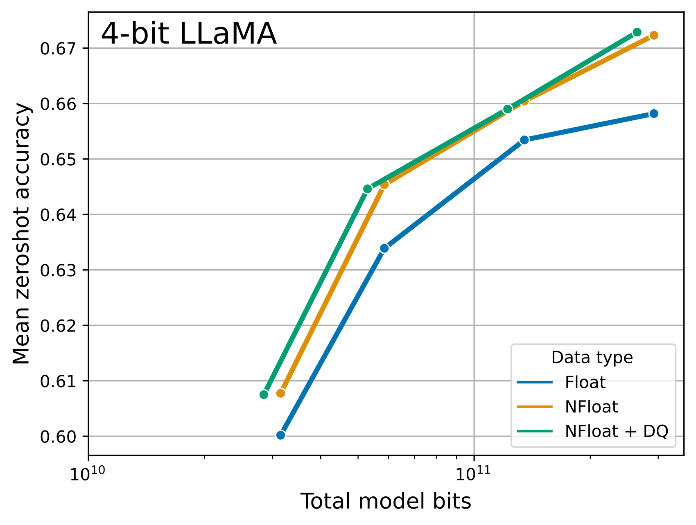
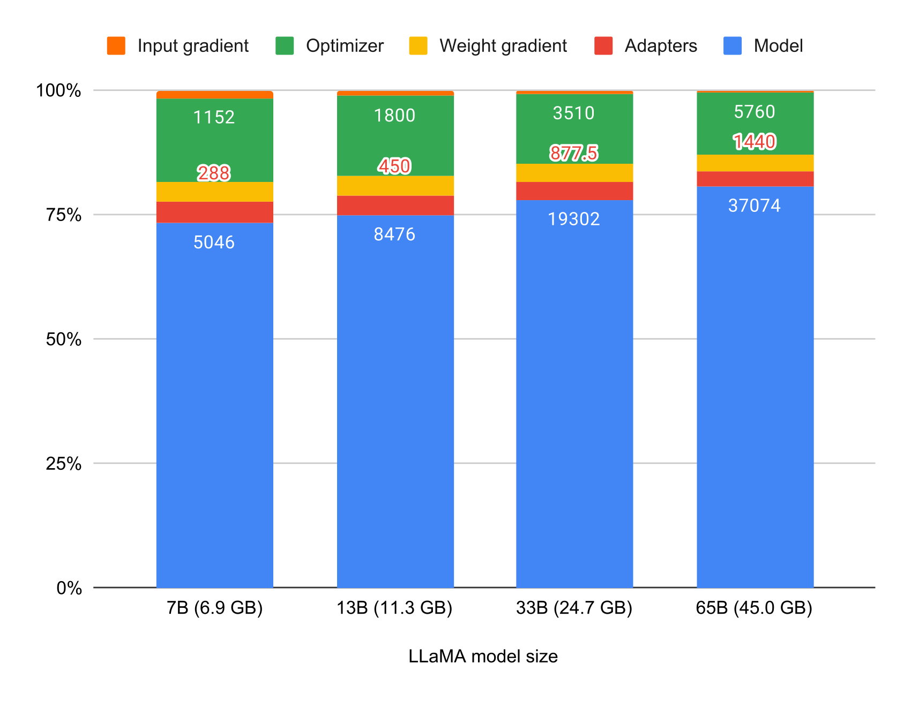
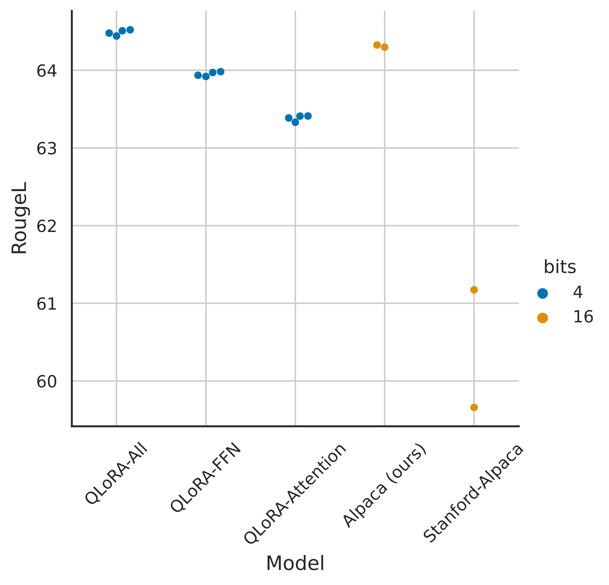

# QLoRA 论文研读：四位基座微调、Guanaco 与评测边界

> **简述**：将冻结基座压为 NF4，以双重量化减少量化常数开销，并用分页优化器处理显存峰值，在低显存下训练 LoRA。 
> **paper**：[QLoRA: Efficient Finetuning of Quantized LLMs](https://arxiv.org/abs/2305.14314) · NeurIPS 2023 
> **code**：[artidoro/qlora](https://github.com/artidoro/qlora) · **refs**：[LoRA](https://arxiv.org/abs/2106.09685) 
> **backbone**：LLaMA 7B–65B；另有 RoBERTa、T5 实验 · **date**：2023-05 
> **modality / languages**：文本；主要英语指令与评测，不据此承诺多语言效果。

## 论文简介

LoRA 大幅减少了可训练状态，但仍需在显存中保存高精度基座，超大模型的适配门槛依然很高。QLoRA 将基座冻结并以四位 NF4 存储，计算时反量化到较高精度，让梯度经过基座传向 LoRA；同时对量化尺度再次量化，并通过统一内存分页缓解优化器状态引起的显存峰值。论文展示了在单张 48 GB GPU 上微调 65B 模型的可行性，在多组任务上接近十六位 LoRA 的效果，训练出的 Guanaco 也获得较强的对话评分。但四位描述的是权重存储，实际显存还包括激活和适配器状态；聊天评测存在裁判与顺序偏差，量化格式及推理部署收益也依赖具体实现。

## 摘要译文

我们提出 QLoRA，一种高效微调方法：它大幅降低显存使用，使单张 48 GB GPU 可以微调 65B 参数模型，同时保留十六位微调的任务表现。QLoRA 将梯度通过冻结的四位量化预训练模型，传播到低秩适配器。

我们最好的模型系列 Guanaco，在 Vicuna benchmark 上超过此前所有公开发布的模型，仅用单张 GPU 微调 24 小时，达到 ChatGPT 表现的 99.3%。QLoRA 引入了三项节省显存且保持效果的创新：面向正态分布权重的四位 NormalFloat、通过量化量化常数来降低平均存储开销的双重量化，以及管理显存峰值的分页优化器。

我们利用节约的资源训练了超过一千个模型，研究指令遵循与聊天表现，涵盖八种指令数据、多种模型类型（LLaMA、T5），以及使用常规微调难以实验的规模，例如 33B 和 65B。结果说明，小而高质量的数据可以获得很强效果，即使所用模型小于此前最佳模型。我们通过人工与 GPT-4 评测分析聊天模型，发现 GPT-4 评测虽是较廉价、合理的人工评测替代方案，但现有聊天基准不足以准确评估聊天模型水平。我们还通过生成样例分析 Guanaco 相对 ChatGPT 的失败之处，并发布模型、代码及四位训练内核。

**解读**：“99.3%”是特定相对评分，不是通用能力百分比；33B/65B 与完整十六位全量微调的严格等价性，也没有被正文全部建立，后文会说明。

## 引言与相关工作：量化和 PEFT 分别解决一部分成本

量化研究希望减少权重或激活的位宽，但异常值和分布差异会导致误差；PEFT 则减少参与训练的参数及其梯度、优化器状态。LoRA 解决了后一部分，却仍需保存基座权重。QLoRA 让两条路线结合：基座以低位存储，反向信号仍经过该基座，任务变化由高精度适配器承载。

论文中的 Guanaco 是监督指令微调模型，并未因为使用 OASST1 就自动包含 RLHF。OASST1 本身可用于偏好或强化学习相关流程，但本文的训练目标与数据处理仍需按其实际实验理解。

## LoRA 之后，显存还花在哪里

LoRA 让梯度和优化器状态主要属于小适配器，但 65B 的十六位基座权重本身就约为 130 GB。QLoRA 因此进一步压缩**冻结基座**。它没有把每次优化都变成对四位整数权重求梯度，也没有让全部计算都使用四位算术。

绿色箭头表示梯度流，蓝色箭头表示参数更新。QLoRA 的基座仍参与前后向，但更新发生在适配器；紫色箭头表示优化器状态可以通过分页在 CPU/GPU 之间迁移。图中的四位基座、十六位适配器和三十二位优化器状态不能合并理解为“整个模型都是四位”。

## 一次前向与反向如何进行

用 $q$ 表示四位代码，$s$ 表示量化尺度，$D(q,s)$ 表示反量化后的近似权重：

$$
h=D(q,s)x+\frac{\alpha}{r}BAx.
$$

基座的代码与尺度被冻结；矩阵乘法使用反量化后的计算表示，论文通常采用 BF16，LoRA 参数在较高精度下训练。损失沿冻结网络回传到 $A,B$，不优化 $q$。尺度、优化器状态和某些算子可能有自己的精度，因此“存储四位”和“计算 BF16”是主路径的区分，并不表示实现只出现两种数据类型。

任务目标仍是监督学习：对生成任务最大化正确目标序列的条件似然；分类任务使用相应标签目标。是否只对回复计算损失，取决于数据格式和训练配置，不能由 QLoRA 这个名字推断。

## NF4：把有限代码分给更常见的权重

均匀 INT4 在数轴上等距放置表示值，但预训练权重通常集中在零附近。NF4（NormalFloat 4-bit）用正态分布分位数构造非均匀码本，在密集区域分配更多分辨率，使用 16 个四位代码表示归一化权重，并包含精确零。

对一个权重块，以绝对最大值等尺度归一化后，选择最近的 NF4 码本值；计算时用码本查表并乘回尺度。原文常用块大小 64，以控制异常值对整块分辨率的影响。

“信息论最优”带有分布假设：它针对近似正态权重的表示设计，不意味着对任意权重、异常值或激活都最优。NF4 也不是均匀 INT4 的另一个名称。

图中平均了 Winogrande、HellaSwag、PIQA、ARC-Easy 和 ARC-Challenge 的准确率。NF4 比常规 FP4 更能保留这些模型的零样本表现；双重量化主要提供进一步的存储收益，其性能变化较小。这一实验比较的是特定模型上的表示损失，不是所有部署内核的速度。

## 双重量化：连尺度也占空间

若每 64 个权重共享一个 FP32 尺度，单尺度开销为

$$
\frac{32}{64}=0.5\ \text{bit/parameter}.
$$

四位权重之外的 0.5 bit 已不可忽视。Double Quantization 将这些尺度再量化为八位，并让每 256 个尺度共享更高层的 FP32 常数，近似开销为

$$
\frac{8}{64}+\frac{32}{64\times256}\approx0.127\ \text{bit/parameter}.
$$

于是每个参数约节省 0.373 bit，65B 模型约节省 3.03 GB（十进制）。主权重加这部分尺度约为 4.127 bit/parameter；这只是主要表示成本，不包括所有元数据、未量化层、激活、临时缓冲和适配器。原文还对尺度作中心化处理以适合二次量化。

## 分页优化器：给峰值留出空间

Paged Optimizers 使用 NVIDIA Unified Memory，在 GPU 不够时将优化器状态页迁移到 CPU，需要时再迁回。它针对的是训练中的瞬时峰值，特别是较长序列或 checkpointing 相关的波动。

它不会消除激活，也不会把内存不足自动变成无代价的训练；频繁迁移会引入传输和同步成本。是否需要分页，取决于模型、优化器、序列长度、batch、梯度累积和硬件。论文的“单张 48 GB GPU 微调 65B”是一个组合配置的结果，不应写成不依赖这些设置的固定显存需求，也不应误写为“A100 48GB”。

该图的输入梯度估算采用 batch size 1、序列长度 512，并未计入完整注意力开销。它说明量化之后适配器状态和激活仍然重要，不适合当成任意训练配置的显存计算器。

## 实验先建立一个强的十六位基线

若十六位 LoRA 本身没有调好，四位版本与它相近并不能证明量化几乎无损。作者先在 LLaMA 7B 的 Alpaca 指令微调中调学习率、batch 和适配位置，并使用 ROUGE-L 比较。

原图显示，仅在少量注意力投影上训练可能不足，覆盖 Transformer 中更多线性层是匹配强十六位基线的重要因素。这里的结论来自 LLaMA/Alpaca 的设置；它支持把 all-linear 纳入候选，不能推出所有架构、数据和预算下都必须用同一位置或同一秩。

## 数据、基准与比较对象

论文先用 RoBERTa/GLUE 和 T5/Super-NaturalInstructions 检查量化微调，再研究 LLaMA 7B、13B、33B、65B 的指令适配。Alpaca 是约 52K 条合成指令数据；FLAN v2 是多任务指令集合，论文对其使用的子集与后续聊天训练数据规模不同。Guanaco 使用筛选后的 OASST1 对话数据，约 9K 条训练样本。

MMLU 汇集 57 类学科多项选择题，衡量较广的知识与理解，论文报告五样本分数。Vicuna benchmark 则是 80 个开放式问题上的聊天回答评分。知识选择题和开放式对话不是同一个目标，聊天评分较强不意味着所有知识指标也更高。

### 四位 NF4 与十六位 LoRA：平均接近，单项仍有差异

下表摘自原论文表 4，均为五样本 MMLU，同一精度下分别在 Alpaca 或 FLAN v2 上微调：

| 模型 | BF16 Alpaca | NF4+DQ Alpaca | BF16 FLAN | NF4+DQ FLAN |
|---|---:|---:|---:|---:|
| LLaMA 7B | 38.4 | 39.0 | 45.6 | 44.5 |
| LLaMA 13B | 47.2 | 47.5 | 50.6 | 50.7 |
| LLaMA 33B | 57.7 | 57.3 | 60.5 | 59.2 |
| LLaMA 65B | 61.8 | 61.8 | 62.5 | 63.9 |

八个设置的均值分别为 53.0 与 53.1。均值接近支持量化适配的可行性，但 7B/FLAN、33B/FLAN 等单项存在下降，不能写成“所有测试零损失”。表 3 的 T5 11B 上，全量 BF16、BF16 LoRA、NF4+DQ 分别为 62.0、60.7、60.9，也说明适配器与全量微调本身仍可能有差距。

### Guanaco 的“99.3% ChatGPT”具体指什么

原论文表 6 用 GPT-4 为 Vicuna 问题上的回答评分，再相对 ChatGPT 归一化：

| 模型 | 论文报告的推理内存 | 相对 ChatGPT 的平均评分 |
|---|---:|---:|
| Guanaco 7B，四位 | 5 GB | 87.0 ± 5.4 |
| Guanaco 13B，四位 | 10 GB | 90.4 ± 5.2 |
| Guanaco 33B，四位 | 21 GB | 97.8 ± 4.4 |
| Guanaco 65B，四位 | 41 GB | 99.3 ± 4.4 |

这些是特定聊天问题、裁判和协议下的相对评分及原文区间，不是模型能力百分比。65B 在两种回答排列顺序下分别得到 96.7 与 101.9，顺序偏差已经足以影响相对排名。表中的推理内存也不是训练显存。

论文比较不同指令数据后发现，较小的高质量 OASST1 在聊天评测上很有效，而 FLAN 在 MMLU 等任务上有自身优势。这体现训练数据与目标评测的匹配程度；“9K 数据胜过更大集合”不能脱离数据性质成为普遍规律。

## 附录中的配方与消融

附录 A 比较 LoRA dropout、秩和目标层，并给出 T5/Super-NaturalInstructions 配置。LLaMA 7B/Alpaca 的消融中，当覆盖所有线性层时，所测秩范围的最终效果差异较小；这与原文强调适配位置一致，却不能推出任何任务都与秩无关。附录 B 的聊天训练则使用 $r=64,\alpha=16$、全部线性层、NF4+DQ 和 BF16 计算，并按模型及数据集调整 batch、学习率和步数。T5 实验使用另一套秩与 alpha，不能将两套设置混写成一个统一默认值。

OASST1 原始集合有 161443 条消息、66497 个对话，涵盖 35 种语言；本文每层仅保留排名最好的回复，最终得到 9209 个训练示例。这并不是以全部原始对话训练。作者在这些对话上训练用户与助手的完整轮次；另外的七十亿参数、四数据集消融中，只对目标计算损失的 MMLU 均值为 38.6，而对输入与目标同时计算为 37.5（表 10），作者未将这个结论推广到全部聊天指标。

附录 C/D 详细给出人工与 GPT-4 的打分、成对比较协议及顺序影响；E/F 解释 NF4 的构造和神经网络权重分布；G 拆分显存。代码、数据配方与评价协议共同决定结果，单独打开四位加载并不等于复现 Guanaco。

## 定性分析与论文自己指出的限制

作者通过生成样例展示了知识回忆、对错误前提的抵抗、拒答、保密指令、数学及语言任务的成功和失败。模型可以正确回答常见事实，也会对罕见事实自信地给出错误答案；对某些简单请求会错误拒绝，稍作改写又可能违背先前约束。这些样例补充了总体分数所不能反映的行为差异，但它们也不是按完整分布进行的可靠性测量。

原文限制章节明确说，资源成本使作者没有建立 33B/65B 上与十六位全量微调全面相当的结论；MMLU、Vicuna 和 OA 结果也不保证泛化到 BigBench、RAFT、HELM。对偏差的检查有限，三位基座和其他 PEFT 适配器也未在本文系统验证。作者关于手机端微调的讨论属于潜在影响与估算，不能作为已完成的设备实测结果。

## 推理与合并：QLoRA 没有规定唯一部署方式

训练后可以保留四位基座与浮点 LoRA 分支，直接运行两者的和；也可以反量化后合并为浮点模型。若要把合并结果再压回低位，通常会引入新的量化误差：

$$
Q\!\left(D(q,s)+\frac{\alpha}{r}BA\right)
$$

一般不能与训练时的未重新量化前向完全等价。QA-LoRA 正是从可合并到量化参数这一需求出发，进一步约束更新结构。不能因此说 QLoRA “必须先变回 FP16 才能推理”，也不能因为训练省显存就承诺推理一定加速；速度还取决于反量化与矩阵乘法内核、batch 和硬件。

## 结论与局限

QLoRA 将“少训练参数”推进到“少存储冻结权重”，NF4、双重量化和分页优化器分别解决表示误差、尺度开销和峰值显存。论文展示的不是四位全量训练，而是在量化模型上训练较高精度适配器。其局限包括量化分布假设、激活开销、分页代价、有限聊天评测，以及合并到低位部署时可能发生的再次量化误差。

## 参考资料

- Dettmers et al. [QLoRA: Efficient Finetuning of Quantized LLMs](https://arxiv.org/abs/2305.14314)，NeurIPS 2023；方法、实验、定性分析与附录 A–G。
- [官方实现与 Guanaco 说明](https://github.com/artidoro/qlora)。

- [LoRA 技术总章](../LoRA技术深度调研报告.md)：跨论文理解 rank、alpha、目标权重、训练与部署。

## 原文与中文全译

- [英文全文](en.md)，保留主文、附录、图表、脚注和参考文献。
- [中文全译稿](zh.md)，以机器初译为底稿，统一术语，并校订摘要及关键方法段落。
