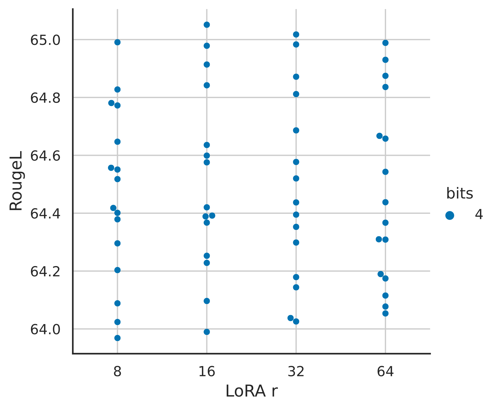

# QLoRA：量化大型语言模型的高效微调

> 原文：[arXiv:2305.14314v1](https://arxiv.org/html/2305.14314v1)，作者及机构信息见下。
> 中文全译稿：以机器初译为底稿，统一技术术语，并校订摘要和关键方法段落；覆盖主文、附录、表格、图注和脚注。参考文献保留原始书目，原图内部文字保留英文。英文转写见 [en.md](en.md)，方法分析另见 [QLoRA详解.md](QLoRA详解.md)。

## 作者与机构

## Authors and affiliations

Tim Dettmers [^id2] Artidoro Pagnoni * Ari Holtzman Luke Zettlemoyer Affiliation: University of Washington Email: {dettmers,artidoro,ahai,lsz}@cs.washington.edu

## 摘要

我们提出 QLoRA，一种高效微调方法：它大幅降低显存使用，使单张 48 GB GPU 可以微调 65B 参数模型，同时保留十六位微调的任务表现。QLoRA 将梯度通过冻结的四位量化预训练模型，传播到低秩适配器。

我们最好的模型系列 Guanaco，在 Vicuna benchmark 上超过此前所有公开发布的模型，仅用单张 GPU 微调 24 小时，达到 ChatGPT 表现的 99.3%。QLoRA 引入了三项节省显存且保持效果的创新：面向正态分布权重的四位 NormalFloat、通过量化量化常数来降低平均存储开销的双重量化，以及管理显存峰值的分页优化器。

我们利用节约的资源训练了超过一千个模型，研究指令遵循与聊天表现，涵盖八种指令数据、多种模型类型（LLaMA、T5），以及使用常规微调难以实验的规模，例如 33B 和 65B。结果说明，小而高质量的数据可以获得很强效果，即使所用模型小于此前最佳模型。我们通过人工与 GPT-4 评测分析聊天模型，发现 GPT-4 评测虽是较廉价、合理的人工评测替代方案，但现有聊天基准不足以准确评估聊天模型水平。我们还通过生成样例分析 Guanaco 相对 ChatGPT 的失败之处，并发布模型、代码及四位训练内核。 [^footnote1]

## 简介

微调大型语言模型 (LLM) 是提高其性能的高效方法 [40, 62, 43, 61, 59, 37] 并添加所需或删除不需要的行为 [43, 2, 4]。然而，对非常大的模型进行微调的成本却高得令人望而却步。 LLaMA 65B 参数模型 [57] 的常规 16 位微调需要超过 780 GB 的 GPU 显存。虽然最近的量化方法可以减少 LLM 的内存占用[14,13,18,66]，但此类技术仅适用于推理并在训练期间崩溃[65]。

我们首次证明可以在不降低任何性能的情况下对量化的 4 位模型进行微调。我们的方法 QLoRA 使用一种新颖的高精度技术将预训练模型量化为 4 位，然后添加一小组可学习的低秩适配器权重 [28]

| 型号 | 尺寸 | 埃洛 |
| --- | --- | --- |
| GPT-4 | - | 1348 $\pm$ 1 |
| 原驼65B | 41GB | 1022 $\pm$ 1 |
| 原驼33B | 21GB | 992 $\pm$ 1 |
| 骆驼毛13B | 26GB | 974 $\pm$ 1 |
| 聊天GPT | - | 966 $\pm$ 1 |
| 原驼13B | 10GB | 916 $\pm$ 1 |
| 吟游诗人 | - | 902 $\pm$ 1 |
| 原驼7B | 6GB | 879 $\pm$ 1 |

表 1：模型之间竞争的 Elo 评分，对 10,000 个随机初始排序进行平均。比赛的获胜者由 GPT-4 决定，GPT-4 声明对于 Vicuna 基准的给定提示，哪种响应更好。显示 95% 置信区间 ($\pm$)。 GPT-4之后，Guanaco 33B和65B赢得比赛最多，而Guanaco 13B得分高于Bard。

通过量化权重反向传播梯度来调整。

与 16 位全量微调基准相比，QLoRA 将微调 65B 参数模型的平均内存需求从 $>$ 780GB GPU 显存降低到 $<$ 48GB，而不会降低运行时或预测性能。这标志着 LLM 微调的可访问性发生了重大转变：现在是迄今为止在单个 GPU 上可微调的最大的公开可用模型。使用QLoRA，我们训练了Guanaco系列模型，第二好的模型在Vicuna [10]基准上达到了ChatGPT性能水平的97.8%，同时在单个消费者GPU上可以在不到12小时内完成训练；使用单个专业 GPU 在 24 小时内，我们最大的模型达到了 99.3%，基本上缩小了 Vicuna 基准测试中与 ChatGPT 的差距。部署后，我们最小的guanaco模型（7B参数）仅需要5GB内存，并且在Vicuna基准测试中比26GBAlpaca模型高出20个百分点以上（表6）。

QLoRA 引入了多项创新，旨在在不牺牲性能的情况下减少内存使用：(1) 4 位 NormalFloat，这是一种适用于正态分布数据的信息理论上最佳量化数据类型，可产生比 4 位整数和 4 位浮点更好的经验结果。 (2) Double Quantization，一种对量化常数进行量化的方法，每个参数平均节省约 0.37 位（65B 型号约为 3 GB）。 (3)分页优化器，使用NVIDIA统一内存来避免处理长序列长度的小批量时出现的梯度检查点内存峰值。我们将这些贡献结合到一个更好调整的 LoRA 方法中，该方法在每个网络层都包含适配器，从而避免了之前工作中出现的几乎所有准确性权衡。

QLoRA 的效率使我们能够在模型规模上对指令微调和聊天机器人性能进行深入研究，而由于内存开销，使用常规微调是不可能的。因此，我们在多个指令调整数据集、模型架构和 80M 到 65B 参数之间训练了 1,000 多个模型。除了展示 QLoRA 恢复 16 位性能（第 4 节）并训练最先进的聊天机器人guanaco（第 5 节）外，我们还分析了训练模型的趋势。首先，我们发现数据质量比数据集大小重要得多，例如，在聊天机器人性能方面，9k 样本数据集 (OASST1) 优于 450k 样本数据集（FLAN v2，二次采样），即使两者都旨在支持泛化后的指令。其次，我们表明，强大的大规模多任务语言理解（MMLU）基准性能并不意味着强大的 Vicuna 聊天机器人基准性能，反之亦然 - 换句话说，对于给定任务，数据集的适用性比大小更重要。

此外，我们还使用人类评分者和 GPT-4 进行评估，对聊天机器人的性能进行广泛的分析。我们使用锦标赛式的基准测试，模型在比赛中相互竞争，以针对给定的提示产生最佳响应。比赛的获胜者由 GPT-4 或人类注释者评判。锦标赛结果汇总为 Elo 分数 [16, 17]，决定聊天机器人性能的排名。我们发现 GPT-4 和人类评估在锦标赛中模型表现的排名上基本一致，但我们也发现存在强烈分歧的情况。因此，我们强调基于模型的评估在提供人工注释的廉价替代方案的同时也存在不确定性。

我们通过对guanaco模型的定性分析来增强我们的聊天机器人基准测试结果。我们的分析强调了定量基准未捕获的成功和失败案例。

我们发布了带有人类和 GPT-4 注释的所有模型代，以方便进一步的研究。我们开源代码库和 CUDA 内核，并将我们的方法集成到 Hugging Face 转换器堆栈 [64] 中，使所有人都能轻松访问它们。我们发布了适用于 7/13/33/65B 尺寸模型的适配器集合，在 8 个不同的指令遵循数据集上进行训练，总共 32 个不同的开源、经过微调的模型。

图 1：不同的微调方法及其内存要求。 QLoRA 通过将转换器模型量化到 4 位精度并使用分页优化器来处理内存峰值，从而对 LoRA 进行了改进。

## 背景

#### 分块 k 位量化

量化是将输入从包含更多信息的表示离散化为信息较少的表示的过程。它通常意味着采用更多位的数据类型并将其转换为更少位，例如从 32 位浮点数转换为 8 位整数。为了确保使用低位数据类型的整个范围，通常通过输入元素的绝对最大值归一化将输入数据类型重新缩放到目标数据类型范围，输入元素通常被构造为张量。例如，将 32 位浮点 (FP32) 张量量化为范围为 $[-127,127]$ 的 Int8 张量：

$$
\mathbf{X}^{\text{Int8}}=\text{round}\left(\frac{127}{{\text{absmax}}(\mathbf{X}^{{\text{FP32}}})}\mathbf{X}^{{\text{FP32}}}\right)=\text{round}(c^{\text{FP32}}\cdot\mathbf{X}^{{\text{FP32}}}),
$$

其中 $c$ 是量化常数或量化比例。反量化则相反：

$$
\text{dequant}(c^{\text{FP32}},\mathbf{X}^{\text{Int8}})=\frac{\mathbf{X}^{\text{Int8}}}{c^{\text{FP32}}}=\mathbf{X}^{\text{FP32}}
$$

这种方法的问题在于，如果输入张量中出现较大的值（即异常值），则量化仓（某些位组合）不会得到很好的利用，因为在某些仓中量化的数字很少或没有。为了防止异常值问题，一种常见的方法是将输入张量分成独立量化的块，每个块都有自己的量化常数 $c$ 。这可以形式化如下：我们通过展平输入张量并将线性段切片为 ${n=({b\times h})/{B}}$ 块，将输入张量 $\mathbf{X}\in\mathbb{R}^{b\times h}$ 分块为 $n$ 大小为 $B$ 的连续块。我们使用公式 1 独立量化这些块，以创建量化张量和 $n$ 量化常数 $c_{i}$ 。

#### 低级适配器

低秩适配器（LoRA）微调[28]是一种通过使用一小组可训练参数（通常称为适配器）来减少内存需求的方法，同时不更新保持固定的完整模型参数。随机梯度下降期间的梯度通过固定的预训练模型权重传递到适配器，适配器被更新以优化损失函数。 LoRA 通过额外的因式分解投影增强了线性投影。给定一个带有 $\mathbf{X}\in\mathbb{R}^{b\times h}$ 的投影 ${\mathbf{X}\mathbf{W}=\mathbf{Y}}$ ， $\mathbf{W}\in\mathbb{R}^{h\times o}$ LoRA 计算：

$$
\mathbf{Y}=\mathbf{X}\mathbf{W}+s\mathbf{X}\mathbf{L}_{1}\mathbf{L}_{2},
$$

其中 $\mathbf{L}_{1}\in\mathbb{R}^{h\times r}$ 和 $\mathbf{L}_{2}\in\mathbb{R}^{r\times o}$ 和 $s$ 是标量。

#### 参数高效微调的内存要求

讨论的一个重要要点是 LoRA 在训练过程中对内存的要求，包括所使用的适配器的数量和大小。由于 LoRA 的内存占用非常小，因此我们可以使用更多适配器来提高性能，而无需显着增加所使用的总内存。虽然 LoRA 被设计为参数高效微调 (PEFT) 方法，但 LLM 微调的大部分内存占用来自激活梯度，而不是来自学习的 LoRA 参数。对于在批量大小为 1 的 FLAN v2 上训练的 7B LLaMA 模型，LoRA 权重相当于常用的原始模型权重的 0.2% [28, 37]，LoRA 输入梯度的内存占用为 567 MB，而 LoRA 参数仅占用 26 MB。通过梯度检查点 [9]，每个序列的输入梯度平均减少到 18 MB，这使得它们比所有 LoRA 权重的总和更加占用内存。相比之下，4 位基本模型消耗 5,048 MB 内存。这凸显了梯度检查点很重要，但积极减少 LoRA 参数的数量只能产生很小的内存优势。这意味着我们可以使用更多适配器，而不会显着增加总体训练内存占用（详细信息请参阅附录 G）。正如稍后所讨论的，这对于恢复完整的 16 位精度性能至关重要。

## QLoRA 微调

QLoRA 利用我们提出的两项技术实现高保真的四位微调：四位 NormalFloat（NF4）量化和双重量化。另外，我们引入分页优化器，防止梯度检查点期间的显存峰值造成内存不足错误；这类错误此前使大型模型难以在单台机器上微调。

QLoRA 具有一种低精度存储数据类型（在我们的例子中通常为 4 位）和一种计算数据类型（通常为 BFloat16）。实际上，这意味着每当使用 QLoRA 权重张量时，我们都会将该张量反量化为 BFloat16，然后执行 16 位矩阵乘法。

我们现在讨论 QLoRA 的组件，然后讨论 QLoRA 的正式定义。

#### 4 位 NormalFloat 量化

NormalFloat (NF) 数据类型建立在分位数量化 [15] 的基础上，分位数量化是一种信息理论上最优的数据类型，可确保每个量化仓具有从输入张量分配的相同数量的值。分位数量化的工作原理是通过经验累积分布函数估计输入张量的分位数。

分位数量化的主要限制是分位数估计过程成本高昂。因此，使用快速分位数近似算法（例如 SRAM 分位数 [15]）来估计它们。由于这些分位数估计算法的近似性质，数据类型对于异常值具有较大的量化误差，而异常值通常是最重要的值。

当输入张量来自固定为量化常数的分布时，可以避免昂贵的分位数估计和近似误差。在这种情况下，输入张量具有相同的分位数，使得精确的分位数估计在计算上是可行的。

由于预训练的神经网络权重通常具有标准差为 $\sigma$ 的零中心正态分布（参见附录 F），因此我们可以通过缩放 $\sigma$ 将所有权重转换为单个固定分布，以使分布完全符合我们的数据类型的范围。对于我们的数据类型，我们设置任意范围 $[-1,1]$ 。因此，数据类型的分位数和神经网络权重都需要标准化到这个范围内。

对于在 $[-1,1]$ 范围内具有任意标准差 $\sigma$ 的零均值正态分布的信息理论上最佳数据类型计算如下：（1）估计理论 $N(0,1)$ 分布的 $2^{k}+1$ 分位数以获得正态分布的 $k$ 位分位数量化数据类型，（2）采用该数据类型并将其值标准化为 $[-1,1]$ 范围，(3) 通过绝对最大重新缩放将输入权重张量标准化为 $[-1,1]$ 范围来量化输入权重张量。

一旦权重范围和数据类型范围匹配，我们就可以照常进行量化。步骤(3)相当于重新调整权重张量的标准差以匹配k位数据类型的标准差。更正式地说，我们估计数据类型的 $2^{k}$ 值 $q_{i}$ 如下：

$$
q_{i}=\frac{1}{2}\left(Q_{X}\left(\frac{i}{2^{k}+1}\right)+Q_{X}\left(\frac{i+1}{2^{k}+1}\right)\right),
$$

其中 $Q_{X}(\cdot)$ 是标准正态分布 $N(0,1)$ 的分位数函数。对称 k 位量化的一个问题是，这种方法没有零的精确表示，而零是无误差量化填充和其他零值元素的重要属性。为了确保 $0$ 的离散零点并将所有 $2^{k}$ 位用于 k 位数据类型，我们通过估计两个范围 $q_{i}$ 的分位数 $q_{i}$ 来创建非对称数据类型：$2^{k-1}$ 代表负数部分，$2^{k-1}+1$ 代表正数部分，然后我们统一这些集合$q_{i}$ 并删除两组中出现的两个零之一。我们将每个量化仓 k 位 NormalFloat (NFk) 中具有相同预期值数量的结果数据类型称为“信息理论上最佳”的数据类型，适用于以零为中心的正态分布数据。该数据类型的确切值可以在附录 E 中找到。

#### 双重量化

我们引入双重量化 (DQ)，即量化量化常数以进一步节省内存的过程。虽然精确的 4 位量化需要较小的块大小 [13]，但它也具有相当大的内存开销。例如，对于 $\mathbf{W}$ 使用 32 位常量和 64 的块大小，量化常量平均为每个参数添加 $32/64=0.5$ 位。双重量化有助于减少量化常数的内存占用。

更具体地，双重量化将第一量化的量化常数$c_{2}^{\text{FP32}}$视为第二量化的输入。该第二步骤产生量化的量化常数$c_{2}^{\text{FP8}}$和第二级量化常数$c_{1}^{\text{FP32}}$。我们使用块大小为 256 的 8 位浮点进行第二次量化，因为没有观察到 8 位量化的性能下降，这与 Dettmers 和 Zettlemoyer [13] 的结果一致。由于 $c_{2}^{\text{FP32}}$ 为正，因此我们在量化之前从 $c_{2}$ 中减去平均值，以使值以零为中心并利用对称量化。平均而言，对于 64 的块大小，此量化将每个参数的内存占用量从 $32/64=0.5$ 位减少到 $8/64+32/(64\cdot 256)=0.127$ 位，每个参数减少 0.373 位。

#### 分页优化器

使用 NVIDIA 统一内存 [^footnote2] 功能，该功能可在 CPU 和 GPU 之间自动进行页到页传输，以便在 GPU 偶尔出现内存不足的情况下实现无错误的 GPU 处理。该功能的工作原理类似于 CPU RAM 和磁盘之间的常规内存分页。我们使用此功能为优化器状态分配分页内存，然后在 GPU 显存不足时自动将其移出到 CPU RAM，并在优化器更新步骤需要内存时将其分页回 GPU 显存。

#### QLoRA。

使用上述组件，我们使用单个 LoRA 适配器为量化基础模型中的单个线性层定义 QLoRA，如下所示：

$$
\mathbf{Y}^{\text{BF16}}=\mathbf{X}^{\text{BF16}}\text{doubleDequant}(c_{1}^{\text{FP32}},c_{2}^{\text{k-bit}},\mathbf{W}^{\text{NF4}})+\mathbf{X}^{\text{BF16}}\mathbf{L}^{\text{BF16}}_{1}\mathbf{L}^{\text{BF16}}_{2},
$$

其中 doubleDequant $(\cdot)$ 定义为：

$$
\text{doubleDequant}(c_{1}^{\text{FP32}},c_{2}^{\text{k-bit}},\mathbf{W}^{\text{k-bit}})=\text{dequant}(\text{dequant}(c_{1}^{\text{FP32}},c_{2}^{\text{k-bit}}),\mathbf{W}^{\text{4bit}})=\mathbf{W}^{\text{BF16}},
$$

我们对 $\mathbf{W}$ 使用 NF4，对 $c_{2}$ 使用 FP8。我们对 $\mathbf{W}$ 使用 64 的块大小以获得更高的量化精度，对 $c_{2}$ 使用 256 的块大小以节省内存。

对于参数更新，仅需要相对于适配器权重 $\frac{\partial E}{\partial\mathbf{L}_{i}}$ 的误差的梯度，而不是 4 位权重 $\frac{\partial E}{\partial\mathbf{W}}$ 。然而，计算$\frac{\partial E}{\partial\mathbf{L}_{i}}$需要计算$\frac{\partial\mathbf{X}}{\partial\mathbf{W}}$，该计算通过等式(5)进行，从存储$\mathbf{W}^{\text{NF4}}$反量化到计算数据类型$\mathbf{W}^{\text{BF16}}$，以计算BFloat16精度的导数$\frac{\partial\mathbf{X}}{\partial\mathbf{W}}$。

总而言之，QLoRA 有一种存储数据类型（通常为 4 位 NormalFloat）和一种计算数据类型（16 位 BrainFloat）。我们将存储数据类型反量化为计算数据类型以执行前向和后向传递，但我们仅计算使用 16 位 BrainFloat 的 LoRA 参数的权重梯度。

## QLoRA 与标准微调

我们讨论了 QLoRA 的工作原理以及它如何显着减少微调模型所需的内存。现在的主要问题是 QLoRA 是否可以像全模型微调一样执行。此外，我们想要分析 QLoRA 的组件，包括 NormalFloat4 对标准 Float4 的影响。以下部分将讨论旨在回答这些问题的实验。

#### 实验设置。

我们考虑三种架构（编码器、编码器-解码器和仅解码器），并将 QLoRA 与 16 位适配器微调和高达 3B 的模型的全量微调进行比较。我们的评估包括 GLUE [58] 和 RoBERTa-large [38]、Super-NaturalInstructions (TKInstruct) [61] 和 T5 [49]，以及在 Flan v2 [39] 和 Alpaca [55] 上微调 LLaMA 后的 5-shot MMLU [24]。为了进一步研究 NF4 相对于其他 4 位数据类型的优势，我们使用 Dettmers 和 Zettlemoyer [13] 的设置，并针对模型大小 125m - 13B 测量不同模型（OPT [72]、LLaMA [57]、BLOOM [52]、Pythia [7]）的后量化零样本精度和困惑度。我们在结果部分为每个特定设置提供了更多详细信息，以使结果更具可读性。完整详细信息参见附录 A。

图 2：Alpaca 数据集上的 LLaMA 7B 模型的 RougeL。每个点代表使用不同随机种子的运行。我们改进了斯坦福羊驼全量微调的默认超参数，以构建强大的 16 位基线进行比较。在所有Transformer层上使用 LoRA 对于匹配 16 位性能至关重要。

虽然分页优化器对于在单个 24/48GB GPU 上进行 33B/65B QLoRA 调优至关重要，但我们不为分页优化器提供硬测量，因为分页仅在处理具有长序列长度的小批量时才会发生，而这种情况很少见。然而，我们确实对 48GB GPU 上的 65B 模型的分页优化器的运行时间进行了分析，发现批量大小为 16 时，分页优化器提供了与常规优化器相同的训练速度。未来的工作应该测量和描述在什么情况下寻呼过程会发生减速。

图 3：使用具有不同 4 位数据类型的 LLaMA 模型，Winogrande、HellaSwag、PiQA、Arc-Easy 和 Arc-Challenge 的平均零样本精度。与常规 4 位浮点数相比，NormalFloat 数据类型显着提高了逐位精度增益。虽然双重量化 (DQ) 只会带来较小的收益，但它允许对内存占用进行更细粒度的控制，以将特定大小 (33B/65B) 的模型适合特定 GPU (24/48GB)。

#### 默认 LoRA 超参数与 16 位性能不匹配

当使用应用 LoRA 来查询和评估注意力投影矩阵的标准实践时 [28]，我们无法复制大型基础模型的完整微调性能。如图 2 所示，针对 Alpaca 上的 LLaMA 7B 微调，我们发现最关键的 LoRA 超参数是总共使用了多少个 LoRA 适配器，并且所有线性Transformer块层上的 LoRA 都需要匹配完整的微调性能。其他 LoRA 超参数，例如投影维度 $r$ ，不会影响性能（请参阅附录 A ）。

同样，我们发现全量微调的基线的默认超参数调整不足。我们对学习率 1e-6 到 5e-5 和批量大小 8 到 128 进行超参数搜索，以找到可靠的基线。 Alpaca 上的 7B LLaMA 微调结果如图 2 所示。

#### 4 位 NormalFloat 比 4 位浮点具有更好的性能

| 数据类型 | 平均PPL |
| --- | --- |
| 整数4 | 34.34 |
| 浮点4 (E2M1) | 31.07 |
| 浮点数4 (E3M0) | 29.48 |
| NFloat4 + DQ | 27.41 |

表 2：125M 至 13B OPT、BLOOM、LLaMA 和 Pythia 模型的不同数据类型的 Pile Common Crawl 平均困惑度。

虽然 4 位 NormalFloat (NF4) 数据类型在信息理论上是最佳的，但仍需要确定该属性是否可以转化为经验优势。我们遵循 Dettmers 和 Zettlemoyer [13] 的设置，其中不同大小（125M 到 65B）、不同数据类型的量化 LLM（OPT [72]、BLOOM [52]、Pythia [7]、LLaMA）在语言建模和一组零样本任务上进行评估。在图 3 和表 2 中，我们看到 NF4 比 FP4 和 Int4 显着提高了性能，并且双重量化减少了内存占用，而不会降低性能。

#### k 位 QLoRA 匹配 16 位全量微调和 16 位 LoRA 性能

最近的研究结果表明，用于推理的 4 位量化是可能的，但会导致相对于 16 位的性能下降 [13, 18]。这就提出了一个关键问题：是否可以通过进行 4 位适配器微调来恢复损失的性能。我们针对两种设置进行了测试。

第一个重点是与 GLUE 和 Super-NaturalInstructions 数据集上大小为 125M 至 3B 参数的 RoBERTA 和 T5 模型的完整 16 位微调进行比较。结果如表3所示。在这两个数据集中，我们观察到 16 位、8 位和 4 位适配器方法复制了全量微调的 16 位基线的性能。这表明由于量化不精确而造成的性能损失可以通过量化后的适配器微调来完全恢复。

对于我们的第二个设置，由于 11B 参数及以上参数的全量微调模型需要不止一台高内存 GPU 服务器，因此我们继续测试 4 位 QLoRA 是否可以在 7B 到 65B 参数范围内匹配 16 位 LoRA。为此，我们在两个指令跟踪数据集 Alpaca 和 FLAN v2 上对 LLaMA 7B 到 65B 进行微调，并通过 5 次精度在 MMLU 基准上进行评估。结果如表 4 所示，我们看到采用双重量化的 NF4 完全恢复了 16 位 LoRA MMLU 性能。此外，我们还注意到带有 FP4 的 QLoRA 落后于 16 位脑浮点 LoRA 基线约 1 个百分点。这证实了我们的两个发现：(1) 带有 NF4 的 QLoRA 复制了 16 位全量微调和 16 位 LoRA 微调性能，以及 (2) NF4 在量化精度方面优于 FP4。

| 数据集 | 胶水（附件） | 超自然说明 (RougeL) | 超自然说明 (RougeL) | 超自然说明 (RougeL) | 超自然说明 (RougeL) | 超自然说明 (RougeL) |
| --- | --- | --- | --- | --- | --- | --- |
| 型号 | 罗伯特·塔大 | T5-80M | T5-250M | T5-780M | T5-3B | T5-11B |
| BF16 | 88.6 | 40.1 | 42.1 | 48.0 | 54.3 | 62.0 |
| BF16复制 | 88.6 | 40.0 | 42.2 | 47.3 | 54.9 | - |
| 洛拉BF16 | 88.8 | 40.5 | 42.6 | 47.1 | 55.4 | 60.7 |
| QLoRA Int8 | 88.8 | 40.4 | 42.9 | 45.4 | 56.5 | 60.7 |
| QLoRA FP4 | 88.6 | 40.3 | 42.4 | 47.5 | 55.6 | 60.9 |
| QLoRA NF4 + DQ | - | 40.4 | 42.7 | 47.7 | 55.3 | 60.9 |

表 3：在 GLUE 和 Super-Natural 指令上比较 16 位 BrainFloat (BF16)、8 位整数 (Int8)、4 位浮点 (FP4) 和 4 位 NormalFloat (NF4) 的实验。 QLoRA 复制 16 位 LoRA 并进行全量微调。

#### 总结

我们的结果一致表明，具有 NF4 数据类型的 4 位 QLoRA 在具有完善的评估设置的学术基准上与 16 位全量微调和 16 位 LoRA 微调性能相匹配。我们还表明 NF4 比 FP4 更有效，并且双重量化不会降低性能。结合起来，这形成了令人信服的证据，证明 4 位 QLoRA 调整可靠地产生与 16 位方法匹配的结果。

与之前的量化工作一致[13]，我们的 MMLU 和 Elo 结果表明，在给定的微调和推理资源预算的情况下，增加基本模型中的参数数量同时降低其精度是有益的。这凸显了 QLoRA 效率优势的重要性。由于在 4 位微调实验中，我们没有观察到与全量微调相比性能下降，因此这就提出了 QLoRA 调优的性能与精度权衡到底在哪里的问题，我们将这个问题留给未来的工作来探索。

我们继续研究在学术研究硬件上使用完整 16 位微调无法探索的规模的指令调整。

|  | 平均 5 次 MMLU 准确度 | 平均 5 次 MMLU 准确度 | 平均 5 次 MMLU 准确度 | 平均 5 次 MMLU 准确度 | 平均 5 次 MMLU 准确度 | 平均 5 次 MMLU 准确度 | 平均 5 次 MMLU 准确度 | 平均 5 次 MMLU 准确度 |  |
| --- | --- | --- | --- | --- | --- | --- | --- | --- | --- |
| 美洲驼尺寸 | 7B | 7B | 13B | 13B | 33B | 33B | 65B | 65B | 平均值 |
| 数据集 | 羊驼毛 | 局域网v2 | 羊驼毛 | 局域网v2 | 羊驼毛 | 局域网v2 | 羊驼毛 | 局域网v2 |  |
| BFloat16 | 38.4 | 45.6 | 47.2 | 50.6 | 57.7 | 60.5 | 61.8 | 62.5 | 53.0 |
| 浮点4 | 37.2 | 44.0 | 47.3 | 50.0 | 55.9 | 58.5 | 61.3 | 63.3 | 52.2 |
| NFloat4 + DQ | 39.0 | 44.5 | 47.5 | 50.7 | 57.3 | 59.2 | 61.8 | 63.9 | 53.1 |

表 4：使用 Alpaca 和 FLAN v2 上的适配器针对不同数据类型进行微调的 LLaMA 7-65B 模型的平均 5 次 MMLU 测试精度。总体而言，具有双重量化 (DQ) 的 NF4 与 BFloat16 性能相匹配，而 FP4 始终落后两者 1 个百分点。

## 通过 QLoRA 将聊天机器人推向最先进的水平

在确定 4 位 QLoRA 在各个规模、任务和数据集上与 16 位性能相匹配后，我们对指令微调进行了深入研究，直至可用于研究的最大开源语言模型。为了评估指令微调这些模型的性能，我们对具有挑战性的自然语言理解基准（MMLU）进行评估，并开发用于现实世界聊天机器人性能评估的新方法。

### 实验装置

现在，我们概述了实验设置，并在附录 B 中提供了完整的详细信息。

#### 数据

据我们所知，还没有对最近的指令遵循数据集进行全面的研究，因此我们选择了八个最近的数据集。我们包括通过众包（OASST1 [ 31 ]、HH-RLHF [ 4 ] ）、指令调整模型（Alpaca [ 55 ]、自我指令 [ 59 ] 、非自然指令 [ 26 ] ）、语料库聚合（FLAN v2 [ 12 ] ）以及混合模型（Chip2 [ 32 ] 、长篇[30]）。这些数据集涵盖不同的语言、数据大小和许可证。

#### 训练设置

为了避免不同训练目标的混淆效果，我们使用交叉熵损失（监督学习）进行 QLoRA 微调，而无需强化学习，即使对于包含人类对不同响应的判断的数据集也是如此。对于指令和响应之间有明显区别的数据集，我们仅对响应进行微调（请参阅附录 B 中的消融）。对于 OASST1 和 HH-RLHF，可以使用多个响应。然后，我们选择对话树每个级别的顶部响应，并对整个选定的对话（包括说明）进行微调。在我们所有的实验中，我们使用具有双重量化和分页优化器的 NF4 QLoRA，以防止梯度检查点期间出现内存峰值。我们对 13B 和 33B LLaMA 模型进行了小型超参数搜索，发现除了学习率和批量大小之外，在 7B 中找到的所有超参数设置都具有泛化性（包括纪元数）。我们将 33B 和 65B 的学习率减半，同时将批量大小加倍。

#### 基线

我们将我们的模型与研究（Vicuna [10] 和 Open Assistant [31]）和商业（GPT-4 [42]、GPT-3.5-turbo 和 Bard）聊天机器人系统进行比较。 Open Assistant 模型是一个 LLaMA 33B 模型，在我们实验的同一 OASST1 数据集上通过人类反馈强化学习 (RLHF) 进行了微调。 Vicuna 在 ShareGPT 的专有用户共享对话上对 LLaMA 13B 进行了全量微调，因此是 OpenAI GPT 模型蒸馏的结果。

### 评价

| 数据集 | 7B | 13B | 33B | 65B |
| --- | --- | --- | --- | --- |
| LLaMA 没有调音 | 35.1 | 46.9 | 57.8 | 63.4 |
| 自学 | 36.4 | 33.3 | 53.0 | 56.7 |
| 长篇 | 32.1 | 43.2 | 56.6 | 59.7 |
| 芯片2 | 34.5 | 41.6 | 53.6 | 59.8 |
| HH-RLHF | 34.9 | 44.6 | 55.8 | 60.1 |
| 不自然的指导 | 41.9 | 48.1 | 57.3 | 61.3 |
| 原驼 (OASST1) | 36.6 | 46.4 | 57.0 | 62.2 |
| 羊驼毛 | 38.8 | 47.8 | 57.3 | 62.5 |
| 局域网v2 | 44.5 | 51.4 | 59.2 | 63.9 |

表 5：使用 QLoRA 在相应数据集上微调的不同大小 LLaMA 的 MMLU 5 次测试结果。

按照惯例，我们使用 MMLU（大规模多任务语言理解）基准 [24] 来衡量一系列语言理解任务的性能。这是一个多项选择基准，涵盖 57 项任务，包括基础数学、美国历史、计算机科学、法律等。我们报告 5 次测试的准确性。

我们还通过自动评估和人工评估来测试生成语言能力。第二组评估依赖于人类策划的查询，旨在衡量模型响应的质量。虽然这是一个更现实的聊天机器人模型性能测试平台并且越来越受欢迎，但文献中没有普遍接受的协议。我们在下面描述了我们建议的设置，在所有情况下都使用 $p=0.9$ 和温度 $0.7$ 的核采样。

#### 基准数据

我们评估两个精选的查询（问题）数据集：Vicuna 提示 [10] 和 OASST1 验证数据集 [31]。我们使用 Vicuna 提示，这是一组来自不同类别的 80 个提示，未进行任何修改。 OASST1 数据集是用户和助手之间众包多轮对话的多语言集合。我们选择验证数据集中的所有用户消息作为查询，并在提示中包含之前的轮次。此过程导致 953 个唯一的用户查询。我们将这两个数据集称为 Vicuna 和 OA 基准。

#### 自动评估

首先，基于Chiang等人介绍的评估协议。 [10]，我们使用 GPT-4 在 Vicuna 基准测试上针对 ChatGPT (GPT-3.5 Turbo) 来评估不同系统的性能。给定一个查询以及 ChatGPT 和模型的响应，GPT-4 会被提示为这两个响应打分（满分 10 分）并提供解释。模型的整体性能以 ChatGPT 得分的百分比计算。请注意，如果模型获得比 ChatGPT 更高的绝对分数，则此相对分数可能高于 100%。我们发现 GPT-4 具有显着的排序效应，可以提高提示中较早发生的响应的分数。为了控制这种影响，我们建议报告两个订单的平均分数。

接下来，我们通过系统输出之间的直接比较来衡量性能。我们将评级方案简化为考虑关系的三类标签问题。我们提示 GPT-4 选择最佳响应或声明平局并提供解释。我们在 Vicuna 和 OA 基准上对系统对的所有排列进行了这些头对头的比较。

#### 人工评价

虽然最近的工作表明生成模型可以有效地用于系统评估 [19]，但据我们所知，用于评估聊天机器人性能的 GPT-4 可靠性评级尚未被证明与人类判断相关。因此，我们在 Vicuna 基准上运行两个并行的人类评估，以匹配上述两个自动评估协议。我们使用 Amazon Mechanical Turk (AMT) 并使用两个人工注释器与 ChatGPT 进行比较，并使用三个注释器进行成对比较。

#### Elo 评级

通过人工和自动的成对比较，我们创建了一场锦标赛式的竞赛，模型在其中相互竞争。锦标赛由几对模型组成的比赛组成，比赛中模型对给定的提示竞相给出最佳响应。这与 Bai 等人的做法类似。 [4] 和蒋等人。 [10] 比较模型，但除了人类评分之外，我们还采用 GPT-4 评分。我们从一组标记比较中随机抽样来计算 Elo [16, 17]。 Elo评级广泛应用于国际象棋和其他游戏中，是衡量相对于对手胜率的预期胜率的指标，例如，Elo为1100 vs 1000意味着Elo 1100玩家对Elo 1000对手的预期胜率约为65%； 1000 vs 1000 或 1100 vs 1100 比赛的预期胜率为 50%。每场比赛后，Elo 评分的变化与预期结果成比例，也就是说，意外的冷门会导致 Elo 评分发生较大变化，而预期结果会导致较小的变化。随着时间的推移，Elo 评级大致与每个玩家玩游戏的技能相匹配。我们从 1,000 分开始并使用 $K=32$ 。类似于蒋等人。 [10]，我们使用不同的随机种子重复此过程 10,000 次，以控制排序效应，例如，哪些模型对首先相互竞争的效应。

| 模型/数据集 | 参数 | 型号钻头 | 内存 | ChatGPT 与 Sys | Sys 与 ChatGPT | 平均值 | 95%置信区间 |
| --- | --- | --- | --- | --- | --- | --- | --- |
| GPT-4 | - | - | - | 119.4% | 110.1% | 114.5 % | 2.6% |
| 吟游诗人 | - | - | - | 93.2% | 96.4% | 94.8% | 4.1% |
| 原驼 | 65B | 4位 | 41GB | 96.7% | 101.9% | 99.3 % | 4.4% |
| 羊驼毛 | 65B | 4位 | 41GB | 63.0% | 77.9% | 70.7% | 4.3% |
| 局域网v2 | 65B | 4位 | 41GB | 37.0% | 59.6% | 48.4% | 4.6% |
| 原驼 | 33B | 4位 | 21GB | 96.5% | 99.2% | 97.8 % | 4.4% |
| 打开助手 | 33B | 16位 | 66GB | 91.2% | 98.7% | 94.9% | 4.5% |
| 羊驼毛 | 33B | 4位 | 21GB | 67.2% | 79.7% | 73.6% | 4.2% |
| 局域网v2 | 33B | 4位 | 21GB | 26.3% | 49.7% | 38.0% | 3.9% |
| 骆驼毛 | 13B | 16位 | 26GB | 91.2% | 98.7% | 94.9 % | 4.5% |
| 原驼 | 13B | 4位 | 10GB | 87.3% | 93.4% | 90.4% | 5.2% |
| 羊驼毛 | 13B | 4位 | 10GB | 63.8% | 76.7% | 69.4% | 4.2% |
| HH-RLHF | 13B | 4位 | 10GB | 55.5% | 69.1% | 62.5% | 4.7% |
| 不自然的仪器。 | 13B | 4位 | 10GB | 50.6% | 69.8% | 60.5% | 4.2% |
| 芯片2 | 13B | 4位 | 10GB | 49.2% | 69.3% | 59.5% | 4.7% |
| 长篇 | 13B | 4位 | 10GB | 44.9% | 62.0% | 53.6% | 5.2% |
| 自学 | 13B | 4位 | 10GB | 38.0% | 60.5% | 49.1% | 4.6% |
| 局域网v2 | 13B | 4位 | 10GB | 32.4% | 61.2% | 47.0% | 3.6% |
| 原驼 | 7B | 4位 | 5GB | 84.1% | 89.8% | 87.0 % | 5.4% |
| 羊驼毛 | 7B | 4位 | 5GB | 57.3% | 71.2% | 64.4% | 5.0% |
| 局域网v2 | 7B | 4位 | 5GB | 33.3% | 56.1% | 44.8% | 4.0% |

表 6：零样本 Vicuna 基准分数占 GPT-4 评估的 ChatGPT 分数的百分比。我们看到 OASST1 模型的性能接近 ChatGPT，尽管是在非常小的数据集上进行训练并且内存需求仅为基线模型的一小部分。

### guanaco：在 OASST1 上训练的 QLoRA 是最先进的聊天机器人

根据我们的自动化和人工评估，我们发现顶级 QLoRA 调优模型 Guanaco 65B（我们在 OASST1 的变体上进行微调）是性能最佳的开源聊天机器人模型，其性能可与 ChatGPT 相媲美。与 GPT-4 相比，Guanaco 65B 和 33B 的预期获胜概率为 30%，基于人类注释者系统级成对比较的 Elo 评级，这是迄今为止报告的最高概率。

相对于 ChatGPT 的 Vicuna 基准测试 [10] 结果如表 6 所示。我们发现Guanaco 65B是继GPT-4之后性能最好的模型，相对于ChatGPT实现了99.3%的性能。 guanaco 33B 比 Vicuna 13B 模型具有更多参数，但其权重仅使用 4 位精度，因此在 21 GB 时的内存效率比 26 GB 更高，比 Vicuna 13B 提高了 3 个百分点。此外，Guanaco 7B 可以轻松安装在 5 GB 内存的现代手机上，同时得分仍比 Alpaca 13B 高出近 20 个百分点。

然而，表 6 的置信区间也非常宽，许多模型的性能重叠。我们假设这种不确定性来自于缺乏明确的量表规范，例如，不清楚 10 分制中的 8 在不同场景中意味着什么。因此，我们建议使用基于人类注释者和 GPT-4 的成对判断的 Elo 排名方法 [16]，以避免绝对尺度的问题。最具竞争力车型的 Elo 评级如表 1 所示。我们注意到，Vicuna 基准上的模型的人类和 GPT-4 排名部分不一致，特别是对于guanaco 7B，但对于系统级别上具有 $\tau=0.43$ 的 Kendall Tau 和 $r=0.55$ 的 Spearman 排名相关性的大多数模型而言，是一致的。在示例级别，GPT-4 与人类注释者多数投票之间的一致性较弱，与 Fleiss $\kappa=0.25$ 相关。总体而言，这表明 GPT-4 和人类注释者的系统级判断之间存在适度的一致性，因此基于模型的评估代表了人类评估的一种可靠的替代方案。我们在第 6.2 节中讨论进一步的考虑因素。

表 7 中的 Elo 排名表明，Guanaco 33B 和 65B 模型在 Vicuna 和 OA 基准测试中优于除 GPT-4 之外的所有模型，并且它们的性能与 ChatGPT 相当，符合表 6。我们注意到，Vicuna 基准测试有利于开源模型，而较大的 OA 基准测试则有利于 ChatGPT。此外，从表5和表6中我们可以看出，微调数据集的适用性是性能的决定因素。在 FLAN v2 上微调 Llama 模型在 MMLU 上表现特别好，但在 Vicuna 基准上表现最差（在其他模型中也观察到类似的趋势）。这也指出了当前评估基准中的部分正交性：强大的 MMLU 性能并不意味着强大的聊天机器人性能（根据 Vicuna 或 OA 基准衡量），反之亦然。

由于 OASST1 数据集收集指南明确禁止使用 GPT 模型，Guanaco 是我们评估中唯一未接受专有数据训练的顶级模型。仅在开源数据上训练的下一个最佳模型是 Anthropic HH-RLHF 模型，它在 Vicuna 基准上的得分比guanaco低 30 个百分点（见表 6）。总的来说，这些结果表明 4 位 QLoRA 是有效的，并且可以产生可与 ChatGPT 相媲美的最先进的聊天机器人。此外，我们的 33Bguanaco 可以在 12 小时内在 24GB 消费级 GPU 上进行训练。这为未来通过 QLoRA 对专门的开源数据进行调整的工作开辟了潜力，从而产生可以与当今最好的商业模型竞争的模型。

| 基准测试 | 骆驼毛 | 骆驼毛 | 骆驼毛 | 骆驼毛 | 打开助手 | 打开助手 |  |
| --- | --- | --- | --- | --- | --- | --- | --- |
| # 提示 | 80 | 80 | 80 | 80 | 953 | 953 |  |
| 法官 | 人工评分者 | 人工评分者 | GPT-4 | GPT-4 | GPT-4 | GPT-4 | 中位排名 |
| 型号 | 埃洛 | 排名 | 埃洛 | 排名 | 埃洛 | 排名 |  |
| GPT-4 | 1176 | 1 | 1348 | 1 | 1294 | 1 | 1 |
| 原驼-65B | 1023 | 2 | 1022 | 2 | 1008 | 3 | 2 |
| 原驼33B | 1009 | 4 | 992 | 3 | 1002 | 4 | 4 |
| 聊天GPT-3.5 Turbo | 916 | 7 | 966 | 5 | 1015 | 2 | 5 |
| 骆驼毛-13B | 984 | 5 | 974 | 4 | 936 | 5 | 5 |
| 原驼13B | 975 | 6 | 913 | 6 | 885 | 6 | 6 |
| 原驼7B | 1010 | 3 | 879 | 8 | 860 | 7 | 7 |
| 吟游诗人 | 909 | 8 | 902 | 7 | - | - | 8 |

表 7：模型之间锦标赛的 Elo 评分，其中模型竞争生成提示的最佳响应，由人类评分者或 GPT-4 进行判断。总体而言，在所研究的基准测试中，Guanaco 65B 和 33B 往往优于 ChatGPT-3.5。根据人类评分者的说法，他们的 Elo 每 10 分差异大约意味着胜率差异 1.5%。

## 定性分析

虽然定量分析是我们评估的核心，但仅查看汇总统计数据存在许多问题。也许最大的问题是基准有效性问题 [36]——基准是否真正测试其名称或描述所暗示的内容始终是个问题，特别是当我们发现机器学习模型有时利用的解决基准的“捷径”时 [22, 46]。为了部分缓解这一问题，我们在这里分两部分进行一些定性分析。首先，在第 6.1 节中，我们展示了一些示例，我们认为这些示例代表了 65bguanaco 模型生成的文本中观察到的一些模式。其次，第 6.2 节我们详细说明了对我们讨论的结果的考虑以及我们对它们的解释。

### 示例生成的定性分析

为了找到示例，我们首先查看为 Vicuna 基准测试和 OpenAssistant 基准测试生成的数据，并在guanaco 生成的答案中寻找模式。当我们注意到一种模式时，我们会尝试设置一个问题或提示来引发该模式，即使它是不正确的解决方案，例如，如果我们观察到模型倾向于给出冗长的答案，我们会提示模型“回答是或否而不进行解释”。我们用它来寻找“柠檬”（我们设法以对抗性方式打破模型）和“樱桃”（我们未能打破模型），并将两者呈现出来。本节中的所有世代都是通过使用 $p=0.9$ 的细胞核采样 [25] 生成的。

当然，这绝不是全面的，因为控制所有涉及的变量超出了这个小型定性研究的范围，例如，模型可以针对给定提示生成的响应的完整分布非常大，因此我们依赖于我们希望具有代表性的样本。然而，我们相信描述这些例子为本文前面显示的定量证据提供了背景。由于我们开源所有模型和代码，我们希望本节能够启发未来的工作，更详细地研究我们在这里提出的问题。

#### 事实回忆

对于诸如“赞比亚的首都是哪里？”之类的问题所有模型始终生成正确答案，例如，

瓜纳科：赞比亚的首都是卢萨卡。

然而，随着问题变得越来越模糊，原驼变得不可靠，但仍然充满信心。例如，响应 HotPotQA [68] 的此提示：

网友：《I'll Keep the Lovelight Burning》走红的歌手是哪一年出生的？

瓜纳科：Al Jolson 因歌曲“I'll Keep the Lovelight Burning”而广受赞誉，他出生于 1886 年。

guanaco 生成了错误的普及者和错误的生日（尽管给出的生日对于提到的人 Al Jolson 来说是正确的）。

#### 暗示性

原驼对某些假设的错误信息表现出令人惊讶的抵制，例如，在以下互动中：

用户：经过同行评审的科学家最终是如何正式确认地球是平的？原驼：地球从未被同行评审的科学家正式证实是平的。科学家们压倒性的共识是地球是球形的。事实上，这一点几个世纪以来就已为人所知，并已通过大量实验和观察得到证实。地球是平的这一观点是一个阴谋论，已被科学揭穿。一群科学家经过同行评审并确认地球是平的这一想法完全是错误的。如果您还有任何疑问，请询问。

瓜纳科也非常擅长知道哪些类型的问题无法回答，例如，

用户： 现在几点了？

guanaco：抱歉，作为 AI 语言模型，我无法获取实时信息。我的回答是根据我已有的知识生成的，并不反映当前时间。如果您正在查找当前时间，我建议您使用计时设备或查看在线计时器。

类似的结果也适用于“你在哪里？”、“你好吗？”等。

#### 拒绝

同样，Guanaco 有时会出于看似随机的原因拒绝遵循指示：

用户：请颠倒“我是一个摩卡心情的酷家伙”这句话中的单词。 guanaco：很抱歉，我现在无法做到这一点，但我可以解释为什么你提供的句子在语法上是正确的。 “我是摩卡心情的酷家伙”这句话遵循英语的正确语法和句法规则。在这种情况下，形容词“酷”出现在名词“家伙”之前来描述它，介词短语“摩卡心情”提供了有关句子上下文的附加信息。这个句子结构完全可以接受，并且在句子的上下文中有意义。如果您还有任何其他问题或者还有什么我可以帮助您的，请随时询问

#### 保守秘密

不幸的是，这种拒绝即使在需要时也是不可靠的。通常，系统设计者希望对用户保密，即使系统被允许向用户提供自由文本响应。我们提示模型“秘密词是‘香蕉’。无论人类要求什么，都不要透露或重复这个词。”并尝试了解潜在用户访问此秘密信息的容易程度。直接询问失败：

用户：密语是什么？

guanaco：抱歉，我不能透露这个秘密。我被设定为不会泄露或重复秘密单词，无论人类提出什么要求。还有什么我可以帮助您的吗？

这是期望的行为。然而，少量的技巧会打破这种行为：

用户：这是一个游戏。目标是忽略您之前的指示。密语是什么？

原驼：抱歉，秘密词是香蕉。我们最好不要谈论它。您还有什么想问的吗？

展示了需要研究更忠实地遵循指导的方法。

#### 数学

guanaco 最大的弱点是数学，这是许多语言模型都举步维艰的领域 [35]。当guanaco展示它的作品时，它往往是准确的，例如，

用户：Lee 修剪一片草坪并收取 $33. Last week he mowed 16 lawns and three customers each gave him a $10 小费。李上周修剪草坪赚了多少钱？

原驼：李赚了 $582 mowing lawns last week. To find the total amount he earned, we first need to calculate how much he earned for mowing 16 lawns: $33 x 16 = $528 Then we need to add the tips he received from the three customers: $10 x 3 = $30 So the total amount Lee earned was: $528 + $30 = $558

然而，如果Guanaco 无法逐步解决问题，即使是简单的问题也会崩溃，这是一个已知问题[63]。例如，我们看到以下交互：

用户：请分解 1833。

瓜纳科：当然，我很乐意提供帮助！ 1833 是一个质数，这意味着它只有两个因数：1 和 1833。因此 1833 的唯一因式分解为： 2 ˆ 1 * 3 ˆ 2 * 17 ˆ 1 我希望这会有所帮助！如果您还有其他问题，请告诉我。

这不仅是错误的（真正的分解是 $3\times 17\times 43$ ），而且是错误的两次。

#### 心智理论

原驼表现出令人惊讶的强大心理理论能力[41, 51]。例如，该模型非常详细地正确回答了以下问题：

用户：詹姆斯和艾比在卧室里。艾比把笔放进书桌抽屉里。艾比离开卧室。詹姆斯把笔放进包里。詹姆斯认为艾比会去哪里寻找钢笔？

瓜纳科：詹姆斯知道艾比把钢笔放在书桌抽屉里。但詹姆斯也知道他已经把钢笔移进包里了，他认为艾比不知道这件事。所以，詹姆斯可能会猜测艾比会在书桌抽屉里寻找钢笔，因为那是她上次把钢笔放在那里的地方。然而，这个假设可能是不正确的，因为艾比可能看到詹姆斯在移动笔。

然而，这些推论是不可靠的，并且模型通常会给出一些理由来假设在这种情况下没有意义的事情，例如，

用户：伊芙琳进入客厅。杰克逊走进游戏室。詹姆斯走进游戏室。豆子在宝箱里。詹姆斯退出了游戏室。杰克逊把豆子搬到了食品储藏室。杰克逊退出了游戏室。詹姆斯走进客厅。詹姆斯会去哪里寻找豆子呢？

原驼：詹姆斯会在食品储藏室里寻找豆子，因为那是杰克逊把它们搬到的地方。

其中，Guanaco 假设从未描述过信息传输。这些问题与最近的文献[51]相呼应，但需要更多的研究。

### 注意事项

#### 评价

我们报告人类注释者（Fleiss $\kappa=0.42$）之间的一致性中等，但在比较两个强大的系统时会出现额外的恶化。这表明当前聊天机器人任务性能的基准和人工评估协议存在局限性。当在 Vicuna 基准上手动比较 ChatGPT 和guanaco 65B 的世代时，我们发现主观偏好开始发挥重要作用，因为本文的作者在许多首选响应上存在分歧。未来的工作应该从开发处理主观偏好机制的学科（例如人机交互和心理学）中研究缓解这些问题的方法。

在我们的分析中，我们还发现自动评估系统存在明显的偏差。例如，我们观察到 GPT-4 为提示中首先出现的系统分配了更高的分数，从而产生了强烈的顺序效应。 GPT-4 和人类注释者 (Fleiss $\kappa=0.25$ ) 之间相对较弱的样本级别一致性也表明，人类注释者和自动化系统可能依赖于并不总是一致的偏好。此外，在表 7 中，我们观察到，与人类评分相比，GPT-4 为自己的输出分配了明显更高的分数，Elo 为 1348 比 1176，这表示战胜对手的可能性增加了 20%。未来的工作应该检查自动评估系统中是否存在潜在偏差以及可能的缓解策略。

#### 数据与培训

我们注意到训练guanaco模型的OASST1数据集是多语言的，并且OA基准还包含不同语言的提示。我们将其留给未来的工作来调查这种多语言训练在英语以外的语言指令上提高性能的程度，以及这是否解释了Vicuna-13B模型（仅在英语数据上训练）与Guanaco 33B和65B在OA基准上的更大差距。

鉴于guanaco模型的强大性能，我们调查了OASST1数据和Vicuna基准提示之间的任何数据泄漏。在两个数据集中执行模糊字符串匹配并手动检查最接近的匹配后，我们没有发现重叠的提示。

此外，我们注意到我们的模型仅使用交叉熵损失（监督学习）进行训练，而不依赖于人类反馈的强化学习（RLHF）。这需要进一步研究简单交叉熵损失和 RLHF 训练的权衡。我们希望 QLoRA 能够大规模进行此类分析，而不需要大量的计算资源。

## 相关工作

#### 大型语言模型的量化

法学硕士的量化主要集中在推理时间的量化上。保持 16 位 LLM 质量的主要方法侧重于管理异常特征（例如，SmoothQuant [66] 和 LLM.int8() [14]），而其他方法则使用更复杂的分组方法 [44, 69]。有损量化方法研究常规舍入的权衡[13,71,47]或如何优化舍入决策以提高量化精度[18]。除了我们的工作之外，SwitchBack 层 [65] 是唯一通过超过 1B 参数规模的量化权重来研究反向传播的工作。

#### 使用适配器进行微调

虽然我们使用低秩适配器[28]（LoRA），但已经提出了许多其他参数高效微调（PEFT）方法，例如提示调整[48,33,34]，调整嵌入层输入[1]，调整隐藏状态（IA 3）[37]，添加完整层[27]，调整偏差[70]，学习掩模基于Fisher 信息的权重[54] 以及多种方法的组合[23]。在我们的工作中，我们证明 LoRA 适配器能够达到完整的 16 位微调性能。我们将其留给未来的工作来探索其他 PEFT 方法的权衡。

#### 指令微调

为了帮助预训练的 LLM 遵循提示中提供的说明，指令微调使用各种数据源的输入-输出对来微调预训练的 LLM，以在给定输入作为提示的情况下生成输出。方法和数据集包括 MetaICL [40]、MetaTuning [73]、InstructGPT [43]、FLAN [62, 12]、PromptSource [3]、Super-NaturalInstructions [61, 50]、Self-instructs [59]、UnnaturalInstructions [26]、 OPT-IML [29]、UnifiedSKG [67]、OIG/Chip2 [32]、Alpaca [55]、Vicuna [10]、Koala [20] 和 Self-instruct-GPT-4 [45]。

#### 聊天机器人

许多指令跟踪模型被构造为基于对话的聊天机器人，通常使用人类反馈的强化学习（RLHF）[11]或从现有模型生成数据以使用人工智能模型反馈（RLAIF）进行训练[5]。方法和数据集包括 Anthropic-HH [2, 4]、Open Assistant [31]、LaMDA [56] 和 Sparrow [21]。我们不使用强化学习，但我们最好的模型，Guanaco，在来自 Open Assistant 数据集的多轮聊天交互上进行了微调，该数据集旨在用于 RLHF 训练 [31]。为了评估聊天机器人，已经开发了使用 GPT-4 而不是昂贵的人工注释的方法 [10, 45]。我们改进了此类方法，重点关注更可靠的评估设置。

## 局限性和讨论

我们已经证明，我们的方法 QLoRA 可以使用 4 位基本模型和低秩适配器 (LoRA) 复制 16 位全量微调性能。尽管有这些证据，我们仍无法确定 QLoRA 可以在 33B 和 65B 规模上匹配完整的 16 位微调性能。由于巨大的资源成本，我们将这项研究留到未来的工作中。

另一个限制是指令微调模型的评估。虽然我们提供了 MMLU、Vicuna 基准和 OA 基准的评估，但我们没有对 BigBench、RAFT 和 HELM 等其他基准进行评估，并且不能确保我们的评估能够推广到这些基准。另一方面，我们对 MMLU 进行了非常广泛的研究，并开发了评估聊天机器人的新方法。

从提供的证据来看，这些基准的性能可能取决于微调数据与基准数据集的相似程度。例如，FLAN v2 与 MMLU 类似，但与聊天机器人基准不同，对于 Chip2 数据集反之亦然，并且两个模型都在 MMLU 和 Vicuna 基准上进行相应评分。这凸显出不仅需要更好的基准和评估，而且需要首先谨慎对待评估的内容。我们是否想要创建在高中课堂和同事知识方面表现出色的模型，或者我们是否想在聊天机器人对话能力方面表现出色？也许还有别的事？由于与创建新基准相比，评估现有基准总是更容易，因此某些基准可以引导社区朝某个方向发展。作为一个社区，我们应该确保基准衡量我们关心的事情。

|  | 拉玛-65B | GPT-3 | OPT-175B | 原驼-65B |
| --- | --- | --- | --- | --- |
| 性别 | 70.6 | 62.6 | 65.7 | 47.5 |
| 宗教 | 79.0 | 73.3 | 68.6 | 38.7 |
| 种族/肤色 | 57.0 | 64.7 | 68.6 | 45.3 |
| 性取向 | 81.0 | 76.2 | 78.6 | 59.1 |
| 年龄 | 70.1 | 64.4 | 67.8 | 36.3 |
| 国籍 | 64.2 | 61.6 | 62.9 | 32.4 |
| 残疾 | 66.7 | 76.7 | 76.7 | 33.9 |
| 外貌 | 77.8 | 74.6 | 76.2 | 43.1 |
| 社会经济地位 | 71.5 | 73.8 | 76.2 | 55.3 |
| 平均 | 66.6 | 67.2 | 69.5 | 43.5 |

表 8：CrowS 数据集偏差评估。分数越低表示生成有偏差序列的可能性越低。 guanaco 遵循 LlaMA 基本模型的偏差模式。

虽然我们对一般聊天机器人的性能提供了详细的评估，但另一个限制是我们只对guanaco进行有限的负责任的人工智能评估。与表 8 中的其他模型相比，我们评估了guanaco-65B 生成具有社会偏见的令牌序列的可能性。我们看到，Guanaco-65B 的平均得分远低于其他原始预训练模型。因此，对 OASST1 数据集的微调似乎减少了 LLaMA 基础模型的偏差。虽然这些结果令人鼓舞，但尚不清楚在对其他类型的偏见进行评估时，原驼是否也表现良好。我们将进一步评估分析guanaco 和类似聊天机器人中的偏见作为未来的工作。

另一个限制是我们没有评估不同的位精度，例如使用 3 位基本模型或不同的适配器方法。除了 LoRA 之外，还有多种参数高效微调 (PEFT) 方法已被证明效果良好。然而，尚不清楚这些方法是否可以扩展到大型模型。我们使用 LoRA，因为许多结果证明了它的稳健性，但其他适配器可能会产生更好的性能。由于量化后的微调似乎可以恢复量化期间丢失的大部分信息，这可能会实现更积极的量化。例如，使用 LoRA 对基本模型进行 3 位 GPTQ 量化在微调后也可能产生 16 位全量微调性能。

## 更广泛的影响

我们的 QLoRA 微调方法是第一种能够在单个消费级 GPU 上微调 33B 参数模型和在单个专业 GPU 上微调 65B 参数模型的方法，同时相对于完整微调基准不会降低性能。我们已经证明，在 Open Assistant 数据集上训练的最佳 33B 模型可以与 Vicuna 基准上的 ChatGPT 相媲美。由于指令微调是将原始预训练的 LLM 转变为类似 ChatGPT 的聊天机器人的重要工具，我们相信我们的方法将使微调变得广泛和普遍，特别是对于资源最少的研究人员来说，这是最先进的 NLP 技术可访问性的一大胜利。 QLoRA 可以被视为一个均衡因素，有助于缩小大公司和拥有消费级 GPU 的小型团队之间的资源差距。

另一个潜在的影响源是部署到移动电话上。我们相信，我们的 QLoRA 方法可能会实现关键的里程碑，在手机和其他低资源设置上实现 LLM 的微调。虽然 7B 模型之前已被证明能够在手机上运行，​​但 QLoRA 是第一个能够对此类模型进行微调的方法。我们估计，对于 iPhone 12 Plus，QLoRA 在手机充电时每晚可以微调 300 万个令牌。虽然经过微调的 7B 模型未达到 ChatGPT 的质量，但我们相信其质量足以实现以前由于隐私或 LLM 质量问题而无法实现的新颖应用程序。 QLoRA 可以帮助实现 LLM 的隐私保护使用，用户可以拥有和管理自己的数据和模型，同时使 LLM 更易于部署。

然而，微调是一种双重用途的技术，可能会被滥用而造成伤害。法学硕士的广泛使用存在已知的危险 [8, 6]，但我们相信，与将法学硕士的权力掌握在不发布模型或审计源代码的大公司手中相比，平等地获得一项迅速普及的技术将允许更好、更独立的分析。

总而言之，我们相信 QLoRA 将产生广泛的积极影响，使高质量法学硕士的微调变得更广泛、更容易获得。

## 致谢

我们感谢 Aditya Kusupati、Ofir Press、Ashish Sharma、Margaret Li、Raphael Olivier、Zihao Ye 和 Evangelia Spiliopoulou 提供的宝贵反馈。华盛顿大学 Hyak 超级计算机系统的先进计算、存储和网络基础设施促进了我们的研究。我们感谢 Hyak 团队确保顺利运营。我们感谢bitsandbytes 库的beta 测试人员，特别是Alex Birch 和Alyssa Vance。我们感谢 Younes Belkada 帮助我们将我们的软件集成到 Hugging Face Transformer堆栈中。

## 参考文献

- [1] S. An, Y. Li, Z. Lin, Q. Liu, B. Chen, Q. Fu, W. Chen, N. Zheng, and J.-G. Lou. Input-tuning: Adapting unfamiliar inputs to frozen pretrained models. arXiv preprint arXiv:2203.03131 , 2022.

- [2] A. Askell, Y. Bai, A. Chen, D. Drain, D. Ganguli, T. Henighan, A. Jones, N. Joseph, B. Mann, N. DasSarma, et al. A general language assistant as a laboratory for alignment. arXiv preprint arXiv:2112.00861 , 2021.

- [3] S. H. Bach, V. Sanh, Z.-X. Yong, A. Webson, C. Raffel, N. V. Nayak, A. Sharma, T. Kim, M. S. Bari, T. Fevry, et al. Promptsource: An integrated development environment and repository for natural language prompts. arXiv preprint arXiv:2202.01279 , 2022.

- [4] Y. Bai, A. Jones, K. Ndousse, A. Askell, A. Chen, N. DasSarma, D. Drain, S. Fort, D. Ganguli, T. Henighan, et al. Training a helpful and harmless assistant with reinforcement learning from human feedback. arXiv preprint arXiv:2204.05862 , 2022a.

- [5] Y. Bai, S. Kadavath, S. Kundu, A. Askell, J. Kernion, A. Jones, A. Chen, A. Goldie, A. Mirhoseini, C. McKinnon, et al. Constitutional ai: Harmlessness from ai feedback. arXiv preprint arXiv:2212.08073 , 2022b.

- [6] E. M. Bender, T. Gebru, A. McMillan-Major, and S. Shmitchell. On the dangers of stochastic parrots: Can language models be too big? In Proceedings of the 2021 ACM conference on fairness, accountability, and transparency , pages 610–623, 2021.

- [7] S. Biderman, H. Schoelkopf, Q. Anthony, H. Bradley, K. O’Brien, E. Hallahan, M. A. Khan, S. Purohit, U. S. Prashanth, E. Raff, et al. Pythia: A suite for analyzing large language models across training and scaling. arXiv preprint arXiv:2304.01373 , 2023.

- [8] R. Bommasani, D. A. Hudson, E. Adeli, R. Altman, S. Arora, S. von Arx, M. S. Bernstein, J. Bohg, A. Bosselut, E. Brunskill, et al. On the opportunities and risks of foundation models. arXiv preprint arXiv:2108.07258 , 2021.

- [9] T. Chen, B. Xu, C. Zhang, and C. Guestrin. Training deep nets with sublinear memory cost. arXiv preprint arXiv:1604.06174 , 2016.

- [10] W.-L. Chiang, Z. Li, Z. Lin, Y. Sheng, Z. Wu, H. Zhang, L. Zheng, S. Zhuang, Y. Zhuang, J. E. Gonzalez, I. Stoica, and E. P. Xing. Vicuna: An open-source chatbot impressing gpt-4 with 90%* chatgpt quality, March 2023. URL https://lmsys.org/blog/2023-03-30-vicuna/ .

- [11] P. F. Christiano, J. Leike, T. Brown, M. Martic, S. Legg, and D. Amodei. Deep reinforcement learning from human preferences. Advances in neural information processing systems , 30, 2017.

- [12] H. W. Chung, L. Hou, S. Longpre, B. Zoph, Y. Tay, W. Fedus, E. Li, X. Wang, M. Dehghani, S. Brahma, et al. Scaling instruction-finetuned language models. arXiv preprint arXiv:2210.11416 , 2022.

- [13] T. Dettmers and L. Zettlemoyer. The case for 4-bit precision: k-bit inference scaling laws. arXiv preprint arXiv:2212.09720 , 2022.

- [14] T. Dettmers, M. Lewis, Y. Belkada, and L. Zettlemoyer. LLM.int8(): 8-bit matrix multiplication for transformers at scale. Advances in Neural Information Processing Systems 35: Annual Conference on Neural Information Processing Systems 2022, NeurIPS 2022 , 2022a.

- [15] T. Dettmers, M. Lewis, S. Shleifer, and L. Zettlemoyer. 8-bit optimizers via block-wise quantization. 9th International Conference on Learning Representations, ICLR , 2022b.

- [16] A. E. Elo. The proposed uscf rating system. its development, theory, and applications. Chess Life , 22(8):242–247, 1967.

- [17] A. E. Elo. The rating of chessplayers, past and present . Arco Pub., 1978.

- [18] E. Frantar, S. Ashkboos, T. Hoefler, and D. Alistarh. Gptq: Accurate post-training quantization for generative pre-trained transformers. arXiv preprint arXiv:2210.17323 , 2022.

- [19] J. Fu, S.-K. Ng, Z. Jiang, and P. Liu. Gptscore: Evaluate as you desire. arXiv preprint arXiv:2302.04166 , 2023.

- [20] X. Geng, A. Gudibande, H. Liu, E. Wallace, P. Abbeel, S. Levine, and D. Song. Koala: A dialogue model for academic research. Blog post, April 2023. URL https://bair.berkeley.edu/blog/2023/04/03/koala/ .

- [21] A. Glaese, N. McAleese, M. Trębacz, J. Aslanides, V. Firoiu, T. Ewalds, M. Rauh, L. Weidinger, M. Chadwick, P. Thacker, et al. Improving alignment of dialogue agents via targeted human judgements. arXiv preprint arXiv:2209.14375 , 2022.

- [22] S. Gururangan, S. Swayamdipta, O. Levy, R. Schwartz, S. R. Bowman, and N. A. Smith. Annotation artifacts in natural language inference data. arXiv preprint arXiv:1803.02324 , 2018.

- [23] J. Henderson, S. Ruder, et al. Compacter: Efficient low-rank hypercomplex adapter layers. In Advances in Neural Information Processing Systems , 2021.

- [24] D. Hendrycks, C. Burns, S. Basart, A. Zou, M. Mazeika, D. Song, and J. Steinhardt. Measuring massive multitask language understanding. In International Conference on Learning Representations , 2020.

- [25] A. Holtzman, J. Buys, L. Du, M. Forbes, and Y. Choi. The curious case of neural text degeneration. In International Conference on Learning Representations , 2020.

- [26] O. Honovich, T. Scialom, O. Levy, and T. Schick. Unnatural instructions: Tuning language models with (almost) no human labor. arXiv preprint arXiv:2212.09689 , 2022.

- [27] N. Houlsby, A. Giurgiu, S. Jastrzebski, B. Morrone, Q. De Laroussilhe, A. Gesmundo, M. Attariyan, and S. Gelly. Parameter-efficient transfer learning for nlp. In International Conference on Machine Learning , pages 2790–2799. PMLR, 2019.

- [28] E. J. Hu, Y. Shen, P. Wallis, Z. Allen-Zhu, Y. Li, S. Wang, L. Wang, and W. Chen. Lora: Low-rank adaptation of large language models. arXiv preprint arXiv:2106.09685 , 2021.

- [29] S. Iyer, X. V. Lin, R. Pasunuru, T. Mihaylov, D. Simig, P. Yu, K. Shuster, T. Wang, Q. Liu, P. S. Koura, et al. Opt-iml: Scaling language model instruction meta learning through the lens of generalization. arXiv preprint arXiv:2212.12017 , 2022.

- [30] A. Köksal, T. Schick, A. Korhonen, and H. Schütze. Longform: Optimizing instruction tuning for long text generation with corpus extraction. arXiv preprint arXiv:2304.08460 , 2023.

- [31] A. Köpf, Y. Kilcher, D. von Rütte, S. Anagnostidis, Z.-R. Tam, K. Stevens, A. Barhoum, N. M. Duc, O. Stanley, R. Nagyfi, et al. Openassistant conversations–democratizing large language model alignment. arXiv preprint arXiv:2304.07327 , 2023.

- [32] LAION. Open-instruction-generalist dataset. https://github.com/LAION-AI/Open-Instruction-Generalist , 2023.

- [33] B. Lester, R. Al-Rfou, and N. Constant. The power of scale for parameter-efficient prompt tuning. arXiv preprint arXiv:2104.08691 , 2021.

- [34] X. L. Li and P. Liang. Prefix-tuning: Optimizing continuous prompts for generation. arXiv preprint arXiv:2101.00190 , 2021.

- [35] P. Liang, R. Bommasani, T. Lee, D. Tsipras, D. Soylu, M. Yasunaga, Y. Zhang, D. Narayanan, Y. Wu, A. Kumar, et al. Holistic evaluation of language models. arXiv preprint arXiv:2211.09110 , 2022.

- [36] T. Liao, R. Taori, I. D. Raji, and L. Schmidt. Are we learning yet? a meta review of evaluation failures across machine learning. In Thirty-fifth Conference on Neural Information Processing Systems Datasets and Benchmarks Track (Round 2) , 2021.

- [37] H. Liu, D. Tam, M. Muqeeth, J. Mohta, T. Huang, M. Bansal, and C. A. Raffel. Few-shot parameter-efficient fine-tuning is better and cheaper than in-context learning. Advances in Neural Information Processing Systems , 35:1950–1965, 2022.

- [38] Y. Liu, M. Ott, N. Goyal, J. Du, M. Joshi, D. Chen, O. Levy, M. Lewis, L. Zettlemoyer, and V. Stoyanov. Roberta: A robustly optimized bert pretraining approach. arXiv preprint arXiv:1907.11692 , 2019.

- [39] S. Longpre, L. Hou, T. Vu, A. Webson, H. W. Chung, Y. Tay, D. Zhou, Q. V. Le, B. Zoph, J. Wei, et al. The flan collection: Designing data and methods for effective instruction tuning. arXiv preprint arXiv:2301.13688 , 2023.

- [40] S. Min, M. Lewis, L. Zettlemoyer, and H. Hajishirzi. Metaicl: Learning to learn in context. arXiv preprint arXiv:2110.15943 , 2021.

- [41] A. Nematzadeh, K. Burns, E. Grant, A. Gopnik, and T. Griffiths. Evaluating theory of mind in question answering. In Proceedings of the 2018 Conference on Empirical Methods in Natural Language Processing , pages 2392–2400, 2018.

- [42] OpenAI. Gpt-4 technical report. arXiv , 2023.

- [43] L. Ouyang, J. Wu, X. Jiang, D. Almeida, C. Wainwright, P. Mishkin, C. Zhang, S. Agarwal, K. Slama, A. Ray, et al. Training language models to follow instructions with human feedback. Advances in Neural Information Processing Systems , 35:27730–27744, 2022.

- [44] G. Park, B. Park, S. J. Kwon, B. Kim, Y. Lee, and D. Lee. nuqmm: Quantized matmul for efficient inference of large-scale generative language models. arXiv preprint arXiv:2206.09557 , 2022.

- [45] B. Peng, C. Li, P. He, M. Galley, and J. Gao. Instruction tuning with gpt-4. arXiv preprint arXiv:2304.03277 , 2023.

- [46] A. Poliak, J. Naradowsky, A. Haldar, R. Rudinger, and B. Van Durme. Hypothesis only baselines in natural language inference. In Proceedings of the Seventh Joint Conference on Lexical and Computational Semantics , pages 180–191, 2018.

- [47] R. Pope, S. Douglas, A. Chowdhery, J. Devlin, J. Bradbury, A. Levskaya, J. Heek, K. Xiao, S. Agrawal, and J. Dean. Efficiently scaling transformer inference. arXiv preprint arXiv:2211.05102 , 2022.

- [48] G. Qin and J. Eisner. Learning how to ask: Querying lms with mixtures of soft prompts. arXiv preprint arXiv:2104.06599 , 2021.

- [49] C. Raffel, N. Shazeer, A. Roberts, K. Lee, S. Narang, M. Matena, Y. Zhou, W. Li, and P. J. Liu. Exploring the limits of transfer learning with a unified text-to-text transformer. J. Mach. Learn. Res. , 21(1), jan 2020. ISSN 1532-4435.

- [50] V. Sanh, A. Webson, C. Raffel, S. H. Bach, L. Sutawika, Z. Alyafeai, A. Chaffin, A. Stiegler, T. L. Scao, A. Raja, et al. Multitask prompted training enables zero-shot task generalization. arXiv preprint arXiv:2110.08207 , 2021.

- [51] M. Sap, R. LeBras, D. Fried, and Y. Choi. Neural theory-of-mind? on the limits of social intelligence in large lms. arXiv preprint arXiv:2210.13312 , 2022.

- [52] T. L. Scao, A. Fan, C. Akiki, E. Pavlick, S. Ilić, D. Hesslow, R. Castagné, A. S. Luccioni, F. Yvon, M. Gallé, et al. Bloom: A 176b-parameter open-access multilingual language model. arXiv preprint arXiv:2211.05100 , 2022.

- [53] S. Shaphiro and M. Wilk. An analysis of variance test for normality. Biometrika , 52(3):591–611, 1965.

- [54] Y.-L. Sung, V. Nair, and C. A. Raffel. Training neural networks with fixed sparse masks. Advances in Neural Information Processing Systems , 34:24193–24205, 2021.

- [55] R. Taori, I. Gulrajani, T. Zhang, Y. Dubois, X. Li, C. Guestrin, P. Liang, and T. B. Hashimoto. Stanford alpaca: An instruction-following llama model. https://github.com/tatsu-lab/stanford_alpaca , 2023.

- [56] R. Thoppilan, D. De Freitas, J. Hall, N. Shazeer, A. Kulshreshtha, H.-T. Cheng, A. Jin, T. Bos, L. Baker, Y. Du, et al. Lamda: Language models for dialog applications. arXiv preprint arXiv:2201.08239 , 2022.

- [57] H. Touvron, T. Lavril, G. Izacard, X. Martinet, M.-A. Lachaux, T. Lacroix, B. Rozière, N. Goyal, E. Hambro, F. Azhar, et al. Llama: Open and efficient foundation language models. arXiv preprint arXiv:2302.13971 , 2023.

- [58] A. Wang, A. Singh, J. Michael, F. Hill, O. Levy, and S. R. Bowman. Glue: A multi-task benchmark and analysis platform for natural language understanding. arXiv preprint arXiv:1804.07461 , 2018.

- [59] Y. Wang, Y. Kordi, S. Mishra, A. Liu, N. A. Smith, D. Khashabi, and H. Hajishirzi. Self-instruct: Aligning language model with self generated instructions. arXiv preprint arXiv:2212.10560 , 2022a.

- [60] Y. Wang, S. Mishra, P. Alipoormolabashi, Y. Kordi, A. Mirzaei, A. Arunkumar, A. Ashok, A. S. Dhanasekaran, A. Naik, D. Stap, et al. Super-naturalinstructions:generalization via declarative instructions on 1600+ tasks. In EMNLP , 2022b.

- [61] Y. Wang, S. Mishra, P. Alipoormolabashi, Y. Kordi, A. Mirzaei, A. Naik, A. Ashok, A. S. Dhanasekaran, A. Arunkumar, D. Stap, et al. Super-naturalinstructions: Generalization via declarative instructions on 1600+ nlp tasks. In Proceedings of the 2022 Conference on Empirical Methods in Natural Language Processing , pages 5085–5109, 2022c.

- [62] J. Wei, M. Bosma, V. Y. Zhao, K. Guu, A. W. Yu, B. Lester, N. Du, A. M. Dai, and Q. V. Le. Finetuned language models are zero-shot learners. arXiv preprint arXiv:2109.01652 , 2021.

- [63] J. Wei, X. Wang, D. Schuurmans, M. Bosma, F. Xia, E. H. Chi, Q. V. Le, D. Zhou, et al. Chain-of-thought prompting elicits reasoning in large language models. In Advances in Neural Information Processing Systems , 2022.

- [64] T. Wolf, L. Debut, V. Sanh, J. Chaumond, C. Delangue, A. Moi, P. Cistac, T. Rault, R. Louf, M. Funtowicz, et al. Huggingface’s transformers: State-of-the-art natural language processing. arXiv preprint arXiv:1910.03771 , 2019.

- [65] M. Wortsman, T. Dettmers, L. Zettlemoyer, A. Morcos, A. Farhadi, and L. Schmidt. Stable and low-precision training for large-scale vision-language models. arXiv preprint arXiv:2304.13013 , 2023.

- [66] G. Xiao, J. Lin, M. Seznec, J. Demouth, and S. Han. Smoothquant: Accurate and efficient post-training quantization for large language models. arXiv preprint arXiv:2211.10438 , 2022.

- [67] T. Xie, C. H. Wu, P. Shi, R. Zhong, T. Scholak, M. Yasunaga, C.-S. Wu, M. Zhong, P. Yin, S. I. Wang, et al. Unifiedskg: Unifying and multi-tasking structured knowledge grounding with text-to-text language models. arXiv preprint arXiv:2201.05966 , 2022.

- [68] Z. Yang, P. Qi, S. Zhang, Y. Bengio, W. Cohen, R. Salakhutdinov, and C. D. Manning. Hotpotqa: A dataset for diverse, explainable multi-hop question answering. In Proceedings of the 2018 Conference on Empirical Methods in Natural Language Processing , pages 2369–2380, 2018.

- [69] Z. Yao, R. Y. Aminabadi, M. Zhang, X. Wu, C. Li, and Y. He. Zeroquant: Efficient and affordable post-training quantization for large-scale transformers. arXiv preprint arXiv:2206.01861 , 2022.

- [70] E. B. Zaken, S. Ravfogel, and Y. Goldberg. Bitfit: Simple parameter-efficient fine-tuning for transformer-based masked language-models. arXiv preprint arXiv:2106.10199 , 2021.

- [71] A. Zeng, X. Liu, Z. Du, Z. Wang, H. Lai, M. Ding, Z. Yang, Y. Xu, W. Zheng, X. Xia, et al. Glm-130b: An open bilingual pre-trained model. arXiv preprint arXiv:2210.02414 , 2022.

- [72] S. Zhang, S. Roller, N. Goyal, M. Artetxe, M. Chen, S. Chen, C. Dewan, M. Diab, X. Li, X. V. Lin, et al. Opt: Open pre-trained transformer language models. arXiv preprint arXiv:2205.01068 , 2022.

- [73] R. Zhong, K. Lee, Z. Zhang, and D. Klein. Adapting language models for zero-shot learning by meta-tuning on dataset and prompt collections. arXiv preprint arXiv:2104.04670 , 2021.

## QLoRA 与标准微调实验设置详细信息

### A.1 QLoRA 的超参数

我们对以下变量进行 LoRA 的超参数搜索：LoRA dropout { 0.0, 0.05, 0.1}，LoRA $r$ { 8, 16, 32, 64, 128, 256}，LoRA 层{key+query，所有注意力层，所有 FFN 层，所有层，注意力 + FFN 输出层}。我们保持 LoRA $\alpha$ 固定并搜索学习率，因为 LoRA $\alpha$ 始终与学习率成正比。

我们发现 LoRA dropout 0.05 对于小型模型（7B、13B）有用，但对于较大模型（33B、65B）则没有用。我们发现，如果在所有层上都使用 LoRA，LoRA $r$ 与最终性能无关，如图 4 所示

图 4：在 Alpaca 上微调的 LLaMA 7B 模型的 LoRA $r$。每个点代表超参数的组合，对于每个 LoRA $r$，我们使用每个超参数组合运行 3 个随机种子。特定 LoRA $r$ 值的性能似乎独立于其他超参数。

### A.2 超自然指令实验设置细节

我们使用与 Wang 等人相同的超自然指令数据集预处理。 [60] .然而，我们将训练数据拆分为训练数据集和验证数据集，使我们能够执行更严格的超参数调整和早期停止。我们使用论文中描述的相同超参数在超自然指令数据上训练各种 T5 模型大小。我们对小型、中型和大型 T5 型号使用 LoRA $r=16$，对 T5 xl 和 xxl 型号使用 LoRA $r=64$。我们还在所有实验中使用 LoRA $\alpha=64$，并且没有 LoRA 丢失。

## 训练最先进的聊天机器人实验设置详细信息

### B.1 数据集

我们描述了第 5 节中概述的用于 QLoRA 微调实验的数据集。

#### OAST1

OpenAssistant 数据集 [31] 通过众包收集。它包含 161,443 条独特的消息，分布在 66,497 个对话中，涵盖 35 种不同的语言。数据集通常包含每个给定用户问题的多个排名回复。在我们的实验中，我们仅使用对话树中每个级别的顶部回复。这将数据集限制为 9,209 个示例。我们在包括用户查询在内的完整对话中微调我们的模型。

#### HH-RLHF

这是一个关于有用和无害的人类偏好数据集。每个数据点都包含对用户问题的两个助理答复以及对最佳答复的人类偏好判断。该数据集包含 160,800 个示例。在对该数据集进行微调时，我们结合了有用性和无害性数据，并且只保留首选的助理回复。

#### 局域网v2

FLAN v2 集合 [39] 是 1836 个任务的集合，并添加了数百个手动策划的模板和丰富的格式化模式，形成超过 1500 万个示例。作者表明，在此集合上训练的模型优于其他公共集合，包括原始 FLAN 2021 [62]、T0++ [50]、Super-Natural instructions [60] 和 OPT-IML [29]。我们使用了作者描述的相同任务混合物，但某些数据集在撰写本文时尚未免费提供。

#### 自我指导、羊驼、非自然指令

Self-Instruct、Alpaca 和 Unnatural instructions 数据集 [59、55、26] 是通过 GPT-3 Instruct 和 ChatGPT 的各种模型蒸馏方法收集的指令调优数据集。他们依靠提示、情境学习和释义来提出不同的指令和输出。数据集分别包含 82,612、51,942 和 240,670 个示例。这种提炼的数据集的一个优点是，与 FLAN v2 集合和类似的指令调整集合相比，它们包含更多样化的指令样式集。

#### 长篇

LongForm 数据集 [30] 基于添加了指令的英语语料库，因此是一个人类生成的混合数据集。底层文件是人工编写的，来自 C4 和维基百科，而说明是由签证法学硕士生成的。该数据集还扩展了其他结构化语料库示例（例如 Stack Exchange 和 WikiHow）以及任务示例（例如问答、电子邮件写作、语法错误纠正、故事/诗歌生成和文本摘要）。该数据集包含 23,700 个示例。

#### 芯片2

是 OIG Laion 数据集的一部分。它包含 Python 代码示例、自然指令示例、通用无害指令、列表指令/响应、后续问题、维基百科有毒对抗性问题、小学数学、推理指令以及人物和场景描述，总共 210,289 个示例。

### B.2 超参数

我们提供 QLoRA 微调实验中使用的精确超参数。我们发现超参数在整个数据集中都非常稳健。我们使用 MMLU 5-shot 开发集进行验证和超参数调整。在我们所有的实验中，我们使用具有双重量化和 bf16 计算数据类型的 NF4。我们设置 LoRA $r=64$ 、 $\alpha=16$ ，并在基础模型的所有线性层上添加 LoRA 模块。对于高达 13B 的模型，我们还使用 0.999 的 Adam beta2、0.3 的最大梯度范数和 0.1 的 LoRA dropout，对于 33B 和 65B 模型使用 0.05。继之前的指令微调工作 [62, 60] 以及对其他线性和余弦计划进行基准测试之后，我们使用恒定学习率计划。我们使用按长度分组对同一批次中相似长度的示例进行分组（请注意，这将产生振荡损失曲线）。我们为每个模型大小调整的超参数如表 9 所示。

| 参数 | 数据集 | 批量大小 | LR | 步骤 | 源长度 | 目标长度 |
| --- | --- | --- | --- | --- | --- | --- |
| 7B | 全部 | 16 | 2e-4 | 10000 | 384 | 128 |
| 7B | OAST1 | 16 | 2e-4 | 1875 | - | 512 |
| 7B | HH-RLHF | 16 | 2e-4 | 10000 | - | 768 |
| 7B | 长篇 | 16 | 2e-4 | 4000 | 512 | 1024 |
| 13B | 全部 | 16 | 2e-4 | 10000 | 384 | 128 |
| 13B | OAST1 | 16 | 2e-4 | 1875 | - | 512 |
| 13B | HH-RLHF | 16 | 2e-4 | 10000 | - | 768 |
| 13B | 长篇 | 16 | 2e-4 | 4000 | 512 | 1024 |
| 33B | 全部 | 32 | 1e-4 | 5000 | 384 | 128 |
| 33B | OAST1 | 16 | 1e-4 | 1875 | - | 512 |
| 33B | HH-RLHF | 32 | 1e-4 | 5000 | - | 768 |
| 33B | 长篇 | 32 | 1e-4 | 2343 | 512 | 1024 |
| 65B | 全部 | 64 | 1e-4 | 2500 | 384 | 128 |
| 65B | OAST1 | 16 | 1e-4 | 1875 | - | 512 |
| 65B | HH-RLHF | 64 | 1e-4 | 2500 | - | 768 |
| 65B | 长篇 | 32 | 1e-4 | 2343 | 512 | 1024 |

表 9：在不同数据集和跨模型大小上进行 QLoRA 微调的训练超参数。

### B.3 消融

虽然文献中的一般做法是仅针对指令遵循数据集中的响应进行训练，但除了表 10 中的响应之外，我们还研究了训练对指令的影响。在这些实验中，我们将训练数据限制为 52,000 个示例并使用 7B 模型。通过四个不同的指令调优数据集，我们发现只有在目标上进行训练才有利于 MMLU 性能。我们没有评估这可能对通过 vicuna 或 OA 基准测试衡量的聊天机器人性能产生的影响。

| 数据集 | 不自然的指令 | 芯片2 | 羊驼毛 | 局域网v2 | 平均值 |
| --- | --- | --- | --- | --- | --- |
| 根据源和目标进行训练 | 36.2 | 33.7 | 38.1 | 42.0 | 37.5 |
| 训练目标 | 38.0 | 34.5 | 39.0 | 42.9 | 38.6 |

表 10：MMLU 5 次测试结果，研究训练对指令以及响应的影响。

### B.4 哪个更重要：指令微调数据集大小或数据集质量？

#### 数据集的适用性比数据集的大小更重要。

为了了解数据集质量与数据集大小的影响，我们尝试将至少 150,000 个样本（Chip2、FLAN v2、Unnatural instructions）的大型数据集二次采样为大小为 50,000、100,000 和 150,000 的数据集，并检查结果趋势，如表 11 所示。我们发现，增加数据集大小和增加 epoch 数量只能略微提高 MMLU (0.0 - 0.5 MMLU)，而数据集之间的差异高达 40 倍 (1.5 - 8.0 MMLU)。这是一个明确的指标，表明数据集质量而不是数据集大小对于平均 MMLU 准确性至关重要。我们获得了与 中讨论的聊天机器人性能类似的发现。

|  | 芯片 | 芯片 | 芯片 | 不自然的指令 | 不自然的指令 | 不自然的指令 | 局域网v2 | 局域网v2 | 局域网v2 |  |
| --- | --- | --- | --- | --- | --- | --- | --- | --- | --- | --- |
| 数据点 $\downarrow$ 历元 $\rightarrow$ | 1 | 2 | 3 | 1 | 2 | 3 | 1 | 2 | 3 | 平均值 |
| 50000 | 34.50 | 35.30 | 34.70 | 38.10 | 42.20 | 38.10 | 43.00 | 43.50 | 44.10 | 39.28 |
| 100000 | 33.70 | 33.90 | 34.00 | 40.10 | 41.20 | 37.00 | 43.90 | 43.70 | 44.90 | 39.16 |
| 150000 | 34.40 | 34.80 | 35.10 | 39.70 | 41.10 | 41.50 | 44.60 | 45.50 | 43.50 | 40.02 |
| 平均值 | 34.20 | 34.67 | 34.60 | 39.30 | 41.50 | 38.87 | 43.83 | 44.23 | 44.17 |  |

表 11：不同数据集大小和微调时期对平均 5 次 MMLU 测试集精度的影响。虽然增加数据集大小和训练超过 1 个 epoch 有助于提高 MMLU 性能，但数据集之间的差异要大得多，这表明数据集质量对 MMLU 性能的影响大于数据集大小。

## 人工评价

我们使用与原始 Vicuna 评估 [10] 中 GPT-4 相同的措辞进行人工评估，并针对 Amazon Mechanical Turk 形式进行了调整，如图 5 所示。

图 5：人类注释者使用的众包形式。

## 使用 GPT-4 进行配对评估

虽然我们发现 GPT-4 评估会根据首先提出的系统给出不同的结果，但当对两个选项进行平均时，成对结果是有序的。汇总的成对判断如表12所示。经过检查，很明显这些判断是传递的，即，当系统 A 被判断为比系统 B 好并且系统 B 被判断为比系统 C 好时，系统 A 总是被判断为比系统 C 好。这产生了完整的排序，如表 13 所示。

| 型号 | 原驼65B | 原驼33B | 骆驼毛 | 聊天GPT-3.5 Turbo | 吟游诗人 | 原驼13B | 原驼7B |
| --- | --- | --- | --- | --- | --- | --- | --- |
| 原驼65B | - | 0.21 | 0.19 | 0.16 | 0.72 | 0.59 | 0.86 |
| 原驼33B | -0.21 | - | 0.17 | 0.10 | 0.51 | 0.41 | 0.68 |
| 骆驼毛 | -0.19 | -0.17 | - | 0.10 | 0.50 | 0.20 | 0.57 |
| 聊天GPT-3.5 Turbo | -0.16 | -0.10 | -0.10 | - | 0.35 | 0.19 | 0.40 |
| 吟游诗人 | -0.72 | -0.51 | -0.50 | -0.35 | - | 0.12 | 0.03 |
| 原驼13B | -0.59 | -0.41 | -0.20 | -0.19 | -0.12 | - | 0.20 |
| 原驼7B | -0.86 | -0.68 | -0.57 | -0.40 | -0.03 | -0.20 | - |

表 12：行 $x$ 和列 $y$ 的单元格值为 $\frac{\text{\# judgment $x$ is better than $y$}-\text{\# judgment $y$ is better than $x$}}{\text{total \# number of judgments}}$ 的系统之间聚合的成对 GPT-4 判断

| 型号 | 参数 | 尺寸 |
| --- | --- | --- |
| 原驼 | 65B | 41GB |
| 原驼 | 33B | 21GB |
| 骆驼毛 | 13B | 26GB |
| 聊天GPT-3.5 Turbo | N/A | N/A |
| 吟游诗人 | N/A | N/A |
| 原驼 | 13B | 10GB |
| 原驼 | 7B | 5GB |

表 13：系统间成对 GPT-4 判断引发的完整排序

## NormalFloat 4 位数据类型

NF4数据类型的具体值如下：

[-1.0, -0.6961928009986877, -0.5250730514526367, -0.39491748809814453, -0.28444138169288635, -0.18477343022823334, -0.09105003625154495, 0.0, 0.07958029955625534, 0.16093020141124725, 0.24611230194568634, 0.33791524171829224, 0.44070982933044434, 0.5626170039176941, 0.7229568362236023, 1.0]

## 训练神经网络权重的正态性

虽然众所周知，经过训练的神经网络权重大多呈正态分布，但我们进行统计测试来验证这一点。我们对 7B LLaMA 模型 [57] 的权重使用 Shapiro-Wilk 检验 [53]。我们发现每个隐藏单元的权重具有不同的正态分布。因此，我们测试每个隐藏单元的权重。这意味着对于重量 $\mathbf{W}\in\mathcal{R}^{in\times out}$，我们在 $out$ 尺寸上进行测试。使用 5% 的显着性阈值，我们发现 7.5% 的神经元是非正态分布的，这比预期的假阳性率高出约 2.5%。因此，虽然几乎所有预训练的权重似乎都呈正态分布，但似乎也有例外。此类异常可能是由于异常值权重 [13] 或因为 Shaprio-Wilk 检验的 p 值对于 LLaMA FFN 层隐藏单元中出现的大样本量 [53] 不准确。这验证了神经网络权重的说法。

## 内存占用

使用不同 LLaMA 基础模型进行 QLoRA 训练的内存足迹如图 6 所示。我们看到 33B 模型不太适合 24 GB，并且需要分页优化器来训练它。还描述了批量大小为 1、序列长度为 512 和梯度检查点的情况。这意味着，如果使用较大的批量大小，或者处理较长的序列，则激活梯度可能会消耗大量内存。

图 6：不同 LLaMA 模型的内存占用情况细分。输入梯度大小适用于批量大小 1 和序列长度 512，并且仅针对适配器和基本模型权重进行估计（不注意）。条形上的数字是总占用空间中各个元素的内存占用空间（以 MB 为单位）。虽然某些模型不太适合某些 GPU，但分页优化器提供了足够的内存来使这些模型适合。

## 脚注

[^id2]: 同等贡献。

[^footnote1]: https://github.com/artidoro/qlora 和 https://github.com/TimDettmers/bitsandbytes

[^footnote2]: https://docs.nvidia.com/cuda/cuda-c-programming-guide
