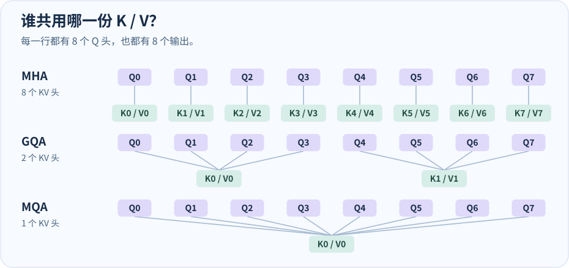
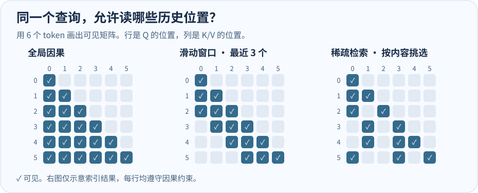
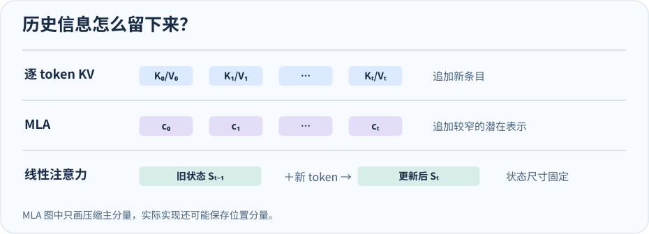

# 大模型注意力怎么选

> 从一个 512 维、8 个查询头的例子出发，看清 MHA、GQA、MQA 为什么能算同样多的 Attention，却读不同大小的 KV。再用图和 PyTorch 小实验理解滑动窗口、稀疏注意力、MLA 和线性注意力。

遇到一个陌生模型，先问三件事。

| 问题 | 常见做法 | 主要影响 |
| --- | --- | --- |
| **几个 Q 头共用一份 KV？** | MHA、GQA、MQA | K/V 投影宽度，每个位置的 KV 大小 |
| **当前 Q 能看哪些位置？** | 全局因果、滑动窗口、按内容稀疏选取 | 每步实际参与 Attention 的位置数 |
| **历史信息存成什么？** | 逐 token KV、MLA 的潜在表示、线性注意力的递推状态 | 每条历史记录的宽度，或缓存是否随序列增长 |

这些选择可以叠加。例如 **GQA + 滑动窗口** 同时减少每个位置的 KV 头数和当前 Q 可读的位置数。混合注意力则可以在不同层做不同选择。

## MHA、GQA、MQA 共享的是谁

一个 **头** 是并行的一套注意力计算。每个 Q 向量像一个查询，和可见位置的 K 算相关度，用 softmax 转成权重，再对这些位置的 V 加权。两个 Q 即使共用同一份 K/V，权重仍可以不同，各自会产出一个输出向量。



图里 GQA 的 Q0–Q3 共用 K0/V0，Q4–Q7 共用 K1/V1。三行都有 **8 个 Q 头和 8 个输出头**。设 `d_model=512`、`h_q=8`、`d_head=64`，每个 token 拼接出来的 Attention 输出总宽度都是 `8 × 64 = 512`。 [MHA 原论文](https://arxiv.org/abs/1706.03762) · [MQA 原论文](https://arxiv.org/abs/1911.02150) · [GQA 原论文](https://arxiv.org/abs/2305.13245)

| 机制 | Q / KV 头数 | W_Q | W_K 和 W_V，各自 | W_O |
| --- | --- | --- | --- | --- |
| MHA，多头注意力 | 8 / 8 | 512 × 512 | 512 × 512 | 512 × 512 |
| GQA，分组查询注意力 | 8 / 2 | 512 × 512 | 512 × 128 | 512 × 512 |
| MQA，多查询注意力 | 8 / 1 | 512 × 512 | 512 × 64 | 512 × 512 |

表里采用 `X @ W` 的矩阵记法，形状是 `[输入宽度, 输出宽度]`。PyTorch 的 `nn.Linear(512, 128)` 会把权重存成 `[128, 512]`。

下面用同一个函数实现三种分组方式。代码只靠 reshape 给 Q 加一个“组内头”的轴，K/V 保持紧凑。两次 `einsum` 分别对应算分数与对 V 加权。它用来核对维度和索引。

```python
import torch
from torch import nn

def grouped_attention(x, h_kv):
    batch, seq_len, d_model = x.shape
    h_q, d_head = 8, 64
    group_size = h_q // h_kv

    q_proj = nn.Linear(d_model, h_q * d_head, bias=False)
    k_proj = nn.Linear(d_model, h_kv * d_head, bias=False)
    v_proj = nn.Linear(d_model, h_kv * d_head, bias=False)
    o_proj = nn.Linear(h_q * d_head, d_model, bias=False)

    # b=batch，h=KV 头，g=组内的 Q 头，t=查询位置，s=键位置，d=头维度。
    q = q_proj(x).reshape(batch, seq_len, h_kv, group_size, d_head)
    k = k_proj(x).reshape(batch, seq_len, h_kv, d_head)
    v = v_proj(x).reshape(batch, seq_len, h_kv, d_head)

    scores = torch.einsum("bthgd,bshd->bhgts", q, k) / d_head**0.5
    positions = torch.arange(seq_len, device=x.device)
    allowed = positions[None, :] <= positions[:, None]
    weights = scores.masked_fill(~allowed, -torch.inf).softmax(dim=-1)

    heads = torch.einsum("bhgts,bshd->bthgd", weights, v)
    y = o_proj(heads.reshape(batch, seq_len, h_q * d_head))
    return y, (k, v)

torch.manual_seed(7)
x = torch.randn(1, 4, 512)
for name, h_kv in (("MHA", 8), ("GQA", 2), ("MQA", 1)):
    output, (keys, values) = grouped_attention(x, h_kv)
    assert output.shape == (1, 4, 512)
    assert keys.shape == values.shape == (1, 4, h_kv, 64)
    print(name, "输出", tuple(output.shape), "K/V 各", tuple(keys.shape))
```

## Prefill、Decode 和显存到底差多少

**Prefill** 是一次处理提示词，为每个位置算各层的 KV。**Decode** 是在已有 KV 的基础上处理一个或少量新 token。这里设 batch 为 1、只算一层、KV 用 BF16/FP16（每元素 2 字节）。Prefill 处理 1,024 个 token。Decode 处理 1 个新 token，总共可见 1,024 个位置，含当前 token。

用 **MAC** 计量，1 MAC 是一次乘加。只统计四个投影和 Attention 两次矩阵乘法，不含 FFN、softmax 等。若按一次乘法和一次加法各计 1 FLOP，表中 MAC 乘 2 就是对应的 FLOP 估算。

- **投影**。每个新 token 的 Q 和 O 各需 `512 × 512` MAC，K 和 V 各需 `512 × h_kv × 64` MAC。Prefill 的投影量再乘 1,024。
- **Attention**。每个有效的 Q–KV 位置对，8 个 Q 头合计需 `2 × 8 × 64 = 1,024` MAC。Prefill 有 `1 + 2 + … + 1,024 = 524,800` 个有效因果位置对。Decode 只有一个新查询位置，共 1,024 对。实际内核可能因分块或 padding 做额外工作。
- **KV cache**。每层字节数为 `batch × T × h_kv × d_head × 2（K 和 V）× 2（每元素字节）`。模型有多层时，再对各层求和。

| 单层成本 | MHA | GQA | MQA |
| --- | ---: | ---: | ---: |
| Prefill 投影，百万 MAC | 1,073.742 | 671.089 | 603.980 |
| Prefill Attention，百万 MAC | 537.395 | 537.395 | 537.395 |
| **Prefill 合计，百万 MAC** | **1,611.137** | **1,208.484** | **1,141.375** |
| Decode 投影，百万 MAC | 1.049 | 0.655 | 0.590 |
| Decode Attention，百万 MAC | 1.049 | 1.049 | 1.049 |
| **Decode 合计，百万 MAC** | **2.097** | **1.704** | **1.638** |
| 每写一个 token 的 KV | 2 KiB | 512 B | 256 B |
| **存 1,024 个 token 的 KV** | **2 MiB** | **512 KiB** | **256 KiB** |

Decode 时，想象 4 个 Q 头都要读第 200 个位置。GQA 内核可以把共享的 KV 从显存搬进片上存储，让组内 4 个 Q 分别算分数。**乘加做了 4 份，搬运的独立 KV 只有 1 份。** 上下文越长，每轮要扫描的历史越多，显存带宽越容易成为瓶颈。实际加速还取决于内核怎样复用数据、batch 和权重读取。Prefill 有很多 Q 可以在一次计算里复用历史，和单 token Decode 的访存条件不同。 [MQA 原论文](https://arxiv.org/abs/1911.02150)

## 全局、滑动窗口和稀疏选择



- **全局因果注意力**允许位置 `t` 看自己和全部前文。有效位置对在 Prefill 随长度二次增长。
- **滑动窗口注意力（SWA）**允许位置 `t` 看最近 `W` 个位置（这里含自己）。当 `T ≫ W`，Prefill 的有效位置对约为 `T × W`，Decode 约为 `W`。只服务这一窗口的层可以丢弃已经滑出的 KV。若同一模型还包含全局层，那些层仍会保留自己的历史。 [gpt-oss 模型卡](https://deploymentsafety.openai.com/gpt-oss)
- **内容稀疏注意力**用 **索引器**给历史位置或块打分，然后挑分数最高的若干项，也叫 **Top-K**。主 Attention 只对入选项做昂贵的计算。索引器本身有成本，未入选的历史可能会在下轮入选，所以缓存容量与本轮读出的 KV 量要分开算。DSA 可以按 token 选，QSA 和 MSA 有按块选取的实现。 [DeepSeek-V3.2 论文](https://arxiv.org/abs/2512.02556) · [Qwen3.8-Flash-Next](https://huggingface.co/Qwen/Qwen3.8-Flash-Next) · [MiniMax MSA 论文](https://arxiv.org/html/2606.13392)

以 8 个 Q 头、每头 64 维为例，若 Decode 从可见 1,024 个位置改成只看最近 128 个，核心 Attention 就从 1,048,576 降到 131,072 MAC。这里减少的是位置对，Q 头数保持 8。

下面只模拟一条 Q 的可见范围。用人工分数代替训练出的索引器，再通过索引取出 KV 行。修改分数就能看到稀疏选择如何跳到较远的位置。

```python
import torch

t = 5
positions = torch.arange(6)
global_ids = positions[positions <= t]
window_ids = positions[(positions <= t) & (positions > t - 3)]

# 假设索引器为历史位置 0 至 4 打了这些分，当前位置 5 保留。
index_scores = torch.tensor([0.90, 0.10, 0.20, 0.80, 0.30])
selected = index_scores.topk(2).indices
sparse_ids = torch.cat((selected, torch.tensor([t]))).sort().values
keys = torch.arange(6 * 2).reshape(6, 2)  # 每个位置一个二维 K
keys_for_attention = keys[sparse_ids]  # V 也用同样的索引取

assert global_ids.tolist() == [0, 1, 2, 3, 4, 5]
assert window_ids.tolist() == [3, 4, 5]
assert sparse_ids.tolist() == [0, 3, 5]
assert keys_for_attention.shape == (3, 2)
print("全局", global_ids.tolist(), "窗口", window_ids.tolist(), "稀疏", sparse_ids.tolist())
```

## MLA 和线性注意力怎么保存历史



### MLA 缩小每个历史位置的表示

**MLA（Multi-head Latent Attention，多头潜在注意力）**为每个 token 缓存一个跨头共享的压缩向量。“潜在表示”可以理解为模型学出来的一份较短的中间向量，K 和 V 可以通过各自的投影从它得到。MLA 仍然可以对历史位置做 softmax。实际架构还会处理单独的位置分量，例如 DeepSeek-V2 把 RoPE 部分与压缩主分量分开。 [DeepSeek-V2 论文 §2.1.1](https://arxiv.org/abs/2405.04434)

下面用一个头、三个历史位置演示为什么能直接用压缩向量算分数。数学上 `Q @ (C @ W_K).T` 等于 `(Q @ W_K.T) @ C.T`。也可以先对 C 加权，再做 V 投影。这个例子只演示等价变换，省掉了多头、RoPE 和实际内核。

```python
import torch

torch.manual_seed(3)
latent = torch.randn(3, 2)  # 3 个历史位置，每个位置的压缩向量是 2 维
w_k, w_v = torch.randn(2, 4), torch.randn(2, 4)
q = torch.randn(1, 4)

keys, values = latent @ w_k, latent @ w_v
scale = q.shape[-1] ** 0.5
expanded = ((q @ keys.T) / scale).softmax(dim=-1) @ values

scores = (q @ w_k.T) @ latent.T / scale
compressed = (scores.softmax(dim=-1) @ latent) @ w_v
torch.testing.assert_close(expanded, compressed)
```

**沿序列压缩**是另一种选择。MLA 在这个示意里每个位置仍留一个条目，只是条目变窄。DeepSeek-V4 的 CSA 和 HCA 把一段历史压成更少的条目。CSA 在压缩池上再做稀疏选取，HCA 用更高压缩率并看全部可见的压缩条目。两者还并入局部窗口，保留近期未压缩的信息。 [DeepSeek-V4 技术说明](https://huggingface.co/docs/transformers/main/en/model_doc/deepseek_v4)

### 线性注意力用递推状态接住新 token

**递推状态**是一块由历史累积出来的固定大小张量。每到一个新 token，就更新状态，然后让 Q 从更新后的状态读结果。对 Gated DeltaNet、KDA 这类层，Decode 可以一直更新同样大小的状态。混合模型里的全局或稀疏层仍有自己随序列增长的缓存。 [Gated DeltaNet 论文](https://arxiv.org/abs/2412.06464) · [Kimi Linear 论文](https://arxiv.org/abs/2510.26692)

下面模拟一条带衰减的 **delta rule（按预测误差修正状态）**。先用当前 K 从旧状态预测 V，算出差值，把这次修正写回去。这里用常数模拟门控，便于观察状态更新，实际的 Gated DeltaNet 和 KDA 有各自的门控与计算方式。

```python
import torch

torch.manual_seed(11)
keys = torch.nn.functional.normalize(torch.randn(4, 2), dim=-1)
queries = torch.randn(4, 2)
values = torch.randn(4, 3)
state = torch.zeros(2, 3)  # [K 的维度, V 的维度]，与历史长度无关

for q, k, v in zip(queries, keys, values):
    decayed = 0.95 * state
    error = v - k @ decayed
    state = decayed + 0.5 * torch.outer(k, error)
    out = q @ state
    assert state.shape == (2, 3)
    assert out.shape == (3,)
```

## 公开模型怎么组合这些机制

以下按 **2026 年 11 月 8 日**能核对的文本主干资料整理。一个系列的不同尺寸、Flash 或 Max 版本可能有不同结构。Q/KV 头数只对应表中指定的检查点。

| 模型 | 从哪里省计算或缓存 |
| --- | --- |
| **Qwen3.5-397B-A17B** | 每四层是 **3 层 Gated DeltaNet + 1 层全局 Gated GQA**。全局层用 **32 Q / 2 KV**，线性层保存递推状态。 [官方模型卡](https://huggingface.co/Qwen/Qwen3.5-397B-A17B) |
| **Qwen3.7 Plus / Max** | 公开 API 资料没有给出可核对的头数、窗口和逐层结构。 [Plus](https://docs.qwencloud.com/models/qwen3-7-plus) · [Max](https://docs.qwencloud.com/models/qwen3-7-max) |
| **Qwen3.8-27B / 2.4T-A95B** | 同为 **3 层 Gated DeltaNet + 1 层全局 Gated GQA**。全局层分别为 **24 Q / 4 KV** 和 **64 Q / 4 KV**。 [27B](https://huggingface.co/Qwen/Qwen3.8-27B) · [2.4T-A95B](https://huggingface.co/Qwen/Qwen3.8-2.4T-A95B) |
| **Qwen3.8-Flash-Next** | 保留每四层中的三层 Gated DeltaNet，把第四层换成 **QSA（Qwen Sparse Attention）**。主注意力是 **24 Q / 2 KV**，索引器按小块选择历史。 [官方模型卡](https://huggingface.co/Qwen/Qwen3.8-Flash-Next) |
| **GPT-6 系列 / gpt-oss** | GPT-6 公开系统卡未给出可核对的头数或窗口。开放权重 **gpt-oss-20b / 120b** 用 **64 Q / 8 KV 的 GQA**，交替使用全局层和 **128-token** 滑动窗口层。 [GPT-6 系统卡](https://deploymentsafety.openai.com/gpt-6-astra/sec%3Aappendix-sol-luna) · [gpt-oss 模型卡](https://deploymentsafety.openai.com/gpt-oss) |
| **Claude 5.5** | Opus、Sonnet、Haiku 的公开资料未披露 KV 头数、共享方式或逐层窗口。 [Anthropic 透明度中心](https://www.anthropic.com/transparency) |
| **DeepSeek-V4 Pro / Flash** | 用共享 **K=V 的单 KV 头**，搭配 **128-token 局部窗口**。长程分支在 **CSA**（压缩后稀疏选择）和 **HCA**（重压缩后对可见压缩条目做全注意力）之间组合。**V4.1-Flash** 的 CSA2 又引入跨层 KV 共享和稀疏索引复用。 [V4 架构](https://huggingface.co/docs/transformers/main/en/model_doc/deepseek_v4) · [V4.1-Flash](https://huggingface.co/deepseek-ai/DeepSeek-V4.1-Flash) |
| **GLM-5.3 / 5.3-Flash** | 主版用 **MLA + DSA**，以低维潜在表示存历史，再用索引器选 token。Flash 版是 **KDA + 稀疏 MLA** 的混合架构。 [主版配置](https://huggingface.co/zai-org/GLM-5.3/blob/main/config.json) · [Flash 架构](https://recipes.vllm.ai/zai-org/GLM-5.3-Flash) |
| **Kimi K3 / K3.1 Pro** | K3 用 **69 层 KDA + 24 层全局 Gated MLA**。K3.1 Pro 保留 69 层 KDA，把 24 层全局 MLA 换成 **Gated DSA**，索引器为主注意力选 Top-2048。 [K3](https://huggingface.co/moonshotai/Kimi-K3) · [K3.1 Pro](https://huggingface.co/moonshotai/Kimi-K3.1-Pro) |
| **MiniMax M2.7 / M3 / M3.1 Flash** | M2.7 是 **48 Q / 8 KV 的 GQA**。M3 用 **MSA**，在 GQA 的基础上为各组挑选历史块，并保留前三个全局层。M3.1 Flash 把前三层也换成了 MSA。 [M2.7 配置](https://huggingface.co/MiniMaxAI/MiniMax-M2.7/blob/main/config.json) · [MSA 论文](https://arxiv.org/abs/2606.13392) · [M3.1 Flash](https://huggingface.co/MiniMaxAI/MiniMax-M3.1-Flash) |

以 **Kimi K3.1 Pro** 为例，同为 FP8 时，vLLM 给出的 24 个 MLA 层合计每 token 缓存占用从 **13,824 B** 增到 **16,992 B**，因为增加了索引键。但长上下文 Decode 只扫轻量索引，完整潜在向量只读入选的部分。**缓存占用可以增加，每步读取量仍可以减少。** [vLLM 的 K3.1 Pro 实现说明](https://vllm-project.github.io/2026/11/04/kimi-k31-pro.html)

## 回到代码里怎么辨认

1. 看 `q_proj`、`k_proj`、`v_proj` 的输出宽度和 reshape，找出 Q 头数、KV 头数、每头维度。
2. 看 mask、窗口配置或索引器，确认每个 Q 实际能读到哪些位置。把 mask 填进普通密集矩阵，并不会自动得到稀疏内核的加速。
3. 看缓存的写入对象和 Attention 的读取方式。沿时间轴追加完整 KV、追加潜在向量，或更新一份固定状态，三种方案的显存账单不同。
4. 看到 **FlashAttention** 或 **PagedAttention** 时，继续查模型本身的头配置和可见范围。FlashAttention 主要改变 Attention 算子的分块与访存。PagedAttention 主要改变 KV 的存放与寻址。 [FlashAttention 论文](https://arxiv.org/abs/2205.14135) · [PagedAttention 论文](https://arxiv.org/abs/2309.06180)

接着可以跑 [KV cache Notebook](../inference/kv-cache.ipynb)，追踪每层的 `(K, V)` 如何跨轮保存。想看同一段历史换了前文还能复用多少，可以读 [CacheBlend](../inference/CacheBlend.md)。
