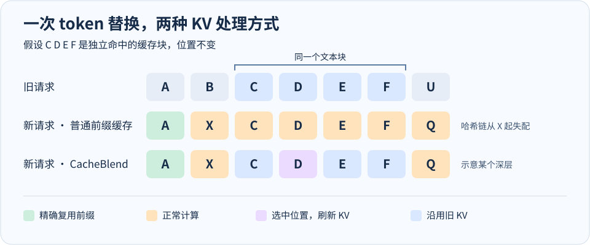

# CacheBlend：前文变了，怎么复用后面的 KV？

> CacheBlend 在预填充（prefill）时按内容查找可复用的文本块，再挑一部分位置重算，让同一个文档即使换了前文也能用上缓存。论文发表于 EuroSys 2025。[论文](https://arxiv.org/html/2405.16444) · [LMCache 实现文档](https://docs.lmcache.ai/kv_cache_optimizations/cacheblend.html)

先用 [KV cache Notebook](kv-cache.ipynb) 跟一遍单次请求里的 KV。下面讨论的是跨请求复用，例如两次 RAG 请求召回了同一篇文档，文档前面的提示词或其他文档却不同。

## 为什么同一段文字会有不同的 KV？

假设旧请求是 `A B | C D E F | U`，新请求是 `A X | C D E F | Q`。这里每个字母代表一个 token，且所有位置保持不变。

- 第一个 Attention 层的 `C D E F` KV 投影仍然相同。此时输入只来自各自的 embedding，加上模型的逐位置处理。
- 第一层计算 `C D E F` 的 Attention 时，它们都能看到 `B → X`。即使只有一个 K/V 项变了，softmax 的归一化也可能改变。传到第二层的 hidden state 因而不同，深层 KV 也可能变化。
- `A` 只能看自己，每一层的 KV 都可以精确复用。vLLM 原生前缀缓存按完整块匹配，块哈希带上父块哈希。改动所在块及之后的块失配，所以实际命中长度还要向下对齐到完整块。 [vLLM 前缀缓存设计](https://docs.vllm.ai/en/latest/design/prefix_caching/)



图中把 `A` 简化成一个可独立命中的前缀块，把 `C D E F` 视为已经独立缓存的文档块。第三行画的是某个较深的层，假设 `D` 被选中。它的 Q 仍然能读到因果 mask 允许的其他位置，即使那些位置的 K/V 来自旧缓存。哪些位置需要计算 **Q 和整条前向路径**，与哪些位置需要提供 **K/V**，是两个问题。

## 先找到块，再修复上下文差异

**找块。** 原论文按文本块建立缓存，例如把 RAG 的每个文档单独预填充，保存每层 KV。服务时按块内容查找，缺失的块照常计算。同一块如果换了位置，论文对 RoPE 的 K 做位置校正。在旋转配置相同的情况下，若旧缓存是 $R(p_{\mathrm{old}})k$，可以先撤销旧旋转，再施加新旋转 $R(p_{\mathrm{new}})$。V 无需这一步。位置校正解决的是坐标问题，块独立计算时漏掉的跨块注意力仍要处理。 [论文 §5 与附录 A](https://arxiv.org/html/2405.16444)

**选位置。** 理想情况下，可以逐层比较完整 prefill 的 KV 和旧 KV，挑偏差最大的 token 更新。但拿到完整 prefill 的 KV 就已经花掉了要节省的计算。论文用早期层的偏差信号筛选候选，并利用相邻层中高偏差位置常有重合这一观察，逐层缩小候选集合。第一层的位置对齐后，单看 K/V 投影差异通常看不出跨块影响。此时可以看 Attention 输出的偏差，或者推进到已混入上下文的早期层再用 K 差异打分。 [论文 §4.2–4.3 与图 9](https://arxiv.org/html/2405.16444)

**重算选中的位置。** 后续层只给选中的位置和必须正常计算的位置推进 hidden state。先更新它们的 KV，再用这些位置的 Q 去读整段可见 KV，最后跑输出投影、残差、归一化和 FFN。被裁掉的位置从这一层起只提供缓存里的 K/V，无需继续算自己的 Q 和 FFN。少量重算还可以和下一层 KV 的读取重叠，实际延迟取决于计算与搬运各花多久。 [论文 §4–5](https://arxiv.org/html/2405.16444)

## 伪代码

下面把筛选策略和底层算子分开。为了能手动跟读，示例采用一次早期层 Top-K 筛选。论文描述的逐层筛选可以在后续早期层继续缩小 `candidates`，而 LMCache 文档也给出了只在一个检查层打分的配置。

```text
exact_prefix, matched, misses = lookup(prompt)
# matched 是前缀之外命中的位置，索引始终使用新请求的原始位置
required = misses ∪ {最后一个 prompt 位置}  # 这里显式保留最后一个位置用于算 logits
candidates = matched - required
active = required ∪ candidates
hidden = embed(prompt[active])

for layer in model.layers:
    old_k, old_v = load_layer_kv(exact_prefix, matched, layer)
    old_k = align_rope_positions(old_k, matched, layer)
    q, k, v = project_qkv(norm(hidden), positions=active)

    if layer == check_layer:
        # 检查层要足够靠后，让 k 已包含之前层的上下文信息
        score = squared_l2(k[candidates], old_k[candidates])
        candidates = top_k_positions(score, budget)
        active = required ∪ candidates
        q, k, v, hidden = take_rows_for(active, q, k, v, hidden)

    all_k, all_v = overwrite_at_positions(old_k, old_v, active, k, v)
    mask = key_positions <= query_positions(active)
    hidden = finish_block(hidden, attention(q, all_k, all_v, mask))
    save_request_kv(layer, all_k, all_v)

logits = lm_head(final_norm(hidden[last_prompt_position]))
```

`overwrite_at_positions` 按原始 token 位置覆盖，不能把筛选后的 Q 行重新编号为从 0 开始。假如只剩位置 3 和 8 的 Q，位置 3 仍只能读到位置 3 及之前的 K/V。`finish_block` 包括 Attention 输出投影和剩余的块内计算。伪代码为简单起见显式推进最后一个 prompt 位置，避免只有它的 KV、却缺少预测下一 token 所需的最终 hidden state。 [LMCache 检查层配置示例](https://docs.lmcache.ai/kv_cache_optimizations/blending.html)

## 实际能省多少？

- **只命中第一层 KV**，可以精确省掉一层的部分投影。完整 prefill 的深层计算依然可能覆盖整个后缀。**CacheBlend 的主要收益**来自让未选中的后缀位置跳过多个深层的前向计算。
- 论文在所测设置中用约 **10–20%** 的选择性重算，在其评测上接近完整 prefill 的生成质量，报告首 token 延迟（TTFT）改善 **2.2–3.3 倍**。这是特定模型、任务和系统设置下的结果。非前缀块的深层 KV 可能仍有误差，单个请求的 logits 和输出也可能不同。 [论文 §7](https://arxiv.org/html/2405.16444)
- **查找粒度也决定收益。** 改动后面的长文档如果还能作为一个块命中，就能复用。若改动落在缓存块内部，该块可能整块失配。LMCache 的 MP 模式通过 blend engine 启用非前缀匹配；实际支持的匹配粒度随实现而定。 [LMCache MP 文档](https://docs.lmcache.ai/kv_cache_optimizations/cacheblend.html) · [LMCache 块匹配设计](https://github.com/LMCache/LMCache/blob/dev/docs/design/v1/mp_coordinator/blend_lookup.md)
